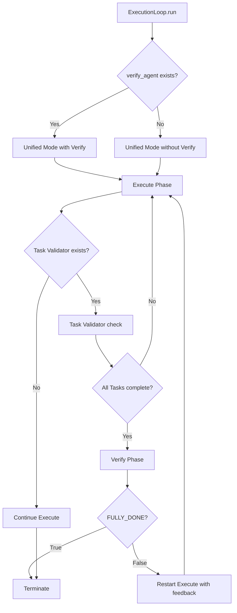

# User's Original Request (For Record)

interactive mode를 돌리면서도 verify phase를 실행하게 하는 것이 맞아. Now focusing on current problem situation, background, and work direction - write ai-todolist.md. Instead of specific implementation code content, structure it so the big picture of work progress direction is well understood.

## Additional User Requests (For Record)

From the start, there should be no distinction between interactive and non-interactive. This phase operation should apply to both modes.

# Work Objectives

- Remove Interactive/Non-Interactive mode distinction in ExecutionLoop
- Ensure Verify Phase operates in all execution modes
- Task Validator and Verify Agent work consistently across all modes

# Work Background

## Current Problem Situation

### 1. Verify Phase Missing Due to Mode Branching

Current `sisyphus/core/loop.py`'s `run()` method:
- `execute_agent.supports_interactive = True` → Interactive Mode execution
- `execute_agent.supports_interactive = False` → Non-Interactive Mode execution

**Problems:**
- Interactive Mode (`_run_interactive_mode`) has **NO Verify Phase at all**
- ClaudeAgent has `supports_interactive = True`, so it always runs in Interactive Mode
- Result: Architect (Verify Agent) never executes when using ClaudeAgent

### 2. humantest20251011 Case Study
- Location: /Users/yeongyu/local-workspaces/humantest20251011
- All checkboxes in ai-todolist.md completed (`is_all_goals_accomplished = TRUE`)
- But ClaudeAgent's `supports_interactive = True` forces Interactive Mode
- Task Validator doesn't run, Verify Phase doesn't run
- Work ends without Architect's final verification

### 3. Design Contradiction
- Verify Phase and Task Validator exist only in Non-Interactive Mode
- But real-time conversation also needs task verification
- Current structure makes "interactive execution" and "verification process" mutually exclusive

## Intended Behavior

**In all execution modes:**
1. Execute Phase runs (real-time support depends on agent characteristics)
2. Task Validator checks (if ai-todolist.md exists)
3. Verify Phase runs (if verify_agent is configured)
4. FULLY_DONE = TRUE signal triggers final termination

# Work Started
is_execution_started = FALSE

# All Goals Accomplished
is_all_goals_accomplished = FALSE

# Parallel Execution
parallel_requested = FALSE

# Current Work in Progress
- Work has not started yet.
   - When starting work, change the value of `is_execution_started` above to TRUE.
   - Never start work until the user explicitly says "start the work".

# Required Background Knowledge

- Python async/await patterns and anyio Task Group
- sisyphus ExecutionLoop architecture
- Agent Protocol and supports_interactive attribute
- Task Validator and Verify Phase roles

## File Structure and Roles

- `sisyphus/core/loop.py`: ExecutionLoop class (main modification target)
  - `run()`: Mode branching logic (to be removed)
  - `_run_interactive_mode()`: Interactive-specific logic (to be integrated)
  - `_run_non_interactive_mode()`: Non-Interactive-specific logic (to be integrated)
- `sisyphus/agents/base.py`: Agent Protocol definition
- `sisyphus/agents/claude.py`: ClaudeAgent (supports_interactive = True)
- `sisyphus/core/tasks.py`: TaskValidator

## Reference Files for Context Understanding

### 1. sisyphus/core/loop.py
- **Role**: Core logic for Execute-Verify two-phase execution loop
- **Reference sections**:
  - Lines 58-87: `run()` method - mode branching logic (needs modification)
  - Lines 89-156: `_run_interactive_mode()` - real-time conversation handling
  - Lines 158-253: `_run_non_interactive_mode()` - Task Validator + Verify Phase
- **Key problems**:
  - Task Validator and Verify Phase missing in Interactive Mode
  - Two modes completely separated, making integration difficult

### 2. sisyphus/agents/claude.py
- **Role**: Claude API-based Agent implementation
- **Reference section**: `supports_interactive = True` attribute
- **Caveat**: This attribute always forces Interactive Mode execution

### 3. sisyphus/core/prompts.py
- **Role**: DEFAULT_VERIFY_PROMPT definition
- **Reference section**: Line 249 "FULLY_DONE = TRUE" signal format

# Work Plan

## PRDs & Structures

### Target Architecture



### Current vs Target Structure Comparison

**Current (Problem):**
```
run()
├─ if supports_interactive:
│  └─ _run_interactive_mode()  [No Verify ❌]
└─ else:
   └─ _run_non_interactive_mode()  [Has Verify ✅]
```

**Target (Solution):**
```
run()
└─ _run_unified_mode()
   ├─ Execute Phase (interactive characteristic handled by agent)
   ├─ Task Validator (optional)
   └─ Verify Phase (optional, when verify_agent exists)
```

## Implementation Direction

### Core Design Principles

1. **Interactive Handling is Agent's Responsibility**
   - ExecutionLoop doesn't concern itself with interactive mode
   - Agent handles real-time response processing itself
   - ExecutionLoop simply consumes the stream

2. **Verification Process is Independent of Execution Mode**
   - Task Validator depends only on ai-todolist.md existence
   - Verify Phase depends only on verify_agent existence
   - Both operate identically regardless of execution mode

3. **Single Responsibility Principle**
   - Execute Phase: Perform work
   - Task Validator: Confirm completion
   - Verify Phase: Quality verification

### Key Changes

#### 1. Simplify `run()` Method
- Remove `supports_interactive` check
- Always run in single unified mode
- Check only verify_agent existence

#### 2. Unified Execution Mode Design
- Call agent.stream() in Execute Phase (agent handles interactive characteristic)
- Check Task Validator after Execute completes (optional)
- Run Verify Phase when tasks complete (optional)

#### 3. Maintain Interactive Characteristics
- Agent's send/stream interface remains unchanged
- ClaudeAgent etc. still support real-time responses
- ExecutionLoop simply relays messages

### Technical Considerations

1. **Parallel Input/Output Handling**
   - Preserve existing Interactive Mode's parallel input/output logic
   - Run receive_loop and input_loop concurrently via Task Group
   - Task Validator and Verify run after Execute completes

2. **Session Management**
   - Execute Phase: Can reuse existing session
   - Verify Phase: Always new session (preserve current behavior)

3. **Error Handling**
   - Preserve SessionLimitError handling logic
   - Consistent error handling across all Phases

## Project Commit Message Style

Based on recent commit analysis:
- Concise Korean explanation (e.g., "verify feedback loop implementation complete")
- Or start in Korean without English prefix (e.g., "fix ctrl-q improper termination issue")
- Feature additions use clear verb phrases (e.g., "time logging & nested json printing")

Recommended for this work: "interactive/non-interactive mode unification and verify phase always executes"

# TODOs

- [ ] 1. ExecutionLoop Architecture Redesign - Implement Unified Execution Mode
   - **Goal**: Merge `_run_interactive_mode` and `_run_non_interactive_mode` into single unified mode
   - **Core Approach**:
     - Delegate agent's interactive characteristic to Agent itself
     - ExecutionLoop manages only Execute -> Validate -> Verify flow
     - Real-time conversation naturally handled via Agent's stream() mechanism
   - [ ] 1.1 Design `_run_unified_mode()` Method
     - Execute Phase logic (based on existing non-interactive, stream consumption approach)
     - Task Validator check (optional, when ai-todolist.md exists)
     - Verify Phase call (optional, when verify_agent exists)
   - [ ] 1.2 Simplify `run()` Method
     - Remove `supports_interactive` check
     - Always call `_run_unified_mode()`
   - [ ] 1.3 Verify Existing Interactive Features Preserved
     - Confirm agent's real-time response characteristic maintained
     - Review parallel input/output if needed
   - [ ] Verification Checklist for Following Guide
     - [ ] Does `run()` method have single execution path only?
     - [ ] Is `supports_interactive` check completely removed?
     - [ ] Is new unified mode structure clear?

- [ ] 2. Unified Mode Implementation - Execute Phase + Task Validator
   - **Goal**: Implement Execute execution through Task Validator check
   - **Core Approach**:
     - Execute Phase receives messages via agent.stream()
     - Task Validator checks after Execute success
     - Restart Execute if incomplete
   - [ ] 2.1 Implement Execute Phase
     - Reuse existing `_execute_phase()` logic
     - Send prompt with agent.send()
     - Receive and display response via agent.stream()
   - [ ] 2.2 Integrate Task Validator
     - Check ai-todolist.md after Execute completes
     - Restart Execute with continue if incomplete
   - [ ] 2.3 Write Tests
     - Execute -> Task incomplete -> Restart Execute scenario
     - Execute -> Task complete -> Proceed to next step scenario
   - [ ] Verification Checklist for Following Guide
     - [ ] Does Execute Phase work correctly?
     - [ ] Does Task Validator check correctly?
     - [ ] Does Execute restart when incomplete?
     - [ ] Do tests pass?

- [ ] 3. Unified Mode Implementation - Add Verify Phase
   - **Goal**: Implement Verify Phase execution and feedback loop after task completion
   - **Core Approach**:
     - Run Verify only when Task Validator passes
     - Terminate on FULLY_DONE = TRUE
     - Restart Execute with feedback on FULLY_DONE = FALSE
   - [ ] 3.1 Integrate Verify Phase
     - Reuse existing `_verify_phase()` logic
     - Execute only when tasks complete
     - Manage feedback history
   - [ ] 3.2 Implement Feedback Loop
     - Accumulate feedback via verify_feedback_history variable
     - Pass feedback when restarting Execute
   - [ ] 3.3 Write Tests
     - Task complete -> Verify (FULLY_DONE=TRUE) -> Terminate
     - Task complete -> Verify (FULLY_DONE=FALSE) -> Execute with feedback
   - [ ] Verification Checklist for Following Guide
     - [ ] Does Verify Phase execute only when Task completes?
     - [ ] Does FULLY_DONE signal properly terminate?
     - [ ] Is feedback correctly passed?
     - [ ] Do tests pass?

- [ ] 4. Remove Existing Mode Methods and Cleanup
   - **Goal**: Remove unused `_run_interactive_mode`, `_run_non_interactive_mode`
   - **Core Approach**:
     - Completely migrate to unified mode before removal
     - Update related tests
   - [ ] 4.1 Remove Existing Methods
     - Delete `_run_interactive_mode()`
     - Delete `_run_non_interactive_mode()`
   - [ ] 4.2 Update Related Tests
     - Convert existing mode-specific tests to unified mode tests
     - Verify all test cases pass in unified mode
   - [ ] 4.3 Lint and Type Check
     - `uv run ruff check sisyphus/core/loop.py`
     - `uv run basedpyright sisyphus/core/loop.py`
   - [ ] Verification Checklist for Following Guide
     - [ ] Are existing mode methods completely removed?
     - [ ] Do all tests pass in unified mode?
     - [ ] Do lint and type checks pass?

- [ ] 5. Real-World Verification - Test Complete Flow with ClaudeAgent
   - **Goal**: Verify Architect executes in humantest20251011 scenario
   - **Core Approach**:
     - Perform actual work using ClaudeAgent
     - Confirm Verify Phase executes after task completion
     - Confirm Architect's feedback works normally
   - [ ] 5.1 Prepare Test Scenario
     - Create simple work in new test directory
     - Write ai-todolist.md
   - [ ] 5.2 Run Actual sisyphus
     - Execute `uv run sisyphus run`
     - Confirm Execute -> Task Validator -> Verify order
   - [ ] 5.3 Analyze Logs
     - Check logs/ directory for each Phase execution
     - Confirm Verify Phase ran
     - Confirm FULLY_DONE signal processed correctly
   - [ ] 5.4 Final Commit
     - `git add -A && git commit -m "interactive/non-interactive mode unification and verify phase always executes"`
   - [ ] Verification Checklist for Following Guide
     - [ ] Does ClaudeAgent use Verify Phase?
     - [ ] Do Task Validator and Verify execute in order?
     - [ ] Are all Phase executions logged?
     - [ ] Does feedback loop work correctly?
     - [ ] Was final commit created?

# Final Work Verification Checklist

- [ ] 1. Does ExecutionLoop have only single unified mode?
   - [ ] Is `supports_interactive` check completely removed?
   - [ ] Are `_run_interactive_mode` and `_run_non_interactive_mode` removed?
- [ ] 2. Does Verify Phase execute in all Agents?
   - [ ] Does Verify execute when using ClaudeAgent?
   - [ ] Does Verify execute when using DroidAgent?
- [ ] 3. Is Task Validator and Verify execution order correct?
   - [ ] Is it Execute -> Task Validator -> Verify order?
   - [ ] Does it skip Verify when tasks incomplete?
- [ ] 4. Does feedback loop work correctly?
   - [ ] Is feedback passed when FULLY_DONE = FALSE?
   - [ ] Is feedback included in Execute Phase?
- [ ] 5. Are existing features unbroken?
   - [ ] Is agent's real-time response characteristic preserved?
   - [ ] Does session management work correctly?
   - [ ] Is error handling working properly?
- [ ] 6. Do all tests pass?
   - [ ] Unit tests pass
   - [ ] Integration tests pass
   - [ ] Lint and type checks pass
- [ ] 7. Does it work correctly in real usage scenarios?
   - [ ] Architect executes in humantest20251011-like situations
   - [ ] All Phases logged
