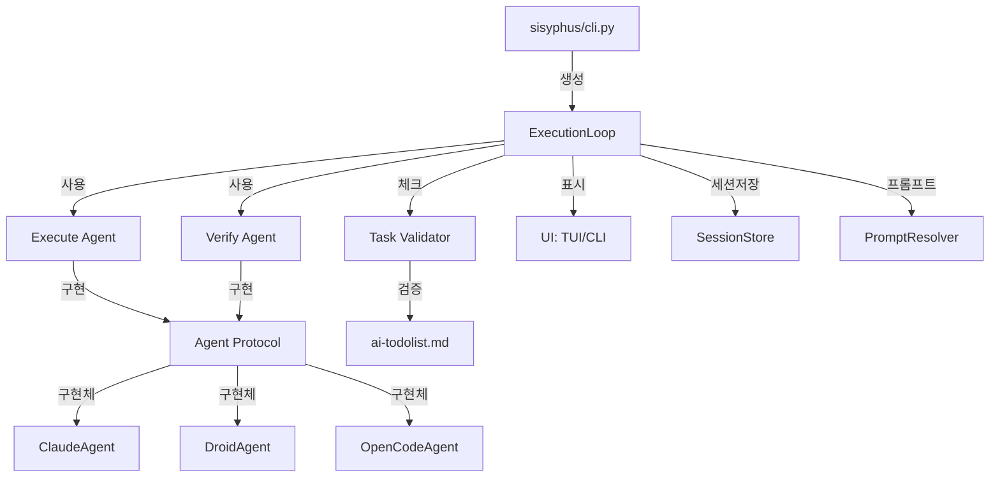
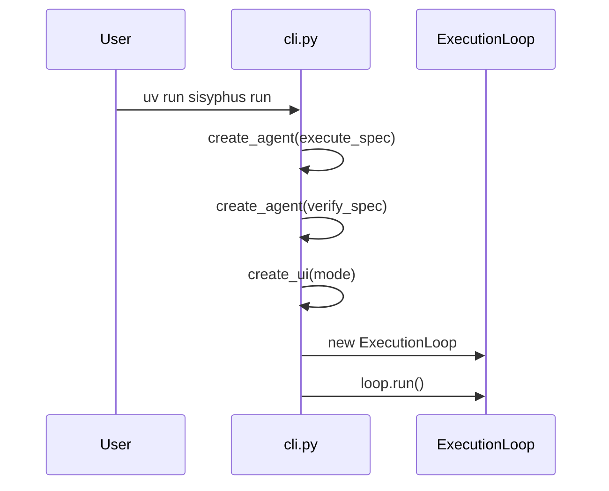
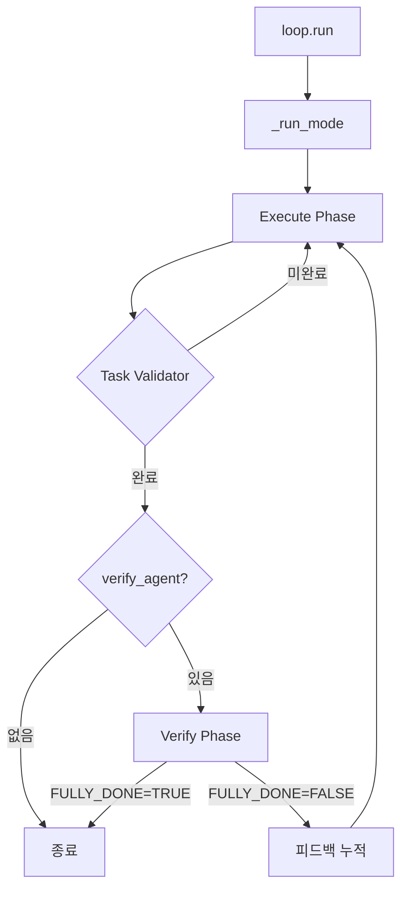
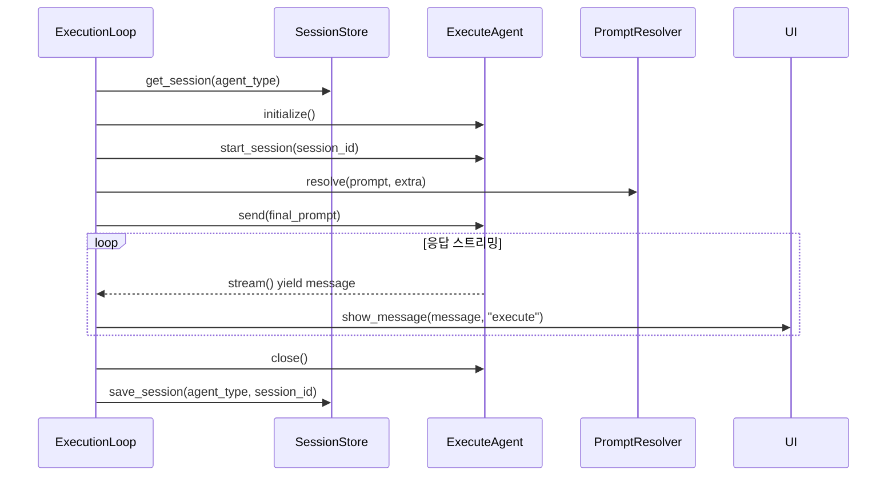
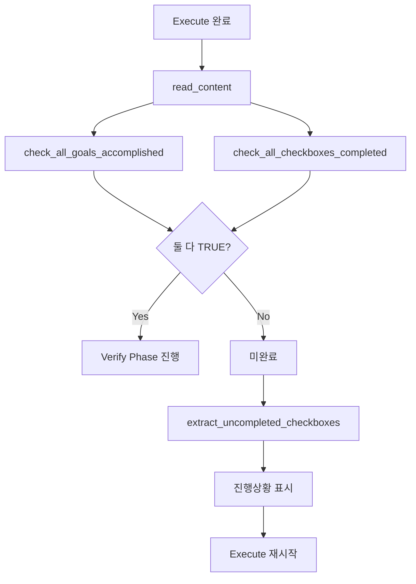
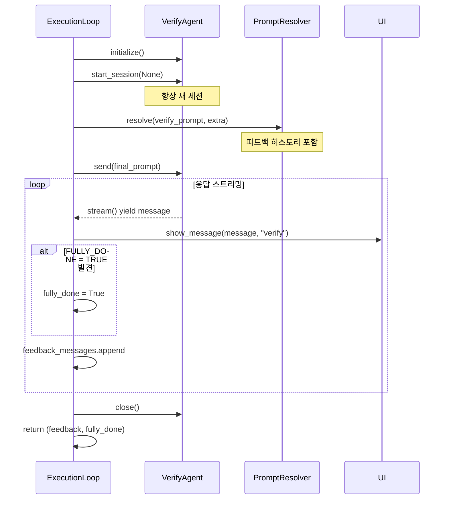
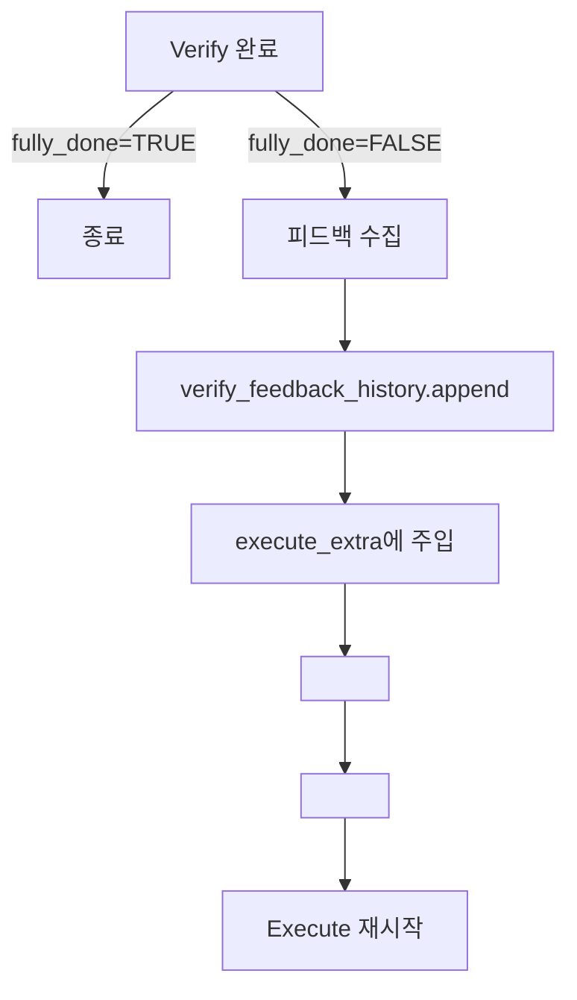
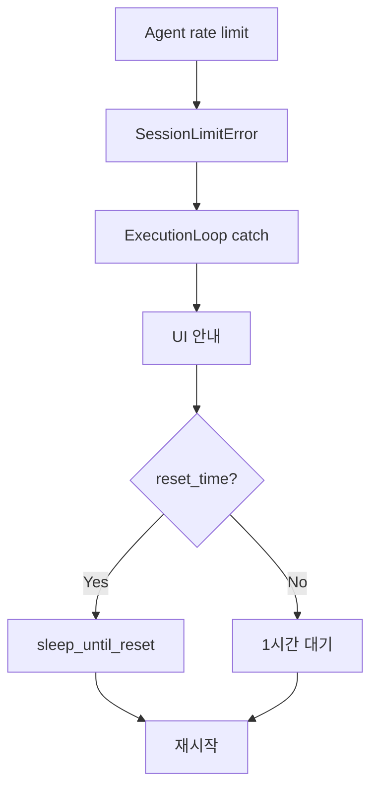
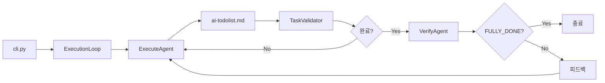

# Sisyphus

> **작성일**: 2025-10-12
> **기준 커밋**: `b1860e3` (verify 2)

Multi-Agent 실행 시스템. Execute-Verify 2단계 루프로 작업 수행 및 품질 검증.

## 핵심 컨셉

**Sisyphus = 작업 수행 + 검증의 반복 루프**
- Execute Agent: ai-todolist.md 기반 작업 수행
- Verify Agent: 완료된 작업 품질 검증
- Task Validator: 체크박스 완료 여부 확인
- 피드백 루프: Verify 결과를 Execute에 전달

## 시스템 아키텍처



## 파일 구조

```
sisyphus/
├── cli.py                      # CLI 진입점, agent/UI 생성
├── __main__.py                 # `uv run sisyphus` 진입
│
├── core/
│   ├── loop.py                 # ExecutionLoop: 메인 orchestrator
│   ├── prompts.py              # 기본 프롬프트 정의
│   ├── tasks.py                # TaskValidator: ai-todolist.md 검증
│   └── session.py              # SessionStore: 세션 영속성
│
├── agents/
│   ├── base.py                 # Agent Protocol
│   ├── claude.py               # ClaudeAgent
│   ├── droid.py                # DroidAgent
│   └── opencode.py             # OpenCodeAgent
│
├── ui/
│   ├── base.py                 # UIProtocol, create_ui()
│   ├── cli/
│   │   └── console.py          # CLI 구현
│   └── tui/
│       ├── app.py              # TUI 메인
│       ├── components/
│       │   ├── chat_log.py     # 채팅 로그
│       │   ├── input_bar.py    # 입력
│       │   └── status_panel.py # 상태
│       └── layouts/
│           └── main.py         # 레이아웃
│
└── utils/
    ├── types.py                # AgentMessage, MessageRole
    ├── logging.py              # LoggerFactory
    ├── process.py              # 프로세스 관리
    ├── session_limit.py        # SessionLimitError 처리
    └── errors.py               # 에러 정의
```

## 실행 흐름

### 1. 시작



### 2. ExecutionLoop 구조



**동작:**
- Execute 실행 → Task 체크 → 완료 시 Verify → 피드백 반영 → 재실행
- 완료 신호 `FULLY_DONE = TRUE`까지 반복

### 3. Execute Phase



**역할:**
- ai-todolist.md 읽고 TODO 수행
- 체크박스 완료 (`- [ ]` → `- [x]`)
- `is_all_goals_accomplished = TRUE` 설정
- Notepad section에 작업 기록

### 4. Task Validator



**검증:**
- `is_all_goals_accomplished = TRUE` 존재?
- 모든 `- [ ]` → `- [x]` 완료?

### 5. Verify Phase



**역할:**
- 작업 완료 여부 검증
- 테스트 통과 확인
- 코드 품질 체크
- 완료 신호: `FULLY_DONE = TRUE`

### 6. 피드백 루프



**피드백 형식:**
```
## 🔍 Architect Feedback

<architect-feedback-history>
<feedback iteration="1">
[피드백 내용]
</feedback>

<feedback iteration="2">
[피드백 내용]
</feedback>
</architect-feedback-history>

**CRITICAL**: Address ALL issues above.
```

## Agent Protocol

```python
class Agent(Protocol):
    supports_interactive: bool

    async def initialize() -> None
    async def start_session(session_id: str | None) -> str
    async def send(message: str) -> None
    def stream() -> AsyncIterator[AgentMessage]
    async def close() -> None
```

### Agent 구현체

#### ClaudeAgent
- **백엔드**: Claude API (Anthropic SDK)
- **supports_interactive**: `True`
- **모델**: claude-sonnet-4-5 등
- **세션**: API session ID

#### DroidAgent
- **백엔드**: droid binary
- **supports_interactive**: `False`
- **모델**: gpt-5, gpt-4.5 등
- **세션**: 프로세스 재시작

#### OpenCodeAgent
- **백엔드**: opencode binary/server
- **supports_interactive**: `True`
- **세션**: 서버 세션

## UI System

### UIProtocol

```python
class UIProtocol(Protocol):
    async def initialize() -> None
    async def show_message(message: AgentMessage, source: str) -> None
    async def show_status(status: str) -> None
    async def get_input() -> str | None
    async def close() -> None
```

### 구현

**CLI**: 콘솔 출력, 상호작용 없음

**TUI**: 3-panel (ChatLog + StatusPanel + InputBar), Markdown 렌더링, 실시간 입력

## Session 관리

### SessionStore

**저장**: `./sessions/sessions.json`

```json
{
  "claude": {
    "session_id": "ses_abc123",
    "updated": "2025-10-12T10:30:00Z"
  }
}
```

**특징:**
- Agent type별 독립 세션
- 원자적 저장 (임시파일 + rename)
- 파일 락 (anyio.Lock)
- 백업 파일 (sessions.json.bak)
- 손상 복구 (main → backup → 초기화)

## Task Validator

**대상**: `./ai-todolist.md`

```markdown
# 모든 목표 달성 여부
is_all_goals_accomplished = TRUE

# TODOs
- [x] 작업 1
- [x] 작업 2
```

**메서드:**
- `read_content()`: 파일 읽기
- `check_all_goals_accomplished()`: flag 확인
- `check_all_checkboxes_completed()`: 체크박스 확인
- `extract_uncompleted_checkboxes()`: 미완료 추출
- `count_*_checkboxes()`: 통계

## Prompt System

### PromptResolver

**형식:**
1. 파일: `@path/to/prompt.md` → 내용 읽기
2. Slash: `/command` → `prompts/command.md` 읽기
3. 텍스트: 그대로 사용

**병합**: `{base}\n\n{extra}`

### 기본 프롬프트

**DEFAULT_EXECUTE_PROMPT**
- ai-todolist.md 기반 작업
- Notepad에 기록
- 체크박스 완료 후 flag 설정

**DEFAULT_VERIFY_PROMPT**
- 작업 검증
- `FULLY_DONE = TRUE/FALSE` 신호
- 피드백 제공

## Error Handling

### SessionLimitError



### 기타
- 파일 없음 → 경고 후 계속
- JSON 손상 → 백업 복구
- 프로세스 실패 → 로그 후 종료

## CLI 사용법

### 기본

```bash
uv run sisyphus run

uv run sisyphus run --agent claude
uv run sisyphus run --agent droid
uv run sisyphus run --agent opencode

uv run sisyphus run --execute claude --verify claude
uv run sisyphus run --execute droid:gpt-5 --verify claude:sonnet
```

### 프롬프트

```bash
uv run sisyphus run --execute-prompt @custom/execute.md
uv run sisyphus run --execute-prompt /my-custom-prompt
uv run sisyphus run --execute-extra-prompt "추가 지시"
```

### UI

```bash
uv run sisyphus run          # TUI
uv run sisyphus run --no-tui # CLI
```

### SDK

```bash
uv run sisyphus run --execute-sdk-options '{"model":"claude-opus-4"}'
```

## 개발

### Agent 개발

```python
class MyAgent:
    supports_interactive: bool = True

    async def initialize(self) -> None: ...
    async def start_session(self, session_id: str | None) -> str: ...
    async def send(self, message: str) -> None: ...
    async def stream(self) -> AsyncIterator[AgentMessage]: ...
    async def close(self) -> None: ...
```

### 테스트

```bash
uv run pytest sisyphus/agents/tests/test_my_agent.py -v
uv run pytest
uv run basedpyright
uv run ruff check
uv run ruff format
```

### 로깅

**위치**: `./logs/{agent_type}_{timestamp}_UTC.log`

```python
logger_factory = LoggerFactory()
logger = logger_factory.create_logger("claude", session_id)

logger.info("Execute phase starting")
logger.debug("Message: ...")
logger.warning("Session limit")
logger.error("Failed")
```

## 데이터 흐름



## 참고

- `CLAUDE.md`: 프로젝트 전반 가이드
- `README.md`: 빠른 시작
- `ai-todolist.md`: 작업 계획
