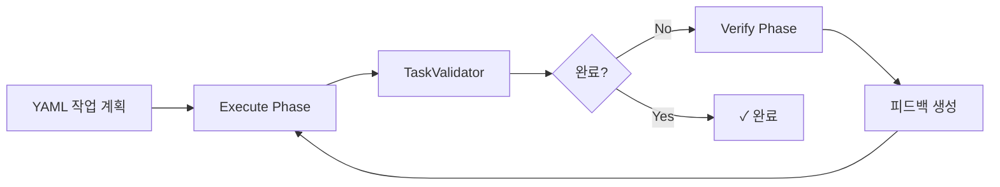
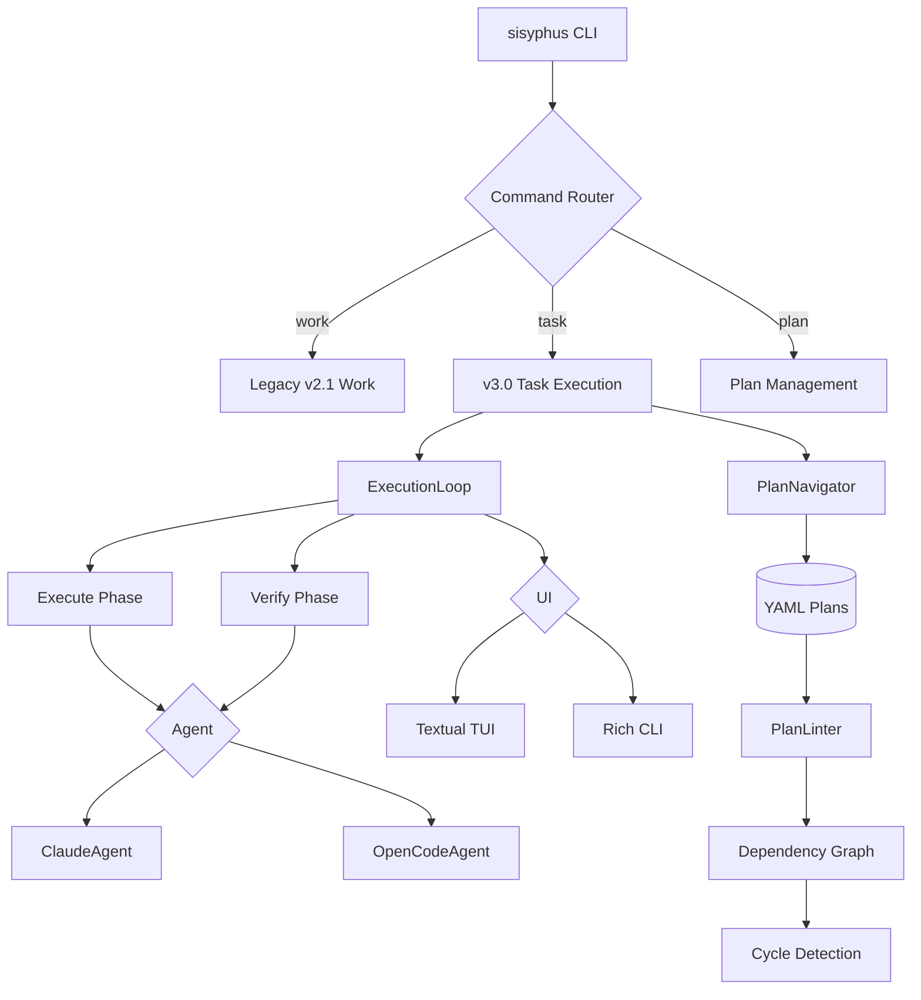
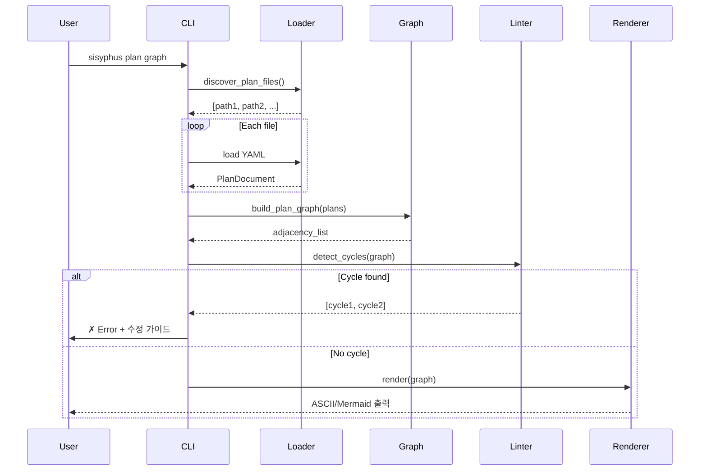

# Sisyphus CLI 완전 가이드: 멀티 에이전트 오케스트레이션 시스템

**작성일**: 2025-11-03
**버전**: v0.1.1
**대상 독자**: 개발자, DevOps 엔지니어, AI 워크플로우 설계자

---

## 목차

1. [개요 및 아키텍처](#1-개요-및-아키텍처)
2. [버전별 차이점 상세 비교](#2-버전별-차이점-상세-비교)
3. [CLI 명령어 레퍼런스](#3-cli-명령어-레퍼런스)
4. [YAML 스키마 및 데이터 모델](#4-yaml-스키마-및-데이터-모델)
5. [검증 시스템](#5-검증-시스템)
6. [에이전트 시스템](#6-에이전트-시스템)
7. [실행 루프 및 워크플로우](#7-실행-루프-및-워크플로우)
8. [의존성 그래프 시스템](#8-의존성-그래프-시스템)
9. [UI 시스템 (TUI/CLI)](#9-ui-시스템-tuicli)
10. [실전 사용 예제 및 베스트 프랙티스](#10-실전-사용-예제-및-베스트-프랙티스)

---

# 1. 개요 및 아키텍처

## 1.1 시지푸스란 무엇인가?

**Sisyphus**는 자연어 작업 계획(YAML)을 LLM 에이전트를 통해 프로덕션 코드로 변환하는 **멀티 에이전트 오케스트레이션 CLI**입니다.

### 핵심 문제 정의

기존 LLM 기반 코딩 도구들의 문제점:
- ❌ **작업 건너뛰기**: 에이전트가 중요한 단계를 생략
- ❌ **품질 검증 부재**: 완료 기준이 불명확
- ❌ **상태 추적 어려움**: 어디까지 완료했는지 파악 곤란
- ❌ **복잡한 의존성**: 다단계 프로젝트의 순서 관리 어려움

### 시지푸스의 해결책



**핵심 컨셉**:
1. **구조화된 계획**: YAML로 명확한 작업 정의
2. **2-Phase 실행**: Execute → Verify 분리
3. **피드백 루프**: 완료까지 반복 검증
4. **의존성 관리**: 다중 플랜 간 순서 보장
5. **멀티 에이전트**: Claude, OpenCode 등 혼용 가능

---

## 1.2 핵심 철학

### 1.2.1 명시적 > 암시적

```yaml
# ✓ 좋은 예: 명확한 작업 정의
todos:
  - id: "1"
    title: "pytest로 테스트 실행"
    verification_spec:
      - bash:
          execute: "pytest tests/"
          expected_exit_code: 0

# ✗ 나쁜 예: 애매한 지시
todos:
  - title: "테스트 확인"
```

### 1.2.2 검증 가능한 완료 조건

모든 작업은 **기계적으로 검증 가능**해야 합니다:
- Bash 명령어 exit code
- LLM 판단 (컨텍스트 제공)
- 수동 확인 (증거 필수)

### 1.2.3 단일 진실 공급원 (Single Source of Truth)

- **v2.x**: `ai-todolist.yaml` (루트)
- **v3.0**: `.sisyphus/tasks/*.yaml` (다중 플랜)

YAML 파일이 **모든 상태**를 담습니다. In-memory 상태 최소화.

### 1.2.4 실패 투명성

에러는 숨기지 않습니다:
```
✗ Bash verification failed!
Command: pytest tests/
Exit code: 1 (expected: 0)
Stderr:
  FAILED tests/test_auth.py::test_login - AssertionError
  
Suggestion: Fix the failing test before marking complete
```

---

## 1.3 전체 아키텍처

### 1.3.1 고수준 다이어그램



### 1.3.2 계층 구조

```
┌─────────────────────────────────────┐
│   CLI Layer (Typer)                 │  ← 사용자 인터페이스
├─────────────────────────────────────┤
│   Command Handlers                  │  ← 비즈니스 로직
│   - work.py, task.py, plan.py      │
├─────────────────────────────────────┤
│   Core Layer                        │
│   ├─ ExecutionLoop (오케스트레이터) │
│   ├─ PlanNavigator (작업 탐색)      │
│   ├─ PlanLinter (검증)              │
│   └─ TaskValidator (완료 판단)      │
├─────────────────────────────────────┤
│   Agent Layer (Protocol)            │  ← 추상화
│   ├─ ClaudeAgent                    │
│   └─ OpenCodeAgent                  │
├─────────────────────────────────────┤
│   UI Layer (Protocol)               │
│   ├─ TUI (Textual)                  │
│   └─ CLI (Rich)                     │
├─────────────────────────────────────┤
│   Data Layer                        │
│   └─ YAML Files (.sisyphus/tasks/) │  ← 영속성
└─────────────────────────────────────┘
```

---

## 1.4 주요 컴포넌트 소개

### 1.4.1 ExecutionLoop (핵심 오케스트레이터)

**책임**: 2-Phase 실행 관리

```python
class ExecutionLoop:
    async def run(
        execute_extra: str | None,
        verify_extra: str | None
    ) -> None:
        """Execute → TaskValidator → Verify → 반복"""
```

**주요 기능**:
- Execute Phase: 에이전트가 작업 수행
- Verify Phase: 품질 검증 (선택적)
- 피드백 주입: 검증 결과를 다음 Execute에 전달
- 에러 복구: SessionLimitError, PromptTooLongError 처리

**파일**: `sisyphus/core/loop.py`

---

### 1.4.2 PlanNavigator (작업 탐색기)

**책임**: YAML에서 현재/다음 작업 찾기

```python
class PlanNavigator:
    def get_current_task(plan: WorkPlan) -> Todo | None:
        """status = in_progress인 작업"""
    
    def get_next_task(plan: WorkPlan) -> Todo | None:
        """의존성 고려한 다음 pending 작업"""
```

**주요 기능**:
- 현재 진행 중인 작업 식별
- 다음 실행 가능한 작업 결정 (의존성 체크)
- 완료 리포트 생성 (총 N개 중 M개 완료)

**파일**: `sisyphus/core/plan_navigator.py`

---

### 1.4.3 Agent Protocol (추상화 계층)

**책임**: 에이전트 통일 인터페이스

```python
class Agent(Protocol):
    def initialize() -> None: ...
    def start_session(prompt: str) -> str: ...
    def send(message: str) -> AgentMessage: ...
    async def stream(message: str) -> AsyncIterator[AgentMessage]: ...
    def close() -> None: ...
```

**구현체**:
- **ClaudeAgent**: Anthropic SDK, 세션 재개 지원
- **OpenCodeAgent**: REST API, SSE 스트리밍

**파일**: `sisyphus/agents/base.py`

---

### 1.4.4 PlanLinter (검증 엔진)

**책임**: YAML 스키마 및 의존성 검증

```python
class PlanLinter:
    def lint(yaml_data: dict) -> list[LintError]:
        """스키마 검증"""
    
    def validate_depends_on(plan: PlanDocument) -> list[str]:
        """순환 의존성 감지"""
```

**검증 항목**:
- 필수 필드 누락
- 타입 불일치
- 순환 의존성 (DFS 알고리즘)
- 참조 무결성 (ref_id 존재 여부)

**파일**: `sisyphus/core/plan_linter.py`

---

### 1.4.5 Dependency Graph (의존성 관리)

**책임**: 플랜 간 실행 순서 결정

```python
def detect_cycles(graph: dict[str, list[str]]) -> list[list[str]]:
    """DFS로 순환 감지"""

def topo_sort(graph: dict[str, list[str]]) -> list[str]:
    """Kahn's algorithm으로 실행 순서"""
```

**기능**:
- 의존성 그래프 빌드
- 순환 감지 (A → B → C → A)
- 위상 정렬 (실행 가능 순서)
- 시각화 (ASCII/Mermaid/PNG)

**파일**: `sisyphus/core/graph/dependencies.py`

---

## 1.5 데이터 흐름

### 1.5.1 Task Continue 실행 흐름

```mermaid
sequenceDiagram
    participant User
    participant CLI
    participant Navigator
    participant Loop
    participant Agent
    participant UI
    participant YAML

    User->>CLI: sisyphus task continue
    CLI->>Navigator: get_current_task()
    Navigator->>YAML: load plan
    YAML-->>Navigator: WorkPlan
    Navigator-->>CLI: Todo (in_progress)
    
    CLI->>Loop: run(execute_extra)
    
    loop Until Complete
        Loop->>Agent: stream(prompt)
        Agent-->>UI: AgentMessage (streaming)
        UI-->>User: 실시간 출력
        
        Loop->>Navigator: 완료 검증
        alt 미완료
            Loop->>Agent: Verify Phase
        else 완료
            Loop-->>CLI: 종료
        end
    end
    
    CLI->>YAML: update status
```

### 1.5.2 Plan Graph 실행 흐름



---

## 1.6 기술 스택

### 1.6.1 핵심 라이브러리

| 라이브러리 | 버전 | 용도 |
|-----------|------|------|
| **Python** | 3.12+ | 언어 |
| **Typer** | 0.15+ | CLI 프레임워크 |
| **Textual** | 1.0+ | TUI (asyncio 전용) |
| **Rich** | 13+ | CLI 출력 포맷팅 |
| **anyio** | 4.11+ | asyncio/trio 추상화 |
| **Pydantic** | 2.0+ | 데이터 검증 |
| **ruamel.yaml** | 0.18+ | YAML 파싱 |
| **claude-agent-sdk** | 0.1+ | Claude 공식 SDK |
| **httpx** | 0.28+ | 비동기 HTTP |

### 1.6.2 특이사항

#### anyio 사용 이유

```python
# ✓ anyio 사용 (호환성)
import anyio

async def foo():
    await anyio.sleep(1)
    async with anyio.create_task_group() as tg:
        tg.start_soon(bar)
```

```python
# ✗ asyncio 직접 사용 (제한적)
import asyncio

async def foo():
    await asyncio.sleep(1)  # trio에서 동작 안 함
```

**이점**:
- 테스트가 asyncio + trio 자동 실행 (pytest-anyio)
- CLI: trio 지원 가능
- TUI: asyncio 강제 (Textual 제약)

#### Protocol > ABC

```python
# ✓ Protocol 사용 (덕 타이핑)
from typing import Protocol, runtime_checkable

@runtime_checkable
class Agent(Protocol):
    def send(self, msg: str) -> AgentMessage: ...

# 런타임 체크 가능
isinstance(obj, Agent)  # OK
```

**이점**:
- 구조적 서브타이핑 (structural subtyping)
- 명시적 상속 불필요
- PEP 544 표준

---

## 1.7 디렉토리 구조

```
sisyphus-cli/
├── sisyphus/                    # 메인 패키지 (src/ 없음)
│   ├── cli/                     # 명령어 핸들러
│   │   ├── plan.py              # plan 하위 명령어
│   │   ├── task.py              # task 하위 명령어
│   │   ├── work.py              # legacy work 명령어
│   │   └── reset.py             # reset 명령어
│   │
│   ├── agents/                  # 에이전트 구현
│   │   ├── base.py              # Agent Protocol
│   │   ├── claude.py            # ClaudeAgent
│   │   └── opencode.py          # OpenCodeAgent
│   │
│   ├── core/                    # 비즈니스 로직
│   │   ├── loop.py              # ExecutionLoop
│   │   ├── plan_navigator.py   # 작업 탐색
│   │   ├── plan_linter.py      # YAML 검증
│   │   ├── plan_loader.py      # YAML 파싱
│   │   ├── session.py          # 세션 관리
│   │   ├── tasks.py            # TaskValidator
│   │   │
│   │   ├── plans/              # 데이터 모델
│   │   │   ├── models.py       # v3.0 Pydantic
│   │   │   └── references.py   # 참조 해결
│   │   │
│   │   ├── graph/              # 의존성 그래프
│   │   │   ├── dependencies.py # 순환 감지, topo sort
│   │   │   └── renderer.py     # ASCII/Mermaid/PNG
│   │   │
│   │   └── status/             # 상태 추적
│   │       └── manager.py      # StatusManager
│   │
│   ├── ui/                      # UI 계층
│   │   ├── base.py              # UIProtocol
│   │   ├── tui/                 # Textual 구현
│   │   │   ├── app.py           # TUI 메인 앱
│   │   │   └── components/      # 위젯들
│   │   ├── cli/                 # Rich 구현
│   │   │   └── console.py       # CLI 출력
│   │   └── themes.py            # Catppuccin 테마
│   │
│   ├── utils/                   # 유틸리티
│   │   ├── plan_types.py        # v2.1 타입
│   │   ├── errors.py            # 예외 클래스
│   │   └── logging.py           # LoggerFactory
│   │
│   └── cli.py                   # Typer 진입점
│
├── tests/                       # 테스트
├── docs/                        # 문서
├── examples/                    # 예제 플랜
└── pyproject.toml              # uv 설정

# 사용자 프로젝트 디렉토리 (v3.0)
your-project/
└── .sisyphus/
    ├── tasks/                   # 플랜 파일들
    │   ├── foundation.yaml
    │   └── main.yaml
    ├── status.json              # 현재 플랜 추적
    ├── notepad.md               # 에이전트 노트
    ├── sessions/                # 세션 파일
    └── logs/                    # 실행 로그
```

---

## 1.8 주요 개념 요약

| 개념 | 설명 | 파일 |
|------|------|------|
| **WorkPlan** | 작업 계획 전체 (metadata + todos) | `utils/plan_types.py:248` |
| **Todo** | 개별 작업 단위 | `utils/plan_types.py:118` |
| **Agent** | LLM 인터페이스 (Protocol) | `agents/base.py:13` |
| **ExecutionLoop** | 2-Phase 실행 오케스트레이터 | `core/loop.py:23` |
| **PlanNavigator** | 작업 탐색 및 상태 관리 | `core/plan_navigator.py:20` |
| **VerificationItem** | 검증 스펙 (bash/llm_judge) | `utils/plan_types.py:60` |
| **UIProtocol** | UI 추상화 (TUI/CLI) | `ui/base.py:14` |
| **DependencyGraph** | 플랜 간 의존성 그래프 | `core/graph/dependencies.py` |

---

## 1.9 다음 챕터 미리보기

**Chapter 2**에서는 v2.0, v2.1, v3.0의 **구체적인 차이점**을 YAML 스키마, CLI 명령어, 디렉토리 구조 관점에서 심층 분석합니다.

주요 내용:
- v2.1 → v3.0 마이그레이션 가이드
- Breaking Changes 완전 정리
- 언제 어떤 버전을 사용할지 의사결정 트리

---

