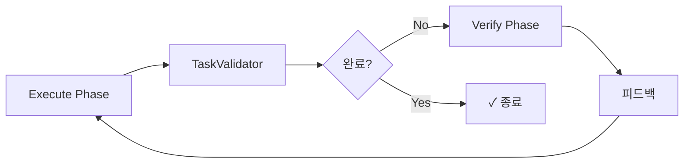
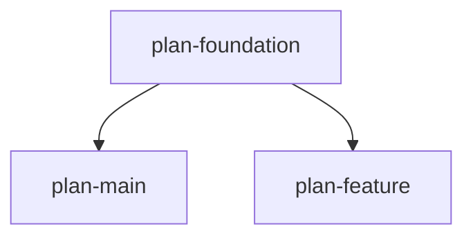

# Sisyphus CLI 가이드

**작성일**: 2025-11-03

---

## 1. ExecutionLoop: 핵심 실행 메커니즘

### 1.1 개념

**ExecutionLoop**는 시지푸스의 핵심 오케스트레이터입니다. 2-Phase 실행 방식으로 작업 완료를 보장합니다.



### 1.2 Execute Phase

**역할**: 에이전트가 실제 작업 수행

```python
# sisyphus/core/loop.py:67
async def run(execute_extra: str | None, verify_extra: str | None):
    await self._run_unified_mode(
        DEFAULT_EXECUTE_PROMPT,
        execute_extra,
        DEFAULT_VERIFY_PROMPT,
        verify_extra
    )
```

**주요 특징**:
- 에이전트에게 작업 프롬프트 전달
- 스트리밍 방식으로 실시간 출력
- 세션 재개 지원 (ClaudeAgent만)
- 에러 발생 시 자동 재시도

**프롬프트 예시**:
```
You are an AI assistant helping complete tasks from a work plan.

Current Task:
- Title: pytest로 테스트 실행
- Status: in_progress

Please complete this task.
```

### 1.3 TaskValidator

**역할**: ai-todolist.md 파싱하여 완료 여부 판단

```python
# sisyphus/core/tasks.py:9
class TaskValidator:
    def is_fully_done(self) -> bool:
        """FULLY_DONE = TRUE 체크"""
        return self.plan_content and "FULLY_DONE = TRUE" in self.plan_content
```

**동작**:
1. `ai-todolist.md` 파일 읽기
2. `FULLY_DONE = TRUE` 문자열 찾기
3. 발견되면 → 루프 종료
4. 없으면 → Verify Phase 진행

### 1.4 Verify Phase (선택적)

**역할**: 품질 검증 및 피드백 생성

```python
if self.verify_agent:
    # Verify 에이전트 실행
    async for message in verify_agent.stream(verify_prompt):
        await ui.show_message(message)
```

**Verify 프롬프트 예시**:
```
Review the work completed in Execute Phase.

Check:
1. All tests pass
2. Code quality is acceptable
3. Task requirements met

Provide feedback for improvement.
```

**피드백 주입**:
- Verify Phase 결과를 다음 Execute Phase에 전달
- 개선 사항을 명시적으로 지시
- 완료까지 반복

### 1.5 에러 핸들링

```python
# SessionLimitError: API 한도 초과
except SessionLimitError:
    await sleep_until_reset()  # 다음 시간까지 대기
    continue

# PromptTooLongError: 프롬프트 너무 길음
except PromptTooLongError:
    session_store.delete_session()  # 세션 삭제
    continue  # 새 세션으로 재시작

# SDK Exception: SDK 내부 오류
except Exception:
    if sdk_exception_count < 3:
        continue  # 재시도
    else:
        raise  # 3회 실패 시 중단
```

### 1.6 실제 코드 예시

```python
# sisyphus/core/loop.py:99
async def _run_unified_mode(...):
    while True:
        # Execute Phase
        async for message in execute_agent.stream(execute_prompt):
            await ui.show_message(message)

        # TaskValidator 체크
        if task_validator and task_validator.is_fully_done():
            break  # 완료!

        # Verify Phase (있으면)
        if verify_agent:
            async for message in verify_agent.stream(verify_prompt):
                await ui.show_message(message)

            # 피드백을 다음 Execute에 주입
            feedback = "Previous verification feedback: ..."
            execute_prompt = f"{execute_prompt}\n\n{feedback}"
```

---

## 2. CLI 명령어 레퍼런스

### 2.1 메인 명령어

```bash
sisyphus [COMMAND] [OPTIONS]
```

**명령어 구조**:
```
sisyphus
├── work              # Legacy v2.1 작업 실행
├── ignore            # .gitignore 설정
├── clean-history     # Git 히스토리 정리
├── reset             # 상태 초기화
├── plan/             # 계획 관리 (6개 하위 명령어)
└── task/             # 작업 실행 (4개 하위 명령어)
    └── verify/       # 검증 (6개 하위 명령어)
```

---

### 2.2 work - Legacy 실행

```bash
sisyphus work [OPTIONS]
```

**주요 옵션**:
```bash
--agent, -a AGENT[:MODEL]        # 에이전트 타입 (claude|opencode)
--execute AGENT[:MODEL]          # Execute 에이전트
--verify AGENT[:MODEL]           # Verify 에이전트
--execute-extra-prompt TEXT      # Execute 추가 프롬프트
--verify-extra-prompt TEXT       # Verify 추가 프롬프트
--no-tui                         # TUI 비활성화
--theme {system|mocha|latte}     # 테마
--log PATH                       # 로그 파일
```

**예제**:
```bash
# 기본 실행 (TUI)
sisyphus work

# Execute만 (Verify 없이)
sisyphus work --execute claude:sonnet

# Execute + Verify (다른 에이전트)
sisyphus work \
  --execute claude:sonnet \
  --verify opencode:qwen

# CLI 모드 (자동화)
sisyphus work --no-tui

# 추가 프롬프트
sisyphus work \
  --execute-extra-prompt "Focus on performance" \
  --verify-extra-prompt "Check for edge cases"
```

---

### 2.3 plan/ - 계획 관리

#### 2.3.1 init - 템플릿 생성

```bash
sisyphus plan init [OPTIONS]

Options:
  --path PATH         생성 경로 [default: ./ai-todolist.yaml]
  --cwd PATH          작업 디렉토리
```

**생성 결과**:
- v2.1 포맷 YAML 템플릿
- metadata, user_request, todos 등 기본 구조
- TODO 플레이스홀더 포함

**예제**:
```bash
# 기본
sisyphus plan init

# 커스텀 경로
sisyphus plan init --path .sisyphus/tasks/main.yaml
```

#### 2.3.2 lint - 검증

```bash
sisyphus plan lint [OPTIONS]

Options:
  --file PATH         YAML 파일 경로
  --cwd PATH          작업 디렉토리
```

**검증 항목**:
- 필수 필드 누락
- 타입 불일치
- 순환 의존성 (v3.0)
- 참조 무결성

**출력 예시**:
```
✓ YAML validation passed. 0 errors.

# 또는
✗ Found 3 errors:
  1. todos[0].status - Invalid enum value
     Expected: one of ['pending', 'in_progress', 'completed']
     Actual: invalid
```

#### 2.3.3 graph - 의존성 시각화

```bash
sisyphus plan graph [OPTIONS]

Options:
  --format {ascii|mermaid}     출력 포맷
  --cwd PATH                   작업 디렉토리
```

**ASCII 출력 예시**:
```
plan-foundation
│
├─→ plan-main
│
└─→ plan-feature
```

**Mermaid 출력**:


**순환 감지**:
```
✗ Circular dependency detected!

Cycle 1:
  plan-a               (in .sisyphus/tasks/a.yaml) →
  plan-b               (in .sisyphus/tasks/b.yaml) →
  plan-a               (loops back to start)

How to fix:
  1. Open the file(s) listed above
  2. Remove one dependency to break the cycle
```

#### 2.3.4 overview - 개요

```bash
sisyphus plan overview [OPTIONS]

Options:
  --rich              Rich 테이블 포맷
  --cwd PATH          작업 디렉토리
```

#### 2.3.5 get - 정보 조회

```bash
sisyphus plan get task [OPTIONS]

Options:
  --current                현재 작업
  --next                   다음 작업
  --id ID                  특정 ID
  --show-references        참조만 표시
  --show-children          하위 작업만
  --show-verification      검증 스펙만
  --rich                   Rich 포맷
```

#### 2.3.6 export - Markdown 변환

```bash
sisyphus plan export YAML_PATH [OPTIONS]

Options:
  --output PATH       출력 파일
  --cwd PATH          작업 디렉토리
```

---

### 2.4 task/ - 작업 실행

#### 2.4.1 show - 작업 표시

```bash
sisyphus task show TASK_ID [OPTIONS]

Options:
  --rich              Rich 포맷
  --cwd PATH          작업 디렉토리
```

#### 2.4.2 current - 현재 작업

```bash
sisyphus task current [OPTIONS]

Options:
  --rich              Rich 포맷
  --cwd PATH          작업 디렉토리
```

**출력**:
```
Current Task:
  ID: 1
  Title: pytest로 테스트 실행
  Status: in_progress

  References:
    - inline: "pytest tests/ -v"
```

#### 2.4.3 next - 다음 작업

```bash
sisyphus task next [OPTIONS]
```

**출력**:
```
Next Task:
  ID: 2
  Title: 타입 체크 실행
  Status: pending

# 모든 작업 완료 시
All tasks completed! 🎉
```

#### 2.4.4 continue - 작업 계속

```bash
sisyphus task continue [OPTIONS]
```

**⚠️ 현재 미구현 (v3.0 개발 중)**

---

### 2.5 task verify/ - 검증

#### 2.5.1 bash - Bash 검증

```bash
sisyphus task verify bash [OPTIONS]

Options:
  --cwd PATH               작업 디렉토리
  --evidence TEXT          추가 증거
```

**동작**:
1. 다음 미검증 bash 항목 찾기
2. 명령어 실행
3. exit code 비교
4. 성공 시 `verified=true` 마킹

**예제**:
```bash
sisyphus task verify bash --evidence "All tests passed on CI"
```

**출력**:
```
Running verification: pytest tests/
Command: pytest tests/
Expected exit code: 0

✓ Verification passed!
  Exit code: 0
  Marked as verified at: 2025-11-03T14:30:00Z
```

#### 2.5.2 llm - LLM 검증 표시

```bash
sisyphus task verify llm [OPTIONS]
```

**출력**:
```
LLM Judge Verification:
  ID: verify-1
  Judge: orchestrator-agent
  Instruction: Check code quality

Context Commands:
  - ruff check src/
  - git diff HEAD~1

Please manually verify, then run:
  sisyphus task verify llm-mark verify-1 --evidence "..."
```

#### 2.5.3 llm-mark - LLM 검증 완료

```bash
sisyphus task verify llm-mark VERIFY_ID [OPTIONS]

Options:
  --evidence TEXT          검증 증거 (필수)
  --cwd PATH               작업 디렉토리
```

**예제**:
```bash
sisyphus task verify llm-mark verify-1 \
  --evidence "Code quality looks good, no major issues"
```

#### 2.5.4 manual - 수동 검증 표시

```bash
sisyphus task verify manual [OPTIONS]
```

#### 2.5.5 manual-mark - 수동 검증 완료

```bash
sisyphus task verify manual-mark VERIFY_ID [OPTIONS]

Options:
  --evidence TEXT          검증 증거 (필수)
  --cwd PATH               작업 디렉토리
```

#### 2.5.6 status - 검증 상태

```bash
sisyphus task verify status [OPTIONS]

Options:
  --cwd PATH               작업 디렉토리
```

**출력**:
```
Verification Status:

✓ verify-1: pytest 테스트 (bash)
  Verified at: 2025-11-03T14:30:00Z

○ verify-2: 코드 리뷰 (llm_judge)
  Not verified yet

○ verify-3: 수동 확인 (manual)
  Not verified yet

Progress: 1/3 completed (33%)
```

---

### 2.6 ignore - Git Ignore

```bash
sisyphus ignore [OPTIONS]

Options:
  --exclude-only      .git/info/exclude만 (로컬)
  --both              .gitignore + .git/info/exclude 둘 다
```

**추가 패턴**:
```gitignore
# Sisyphus generated files
ai-todolist.md
notepad.md
sessions/
logs/
agentloop.json
claude_session_*.log
```

---

### 2.7 clean-history - Git 히스토리 정리

```bash
sisyphus clean-history [OPTIONS]

Options:
  --base-branch BRANCH    Base 브랜치 (자동 감지)
  --dry-run               실제 삭제 없이 미리보기
```

**동작**:
1. main/master 브랜치에서 실행 방지
2. base 브랜치 이후 커밋에서 Sisyphus 파일 탐색
3. `git rebase -i` 가이드 생성
4. **수동으로 rebase 수행** (자동 실행 안 함)

---

### 2.8 reset - 상태 초기화

```bash
sisyphus reset [OPTIONS]

Options:
  --include-task-specs    .sisyphus/tasks/도 삭제
  --dry-run               미리보기
  --yes, -y               확인 프롬프트 스킵
```

**삭제 대상 (기본)**:
- `notepad.md`
- `sessions/`
- `logs/`

**추가 삭제 (--include-task-specs)**:
- `.sisyphus/tasks/`
- `.sisyphus/status.json`

**예제**:
```bash
# 미리보기
sisyphus reset --dry-run

# 기본 삭제 (확인)
sisyphus reset

# 모두 삭제 (확인 없이)
sisyphus reset --include-task-specs --yes
```

---

## 3. 실전 사용 예제

### 3.1 기본 워크플로우

```bash
# 1. 플랜 생성
sisyphus plan init

# 2. 플랜 편집 (vi/code)
vim ai-todolist.yaml

# 3. 검증
sisyphus plan lint --file ai-todolist.yaml

# 4. 작업 실행
sisyphus work

# 5. 검증 수행
sisyphus task verify bash

# 6. 완료 확인
sisyphus task verify status
```

### 3.2 CI/CD 통합

```yaml
# .github/workflows/sisyphus.yml
name: Sisyphus Task

on: [push]

jobs:
  execute:
    runs-on: ubuntu-latest
    steps:
      - uses: actions/checkout@v3
      - uses: actions/setup-python@v4
        with:
          python-version: '3.12'

      - name: Install Sisyphus
        run: |
          pip install uv
          uv pip install sisyphus-cli

      - name: Run tasks
        run: sisyphus work --no-tui
        env:
          ANTHROPIC_API_KEY: ${{ secrets.ANTHROPIC_API_KEY }}
```

### 3.3 다중 에이전트 사용

```bash
# Execute: Claude (강력), Verify: OpenCode (빠름)
sisyphus work \
  --execute claude:sonnet \
  --verify opencode:qwen
```

---

## 4. 트러블슈팅

### 4.1 "File not found: ai-todolist.yaml"

**원인**: 플랜 파일이 없음

**해결**:
```bash
sisyphus plan init
```

### 4.2 "Circular dependency detected"

**원인**: 플랜 간 순환 의존성

**해결**:
```bash
# 1. 순환 확인
sisyphus plan graph

# 2. YAML 편집하여 의존성 제거
vim .sisyphus/tasks/main.yaml

# 3. 재검증
sisyphus plan graph
```

### 4.3 "Session limit exceeded"

**원인**: API 요청 한도 초과

**동작**: ExecutionLoop이 자동으로 대기 후 재시도

### 4.4 TUI 동작 안 함

**원인**: Textual은 asyncio 전용

**해결**:
```bash
# CLI 모드 사용
sisyphus work --no-tui
```

---

## 5. 요약

### ExecutionLoop
- **2-Phase**: Execute → TaskValidator → Verify
- **피드백 루프**: 완료까지 반복
- **에러 복구**: 자동 재시도

### CLI 구조
```
sisyphus
├── work              # Legacy 실행
├── plan/             # 계획 관리 (6개)
│   ├── init
│   ├── lint
│   ├── graph
│   ├── overview
│   ├── get
│   └── export
└── task/             # 작업 실행 (4개)
    ├── show
    ├── current
    ├── next
    ├── continue
    └── verify/       # 검증 (6개)
        ├── bash
        ├── llm
        ├── llm-mark
        ├── manual
        ├── manual-mark
        └── status
```

**총 명령어**: 20+개

---
