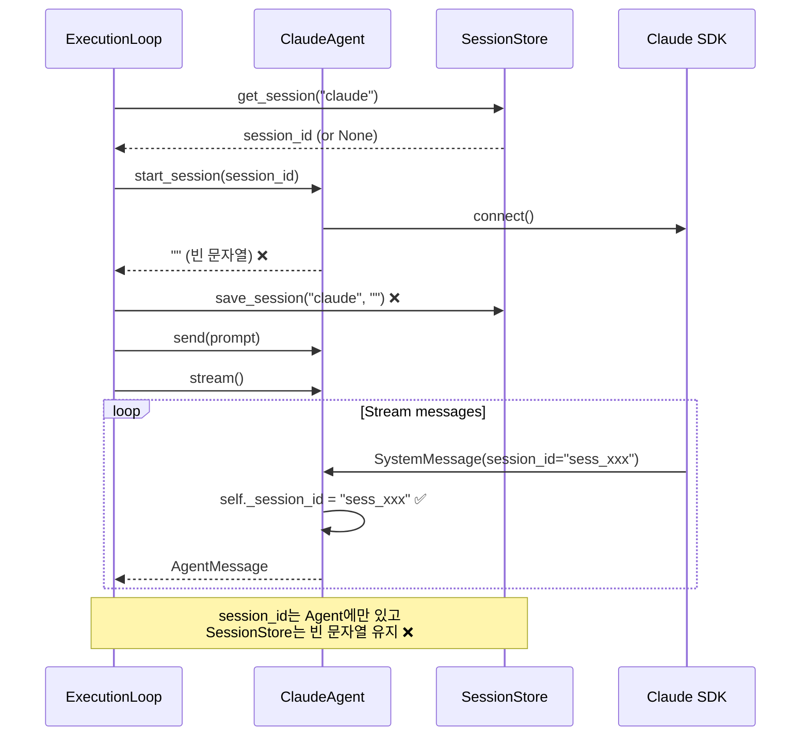
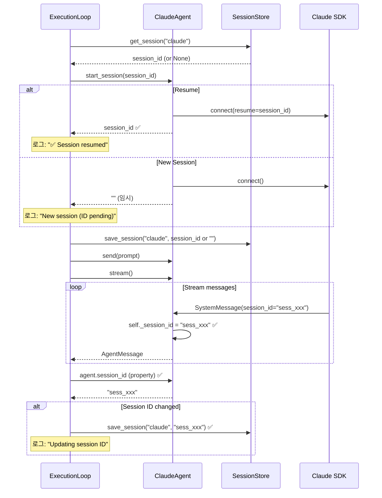

# 사용자의 최초 요청 (기록용)

지금 ./sessions/sessions.json 보면 알겠지만 session_id 가 빈 스트링인데 claude session 이 제대로 기록되고 / resume 되고있지 않는거같아 (그리고 resume 성공 / 실패 여부도 로그로 찍히지 않아 - ./local-ignore/agentsdk_loop.py 는 찍거든) 이렇게 작업하려면 어떻게 해야할까 ? 어느부분을 어떻게 수정해야할까? 지금 뭐가 문제길래 빈 스트링으로 기록되고있을까 ?

## 사용자가 이후에 추가 요청한 내용들 (기록용)

- 문제 분석 결과를 계획서 형식으로 작성 요청

# 작업 목표

1. **Claude session_id 올바르게 저장**: 빈 문자열 대신 실제 session_id가 저장되도록 수정
2. **Resume 기능 정상화**: 다음 실행 시 이전 세션을 올바르게 resume
3. **로깅 개선**: Resume 시도/성공/실패 여부를 로그에 명확히 기록
4. **디버깅 가능성 향상**: 문제 발생 시 원인 파악 가능하도록 개선

# 작업 배경

## 현재 문제점

### 문제 1: session_id가 빈 문자열로 저장됨
```json
{
  "claude": {
    "session_id": "",
    "updated": "2025-10-13T04:24:55.697156+00:00"
  }
}
```

### 문제 2: Resume이 작동하지 않음
- 다음 실행 시 빈 문자열 로드 → resume 시도 안함 → 새 세션 시작
- 무한 반복: 항상 새 세션 시작 → 빈 문자열 저장 → ...

### 문제 3: 로깅 부재
- Resume 시도 여부 로그 없음
- Resume 성공/실패 로그 없음
- 디버깅 불가능

## 근본 원인 분석

### 원인 1: start_session()이 빈 문자열 반환
**위치**: `sisyphus/agents/claude.py:105-110`

```python
else:
    if self._client is None:
        raise RuntimeError("Client not initialized. Call initialize() first.")
    await self._client.connect()
    self._connected = True
    return ""  # ⚠️ 새 세션 시작 시 빈 문자열 반환
```

### 원인 2: 실제 session_id는 stream() 중에 받음
**위치**: `sisyphus/agents/claude.py:136-139`

```python
async for message in self._client.receive_response():
    if isinstance(message, SystemMessage) and message.subtype == "init":
        session_id = message.data.get("session_id")
        if session_id:
            self._session_id = session_id  # ✅ 여기서 실제 session_id 저장
```

하지만 이 `self._session_id`는 **SessionStore에 업데이트되지 않음**.

### 원인 3: ExecutionLoop의 타이밍 문제
**위치**: `sisyphus/core/loop.py:222-225`

```python
actual_session_id = await self.execute_agent.start_session(session_id)
self.execute_logger.info(f"Session started: {actual_session_id}")

await self.session_store.save_session(agent_type, actual_session_id)  # ⚠️ 빈 문자열 저장
```

`start_session()`이 반환한 **빈 문자열을 즉시 저장**하고, 이후 `stream()`에서 실제 session_id를 받아도 **SessionStore는 업데이트되지 않음**.

# 작업 시작 여부
is_execution_started = FALSE

# 모든 목표 달성 여부
is_all_goals_accomplished = FALSE

# 병렬 실행 여부
parallel_requested = FALSE

# 현재 진행 중인 작업
- 작업 시작 전입니다.
  - 작업을 시작하면 위의 `is_execution_started` 의 값을 TRUE 로 바꾸세요.
  - 사용자가 명시적으로 "작업을 시작하라" 라고 말하기 전까지는 절대로 작업하지 않습니다.
  - **plan reviewer 에게 OKAY 사인을 받았더라도 절대 시작하지마십시오**
  - 사용자가 명시적으로 "작업을 시작하라" 라고 말하기 전까지는 절대로 작업하지 않습니다.

# 필요한 사전 지식

## 기술 스택
- **Python**: 3.12
- **비동기**: anyio 4.11+
- **Agent SDK**: claude-agent-sdk 0.1+
- **타입 시스템**: Protocol (PEP 544), Type hints

## 아키텍처 패턴
- **Session 관리**: ClaudeAgent가 session_id를 내부적으로 관리
- **영속성**: SessionStore가 파일 기반으로 session_id 저장/로드
- **오케스트레이션**: ExecutionLoop가 Agent와 SessionStore를 조율

## 파일 구조 및 역할

### 맥락 이해를 위해 참고해야 할 파일들

#### 1. sisyphus/agents/claude.py
- **역할**: Claude Agent SDK 래퍼, session 관리
- **참고할 부분**:
  - `start_session()` 메서드 (line 66-110): 새 세션 시작/resume
  - `stream()` 메서드 (line 123-194): SystemMessage에서 session_id 수신
  - `self._session_id` 인스턴스 변수: 실제 session_id 저장
- **예상 코드 구조**:
  ```python
  class ClaudeAgent:
      def __init__(self) -> None:
          self._session_id: str | None = None

      async def start_session(self, session_id: str | None = None) -> str:
          if session_id:
              # Resume 로직
              return session_id
          else:
              # 새 세션 로직
              return ""  # ⚠️ 문제: 빈 문자열 반환

      async def stream(self) -> AsyncIterator[AgentMessage]:
          async for message in self._client.receive_response():
              if isinstance(message, SystemMessage) and message.subtype == "init":
                  session_id = message.data.get("session_id")
                  if session_id:
                      self._session_id = session_id  # ✅ 여기서 실제 ID 받음
  ```

#### 2. sisyphus/core/loop.py
- **역할**: Execute/Verify 단계 오케스트레이션
- **참고할 부분**: `_execute_phase()` 메서드 (line 198-248)
- **주의사항**:
  - `start_session()` 호출 후 즉시 저장 → 빈 문자열 저장 문제
  - `stream()` 완료 후 업데이트 로직 필요
- **예상 코드 구조**:
  ```python
  async def _execute_phase(self, prompt: str, extra: str | None = None) -> None:
      session_id = await self.session_store.get_session(agent_type)

      actual_session_id = await self.execute_agent.start_session(session_id)
      await self.session_store.save_session(agent_type, actual_session_id)  # ⚠️ 빈 문자열 저장

      await self.execute_agent.send(final_prompt)

      stream = self.execute_agent.stream()
      async for message in stream:
          await self.ui.show_message(message, source="execute")

      # ⚠️ 여기서 실제 session_id 업데이트 필요
  ```

#### 3. sisyphus/core/session.py
- **역할**: Session 영속성 관리 (파일 기반)
- **참고할 부분**:
  - `get_session()` 메서드 (line 69-76): session_id 로드
  - `save_session()` 메서드 (line 78-86): session_id 저장
- **주의사항**: SessionStore는 정상 작동, 문제 없음

#### 4. sisyphus/agents/opencode.py
- **역할**: OpenCode Agent 구현
- **참고할 부분**: Protocol 일관성 유지를 위해 동일한 수정 필요
- **주의사항**: ClaudeAgent와 동일한 패턴으로 `session_id` property 추가

#### 5. sisyphus/agents/base.py
- **역할**: Agent Protocol 정의
- **참고할 부분**: (선택) `session_id` property 추가 가능
- **주의사항**: Protocol에 추가하면 타입 안전성 향상

# 작업 계획

## PRDs & Structures

### 현재 아키텍처 (문제 상황)


### 수정 후 아키텍처 (해결 방안)


## 구현 세부사항

### Option 2 (추천): ExecutionLoop에서 stream() 후 session_id 업데이트

**장점**:
- Agent와 SessionStore의 결합도 유지 (낮음)
- 명확한 책임 분리: Agent는 session 관리, ExecutionLoop는 영속성 관리
- 구현이 깔끔하고 직관적
- 기존 아키텍처 패턴 유지

**단점**:
- ExecutionLoop에 약간의 로직 추가 필요

### 핵심 변경사항

1. **ClaudeAgent에 `session_id` property 추가**: Agent 내부 session_id를 외부에서 조회 가능하도록
2. **ExecutionLoop에서 stream() 후 업데이트**: 실제 session_id를 받은 후 SessionStore 업데이트
3. **Resume 로깅 추가**: Resume 시도/성공/실패를 명확히 로그 기록
4. **SessionResumeError 처리**: Resume 실패 시 새 세션으로 fallback

## 프로젝트 커밋 메시지 스타일

```
# 분석 결과
remove close() from UIProtocol for lifecycle independence
작업 실행 프롬프트 명시화
no close tui init
테스트 코드에서 droid 제거
Complete DroidAgent removal - update task tracking
Remove DroidAgent support
```

**패턴**:
- 소문자 또는 일반 문장 시작
- 동사 명령형 (add, fix, remove, update 등)
- 간결하고 직접적인 설명
- 특별한 경우 대문자 시작 또는 괄호로 추가 설명
- 한글/영어 혼용 가능

**적용 예시**:
- `fix claude session resume with proper session_id storage`
- `add session_id property to ClaudeAgent for tracking`
- `improve session resume logging for debugging`

# TODOs

- [ ] 1. ClaudeAgent에 session_id property 추가
  - [ ] 1.1 구현: sisyphus/agents/claude.py에 property 추가
    ```python
    # 현재 코드 (line 27-49)
    class ClaudeAgent:
        """Claude Agent using Claude Agent SDK with session management."""

        supports_interactive: bool = True

        def __init__(
            self,
            model: str | None = None,
            sdk_options: dict[str, Any] | None = None,
        ) -> None:
            self._model = model
            self._sdk_options = sdk_options or {}
            self._client: ClaudeSDKClient | None = None
            self._options: ClaudeAgentOptions | None = None
            self._session_id: str | None = None
            self._connected: bool = False

    # 추가할 코드 (class 내부 적절한 위치에):
    @property
    def session_id(self) -> str | None:
        """Get current session ID (available after stream() receives init message).

        Returns:
            Current session ID or None if not yet received
        """
        return self._session_id
    ```
  - [ ] 1.2 타입 체크: `uv run basedpyright sisyphus/agents/claude.py`
  - [ ] 아래의 가이드대로 진행했을 때 Orchestrator 1번 작업 검증 성공 여부
    - [ ] ClaudeAgent 클래스에 `session_id` property가 추가되었는가?
    - [ ] Property의 타입 힌트가 `str | None`로 정확한가?
    - [ ] Docstring이 추가되어 언제 사용 가능한지 명시되어 있는가?
    - [ ] basedpyright 타입 체크가 통과하는가?
    - [ ] 기존 코드 스타일(독스트링 형식, 들여쓰기 등)을 유지하는가?

- [ ] 2. ExecutionLoop._execute_phase() 수정: Resume 로깅 및 stream() 후 업데이트
  - [ ] 2.1 구현: sisyphus/core/loop.py의 _execute_phase() 메서드 수정 (line 198-248)
    ```python
    # 현재 코드 (line 211-248):
    async def _execute_phase(
        self,
        prompt: str,
        extra: str | None = None,
    ) -> None:
        """Execute phase: can resume previous session."""
        final_prompt = await self.prompt_resolver.resolve(prompt, extra)

        await self.execute_agent.initialize()

        agent_type = type(self.execute_agent).__name__.lower().replace("agent", "")
        session_id = await self.session_store.get_session(agent_type)

        self.execute_logger = self.logger_factory.create_logger(agent_type, session_id)
        self.execute_logger.info(f"Execute phase starting (session_id={session_id})")

        actual_session_id = await self.execute_agent.start_session(session_id)
        self.execute_logger.info(f"Session started: {actual_session_id}")

        await self.session_store.save_session(agent_type, actual_session_id)

        await self.execute_agent.send(final_prompt)
        self.execute_logger.info("Prompt sent")

        try:
            stream = self.execute_agent.stream()
            async for message in stream:
                await self.ui.show_message(message, source="execute")
                self.execute_logger.debug(f"Message: {message.role} - {message.content[:100]}...")
        except SessionLimitError as e:
            # ... 에러 처리 ...

        await self.execute_agent.close()
        self.execute_logger.info("Execute phase complete")

    # 변경 후:
    async def _execute_phase(
        self,
        prompt: str,
        extra: str | None = None,
    ) -> None:
        """Execute phase: can resume previous session."""
        final_prompt = await self.prompt_resolver.resolve(prompt, extra)

        await self.execute_agent.initialize()

        agent_type = type(self.execute_agent).__name__.lower().replace("agent", "")
        session_id = await self.session_store.get_session(agent_type)

        self.execute_logger = self.logger_factory.create_logger(agent_type, session_id)
        self.execute_logger.info(f"Execute phase starting (session_id={session_id})")

        # ✅ Resume 시도 로깅 추가
        if session_id:
            self.execute_logger.info(f"Attempting to resume session: {session_id}")
        else:
            self.execute_logger.info("Starting new session")

        # ✅ Resume 실패 시 fallback
        try:
            actual_session_id = await self.execute_agent.start_session(session_id)

            # ✅ Resume 성공 로깅
            if session_id:
                self.execute_logger.info(f"✅ Session resumed successfully: {session_id}")
            else:
                self.execute_logger.info("New session initialized (ID will be received during stream)")

        except SessionResumeError as e:
            # ✅ Resume 실패 로깅 및 새 세션 시작
            self.execute_logger.warning(f"❌ Failed to resume session {session_id}: {e}")
            self.execute_logger.info("Starting new session instead")
            actual_session_id = await self.execute_agent.start_session(None)

        # 초기 session_id 저장 (빈 문자열일 수 있음)
        await self.session_store.save_session(agent_type, actual_session_id)

        await self.execute_agent.send(final_prompt)
        self.execute_logger.info("Prompt sent")

        try:
            stream = self.execute_agent.stream()
            async for message in stream:
                await self.ui.show_message(message, source="execute")
                self.execute_logger.debug(f"Message: {message.role} - {message.content[:100]}...")
        except SessionLimitError as e:
            # ... 에러 처리 ...

        # ✅ stream() 완료 후 실제 session_id 업데이트
        final_session_id = self.execute_agent.session_id
        if final_session_id and final_session_id != actual_session_id:
            self.execute_logger.info(f"Updating session ID: '' -> '{final_session_id}'")
            await self.session_store.save_session(agent_type, final_session_id)

        await self.execute_agent.close()
        self.execute_logger.info("Execute phase complete")
    ```
  - [ ] 2.2 타입 체크: `uv run basedpyright sisyphus/core/loop.py`
  - [ ] 아래의 가이드대로 진행했을 때 Orchestrator 2번 작업 검증 성공 여부
    - [ ] Resume 시도 로깅이 추가되었는가? ("Attempting to resume session" / "Starting new session")
    - [ ] Resume 성공 로깅이 추가되었는가? ("✅ Session resumed successfully")
    - [ ] SessionResumeError를 catch하여 fallback 로직이 추가되었는가?
    - [ ] Resume 실패 로깅이 추가되었는가? ("❌ Failed to resume session")
    - [ ] stream() 완료 후 `agent.session_id`를 조회하여 업데이트하는가?
    - [ ] session_id가 변경되었을 때만 업데이트 로깅을 하는가?
    - [ ] basedpyright 타입 체크가 통과하는가?
    - [ ] 기존 코드 구조와 스타일을 유지하는가?

- [ ] 3. OpenCodeAgent에 session_id property 추가 (Protocol 일관성)
  - [ ] 3.1 구현: sisyphus/agents/opencode.py에 property 추가
    ```python
    # OpenCodeAgent 클래스 내부에 추가:
    @property
    def session_id(self) -> str | None:
        """Get current session ID.

        Returns:
            Current session ID or None if not yet received
        """
        return self._session_id
    ```
  - [ ] 3.2 타입 체크: `uv run basedpyright sisyphus/agents/opencode.py`
  - [ ] 아래의 가이드대로 진행했을 때 Orchestrator 3번 작업 검증 성공 여부
    - [ ] OpenCodeAgent 클래스에 `session_id` property가 추가되었는가?
    - [ ] Property 시그니처가 ClaudeAgent와 동일한가?
    - [ ] basedpyright 타입 체크가 통과하는가?

- [ ] 4. (선택) Agent Protocol에 session_id property 추가
  - [ ] 4.1 구현: sisyphus/agents/base.py의 Agent Protocol 수정
    ```python
    # Agent Protocol에 추가:
    @property
    def session_id(self) -> str | None:
        """Get current session ID (may be None before stream() receives it).

        Returns:
            Current session ID or None if not yet available
        """
        ...
    ```
  - [ ] 4.2 타입 체크: `uv run basedpyright sisyphus/agents/base.py`
  - [ ] 아래의 가이드대로 진행했을 때 Orchestrator 4번 작업 검증 성공 여부
    - [ ] Agent Protocol에 `session_id` property가 추가되었는가?
    - [ ] @property 데코레이터가 적용되었는가?
    - [ ] 반환 타입이 `str | None`인가?
    - [ ] basedpyright 타입 체크가 통과하는가?
    - [ ] ClaudeAgent와 OpenCodeAgent가 여전히 Protocol을 만족하는가?

- [ ] 5. 통합 테스트 및 검증
  - [ ] 5.1 타입 체크: `uv run basedpyright`
  - [ ] 5.2 린트 체크: `uv run ruff check sisyphus/agents sisyphus/core`
  - [ ] 5.3 수동 테스트: session 저장 및 resume 확인
    ```bash
    # 1. 기존 sessions.json 삭제
    rm ./sessions/sessions.json

    # 2. 첫 실행 (새 세션)
    uv run sisyphus run --execute claude:sonnet --no-tui

    # 3. sessions.json 확인
    cat ./sessions/sessions.json
    # 예상: {"claude": {"session_id": "sess_xxx...", "updated": "..."}}

    # 4. 다시 실행 (resume 테스트)
    uv run sisyphus run --execute claude:sonnet --no-tui

    # 5. 로그 확인
    tail -n 50 logs/claude_*_UTC.log
    # 예상 로그:
    # - "Attempting to resume session: sess_xxx"
    # - "✅ Session resumed successfully: sess_xxx"
    ```
  - [ ] 5.4 Resume 실패 시나리오 테스트 (선택)
    ```bash
    # 1. sessions.json에 잘못된 session_id 입력
    echo '{"claude": {"session_id": "invalid_id", "updated": "2025-10-13T00:00:00+00:00"}}' > ./sessions/sessions.json

    # 2. 실행
    uv run sisyphus run --execute claude:sonnet --no-tui

    # 3. 로그 확인
    tail -n 50 logs/claude_*_UTC.log
    # 예상 로그:
    # - "Attempting to resume session: invalid_id"
    # - "❌ Failed to resume session invalid_id: ..."
    # - "Starting new session instead"
    # - "Updating session ID: '' -> 'sess_yyy'"
    ```
  - [ ] 아래의 가이드대로 진행했을 때 Orchestrator 5번 작업 검증 성공 여부
    - [ ] basedpyright 타입 체크가 모든 파일에서 통과하는가?
    - [ ] ruff lint 체크가 통과하는가?
    - [ ] 첫 실행 시 sessions.json에 실제 session_id가 저장되는가? (빈 문자열 아님)
    - [ ] 두 번째 실행 시 "Attempting to resume" 로그가 찍히는가?
    - [ ] Resume 성공 시 "✅ Session resumed successfully" 로그가 찍히는가?
    - [ ] 잘못된 session_id로 Resume 실패 시 "❌ Failed to resume" 로그가 찍히는가?
    - [ ] Resume 실패 후 새 세션으로 fallback하는가?
    - [ ] 새 세션 시작 후 "Updating session ID" 로그가 찍히는가?

- [ ] 6. 커밋
  - [ ] 6.1 변경사항 확인
    ```bash
    git status
    git diff sisyphus/agents/claude.py
    git diff sisyphus/agents/opencode.py
    git diff sisyphus/core/loop.py
    git diff sisyphus/agents/base.py  # (선택사항)
    ```
  - [ ] 6.2 커밋 (프로젝트 컨벤션 준수)
    ```bash
    git add sisyphus/agents/claude.py \
            sisyphus/agents/opencode.py \
            sisyphus/core/loop.py \
            sisyphus/agents/base.py  # (선택사항)

    git commit -m "fix claude session resume with proper session_id storage

- add session_id property to ClaudeAgent and OpenCodeAgent
- update ExecutionLoop to save session_id after stream() receives it
- add resume attempt/success/failure logging for debugging
- handle SessionResumeError with fallback to new session

Fixes issue where session_id was saved as empty string, preventing
session resume on next execution"
    ```
  - [ ] 아래의 가이드대로 진행했을 때 Orchestrator 6번 작업 검증 성공 여부
    - [ ] 모든 수정된 파일이 git add되었는가?
    - [ ] 커밋 메시지가 프로젝트 스타일을 따르는가?
    - [ ] 커밋 메시지에 변경사항이 명확히 설명되어 있는가?
    - [ ] 커밋 메시지에 문제 해결 내용이 포함되어 있는가?
    - [ ] git commit이 성공적으로 완료되었는가?

# 최종 작업 검증 체크리스트

- [ ] 1. Session ID 저장 확인
  - [ ] sessions.json에 빈 문자열 대신 실제 session_id가 저장되는가?
  - [ ] session_id 형식이 올바른가? (예: `sess_` 로 시작)
  - [ ] updated 타임스탬프가 올바르게 기록되는가?

- [ ] 2. Resume 기능 확인
  - [ ] 두 번째 실행 시 이전 session_id를 로드하는가?
  - [ ] Resume 시도 로그가 찍히는가?
  - [ ] Resume 성공 시 이전 대화 기록이 유지되는가?
  - [ ] Resume 실패 시 새 세션으로 fallback하는가?

- [ ] 3. 로깅 확인
  - [ ] Resume 시도 로그: "Attempting to resume session: {id}"
  - [ ] Resume 성공 로그: "✅ Session resumed successfully: {id}"
  - [ ] Resume 실패 로그: "❌ Failed to resume session {id}: {error}"
  - [ ] Session ID 업데이트 로그: "Updating session ID: '' -> '{id}'"
  - [ ] 모든 로그가 적절한 레벨(info/warning)로 기록되는가?

- [ ] 4. 코드 품질
  - [ ] basedpyright 타입 체크 통과
  - [ ] ruff lint 체크 통과
  - [ ] 기존 코드 스타일 유지
  - [ ] 적절한 타입 힌트 사용
  - [ ] Docstring 작성

- [ ] 5. 기존 기능 영향 없음
  - [ ] CLI 모드 정상 작동
  - [ ] TUI 모드 정상 작동
  - [ ] Execute-Verify 루프 정상 작동
  - [ ] OpenCodeAgent 정상 작동 (session_id property 추가 후)
  - [ ] SessionStore의 다른 메서드들 정상 작동

- [ ] 6. Edge Cases 처리
  - [ ] sessions.json 파일이 없을 때 정상 작동
  - [ ] sessions.json이 손상되었을 때 fallback (SessionStore의 기존 로직)
  - [ ] 잘못된 session_id로 resume 시도 시 fallback
  - [ ] SessionLimitError 발생 시 정상 처리 (기존 로직)
