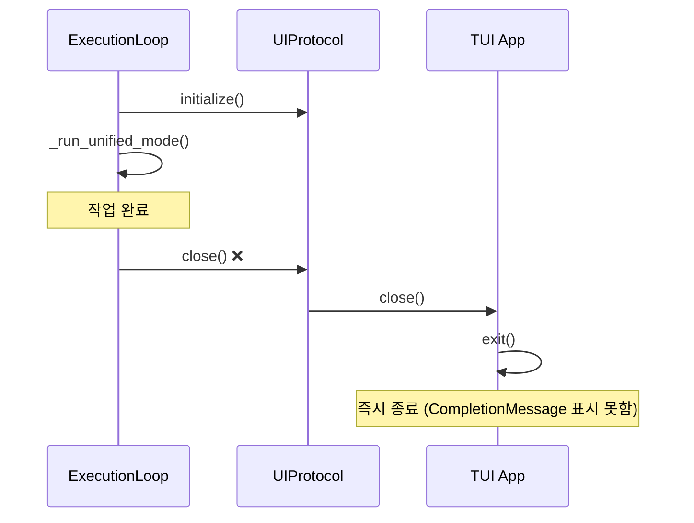
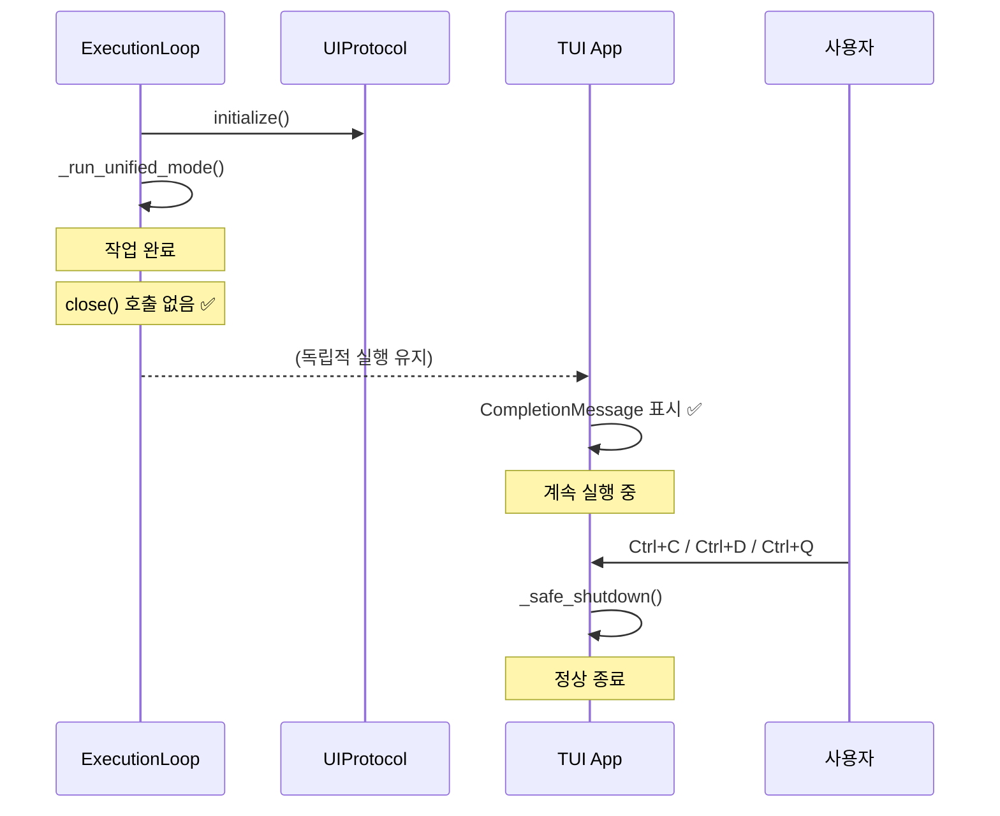
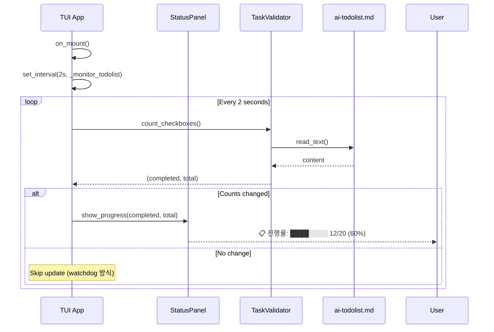

# 사용자의 최초 요청 (기록용)

TUI 가 명시적으로 ctrl + c ctrl+d 하지 않는 이상 종료되지 않도록 하는 근본적인 수정을 원함.
- Ctrl+C 두 번, Ctrl+D, Ctrl+Q 중 하나로만 명시적으로 종료 가능하도록
- 작업이 완료되어도 TUI가 자동으로 닫히지 않고, 사용자가 완료 메시지를 확인할 수 있어야 함

## 사용자가 이후에 추가 요청한 내용들 (기록용)

1. StatusPanel 수정: 유효한 status가 실제로 더 보이도록
   - ai-todolist.md에 있는 남아있는 체크박스 개수/전체 체크박스 개수 (진행률) 로그
   - watchdog 느낌으로 ai-todolist.md 수정될 때마다 업데이트
   - 변경이 생겼을 때만 찍히도록

2. 러프하게 작성한 no-close-tui.md 문서를 계획서 형식으로 변환 요청

# 작업 목표

1. **TUI 생명주기 독립성 확보**: ExecutionLoop가 TUI 생명주기를 제어하지 않도록 아키텍처 개선
2. **명시적 사용자 종료만 허용**: Ctrl+C 두 번, Ctrl+D, Ctrl+Q로만 TUI 종료 가능
3. **작업 완료 후 TUI 유지**: 완료 메시지 표시 후에도 TUI가 계속 실행되어 사용자가 결과 확인 가능
4. **StatusPanel 실시간 진행률 표시**: ai-todolist.md 체크박스 진행률을 실시간으로 모니터링하여 표시
5. **책임 분리 원칙 준수**: UI(프레젠테이션)와 ExecutionLoop(비즈니스 로직)의 계층 분리

# 작업 배경

## 현재 문제점

### 문제 1: 잘못된 책임 분배
- **근본 원인**: ExecutionLoop(비즈니스 로직)이 UI(프레젠테이션)의 생명주기를 제어
- **증상**: `ExecutionLoop.run()` 완료 시 `await self.ui.close()` 호출 → TUI가 즉시 종료됨
- **결과**: CompletionMessage가 표시되지 않고 사용자가 결과를 확인할 수 없음

### 문제 2: 계층 분리 원칙 위반
- **현재 의존성 방향**: `ExecutionLoop → UI.close()` (비즈니스 로직이 프레젠테이션 제어)
- **올바른 설계**: `ExecutionLoop ⊥ UI` (두 계층은 독립적이어야 함)

### 문제 3: 진행률 가시성 부족
- 현재 StatusPanel은 ExecutionLoop 완료 후에만 진행률 업데이트
- 실시간으로 작업 진행 상황을 확인할 수 없음

## 컴포넌트별 본질적 책임

### ExecutionLoop의 책임
- ✅ Execute-Verify 단계 오케스트레이션
- ✅ 에이전트 조정
- ✅ 피드백 루프 관리
- ❌ UI 생명주기 제어 (현재 잘못된 책임)

### TUI의 책임
- ✅ 사용자에게 정보 표시
- ✅ 사용자 입력 수집
- ✅ 자체 생명주기 관리 (사용자 액션 기반)
- ❌ 비즈니스 로직에 종속적 생명주기 (현재 문제)

# 작업 시작 여부
is_execution_started = FALSE

# 모든 목표 달성 여부
is_all_goals_accomplished = FALSE

# 병렬 실행 여부
parallel_requested = FALSE

# 현재 진행 중인 작업
- 작업 시작 전입니다.
  - 작업을 시작하면 위의 `is_execution_started` 의 값을 TRUE 로 바꾸세요.
  - 사용자가 명시적으로 "작업을 시작하라" 라고 말하기 전까지는 절대로 작업하지 않습니다.
  - **plan reviewer 에게 OKAY 사인을 받았더라도 절대 시작하지마십시오**
  - 사용자가 명시적으로 "작업을 시작하라" 라고 말하기 전까지는 절대로 작업하지 않습니다.

# 필요한 사전 지식

## 기술 스택
- **비동기 프레임워크**: anyio 4.11+ (asyncio/trio 호환 레이어)
- **TUI 프레임워크**: Textual 1.0+ (asyncio 전용)
- **타입 시스템**: Python 3.12 타입 힌트, Protocol (PEP 544)
- **테스트**: pytest, pytest-anyio (asyncio/trio 양쪽 테스트)

## 아키텍처 패턴
- **Protocol 기반 설계**: 추상 클래스 대신 typing.Protocol 사용
- **계층 분리**: UIProtocol이 ExecutionLoop와 독립적
- **메시지 기반 통신**: Textual의 post_message 패턴

## 핵심 원칙
1. **계층 분리**: 비즈니스 로직 ⊥ 프레젠테이션
2. **단일 책임**: 각 컴포넌트는 자신의 생명주기만 관리
3. **사용자 제어**: UI는 사용자 명령으로만 종료

## 파일 구조 및 역할

### 맥락 이해를 위해 참고해야 할 파일들

#### 1. sisyphus/ui/base.py
- **역할**: UIProtocol 정의 - UI 구현체가 따라야 할 인터페이스
- **참고할 부분**: `close()` 메서드 (제거 대상)
- **현재 구조**:
  ```python
  @runtime_checkable
  class UIProtocol(Protocol):
      async def initialize(self) -> None: ...
      async def show_message(self, message: AgentMessage, source: str) -> None: ...
      async def show_status(self, status: str) -> None: ...
      async def get_input(self) -> str | None: ...
      async def close(self) -> None: ...  # ❌ 제거 대상
  ```

#### 2. sisyphus/core/loop.py
- **역할**: ExecutionLoop - Execute/Verify 단계 오케스트레이션
- **참고할 부분**: `run()` 메서드의 `await self.ui.close()` 호출 (line 97)
- **주의사항**: UI 생명주기 제어 로직을 완전히 제거해야 함
- **현재 구조**:
  ```python
  async def run(self, ...) -> None:
      await self.ui.initialize()
      # ... 작업 실행 ...
      await self.ui.close()  # ❌ 제거 대상
  ```

#### 3. sisyphus/ui/tui/app.py
- **역할**: TUI 구현 - Textual 기반 터미널 UI
- **참고할 부분**:
  - `close()` 메서드 (line 279-281, 제거 대상)
  - `_safe_shutdown()` 메서드 (사용자 인터랙션용, 유지)
  - `on_key()` 메서드 (Ctrl+C, Ctrl+D 처리)
- **현재 구조**:
  ```python
  class TUI(App[None]):
      async def close(self) -> None:  # ❌ 제거 대상
          await self._safe_shutdown()

      async def _safe_shutdown(self) -> None:  # ✅ 유지
          # 사용자 인터랙션으로만 호출됨
          self.shutdown_event.set()
          self.exit()
  ```

#### 4. sisyphus/ui/cli/console.py
- **역할**: CLI 구현 - Rich Console 기반 커맨드라인 UI
- **참고할 부분**: `close()` 메서드 (line 72-74, 제거 대상)
- **주의사항**: CLI는 원래 no-op이므로 영향 최소
- **현재 구조**:
  ```python
  class CLI:
      async def close(self) -> None:  # ❌ 제거 대상
          self._initialized = False
  ```

#### 5. sisyphus/core/tasks.py
- **역할**: TaskValidator - ai-todolist.md 파싱 및 검증
- **참고할 부분**:
  - `count_total_checkboxes()` - 전체 체크박스 개수
  - `count_completed_checkboxes()` - 완료된 체크박스 개수
  - `read_content()` - 파일 읽기
- **용도**: StatusPanel 실시간 모니터링에 사용
- **예상 코드 활용**:
  ```python
  # StatusPanel 모니터링에서 이렇게 사용
  total = task_validator.count_total_checkboxes(content)
  completed = task_validator.count_completed_checkboxes(content)
  ```

#### 6. sisyphus/cli.py
- **역할**: CLI 진입점 - Typer 기반 명령행 인터페이스
- **참고할 부분**:
  - `_main_tui()` 함수 (line 180-272) - TUI 모드 실행
  - task_validator 생성 및 전달 (line 225)
- **주의사항**: 기존 생명주기 관리는 이미 올바름, 추가 수정 불필요

# 작업 계획

## PRDs & Structures

### 수정 전 아키텍처 (문제 상황)


### 수정 후 아키텍처 (올바른 설계)


### StatusPanel 실시간 모니터링 구조


## 구현 세부사항

### Part 1: UIProtocol에서 close() 제거 (Breaking Change)

**원칙**: UI 생명주기는 UI 자신과 사용자만이 제어한다.

**변경 사항**:
1. `sisyphus/ui/base.py`의 UIProtocol에서 `close()` 메서드 완전 제거
2. 독스트링 추가: UI가 자신의 생명주기를 독립적으로 관리함을 명시

**이유**:
- ExecutionLoop가 UI를 제어할 수 없도록 인터페이스 레벨에서 차단
- Protocol에서 제거되면 타입 체커가 잘못된 호출을 컴파일 타임에 감지

### Part 2: ExecutionLoop에서 ui.close() 호출 제거

**원칙**: ExecutionLoop는 작업 실행만 담당하며, UI 생명주기는 관여하지 않는다.

**변경 사항**:
1. `sisyphus/core/loop.py`의 `run()` 메서드에서 `await self.ui.close()` 라인 제거 (line 97)
2. 독스트링 업데이트: UI 생명주기 독립성 명시

**주의사항**:
- CompletionMessage는 `_main_tui()` 함수에서 post_message로 이미 전달됨
- ExecutionLoop는 단지 작업을 완료하고 반환하기만 하면 됨

### Part 3: TUI/CLI 구현체에서 close() 메서드 제거

**원칙**: UIProtocol에서 제거되었으므로 구현체에서도 불필요

**변경 사항**:
1. `sisyphus/ui/tui/app.py`의 `close()` 메서드 제거 (line 279-281)
   - `_safe_shutdown()`은 그대로 유지 (사용자 인터랙션용)
2. `sisyphus/ui/cli/console.py`의 `close()` 메서드 제거 (line 72-74)

**주의사항**:
- TUI의 `_safe_shutdown()`은 사용자가 Ctrl+C, Ctrl+D, Ctrl+Q를 눌렀을 때만 호출됨
- 이 메서드는 private이므로 외부에서 호출할 수 없음

### Part 4: StatusPanel 실시간 진행률 모니터링 추가

**원칙**: 사용자에게 작업 진행 상황을 실시간으로 보여준다.

**변경 사항**:

1. **TUI App 수정** (`sisyphus/ui/tui/app.py`):
   - 인스턴스 변수 추가:
     ```python
     self.task_validator: TaskValidator | None = None
     self._last_total_checkboxes: int = 0
     self._last_completed_checkboxes: int = 0
     ```
   - `set_task_validator()` 메서드 추가
   - `_monitor_todolist()` 백그라운드 태스크 추가
   - `on_mount()`에서 `set_interval(2.0, self._monitor_todolist)` 시작

2. **StatusPanel 수정** (`sisyphus/ui/tui/components/status_panel.py`):
   - `show_progress(completed: int, total: int)` 메서드 추가
   - 진행 바, 퍼센트, 남은 작업 수 표시

3. **CLI 수정** (`sisyphus/cli.py`):
   - `_main_tui()` 함수의 `run_execution_loop()` 내부
   - task_validator 생성 후 `ui.set_task_validator(task_validator)` 호출 (line 225 직후)

**폴링 간격**: 2초
- 너무 빠름 (< 1초): CPU 낭비
- 너무 느림 (> 5초): 실시간 느낌 상실
- 2초: 최적 균형점

### Part 5: 테스트 수정

**원칙**: close() 메서드가 제거되었으므로 관련 테스트도 제거/수정

**변경 파일**:
1. `sisyphus/core/tests/test_loop.py`: `ui.closed` assertion 제거
2. `sisyphus/ui/tests/test_base.py`: `close()` 테스트 케이스 수정
3. `sisyphus/ui/tests/test_tui.py`: TUI close 관련 테스트 확인 및 수정

**전략**:
- UI가 "작동 중"인지 검증하려면 `ui.initialized` 상태 확인
- close() 대신 작업 완료를 다른 방식으로 검증 (메시지 개수 등)

### Part 6: Ctrl+Q 지원 추가 (선택사항)

**원칙**: 사용자가 요청한 종료 방법 지원

**변경 사항** (`sisyphus/ui/tui/app.py`):
```python
BINDINGS = [
    ("ctrl+c", "interrupt", "Interrupt"),
    ("ctrl+d", "quit", "Quit"),
    ("ctrl+q", "quit", "Quit"),  # ✅ 추가
]

async def on_key(self, event: Key) -> None:
    """Ctrl+C, Ctrl+D, Ctrl+Q 처리."""
    if event.key == "ctrl+c":
        await self._handle_interrupt()
    elif event.key in ("ctrl+d", "ctrl+q"):
        await self._safe_shutdown()
```

## 프로젝트 커밋 메시지 스타일

```
# 분석 결과: 소문자 시작, 명령형, 간결한 설명
ai reset
prompt update
verify first
change prompt as agentsdk_loop.py one
verify now works (for sure, i tested)
```

**패턴**:
- 소문자로 시작
- 동사 명령형 (add, fix, remove, update 등)
- 간결하고 직접적인 설명
- 특별한 경우 괄호로 추가 설명

**적용 예시**:
- `remove close() from UIProtocol for lifecycle independence`
- `add real-time checkbox progress monitoring to StatusPanel`
- `remove ui.close() calls from ExecutionLoop`

# TODOs

- [ ] 1. UIProtocol에서 close() 메서드 제거
  - [ ] 1.1 구현: sisyphus/ui/base.py 수정
    ```python
    # 현재 (line 31-33)
    async def close(self) -> None:
        """UI 종료."""
        ...

    # 변경: 위 메서드 완전 제거
    # 클래스 독스트링에 다음 추가:
    """UI 구현이 따라야 할 프로토콜.

    UI 생명주기는 UI 자신이 관리합니다. ExecutionLoop는 UI 생명주기에
    관여하지 않으며, 단지 메시지와 상태를 표시하는 인터페이스만 사용합니다.
    """
    ```
  - [ ] 1.2 타입 체크: `uv run basedpyright sisyphus/ui/base.py`
  - [ ] 아래의 가이드대로 진행했을 때 Orchestrator 1번 작업 검증 성공 여부
    - [ ] sisyphus/ui/base.py 파일을 열어 UIProtocol 클래스에 `close()` 메서드가 완전히 제거되었는가?
    - [ ] 클래스 독스트링에 UI 생명주기 독립성에 관한 설명이 추가되었는가?
    - [ ] basedpyright 타입 체크가 통과하는가?
    - [ ] 실제 코드를 읽어보았을 때 기존 코드 스타일을 유지하면서 수정되었는가?

- [ ] 2. ExecutionLoop에서 ui.close() 호출 제거
  - [ ] 2.1 구현: sisyphus/core/loop.py의 `run()` 메서드 수정
    ```python
    # 현재 (line 63-97)
    async def run(
        self,
        execute_prompt: str | None,
        execute_extra: str | None = None,
        verify_prompt: str | None = None,
        verify_extra: str | None = None,
    ) -> None:
        """Run the execution loop in unified mode."""
        await self.ui.initialize()
        actual_execute_prompt = execute_prompt if execute_prompt is not None else DEFAULT_EXECUTE_PROMPT
        await self._run_unified_mode(actual_execute_prompt, execute_extra, verify_prompt, verify_extra)
        await self.ui.close()  # ❌ 이 라인 제거

    # 변경 후:
    async def run(
        self,
        execute_prompt: str | None,
        execute_extra: str | None = None,
        verify_prompt: str | None = None,
        verify_extra: str | None = None,
    ) -> None:
        """Run the execution loop in unified mode.

        ExecutionLoop는 작업 실행만 담당하며, UI 생명주기는 관여하지 않습니다.
        작업 완료 후 UI는 사용자가 명시적으로 종료할 때까지 계속 실행됩니다.
        """
        await self.ui.initialize()
        actual_execute_prompt = execute_prompt if execute_prompt is not None else DEFAULT_EXECUTE_PROMPT
        await self._run_unified_mode(actual_execute_prompt, execute_extra, verify_prompt, verify_extra)
        # ui.close() 제거 - UI 생명주기는 UI가 독립적으로 관리
    ```
  - [ ] 2.2 타입 체크: `uv run basedpyright sisyphus/core/loop.py`
  - [ ] 아래의 가이드대로 진행했을 때 Orchestrator 2번 작업 검증 성공 여부
    - [ ] sisyphus/core/loop.py 파일의 `run()` 메서드에서 `await self.ui.close()` 호출이 제거되었는가?
    - [ ] 독스트링이 업데이트되어 UI 생명주기 독립성을 명시하는가?
    - [ ] basedpyright 타입 체크가 통과하는가?
    - [ ] 다른 부분의 로직은 그대로 유지되었는가?

- [ ] 3. TUI에서 close() 메서드 제거
  - [ ] 3.1 구현: sisyphus/ui/tui/app.py 수정
    ```python
    # 현재 (line 279-281)
    async def close(self) -> None:
        """UI 종료."""
        await self._safe_shutdown()

    # 변경: 위 메서드 완전 제거
    # _safe_shutdown()은 그대로 유지 (사용자 인터랙션용)
    ```
  - [ ] 3.2 타입 체크: `uv run basedpyright sisyphus/ui/tui/app.py`
  - [ ] 아래의 가이드대로 진행했을 때 Orchestrator 3번 작업 검증 성공 여부
    - [ ] sisyphus/ui/tui/app.py의 TUI 클래스에서 `close()` 메서드가 제거되었는가?
    - [ ] `_safe_shutdown()` 메서드는 그대로 유지되었는가?
    - [ ] basedpyright 타입 체크가 통과하는가?
    - [ ] 기존 코드 스타일을 유지하면서 수정되었는가?

- [ ] 4. CLI에서 close() 메서드 제거
  - [ ] 4.1 구현: sisyphus/ui/cli/console.py 수정
    ```python
    # 현재 (line 72-74)
    async def close(self) -> None:
        """Close CLI (no-op for console)."""
        self._initialized = False

    # 변경: 위 메서드 완전 제거
    ```
  - [ ] 4.2 타입 체크: `uv run basedpyright sisyphus/ui/cli/console.py`
  - [ ] 아래의 가이드대로 진행했을 때 Orchestrator 4번 작업 검증 성공 여부
    - [ ] sisyphus/ui/cli/console.py의 CLI 클래스에서 `close()` 메서드가 제거되었는가?
    - [ ] basedpyright 타입 체크가 통과하는가?
    - [ ] 다른 메서드들은 영향받지 않았는가?

- [ ] 5. StatusPanel에 show_progress() 메서드 추가
  - [ ] 5.1 구현: sisyphus/ui/tui/components/status_panel.py 수정
    ```python
    # 추가할 메서드:
    def show_progress(self, completed: int, total: int) -> None:
        """Show checkbox progress with visual progress bar.

        Args:
            completed: Number of completed checkboxes
            total: Total number of checkboxes
        """
        if total == 0:
            return  # 체크박스 없으면 표시 안함

        percentage = int((completed / total) * 100)
        remaining = total - completed

        # 시각적 진행 바 생성
        bar_length = 20
        filled = int((completed / total) * bar_length)
        bar = "█" * filled + "░" * (bar_length - filled)

        # Rich 마크업으로 포맷팅
        self.write(
            f"[cyan]📋 진행률:[/cyan] {bar} "
            f"[bold]{completed}/{total}[/bold] ({percentage}%) "
            f"[dim]| 남은 작업: {remaining}개[/dim]"
        )
    ```
  - [ ] 5.2 타입 체크: `uv run basedpyright sisyphus/ui/tui/components/status_panel.py`
  - [ ] 아래의 가이드대로 진행했을 때 Orchestrator 5번 작업 검증 성공 여부
    - [ ] StatusPanel 클래스에 `show_progress()` 메서드가 추가되었는가?
    - [ ] 메서드의 모든 파라미터에 타입 힌트가 있는가? (ANN001 규칙 준수)
    - [ ] 진행 바, 퍼센트, 남은 작업 수가 모두 표시되는가?
    - [ ] basedpyright 타입 체크가 통과하는가?
    - [ ] 기존 StatusPanel 스타일과 일관성 있게 구현되었는가?

- [ ] 6. TUI에 실시간 체크박스 모니터링 추가
  - [ ] 6.1 구현: sisyphus/ui/tui/app.py의 TUI 클래스 수정
    ```python
    # __init__에 추가:
    def __init__(self) -> None:
        super().__init__()
        # ... 기존 코드 ...
        self.task_validator: TaskValidator | None = None
        self._last_total_checkboxes: int = 0
        self._last_completed_checkboxes: int = 0

    # 새 메서드 추가:
    def set_task_validator(self, task_validator: TaskValidator | None) -> None:
        """Set task validator for checkbox monitoring.

        Args:
            task_validator: TaskValidator instance to monitor ai-todolist.md
        """
        self.task_validator = task_validator

    async def _monitor_todolist(self) -> None:
        """Background task to monitor ai-todolist.md changes.

        Polls the todolist file every 2 seconds and updates StatusPanel
        only when checkbox counts change.
        """
        if self.task_validator is None:
            return

        try:
            content = self.task_validator.read_content()
            if not content:  # 파일 없거나 비어있음
                return

            total = self.task_validator.count_total_checkboxes(content)
            completed = self.task_validator.count_completed_checkboxes(content)

            # 변경이 있을 때만 업데이트 (watchdog 느낌)
            if total != self._last_total_checkboxes or completed != self._last_completed_checkboxes:
                self._last_total_checkboxes = total
                self._last_completed_checkboxes = completed

                status_panel = self.query_one(StatusPanel)
                status_panel.show_progress(completed, total)

        except FileNotFoundError:
            # 파일이 삭제되었거나 아직 생성 안됨 - 조용히 무시
            pass
        except Exception as e:
            self.log.error(f"Error monitoring todolist: {e}")

    # on_mount() 수정:
    async def on_mount(self) -> None:
        """초기화."""
        self.title = "Sisyphus - Multi-Agent Execution System"
        self.sub_title = "Execute & Verify"

        # ✨ 새로 추가: task_validator가 있으면 모니터링 시작
        if self.task_validator is not None:
            self.set_interval(2.0, self._monitor_todolist)  # 2초마다 폴링

        self.ready_event.set()
    ```
  - [ ] 6.2 타입 체크: `uv run basedpyright sisyphus/ui/tui/app.py`
  - [ ] 아래의 가이드대로 진행했을 때 Orchestrator 6번 작업 검증 성공 여부
    - [ ] TUI.__init__에 task_validator 관련 인스턴스 변수 3개가 추가되었는가?
    - [ ] `set_task_validator()` 메서드가 추가되었는가?
    - [ ] `_monitor_todolist()` 메서드가 추가되었는가?
    - [ ] `on_mount()`에서 task_validator가 있을 때 `set_interval()` 호출이 추가되었는가?
    - [ ] 모든 메서드 파라미터에 타입 힌트가 있는가? (ANN001 규칙 준수)
    - [ ] FileNotFoundError와 일반 Exception을 적절히 처리하는가?
    - [ ] basedpyright 타입 체크가 통과하는가?
    - [ ] 기존 TUI 클래스 스타일을 유지하면서 수정되었는가?

- [ ] 7. CLI에서 TUI에 task_validator 전달
  - [ ] 7.1 구현: sisyphus/cli.py의 `_main_tui()` 함수 수정
    ```python
    # _main_tui 함수 내부 run_execution_loop() 함수의 line 225 직후에 추가:

    # 현재 (line 225):
    task_validator = TaskValidator() if Path("ai-todolist.md").exists() else None

    # 바로 다음에 추가:
    # ✨ 새로 추가: TUI에 task_validator 전달
    if isinstance(ui, TUI):
        ui.set_task_validator(task_validator)

    # 그 다음 기존 코드:
    loop = ExecutionLoop(
        execute_agent=execute_agent,
        ui=ui,
        session_store=session_store,
        prompt_resolver=prompt_resolver,
        logger_factory=logger_factory,
        verify_agent=verify_agent,
        task_validator=task_validator,
    )
    ```
  - [ ] 7.2 타입 체크: `uv run basedpyright sisyphus/cli.py`
  - [ ] 아래의 가이드대로 진행했을 때 Orchestrator 7번 작업 검증 성공 여부
    - [ ] sisyphus/cli.py의 `_main_tui()` 함수에 `ui.set_task_validator()` 호출이 추가되었는가?
    - [ ] `isinstance(ui, TUI)` 체크를 통해 타입 안전성을 보장하는가?
    - [ ] ExecutionLoop 생성 코드는 그대로 유지되었는가?
    - [ ] basedpyright 타입 체크가 통과하는가?
    - [ ] 기존 코드 흐름을 방해하지 않으면서 추가되었는가?

- [ ] 8. 테스트 파일 수정 - test_loop.py
  - [ ] 8.1 구현: sisyphus/core/tests/test_loop.py에서 ui.closed 체크 제거
    ```python
    # 현재: ui.closed assertion이 있는 모든 테스트 찾기
    # rg "ui\.closed" sisyphus/core/tests/test_loop.py --line-number

    # 변경: ui.closed 체크를 다른 방식으로 변경
    # Before:
    # assert ui.closed

    # After (예시):
    # assert ui.initialized
    # assert len(ui.messages) > 0  # 작업이 실행되었는지 확인
    # UI가 여전히 작동 중임을 나타내는 다른 상태로 검증
    ```
  - [ ] 8.2 테스트 실행: `uv run pytest sisyphus/core/tests/test_loop.py -xvs`
  - [ ] 아래의 가이드대로 진행했을 때 Orchestrator 8번 작업 검증 성공 여부
    - [ ] test_loop.py에서 `ui.closed` 관련 assertion이 모두 제거되었는가?
    - [ ] 대체 검증 로직이 적절히 추가되었는가?
    - [ ] pytest 실행 시 모든 테스트가 통과하는가?
    - [ ] 기존 테스트 구조 (Given-When-Then)를 유지하는가?
    - [ ] basedpyright 타입 체크가 통과하는가?

- [ ] 9. 테스트 파일 수정 - test_base.py
  - [ ] 9.1 구현: sisyphus/ui/tests/test_base.py의 close() 테스트 수정
    ```python
    # 현재: close() 관련 테스트가 있는지 확인
    # rg "def test.*close" sisyphus/ui/tests/test_base.py --line-number

    # 변경 예시:
    # Before:
    # async def test_ui_protocol__if_basic_lifecycle__works():
    #     ui = MockUI()
    #     assert not ui.closed
    #     await ui.initialize()
    #     await ui.close()
    #     assert ui.closed

    # After:
    # async def test_ui_protocol__if_basic_lifecycle__works():
    #     ui = MockUI()
    #     assert not ui.initialized
    #     await ui.initialize()
    #     assert ui.initialized
    #     # close() 테스트 제거 - UIProtocol에서 close()가 제거됨
    ```
  - [ ] 9.2 MockUI 클래스 수정: closed 속성 제거 (필요시)
  - [ ] 9.3 테스트 실행: `uv run pytest sisyphus/ui/tests/test_base.py -xvs`
  - [ ] 아래의 가이드대로 진행했을 때 Orchestrator 9번 작업 검증 성공 여부
    - [ ] test_base.py에서 close() 관련 테스트가 적절히 수정되었는가?
    - [ ] MockUI 클래스에서 closed 속성이 제거되었는가 (필요시)?
    - [ ] pytest 실행 시 모든 테스트가 통과하는가?
    - [ ] 기존 테스트 구조를 유지하는가?
    - [ ] basedpyright 타입 체크가 통과하는가?

- [ ] 10. 테스트 파일 수정 - test_tui.py
  - [ ] 10.1 구현: sisyphus/ui/tests/test_tui.py의 close() 관련 테스트 확인 및 수정
    ```python
    # close() 관련 테스트 확인
    # rg "close" sisyphus/ui/tests/test_tui.py --line-number

    # 필요시 수정 (파일 내용에 따라 다름)
    ```
  - [ ] 10.2 테스트 실행: `uv run pytest sisyphus/ui/tests/test_tui.py -xvs`
  - [ ] 아래의 가이드대로 진행했을 때 Orchestrator 10번 작업 검증 성공 여부
    - [ ] test_tui.py의 모든 close() 관련 코드가 적절히 처리되었는가?
    - [ ] pytest 실행 시 모든 테스트가 통과하는가?
    - [ ] basedpyright 타입 체크가 통과하는가?

- [ ] 11. Ctrl+Q 지원 추가 (선택사항)
  - [ ] 11.1 구현: sisyphus/ui/tui/app.py의 BINDINGS 및 on_key() 수정
    ```python
    # BINDINGS에 추가:
    BINDINGS = [
        ("ctrl+c", "interrupt", "Interrupt"),
        ("ctrl+d", "quit", "Quit"),
        ("ctrl+q", "quit", "Quit"),  # ✅ 새로 추가
    ]

    # on_key() 메서드 수정:
    async def on_key(self, event: Key) -> None:
        """Ctrl+C, Ctrl+D, Ctrl+Q 처리.

        Args:
            event: 키 이벤트
        """
        if event.key == "ctrl+c":
            await self._handle_interrupt()
        elif event.key in ("ctrl+d", "ctrl+q"):  # ✅ ctrl+q 추가
            await self._safe_shutdown()
    ```
  - [ ] 11.2 타입 체크: `uv run basedpyright sisyphus/ui/tui/app.py`
  - [ ] 아래의 가이드대로 진행했을 때 Orchestrator 11번 작업 검증 성공 여부
    - [ ] BINDINGS에 ctrl+q가 추가되었는가?
    - [ ] on_key() 메서드에서 ctrl+q를 처리하는가?
    - [ ] basedpyright 타입 체크가 통과하는가?
    - [ ] 기존 키 바인딩 처리 로직을 방해하지 않는가?

- [ ] 12. 전체 통합 테스트 및 커밋
  - [ ] 12.1 전체 타입 체크: `uv run basedpyright`
  - [ ] 12.2 전체 테스트 실행: `uv run pytest sisyphus/`
  - [ ] 12.3 린트 체크: `uv run ruff check sisyphus/`
  - [ ] 12.4 포맷 체크: `uv run ruff format --check sisyphus/`
  - [ ] 12.5 커밋 (프로젝트 컨벤션 준수):
    ```bash
    git add sisyphus/ui/base.py \
            sisyphus/core/loop.py \
            sisyphus/ui/tui/app.py \
            sisyphus/ui/cli/console.py \
            sisyphus/ui/tui/components/status_panel.py \
            sisyphus/cli.py \
            sisyphus/core/tests/test_loop.py \
            sisyphus/ui/tests/test_base.py \
            sisyphus/ui/tests/test_tui.py

    git commit -m "remove close() from UIProtocol for lifecycle independence

    - remove ui.close() from ExecutionLoop.run()
    - remove close() methods from TUI and CLI implementations
    - add real-time checkbox progress monitoring to StatusPanel
    - add Ctrl+Q support for TUI shutdown
    - update tests to reflect new lifecycle management

    TUI now continues running after work completion until user explicitly
    terminates with Ctrl+C (twice), Ctrl+D, or Ctrl+Q"
    ```
  - [ ] 아래의 가이드대로 진행했을 때 Orchestrator 12번 작업 검증 성공 여부
    - [ ] basedpyright 타입 체크가 완전히 통과하는가?
    - [ ] 모든 pytest 테스트가 통과하는가?
    - [ ] ruff lint와 format이 통과하는가?
    - [ ] 커밋 메시지가 프로젝트 스타일을 따르는가? (소문자 시작, 명령형)
    - [ ] 모든 수정된 파일이 커밋에 포함되었는가?

- [ ] 13. 수동 TUI 테스트
  - [ ] 13.1 TUI 모드 실행: `uv run sisyphus run --execute claude:sonnet`
  - [ ] 13.2 검증 시나리오:
    1. Execute 실행 → 완료
    2. "모든 작업이 완료되었습니다" 메시지 표시 확인 ✅
    3. "Ctrl+C 두 번으로 종료할 수 있습니다" 표시 확인 ✅
    4. TUI가 계속 실행 중 (닫히지 않음) 확인 ✅
    5. ai-todolist.md 있을 때 진행률 표시 확인 ✅
    6. ai-todolist.md 체크박스 수정 → 2초 후 진행률 업데이트 확인 ✅
    7. Ctrl+C 한 번 → "한 번 더 누르면 종료" 경고 확인 ✅
    8. Ctrl+C 두 번 → 정상 종료 확인 ✅
    9. Ctrl+D → 즉시 정상 종료 확인 ✅
    10. Ctrl+Q → 즉시 정상 종료 확인 ✅
  - [ ] 아래의 가이드대로 진행했을 때 Orchestrator 13번 작업 검증 성공 여부
    - [ ] 위 10가지 시나리오가 모두 정상 작동하는가?
    - [ ] TUI가 작업 완료 후에도 닫히지 않는가?
    - [ ] 진행률이 실시간으로 업데이트되는가?
    - [ ] 모든 종료 방법 (Ctrl+C 두 번, Ctrl+D, Ctrl+Q)이 작동하는가?
    - [ ] CompletionMessage가 제대로 표시되는가?

# 최종 작업 검증 체크리스트

- [ ] 1. TUI 생명주기 독립성 달성
  - [ ] UIProtocol에 close() 메서드가 존재하지 않는가?
  - [ ] ExecutionLoop가 UI 생명주기를 제어하는 코드가 없는가?
  - [ ] TUI가 작업 완료 후에도 계속 실행되는가?

- [ ] 2. 명시적 사용자 종료만 허용
  - [ ] Ctrl+C 두 번으로 종료되는가?
  - [ ] Ctrl+D로 즉시 종료되는가?
  - [ ] Ctrl+Q로 즉시 종료되는가?
  - [ ] 작업 완료 시 자동 종료되지 않는가?

- [ ] 3. 실시간 진행률 모니터링 작동
  - [ ] StatusPanel에 진행률이 표시되는가?
  - [ ] ai-todolist.md 변경 시 2초 내에 업데이트되는가?
  - [ ] 변경이 없을 때는 로그가 추가되지 않는가?
  - [ ] 진행 바, 퍼센트, 남은 작업 수가 모두 표시되는가?

- [ ] 4. 기존 기능 영향 없음
  - [ ] CLI 모드가 정상 작동하는가?
  - [ ] Execute-Verify 루프가 정상 작동하는가?
  - [ ] TaskValidator가 정상 작동하는가?
  - [ ] SessionStore가 정상 작동하는가?

- [ ] 5. 코드 품질
  - [ ] 모든 파일에서 basedpyright 타입 체크가 통과하는가?
  - [ ] 모든 테스트가 통과하는가?
  - [ ] ruff lint/format이 통과하는가?
  - [ ] 커밋 메시지가 프로젝트 스타일을 따르는가?

- [ ] 6. 아키텍처 원칙 준수
  - [ ] 계층 분리: 비즈니스 로직과 프레젠테이션이 독립적인가?
  - [ ] 단일 책임: 각 컴포넌트가 자신의 생명주기만 관리하는가?
  - [ ] 사용자 제어: UI가 사용자 명령으로만 종료되는가?

- [ ] 7. 사용자 요구사항 완전 충족
  - [ ] TUI가 명시적 종료 명령 없이 닫히지 않는가?
  - [ ] 작업 완료 메시지를 사용자가 확인할 수 있는가?
  - [ ] 진행률을 실시간으로 확인할 수 있는가?
  - [ ] 최초 요청한 모든 기능이 구현되었는가?
