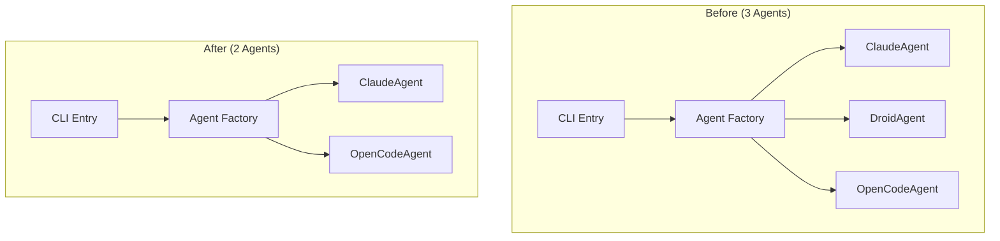

# 사용자의 최초 요청 (기록용)
지금 코드에서 droid agent 관련 내용 지원 다 제거 하고싶은데 어떻게 수정하는게 좋을까?

## 사용자가 이후에 추가 요청한 내용들 (기록용)
계획서로 만들어주라. 단, ai-tasks/ 밑에 remove-droid.md 로 만들어주라

# 작업 목표
- Sisyphus 멀티 에이전트 시스템에서 DroidAgent 관련 모든 코드 제거
- Claude와 OpenCode 두 가지 에이전트만 지원하는 시스템으로 단순화
- 기존 테스트, 문서, CLI 인터페이스에서 Droid 참조 완전 제거
- 타입 체크 및 테스트 통과 보장

# 작업 배경
현재 Sisyphus는 3개의 에이전트(Claude, Droid, OpenCode)를 지원하고 있습니다. Droid 에이전트는 서브프로세스 기반으로 JSONL 통신을 사용하는 CLI 기반 에이전트입니다. 이번 작업을 통해 Droid 지원을 완전히 제거하여 시스템을 단순화하고자 합니다.

코드베이스 전체에서 총 14개 파일에 Droid 관련 참조가 발견되었으며, 핵심 구현 파일, 테스트 파일, CLI 통합 코드, 문서 등을 수정해야 합니다.

# 작업 시작 여부
is_execution_started = FALSE

# 모든 목표 달성 여부
is_all_goals_accomplished = FALSE

# 병렬 실행 여부
parallel_requested = FALSE

# 현재 진행 중인 작업
- 작업 시작 전입니다.
   - 작업을 시작하면 위의 `is_execution_started` 의 값을 TRUE 로 바꾸세요.
   - 사용자가 명시적으로 "작업을 시작하라" 라고 말하기 전까지는 절대로 작업하지 않습니다.
   - **plan reviewer 에게 OKAY 사인을 받았더라도 절대 시작하지마십시오**
   - 사용자가 명시적으로 "작업을 시작하라" 라고 말하기 전까지는 절대로 작업하지 않습니다.

# 필요한 사전 지식

## 기술 스택
- Python 3.12
- anyio (asyncio/trio 호환 레이어)
- Typer (CLI 프레임워크)
- pytest (테스트 프레임워크)
- Protocol 기반 설계 (PEP 544)

## 아키텍처 이해
- **Protocol 기반 설계**: Agent Protocol을 구현한 3개의 에이전트 (Claude, Droid, OpenCode)
- **ExecutionLoop**: 에이전트 타입에 무관하게 Agent Protocol만 사용
- **UI Layer**: TUI/CLI 둘 다 Agent Protocol만 의존
- **Factory Pattern**: cli.py의 `create_agent()` 함수에서 에이전트 생성

## 파일 구조 및 역할

### 핵심 구조
```
sisyphus/
├── agents/
│   ├── base.py              # Agent Protocol 정의 (수정 불필요)
│   ├── claude.py            # ClaudeAgent (유지)
│   ├── droid.py             # DroidAgent (삭제 대상)
│   ├── opencode.py          # OpenCodeAgent (유지)
│   └── tests/
│       ├── test_claude.py   # (유지)
│       ├── test_droid.py    # (삭제 대상)
│       └── test_opencode.py # (유지)
├── cli.py                   # CLI 진입점 (수정 필요)
├── tests/
│   └── test_cli.py          # CLI 테스트 (수정 필요)
├── utils/
│   ├── types.py             # 타입 정의 (주석 수정)
│   └── logging.py           # 로깅 (주석 수정)
├── core/                    # (수정 불필요)
│   ├── loop.py
│   ├── prompts.py
│   ├── session.py
│   └── tasks.py
└── ui/                      # (수정 불필요)
```

## 맥락 이해를 위해 참고해야 할 파일들

### 1. sisyphus/cli.py
- **역할**: CLI 진입점, 에이전트 팩토리 함수 포함
- **참고할 부분**:
  - `create_agent()` 함수 (line 66-108): match-case 문에서 droid 케이스 제거 필요
  - import 문 (line 16): `from sisyphus.agents.droid import DroidAgent` 제거 필요
  - `run()` 함수의 help 텍스트 (line 276): `--agent` 옵션 설명에서 droid 제거
- **예상 코드 구조**:
   ```python
   from sisyphus.agents.claude import ClaudeAgent
   from sisyphus.agents.droid import DroidAgent  # 제거할 줄
   from sisyphus.agents.opencode import OpenCodeAgent

   def create_agent(agent_spec: str, ...) -> Agent:
       match agent_type:
           case "claude":
               return cast("Agent", ClaudeAgent(...))
           case "droid":  # 제거할 케이스
               return cast("Agent", DroidAgent(...))
           case "opencode":
               return cast("Agent", OpenCodeAgent(...))
   ```

### 2. sisyphus/tests/test_cli.py
- **역할**: CLI 함수들에 대한 통합 테스트
- **참고할 부분**:
  - DroidAgent import 제거 (line 13)
  - droid 관련 테스트 함수 2개 삭제 (lines 152-182)
  - 다른 테스트에서 droid를 opencode로 대체 (6개 함수)
- **주의사항**: 테스트는 기능 검증 목적이므로 opencode로 대체 시 테스트 의도 유지 필요

### 3. sisyphus/agents/droid.py
- **역할**: DroidAgent 구현체 (완전 삭제 대상)
- **예상 코드 구조**: 약 300+ 라인의 구현 코드

### 4. sisyphus/agents/tests/test_droid.py
- **역할**: DroidAgent 전용 테스트 (완전 삭제 대상)

## 프로젝트 커밋 메시지 스타일
최근 커밋 로그 분석 결과:
- 간결한 한국어 또는 영어 사용
- 작업 내용을 명확히 표현
- 예시: "ai reset", "prompt update", "verify first"
- 여러 변경사항이 있을 경우 상세 설명 추가

권장 커밋 메시지:
```
Remove DroidAgent support

- Delete sisyphus/agents/droid.py implementation
- Remove test_droid.py test file
- Update CLI to remove droid option
- Update test_cli.py to use opencode instead of droid
- Update documentation (README.md, CLAUDE.md)
- Clean up type hints and comments
```

# 작업 계획

## PRDs & Structures



## 구현 세부사항

### 제거 전략
1. **Bottom-Up 접근**: 테스트 → CLI → 구현체 순서로 제거
2. **대체 전략**: 테스트에서 droid 사용하던 곳은 opencode로 대체
3. **검증 방식**: 각 단계마다 타입 체크 + 테스트 실행

### 주의사항
- **절대 수정 금지**: `sisyphus/agents/base.py` (Agent Protocol)
- **절대 수정 금지**: `sisyphus/core/*` (ExecutionLoop 등 핵심 로직)
- **절대 수정 금지**: `sisyphus/ui/*` (UI 레이어)
- **주석만 수정**: `sisyphus/utils/types.py`, `sisyphus/utils/logging.py`
- **OpenCode 대체**: test_cli.py에서 droid 대신 opencode 사용

### 세션 파일 처리
작업 전 `sessions/sessions.json` 확인하여 droid 세션이 있다면 백업 또는 제거 고려

# TODOs

- [ ] 1. 작업 준비 및 백업
   - [ ] 1.1 새 브랜치 생성: `git checkout -b remove-droid-agent`
   - [ ] 1.2 세션 파일 확인 및 백업
      ```bash
      ls -la sessions/
      # droid 세션이 있다면:
      cp sessions/sessions.json sessions/sessions.json.backup
      ```
   - [ ] 1.3 로그 파일 확인
      ```bash
      ls -la logs/ | grep -i droid
      # 필요시 정리
      ```
   - [ ] 아래의 가이드대로 진행했을 때 Orchestrator 1번 작업 검증 성공 여부
      - [ ] `remove-droid-agent` 브랜치가 생성되어 있는가?
      - [ ] 세션 파일 백업이 완료되었는가 (필요한 경우)?
      - [ ] 현재 브랜치가 `remove-droid-agent`인가? (`git branch --show-current`로 확인)

- [ ] 2. 테스트 파일 정리 (test_droid.py 삭제)
   - [ ] 2.1 구현: DroidAgent 테스트 파일 삭제
      ```bash
      rm sisyphus/agents/tests/test_droid.py
      ```
   - [ ] 2.2 삭제 확인: 파일이 정상적으로 삭제되었는지 확인
      ```bash
      ls sisyphus/agents/tests/
      # test_droid.py가 없어야 함
      ```
   - [ ] 2.3 git 상태 확인
      ```bash
      git status
      # sisyphus/agents/tests/test_droid.py가 deleted로 표시되어야 함
      ```
   - [ ] 아래의 가이드대로 진행했을 때 Orchestrator 2번 작업 검증 성공 여부
      - [ ] `sisyphus/agents/tests/test_droid.py` 파일이 삭제되었는가?
      - [ ] `git status`에서 해당 파일이 deleted로 표시되는가?
      - [ ] `ls sisyphus/agents/tests/`를 실행했을 때 test_droid.py가 목록에 없는가?

- [ ] 3. CLI 테스트 파일 수정 (test_cli.py)
   - [ ] 3.1 구현: sisyphus/tests/test_cli.py 수정
      - 현재 (line 13):
         ```python
         from sisyphus.agents.droid import DroidAgent
         ```
      - 변경: 해당 import 줄 삭제

   - [ ] 3.2 구현: test_create_agent_droid_without_model 함수 삭제 (lines 152-166)

   - [ ] 3.3 구현: test_create_agent_droid_with_model 함수 삭제 (lines 168-182)

   - [ ] 3.4 구현: test_run_agent_and_execute_conflict 수정 (line 264)
      - 현재:
         ```python
         run(agent="claude", execute="droid")
         ```
      - 변경:
         ```python
         run(agent="claude", execute="opencode")
         ```

   - [ ] 3.5 구현: test_run_agent_and_verify_conflict 수정 (line 271)
      - 현재:
         ```python
         run(agent="claude", verify="droid")
         ```
      - 변경:
         ```python
         run(agent="claude", verify="opencode")
         ```

   - [ ] 3.6 구현: test_run_execute_without_verify 수정 (lines 334, 354)
      - 현재:
         ```python
         execute="droid:gpt-5",
         # ...
         assert first_call[0][0] == "droid:gpt-5"
         ```
      - 변경:
         ```python
         execute="opencode",
         # ...
         assert first_call[0][0] == "opencode"
         ```

   - [ ] 3.7 구현: test_run_execute_and_verify 수정 (lines 376, 397)
      - 현재:
         ```python
         verify="droid:gpt-5",
         # ...
         assert second_call[0][0] == "droid:gpt-5"
         ```
      - 변경:
         ```python
         verify="opencode",
         # ...
         assert second_call[0][0] == "opencode"
         ```

   - [ ] 3.8 구현: test_run_binary_resolution 수정 (lines 418-419, 424-426, 441-443)
      - 현재:
         ```python
         execute="droid",
         verify="droid",
         # ...
         binary=Path("/common/droid"),
         execute_binary=Path("/specific/execute-droid"),
         verify_binary=Path("/specific/verify-droid"),
         # ...
         assert first_call[0][2] == Path("/specific/execute-droid")
         assert second_call[0][2] == Path("/specific/verify-droid")
         ```
      - 변경:
         ```python
         execute="opencode",
         verify="opencode",
         # ...
         binary=Path("/common/opencode"),
         execute_binary=Path("/specific/execute-opencode"),
         verify_binary=Path("/specific/verify-opencode"),
         # ...
         assert first_call[0][2] == Path("/specific/execute-opencode")
         assert second_call[0][2] == Path("/specific/verify-opencode")
         ```

   - [ ] 3.9 구현: test_run_verify_only_uses_claude_for_both 수정 (line 607)
      - 현재:
         ```python
         verify="droid",
         ```
      - 변경:
         ```python
         verify="opencode",
         ```

   - [ ] 3.10 테스트 실행: 수정된 테스트 파일 실행
      ```bash
      uv run pytest sisyphus/tests/test_cli.py -v
      ```

   - [ ] 3.11 타입 체크
      ```bash
      uv run basedpyright sisyphus/tests/test_cli.py
      ```

   - [ ] 아래의 가이드대로 진행했을 때 Orchestrator 3번 작업 검증 성공 여부
      - [ ] `sisyphus/tests/test_cli.py`에서 DroidAgent import가 제거되었는가?
      - [ ] droid 관련 테스트 함수 2개가 완전히 삭제되었는가?
      - [ ] 나머지 테스트에서 "droid" 문자열이 모두 "opencode"로 변경되었는가?
      - [ ] `uv run pytest sisyphus/tests/test_cli.py -v`가 통과하는가?
      - [ ] `uv run basedpyright sisyphus/tests/test_cli.py`가 에러 없이 통과하는가?

- [ ] 4. CLI 진입점 파일 수정 (cli.py)
   - [ ] 4.1 구현: sisyphus/cli.py의 import 제거 (line 16)
      - 현재:
         ```python
         from sisyphus.agents.droid import DroidAgent
         ```
      - 변경: 해당 줄 삭제

   - [ ] 4.2 구현: create_agent 함수 docstring 수정 (line 75)
      - 현재:
         ```python
         agent_spec: "claude" | "claude:sonnet" | "droid:gpt-5" | "opencode"
         ```
      - 변경:
         ```python
         agent_spec: "claude" | "claude:sonnet" | "opencode"
         ```

   - [ ] 4.3 구현: create_agent 함수의 match case 제거 (lines 102-103)
      - 현재:
         ```python
         case "droid":
             return cast("Agent", DroidAgent(binary=binary_path, model=model))
         ```
      - 변경: 해당 case 블록 전체 삭제

   - [ ] 4.4 구현: run 함수의 help 텍스트 수정 (line 276)
      - 현재:
         ```python
         agent: str | None = typer.Option(None, "--agent", "-a", help="Agent type (claude|droid|opencode)"),
         ```
      - 변경:
         ```python
         agent: str | None = typer.Option(None, "--agent", "-a", help="Agent type (claude|opencode)"),
         ```

   - [ ] 4.5 타입 체크
      ```bash
      uv run basedpyright sisyphus/cli.py
      ```

   - [ ] 4.6 CLI 테스트 재실행
      ```bash
      uv run pytest sisyphus/tests/test_cli.py -v
      ```

   - [ ] 아래의 가이드대로 진행했을 때 Orchestrator 4번 작업 검증 성공 여부
      - [ ] `sisyphus/cli.py`에서 DroidAgent import가 제거되었는가?
      - [ ] `create_agent()` 함수에서 "droid" case가 제거되었는가?
      - [ ] `run()` 함수의 help 텍스트에서 "droid"가 제거되었는가?
      - [ ] docstring에서 "droid:gpt-5" 예시가 제거되었는가?
      - [ ] `uv run basedpyright sisyphus/cli.py`가 에러 없이 통과하는가?
      - [ ] `uv run pytest sisyphus/tests/test_cli.py -v`가 여전히 통과하는가?

- [ ] 5. DroidAgent 구현 파일 삭제
   - [ ] 5.1 구현: sisyphus/agents/droid.py 삭제
      ```bash
      rm sisyphus/agents/droid.py
      ```

   - [ ] 5.2 삭제 확인
      ```bash
      ls sisyphus/agents/
      # droid.py가 없어야 함
      ```

   - [ ] 5.3 git 상태 확인
      ```bash
      git status
      # sisyphus/agents/droid.py가 deleted로 표시되어야 함
      ```

   - [ ] 아래의 가이드대로 진행했을 때 Orchestrator 5번 작업 검증 성공 여부
      - [ ] `sisyphus/agents/droid.py` 파일이 삭제되었는가?
      - [ ] `git status`에서 해당 파일이 deleted로 표시되는가?
      - [ ] `ls sisyphus/agents/`를 실행했을 때 droid.py가 목록에 없는가?

- [ ] 6. 유틸리티 파일 주석 수정
   - [ ] 6.1 구현: sisyphus/utils/types.py 주석 수정 (line 23)
      - 현재:
         ```python
         agent_type: str  # 'claude', 'droid', 'opencode'
         ```
      - 변경:
         ```python
         agent_type: str  # 'claude', 'opencode'
         ```

   - [ ] 6.2 구현: sisyphus/utils/logging.py 주석 수정 (line 23)
      - 현재:
         ```python
         agent_type: Type of agent (claude, droid, opencode)
         ```
      - 변경:
         ```python
         agent_type: Type of agent (claude, opencode)
         ```

   - [ ] 6.3 타입 체크
      ```bash
      uv run basedpyright sisyphus/utils/types.py sisyphus/utils/logging.py
      ```

   - [ ] 아래의 가이드대로 진행했을 때 Orchestrator 6번 작업 검증 성공 여부
      - [ ] `sisyphus/utils/types.py`의 주석에서 "droid"가 제거되었는가?
      - [ ] `sisyphus/utils/logging.py`의 주석에서 "droid"가 제거되었는가?
      - [ ] `uv run basedpyright sisyphus/utils/types.py sisyphus/utils/logging.py`가 에러 없이 통과하는가?

- [ ] 7. 문서 파일 수정 (README.md)
   - [ ] 7.1 구현: README.md에서 Droid 관련 모든 언급 제거
      참고할 파일: `/Users/yeongyu/local-workspaces/sisyphus/README.md`

      수정해야 할 위치들:
      - Line 3: "Claude, Droid, and OpenCode" → "Claude and OpenCode"
      - Line 27: Features에서 "Droid (CLI-based)," 제거
      - Line 41: "Droid Agent" 항목 전체 제거
      - Line 60: "Droid" 제거
      - Line 111: ASCII 다이어그램에서 DroidAgent 박스 제거
      - Lines 203-204: "Use Droid" 예시 섹션 제거
      - Lines 216-217: "Droid with GPT-5" 예시 제거
      - Lines 226-227: "verify with Droid GPT-5" → "verify with OpenCode" 로 수정
      - Lines 276-289: Droid binary 관련 예시들 제거 또는 OpenCode로 대체
      - Line 322: droid 예시 제거 또는 수정

   - [ ] 아래의 가이드대로 진행했을 때 Orchestrator 7번 작업 검증 성공 여부
      - [ ] README.md에서 "droid" 문자열을 검색했을 때 (대소문자 무관) 결과가 없는가?
         ```bash
         rg -i "droid" README.md
         # 결과가 없어야 함
         ```
      - [ ] README.md의 아키텍처 다이어그램에서 DroidAgent가 제거되었는가?
      - [ ] README.md의 모든 예시 명령어에서 droid 참조가 제거되었는가?

- [ ] 8. 프로젝트 지식베이스 문서 수정 (CLAUDE.md)
   - [ ] 8.1 구현: CLAUDE.md에서 Droid 관련 모든 언급 제거
      참고할 파일: `/Users/yeongyu/local-workspaces/sisyphus/CLAUDE.md`

      수정해야 할 내용:
      - "3 agents" → "2 agents" 수정
      - Architecture 다이어그램에서 DroidAgent 노드 제거
      - "ClaudeAgent, DroidAgent, OpenCodeAgent" → "ClaudeAgent, OpenCodeAgent"
      - Droid binary 관련 설명 제거
      - DroidAgent JSONL stream parsing 설명 제거
      - "Droid runs with --autonomy skip-permissions-unsafe" 섹션 제거

   - [ ] 8.2 AGENTS.md 수정 (있는 경우)
      - DroidAgent 관련 모든 참조 제거
      - 아키텍처 다이어그램 업데이트

   - [ ] 아래의 가이드대로 진행했을 때 Orchestrator 8번 작업 검증 성공 여부
      - [ ] CLAUDE.md에서 "droid" 문자열을 검색했을 때 (대소문자 무관) 결과가 없는가?
         ```bash
         rg -i "droid" CLAUDE.md
         # 결과가 없어야 함
         ```
      - [ ] AGENTS.md가 존재한다면, 해당 파일에서도 "droid" 참조가 제거되었는가?
      - [ ] 프로젝트 지식베이스 문서들이 "2 agents" 시스템으로 업데이트되었는가?

- [ ] 9. 리소스 문서 정리 (선택사항)
   - [ ] 9.1 구현: resources/droid-cli-integration.md 삭제
      ```bash
      rm resources/droid-cli-integration.md
      ```

   - [ ] 9.2 기타 리소스 파일에서 droid 언급 확인 및 선택적 정리
      ```bash
      rg -i "droid" resources/
      # 필요시 수정 또는 히스토리로 보존
      ```

   - [ ] 아래의 가이드대로 진행했을 때 Orchestrator 9번 작업 검증 성공 여부
      - [ ] `resources/droid-cli-integration.md` 파일이 삭제되었는가?
      - [ ] resources/ 폴더의 다른 문서들에서 droid 참조 여부를 확인했는가?

- [ ] 10. 전체 타입 체크 및 테스트 실행
   - [ ] 10.1 전체 타입 체크
      ```bash
      uv run basedpyright
      ```

   - [ ] 10.2 전체 테스트 실행
      ```bash
      uv run pytest -v
      ```

   - [ ] 10.3 코드베이스 전체에서 droid 참조 확인 (resources 제외)
      ```bash
      rg -i "droid" --glob "!resources/**" --glob "!ai-tasks/**"
      # 결과가 없어야 함 (또는 무관한 파일만)
      ```

   - [ ] 아래의 가이드대로 진행했을 때 Orchestrator 10번 작업 검증 성공 여부
      - [ ] `uv run basedpyright`가 에러 없이 통과하는가?
      - [ ] `uv run pytest -v`가 모든 테스트 통과하는가?
      - [ ] 코드베이스에서 "droid" 참조가 완전히 제거되었는가? (리소스 제외)
      - [ ] import 에러가 발생하지 않는가?

- [ ] 11. 기능 검증 및 커밋
   - [ ] 11.1 Claude agent 동작 확인
      ```bash
      uv run sisyphus run --agent claude --no-tui --help
      # 도움말이 정상 출력되고 droid 언급이 없어야 함
      ```

   - [ ] 11.2 OpenCode agent 동작 확인
      ```bash
      uv run sisyphus run --agent opencode --help
      # 도움말이 정상 출력되고 droid 언급이 없어야 함
      ```

   - [ ] 11.3 잘못된 agent 타입 에러 확인
      ```bash
      uv run sisyphus run --agent droid --no-tui
      # "Unknown agent type: droid" 에러가 발생해야 함
      ```

   - [ ] 11.4 변경사항 커밋
      ```bash
      git add .
      git commit -m "Remove DroidAgent support

- Delete sisyphus/agents/droid.py implementation
- Remove test_droid.py test file
- Update CLI to remove droid option
- Update test_cli.py to use opencode instead of droid
- Update documentation (README.md, CLAUDE.md)
- Clean up type hints and comments
- Remove droid-related resource files"
      ```

   - [ ] 11.5 커밋 검증
      ```bash
      git log -1 --stat
      # 삭제/수정된 파일 목록 확인
      ```

   - [ ] 아래의 가이드대로 진행했을 때 Orchestrator 11번 작업 검증 성공 여부
      - [ ] Claude agent가 정상적으로 동작하는가?
      - [ ] OpenCode agent가 정상적으로 동작하는가?
      - [ ] droid agent 사용 시 적절한 에러 메시지가 출력되는가?
      - [ ] 모든 변경사항이 커밋되었는가?
      - [ ] 커밋 메시지가 프로젝트 컨벤션을 따르는가?
      - [ ] git log에서 변경된 파일들이 정상적으로 표시되는가?

# 최종 작업 검증 체크리스트

- [ ] 1. 모든 Droid 관련 코드가 제거되었는가?
   - [ ] `sisyphus/agents/droid.py` 파일이 존재하지 않는가?
   - [ ] `sisyphus/agents/tests/test_droid.py` 파일이 존재하지 않는가?
   - [ ] `sisyphus/cli.py`에 DroidAgent import가 없는가?
   - [ ] `sisyphus/tests/test_cli.py`에 DroidAgent import가 없는가?
   - [ ] 코드베이스에서 `rg -i "droid" --glob "!resources/**" --glob "!ai-tasks/**"` 실행 시 결과가 없는가?

- [ ] 2. 타입 체크 및 테스트가 통과하는가?
   - [ ] `uv run basedpyright` 실행 시 에러가 없는가?
   - [ ] `uv run pytest -v` 실행 시 모든 테스트가 통과하는가?
   - [ ] import 에러가 발생하지 않는가?

- [ ] 3. 기능이 정상적으로 동작하는가?
   - [ ] Claude agent (`--agent claude`)가 정상 동작하는가?
   - [ ] OpenCode agent (`--agent opencode`)가 정상 동작하는가?
   - [ ] droid agent 사용 시 "Unknown agent type" 에러가 발생하는가?
   - [ ] `--help` 출력에 droid 언급이 없는가?

- [ ] 4. 문서가 업데이트되었는가?
   - [ ] README.md에서 droid 언급이 제거되었는가?
   - [ ] CLAUDE.md에서 droid 언급이 제거되었는가?
   - [ ] 아키텍처 다이어그램이 2-agent 시스템을 반영하는가?

- [ ] 5. 다른 에이전트에 영향을 주지 않았는가?
   - [ ] ClaudeAgent 코드가 변경되지 않았는가?
   - [ ] OpenCodeAgent 코드가 변경되지 않았는가?
   - [ ] Agent Protocol (base.py)가 변경되지 않았는가?
   - [ ] ExecutionLoop 등 core 로직이 변경되지 않았는가?

- [ ] 6. 커밋이 올바르게 되었는가?
   - [ ] 모든 변경사항이 커밋되었는가?
   - [ ] 커밋 메시지가 변경 내용을 명확히 설명하는가?
   - [ ] `git status`가 clean 상태인가?

- [ ] 7. 불필요한 대체나 추가 구현이 없는가?
   - [ ] 단순히 droid를 제거하는 것 외에 다른 기능 추가는 없는가?
   - [ ] 기존 코드 스타일이 유지되는가?
   - [ ] 과도한 리팩토링이 없는가?
