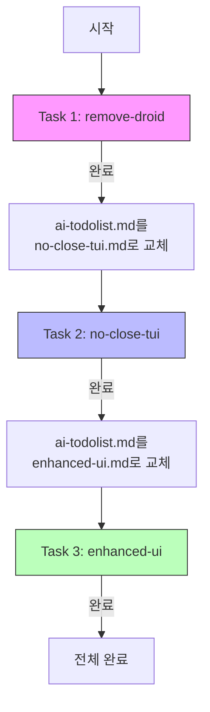

# 사용자의 최초 요청 (기록용)

@ai-tasks/remove-droid.md @ai-tasks/no-close-tui.md @ai-tasks/enhanced-ui.md 순으로 작업하는 작업계획서 작성해줘.

단, 맥락이 너무 길어지고 다른 맥락이 섞이는게 우려가 되니까,
@ai-todolist.md 의 맨 위에다가 이 세개의 작업을 진행한다고 적어두고,
하나가 완전히 끝나면 그 다음거의 내용을 넣어서 새로 ai-todolist.md 를 교체하도록 하는 그런식으로 구상해줄래?

## 사용자가 이후에 추가 요청한 내용들 (기록용)

없음

# 작업 목표

1. **순차적 멀티 태스크 관리**: 세 개의 독립적인 작업을 순차적으로 진행
2. **컨텍스트 분리**: 각 작업 완료 시 ai-todolist.md를 교체하여 맥락 혼선 방지
3. **진행 상황 추적**: 전체 작업 중 현재 위치를 명확히 표시

# 작업 배경

세 개의 큰 작업(DroidAgent 제거, TUI 생명주기 개선, UI 테마 시스템)이 있으며, 각각이 독립적이고 상당한 분량입니다. 모든 내용을 하나의 ai-todolist.md에 담으면 맥락이 길어지고 섞일 우려가 있습니다.

따라서 현재 진행 중인 작업의 계획서만 ai-todolist.md에 유지하고, 작업 완료 시 다음 작업으로 교체하는 방식을 사용합니다.

# 작업 시작 여부
is_execution_started = FALSE

# 모든 목표 달성 여부
is_all_goals_accomplished = FALSE

# 병렬 실행 여부
parallel_requested = FALSE

# 현재 진행 중인 작업
- 작업 시작 전입니다.
  - 작업을 시작하면 위의 `is_execution_started` 의 값을 TRUE 로 바꾸세요.
  - 사용자가 명시적으로 "작업을 시작하라" 라고 말하기 전까지는 절대로 작업하지 않습니다.
  - **plan reviewer 에게 OKAY 사인을 받았더라도 절대 시작하지마십시오**
  - 사용자가 명시적으로 "작업을 시작하라" 라고 말하기 전까지는 절대로 작업하지 않습니다.

# 필요한 사전 지식

## 멀티 태스크 관리 방식

이 프로젝트는 세 개의 독립적인 작업을 순차적으로 진행합니다:

1. **Task 1: remove-droid** - DroidAgent 관련 코드 제거
2. **Task 2: no-close-tui** - TUI 생명주기 개선 (작업 완료 후에도 TUI 유지)
3. **Task 3: enhanced-ui** - Catppuccin 테마 시스템 구현 및 UI 요소 제거

각 작업은 완전히 독립적이며, 하나가 완료되면 다음 작업의 상세 계획서로 ai-todolist.md를 교체합니다.
단, 현재 이 작업 계획서 내의 내용이 완료되기 전까지는 그저 일반 태스크를 진행한다고 생각해주세요. 그냥 이 안의 체크박스를 모두 완수하시고, 이 안에 적힌 내용대로 (멀티 태스크 신경쓰지마시고) 완수가 되었고 정말 목표가 달성되었다면 is_all_goals_accomplished 를 TRUE 로 바꿔주세요.

<작업검증자 용 메시지>
당신이 만약 작업자가 아니고, 작업 검증자로써 이 파일을 읽었다면, 실제로 보고한대로 이 안의 내용이 완수되었는지 보시고, 완수가 되었다면 그때서야 멀티 태스크 기준으로 완수되었는지도 다시 봐주세요. 이 두가지 기준이 충족하지 않으면 FULLY_DONE = FALSE 를 내려주면 됩니다.
만약 예를들어 remove-droid 작업까지는 완료가 된 보고서를 받았다면, 작업자에게 이제 remove-droid 작업을 진행했으니 이 작업 계획서를 다음의 명령으로 교체하라고 안내해주세요.


```sh
rm -r notepad.md # 다른 작업이니 작업기록 제거
cat ai-todolist-template.md {{다음 todolist 파일}} > ai-todolist.md
git commit -m {{Task X 완료, verify 결과와 함께, 그리고 다음 작업을 로딩한다는 내용의 커밋 메시지}}
```
</작업검증자 용 메시지>

## 파일 구조

```
sisyphus/
├── ai-todolist.md              # 현재 진행 중인 작업의 계획서
├── ai-tasks/
│   ├── remove-droid.md         # Task 1 상세 계획서
│   ├── no-close-tui.md         # Task 2 상세 계획서
│   └── enhanced-ui.md          # Task 3 상세 계획서
```

# 작업 계획

## PRDs & Structures



## 구현 세부사항

### 작업 순서

1. **현재 (Task 1)**: remove-droid.md 내용이 ai-todolist.md에 있음
2. **Task 1 완료 후**: ai-todolist.md를 삭제하고 no-close-tui.md 내용 + REMINDER로 새로 작성
3. **Task 2 완료 후**: ai-todolist.md를 삭제하고 enhanced-ui.md 내용 + REMINDER로 새로 작성
4. **Task 3 완료 후**: 전체 작업 완료

## 프로젝트 커밋 메시지 스타일

```
ai reset
prompt update
verify first
```

패턴: 소문자 시작, 간결한 동사 명령형

Now, work as below:
----------
