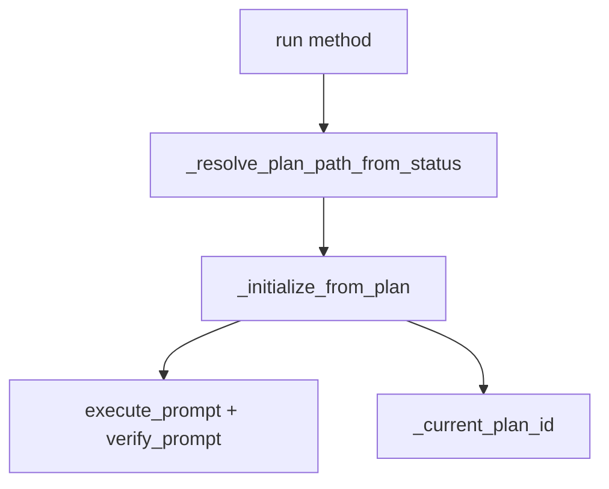

# 사용자의 최초 요청 (기록용)
지금 저 fallback 로직 없애고 ideal 한 one root 코드만 남기고 싶은데 가능하려나 ?

## 추가 사용자 요청 (기록용)
- 기존 테스트 코드도 다 통과해야하는데 그 내용도 넣어줘 태스크로

# 작업 목표 (WHAT & WHY)

## 핵심 목표 (TL;DR)
`loop.py`의 `run()` 메서드에서 중복된 fallback 로직(4번 반복)을 제거하고, `status_manager` 단일 소스 기반의 깔끔한 plan path 결정 로직으로 리팩토링

## 세부 목표
- 과도기 하위호환 코드 완전 제거 (`task_validator.todolist_path` 기반 fallback 제거)
- `status_manager`만 사용하는 단일 소스 plan path 결정
- 중복 코드 (plan 로드 + todo 수집 + prompt 빌드) 헬퍼 메서드로 추출
- `task_validator`는 validation 용도로만 사용 (원래 목적 복원)

# 작업 배경 (WHY & WHAT - 현재 상태)

## 현재 상황
`loop.py:101-246` (`run()` 메서드)에서 plan_path를 결정하는 로직이 다음과 같이 중복 반복됨:

1. **Line 138-160**: `status_manager`에서 plan_path 가져오기 성공
2. **Line 163-185**: `status_manager`는 있지만 current_plan 없을 때 → `task_validator`로 fallback
3. **Line 190-213**: `status_manager` 예외 발생 시 → `task_validator`로 fallback
4. **Line 219-240**: `status_manager` 자체가 없을 때 → `task_validator`로 fallback

**모든 블록에서 동일한 작업:**
- `load_plan()` 호출
- `plan_doc.work_plans` 체크
- `_current_plan_id` 설정
- `uncompleted_todos` 수집 (완전히 동일)
- `execute_prompt`, `verify_prompt` 빌드

## 변경 이유
- **기술부채 제거**: 하위호환 목적의 과도기 코드가 코드 복잡도만 증가
- **단일 책임 원칙**: `status_manager`가 plan path의 단일 소스여야 함
- **유지보수성 향상**: 중복 코드 제거로 버그 발생 가능성 감소

## 변경 사항
**현재 상태 → 변경 후 상태**

| 항목 | 현재 | 변경 후 |
|------|------|---------|
| Plan path 소스 | `status_manager` + `task_validator` (fallback) | `status_manager`만 |
| 코드 중복 | plan 초기화 로직 4번 반복 | 헬퍼 메서드 1개로 통합 |
| `task_validator` 역할 | validation + plan path 제공 | validation만 |
| 하위호환 | `task_validator.todolist_path` 지원 | 제거 |

# 작업 시작 여부
is_execution_started = FALSE

# 모든 목표 달성 여부
is_all_goals_accomplished = FALSE

# 병렬 실행
parallel_requested = FALSE

# 현재 작업 진행 상황
- 작업이 아직 시작되지 않았습니다.
   - 작업을 시작할 때 위의 `is_execution_started` 값을 TRUE로 변경하세요.
   - **사용자가 명시적으로 "작업 시작"이라고 말하기 전까지 절대 작업을 시작하지 마세요.**
   - **plan reviewer로부터 OKAY를 받았더라도, 절대 작업을 시작하지 마세요.**
   - **사용자가 명시적으로 "작업 시작"이라고 말하기 전까지 절대 작업을 시작하지 마세요.**

# 필요한 배경 지식

## 파일 구조 및 역할
- `projects/sisyphus-core/sisyphus_core/core/loop.py`: ExecutionLoop 클래스, Execute/Verify 2단계 실행
- `projects/sisyphus-core/sisyphus_core/core/status/manager.py`: StatusManager 클래스, status.json 관리
- `projects/sisyphus-core/sisyphus_core/core/task_validator.py`: YamlTaskValidator 클래스, task validation
- `projects/sisyphus-core/sisyphus_core/core/plans/loader.py`: `load_plan()`, YAML → Pydantic 모델
- `projects/sisyphus-core/sisyphus_core/core/prompts.py`: prompt 빌드 함수들

## 컨텍스트 이해를 위한 참조 파일

### 1. `projects/sisyphus-core/sisyphus_core/core/loop.py`
- **역할**: ExecutionLoop 메인 로직
- **검색 키워드**: `async def run(`, `_run_unified_mode`, `Priority 1: Try status_manager`
- **주요 패턴**: anyio 기반 async, Protocol 사용, 2-phase execution

### 2. `projects/sisyphus-core/sisyphus_core/core/status/manager.py`
- **역할**: status.json 파일 관리, current plan 추적
- **검색 키워드**: `class StatusManager`, `async def get()`, `CurrentPlan`
- **주요 패턴**: Pydantic BaseModel, atomic file write (backup + rename)

### 3. `projects/sisyphus-core/sisyphus_core/core/task_validator.py`
- **역할**: YAML plan validation (completeness check)
- **검색 키워드**: `class YamlTaskValidator`, `check_all_goals_accomplished`
- **주요 패턴**: Protocol 구현, YAML parsing

### 4. `projects/sisyphus-core/sisyphus_core/core/prompts.py`
- **역할**: Execute/Verify phase prompt 생성
- **검색 키워드**: `build_execute_prompt`, `build_verify_prompt`

### 5. `projects/sisyphus-core/sisyphus_core/core/tests/test_loop.py`
- **역할**: ExecutionLoop 테스트
- **검색 키워드**: `class MockStatusManager`, `async def test_execution_loop`
- **주의사항**: 테스트에서 `status_manager=None` 케이스 제거 필요

# 작업 흐름 (HOW - Task 흐름 & 의존성)

## Task 의존성 다이어그램
```
Task 1 (Refactor run())
   ↓
Task 2 (Update tests)
   ↓
Task 3 (Verify & Type check)
```

## 단계별 설명
- **Phase 1 (Task 1)**: `run()` 메서드 리팩토링 - 핵심 로직 변경
- **Phase 2 (Task 2)**: 테스트 수정 - `status_manager=None` 케이스 제거, `TaskValidator` mock 단순화
- **Phase 3 (Task 3)**: 검증 - 타입 체크, 테스트 실행, lint

# 작업 계획

## PRD & 구조

### 리팩토링 목표 구조


**변경 전 흐름:**
```
run() → try status_manager → fallback to task_validator → load_plan × 4번
```

**변경 후 흐름:**
```
run() → _resolve_plan_path_from_status() → _initialize_from_plan() (1번만)
```

## 구현 세부사항

### 아키텍처 제약사항
- anyio 기반 async 사용 (asyncio 직접 사용 금지)
- Protocol 기반 설계 유지
- Pydantic 모델 사용
- 기존 테스트 호환성 유지 (MockStatusManager 패턴)

### Edge Case 처리
- `status_manager=None` → ValueError 발생 (명확한 에러 메시지)
- `status.json` 파일 없음 → `StatusFile(current_plan=None)` → ValueError
- `current_plan` 필드 없음 → ValueError
- YAML 파일 로드 실패 → 기존 예외 그대로 전파

### 암묵적 가정 명시화
- **가정 1**: v3.0 이후 `status_manager`는 필수 (optional이 아님)
- **가정 2**: `task_validator`는 task completion 체크 용도로만 사용
- **가정 3**: plan_path는 항상 `status_manager`에서 가져옴

## 프로젝트 커밋 메시지 스타일
```bash
# 최근 커밋 패턴 확인
git log -20 --oneline
```

일반적인 패턴:
- `refactor(core): remove fallback logic from ExecutionLoop`
- `test(core): update loop tests for status_manager requirement`
- `feat(core): add helper methods for plan initialization`

# TODOs

- [ ] 1. `loop.py` 리팩토링 - fallback 로직 제거 및 헬퍼 메서드 추가

   **참조 소스**:
   - 현재 코드: `projects/sisyphus-core/sisyphus_core/core/loop.py:101-246` (검색: `async def run(`, `Priority 1`)
   - StatusManager 사용 패턴: `projects/sisyphus-core/sisyphus_core/core/status/manager.py:42-50` (검색: `async def get()`)
   - Prompt 빌드 패턴: `projects/sisyphus-core/sisyphus_core/core/prompts.py` (검색: `build_execute_prompt`, `build_verify_prompt`)

   - [ ] 1.1 헬퍼 메서드 추가: `_resolve_plan_path_from_status()`

      **구현 위치**: `loop.py:100` 이후 (클래스 메서드 영역)

      **구현 내용**:
      ```python
      async def _resolve_plan_path_from_status(self) -> Path:
          """Resolve plan path from status_manager (single source of truth).

          Returns:
              Path: Resolved plan path

          Raises:
              ValueError: If status_manager is None or current_plan is not set
          """
          if not self.status_manager:
              raise ValueError(
                  "status_manager is required. "
                  "task_validator.todolist_path fallback has been removed in v3.0. "
                  "Please set status_manager in ExecutionLoop initialization."
              )

          status_file = await self.status_manager.get()
          if not status_file.current_plan or not status_file.current_plan.plan_path:
              raise ValueError(
                  "current_plan is not set in status.json. "
                  "Please run 'sisyphus-speckit plan init' or set current plan first."
              )

          return Path(status_file.current_plan.plan_path)
      ```

   - [ ] 1.2 헬퍼 메서드 추가: `_initialize_from_plan()`

      **구현 위치**: `loop.py:_resolve_plan_path_from_status()` 이후

      **구현 내용**:
      ```python
      async def _initialize_from_plan(
          self,
          plan_path: Path,
      ) -> tuple[str, str, str]:
          """Initialize plan context from plan path (DRY - used once).

          Args:
              plan_path: Path to YAML plan file

          Returns:
              Tuple of (execute_prompt, verify_prompt, resolved_plan_path_str)
          """
          plan_doc = await load_plan(plan_path)

          if not plan_doc.work_plans:
              self._current_plan_id = "default"
          else:
              self._current_plan_id = plan_doc.work_plans[0].id

          uncompleted_todos = []
          for plan in plan_doc.work_plans:
              for todo in plan.todos:
                  if todo.status != "completed":
                      uncompleted_todos.append(f"  - [{todo.id}] {todo.title}")

          todo_summary = "\n".join(uncompleted_todos[:10]) if uncompleted_todos else "All tasks completed"
          if len(uncompleted_todos) > 10:
              todo_summary += f"\n  ... and {len(uncompleted_todos) - 10} more"

          execute_prompt = build_execute_prompt(str(plan_path), todo_summary)
          verify_prompt = build_verify_prompt(str(plan_path))

          return (execute_prompt, verify_prompt, str(plan_path))
      ```

   - [ ] 1.3 `run()` 메서드 리팩토링 - fallback 로직 제거

      **현재 코드 (line 101-246)**:
      - Priority 1/2 분기 + 4번 중복

      **변경 후 코드**:
      ```python
      async def run(
          self,
          execute_extra: str | None = None,
          verify_extra: str | None = None,
      ) -> None:
          """Run the execution loop in unified mode.

          ExecutionLoop only handles task execution and does not interfere with UI lifecycle.
          After task completion, the UI continues running until the user explicitly terminates it.

          (기존 docstring 유지)
          """
          await self.ui.initialize()

          execute_prompt = DEFAULT_EXECUTE_PROMPT
          verify_prompt = ""
          resolved_plan_path: str | None = None

          # Single source: status_manager only
          try:
              plan_path = await self._resolve_plan_path_from_status()
              execute_prompt, verify_prompt, resolved_plan_path = await self._initialize_from_plan(plan_path)
          except ValueError as e:
              # No plan set → use defaults
              self._current_plan_id = "default"
              # execute_prompt, verify_prompt already initialized above

          await self._run_unified_mode(execute_prompt, execute_extra, verify_prompt, verify_extra)
      ```

      **주의사항**:
      - `DEFAULT_EXECUTE_PROMPT`, `verify_prompt = ""` 초기화 유지
      - ValueError는 조용히 무시 (default로 fallback)
      - `resolved_plan_path` 변수는 현재 미사용이지만 유지 (향후 확장 가능)

   - [ ] 1.4 Lint 및 타입 체크
      - [ ] `uv run ruff check projects/sisyphus-core/sisyphus_core/core/loop.py` → 0 errors 기대
      - [ ] `uv run basedpyright projects/sisyphus-core/sisyphus_core/core/loop.py` → 0 errors 기대

   - [ ] 1.5 변경사항 커밋
      ```bash
      git add projects/sisyphus-core/sisyphus_core/core/loop.py
      git commit -m "refactor(core): remove task_validator fallback from ExecutionLoop

Remove backward compatibility code for task_validator.todolist_path.
Now ExecutionLoop requires status_manager (single source of truth for plan path).

- Add _resolve_plan_path_from_status() helper
- Add _initialize_from_plan() helper (DRY)
- Simplify run() method (4x code duplication removed)
- task_validator now used only for validation (original purpose)"
      ```

   - [ ] **작업 완료 검증 체크리스트**
      - [ ] `loop.py`에 헬퍼 메서드 2개 추가 완료? (`_resolve_plan_path_from_status`, `_initialize_from_plan`)
      - [ ] `run()` 메서드에서 fallback 로직 (line 135-244) 완전 제거 완료?
      - [ ] `uv run ruff check projects/sisyphus-core/sisyphus_core/core/loop.py` → 0 errors 확인
      - [ ] `uv run basedpyright projects/sisyphus-core/sisyphus_core/core/loop.py` → 0 errors 확인
      - [ ] git commit 완료? (`git log -1 --oneline` 확인)

- [ ] 2. 테스트 수정 - `status_manager=None` 케이스 제거

   **참조 소스**:
   - 테스트 파일: `projects/sisyphus-core/sisyphus_core/core/tests/test_loop.py` (검색: `class MockStatusManager`, `ExecutionLoop(`)
   - 다른 테스트 파일들: `projects/sisyphus-core/sisyphus_core/core/tests/test_loop__*.py` (모두 확인 필요)

   - [ ] 2.1 `test_loop.py` 수정

      **검색 패턴**: `status_manager=None` 또는 `status_manager`가 없는 `ExecutionLoop(` 호출

      **변경 방향**:
      - 모든 테스트에 `status_manager=MockStatusManager()` 추가
      - `task_validator`는 validation 용도로만 사용 (`MockTaskValidator` 유지)

      **예시 변경**:
      ```python
      # Before
      loop = ExecutionLoop(
          execute_agent=execute_agent,
          ui=ui,
          session_store=session_store,
          logger_factory=logger_factory,
          verify_agent=verify_agent,
          task_validator=task_validator,
      )

      # After
      loop = ExecutionLoop(
          execute_agent=execute_agent,
          ui=ui,
          session_store=session_store,
          logger_factory=logger_factory,
          verify_agent=verify_agent,
          task_validator=task_validator,
          status_manager=MockStatusManager(),  # ✅ ADD THIS
      )
      ```

   - [ ] 2.2 다른 test_loop__*.py 파일들 일괄 수정

      **파일 리스트**:
      - `test_loop__non_interactive_flow.py`
      - `test_loop__verify_phase_feedback.py`
      - `test_loop__execute_feedback_injection.py`
      - `test_loop__prompt_too_long_session_delete.py`
      - `test_loop__verify_feedback_history.py`
      - `test_loop__phase_resume.py`
      - `test_loop__sdk_exception.py`
      - `test_loop__integration_feedback_loop.py`

      **각 파일에서 동일 패턴 적용**: `status_manager=MockStatusManager()` 추가

   - [ ] 2.3 각 수정한 테스트 파일별로 개별 실행 및 검증

      **Task 1 수정 후 즉시 검증**:
      ```bash
      # Task 1에서 loop.py 수정 후 기존 테스트가 통과하는지 확인
      uv run pytest projects/sisyphus-core/sisyphus_core/core/tests/test_loop.py -v
      ```
      **기대**: 일부 실패 가능 (status_manager 없는 케이스들)

      **각 테스트 파일 수정 후 개별 검증**:
      ```bash
      # test_loop.py 수정 후
      uv run pytest projects/sisyphus-core/sisyphus_core/core/tests/test_loop.py -v

      # test_loop__non_interactive_flow.py 수정 후
      uv run pytest projects/sisyphus-core/sisyphus_core/core/tests/test_loop__non_interactive_flow.py -v

      # test_loop__verify_phase_feedback.py 수정 후
      uv run pytest projects/sisyphus-core/sisyphus_core/core/tests/test_loop__verify_phase_feedback.py -v

      # test_loop__execute_feedback_injection.py 수정 후
      uv run pytest projects/sisyphus-core/sisyphus_core/core/tests/test_loop__execute_feedback_injection.py -v

      # test_loop__prompt_too_long_session_delete.py 수정 후
      uv run pytest projects/sisyphus-core/sisyphus_core/core/tests/test_loop__prompt_too_long_session_delete.py -v

      # test_loop__verify_feedback_history.py 수정 후
      uv run pytest projects/sisyphus-core/sisyphus_core/core/tests/test_loop__verify_feedback_history.py -v

      # test_loop__phase_resume.py 수정 후
      uv run pytest projects/sisyphus-core/sisyphus_core/core/tests/test_loop__phase_resume.py -v

      # test_loop__sdk_exception.py 수정 후
      uv run pytest projects/sisyphus-core/sisyphus_core/core/tests/test_loop__sdk_exception.py -v

      # test_loop__integration_feedback_loop.py 수정 후
      uv run pytest projects/sisyphus-core/sisyphus_core/core/tests/test_loop__integration_feedback_loop.py -v
      ```

      **기대 결과**: 각 파일 수정 후 해당 파일의 모든 테스트 PASS

   - [ ] 2.4 모든 loop 테스트 일괄 실행
      ```bash
      uv run pytest projects/sisyphus-core/sisyphus_core/core/tests/test_loop*.py -v
      ```

      **기대 결과**: 모든 loop 관련 테스트 PASS

   - [ ] 2.5 변경사항 커밋
      ```bash
      git add projects/sisyphus-core/sisyphus_core/core/tests/test_loop*.py
      git commit -m "test(core): require status_manager in all ExecutionLoop tests

Remove status_manager=None test cases (no longer supported).
All tests now use MockStatusManager() to match new requirement."
      ```

   - [ ] **작업 완료 검증 체크리스트**
      - [ ] 모든 테스트 파일에서 `status_manager=MockStatusManager()` 추가 완료?
      - [ ] Task 1 완료 후 기존 테스트 실행하여 실패 확인? (status_manager 없어서 실패 예상)
      - [ ] 각 테스트 파일 수정 후 개별로 pytest 실행하여 PASS 확인?
      - [ ] `uv run pytest projects/sisyphus-core/sisyphus_core/core/tests/test_loop*.py -v` → 모두 PASS 확인
      - [ ] git commit 완료?

- [ ] 3. 최종 검증 및 전체 테스트

   - [ ] 3.1 전체 테스트 실행
      ```bash
      uv run pytest projects/sisyphus-core/ -v
      ```

      **기대 결과**: 모든 테스트 PASS (sisyphus-core 전체)

   - [ ] 3.2 전체 타입 체크
      ```bash
      uv run basedpyright projects/sisyphus-core/
      ```

      **기대 결과**: 0 errors

   - [ ] 3.3 전체 lint 체크
      ```bash
      uv run ruff check projects/sisyphus-core/
      ```

      **기대 결과**: 0 errors

   - [ ] **작업 완료 검증 체크리스트**
      - [ ] 전체 테스트 통과? (`uv run pytest projects/sisyphus-core/ -v`)
      - [ ] 타입 체크 통과? (`uv run basedpyright projects/sisyphus-core/`)
      - [ ] Lint 체크 통과? (`uv run ruff check projects/sisyphus-core/`)
      - [ ] 리팩토링 목표 달성?
        - [ ] fallback 로직 4번 중복 제거됨
        - [ ] `status_manager` 단일 소스로 통합됨
        - [ ] `task_validator`는 validation 용도로만 사용됨
        - [ ] 코드 가독성 향상됨

# 성공 비전

## 사용자 관점에서의 성공
- 코드 리뷰 시 `loop.py`가 명확하고 이해하기 쉬움
- 버그 발생 가능성 감소 (중복 코드 제거)
- 향후 유지보수 시 수정 포인트가 명확함

## 비즈니스 관점에서의 성공
- 기술부채 제거로 개발 속도 향상
- 새로운 기여자가 코드베이스 이해하기 쉬워짐

## 기술적 성공 기준
- [ ] `loop.py`의 `run()` 메서드 길이: 246줄 → 약 30줄 이하
- [ ] 중복 코드 블록: 4개 → 0개
- [ ] 모든 테스트 통과: `uv run pytest projects/sisyphus-core/ -v` → 100% PASS
- [ ] 타입 체크 통과: `uv run basedpyright projects/sisyphus-core/` → 0 errors
- [ ] Lint 통과: `uv run ruff check projects/sisyphus-core/` → 0 errors

# 최종 작업 검증 체크리스트
- [ ] 1. **기능 작동 확인**
  - [ ] 리팩토링 후 `ExecutionLoop` 정상 작동 (테스트로 검증)
  - [ ] `status_manager` 기반 plan path 결정 정상 작동

- [ ] 2. **잘못된 구현 방지**
  - [ ] 하위호환 코드가 완전히 제거되었는가?
  - [ ] `task_validator.todolist_path` 사용하는 코드가 남아있지 않은가?

- [ ] 3. **범위 준수 확인**
  - [ ] 요청한 대로 fallback 로직만 제거했는가?
  - [ ] 불필요한 추가 기능을 구현하지 않았는가?

- [ ] 4. **기존 기능 회귀 테스트**
  - [ ] 전체 테스트 스위트 통과 (`uv run pytest projects/sisyphus-core/`)
  - [ ] Execute/Verify 2-phase 실행 정상 작동
  - [ ] Session 관리 정상 작동
  - [ ] Task validation 정상 작동
