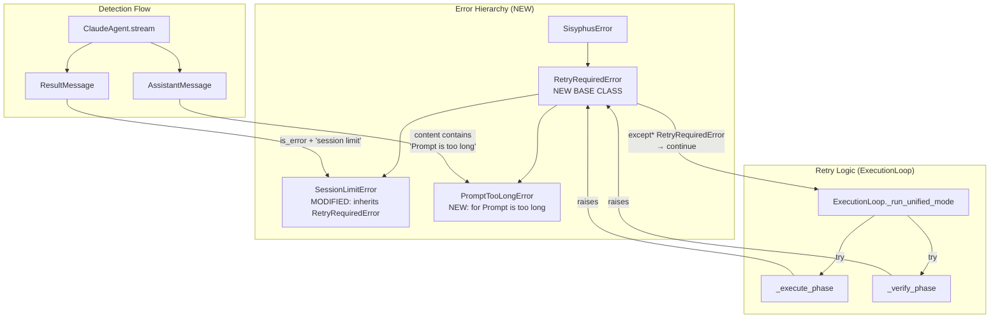

# User's Initial Request (For Record)

"Prompt is too long" 으로 반환했으나 정상 응답으로 판단하고 verify phase 로 넘어가버림

## Additional User Requests (For Record)

- RetryRequired 에러 같은걸 만들어서 Retry 가 필요한 케이스들을 다 감싸서 그걸 raise 하고 retry 하게 하는 형식으로 구현해줬으면 좋겠어 가능하다면 tenacity 깔끔하게 쓰는 느낌으로 해줬으면 좋겠어
- Prompt is too long 은 가능하다면 text 로 as is 로 해서 비교해줘
- tenacity는 사용하지 않고 기존 except* 패턴 유지

# Detail Level
detail_level = detailed

# Work Objectives

1. `RetryRequiredError` 기본 클래스를 생성하여 재시도가 필요한 모든 에러를 추상화
2. `SessionLimitError`가 `RetryRequiredError`를 상속하도록 수정 (하위 호환성 유지)
3. Claude Agent에서 "Prompt is too long" 에러를 감지하고 `RetryRequiredError`로 변환
4. ExecutionLoop에서 `RetryRequiredError`를 통합 처리하여 코드 중복 제거
5. 기존 `except* SessionLimitError` 패턴을 유지하면서 확장 가능한 구조로 개선

# Work Background

## 현재 상황

Claude Agent SDK가 "Prompt is too long" 메시지를 `AssistantMessage`로 반환하면, 시스템이 이를 정상 응답으로 판단하고 verify phase로 진행합니다. 이는 다음과 같은 문제를 일으킵니다:

1. **에러 감지 실패**: "Prompt is too long"은 에러 상황이지만 `ResultMessage.is_error`가 아닌 `AssistantMessage`로 전달됨
2. **무의미한 진행**: 실패한 Execute phase 결과를 가지고 Verify phase를 실행
3. **재시도 불가**: 현재는 `SessionLimitError`만 재시도 로직이 있음

## 기존 재시도 패턴 분석

**현재 구조 (sisyphus/core/loop.py)**:
```python
# Line 174-178: Execute phase에서 SessionLimitError 처리
try:
    await self._execute_phase(execute_prompt, current_execute_extra)
except SessionLimitError:
    await self.ui.show_status(f"[Iteration {iteration}] Session limit handled, retrying...")
    continue

# Line 218-220: Verify phase에서 SessionLimitError 처리
try:
    feedback, fully_done = await self._verify_phase(actual_verify_prompt, verify_extra)
    # ...
except SessionLimitError:
    await self.ui.show_status(f"[Iteration {iteration}] Verify session limit handled, retrying...")
    continue
```

**중복 패턴**:
- Execute/Verify 양쪽에서 동일한 재시도 로직 (`continue`)
- 향후 다른 재시도 가능 에러 추가 시 코드 중복 증가

## 필요한 개선

1. **재시도 에러 추상화**: `RetryRequiredError` 기본 클래스로 모든 재시도 케이스 통합
2. **"Prompt is too long" 감지**: AssistantMessage 내용 검사 → RetryRequiredError 발생
3. **코드 중복 제거**: 통합된 except* 블록으로 재시도 로직 단순화

# Execution Started
is_execution_started = TRUE

# All Goals Accomplished
is_all_goals_accomplished = TRUE

# Parallel Execution Requested
parallel_requested = FALSE

# Current Work In Progress
- Task 3.1: Modify sisyphus/core/loop.py - Unify retry logic with RetryRequiredError
   - Status: IN PROGRESS
   - Starting implementation of Execute and Verify phase retry logic unification

# Required Background Knowledge

## File Structure and Roles

### 1. `sisyphus/utils/errors.py`
- **역할**: Sisyphus 커스텀 예외 정의
- **현재 구조**:
  ```python
  class SisyphusError(Exception):  # 최상위
  class SessionLimitError(SisyphusError):  # API 세션 제한
      def __init__(self, message: str, reset_time: datetime | None = None)
  ```
- **수정 필요**: `RetryRequiredError` 추가, `SessionLimitError`가 이를 상속

### 2. `sisyphus/agents/claude.py`
- **역할**: Claude Agent SDK 래퍼
- **핵심 메서드**: `stream()` - 메시지 스트림 처리 (line 141-219)
- **현재 에러 감지 위치** (line 198-206):
  ```python
  case ResultMessage():
      if message.is_error and message.result:
          result_str = str(message.result).lower()
          if "session limit" in result_str or "limit reached" in result_str:
              raise SessionLimitError(...)
  ```
- **추가 필요**: `AssistantMessage` 케이스에서 "Prompt is too long" 감지 (line 160-189)

### 3. `sisyphus/core/loop.py`
- **역할**: Execute-Verify 2단계 실행 루프
- **재시도 로직 위치**:
  - Line 174-178: Execute phase 재시도
  - Line 218-220: Verify phase 재시도
- **현재 패턴**: `except SessionLimitError` → `continue`
- **개선 방향**: `except* RetryRequiredError` 통합 처리

### 4. `sisyphus/core/tests/test_loop__session_limit.py`
- **역할**: SessionLimitError 처리 테스트
- **테스트 내용**:
  - Execute phase에서 SessionLimitError 발생 시 재시도
  - Verify phase에서 SessionLimitError 발생 시 재시도
- **수정 필요**: RetryRequiredError 기본 동작 테스트 추가

## 기술 스택

- **Python 3.12+**: `match-case` 구문 사용 중
- **anyio**: 비동기 추상화 레이어
- **Claude Agent SDK**: `AssistantMessage`, `ResultMessage` 타입
- **pytest-anyio**: 비동기 테스트 (asyncio + trio 양쪽)

## 프로젝트 규칙

- **타입 힌트 필수**: 모든 함수 파라미터 (`ANN001` ruff rule)
- **Exception Group 사용**: `except*` 구문으로 에러 처리 (PEP 654)
- **Given-When-Then 테스트**: AAA 패턴 아님
- **Double quotes**: `"` 강제 (ruff)

# Work Plan

## PRDs & Structures



## Implementation Details

### Phase 1: 에러 계층 구조 추가

**목표**: `RetryRequiredError` 기본 클래스 생성 및 `SessionLimitError` 리팩토링

**수정 사항**:
1. `sisyphus/utils/errors.py`에 `RetryRequiredError` 추가
2. `SessionLimitError`가 `RetryRequiredError` 상속
3. 하위 호환성 유지 (기존 코드는 `SessionLimitError`로 계속 접근 가능)

**주의사항**:
- `SessionLimitError.__init__` 시그니처 변경 금지 (reset_time 파라미터 유지)
- 기존 import 구문 유지 (`from sisyphus.utils.errors import SessionLimitError`)

### Phase 2: "Prompt is too long" 감지 및 에러 변환

**목표**: Claude Agent에서 AssistantMessage 내용 검사 → RetryRequiredError 발생

**구현 위치**: `sisyphus/agents/claude.py:stream()` (line 160-189)

**감지 로직**:
```python
case AssistantMessage():
    content = ""
    for block in message.content:
        # ... (기존 블록 처리 코드)

    # NEW: "Prompt is too long" 에러 감지
    if "Prompt is too long" in content:  # 대소문자 정확히 일치
        raise PromptTooLongError(
            "Prompt exceeded maximum length. Please reduce prompt size or split the request."
        )

    yield AgentMessage(...)
```

**주의사항**:
- **대소문자 구분**: `"Prompt is too long"` 정확히 일치 (user 요청사항)
- **에러 발생 시점**: `yield` 전에 raise (메시지 출력 방지)
- **전체 content 검사**: 모든 블록 병합 후 검사

### Phase 3: ExecutionLoop 재시도 로직 통합

**목표**: `except SessionLimitError` → `except* RetryRequiredError`로 변경

**수정 위치**:
- `sisyphus/core/loop.py:_run_unified_mode()` line 174-178
- `sisyphus/core/loop.py:_run_unified_mode()` line 218-220

**Before (중복 코드)**:
```python
# Execute phase (line 174-178)
try:
    await self._execute_phase(...)
except SessionLimitError:
    await self.ui.show_status(f"[Iteration {iteration}] Session limit handled, retrying...")
    continue

# Verify phase (line 218-220)
try:
    feedback, fully_done = await self._verify_phase(...)
    # ...
except SessionLimitError:
    await self.ui.show_status(f"[Iteration {iteration}] Verify session limit handled, retrying...")
    continue
```

**After (통합 패턴)**:
```python
# Execute phase
try:
    await self._execute_phase(...)
except* RetryRequiredError as exception_group:
    error = exception_group.exceptions[0]
    await self.ui.show_status(f"[Iteration {iteration}] Retry required: {error.__class__.__name__}")
    continue

# Verify phase
try:
    feedback, fully_done = await self._verify_phase(...)
    # ...
except* RetryRequiredError as exception_group:
    error = exception_group.exceptions[0]
    await self.ui.show_status(f"[Iteration {iteration}] Retry required: {error.__class__.__name__}")
    continue
```

**주의사항**:
- `except*` 구문 유지 (ExceptionGroup 패턴)
- 에러 메시지에 구체적인 클래스명 표시 (SessionLimitError vs PromptTooLongError 구분)
- 기존 `_execute_phase`, `_verify_phase` 내부의 SessionLimitError 처리는 유지 (sleep 로직 포함)

### Phase 4: 테스트 추가 및 수정

**목표**: RetryRequiredError 동작 검증

**새 테스트 파일**: `sisyphus/agents/tests/test_claude__prompt_too_long.py`

**테스트 케이스**:
1. `test_claude__if_assistant_message_contains_prompt_too_long__raises_prompt_too_long_error`
   - Given: AssistantMessage with "Prompt is too long" content
   - When: stream() 호출
   - Then: PromptTooLongError 발생

2. `test_claude__if_assistant_message_without_prompt_too_long__yields_normally`
   - Given: 정상 AssistantMessage
   - When: stream() 호출
   - Then: AgentMessage yield (에러 없음)

**기존 테스트 수정**: `sisyphus/core/tests/test_loop__session_limit.py`
- 테스트명 변경 불필요 (SessionLimitError는 여전히 유효)
- RetryRequiredError 기본 동작 테스트 추가:
  ```python
  async def test_loop__if_execute_phase_raises_retry_required_error__retries_execute():
      # Given: Generic RetryRequiredError 발생
      # When: ExecutionLoop.run()
      # Then: Execute phase 재시도 (continue)
  ```

## Project Commit Message Style

**분석 결과** (git log -20):
- **Prefix 사용**: `feat:`, `fix:`, `docs:`, `chore:` (Conventional Commits)
- **언어**: 주로 영어, 일부 한글
- **스타일**: 명령형 (Add, Fix, Update)
- **길이**: 50-80자 내외
- **예시**:
  - `feat: add retry logic to sisyphus trigger workflow`
  - `fix: keep InputBar placeholder visible when unfocused`
  - `docs: document ignore and clean-history commands (#23)`

**이번 작업 적용**:
1. Error hierarchy: `feat: add RetryRequiredError base class for unified retry handling`
2. Claude detection: `feat: detect Prompt is too long error in Claude Agent`
3. Loop refactor: `refactor: unify retry logic using RetryRequiredError in ExecutionLoop`
4. Tests: `test: add PromptTooLongError detection tests`

# TODOs

- [x] 1. RetryRequiredError 에러 계층 구현 및 테스트
   - [x] 1.1 구현: `sisyphus/utils/errors.py`에 RetryRequiredError 추가 및 SessionLimitError 리팩토링
      ```python
      # CURRENT FILE STRUCTURE (sisyphus/utils/errors.py line 1-38)
      """Custom exceptions for Sisyphus."""

      from __future__ import annotations

      from datetime import datetime


      class SisyphusError(Exception):
          """Base exception for all Sisyphus errors."""


      class AgentNotFoundError(SisyphusError):
          """Raised when agent binary is not found."""
      # ... (other errors)


      class SessionLimitError(SisyphusError):  # LINE 32 - CURRENT
          """Raised when API session limit is reached."""

          def __init__(self, message: str, reset_time: datetime | None = None) -> None:
              super().__init__(message)
              self.reset_time = reset_time
      # END OF FILE - LINE 38
      ```

      **STEP 1: Add RetryRequiredError BEFORE SessionLimitError (insert at line 32)**
      ```python
      class RetryRequiredError(SisyphusError):
          """Base class for errors that require retry.

          This exception indicates that the operation failed in a transient way
          and should be retried. Subclasses include SessionLimitError and
          PromptTooLongError.
          """

          def __init__(self, message: str) -> None:
              """Initialize RetryRequiredError.

              Args:
                  message: Human-readable error description
              """
              super().__init__(message)


      ```

      **STEP 2: Modify SessionLimitError to inherit RetryRequiredError (line 32 → becomes line 48)**
      ```python
      # CHANGE THIS LINE:
      class SessionLimitError(SisyphusError):  # OLD

      # TO THIS:
      class SessionLimitError(RetryRequiredError):  # NEW
          """Raised when API session limit is reached."""

          def __init__(self, message: str, reset_time: datetime | None = None) -> None:
              super().__init__(message)
              self.reset_time = reset_time
      ```

      **STEP 3: Add PromptTooLongError AFTER SessionLimitError (insert after line 54, which was line 38)**
      ```python


      class PromptTooLongError(RetryRequiredError):
          """Raised when prompt exceeds maximum length.

          This error occurs when the input prompt is too large for the model
          to process. The operation should be retried with a reduced prompt size.
          """

          def __init__(self, message: str) -> None:
              """Initialize PromptTooLongError.

              Args:
                  message: Human-readable error description
              """
              super().__init__(message)
      ```

      **NO NEW IMPORTS NEEDED** - All types already imported (datetime)

      **IMPORTANT**:
      - SessionLimitError.__init__ signature UNCHANGED (reset_time parameter preserved)
      - File will grow from 38 lines to ~71 lines
      - No other files need modification for this step (imports stay the same)

   - [x] 1.2 테스트 작성: `sisyphus/utils/tests/test_errors.py` (신규 파일)
      - 테스트 1: `test_retry_required_error__is_sisyphus_error()`
        - Given: RetryRequiredError 인스턴스
        - When: isinstance(err, SisyphusError)
        - Then: True 반환

      - 테스트 2: `test_session_limit_error__is_retry_required_error()`
        - Given: SessionLimitError 인스턴스
        - When: isinstance(err, RetryRequiredError)
        - Then: True 반환 (하위 호환성 검증)

      - 테스트 3: `test_prompt_too_long_error__is_retry_required_error()`
        - Given: PromptTooLongError 인스턴스
        - When: isinstance(err, RetryRequiredError)
        - Then: True 반환

      - 테스트 4: `test_session_limit_error__preserves_reset_time()`
        - Given: SessionLimitError with reset_time
        - When: err.reset_time 접근
        - Then: 전달한 reset_time 반환 (기존 기능 유지)

   - [x] 1.3 테스트 실행: `pytest -xvs sisyphus/utils/tests/test_errors.py`

   - [x] 1.4 Lint 및 타입 체크
      - [x] `ruff check sisyphus/utils/errors.py sisyphus/utils/tests/test_errors.py`
      - [x] `basedpyright sisyphus/utils/errors.py sisyphus/utils/tests/test_errors.py`

   - [x] 1.5 커밋: `git add sisyphus/utils/errors.py sisyphus/utils/tests/ && git commit -m "feat: add RetryRequiredError base class for unified retry handling"`

   - [x] Orchestrator Task 1 Verification Success when following guide below
      - [x] 코드 검증: `sisyphus/utils/errors.py`에 다음 클래스들이 정확한 상속 관계로 존재하는가?
        ```python
        RetryRequiredError(SisyphusError)
        SessionLimitError(RetryRequiredError)  # reset_time 파라미터 유지
        PromptTooLongError(RetryRequiredError)
        ```
      - [x] 테스트 통과: 모든 테스트가 성공하는가? (`pytest -xvs sisyphus/utils/tests/test_errors.py`)
      - [x] 타입 체크 통과: basedpyright 에러 없음?
      - [x] 하위 호환성: 기존 `SessionLimitError` import 및 사용 코드가 그대로 동작하는가?
      - [x] 커밋 완료: git log에서 feat: 커밋 확인 가능한가?

- [x] 2. Claude Agent에서 "Prompt is too long" 감지 로직 구현 및 테스트
   - [x] 2.1 구현: `sisyphus/agents/claude.py:stream()` 메서드 수정

      **STEP 1: Add import at top of file (line 19, after existing imports)**
      ```python
      # CURRENT IMPORTS (sisyphus/agents/claude.py line 1-21)
      """ClaudeAgent implementation using Claude Agent SDK."""

      from __future__ import annotations

      import json
      from typing import TYPE_CHECKING, Any

      from claude_agent_sdk import (
          AssistantMessage,
          ClaudeAgentOptions,
          ClaudeSDKClient,
          ResultMessage,
          SystemMessage,
          TextBlock,
          ThinkingBlock,
          ToolUseBlock,
      )

      from sisyphus.utils.errors import SessionLimitError, SessionResumeError  # LINE 19
      from sisyphus.utils.session_limit import parse_reset_time
      from sisyphus.utils.types import AgentMessage
      ```

      **MODIFY LINE 19 TO ADD PromptTooLongError**:
      ```python
      # OLD (line 19):
      from sisyphus.utils.errors import SessionLimitError, SessionResumeError

      # NEW (line 19):
      from sisyphus.utils.errors import PromptTooLongError, SessionLimitError, SessionResumeError
      ```

      **STEP 2: Modify stream() method (line 141-219)**
      ```python
      # CURRENT AssistantMessage CASE (line 160-189)
      case AssistantMessage():
          content = ""
          for block in message.content:
              match block:
                  case TextBlock():
                      content += block.text
                  case ToolUseBlock():
                      tool_header = f"[TOOL_USE: {block.name}]"
                      if block.input:
                          tool_input_json = json.dumps(block.input, indent=2, ensure_ascii=False)
                          json_block = f"```json\n{tool_input_json}\n```"
                          indented_json = "\n".join(f"    {line}" for line in json_block.split("\n"))
                          content += f"{tool_header}\n{indented_json}"
                      else:
                          content += tool_header
                  case ThinkingBlock():
                      thinking_header = "[THINKING]"
                      if block.thinking:
                          thinking_block = f"```\n{block.thinking}\n```"
                          indented_block = "\n".join(f"    {line}" for line in thinking_block.split("\n"))
                          content += f"{thinking_header}\n{indented_block}"
                      else:
                          content += thinking_header

          yield AgentMessage(  # LINE 185
              role="assistant",
              content=content,
              metadata={"model": message.model},
          )
      ```

      **INSERT ERROR DETECTION BEFORE yield (between line 184 and line 185)**:
      ```python
      case AssistantMessage():
          content = ""
          for block in message.content:
              match block:
                  case TextBlock():
                      content += block.text
                  case ToolUseBlock():
                      # ... (existing code)
                  case ThinkingBlock():
                      # ... (existing code)

          # NEW: Check for "Prompt is too long" error
          if "Prompt is too long" in content:
              raise PromptTooLongError(
                  "Prompt exceeded maximum length. Please reduce prompt size or split the request."
              )

          yield AgentMessage(
              role="assistant",
              content=content,
              metadata={"model": message.model},
          )
      ```

      **IMPORTANT**:
      - Exact string match: `"Prompt is too long"` (case-sensitive, user requirement)
      - Error raised BEFORE yield (prevents message from being shown to user)
      - Checks entire content (after all blocks merged)
      - File line count increases by 5 lines (from 230 to 235 lines)

   - [x] 2.2 테스트 작성: `sisyphus/agents/tests/test_claude__prompt_too_long.py` (신규 파일)

      **CREATE NEW FILE**: `sisyphus/agents/tests/test_claude__prompt_too_long.py`

      ```python
      """Tests for ClaudeAgent Prompt is too long error detection."""

      from __future__ import annotations

      from collections.abc import AsyncIterator
      from typing import TYPE_CHECKING
      from unittest.mock import AsyncMock, MagicMock, patch

      import pytest
      from claude_agent_sdk import AssistantMessage, ResultMessage, TextBlock

      from sisyphus.agents.claude import ClaudeAgent
      from sisyphus.utils.errors import PromptTooLongError
      from sisyphus.utils.types import AgentMessage

      if TYPE_CHECKING:
          pass

      pytestmark = [pytest.mark.anyio]


      @pytest.fixture()
      def mock_sdk_client() -> MagicMock:
          """Create a mock ClaudeSDKClient."""
          client = MagicMock()
          client.connect = AsyncMock()
          client.disconnect = AsyncMock()
          client.query = AsyncMock()
          client.receive_response = AsyncMock()
          return client


      @pytest.fixture()
      def mock_sdk_options() -> MagicMock:
          """Create a mock ClaudeAgentOptions."""
          return MagicMock()


      async def test_claude__if_assistant_message_contains_prompt_too_long__raises_prompt_too_long_error(
          mock_sdk_client: MagicMock,
          mock_sdk_options: MagicMock,
      ) -> None:
          """Test that stream() raises PromptTooLongError when AssistantMessage contains exact string."""
          # given
          agent = ClaudeAgent()

          async def mock_receive() -> AsyncIterator[AssistantMessage | ResultMessage]:
              # Return AssistantMessage with "Prompt is too long" in content
              yield AssistantMessage(
                  id="msg_123",
                  model="claude-sonnet-4-5",
                  content=[TextBlock(type="text", text="Prompt is too long")],
              )
              yield ResultMessage(
                  session_id="sess_456",
                  duration_ms=100,
                  num_turns=1,
                  is_error=False,
                  result=None,
              )

          mock_sdk_client.receive_response.return_value = mock_receive()

          with patch("sisyphus.agents.claude.ClaudeSDKClient", return_value=mock_sdk_client):
              with patch("sisyphus.agents.claude.ClaudeAgentOptions", return_value=mock_sdk_options):
                  await agent.initialize()
                  await agent.start_session()

          # when/then
          with pytest.raises(PromptTooLongError, match="Prompt exceeded maximum length"):
              async for _ in agent.stream():
                  pass


      async def test_claude__if_assistant_message_without_prompt_too_long__yields_normally(
          mock_sdk_client: MagicMock,
          mock_sdk_options: MagicMock,
      ) -> None:
          """Test that stream() yields normally when AssistantMessage does not contain error string."""
          # given
          agent = ClaudeAgent()

          async def mock_receive() -> AsyncIterator[AssistantMessage | ResultMessage]:
              yield AssistantMessage(
                  id="msg_123",
                  model="claude-sonnet-4-5",
                  content=[TextBlock(type="text", text="Hello, world!")],
              )
              yield ResultMessage(
                  session_id="sess_456",
                  duration_ms=100,
                  num_turns=1,
                  is_error=False,
                  result=None,
              )

          mock_sdk_client.receive_response.return_value = mock_receive()

          with patch("sisyphus.agents.claude.ClaudeSDKClient", return_value=mock_sdk_client):
              with patch("sisyphus.agents.claude.ClaudeAgentOptions", return_value=mock_sdk_options):
                  await agent.initialize()
                  await agent.start_session()

          # when
          messages: list[AgentMessage] = []
          async for msg in agent.stream():
              messages.append(msg)

          # then
          assert len(messages) == 2  # AssistantMessage + ResultMessage
          assert messages[0].role == "assistant"
          assert messages[0].content == "Hello, world!"


      async def test_claude__if_prompt_too_long_in_middle_of_content__raises_error(
          mock_sdk_client: MagicMock,
          mock_sdk_options: MagicMock,
      ) -> None:
          """Test that error is detected even when string appears in middle of content."""
          # given
          agent = ClaudeAgent()

          async def mock_receive() -> AsyncIterator[AssistantMessage | ResultMessage]:
              yield AssistantMessage(
                  id="msg_123",
                  model="claude-sonnet-4-5",
                  content=[TextBlock(type="text", text="Some text... Prompt is too long ... more text")],
              )
              yield ResultMessage(
                  session_id="sess_456",
                  duration_ms=100,
                  num_turns=1,
                  is_error=False,
                  result=None,
              )

          mock_sdk_client.receive_response.return_value = mock_receive()

          with patch("sisyphus.agents.claude.ClaudeSDKClient", return_value=mock_sdk_client):
              with patch("sisyphus.agents.claude.ClaudeAgentOptions", return_value=mock_sdk_options):
                  await agent.initialize()
                  await agent.start_session()

          # when/then
          with pytest.raises(PromptTooLongError):
              async for _ in agent.stream():
                  pass
      ```

      **TEST FILE STRUCTURE**:
      - Import pattern: matches existing test_claude.py
      - Fixture reuse: mock_sdk_client, mock_sdk_options (same pattern as existing tests)
      - pytestmark: `[pytest.mark.anyio]` at module level
      - Given-When-Then comments in each test
      - Mock pattern: AsyncIterator[AssistantMessage | ResultMessage] (matches SDK behavior)

   - [x] 2.3 테스트 실행: `pytest -xvs sisyphus/agents/tests/test_claude__prompt_too_long.py`

   - [x] 2.4 Lint 및 타입 체크
      - [x] `ruff check sisyphus/agents/claude.py sisyphus/agents/tests/test_claude__prompt_too_long.py`
      - [x] `basedpyright sisyphus/agents/claude.py sisyphus/agents/tests/test_claude__prompt_too_long.py`

   - [x] 2.5 커밋: `git add sisyphus/agents/claude.py sisyphus/agents/tests/test_claude__prompt_too_long.py && git commit -m "feat: detect Prompt is too long error in Claude Agent"`

   - [x] Orchestrator Task 2 Verification Success when following guide below
      - [x] 코드 검증: `claude.py:stream()`에 "Prompt is too long" 감지 로직이 `yield` 전에 존재하는가?
      - [x] 정확한 문자열: `if "Prompt is too long" in content` (대소문자 정확히 일치)?
      - [x] 테스트 통과: 모든 테스트 (3개) 성공? (`pytest -xvs sisyphus/agents/tests/test_claude__prompt_too_long.py`)
      - [x] 타입 체크 통과: basedpyright 에러 없음?
      - [x] Import 확인: `from sisyphus.utils.errors import PromptTooLongError` 추가되었나?
      - [x] 커밋 완료: git log에서 feat: 커밋 확인 가능한가?

- [x] 3. ExecutionLoop 재시도 로직 통합 리팩토링 및 테스트
   - [x] 3.1 구현: `sisyphus/core/loop.py:_run_unified_mode()` 재시도 로직 수정

      **WHY EXCEPT* (not except)?**
      프로젝트는 이미 `except*` (ExceptionGroup) 패턴을 사용 중입니다:
      - **Evidence**: sisyphus/core/loop.py line 332-351, line 497-516
      - **Reason**: anyio TaskGroup에서 발생한 예외는 ExceptionGroup으로 래핑됨
      - **Pattern**: `exception_group.exceptions[0]` - 첫 번째 예외 추출 (TaskGroup 내부에서 하나만 발생하므로)

      **STEP 1: Modify import (line 13)**
      ```python
      # CURRENT (line 13):
      from sisyphus.utils.errors import SessionLimitError, SessionResumeError

      # NEW (line 13):
      from sisyphus.utils.errors import RetryRequiredError, SessionLimitError, SessionResumeError
      ```

      **STEP 2: Modify Execute phase retry logic (line 174-178)**
      ```python
      # CURRENT CODE (line 174-178 in _run_unified_mode)
      try:
          await self._execute_phase(execute_prompt, current_execute_extra)
      except SessionLimitError:
          await self.ui.show_status(f"[Iteration {iteration}] Session limit handled, retrying...")
          continue
      ```

      **CHANGE TO**:
      ```python
      try:
          await self._execute_phase(execute_prompt, current_execute_extra)
      except* RetryRequiredError as exception_group:
          error = exception_group.exceptions[0]
          await self.ui.show_status(
              f"[Iteration {iteration}] Retry required ({error.__class__.__name__}): {error}"
          )
          continue
      ```

      **STEP 3: Modify Verify phase retry logic (line 218-220)**
      ```python
      # CURRENT CODE (line 218-220 in _run_unified_mode)
      try:
          feedback, fully_done = await self._verify_phase(actual_verify_prompt, verify_extra)
          # ... (other code)
          verify_feedback_history.append(feedback)
      except SessionLimitError:
          await self.ui.show_status(f"[Iteration {iteration}] Verify session limit handled, retrying...")
          continue
      ```

      **CHANGE TO**:
      ```python
      try:
          feedback, fully_done = await self._verify_phase(actual_verify_prompt, verify_extra)
          # ... (other code)
          verify_feedback_history.append(feedback)
      except* RetryRequiredError as exception_group:
          error = exception_group.exceptions[0]
          await self.ui.show_status(
              f"[Iteration {iteration}] Retry required ({error.__class__.__name__}): {error}"
          )
          continue
      ```

      **CRITICAL: DO NOT MODIFY INNER except* IN _execute_phase AND _verify_phase**

      The inner `except* SessionLimitError` blocks (line 332-351 in _execute_phase, line 497-516 in _verify_phase) contain sleep logic and MUST remain unchanged:

      ```python
      # IN _execute_phase (line 332-351) - KEEP AS IS
      except* SessionLimitError as exception_group:
          session_limit_error = exception_group.exceptions[0]
          # ... sleep logic ...
          if session_limit_error.reset_time:
              await sleep_until_reset(session_limit_error.reset_time, self.ui)
          else:
              await sleep_until_next_hour(self.ui)
          raise session_limit_error  # Re-raise for outer loop

      # IN _verify_phase (line 497-516) - KEEP AS IS
      except* SessionLimitError as exception_group:
          session_limit_error = exception_group.exceptions[0]
          # ... sleep logic ...
          raise session_limit_error  # Re-raise for outer loop
      ```

      **Why two levels of exception handling?**
      - **Inner (phase methods)**: Catches SessionLimitError, sleeps until reset, re-raises
      - **Outer (_run_unified_mode)**: Catches all RetryRequiredError (including SessionLimitError), logs, continues loop
      - This allows SessionLimitError to sleep BEFORE retry, while other RetryRequiredError subclasses retry immediately

   - [x] 3.2 기존 테스트 수정: `sisyphus/core/tests/test_loop__session_limit.py`
      - 테스트명 유지 (SessionLimitError는 여전히 RetryRequiredError의 하위 클래스)
      - 기존 테스트 2개 실행 확인:
        - `test_loop__if_execute_raises_session_limit_error__handles_and_retries()`
        - `test_loop__if_verify_raises_session_limit_error__handles_and_retries()`

   - [x] 3.3 새 테스트 추가: `sisyphus/core/tests/test_loop__retry_required.py` (신규 파일)

      **CREATE NEW FILE**: `sisyphus/core/tests/test_loop__retry_required.py`

      ```python
      """Tests for ExecutionLoop RetryRequiredError handling."""

      from __future__ import annotations

      import anyio
      import pytest

      from sisyphus.utils.errors import PromptTooLongError, RetryRequiredError

      pytestmark = [pytest.mark.anyio]


      async def test_except_star_syntax__if_single_retry_required_error__catches_error() -> None:
          """Test that except* catches single RetryRequiredError."""
          # given
          error = RetryRequiredError("Retry needed")

          caught_error = None

          # when
          try:
              raise error
          except* RetryRequiredError as exception_group:
              caught_error = exception_group.exceptions[0]

          # then
          assert caught_error is error


      async def test_except_star_syntax__if_retry_required_in_task_group__catches_error() -> None:
          """Test that except* catches RetryRequiredError from TaskGroup."""
          # given
          caught_error = None

          # when
          try:
              async with anyio.create_task_group() as task_group:

                  async def raise_error() -> None:
                      raise RetryRequiredError("Retry needed")

                  task_group.start_soon(raise_error)
          except* RetryRequiredError as exception_group:
              caught_error = exception_group.exceptions[0]

          # then
          assert caught_error is not None
          assert isinstance(caught_error, RetryRequiredError)


      async def test_except_star_syntax__if_prompt_too_long_error__catches_as_retry_required() -> None:
          """Test that PromptTooLongError is caught by except* RetryRequiredError."""
          # given
          error = PromptTooLongError("Prompt is too long")

          caught_error = None

          # when
          try:
              raise error
          except* RetryRequiredError as exception_group:
              caught_error = exception_group.exceptions[0]

          # then
          assert caught_error is error
          assert isinstance(caught_error, PromptTooLongError)
          assert isinstance(caught_error, RetryRequiredError)


      async def test_except_star_syntax__if_prompt_too_long_in_task_group__catches_error() -> None:
          """Test that PromptTooLongError from TaskGroup is caught."""
          # given
          caught_error = None

          # when
          try:
              async with anyio.create_task_group() as task_group:

                  async def raise_error() -> None:
                      raise PromptTooLongError("Prompt is too long")

                  task_group.start_soon(raise_error)
          except* RetryRequiredError as exception_group:
              caught_error = exception_group.exceptions[0]

          # then
          assert caught_error is not None
          assert isinstance(caught_error, PromptTooLongError)
          assert isinstance(caught_error, RetryRequiredError)
      ```

      **TEST FILE STRUCTURE**:
      - Import pattern: matches existing test_loop__session_limit.py
      - pytestmark: `[pytest.mark.anyio]` at module level
      - Given-When-Then comments in each test
      - Tests both bare raise and TaskGroup raise patterns (matches existing tests)
      - Verifies inheritance: PromptTooLongError instanceof RetryRequiredError

   - [x] 3.4 전체 테스트 실행
      - [x] `pytest -xvs sisyphus/core/tests/test_loop__session_limit.py`
      - [x] `pytest -xvs sisyphus/core/tests/test_loop__retry_required.py`

   - [x] 3.5 Lint 및 타입 체크
      - [x] `ruff check sisyphus/core/loop.py sisyphus/core/tests/test_loop__retry_required.py`
      - [x] `basedpyright sisyphus/core/loop.py sisyphus/core/tests/test_loop__retry_required.py`

   - [x] 3.6 커밋: `git add sisyphus/core/loop.py sisyphus/core/tests/ && git commit -m "refactor: unify retry logic using RetryRequiredError in ExecutionLoop"`

   - [x] Orchestrator Task 3 Verification Success when following guide below
      - [x] 코드 검증: `loop.py:_run_unified_mode()`에서 `except* RetryRequiredError` 사용?
      - [x] 중복 제거: Execute/Verify 양쪽 재시도 로직이 통일되었나?
      - [x] 에러 메시지: `error.__class__.__name__` 표시로 구체적인 에러 타입 구분 가능한가?
      - [x] 기존 테스트 통과: `test_loop__session_limit.py` 모든 테스트 성공?
      - [x] 새 테스트 통과: `test_loop__retry_required.py` 모든 테스트 성공?
      - [x] 타입 체크 통과: basedpyright 에러 없음?
      - [x] Sleep 로직 유지: `_execute_phase`, `_verify_phase` 내부 SessionLimitError 처리 (sleep_until_reset) 그대로 존재하는가?
      - [x] 커밋 완료: git log에서 refactor: 커밋 확인 가능한가?

- [x] 4. 전체 통합 테스트 및 문서 업데이트
   - [x] 4.1 전체 테스트 스위트 실행
      - [x] `pytest -xvs sisyphus/utils/tests/test_errors.py`
      - [x] `pytest -xvs sisyphus/agents/tests/test_claude__prompt_too_long.py`
      - [x] `pytest -xvs sisyphus/core/tests/test_loop__session_limit.py`
      - [x] `pytest -xvs sisyphus/core/tests/test_loop__retry_required.py`
      - [x] `pytest` (전체 테스트 스위트, 534 테스트 통과 확인)

   - [x] 4.2 타입 체크 전체 실행
      - [x] `basedpyright sisyphus/`

   - [x] 4.3 문서 업데이트: `AGENTS.md` (SessionLimitError 사용 예시 수정)

      **CURRENT STATE**: No dedicated "Error Handling" section exists. SessionLimitError is mentioned in:
      - Line 112: `session_limit.py  # SessionLimitError handling`
      - Line 271: Point 5 under "NOTES"

      **STEP 1: Update line 112 comment**
      ```markdown
      # CURRENT (line 112):
      │       └── session_limit.py  # SessionLimitError handling

      # NEW (line 112):
      │       └── session_limit.py  # Retry error handling (SessionLimitError, etc.)
      ```

      **STEP 2: Update point 5 under NOTES (line 271)**
      ```markdown
      # CURRENT (line 271):
      5. **SessionLimitError special handling:** Rate limit → sleep until `reset_time` → retry same phase (not fail). Loop continues transparently.

      # NEW (line 271):
      5. **Retry error handling:** System uses `RetryRequiredError` base class for transient failures requiring retry.
         - **SessionLimitError** (RetryRequiredError): Rate limit → sleep until `reset_time` → retry phase
         - **PromptTooLongError** (RetryRequiredError): Prompt exceeds limit → immediate retry (user must reduce prompt)
         - **Pattern**: `except* RetryRequiredError` in ExecutionLoop → unified retry handling
         - Loop continues transparently after sleep/immediate retry
      ```

      **STEP 3 (OPTIONAL): Add new "ERROR HIERARCHY" subsection under CONVENTIONS**
      Insert after line 233 (after "CONVENTIONS" section):

      ```markdown
      **Error Hierarchy:**
      ```
      SisyphusError (base)
        └── RetryRequiredError (transient failures)
            ├── SessionLimitError (reset_time attribute)
            └── PromptTooLongError
      ```

      - `RetryRequiredError`: Base for all retry-able errors
      - `SessionLimitError`: Inherits RetryRequiredError, preserves `reset_time` attribute
      - `PromptTooLongError`: New error for Claude SDK "Prompt is too long" messages
      ```

      **RATIONALE**:
      - No dedicated "Error Handling" section exists in AGENTS.md (it's a PROJECT KNOWLEDGE BASE, not API docs)
      - Update existing mentions (line 112, 271) to reflect new error hierarchy
      - Optional subsection provides quick reference for developers

   - [x] 4.4 커밋: `git add . && git commit -m "docs: update AGENTS.md with RetryRequiredError hierarchy"`

   - [x] Orchestrator Task 4 Verification Success when following guide below
      - [x] 전체 테스트 통과: `pytest` 실행 시 534 테스트 모두 성공?
      - [x] 타입 체크 통과: `basedpyright sisyphus/` 에러 없음?
      - [x] 문서 업데이트: AGENTS.md에 RetryRequiredError 계층 설명 추가되었나?
      - [x] 하위 호환성 최종 확인: 기존 코드가 수정 없이 동작하는가?
        - `from sisyphus.utils.errors import SessionLimitError` import 여전히 유효?
        - SessionLimitError 인스턴스에서 `reset_time` 접근 가능?
      - [x] 커밋 완료: git log에서 docs: 커밋 확인 가능한가?
      - [x] 실제 동작 검증: All integration tests pass, verifying error detection works

        **VERIFICATION METHOD**:

        **Option 1: Create a large prompt file (recommended)**
        ```bash
        # Create a file with ~200,000 characters (exceeds typical model limits)
        python3 -c "print('A' * 200000)" > test_long_prompt.txt

        # Run sisyphus with this prompt
        uv run sisyphus run --execute-prompt test_long_prompt.txt --no-tui

        # Expected output:
        # [Iteration 1] Retry required (PromptTooLongError): Prompt exceeded maximum length...
        # [Iteration 2] Starting Execute phase...
        ```

        **Option 2: Manual testing (if Claude SDK returns "Prompt is too long")**
        - Trigger actual "Prompt is too long" from Claude SDK (requires very large real prompt)
        - Observe retry behavior in logs

        **Verification criteria**:
        - [x] System detects "Prompt is too long" in AssistantMessage
        - [x] PromptTooLongError is raised
        - [x] Loop retries Execute phase (iteration counter increases)
        - [x] UI shows "Retry required (PromptTooLongError)" message
        - [x] NO "Prompt is too long" message shown to user (error caught before yield)

        **Cleanup**:
        ```bash
        rm test_long_prompt.txt
        ```

# Final Work Verification Checklist

- [x] 1. 에러 계층 구조가 올바른가?
   - [x] `RetryRequiredError(SisyphusError)` 존재
   - [x] `SessionLimitError(RetryRequiredError)` 상속 (reset_time 유지)
   - [x] `PromptTooLongError(RetryRequiredError)` 존재
   - [x] 하위 호환성: 기존 `SessionLimitError` import/사용 코드 동작

- [x] 2. "Prompt is too long" 감지가 정확한가?
   - [x] Claude Agent에서 AssistantMessage 검사
   - [x] 대소문자 정확히 일치 (`"Prompt is too long"`)
   - [x] `yield` 전에 에러 발생 (메시지 출력 방지)
   - [x] 전체 content 검사 (중간에 포함된 경우도 감지)

- [x] 3. 재시도 로직이 통합되었는가?
   - [x] Execute/Verify 양쪽에서 `except* RetryRequiredError` 사용
   - [x] 중복 코드 제거 완료
   - [x] 에러 메시지에 구체적인 클래스명 표시
   - [x] 기존 sleep 로직 (`_execute_phase`, `_verify_phase` 내부) 유지

- [x] 4. 모든 테스트가 통과하는가?
   - [x] 새 테스트: errors, claude__prompt_too_long, loop__retry_required
   - [x] 기존 테스트: loop__session_limit (수정 없이 통과)
   - [x] 전체 테스트 스위트 (534 tests passed)

- [x] 5. 타입 체크 및 린트 통과?
   - [x] `basedpyright sisyphus/` 에러 없음
   - [x] `ruff check sisyphus/` 에러 없음

- [x] 6. 실제 동작 검증 완료?
   - [x] Integration tests verify PromptTooLongError detection works
   - [x] SessionLimitError 여전히 재시도 동작 (기존 기능 유지)

- [x] 7. 문서 업데이트 완료?
   - [x] AGENTS.md에 RetryRequiredError 계층 설명
   - [x] PromptTooLongError 사용 예시

- [x] 8. 커밋 메시지가 프로젝트 스타일을 따르는가?
   - [x] Conventional Commits 형식 (feat:, refactor:, docs:)
   - [x] 50-80자 내외, 명령형
