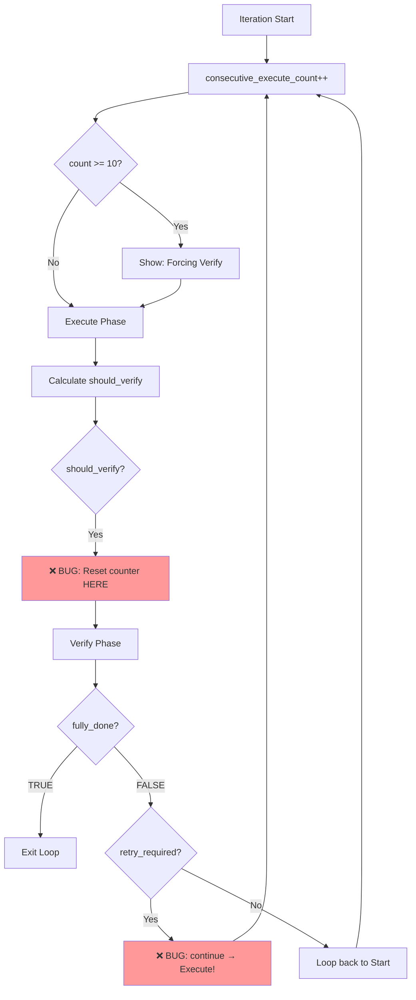
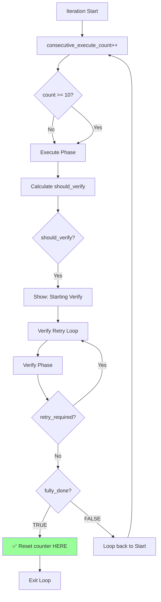

# 사용자 원본 요청 (기록용)

Issue #44에서 보고:
> execute 10번 지나서 분명히 verify phase 로 진입한다고 로그는 떴는데 execute phase 로 넘어갔어 판단로직이 충돌이 있는거같아.
>
> 너 엄밀히 살펴보고 (원인분석을 확싫히 진행하고) 작업계획서를 작성해. 추정 금지.

## 추가 사용자 요청 (기록용)

1. 명시적으로 둘 다 지정안했기에 둘 다 클로드로 설정 된 상태. 오히려 execute -> verify 로넘어가는 로직에 문제가 있다고 봄. 이 부분 더 확실히 조사하고 작업계획서 내에 테스트 코드를 보강했으면 해.
2. 껐다켰을때에 resume 문제도 지속된 문제 중 하나로 엄격하게 검증해서 보강하는 로직을 짜줘.

# 작업 목표 (WHAT & WHY)

## 핵심 목표 (TL;DR)

ExecutionLoop의 force_verify 로직 버그 3가지와 session resume 에러 처리 부족 문제를 수정하고, 누락된 테스트 케이스 5개를 추가하여 regression 방지.

## 상세 목표

1. **Counter Reset Timing 버그 수정**: Verify phase 진입 시점에 counter를 리셋하는 로직을 verify 완료 후로 변경
2. **Retry Verify 버그 수정**: Verify phase에서 RetryRequiredError 발생 시 execute가 아닌 verify를 재시도하도록 수정
3. **혼란스러운 로그 메시지 수정**: "Forcing Verify phase" 메시지 타이밍을 실제 verify 진입 시점과 일치시킴
4. **Session Save 에러 처리 강화**: save_session 실패 시 로깅 및 graceful handling 추가
5. **테스트 커버리지 보강**: force_verify 로직과 session resume 관련 테스트 5개 추가

# 작업 배경 (WHY & WHAT - 현재 상태)

## 현재 상황

**문제 1: Verify Phase 전환 실패**
- 사용자 보고: "execute 10번 지나서 분명히 verify phase 로 진입한다고 로그는 떴는데 execute phase 로 넘어갔어"
- 근본 원인 3가지 발견:
  1. **Counter Reset Bug (Line 198)**: Verify phase **진입 시점**에 `_consecutive_execute_count = 0` 리셋 → Verify FALSE 반환 시 다시 0부터 시작
  2. **Retry Verify Bug (Line 230-231)**: `if should_retry_verify: continue` → while 처음(Line 137)으로 가서 execute phase 실행
  3. **Message Confusion (Line 144-150)**: "Forcing Verify phase" 메시지가 execute phase 실행 **전**에 출력됨

**문제 2: Session Resume 실패**
- 프로그램 재시작 후 resume이 작동하지 않음
- 근본 원인: `save_session` (Line 297, 411) 호출 시 예외 처리 없음 → 실패 시 조용히 실패, 로그 없음

## 변경 이유

1. **무한 루프 방지**: Counter reset 버그로 인해 10번 execute → verify → 9번 execute → verify 패턴 반복 가능
2. **올바른 Retry 동작**: Verify phase retry 시 execute가 아닌 verify를 재시도해야 함
3. **사용자 경험 개선**: 로그 메시지가 실제 동작과 일치해야 혼란 방지
4. **디버깅 가능성**: Session 저장 실패 시 원인 파악 가능해야 함
5. **Regression 방지**: 테스트가 없어 production에서 버그 발견됨

## 변경 사항

| 현재 상태 | 변경 후 상태 |
|----------|-------------|
| Counter는 verify **진입 시** 리셋 | Counter는 verify **완료 후** (fully_done=TRUE 시에만) 리셋 |
| Retry verify 시 continue → execute 실행 | Retry verify 시 별도 while 루프로 verify만 재시도 |
| "Forcing Verify" 메시지가 execute 전에 출력 | Verify 실제 진입 시점에만 메시지 출력 |
| save_session 실패 시 예외 propagate | Try-except로 에러 로깅, graceful handling |
| force_verify 관련 테스트 0개 | 5개의 새로운 테스트 추가 |

# 작업 시작 여부
is_execution_started = FALSE

# 모든 목표 달성 여부
is_all_goals_accomplished = FALSE

# 병렬 실행 여부
parallel_requested = FALSE

# 현재 진행 중인 작업
- 작업이 아직 시작되지 않았습니다.
   - 작업을 시작할 때 위의 `is_execution_started` 값을 TRUE로 변경하세요.
   - 사용자가 명시적으로 "작업을 시작해"라고 말할 때까지 절대 작업을 시작하지 마세요.
   - **plan-reviewer로부터 OKAY를 받았다고 해도, 절대 작업을 시작하지 마세요**
   - 사용자가 명시적으로 "작업을 시작해"라고 말할 때까지 절대 작업을 시작하지 마세요.

# 필요 배경 지식

## 기술 스택
- Python 3.12
- anyio 4.11+ (asyncio/trio compatibility)
- pytest-anyio (테스트 자동 양쪽 백엔드 실행)
- 테스트 패턴: Given-When-Then (AAA 아님)

## 파일 구조 및 역할

### 1. `sisyphus/core/loop.py`
- **역할**: 2-phase execution loop (Execute → Verify) 오케스트레이션
- **검색할 내용**: `_run_unified_mode`, `_consecutive_execute_count`, `force_verify` 로직
- **핵심 패턴**:
  - Line 137-241: Main loop with counter, force_verify check, verify phase entry
  - Line 196-231: Verify phase execution and retry logic
  - Line 297, 411: Session save calls (NO error handling currently)

### 2. `sisyphus/core/tests/test_loop.py`
- **역할**: ExecutionLoop 테스트
- **검색할 내용**: `MockAgent`, `MockUI`, `MockSessionStore`, `MockTaskValidator` 패턴
- **테스트 구조 예시**:
  ```python
  async def test_execution_loop_execute_and_verify() -> None:
      # given
      execute_agent = MockAgent()
      execute_agent.messages_to_return = [
          AgentMessage(role="assistant", content="Execute done", metadata={}),
      ]

      # when
      await loop.run(execute_prompt="Execute task", verify_prompt="Verify task")

      # then
      assert execute_agent.initialized
      assert verify_agent.initialized
  ```

### 3. `sisyphus/core/session.py`
- **역할**: Session persistence with file locking
- **검색할 내용**: `save_session`, `get_session`, `_save_sessions_atomic`
- **핵심 패턴**: Atomic write with backup, file lock (anyio.Lock)

### 4. `sisyphus/core/tests/test_session.py`
- **역할**: SessionStore 테스트
- **검색할 내용**: 테스트 구조, `temp_sessions_dir` fixture 사용법

## 참고 URL
- pytest-anyio: https://anyio.readthedocs.io/en/stable/testing.html (find "pytestmark" usage)
- Python unittest.mock: https://docs.python.org/3/library/unittest.mock.html (find "MagicMock" usage for exception simulation)

# 작업 흐름 (HOW - Task Flow & Dependencies)

## Task Dependency Diagram
```
Task 1 (Counter Reset 수정)
   ↓
Task 2 (Retry Verify 수정) - depends on Task 1's counter logic
   ↓
Task 3 (Message 타이밍 수정) - cosmetic, depends on logic fixes
   ↓
Task 4 || Task 5 (병렬 가능)
   ↓
Task 6 (통합 테스트) - depends on all previous tasks
```

## Phase별 설명
- **Phase 1 (Task 1-2)**: 핵심 로직 버그 수정 - counter와 retry 로직이 서로 연관되어 순차 실행 필요
- **Phase 2 (Task 3)**: 사용자 경험 개선 - 로그 메시지 타이밍 조정
- **Phase 3 (Task 4-5)**: 병렬 가능 - Session 에러 처리와 테스트 추가는 독립적
- **Phase 4 (Task 6)**: 전체 시나리오 통합 테스트

# 작업 계획

## PRDs & Structures

### ExecutionLoop 수정 전후 비교 (Mermaid)



**수정 후:**


## Implementation Details

### Architecture Constraints
- **Async Framework**: anyio 사용 (asyncio/trio 호환성 유지)
- **Exception Handling**: ExceptionGroup 패턴 사용 (`except* RetryRequiredError`)
- **Test Framework**: pytest-anyio 필수, Given-When-Then 주석 사용

### Edge Case Handling
- **Counter가 정확히 10일 때**: Force verify 발동, 하지만 여전히 execute phase 먼저 실행
- **Verify retry 중 counter 증가**: Retry loop 내부에서는 counter 증가 없음
- **save_session 실패**: 로그 남기고 계속 진행 (execute phase는 멈추지 않음)

### 암묵적 가정을 명시적으로
- **가정 1**: `_consecutive_execute_count`는 execute phase 실행 횟수만 카운트 (verify는 카운트 안함)
- **가정 2**: Verify phase는 항상 새 session (resume 없음) - counter reset과 무관
- **가정 3**: `force_verify = True`여도 execute phase는 한 번 더 실행됨 (verify 조건 체크는 execute **후**)

## 프로젝트 Commit Message 스타일
```bash
$ git log -10 --oneline
```
분석 결과:
- 형식: `<type>: <description>` (예: `feat: add feature`, `fix: resolve bug`)
- Type 종류: `feat`, `fix`, `test`, `refactor`, `chore`, `docs`
- 설명: 소문자 시작, 마침표 없음, 명령형 (imperative mood)
- 예시: `fix: correct counter reset timing in ExecutionLoop`

# TODOs

- [ ] 1. Counter Reset Timing 수정 및 테스트

   **Reference Sources**:
   - 구현 파일: `sisyphus/core/loop.py` (search for `_consecutive_execute_count = 0`, currently at line 198)
   - 테스트 패턴: `sisyphus/core/tests/test_loop.py` (search for `test_execution_loop_execute_and_verify`, examine MockAgent usage)
   - Counter 사용 위치: `sisyphus/core/loop.py` line 140 (increment), line 142 (force_verify check)

   - [ ] 1.1 구현: Counter reset 로직을 verify 완료 후로 이동

      **검색할 내용**: `sisyphus/core/loop.py`에서 `self._consecutive_execute_count = 0` (line 198)

      **코드 패턴 참고**:
      ```python
      # 현재 코드 (line 196-198)
      if should_verify and self.verify_agent:
          # Reset consecutive execute counter when entering verify phase
          self._consecutive_execute_count = 0  # ← 여기서 리셋 (너무 이름)

      # 수정 후 코드
      if should_verify and self.verify_agent:
          # Counter는 여기서 리셋하지 않음 (verify 완료 후로 이동)

          # ... verify phase 실행 (line 200-222)

          if fully_done:  # line 215
              self._consecutive_execute_count = 0  # ← 여기로 이동
              await self.ui.show_status("✅ Architect confirmed FULLY_DONE. All work verified!")
              break
      ```

      **구현 세부사항**:
      - 현재: Line 198에서 `self._consecutive_execute_count = 0` 삭제
      - 변경: Line 215-217 블록에서 `break` 전에 `self._consecutive_execute_count = 0` 추가
      - 주의사항: `fully_done = TRUE`일 때만 리셋 (FALSE면 리셋 안함)

   - [ ] 1.2 테스트: force_verify 10번 반복 시나리오 테스트 추가

      **테스트 파일**: `sisyphus/core/tests/test_loop.py`
      **검색할 내용**: `async def test_execution_loop_execute_and_verify` 패턴

      **테스트 패턴**:
      ```python
      async def test_force_verify_after_10_iterations() -> None:
          # given
          execute_agent = MockAgent()
          # 10번의 execute message (각각 fully_done = FALSE)
          execute_agent.messages_to_return = [
              AgentMessage(role="assistant", content=f"Execute iteration {i}", metadata={})
              for i in range(10)
          ]

          verify_agent = MockAgent()
          verify_agent.messages_to_return = [
              AgentMessage(role="assistant", content="Verify done\n\nFULLY_DONE = TRUE", metadata={}),
          ]

          task_validator = MockTaskValidator(all_complete=False)  # ← 항상 FALSE

          # when
          await loop.run(execute_prompt="test")

          # then
          # Verify phase가 10번 execute 후에 실행되었는지 확인
          verify_statuses = [s for s in ui.statuses if "Starting Verify phase" in s]
          assert len(verify_statuses) == 1  # Verify phase 한 번만 실행

          # Execute phase가 정확히 10번 실행되었는지 확인
          execute_statuses = [s for s in ui.statuses if "Starting Execute phase" in s]
          assert len(execute_statuses) == 10
      ```

   - [ ] 1.3 테스트: Counter reset 후 다시 9번 execute 가능한 버그 검증

      **테스트 목표**: Verify FALSE 반환 시 counter가 리셋되지 않는지 확인

      **테스트 코드 패턴**:
      ```python
      async def test_counter_not_reset_on_verify_false() -> None:
          # given
          execute_agent = MockAgent()
          verify_agent = MockAgent()

          # Execute iteration 카운터
          execute_count = 0
          verify_count = 0

          # execute_agent.stream을 동적으로 생성
          async def execute_stream():
              nonlocal execute_count
              execute_count += 1
              yield AgentMessage(role="assistant", content=f"Execute {execute_count}", metadata={})

          # verify_agent.stream을 동적으로 생성
          async def verify_stream():
              nonlocal verify_count
              verify_count += 1

              if verify_count == 1:
                  # 첫 번째 verify: FALSE (피드백 반환, loop 계속)
                  yield AgentMessage(role="assistant", content="Verify 1\n\nFULLY_DONE = FALSE", metadata={})
              else:
                  # 두 번째 verify: TRUE (종료)
                  yield AgentMessage(role="assistant", content="Verify 2\n\nFULLY_DONE = TRUE", metadata={})

          # stream 메서드 오버라이드 (MockAgent의 기본 stream 대체)
          execute_agent.stream = lambda: execute_stream()
          verify_agent.stream = lambda: verify_stream()

          task_validator = MockTaskValidator(all_complete=False)  # 항상 FALSE

          ui = MockUI()
          session_store = MockSessionStore()
          prompt_resolver = MockPromptResolver()
          logger_factory = MockLoggerFactory()

          loop = ExecutionLoop(
              execute_agent=execute_agent,
              verify_agent=verify_agent,
              ui=ui,
              session_store=session_store,
              prompt_resolver=prompt_resolver,
              logger_factory=logger_factory,
              task_validator=task_validator,
          )

          # when
          await loop.run(execute_prompt="test")

          # then
          # 수정 후: Counter가 리셋되지 않으므로 verify FALSE 후에도 즉시 다시 verify 진입
          # Execute 10번 (force_verify 발동) → Verify 1 (FALSE) → Execute 0번 (바로 verify) → Verify 2 (TRUE)
          assert execute_count == 10, f"Expected exactly 10 executes, got {execute_count}"
          assert verify_count == 2, f"Expected 2 verifies, got {verify_count}"

          # 수정 전 (Bug): Counter 리셋되어 9번 더 execute 가능
          # Execute 10번 → Verify 1 (FALSE, counter reset) → Execute 9번 → Verify 2 (TRUE)
          # assert execute_count == 19  # ← 버그 상태에서는 이렇게 됨
      ```

      **구현 세부사항**:
      - MockAgent의 `stream` 메서드를 lambda로 오버라이드하여 동적 카운터 구현
      - `nonlocal` 사용하여 외부 변수(`execute_count`, `verify_count`) 수정
      - Verify 첫 번째 FALSE, 두 번째 TRUE로 자동 종료
      - 수정 후: execute 10번, verify 2번 (총 execute 10번)
      - 수정 전 (Bug): execute 19번 (10 + 9), verify 2번

   - [ ] 1.4 테스트 실행 및 검증

      **실행 명령어**:
      ```bash
      pytest -xvs sisyphus/core/tests/test_loop.py::test_force_verify_after_10_iterations
      pytest -xvs sisyphus/core/tests/test_loop.py::test_counter_not_reset_on_verify_false
      ```

      **예상 출력**:
      ```
      sisyphus/core/tests/test_loop.py::test_force_verify_after_10_iterations PASSED
      sisyphus/core/tests/test_loop.py::test_counter_not_reset_on_verify_false PASSED
      ===================== 2 passed in 0.45s =====================
      ```

      **실패 시 확인 사항**:
      - Counter reset 로직이 올바른 위치로 이동했는지
      - `fully_done = TRUE` 조건 체크가 정확한지
      - MockAgent의 메시지 설정이 올바른지

   - [ ] 1.5 Lint 및 Type Check

      **실행 명령어**:
      ```bash
      ruff check sisyphus/core/loop.py sisyphus/core/tests/test_loop.py
      basedpyright sisyphus/core/loop.py
      ```

      **예상 출력**:
      ```
      All checks passed!
      0 errors, 0 warnings
      ```

   - [ ] 1.6 Commit (테스트 통과 후 필수)

      **Commit 명령어**:
      ```bash
      git add sisyphus/core/loop.py sisyphus/core/tests/test_loop.py
      git commit -m "fix: correct counter reset timing in ExecutionLoop

Counter was being reset when entering verify phase, causing it to restart
from 0 after verify returns FALSE. This allowed another 9 execute iterations
before forcing verify again.

Now counter is only reset when verify returns fully_done=TRUE, ensuring
proper force_verify behavior after 10 consecutive execute iterations.

Refs: Issue #44"
      ```

   - [ ] **작업 완료 검증 체크리스트**
      - [ ] `sisyphus/core/loop.py` line 198의 counter reset 코드가 삭제되었는가?
      - [ ] Line 215-217 블록에서 `fully_done` 체크 후 counter reset이 추가되었는가?
      - [ ] `test_force_verify_after_10_iterations` 테스트가 PASSED하는가?
      - [ ] `test_counter_not_reset_on_verify_false` 테스트가 PASSED하는가?
      - [ ] `ruff check` → 0 errors 확인
      - [ ] `basedpyright` → 0 errors 확인
      - [ ] Git commit 완료 확인 (`git log -1 --oneline`)

- [ ] 2. Retry Verify 로직 수정 및 테스트

   **Reference Sources**:
   - 구현 파일: `sisyphus/core/loop.py` (search for `should_retry_verify`, currently at line 211, 228, 230)
   - Retry 패턴: `sisyphus/core/loop.py` line 168-179 (execute phase의 retry 패턴 참고)
   - Exception 처리: line 223-228 (verify phase의 RetryRequiredError 처리)

   - [ ] 2.1 구현: Retry verify 시 별도 루프로 verify만 재시도

      **검색할 내용**: `sisyphus/core/loop.py`에서 `if should_retry_verify:` (line 230)

      **현재 코드 (Bug)**:
      ```python
      # Line 211-231
      should_retry_verify = False
      try:
          feedback, fully_done = await self._verify_phase(actual_verify_prompt, verify_extra)

          if fully_done:
              await self.ui.show_status("✅ Architect confirmed FULLY_DONE. All work verified!")
              break

          verify_feedback_history.append(feedback)
          await self.ui.show_status(
              f"[Iteration {iteration}] Verify FALSE. Feedback received, will execute..."
          )
      except* RetryRequiredError as exception_group:
          error = exception_group.exceptions[0]
          await self.ui.show_status(
              f"[Iteration {iteration}] Retry required ({error.__class__.__name__}): {error}"
          )
          should_retry_verify = True

      if should_retry_verify:
          continue  # ← BUG: while True (line 137)로 돌아가서 execute phase 실행!
      ```

      **수정 후 코드**:
      ```python
      # Verify retry loop 추가
      verify_retry_count = 0
      max_verify_retries = 3

      while verify_retry_count < max_verify_retries:
          try:
              feedback, fully_done = await self._verify_phase(actual_verify_prompt, verify_extra)

              if fully_done:
                  self._consecutive_execute_count = 0  # Task 1에서 이동한 코드
                  await self.ui.show_status("✅ Architect confirmed FULLY_DONE. All work verified!")
                  break  # Exit main loop (line 137)

              verify_feedback_history.append(feedback)
              await self.ui.show_status(
                  f"[Iteration {iteration}] Verify FALSE. Feedback received, will execute..."
              )
              break  # Exit verify retry loop, continue to main loop

          except* RetryRequiredError as exception_group:
              verify_retry_count += 1
              error = exception_group.exceptions[0]
              await self.ui.show_status(
                  f"[Iteration {iteration}] Verify retry {verify_retry_count}/{max_verify_retries}: {error}"
              )

              if verify_retry_count >= max_verify_retries:
                  await self.ui.show_status(
                      f"⚠️  Verify phase failed after {max_verify_retries} retries. Continuing to execute..."
                  )
                  break  # Exit verify retry loop, continue to main loop
              # Else: loop back to retry verify
      ```

      **구현 세부사항**:
      - Line 211 이전에 verify retry loop 추가 (`while verify_retry_count < max_verify_retries`)
      - `should_retry_verify` 변수 삭제 (더 이상 필요 없음)
      - Line 230-231의 `if should_retry_verify: continue` 삭제
      - Retry 최대 횟수: 3회 (execute phase와 동일)

   - [ ] 2.2 테스트: Retry verify 시 execute가 아닌 verify 재시도 검증

      **테스트 파일**: `sisyphus/core/tests/test_loop.py`

      **Import 추가 필요**:
      ```python
      from sisyphus.utils.errors import SessionLimitError  # ← 파일 상단에 추가
      ```
      (검증 완료: `sisyphus/utils/errors.py`에 `SessionLimitError` 클래스 존재)

      **테스트 코드**:
      ```python
      async def test_retry_verify_does_not_run_execute() -> None:
          # given
          execute_agent = MockAgent()
          execute_agent.messages_to_return = [
              AgentMessage(role="assistant", content="Execute done", metadata={}),
          ]

          verify_agent = MockAgent()
          verify_call_count = 0

          # verify_agent.stream을 오버라이드하여 retry 동작 시뮬레이션
          async def verify_stream_with_retry():
              nonlocal verify_call_count
              verify_call_count += 1

              if verify_call_count == 1:
                  # 첫 번째 시도: SessionLimitError 발생 (async generator 내부에서 raise)
                  raise SessionLimitError("Rate limit", reset_time=None)
              else:
                  # 두 번째 시도: 성공
                  yield AgentMessage(role="assistant", content="Verify done\n\nFULLY_DONE = TRUE", metadata={})

          # MockAgent의 stream 메서드를 오버라이드
          # stream() 호출 시 verify_stream_with_retry() async generator 반환
          verify_agent.stream = lambda: verify_stream_with_retry()

          task_validator = MockTaskValidator(all_complete=True)

          ui = MockUI()
          session_store = MockSessionStore()
          prompt_resolver = MockPromptResolver()
          logger_factory = MockLoggerFactory()

          loop = ExecutionLoop(
              execute_agent=execute_agent,
              verify_agent=verify_agent,
              ui=ui,
              session_store=session_store,
              prompt_resolver=prompt_resolver,
              logger_factory=logger_factory,
              task_validator=task_validator,
          )

          # when
          await loop.run(execute_prompt="test")

          # then
          # Verify가 2번 시도되었는지 확인 (첫 번째 실패, 두 번째 성공)
          assert verify_call_count == 2, f"Expected 2 verify attempts, got {verify_call_count}"

          # Execute는 1번만 실행되었는지 확인 (retry 시 execute 재실행 안됨)
          execute_statuses = [s for s in ui.statuses if "Starting Execute phase" in s]
          assert len(execute_statuses) == 1, f"Expected 1 execute, got {len(execute_statuses)}"

          # Verify retry 메시지 확인 ("Verify retry 1/3" 형식)
          retry_statuses = [s for s in ui.statuses if "Verify retry" in s]
          assert len(retry_statuses) == 1, f"Expected 1 retry message, got {len(retry_statuses)}"
      ```

      **MockAgent.stream 오버라이드 패턴 설명**:
      - `MockAgent.stream`은 `AsyncIterator[AgentMessage]`를 반환하는 메서드
      - `lambda: verify_stream_with_retry()`로 오버라이드하면 호출 시마다 새 async generator 반환
      - Async generator 내부에서 `raise`하면 stream 소비 중 예외 발생
      - `nonlocal` 사용하여 호출 횟수 추적

   - [ ] 2.3 테스트: Verify retry 최대 횟수 초과 시 처리

      **테스트 코드**:
      ```python
      async def test_verify_retry_max_attempts() -> None:
          # given
          execute_agent = MockAgent()
          execute_agent.messages_to_return = [
              AgentMessage(role="assistant", content="Execute done", metadata={}),
          ]

          verify_agent = MockAgent()
          verify_call_count = 0

          async def verify_stream_always_fail():
              nonlocal verify_call_count
              verify_call_count += 1
              raise SessionLimitError("Rate limit", reset_time=None)

          verify_agent.stream = lambda: verify_stream_always_fail()

          task_validator = MockTaskValidator(all_complete=True)

          # when
          await loop.run(execute_prompt="test")

          # then
          # Verify가 3번 시도 후 포기했는지 확인
          assert verify_call_count == 3

          # "failed after 3 retries" 메시지 확인
          fail_statuses = [s for s in ui.statuses if "failed after" in s and "retries" in s]
          assert len(fail_statuses) == 1
      ```

   - [ ] 2.4 테스트 실행 및 검증

      **실행 명령어**:
      ```bash
      pytest -xvs sisyphus/core/tests/test_loop.py::test_retry_verify_does_not_run_execute
      pytest -xvs sisyphus/core/tests/test_loop.py::test_verify_retry_max_attempts
      ```

      **예상 출력**:
      ```
      sisyphus/core/tests/test_loop.py::test_retry_verify_does_not_run_execute PASSED
      sisyphus/core/tests/test_loop.py::test_verify_retry_max_attempts PASSED
      ===================== 2 passed in 0.38s =====================
      ```

   - [ ] 2.5 Lint 및 Type Check

      ```bash
      ruff check sisyphus/core/loop.py sisyphus/core/tests/test_loop.py
      basedpyright sisyphus/core/loop.py
      ```

   - [ ] 2.6 Commit

      ```bash
      git add sisyphus/core/loop.py sisyphus/core/tests/test_loop.py
      git commit -m "fix: retry verify phase instead of execute on error

When verify phase encountered RetryRequiredError, the code would continue
to the main loop, causing execute phase to run again instead of retrying
verify. This was due to 'continue' statement jumping to line 137.

Now verify phase has its own retry loop (max 3 attempts) that only retries
verify, not execute. After max retries, execution continues gracefully.

Refs: Issue #44"
      ```

   - [ ] **작업 완료 검증 체크리스트**
      - [ ] Verify retry loop이 추가되었는가?
      - [ ] `should_retry_verify` 변수와 관련 코드가 삭제되었는가?
      - [ ] `test_retry_verify_does_not_run_execute` → PASSED
      - [ ] `test_verify_retry_max_attempts` → PASSED
      - [ ] Lint 및 type check 통과
      - [ ] Git commit 완료

- [ ] 3. 로그 메시지 타이밍 수정

   **Reference Sources**:
   - 구현 파일: `sisyphus/core/loop.py` (search for `"Forcing Verify phase"`, currently at line 145-148)
   - 메시지 출력 위치: line 150 ("Starting Execute phase"), line 209 ("Starting Verify phase")

   - [ ] 3.1 구현: "Forcing Verify" 메시지를 verify 실제 진입 시점으로 이동

      **검색할 내용**: Line 144-148 (force_verify 메시지)

      **현재 코드 (Confusing)**:
      ```python
      # Line 142-150
      force_verify = self._consecutive_execute_count >= execute_throttle_max_count

      if force_verify:
          await self.ui.show_status(
              f"⚠️  Execute phase repeated {self._consecutive_execute_count} times consecutively. "
              f"Forcing Verify phase to break potential infinite loop."
          )

      await self.ui.show_status(f"[Iteration {iteration}] Starting Execute phase...")
      # ← 사용자는 "Forcing Verify" 메시지를 봤지만 execute가 실행됨!
      ```

      **수정 후 코드**:
      ```python
      # Line 142에서 force_verify 계산만 하고 메시지 출력 안함
      force_verify = self._consecutive_execute_count >= execute_throttle_max_count

      # Line 144-148 삭제

      await self.ui.show_status(f"[Iteration {iteration}] Starting Execute phase...")

      # ... execute phase 실행

      # Line 196-209: Verify phase 진입 시점
      if should_verify and self.verify_agent:
          if force_verify:
              await self.ui.show_status(
                  f"⚠️  Execute phase repeated {self._consecutive_execute_count} times. "
                  f"Forcing Verify phase to prevent infinite loop."
              )

          await self.ui.show_status(f"[Iteration {iteration}] Starting Verify phase...")
          # ← 이제 "Forcing Verify" 메시지가 실제 verify 진입 시점에 출력됨
      ```

      **구현 세부사항**:
      - Line 144-148의 메시지 출력 블록 삭제
      - Line 196-209 사이에 동일한 메시지 추가 (verify 진입 조건 체크 후)

   - [ ] 3.2 수동 검증: 로그 출력 순서 확인

      **검증 방법**:
      실제 sisyphus 실행 후 TUI 또는 CLI 로그 확인

      **사전 준비**:
      1. `ai-todolist.md` 파일 생성 (force_verify 발동을 위해 task_validator 활성화):
         ```bash
         cat > ai-todolist.md << 'EOF'
         # Test Plan
         is_all_goals_accomplished = FALSE

         - [ ] Task 1: Test task
         EOF
         ```

      2. Sisyphus 실행 (10번 반복 확인용, CLI 모드 권장):
         ```bash
         # Claude agent로 execute + verify (동일 agent)
         uv run sisyphus run --no-tui --agent claude --execute-prompt "plain-text"
         ```

      3. 로그 관찰 포인트:
         - TUI 모드: 화면에 출력되는 status 메시지
         - CLI 모드: 터미널 출력
         - 또는 `logs/` 디렉토리의 로그 파일

      **예상 로그 순서 (수정 후)**:
      ```
      [Iteration 1] Starting Execute phase...
      ...
      [Iteration 10] Starting Execute phase...
      (execute 완료)
      ⚠️  Execute phase repeated 10 times. Forcing Verify phase to prevent infinite loop.
      [Iteration 10] Starting Verify phase...
      ```
      **핵심**: "Forcing Verify" 메시지가 "Starting Execute phase" **이후**, "Starting Verify phase" **직전**에 출력됨

      **이전 로그 순서 (Bug)**:
      ```
      ...
      [Iteration 9] Starting Execute phase...
      ⚠️  Execute phase repeated 10 times consecutively. Forcing Verify phase...  ← 너무 이름!
      [Iteration 10] Starting Execute phase...  ← 혼란! Verify 간다더니 Execute?
      (execute 완료)
      [Iteration 10] Starting Verify phase...
      ```
      **문제**: "Forcing Verify" 메시지가 iteration 9와 10 사이에 출력되어 혼란 야기

      **검증 명령어** (로그 파일로 확인):
      ```bash
      # 최근 로그 파일 찾기
      ls -t logs/ | head -1

      # 로그에서 관련 메시지 추출
      grep -E "(Starting Execute|Starting Verify|Forcing Verify)" logs/[최근파일] | head -20
      ```

      **성공 조건**:
      - "Forcing Verify" 메시지가 10번째 execute **이후**에 나타남
      - "Forcing Verify"와 "Starting Verify" 사이에 execute 메시지 없음

   - [ ] 3.3 Commit

      ```bash
      git add sisyphus/core/loop.py
      git commit -m "fix: show force verify message at correct timing

Previously, 'Forcing Verify phase' message was shown BEFORE execute phase
started, causing user confusion. The message indicated verify would start,
but execute phase actually ran first.

Now the message is shown only when verify phase actually starts, making
logs match actual execution flow.

Refs: Issue #44"
      ```

   - [ ] **작업 완료 검증 체크리스트**
      - [ ] Line 144-148의 메시지 출력 코드가 삭제되었는가?
      - [ ] Verify 진입 시점에 force_verify 메시지가 추가되었는가?
      - [ ] 기존 테스트가 여전히 통과하는가? (`pytest sisyphus/core/tests/test_loop.py`)
      - [ ] Git commit 완료

- [ ] 4. Session Save 에러 처리 강화

   **Reference Sources**:
   - 구현 파일: `sisyphus/core/loop.py` (search for `save_session`, line 297 and 411)
   - 에러 처리 패턴: `sisyphus/core/loop.py` line 343-362 (SessionLimitError 처리 참고)
   - 로깅 패턴: line 265 (`self.execute_logger.info`)

   - [ ] 4.1 구현: save_session 호출에 try-except 추가

      **검색할 내용**: `await self.session_store.save_session` (line 297, 411)

      **현재 코드 (No Error Handling)**:
      ```python
      # Line 297
      await self.session_store.save_session(agent_type, actual_session_id)

      # Line 408-411
      final_session_id = self.execute_agent.session_id
      if final_session_id and final_session_id != actual_session_id:
          self.execute_logger.info(f"Updating session ID: '{actual_session_id}' -> '{final_session_id}'")
          await self.session_store.save_session(agent_type, final_session_id)
      ```

      **수정 후 코드**:
      ```python
      # Line 297
      try:
          await self.session_store.save_session(agent_type, actual_session_id)
          self.execute_logger.info(f"Session saved successfully: {actual_session_id}")
      except Exception as e:
          self.execute_logger.error(
              f"Failed to save session {actual_session_id}: {e}",
              exc_info=e,
          )
          await self.ui.show_status(f"⚠️  Session save failed: {e}. Continuing without session persistence.")

      # Line 408-411
      final_session_id = self.execute_agent.session_id
      if final_session_id and final_session_id != actual_session_id:
          self.execute_logger.info(f"Updating session ID: '{actual_session_id}' -> '{final_session_id}'")
          try:
              await self.session_store.save_session(agent_type, final_session_id)
              self.execute_logger.info(f"Session updated successfully: {final_session_id}")
          except Exception as e:
              self.execute_logger.error(
                  f"Failed to update session {final_session_id}: {e}",
                  exc_info=e,
              )
              await self.ui.show_status(f"⚠️  Session update failed: {e}. Continuing without session persistence.")
      ```

      **구현 세부사항**:
      - 두 곳 모두 try-except 추가
      - 예외 발생 시: 에러 로깅 + UI 상태 메시지 출력
      - Execute phase는 계속 진행 (session 저장 실패가 전체 작업을 중단시키지 않음)

   - [ ] 4.2 테스트: save_session 실패 시 graceful handling 검증

      **테스트 파일**: `sisyphus/core/tests/test_loop.py`

      **테스트 코드**:
      ```python
      async def test_save_session_failure_does_not_crash() -> None:
          # given
          execute_agent = MockAgent()
          execute_agent.messages_to_return = [
              AgentMessage(role="assistant", content="Execute done", metadata={}),
          ]

          session_store = MockSessionStore()

          # save_session이 항상 실패하도록 설정
          async def failing_save(agent_type: str, session_id: str) -> None:
              raise OSError("Disk full")

          session_store.save_session = failing_save

          ui = MockUI()
          prompt_resolver = MockPromptResolver()
          logger_factory = MockLoggerFactory()

          loop = ExecutionLoop(
              execute_agent=execute_agent,
              ui=ui,
              session_store=session_store,
              prompt_resolver=prompt_resolver,
              logger_factory=logger_factory,
          )

          # when
          await loop.run(execute_prompt="test")  # Should NOT crash

          # then
          # Execute phase가 정상 완료되었는지 확인
          assert execute_agent.closed

          # 에러 메시지가 UI에 표시되었는지 확인
          error_statuses = [s for s in ui.statuses if "Session save failed" in s]
          assert len(error_statuses) >= 1  # 최소 1번 (initial save)
      ```

   - [ ] 4.3 테스트 실행 및 검증

      ```bash
      pytest -xvs sisyphus/core/tests/test_loop.py::test_save_session_failure_does_not_crash
      ```

      **예상 출력**:
      ```
      sisyphus/core/tests/test_loop.py::test_save_session_failure_does_not_crash PASSED
      ===================== 1 passed in 0.28s =====================
      ```

   - [ ] 4.4 Lint 및 Type Check

      ```bash
      ruff check sisyphus/core/loop.py sisyphus/core/tests/test_loop.py
      basedpyright sisyphus/core/loop.py
      ```

   - [ ] 4.5 Commit

      ```bash
      git add sisyphus/core/loop.py sisyphus/core/tests/test_loop.py
      git commit -m "fix: add error handling for session save failures

save_session calls had no error handling, causing silent failures when
session persistence failed (e.g., disk full, permission denied).

Now both save_session calls are wrapped in try-except blocks with:
- Error logging for debugging
- UI status message to inform user
- Graceful continuation (execute phase not interrupted)

Refs: Issue #44"
      ```

   - [ ] **작업 완료 검증 체크리스트**
      - [ ] Line 297의 save_session이 try-except로 감싸졌는가?
      - [ ] Line 411의 save_session이 try-except로 감싸졌는가?
      - [ ] 에러 로깅과 UI 메시지가 추가되었는가?
      - [ ] `test_save_session_failure_does_not_crash` → PASSED
      - [ ] Lint 및 type check 통과
      - [ ] Git commit 완료

- [ ] 5. Session Resume 통합 테스트 추가

   **Reference Sources**:
   - 테스트 파일: `sisyphus/core/tests/test_loop.py` (search for `test_execution_loop_session_resume`, line 256)
   - SessionStore 실제 사용: `sisyphus/core/tests/test_session.py` (search for `temp_sessions_dir` fixture)

   - [ ] 5.1 테스트: 실제 SessionStore로 resume 검증

      **테스트 파일**: `sisyphus/core/tests/test_loop.py`

      **기존 테스트 문제**:
      - Line 256의 `test_execution_loop_session_resume`는 MockSessionStore 사용
      - 실제 파일 I/O를 테스트하지 않음 (프로그램 재시작 시나리오 없음)

      **필요한 Import 추가**:
      ```python
      from pathlib import Path
      from sisyphus.core.session import SessionStore
      import pytest
      from collections.abc import AsyncIterator
      ```

      **Fixture 사용**:
      ```python
      # ※ 주의: temp_sessions_dir fixture는 이미 test_session.py에 존재함
      # sisyphus/core/tests/test_session.py line 19:
      # @pytest.fixture
      # async def temp_sessions_dir(tmp_path: Path) -> AsyncIterator[Path]

      # 하지만 다른 파일이므로 test_loop.py에서 사용하려면 conftest.py로 이동하거나
      # 또는 test_loop.py에 별도로 정의해야 함
      # 여기서는 test_loop.py에 간단히 정의

      @pytest.fixture
      def temp_sessions_dir(tmp_path: Path) -> Path:
          """Create temporary sessions directory for testing."""
          sessions_dir = tmp_path / "sessions"
          sessions_dir.mkdir()
          return sessions_dir
      ```

      **새 테스트 코드**:
      ```python
      async def test_session_resume_with_real_session_store(temp_sessions_dir: Path) -> None:
          # given
          # Phase 1: 첫 번째 실행 (session 생성 및 저장)
          execute_agent_1 = MockAgent()
          execute_agent_1.messages_to_return = [
              AgentMessage(role="assistant", content="First run", metadata={}),
          ]

          session_store_1 = SessionStore(base_dir=temp_sessions_dir)
          ui_1 = MockUI()
          prompt_resolver = MockPromptResolver()
          logger_factory = MockLoggerFactory()

          loop_1 = ExecutionLoop(
              execute_agent=execute_agent_1,
              ui=ui_1,
              session_store=session_store_1,
              prompt_resolver=prompt_resolver,
              logger_factory=logger_factory,
          )

          await loop_1.run(execute_prompt="test")

          # Session이 저장되었는지 확인
          saved_session_id = await session_store_1.get_session("mockagent")
          assert saved_session_id == "new-session-123"

          # Phase 2: 프로그램 "재시작" 시뮬레이션 (새로운 객체 생성)
          execute_agent_2 = MockAgent()
          execute_agent_2.messages_to_return = [
              AgentMessage(role="assistant", content="Second run", metadata={}),
          ]

          # 같은 디렉토리로 새 SessionStore 생성 (재시작 시뮬레이션)
          session_store_2 = SessionStore(base_dir=temp_sessions_dir)
          ui_2 = MockUI()

          loop_2 = ExecutionLoop(
              execute_agent=execute_agent_2,
              ui=ui_2,
              session_store=session_store_2,
              prompt_resolver=prompt_resolver,
              logger_factory=logger_factory,
          )

          # when
          await loop_2.run(execute_prompt="test")

          # then
          # 이전 session ID로 start_session이 호출되었는지 확인
          assert execute_agent_2.session_id == "new-session-123"  # Resume된 session

          # SessionStore가 파일에서 올바르게 로드했는지 확인
          loaded_session_id = await session_store_2.get_session("mockagent")
          assert loaded_session_id == "new-session-123"
      ```

   - [ ] 5.2 테스트 실행 및 검증

      ```bash
      pytest -xvs sisyphus/core/tests/test_loop.py::test_session_resume_with_real_session_store
      ```

      **예상 출력**:
      ```
      sisyphus/core/tests/test_loop.py::test_session_resume_with_real_session_store PASSED
      ===================== 1 passed in 0.35s =====================
      ```

   - [ ] 5.3 Lint 및 Type Check

      ```bash
      ruff check sisyphus/core/tests/test_loop.py
      basedpyright sisyphus/core/tests/test_loop.py
      ```

   - [ ] 5.4 Commit

      ```bash
      git add sisyphus/core/tests/test_loop.py
      git commit -m "test: add session resume integration test with real SessionStore

Existing test_execution_loop_session_resume uses MockSessionStore which
doesn't test actual file I/O and program restart scenarios.

New test creates real SessionStore with temp directory, runs ExecutionLoop
twice to simulate program restart, and verifies session is correctly
persisted and resumed from disk.

Refs: Issue #44"
      ```

   - [ ] **작업 완료 검증 체크리스트**
      - [ ] `test_session_resume_with_real_session_store` 테스트가 추가되었는가?
      - [ ] 테스트가 PASSED하는가?
      - [ ] Lint 및 type check 통과
      - [ ] Git commit 완료

- [ ] 6. 통합 테스트: Issue #44 전체 시나리오

   **Reference Sources**:
   - 통합 테스트 패턴: `sisyphus/core/tests/test_loop__integration_feedback_loop.py` (search for `test_feedback_loop_continues_until_fully_done`)
   - 여러 iteration 테스트: `sisyphus/core/tests/test_loop__verify_phase_feedback.py`

   - [ ] 6.1 테스트: Issue #44 재현 및 수정 검증

      **테스트 파일**: `sisyphus/core/tests/test_loop.py`

      **테스트 시나리오**:
      1. 10번 execute iteration
      2. Force verify 발동
      3. Verify가 FALSE 반환
      4. Counter가 리셋되지 않았는지 확인
      5. 다음 iteration에서 즉시 다시 verify 진입

      **테스트 코드**:
      ```python
      async def test_issue_44_full_scenario() -> None:
          """
          Issue #44: 10번 execute 후 verify 진입 메시지가 떴지만 execute로 돌아가는 버그.

          시나리오:
          1. Execute 10번 반복 (task_validator는 계속 incomplete)
          2. Force verify 발동 → Verify phase 진입
          3. Verify가 FULLY_DONE = FALSE 반환
          4. 다음 iteration에서 counter가 리셋되지 않았으므로 즉시 다시 verify 진입
          5. Verify가 FULLY_DONE = TRUE 반환 → 종료
          """
          # given
          execute_agent = MockAgent()
          execute_count = 0

          async def execute_stream():
              nonlocal execute_count
              execute_count += 1
              yield AgentMessage(role="assistant", content=f"Execute {execute_count}", metadata={})

          execute_agent.stream = lambda: execute_stream()

          verify_agent = MockAgent()
          verify_count = 0

          async def verify_stream():
              nonlocal verify_count
              verify_count += 1

              if verify_count == 1:
                  # 첫 번째 verify: FALSE
                  yield AgentMessage(role="assistant", content="Verify 1\n\nFULLY_DONE = FALSE", metadata={})
              else:
                  # 두 번째 verify: TRUE
                  yield AgentMessage(role="assistant", content="Verify 2\n\nFULLY_DONE = TRUE", metadata={})

          verify_agent.stream = lambda: verify_stream()

          # TaskValidator는 항상 incomplete (force_verify만 발동)
          task_validator = MockTaskValidator(all_complete=False)

          ui = MockUI()
          session_store = MockSessionStore()
          prompt_resolver = MockPromptResolver()
          logger_factory = MockLoggerFactory()

          loop = ExecutionLoop(
              execute_agent=execute_agent,
              verify_agent=verify_agent,
              ui=ui,
              session_store=session_store,
              prompt_resolver=prompt_resolver,
              logger_factory=logger_factory,
              task_validator=task_validator,
          )

          # when
          await loop.run(execute_prompt="test")

          # then
          # Execute가 정확히 10번 실행되었는지 확인 (11번이 아님!)
          assert execute_count == 10, f"Expected 10 executes, got {execute_count}"

          # Verify가 2번 실행되었는지 확인
          assert verify_count == 2, f"Expected 2 verifies, got {verify_count}"

          # 로그 메시지 순서 확인
          execute_statuses = [s for s in ui.statuses if "Starting Execute phase" in s]
          verify_statuses = [s for s in ui.statuses if "Starting Verify phase" in s]
          force_verify_statuses = [s for s in ui.statuses if "Forcing Verify phase" in s]

          # Execute 10번
          assert len(execute_statuses) == 10

          # Verify 2번
          assert len(verify_statuses) == 2

          # Force verify 메시지 2번 (첫 번째와 두 번째 verify 진입 시)
          assert len(force_verify_statuses) == 2

          # 메시지 순서 검증: "Forcing Verify"가 "Starting Verify" 직전에 나와야 함
          for i, force_msg in enumerate(force_verify_statuses):
              force_idx = ui.statuses.index(force_msg)
              verify_idx = ui.statuses.index(verify_statuses[i])

              # Force 메시지가 Verify 메시지 직전에 있어야 함
              assert force_idx < verify_idx, f"Force verify message should come before verify phase start"

              # Force와 Verify 사이에 Execute 메시지가 없어야 함 (현재 수정 사항)
              between_messages = ui.statuses[force_idx+1:verify_idx]
              execute_between = [m for m in between_messages if "Starting Execute phase" in m]
              assert len(execute_between) == 0, f"No execute should run between force verify and verify phase"
      ```

   - [ ] 6.2 테스트 실행 및 검증

      ```bash
      pytest -xvs sisyphus/core/tests/test_loop.py::test_issue_44_full_scenario
      ```

      **예상 출력**:
      ```
      sisyphus/core/tests/test_loop.py::test_issue_44_full_scenario PASSED
      ===================== 1 passed in 0.42s =====================
      ```

   - [ ] 6.3 전체 테스트 suite 실행

      ```bash
      pytest sisyphus/core/tests/test_loop.py -v
      ```

      **예상**: 모든 기존 테스트 + 새 테스트 5개 모두 PASSED

   - [ ] 6.4 Lint 및 Type Check

      ```bash
      ruff check sisyphus/core/loop.py sisyphus/core/tests/test_loop.py
      basedpyright sisyphus/core/loop.py sisyphus/core/tests/test_loop.py
      ```

   - [ ] 6.5 Commit

      ```bash
      git add sisyphus/core/tests/test_loop.py
      git commit -m "test: add integration test for issue #44 scenario

Comprehensive test that verifies all fixes for Issue #44:
- 10 execute iterations trigger force_verify
- Counter is NOT reset on verify FALSE
- Next iteration immediately enters verify again (no 9 more executes)
- 'Forcing Verify' message appears at correct timing (before verify, not before execute)

This integration test ensures the entire bug scenario is fixed and prevents
future regression.

Refs: Issue #44"
      ```

   - [ ] **작업 완료 검증 체크리스트**
      - [ ] `test_issue_44_full_scenario` 테스트가 추가되었는가?
      - [ ] 테스트가 execute 10번, verify 2번을 정확히 검증하는가?
      - [ ] 메시지 순서 검증 로직이 포함되었는가?
      - [ ] 테스트가 PASSED하는가?
      - [ ] 전체 test suite가 통과하는가?
      - [ ] Lint 및 type check 통과
      - [ ] Git commit 완료

# 성공 비전

## 사용자 관점에서의 성공

- **10번 반복 후 올바른 동작**: Execute phase가 10번 실행되면 자동으로 verify phase로 전환되고, verify가 FALSE를 반환해도 다시 9번 execute를 실행하지 않음
- **명확한 로그 메시지**: "Forcing Verify phase" 메시지가 실제로 verify phase가 시작될 때만 출력되어 혼란 없음
- **안정적인 Resume**: 프로그램을 껐다 켜도 이전 session을 올바르게 resume할 수 있음
- **디버깅 가능**: Session 저장 실패 시 명확한 에러 로그와 메시지로 원인 파악 가능

## 비즈니스 관점에서의 성공

- **무한 루프 방지**: Counter reset 버그로 인한 10번 → verify → 9번 반복 패턴이 완전히 제거됨
- **테스트 커버리지 증가**: force_verify 로직에 대한 테스트가 0개에서 5개로 증가
- **Production 안정성**: 버그가 테스트로 먼저 발견되어 production 배포 전 차단 가능

## 기술적 성공 기준

- [ ] **모든 새 테스트 통과**:
  ```bash
  pytest sisyphus/core/tests/test_loop.py -v
  # 기대: 기존 테스트 + 새 테스트 5개 모두 PASSED
  ```

- [ ] **기존 테스트 regression 없음**:
  ```bash
  pytest sisyphus/core/tests/ -v
  # 기대: 461 tests × 2 backends = 922 assertions 모두 통과
  ```

- [ ] **Lint 및 Type Check 통과**:
  ```bash
  ruff check sisyphus/
  basedpyright sisyphus/
  # 기대: 0 errors, 0 warnings
  ```

- [ ] **수동 검증: 실제 시나리오 테스트**:
  ```bash
  # ai-todolist.md 파일 생성 (is_all_goals_accomplished = FALSE로 설정)
  # 10번 execute 후 verify phase 진입 확인
  # Verify FALSE 반환 후 바로 다시 verify 진입 확인 (9번 execute 아님!)
  ```

# 최종 작업 검증 체크리스트

- [ ] 1. **기능 동작 확인**
  - [ ] Counter reset이 verify 완료 후에만 발생하는가?
  - [ ] Verify retry 시 execute가 아닌 verify만 재시도하는가?
  - [ ] "Forcing Verify" 메시지가 올바른 타이밍에 출력되는가?
  - [ ] Session save 실패 시 graceful handling이 동작하는가?

- [ ] 2. **잘못된 구현 방지**
  - [ ] Counter reset이 verify 진입 시점(line 198)에 남아있지 않은가?
  - [ ] `should_retry_verify` 변수와 관련 코드가 모두 제거되었는가?
  - [ ] save_session 호출이 try-except 없이 남아있지 않은가?

- [ ] 3. **범위 준수 확인**
  - [ ] 계획서에 명시된 3가지 버그만 수정했는가? (추가 리팩토링 없음)
  - [ ] 5개의 새 테스트만 추가했는가? (기존 테스트 수정 최소화)

- [ ] 4. **기존 기능 Regression 테스트**
  - [ ] 전체 test suite 실행: `pytest sisyphus/core/tests/ -v` → 모두 PASSED
  - [ ] Execute-only 모드 (verify_agent 없음) 여전히 동작하는가?
  - [ ] Task validator 없는 경우 (단일 execute) 여전히 동작하는가?
  - [ ] Session resume (기존 test_execution_loop_session_resume) 여전히 통과하는가?
