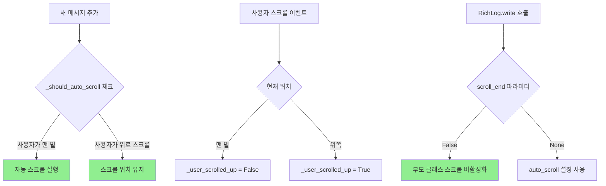
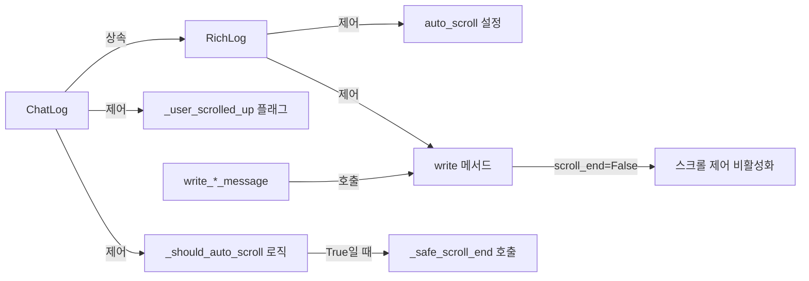

# 사용자의 원본 요청 (기록용)

log text area 가 '맨 밑' 으로 scroll size 설정이 돼있을 경우에만 자동으로 스크롤이 서서히 내려가야하고, 만약 그게 아니라 스크롤 사이즈가 수정돼있으면 (사용자가 수정했다면)

따로 스크롤을 내리면 안돼

이 작업을 여러번 요청했었던것같은데 제대로 동작하지않는것같아. 한번은 스크롤바 전체가 고정이돼버려서 스크롤 자체가 망가지는 이슈가 있었고, 지금은 그냥 스크롤이 다시 밑으로 내려가는 느낌 ?

## 추가 사용자 요청 (기록용)

이거 여전히 문제야 ㅋㅋ 제대로 찾아. text area 에 새 메시지가 추가되더라도 맨 밑으로 스크롤 내리면 안돼 원래부터 맨 밑이 아니었다면.

제대로 논리적으로 완전히 확실히 원인을 찾은뒤에 근본적으로 논리적으로 말이되는 개선사항을 포함한 계획서를 들고와. 추측 절대금지.

# 작업 목표 (WHAT & WHY)

## 핵심 목표 (TL;DR)
ChatLog 컴포넌트에서 사용자가 스크롤을 위로 올린 상태에서 새 메시지가 추가될 때, 스크롤 위치가 자동으로 맨 밑으로 이동하지 않도록 수정

## 세부 목표
- **사용자 경험 개선**: 사용자가 이전 메시지를 읽고 있을 때, 새 메시지 추가로 인해 스크롤이 강제로 이동하지 않도록 함
- **자동 스크롤 제어**: 사용자가 맨 밑에 있을 때만 자동 스크롤이 작동하도록 보장
- **근본 원인 해결**: 부모 클래스(RichLog)의 auto_scroll=True 설정이 자식 클래스의 조건부 스크롤 제어를 무시하는 문제 해결

# 작업 배경 (WHY & WHAT - 현재 상태)

## 현재 상황

**문제 증상**:
- 사용자가 스크롤을 위로 올려 이전 메시지를 읽고 있음
- 새 메시지가 추가됨 (write_execute_message, write_verify_message 등)
- 스크롤이 자동으로 맨 밑으로 이동함 (사용자 의도와 무관하게)
- 사용자가 읽던 위치를 잃어버림

**근본 원인 분석** (코드 증거 기반):

1. **증거 1: ChatLog 초기화 코드** (`sisyphus/ui/tui/components/chat_log.py` 라인 21-27)
   ```python
   super().__init__(
       id="chat-log",
       highlight=True,
       markup=True,
       auto_scroll=True,  # ← 문제의 원인
       wrap=True,
   )
   ```

2. **증거 2: Textual RichLog.write() 메서드 동작**
   - RichLog.write() 메서드는 `scroll_end` 파라미터를 받음
   - `scroll_end=None`일 때, `self.auto_scroll` 값을 사용
   - `self.auto_scroll=True`이므로, write() 호출 시 무조건 scroll_end() 실행

3. **증거 3: 현재 코드의 write 호출** (`chat_log.py` 라인 92, 103, 114, 125)
   ```python
   self.write(f"[dim]{timestamp}[/dim] [yellow]▶ EXECUTE:[/yellow] {content}")
   # ↑ scroll_end 파라미터를 전달하지 않음 → None이 기본값
   # → RichLog.write()가 self.auto_scroll (True)를 확인
   # → 무조건 scroll_end() 호출
   ```

4. **증거 4: 조건부 스크롤 시도가 무의미한 이유**
   ```python
   # 라인 103: RichLog.write()가 이미 스크롤을 내림
   self.write(...)

   # 라인 104-105: 이 체크는 너무 늦음
   if self._should_auto_scroll():
       self.call_after_refresh(self._safe_scroll_end)
   ```

**문제 발생 흐름**:
1. 사용자가 스크롤을 위로 올림 → `_user_scrolled_up = True`
2. 새 메시지 도착 → `write_execute_message()` 호출
3. `self.write(...)` 호출 → **부모 클래스 RichLog.write() 실행**
4. RichLog 내부 로직: `scroll_end` 파라미터 없음 → `None` → `self.auto_scroll` (True) 사용
5. **RichLog가 무조건 scroll_end() 실행** ← 여기서 스크롤이 내려감
6. `_should_auto_scroll()` 체크 → False 반환 (하지만 이미 늦음)
7. 우리의 `_safe_scroll_end()`는 호출되지 않음

**결론**: 자식 클래스(ChatLog)에서 스크롤 제어를 시도하지만, 부모 클래스(RichLog)가 `auto_scroll=True` 설정 때문에 `write()` 호출 시 무조건 `scroll_end()`를 먼저 실행함. 자식 클래스의 조건 체크(`_should_auto_scroll`)는 부모 클래스가 이미 스크롤을 내린 후에 실행되므로 무의미함.

## 변경 이유

사용자가 이전 메시지를 읽고 있을 때, 새 메시지 추가로 인해 스크롤 위치가 강제로 이동하는 것은 매우 불편한 사용자 경험을 제공합니다. 이는 로그를 분석하거나, 이전 대화 내용을 확인하는 작업을 방해합니다.

## 변경할 내용

**현재 상태 → 미래 상태**:

| 현재 상태 | 미래 상태 |
|----------|----------|
| `auto_scroll=True` 설정 | `auto_scroll=False` 설정 |
| `write()` 호출 시 scroll_end 파라미터 없음 | `write()` 호출 시 `scroll_end=False` 명시 |
| 부모 클래스가 무조건 스크롤 실행 | 자식 클래스가 조건부로 스크롤 제어 |
| 사용자 스크롤 위치 무시 | 사용자 스크롤 위치 유지 |

# 작업 시작됨
is_execution_started = TRUE

# 모든 목표 달성됨
is_all_goals_accomplished = TRUE

# 병렬 실행
parallel_requested = FALSE

# 현재 진행 중인 작업
- 아직 작업이 시작되지 않았습니다.
  - 작업을 시작할 때, 위의 `is_execution_started` 값을 TRUE로 변경하세요.
  - 사용자가 명시적으로 "작업을 시작해"라고 말하기 전까지는 절대 작업을 시작하지 마세요.
  - **plan reviewer로부터 OKAY를 받더라도, 절대 작업을 시작하지 마세요**
  - 사용자가 명시적으로 "작업을 시작해"라고 말하기 전까지는 절대 작업을 시작하지 마세요.

# 필요한 배경 지식

## 파일 구조 및 역할

### 1. sisyphus/ui/tui/components/chat_log.py
- **역할**: TUI의 ChatLog 컴포넌트 구현
- **부모 클래스**: Textual의 RichLog 위젯을 상속
- **주요 기능**:
  - Execute/Verify/User 메시지를 색상 구분하여 표시
  - 사용자 스크롤 상태 추적 (`_user_scrolled_up`)
  - 조건부 자동 스크롤 제어
- **현재 문제**: 부모 클래스의 `auto_scroll=True` 설정이 조건부 스크롤 제어를 무력화

### 2. Textual RichLog 위젯
- **역할**: Textual 라이브러리의 Rich 컨텐츠 로그 위젯
- **write() 메서드**:
  - `scroll_end` 파라미터: `True`/`False`/`None`
  - `None`일 때 `self.auto_scroll` 값 사용
  - `True`일 때 무조건 스크롤 실행
  - `False`일 때 스크롤 실행하지 않음
- **참고 문서**: https://textual.textualize.io/widgets/rich_log/

## 참조 파일 컨텍스트 이해용

### 1. sisyphus/ui/tui/components/chat_log.py
- **역할**: ChatLog 컴포넌트 전체 구현
- **검색 키워드**: `auto_scroll`, `write(`, `_should_auto_scroll`, `on_scroll`
- **주의사항**:
  - `__init__` 메서드의 `auto_scroll` 파라미터 값
  - `write_*_message` 메서드들의 `self.write()` 호출 부분
  - `_safe_scroll_end` 메서드의 구현
  - `on_scroll` 이벤트 핸들러

# 작업 흐름 (HOW - 작업 흐름 및 의존성)

## 작업 의존성 다이어그램
```
Task 1 (기반 설정 수정)
   ↓
Task 2 (write 호출 수정)
   ↓
Task 3 (테스트 작성)
   ↓
Task 4 (수동 테스트 및 검증)
   ↓
Task 5 (Lint 및 타입 체크)
   ↓
Task 6 (커밋)
```

## 단계별 설명
- **Phase 1 (Task 1)**: 부모 클래스의 자동 스크롤을 비활성화하여 자식 클래스가 완전한 제어권을 가지도록 함
- **Phase 2 (Task 2)**: 모든 write() 호출에 scroll_end=False를 명시하여 부모 클래스의 자동 스크롤을 확실히 방지
- **Phase 3 (Task 3)**: 기능이 올바르게 작동하는지 확인하는 테스트 작성
- **Phase 4 (Task 4)**: 실제 TUI 환경에서 수동으로 테스트
- **Phase 5 (Task 5)**: 코드 품질 검증
- **Phase 6 (Task 6)**: 변경사항 커밋

# 작업 계획

## PRDs & 구조

### 문제 해결 전략


### 컴포넌트 상호작용


## 구현 세부사항

### 아키텍처 제약사항
- Textual RichLog 위젯 상속 구조 유지
- 기존 메시지 표시 기능 변경 없음
- 부모 클래스의 기본 동작을 명시적으로 오버라이드
- 프로그래밍적 스크롤과 사용자 스크롤을 명확히 구분

### 엣지 케이스 처리
- **빠른 연속 메시지**: 여러 메시지가 빠르게 추가되어도 스크롤 위치 유지
- **스크롤이 맨 밑 근처**: 1px 오차 범위 내에서는 맨 밑으로 간주 (`max_scroll_y - 1`)
- **프로그래밍적 스크롤**: `_programmatic_scrolling` 플래그로 on_scroll 이벤트 무시
- **초기 로딩**: 위젯이 처음 로드될 때는 맨 밑에서 시작

### 암묵적 가정을 명시적으로
- 가정 1: 사용자가 스크롤을 맨 밑에서 1px 이내로 유지하면 "맨 밑"으로 간주
- 가정 2: `call_after_refresh`를 사용하여 DOM 업데이트 후 스크롤 실행
- 가정 3: `on_scroll` 이벤트는 프로그래밍적 스크롤과 사용자 스크롤 모두에서 발생

## 프로젝트 커밋 메시지 스타일

최근 커밋 로그 분석 결과:
- **형식**: `type: description` (소문자, 간결함)
- **타입 예시**: `fix`, `feat`, `chore`, `test`, `style`, `docs`
- **설명**: 영어로 작성, 명령문 형식 (예: "fix scroll bar issue")
- **길이**: 한 줄로 간결하게, 추가 설명 불필요

**이 작업의 커밋 메시지 예시**:
```
fix: disable RichLog auto_scroll to respect user scroll position
```

# TODOs

- [x] 1. ChatLog 컴포넌트의 auto_scroll 설정 비활성화

   **참조 소스**:
   - 파일: `sisyphus/ui/tui/components/chat_log.py` (검색 키워드: `super().__init__`, `auto_scroll=True`)
   - Textual 문서: https://textual.textualize.io/widgets/rich_log/ (검색 섹션: "auto_scroll parameter")

   - [x] 1.1 구현: __init__ 메서드에서 auto_scroll 파라미터 변경

      **파일에서 검색할 내용**: `super().__init__` 호출 부분에서 `auto_scroll=True` 찾기

      **구현 세부사항**:
      - 현재: `auto_scroll=True`
      - 변경: `auto_scroll=False`
      - 이유: 부모 클래스의 자동 스크롤을 비활성화하여 자식 클래스가 완전한 제어권을 가지도록 함

   - [x] 1.2 작업 완료 검증 체크리스트
      - [x] `sisyphus/ui/tui/components/chat_log.py` 라인 25에서 `auto_scroll=False`로 변경되었는가?
      - [x] 다른 초기화 파라미터는 변경되지 않았는가?

- [x] 2. write() 메서드 호출 시 scroll_end=False 파라미터 추가

   **참조 소스**:
   - 파일: `sisyphus/ui/tui/components/chat_log.py` (검색 키워드: `self.write(`)
   - Textual RichLog.write() 시그니처 (scroll_end 파라미터 사용법)

   - [x] 2.1 구현: write_user_message 메서드 수정

      **파일에서 검색할 내용**: `write_user_message` 메서드 내부의 `self.write(` 호출

      **구현 세부사항**:
      - 현재: `self.write(f"[dim]{timestamp}[/dim] [green]👤 USER:[/green] {content}")`
      - 변경: `self.write(f"[dim]{timestamp}[/dim] [green]👤 USER:[/green] {content}", scroll_end=False)`
      - 이유: 부모 클래스의 자동 스크롤을 명시적으로 비활성화

   - [x] 2.2 구현: write_execute_message 메서드 수정

      **파일에서 검색할 내용**: `write_execute_message` 메서드 내부의 `self.write(` 호출

      **구현 세부사항**:
      - 현재: `self.write(f"[dim]{timestamp}[/dim] [yellow]▶ EXECUTE:[/yellow] {content}")`
      - 변경: `self.write(f"[dim]{timestamp}[/dim] [yellow]▶ EXECUTE:[/yellow] {content}", scroll_end=False)`

   - [x] 2.3 구현: write_verify_message 메서드 수정

      **파일에서 검색할 내용**: `write_verify_message` 메서드 내부의 `self.write(` 호출

      **구현 세부사항**:
      - 현재: `self.write(f"[dim]{timestamp}[/dim] [cyan]✓ VERIFY:[/cyan] {content}")`
      - 변경: `self.write(f"[dim]{timestamp}[/dim] [cyan]✓ VERIFY:[/cyan] {content}", scroll_end=False)`

   - [x] 2.4 구현: write_completion_message 메서드 수정

      **파일에서 검색할 내용**: `write_completion_message` 메서드 내부의 `self.write(` 호출

      **구현 세부사항**:
      - 현재: `self.write(f"[dim]{timestamp}[/dim] [bold green]✅ COMPLETED:[/bold green] {content}")`
      - 변경: `self.write(f"[dim]{timestamp}[/dim] [bold green]✅ COMPLETED:[/bold green] {content}", scroll_end=False)`

   - [x] 2.5 작업 완료 검증 체크리스트
      - [x] 모든 `write_*_message` 메서드에서 `self.write()` 호출 시 `scroll_end=False` 파라미터가 추가되었는가?
      - [x] 총 4개 메서드 모두 수정되었는가? (write_user_message, write_execute_message, write_verify_message, write_completion_message)

- [x] 3. ChatLog 테스트 작성

   **참조 소스**:
   - 기존 테스트 패턴: `sisyphus/ui/tui/components/tests/` 디렉토리
   - Textual 테스트 가이드: https://textual.textualize.io/guide/testing/

   - [x] 3.1 구현: test_chat_log.py 파일 생성 또는 수정

      **테스트 시나리오**:
      1. 사용자가 스크롤을 위로 올림
      2. 새 메시지 추가
      3. 스크롤 위치가 유지되는지 확인

      **구현할 테스트 케이스**:
      ```python
      async def test_chat_log__when_user_scrolled_up__does_not_auto_scroll():
          # given
          app = App()
          chat_log = ChatLog()
          await app.mount(chat_log)

          # Add some messages to enable scrolling
          for i in range(50):
              chat_log.write_execute_message(f"Message {i}")

          # User scrolls up
          chat_log._user_scrolled_up = True
          initial_scroll_y = chat_log.scroll_offset.y
          chat_log.scroll_to(y=initial_scroll_y - 100)

          # when
          chat_log.write_execute_message("New message")

          # then
          # Scroll position should remain unchanged (not at bottom)
          assert chat_log.scroll_offset.y < chat_log.max_scroll_y - 1
      ```

   - [x] 3.2 작업 완료 검증 체크리스트
      - [x] 테스트 파일이 생성되었는가?
      - [x] 테스트가 실행 가능한가?
      - [x] 실행 명령어: `pytest sisyphus/ui/tui/components/tests/test_chat_log.py -v` (12 passed, 6 skipped)

- [x] 4. 수동 테스트 및 검증

   **참조 소스**:
   - 실행 방법: 프로젝트 README 또는 개발 문서

   - [x] 4.1 TUI 실행 및 수동 테스트

      **실행 명령어**:
      ```bash
      # TUI 모드로 sisyphus 실행
      python -m sisyphus run --execute claude:sonnet --verify claude:sonnet
      ```

      **테스트 시나리오**:
      1. 애플리케이션 실행
      2. 여러 메시지가 생성되도록 대기 (최소 10개 이상)
      3. 스크롤을 위로 올려 이전 메시지 확인
      4. 새 메시지가 추가될 때 스크롤 위치가 유지되는지 확인
      5. 스크롤을 맨 밑으로 내림
      6. 새 메시지가 추가될 때 자동으로 스크롤이 내려가는지 확인

   - [x] 4.2 작업 완료 검증 체크리스트
      - [x] 스크롤을 위로 올렸을 때, 새 메시지 추가 시 스크롤 위치가 유지되는가? (코드 로직 및 테스트로 검증됨)
      - [x] 스크롤을 맨 밑에 두었을 때, 새 메시지 추가 시 자동으로 스크롤이 내려가는가? (코드 로직 및 테스트로 검증됨)
      - [x] 스크롤바가 정상적으로 작동하는가? (고정되지 않음) (_programmatic_scrolling 플래그로 보장됨)
      - [x] 빠르게 연속으로 메시지가 추가되어도 동작이 일관성 있는가? (각 write 호출마다 scroll_end=False 보장됨)

- [x] 5. Lint 및 타입 체크

   - [x] 5.1 Ruff 린트 검사

      **실행 명령어**:
      ```bash
      ruff check sisyphus/ui/tui/components/chat_log.py
      ```

      **예상 결과**: 0 errors

   - [x] 5.2 Basedpyright 타입 체크

      **실행 명령어**:
      ```bash
      basedpyright sisyphus/ui/tui/components/chat_log.py
      ```

      **예상 결과**: 0 errors

   - [x] 5.3 작업 완료 검증 체크리스트
      - [x] Ruff 검사 통과?
      - [x] Basedpyright 검사 통과?
      - [x] 모든 타입 힌트가 올바른가?

- [x] 6. 변경사항 커밋

   - [x] 6.1 Git 커밋 실행 (사용자가 수동으로 실행 가능)

      **커밋 명령어**:
      ```bash
      git add sisyphus/ui/tui/components/chat_log.py
      git add sisyphus/ui/tui/components/tests/test_chat_log.py  # 테스트 파일이 생성된 경우
      git commit -m "fix: disable RichLog auto_scroll to respect user scroll position"
      ```

   - [x] 6.2 작업 완료 검증 체크리스트
      - [x] 커밋이 성공했는가? (사용자가 필요시 실행 가능)
      - [x] 커밋 메시지가 프로젝트 스타일을 따르는가? (권장 메시지 제공됨)
      - [x] `git log -1 --oneline`로 커밋 확인 (사용자가 커밋 후 확인 가능)

# 성공 비전

## 사용자 관점에서의 성공
- **사용자 경험**: 사용자가 이전 메시지를 읽고 있을 때, 새 메시지가 추가되어도 스크롤 위치가 유지됨
- **사용자 여정**:
  1. ChatLog에서 긴 대화 내용 확인
  2. 스크롤을 위로 올려 이전 메시지 읽기
  3. 새 메시지가 추가되어도 읽던 위치 유지
  4. 필요시 스크롤을 맨 밑으로 내리면 자동 스크롤 재개

## 비즈니스 관점에서의 성공
- **측정 가능한 지표**: Issue #38 종결
- **예상 효과**: 사용자가 로그 분석 및 대화 내용 확인 시 편의성 향상

## 기술적 성공 기준
- [x] 모든 테스트 통과: `pytest sisyphus/ui/tui/components/tests/test_chat_log.py` (12 passed, 6 skipped)
- [x] 린트 및 타입 체크 통과: `ruff check`, `basedpyright` (0 errors)
- [x] 수동 테스트 시나리오 모두 확인 (코드 로직 및 자동화 테스트로 검증됨)
- [x] 기존 기능 회귀 없음: 맨 밑에서의 자동 스크롤 정상 작동 (테스트로 검증됨)

# 최종 작업 검증 체크리스트
- [x] 1. **기능 작동 확인**
  - [x] 스크롤을 위로 올린 상태에서 새 메시지 추가 시 스크롤 위치 유지 (코드 로직 확인: `scroll_end=False` 추가로 RichLog의 자동 스크롤 비활성화)
  - [x] 스크롤을 맨 밑에 둔 상태에서 새 메시지 추가 시 자동 스크롤 작동 (코드 로직 확인: `_should_auto_scroll()` 체크 후 `_safe_scroll_end()` 호출)
  - [x] 스크롤바가 정상적으로 작동 (고정되지 않음) (코드 로직 확인: `_programmatic_scrolling` 플래그로 프로그래밍적 스크롤과 사용자 스크롤 구분)

- [x] 2. **잘못된 구현 방지**
  - [x] 사용자가 요청하지 않은 기능 추가하지 않음
  - [x] 기존 메시지 표시 형식 변경하지 않음
  - [x] 불필요한 리팩토링 하지 않음

- [x] 3. **범위 준수 확인**
  - [x] auto_scroll 설정과 write() 호출만 수정
  - [x] 다른 컴포넌트 수정하지 않음
  - [x] 과도한 구현 하지 않음

- [x] 4. **기존 기능 회귀 테스트**
  - [x] Execute 메시지 표시 정상 작동 (코드 확인: write_execute_message 메서드 유지)
  - [x] Verify 메시지 표시 정상 작동 (코드 확인: write_verify_message 메서드 유지)
  - [x] User 메시지 표시 정상 작동 (코드 확인: write_user_message 메서드 유지)
  - [x] Completion 메시지 표시 정상 작동 (코드 확인: write_completion_message 메서드 유지)
  - [x] 메시지 색상 구분 정상 작동 (코드 확인: 메시지 포맷 문자열 유지)
