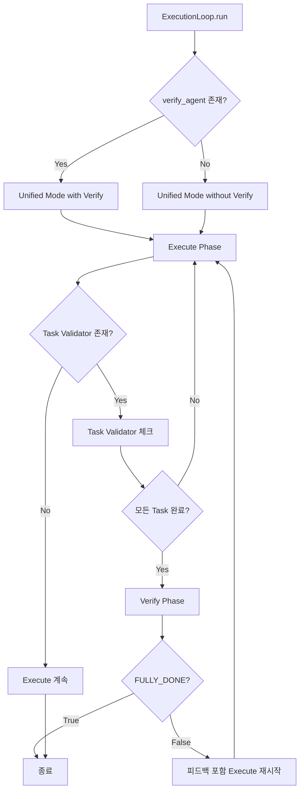

# 사용자의 최초 요청 (기록용)

interactive mode 여도 verify phase 를 돌리게 하는게 맞아. 지금 문제상황과 배경, 작업 방향에 집중해서 ai-todolist.md 적어줘. 구체적 구현 코드 내용 대신 작업 진행방향을 큰 틀에서 잘 알 수 있도록

## 사용자가 이후에 추가 요청한 내용들 (기록용)

애초에 interactive - non interactive 구분이 없도록 해야해 이 phase 동작에는

# 작업 목표

- ExecutionLoop에서 Interactive/Non-Interactive 모드 구분 제거
- 모든 실행 모드에서 Verify Phase가 동작하도록 통합
- Task Validator와 Verify Agent가 모든 모드에서 일관되게 작동

# 작업 배

## 현재 문제 상황

### 1. 모드 분기로 인한 Verify Phase 누락
현재 `sisyphus/core/loop.py`의 `run()` 메서드는:
- `execute_agent.supports_interactive = True` -> Interactive Mode 실행
- `execute_agent.supports_interactive = False` -> Non-Interactive Mode 실행

**문제점:**
- Interactive Mode(`_run_interactive_mode`)에는 Verify Phase가 **전혀 없음**
- ClaudeAgent는 `supports_interactive = True`이므로 항상 Interactive Mode로 실행
- 결과적으로 ClaudeAgent 사용 시 Architect(Verify Agent)가 절대 실행되지 않음

### 2. humantest20251011 사례
- /Users/yeongyu/local-workspaces/humantest20251011
- ai-todolist.md의 모든 체크박스가 완료됨 (`is_all_goals_accomplished = TRUE`)
- 하지만 ClaudeAgent의 `supports_interactive = True` 때문에 Interactive Mode로 실행
- Task Validator도, Verify Phase도 실행되지 않음
- Architect의 최종 검증 없이 작업 종료

### 3. 설계상의 모순
- Verify Phase와 Task Validator는 Non-Interactive Mode에만 존재
- 하지만 실시간 대화 중에도 작업 검증이 필요함
- 현재 구조는 "대화형 실행"과 "검증 프로세스"를 양립할 수 없게 만듦

## 의도된 동작

**모든 실행 모드에서:**
1. Execute Phase 실행 (실시간 대화 지원 여부는 agent 특성에 따라)
2. Task Validator 체크 (ai-todolist.md가 있는 경우)
3. Verify Phase 실행 (verify_agent가 설정된 경우)
4. FULLY_DONE = TRUE 신호로 최종 종료

# 작업 시작 여부
is_execution_started = FALSE

# 모든 목표 달성 여부
is_all_goals_accomplished = FALSE

# 병렬 실행 여부
parallel_requested = FALSE

# 현재 진행 중인 작업
- 작업 시작 전입니다.
   - 작업을 시작하면 위의 `is_execution_started` 의 값을 TRUE 로 바꾸세요.
   - 사용자가 명시적으로 "작업을 시작하라" 라고 말하기 전까지는 절대로 작업하지 않습니다.

# 필요한 사전 지식

- Python async/await 패턴 및 anyio Task Group
- sisyphus의 ExecutionLoop 아키텍처
- Agent Protocol과 supports_interactive 속성
- Task Validator와 Verify Phase의 역할

## 파일 구조 및 역할

- `sisyphus/core/loop.py`: ExecutionLoop 클래스 (메인 수정 대상)
  - `run()`: 모드 분기 로직 (제거 대상)
  - `_run_interactive_mode()`: Interactive 전용 로직 (통합 대상)
  - `_run_non_interactive_mode()`: Non-Interactive 전용 로직 (통합 대상)
- `sisyphus/agents/base.py`: Agent Protocol 정의
- `sisyphus/agents/claude.py`: ClaudeAgent (supports_interactive = True)
- `sisyphus/core/tasks.py`: TaskValidator

## 맥락 이해를 위해 참고해야 할 파일들

### 1. sisyphus/core/loop.py
- **역할**: Execute-Verify 2단계 실행 루프의 핵심 로직
- **참고할 부분**:
  - 58-87줄: `run()` 메서드 - 모드 분기 로직 (수정 필요)
  - 89-156줄: `_run_interactive_mode()` - 실시간 대화 처리
  - 158-253줄: `_run_non_interactive_mode()` - Task Validator + Verify Phase
- **주요 문제**:
  - Interactive Mode에 Task Validator와 Verify Phase가 없음
  - 두 모드가 완전히 분리되어 있어 통합이 어려움

### 2. sisyphus/agents/claude.py
- **역할**: Claude API 기반 Agent 구현
- **참고할 부분**: `supports_interactive = True` 속성
- **주의사항**: 이 속성으로 인해 항상 Interactive Mode로 실행됨

### 3. sisyphus/core/prompts.py
- **역할**: DEFAULT_VERIFY_PROMPT 정의
- **참고할 부분**: 249줄 "FULLY_DONE = TRUE" 신호 형식

# 작업 계획

## PRDs & Structures

### 목표 아키텍처



### 현재 vs 목표 구조 비교

**현재 (문제):**
```
run()
├─ if supports_interactive:
│  └─ _run_interactive_mode()  [Verify 없음 ❌]
└─ else:
   └─ _run_non_interactive_mode()  [Verify 있음 ✅]
```

**목표 (해결):**
```
run()
└─ _run_unified_mode()
   ├─ Execute Phase (interactive 특성은 agent가 처리)
   ├─ Task Validator (optional)
   └─ Verify Phase (optional, verify_agent 있을 때)
```

## 구현 방향

### 핵심 설계 원칙

1. **Interactive 처리는 Agent의 책임**
   - ExecutionLoop은 interactive 여부를 신경쓰지 않음
   - Agent가 자체적으로 실시간 응답 처리
   - ExecutionLoop은 단순히 stream을 소비

2. **검증 프로세스는 실행 모드와 독립적**
   - Task Validator는 ai-todolist.md 존재 여부에만 의존
   - Verify Phase는 verify_agent 존재 여부에만 의존
   - 실행 모드와 관계없이 동일하게 동작

3. **단일 책임 원칙**
   - Execute Phase: 작업 수행
   - Task Validator: 완료 여부 확인
   - Verify Phase: 품질 검증

### 주요 변경 사항

#### 1. `run()` 메서드 단순화
- `supports_interactive` 체크 제거
- 항상 단일 통합 모드로 실행
- verify_agent 존재 여부만 확인

#### 2. 통합 실행 모드 설계
- Execute Phase에서 agent.stream() 호출 (agent가 interactive 특성 처리)
- Execute 완료 후 Task Validator 체크 (선택적)
- Task 완료 시 Verify Phase 실행 (선택적)

#### 3. Interactive 특성 유지
- Agent의 send/stream 인터페이스는 그대로 유지
- ClaudeAgent 등은 여전히 실시간 응답 가능
- ExecutionLoop은 단순히 메시지를 relay

### 기술적 고려사항

1. **Parallel Input/Output 처리**
   - 현재 Interactive Mode의 병렬 input/output 로직 유지 필요
   - Task Group으로 receive_loop와 input_loop 동시 실행
   - 단, Task Validator와 Verify는 Execute 완료 후 실행

2. **세션 관리**
   - Execute Phase: 기존 세션 재사용 가능
   - Verify Phase: 항상 새 세션 (현재 동작 유지)

3. **에러 처리**
   - SessionLimitError 처리 로직 유지
   - 모든 Phase에서 일관된 에러 처리

## 프로젝트 커밋 메시지 스타일

최근 커밋 분석 결과:
- 간결한 한글 설명 (예: "verify 피드백 루프 구현 완료")
- 또는 영어 prefix 없이 한글로 시작 (예: "ctrl q 해도 제대로 종료 안되는 문제 수정")
- 기능 추가는 명확한 동사구 (예: "time logging & nested json printing")

이번 작업 권장: "interactive/non-interactive 모드 통합 및 verify phase 항상 실행"

# TODOs

- [ ] 1. ExecutionLoop 아키텍처 재설계 - 통합 실행 모드 구현
   - **목표**: `_run_interactive_mode`와 `_run_non_interactive_mode`를 하나의 통합 모드로 병합
   - **핵심 접근**:
     - Agent의 interactive 특성은 Agent가 처리하도록 위임
     - ExecutionLoop은 Execute -> Validate -> Verify 흐름만 관리
     - 실시간 대화는 Agent의 stream() 메커니즘으로 자연스럽게 처리됨
   - [ ] 1.1 `_run_unified_mode()` 메서드 설계
     - Execute Phase 로직 (기존 non-interactive 기반, stream 소비 방식)
     - Task Validator 체크 (optional, ai-todolist.md 있을 때)
     - Verify Phase 호출 (optional, verify_agent 있을 때)
   - [ ] 1.2 `run()` 메서드 단순화
     - `supports_interactive` 체크 제거
     - 항상 `_run_unified_mode()` 호출
   - [ ] 1.3 기존 interactive 기능 보존 확인
     - Agent의 실시간 응답 특성이 유지되는지 확인
     - 병렬 input/output이 필요하다면 별도 처리 방안 검토
   - [ ] 아래의 가이드대로 진행했을 때 작업 검증 성공 여부
     - [ ] `run()` 메서드가 단일 실행 경로만 가지는가?
     - [ ] `supports_interactive` 체크가 완전히 제거되었는가?
     - [ ] 새로운 통합 모드의 구조가 명확한가?

- [ ] 2. 통합 모드 구현 - Execute Phase + Task Validator
   - **목표**: Execute 실행 후 Task Validator 체크까지 구현
   - **핵심 접근**:
     - Execute Phase는 agent.stream()을 통해 메시지 수신
     - Task Validator는 Execute 성공 후 체크
     - 미완료 시 Execute 재시작
   - [ ] 2.1 Execute Phase 구현
     - 기존 `_execute_phase()` 로직 재사용
     - agent.send()로 프롬프트 전송
     - agent.stream()으로 응답 수신 및 UI 표시
   - [ ] 2.2 Task Validator 통합
     - Execute 완료 후 ai-todolist.md 체크
     - 미완료 시 continue로 Execute 재시작
   - [ ] 2.3 테스트 작성
     - Execute -> Task incomplete -> Execute 재시작 시나리오
     - Execute -> Task complete -> 다음 단계 진행 시나리오
   - [ ] 아래의 가이드대로 진행했을 때 작업 검증 성공 여부
     - [ ] Execute Phase가 정상 동작하는가?
     - [ ] Task Validator가 올바르게 체크하는가?
     - [ ] 미완료 시 Execute가 재시작되는가?
     - [ ] 테스트가 통과하는가?

- [ ] 3. 통합 모드 구현 - Verify Phase 추가
   - **목표**: Task 완료 후 Verify Phase 실행 및 피드백 루프 구현
   - **핵심 접근**:
     - Task Validator 통과 시에만 Verify 실행
     - FULLY_DONE = TRUE 시 종료
     - FULLY_DONE = FALSE 시 피드백 포함해서 Execute 재시작
   - [ ] 3.1 Verify Phase 통합
     - 기존 `_verify_phase()` 로직 재사용
     - Task 완료 시에만 실행
     - 피드백 히스토리 관리
   - [ ] 3.2 피드백 루프 구현
     - verify_feedback_history 변수로 피드백 누적
     - Execute 재시작 시 피드백 전달
   - [ ] 3.3 테스트 작성
     - Task complete -> Verify (FULLY_DONE=TRUE) -> 종료
     - Task complete -> Verify (FULLY_DONE=FALSE) -> Execute with feedback
   - [ ] 아래의 가이드대로 진행했을 때 작업 검증 성공 여부
     - [ ] Verify Phase가 Task 완료 시에만 실행되는가?
     - [ ] FULLY_DONE 신호로 종료가 작동하는가?
     - [ ] 피드백이 올바르게 전달되는가?
     - [ ] 테스트가 통과하는가?

- [ ] 4. 기존 모드 메서드 제거 및 정리
   - **목표**: 사용하지 않는 `_run_interactive_mode`, `_run_non_interactive_mode` 제거
   - **핵심 접근**:
     - 통합 모드로 완전히 이전 후 제거
     - 관련 테스트 업데이트
   - [ ] 4.1 기존 메서드 제거
     - `_run_interactive_mode()` 삭제
     - `_run_non_interactive_mode()` 삭제
   - [ ] 4.2 관련 테스트 업데이트
     - 기존 모드별 테스트를 통합 모드 테스트로 전환
     - 모든 테스트 케이스가 통합 모드에서 통과하는지 확인
   - [ ] 4.3 린트 및 타입 체크
     - `uv run ruff check sisyphus/core/loop.py`
     - `uv run basedpyright sisyphus/core/loop.py`
   - [ ] 아래의 가이드대로 진행했을 때 작업 검증 성공 여부
     - [ ] 기존 모드 메서드가 완전히 제거되었는가?
     - [ ] 모든 테스트가 통합 모드에서 통과하는가?
     - [ ] 린트와 타입 체크가 통과하는가?

- [ ] 5. 실제 동작 검증 - ClaudeAgent로 전체 흐름 테스트
   - **목표**: humantest20251011과 같은 시나리오에서 Architect가 실행되는지 확인
   - **핵심 접근**:
     - ClaudeAgent 사용해서 실제 작업 수행
     - Task 완료 후 Verify Phase가 실행되는지 확인
     - Architect의 피드백이 정상 동작하는지 확인
   - [ ] 5.1 테스트 시나리오 준비
     - 새로운 테스트 디렉토리에서 간단한 작업 수행
     - ai-todolist.md 작성
   - [ ] 5.2 실제 sisyphus 실행
     - `uv run sisyphus run` 실행
     - Execute -> Task Validator -> Verify 순서 확인
   - [ ] 5.3 로그 분석
     - logs/ 디렉토리에서 각 Phase 실행 로그 확인
     - Verify Phase가 실행되었는지 확인
     - FULLY_DONE 신호가 올바르게 처리되었는지 확인
   - [ ] 5.4 최종 커밋
     - `git add -A && git commit -m "interactive/non-interactive 모드 통합 및 verify phase 항상 실행"`
   - [ ] 아래의 가이드대로 진행했을 때 작업 검증 성공 여부
     - [ ] ClaudeAgent 사용 시 Verify Phase가 실행되는가?
     - [ ] Task Validator와 Verify가 순서대로 동작하는가?
     - [ ] 로그에 모든 Phase 실행이 기록되는가?
     - [ ] 피드백 루프가 정상 동작하는가?
     - [ ] 최종 커밋이 생성되었는가?

# 최종 작업 검증 체크리스트

- [ ] 1. ExecutionLoop에 단일 통합 모드만 존재하는가?
   - [ ] `supports_interactive` 체크가 완전히 제거되었는가?
   - [ ] `_run_interactive_mode`와 `_run_non_interactive_mode`가 제거되었는가?
- [ ] 2. 모든 Agent에서 Verify Phase가 동작하는가?
   - [ ] ClaudeAgent 사용 시 Verify가 실행되는가?
   - [ ] DroidAgent 사용 시에도 Verify가 실행되는가?
- [ ] 3. Task Validator와 Verify의 실행 순서가 올바른가?
   - [ ] Execute -> Task Validator -> Verify 순서인가?
   - [ ] Task 미완료 시 Verify를 건너뛰는가?
- [ ] 4. 피드백 루프가 정상 동작하는가?
   - [ ] FULLY_DONE = FALSE 시 피드백이 전달되는가?
   - [ ] 피드백이 Execute Phase에 포함되는가?
- [ ] 5. 기존 기능이 손상되지 않았는가?
   - [ ] Agent의 실시간 응답 특성이 유지되는가?
   - [ ] 세션 관리가 올바르게 동작하는가?
   - [ ] 에러 처리가 정상 작동하는가?
- [ ] 6. 모든 테스트가 통과하는가?
   - [ ] 단위 테스트 통과
   - [ ] 통합 테스트 통과
   - [ ] 린트 및 타입 체크 통과
- [ ] 7. 실제 사용 시나리오에서 정상 동작하는가?
   - [ ] humantest20251011과 같은 상황에서 Architect 실행
   - [ ] 로그에 모든 Phase가 기록됨
