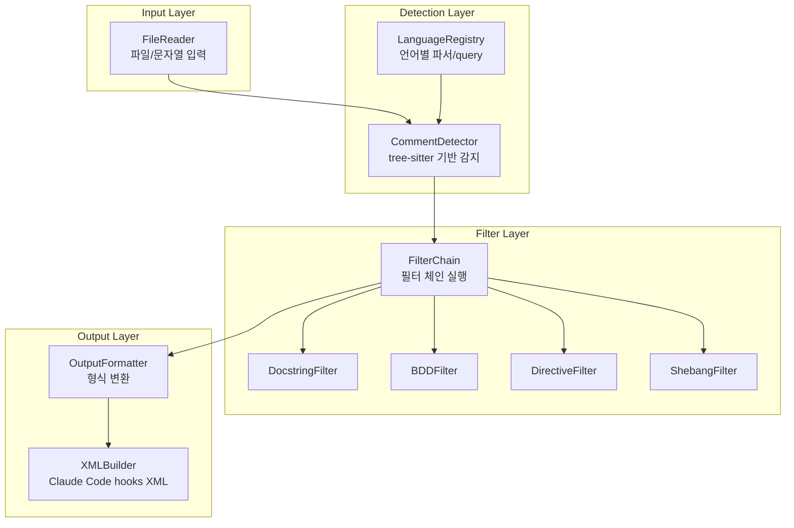
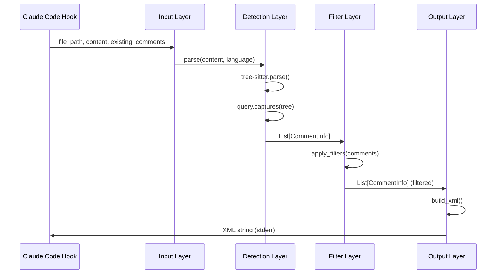
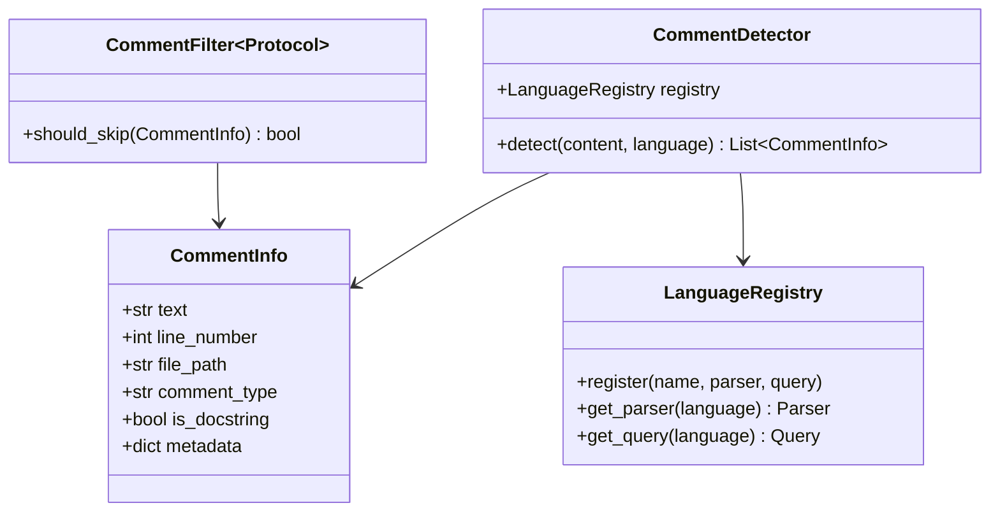

# User's Original Request (For Record)
훅에있는 커멘트 체커가 현재는 파이썬 코드만 감지하는데, 이를 다양한 언어에 대해 지원해야함.

파이썬에 이러한걸 감지하는 라이브러리(정적분석으로 커멘트 찾기)가 있는지 찾아보고

혹은 파이썬으로 안된다면 다른 언어에는 없나 사례를 찾아보고 (ast grep 같은걸론 안되려나?)

가능하다면 폴리모픽하게 지원되도록 하는 방안으로 바뀌어야함

## Additional User Requests (For Record)
필수 지원 필요 목록:
- python
- typescript
- javascript (and its variations like jsx)
- svelte
- vue
- go
- rust
- zig
- swift
- kotlin
- java
- elixir
- c, cpp, csharp
- 그 외 더 많을 수록 좋음
- 단, docstring jsdoc, javadoc, bdd keyword, typechecker directive 같은 known okay pattern 은 예외로 다룰 수 있어야 함

가능하면 파이썬 코드 안에서 주석 감지를 때리고 그 안에서 감지된 내용을 쫙 출력시키는 방식으로 일원화되어 우아하게 표현할 수 있었으면 해. 언어별 variant 가 너무 복잡하게 다뤄지지 않았으면 해.

이를 만족할 수 있는 기술로 선택하고, 작업계획서 만들어줘.

지금 있는 check comments hook 은 일단 그대로 두고, sisyphus-tools/ 만들고 그 밑에다가 comment-checker/ 이렇게해서 밑에다가 새로 만들어준다고 생각하면 돼.
내가 원하는건 감지 하는 레이어, 이를 입력받는 레이어, 이를 claude code hooks 형식으로 컨버팅 하는 레이어가 다 분리되어있었으면 하는 바람이야.

그래서 프로젝트 전반적인 레이아웃도 포함하는 작업계획서로 만들어줘. 작업계획서에는 언어별 케이스들, 특히 known okay pattern handling 까지 포함해서 잘 고려하도록 하는 내용으로 구성해줘.

# Work Objectives (WHAT & WHY)

## Core Objective (TL;DR)
현재 Python만 지원하는 comment checker를 다국어 지원이 가능한 polymorphic 시스템으로 재설계하여 15개 이상의 프로그래밍 언어에서 일관된 방식으로 주석을 감지하고 검증할 수 있도록 한다.

## Detailed Objectives
- **다국어 지원**: Python, TypeScript, JavaScript/JSX, Svelte, Vue, Go, Rust, Zig, Swift, Kotlin, Java, Elixir, C, C++, C# 등 15개 이상 언어 지원
- **Known Okay Pattern 예외 처리**: docstring, JSDoc, Javadoc, BDD keyword (given/when/then), type checker directive (noqa, pyright: 등) 등 허용 가능한 패턴 필터링
- **레이어 분리 아키텍처**: 감지 레이어, 입력 레이어, Claude Code hooks 변환 레이어를 명확히 분리
- **통일된 인터페이스**: 언어별 variant가 복잡하지 않고 Python 코드 내에서 일원화된 방식으로 처리
- **확장 가능한 설계**: 새로운 언어 추가 시 최소한의 변경으로 대응 가능
- **기존 hook 유지**: 현재 `.github/workflows/.claude.sisyphus/hooks/post-tool-use/static_check/python_opinionated/check_comments.py` 는 그대로 유지

# Work Background (WHY & WHAT - Current State)

## Current Situation
- 현재 comment checker는 `check_comments.py` 에 하드코딩되어 Python 파일만 감지 가능 (`if ext != "py": return []`)
- `comment-parser` 라이브러리 사용 중이나 2018년 이후 업데이트 없음
- Python docstring은 `ast` 모듈로 별도 처리
- BDD keyword, type checker directive 등 예외 처리는 Python에 특화되어 있음
- C, C++, Go, Java, JavaScript, Ruby, HTML 등 9개 언어를 지원한다고 하지만 실제로는 Python만 활용 중

## Reason for Change
- 프로젝트에서 Python 외에 다양한 언어를 사용하기 시작하면서 일관된 comment policy 적용이 필요
- TypeScript, Svelte, Vue 등 최신 프론트엔드 기술 스택을 포함한 광범위한 언어 지원 요구
- 유지보수가 중단된 `comment-parser` 대신 활발히 관리되는 tree-sitter 생태계로 전환 필요
- 언어별로 중복 코드를 작성하는 대신 polymorphic 설계로 확장성 확보

## Changes to Make
**현재 상태**:
- Python 전용 하드코딩된 로직 (`check_comments.py` 내 `if ext != "py"` 체크)
- 단일 파일에 모든 로직이 혼재 (감지, 검증, 출력 모두 한 곳)
- `comment-parser` + `ast` 모듈의 이원화된 처리

**변경 후 상태**:
- Tree-sitter 기반 다국어 지원 (15+ 언어)
- `sisyphus-tools/comment-checker/` 아래 레이어별로 명확히 분리:
  - Detection Layer: tree-sitter를 이용한 comment 추출
  - Input Layer: 파일 또는 코드 문자열 입력 처리
  - Hook Conversion Layer: Claude Code hooks 형식의 XML 출력 생성
- 언어별 known okay pattern 정의를 config로 외부화
- Protocol 기반 설계로 새 언어 추가 시 확장 용이

# Work Started
is_execution_started = FALSE

# All Goals Accomplished
is_all_goals_accomplished = FALSE

# Parallel Execution
parallel_requested = FALSE

# Current Work in Progress
- Work has not started yet.
  - When starting work, change the value of `is_execution_started` above to TRUE.
  - Never start work until the user explicitly says "start the work".
  - **Even if you receive OKAY from plan reviewer, NEVER start work**
  - Never start work until the user explicitly says "start the work".

# Required Background Knowledge

## Tech Stack Selection: tree-sitter + tree-sitter-languages

### Why tree-sitter?
- **Active maintenance**: 2025년 기준 활발히 업데이트 중 (vs comment-parser 2018년 이후 중단)
- **165+ 언어 지원**: tree-sitter-languages 패키지로 대부분의 메이저 언어 커버
- **정확한 AST 기반**: 정규식이 아닌 문법 트리 기반으로 정확한 파싱
- **Query 시스템**: 강력한 패턴 매칭 시스템으로 comment 뿐만 아니라 docstring, JSDoc 등 구조화된 문서도 감지 가능
- **Python 바인딩 성숙**: `py-tree-sitter` (공식), `tree-sitter-languages` (community, 바이너리 휠 포함)

### 지원 언어 현황
**tree-sitter-languages 기본 지원** (46개 언어):
- 필수 언어 중 지원: Python, TypeScript, JavaScript, Go, Rust, Swift, Kotlin, Java, Elixir, C, C++, C#
- 추가 지원: Bash, CSS, Dockerfile, Elm, Erlang, Haskell, HTML, Lua, Markdown, OCaml, Perl, PHP, Ruby, Scala, SQL, TOML, YAML 등

**별도 통합 필요** (tree-sitter 파서는 존재하나 tree-sitter-languages 미포함):
- Svelte: `tree-sitter-svelte` (Himujjal/tree-sitter-svelte, npm/GitHub에서 사용 가능)
- Vue: `tree-sitter-vue` (ikatyang/tree-sitter-vue, tree-sitter-grammars/tree-sitter-vue)
- Zig: `tree-sitter-zig` (maxxnino/tree-sitter-zig)

### Architecture Decision
- **Core**: `tree-sitter-languages` 패키지 사용으로 46개 언어 즉시 지원
- **Extension**: Svelte, Vue, Zig는 개별 파서를 optional dependency로 추가 (py-tree-sitter로 로드)
- **Fallback**: 파서가 없는 언어는 graceful degradation (warning 로그 후 skip)

## File Structure and Roles

### New Directory Structure (sisyphus-tools/comment-checker/)
```
sisyphus-tools/
└── comment-checker/
    ├── pyproject.toml                     # 독립 패키지 설정, dependencies 명시
    ├── README.md                          # 사용법, 아키텍처 설명
    ├── comment_checker/
    │   ├── __init__.py                   # 패키지 초기화, 주요 API export
    │   ├── core/
    │   │   ├── __init__.py
    │   │   ├── detector.py               # Detection Layer - tree-sitter로 comment 추출
    │   │   ├── language_registry.py      # 언어별 파서 및 query 관리
    │   │   └── query_templates.py        # 언어별 tree-sitter query 템플릿
    │   ├── filters/
    │   │   ├── __init__.py
    │   │   ├── base.py                   # CommentFilter protocol 정의
    │   │   ├── docstring.py              # Docstring 필터 (Python, JSDoc, Javadoc 등)
    │   │   ├── bdd.py                    # BDD keyword 필터
    │   │   ├── directive.py              # Type checker directive 필터
    │   │   └── shebang.py                # Shebang 필터
    │   ├── models/
    │   │   ├── __init__.py
    │   │   └── comment.py                # CommentInfo 데이터 모델
    │   ├── input/
    │   │   ├── __init__.py
    │   │   └── reader.py                 # Input Layer - 파일/문자열 입력 처리
    │   ├── output/
    │   │   ├── __init__.py
    │   │   ├── formatter.py              # Hook Conversion Layer - 출력 형식 생성
    │   │   └── xml_builder.py            # XML 형식 빌더
    │   └── config/
    │       ├── __init__.py
    │       └── known_patterns.yaml       # 언어별 known okay pattern 정의
    └── tests/
        ├── __init__.py
        ├── fixtures/                      # 테스트용 코드 샘플 (언어별)
        │   ├── python_sample.py
        │   ├── typescript_sample.ts
        │   ├── javascript_sample.js
        │   ├── go_sample.go
        │   └── ...
        ├── core/
        │   ├── test_detector.py
        │   └── test_language_registry.py
        ├── filters/
        │   ├── test_docstring.py
        │   ├── test_bdd.py
        │   └── test_directive.py
        └── integration/
            └── test_end_to_end.py         # 전체 파이프라인 통합 테스트
```

### Existing Hook (유지)
- `.github/workflows/.claude.sisyphus/hooks/post-tool-use/static_check/python_opinionated/check_comments.py`
- 이 파일은 **변경하지 않음**
- 향후 이 hook이 `sisyphus-tools/comment-checker` 를 호출하도록 마이그레이션할 수 있음 (별도 작업)

## Reference Files for Context Understanding

### 1. `.github/workflows/.claude.sisyphus/hooks/post-tool-use/static_check/python_opinionated/check_comments.py`
- **Role**: 현재 Python 전용 comment checker hook 구현체
- **What to search for**:
  - `BDD_KEYWORDS`, `SKIP_EXTENSIONS` 상수 → 예외 처리 패턴 이해
  - `is_bdd_comment()`, `is_python_type_comment()`, `is_shebang_comment()` 함수 → known okay pattern 필터링 로직
  - `build_error_message()` 함수 → XML 출력 형식 및 에러 메시지 구조
  - `check_comments_in_content()` 함수 → 전체 파이프라인 흐름
- **Key pattern to understand**:
  - stdin으로 JSON 입력 받기 → 파일 경로 추출 → comment 감지 → 기존 comment와 비교 → 새로운 comment만 필터링 → XML 형식으로 stderr 출력
  - `PostToolUseInput` TypedDict 구조: `{"session_id", "tool_name", "tool_input", "tool_response", ...}`
  - Tool name 별 처리: Write (전체 content), Edit (new_string만), MultiEdit (edits 배열)

### 2. tree-sitter-languages 공식 문서
- **Role**: tree-sitter Python 바인딩 사용법
- **Reference URL**: https://github.com/grantjenks/py-tree-sitter-languages
- **What to learn**:
  - `get_language(name)`, `get_parser(name)` API 사용법
  - 지원 언어 목록 (`repos.txt` 파일 참조)
- **Code Pattern**:
  ```python
  from tree_sitter_languages import get_language, get_parser

  language = get_language('python')
  parser = get_parser('python')
  tree = parser.parse(bytes(code, 'utf-8'))
  ```

### 3. tree-sitter Query 문법
- **Role**: comment 추출을 위한 query 작성법
- **Reference URL**: https://tree-sitter.github.io/tree-sitter/4-code-navigation.html
- **What to learn**:
  - `(comment) @comment` 형태의 query 작성
  - `#strip!`, `#select-adjacent!` 같은 built-in 함수 활용
- **Code Pattern**:
  ```python
  # Python comment query 예시
  query = language.query("(comment) @comment")
  captures = query.captures(tree.root_node)
  for node, capture_name in captures:
      comment_text = node.text.decode('utf-8')
  ```

### 4. Existing Project Patterns (sisyphus codebase)
- **Role**: 프로젝트 코딩 컨벤션 이해
- **Files to check**:
  - `sisyphus/utils/types.py` → TypedDict, Protocol 사용 패턴
  - `sisyphus/agents/base.py` → Protocol 기반 polymorphic 설계 패턴
  - `sisyphus/core/*.py` → 레이어 분리 아키텍처 스타일
- **Conventions to follow**:
  - Type hints 철저히 사용 (ANN001 ruff rule 준수)
  - Protocol over ABC (PEP 544)
  - Double quotes for strings
  - Line length 119
  - Given-When-Then 테스트 구조

# Work Flow (HOW - Task Flow & Dependencies)

## Task Dependency Diagram
```
Task 1 (프로젝트 구조 생성)
   ↓
Task 2 (Detection Layer - Core)
   ↓
Task 3 || Task 4 || Task 5 (병렬 가능: Filter Layer - 각 필터 독립적)
   ↓
Task 6 (Input Layer)
   ↓
Task 7 (Output Layer)
   ↓
Task 8 (Language Registry 확장 - Svelte/Vue/Zig)
   ↓
Task 9 (통합 테스트 및 검증)
   ↓
Task 10 (문서화)
```

## Phase-by-Phase Explanation
- **Phase 1 (Task 1)**: 기본 디렉토리 구조와 pyproject.toml 생성, 패키지 초기화
- **Phase 2 (Task 2)**: tree-sitter를 이용한 핵심 comment detection 로직 구현, 언어 레지스트리 기반 구조
- **Phase 3 (Task 3-5)**: Filter 레이어 구현 - 각 필터는 독립적이므로 병렬 작업 가능 (docstring, BDD, directive 필터)
- **Phase 4 (Task 6)**: Input 레이어 구현 - 파일 경로 또는 코드 문자열을 받아 파싱
- **Phase 5 (Task 7)**: Output 레이어 구현 - Claude Code hooks 형식 XML 생성
- **Phase 6 (Task 8)**: tree-sitter-languages에 포함되지 않은 언어 (Svelte, Vue, Zig) 지원 추가
- **Phase 7 (Task 9)**: 전체 파이프라인 end-to-end 테스트, 각 언어별 샘플 코드 테스트
- **Phase 8 (Task 10)**: README 및 사용 예제 문서 작성

# Work Plan

## PRDs & Structures

### System Architecture


### Data Flow


### Core Data Model


## Implementation Details

### Architecture Constraints
- **Pure Python Implementation**: 모든 로직은 Python으로 구현 (CLI 도구 의존성 없음)
- **Synchronous Processing**: 파일 단위 처리이므로 동기 처리 (async 불필요)
- **Stateless Design**: 각 호출은 독립적, 세션 상태 유지 안 함
- **Graceful Degradation**: 지원하지 않는 언어는 warning 로그 후 skip (에러 발생 안 함)

### Edge Case Handling
- **파서 없는 언어**: `LanguageRegistry.get_parser()` 에서 `None` 반환 → caller에서 warning 후 빈 리스트 반환
- **파싱 에러**: tree-sitter 파싱 실패 시 (syntax error 등) 빈 리스트 반환 + 로그
- **Encoding 문제**: UTF-8 decode 실패 시 latin-1 fallback 시도
- **대용량 파일**: 파일 크기 제한 없음 (tree-sitter는 incremental parsing 지원하지만 우선 전체 파일 파싱)
- **Multi-line comment**: tree-sitter query로 자동 처리 (block comment node)
- **Nested comment**: 언어별 파서가 처리 (예: Rust의 `/* /* nested */ */`)

### Making Implicit Assumptions Explicit
- **Python >= 3.12**: `tree-sitter` 패키지가 Python 3.8+ 요구, 프로젝트 기준 3.12 사용
- **UTF-8 기본**: 모든 소스 파일은 UTF-8로 가정 (encoding parameter 제공 가능)
- **tree-sitter-languages 설치됨**: core 46개 언어는 이 패키지 설치 전제
- **Optional parsers는 선택적**: Svelte/Vue/Zig 파서는 optional, 없어도 나머지 동작
- **Hook contract 유지**: 기존 `check_comments.py` 의 stdin/stderr contract 유지 (JSON input, XML output)

## Project Commit Message Style
```bash
git log --oneline -20 --no-merges
```
프로젝트 최근 커밋 스타일 (예시):
- `feat: add XXX feature` - 새 기능 추가
- `fix: correct YYY behavior` - 버그 수정
- `refactor: restructure ZZZ` - 리팩토링
- `test: add test for AAA` - 테스트 추가
- `docs: update BBB documentation` - 문서 업데이트
- `chore: CCC maintenance` - 기타 작업

이 스타일을 따라 커밋 메시지 작성:
- prefix 사용 (feat, fix, refactor, test, docs, chore 등)
- 소문자 시작
- 명령형 (imperative) 사용
- 마침표 없음
- 한 줄 요약 (50자 이내)

# TODOs

- [ ] 1. 프로젝트 구조 생성 및 패키지 초기화

   **목표**: `sisyphus-tools/comment-checker/` 디렉토리 구조 생성, pyproject.toml 설정, 기본 패키지 파일 작성

   - [ ] 1.1 디렉토리 구조 생성

      **Implementation Details**:
      ```bash
      mkdir -p sisyphus-tools/comment-checker/comment_checker/{core,filters,models,input,output,config}
      mkdir -p sisyphus-tools/comment-checker/tests/{fixtures,core,filters,integration}
      ```

      생성할 디렉토리:
      - `sisyphus-tools/comment-checker/comment_checker/` (메인 패키지)
      - 하위 패키지: core, filters, models, input, output, config
      - `tests/` 아래: fixtures, core, filters, integration

   - [ ] 1.2 pyproject.toml 작성

      **Reference Sources**:
      - Pattern file: `pyproject.toml` (search for `[project]`, `dependencies`, `[tool.ruff]` 섹션)
      - Follow project's dependency management style (uv 사용, version pinning 정책)

      **Implementation Details**:
      ```toml
      [project]
      name = "comment-checker"
      version = "0.1.0"
      requires-python = ">=3.12"
      dependencies = [
          "tree-sitter>=0.23.0",
          "tree-sitter-languages>=1.10.2",
          "pyyaml>=6.0",
      ]

      [project.optional-dependencies]
      # Svelte, Vue, Zig 파서는 optional (향후 추가)
      extended = [
          # "tree-sitter-svelte",  # 추후 패키지 확인 후 추가
      ]

      [tool.ruff]
      line-length = 119
      # ... (기존 프로젝트 설정 복사)
      ```

      Current: 프로젝트에 pyproject.toml 없음
      Change: comment-checker 전용 pyproject.toml 생성
      Note: 독립 패키지로 관리, 향후 monorepo 구조로 통합 가능

   - [ ] 1.3 각 패키지에 __init__.py 생성

      **Implementation Details**:
      - `comment_checker/__init__.py`: 주요 API export
        ```python
        """Multi-language comment detection system based on tree-sitter."""

        from comment_checker.core.detector import CommentDetector
        from comment_checker.models.comment import CommentInfo

        __all__ = ["CommentDetector", "CommentInfo"]
        ```
      - `comment_checker/core/__init__.py`, `filters/__init__.py` 등: 빈 파일로 시작
      - `tests/__init__.py`: 빈 파일

   - [ ] 1.4 기본 파일 생성 (README.md, .gitignore)

      **Implementation Details**:
      - README.md: 프로젝트 소개, 사용법, 아키텍처 개요 (향후 상세 작성)
      - .gitignore: Python 관련 (\_\_pycache\_\_, *.pyc, .pytest_cache/ 등)

   - [ ] 1.5 Commit
      - Command: `git add sisyphus-tools/comment-checker/ && git commit -m "feat: initialize comment-checker project structure"`

   - [ ] **Work Completion Verification Checklist**
      - [ ] `sisyphus-tools/comment-checker/comment_checker/` 디렉토리 존재 확인
      - [ ] `pyproject.toml` 파일 존재 및 `tree-sitter`, `tree-sitter-languages` dependency 확인
      - [ ] `comment_checker/__init__.py` 에 `CommentDetector`, `CommentInfo` import 가능 확인
      - [ ] `tests/` 디렉토리 하위에 fixtures, core, filters, integration 폴더 존재
      - [ ] Git commit 완료 확인 (`git log -1 --oneline` → "feat: initialize comment-checker project structure")

- [ ] 2. Detection Layer - Core 구현 (CommentDetector, LanguageRegistry)

   **목표**: tree-sitter를 이용한 핵심 comment 감지 엔진 구현, 언어별 파서 및 query 관리 시스템 구축

   **Reference Sources**:
   - tree-sitter-languages API: https://github.com/grantjenks/py-tree-sitter-languages (search for `get_language`, `get_parser` usage)
   - tree-sitter Query 문법: https://tree-sitter.github.io/tree-sitter/ (find "Pattern Matching with Queries" section)
   - 기존 check_comments.py: `.github/workflows/.claude.sisyphus/hooks/post-tool-use/static_check/python_opinionated/check_comments.py` (search for `extract_comments_from_string` function, understand comment extraction flow)

   - [ ] 2.1 CommentInfo 데이터 모델 작성 (`models/comment.py`)

      **Implementation Details**:
      ```python
      from __future__ import annotations

      from dataclasses import dataclass

      @dataclass(frozen=True)
      class CommentInfo:
          """Represents a single comment detected in source code."""
          text: str                    # 주석 텍스트 (원본, prefix 포함)
          line_number: int             # 라인 번호 (1-based)
          file_path: str               # 파일 경로
          comment_type: str            # "line", "block", "docstring" 등
          is_docstring: bool = False   # docstring 여부
          metadata: dict[str, str] | None = None  # 추가 정보 (언어별)

          def normalized_text(self) -> str:
              """Normalize text for comparison (lowercase, strip)."""
              return self.text.strip().lower()
      ```

      Note: 기존 `check_comments.py` 는 tuple 사용, 여기서는 dataclass로 type-safe하게 관리

   - [ ] 2.2 LanguageRegistry 구현 (`core/language_registry.py`)

      **Reference Pattern**: `sisyphus/agents/base.py` (Protocol 사용 패턴 참조)

      **Implementation Details**:
      ```python
      from __future__ import annotations

      from typing import TYPE_CHECKING

      if TYPE_CHECKING:
          from tree_sitter import Language, Parser, Query

      from tree_sitter_languages import get_language, get_parser

      class LanguageRegistry:
          """Manages tree-sitter parsers and queries for each language."""

          def __init__(self) -> None:
              self._parsers: dict[str, Parser] = {}
              self._queries: dict[str, Query] = {}
              self._language_map: dict[str, str] = self._build_language_map()

          def _build_language_map(self) -> dict[str, str]:
              """Map file extension to tree-sitter language name."""
              return {
                  "py": "python",
                  "ts": "typescript",
                  "tsx": "tsx",
                  "js": "javascript",
                  "jsx": "javascript",  # JSX uses javascript parser
                  "go": "go",
                  "rs": "rust",
                  "swift": "swift",
                  "kt": "kotlin",
                  "java": "java",
                  "ex": "elixir",
                  "exs": "elixir",
                  "c": "c",
                  "cpp": "cpp",
                  "cc": "cpp",
                  "cxx": "cpp",
                  "cs": "c_sharp",
                  # ... (46개 언어 매핑)
              }

          def get_parser(self, extension: str) -> Parser | None:
              """Get parser for file extension."""
              language_name = self._language_map.get(extension)
              if not language_name:
                  return None

              if language_name not in self._parsers:
                  try:
                      self._parsers[language_name] = get_parser(language_name)
                  except Exception:
                      return None  # Graceful degradation

              return self._parsers[language_name]

          def get_query(self, extension: str) -> Query | None:
              """Get comment query for language."""
              # Lazy load query from query_templates.py
              pass  # 구현은 2.3에서
      ```

      Note: Singleton pattern 대신 instance 생성 (테스트 용이성)

   - [ ] 2.3 Query Templates 작성 (`core/query_templates.py`)

      **Reference**: tree-sitter Query 문법 문서

      **Implementation Details**:
      ```python
      """Tree-sitter query templates for each language."""

      QUERY_TEMPLATES: dict[str, str] = {
          "python": """
              (comment) @comment
              """,
          "javascript": """
              (comment) @comment
              """,
          "typescript": """
              (comment) @comment
              """,
          "go": """
              (comment) @comment
              """,
          "rust": """
              (line_comment) @comment
              (block_comment) @comment
              """,
          # ... (언어별 query 추가)
      }

      # Docstring query (language-specific)
      DOCSTRING_QUERIES: dict[str, str] = {
          "python": """
              (module . (expression_statement (string) @docstring))
              (class_definition body: (block . (expression_statement (string) @docstring)))
              (function_definition body: (block . (expression_statement (string) @docstring)))
              """,
          "javascript": """
              (comment) @jsdoc
              (#match? @jsdoc "^/\\*\\*")
              """,
          # ... (JSDoc, Javadoc 등)
      }
      ```

      Note: 각 언어의 node type은 tree-sitter grammar 참조 (예: Rust는 `line_comment`, `block_comment` 구분)

   - [ ] 2.4 CommentDetector 구현 (`core/detector.py`)

      **Reference Pattern**: `check_comments.py` 의 `extract_comments_from_string` 함수

      **Implementation Details**:
      ```python
      from __future__ import annotations

      from pathlib import Path
      from typing import TYPE_CHECKING

      if TYPE_CHECKING:
          from tree_sitter import Tree

      from comment_checker.core.language_registry import LanguageRegistry
      from comment_checker.core.query_templates import QUERY_TEMPLATES, DOCSTRING_QUERIES
      from comment_checker.models.comment import CommentInfo

      class CommentDetector:
          """Detects comments in source code using tree-sitter."""

          def __init__(self, registry: LanguageRegistry | None = None) -> None:
              self.registry = registry or LanguageRegistry()

          def detect(
              self,
              content: str,
              file_path: str,
              include_docstrings: bool = True,
          ) -> list[CommentInfo]:
              """Detect all comments in content."""
              ext = Path(file_path).suffix.lstrip(".").lower()
              parser = self.registry.get_parser(ext)

              if not parser:
                  return []  # Graceful degradation

              try:
                  tree: Tree = parser.parse(bytes(content, "utf-8"))
              except Exception:
                  return []  # Parse error

              comments: list[CommentInfo] = []

              # Regular comments
              comments.extend(self._extract_comments(tree, file_path, ext))

              # Docstrings
              if include_docstrings:
                  comments.extend(self._extract_docstrings(tree, file_path, ext))

              return comments

          def _extract_comments(
              self, tree: Tree, file_path: str, ext: str
          ) -> list[CommentInfo]:
              """Extract regular comments using query."""
              language = self.registry.get_parser(ext).language
              query_str = QUERY_TEMPLATES.get(ext)
              if not query_str:
                  return []

              query = language.query(query_str)
              captures = query.captures(tree.root_node)

              results: list[CommentInfo] = []
              for node, _ in captures:
                  text = node.text.decode("utf-8")
                  line = node.start_point[0] + 1  # 0-based to 1-based
                  results.append(
                      CommentInfo(
                          text=text,
                          line_number=line,
                          file_path=file_path,
                          comment_type="line" if "//" in text or "#" in text else "block",
                          is_docstring=False,
                      )
                  )

              return results

          def _extract_docstrings(
              self, tree: Tree, file_path: str, ext: str
          ) -> list[CommentInfo]:
              """Extract docstrings (Python, JSDoc, Javadoc)."""
              # Similar to _extract_comments but use DOCSTRING_QUERIES
              pass  # 구현 로직 유사
      ```

   - [ ] 2.5 단위 테스트 작성 (`tests/core/test_detector.py`)

      **Test Pattern**: `sisyphus/agents/tests/test_claude.py` (Given-When-Then 구조)

      **Implementation Details**:
      ```python
      import pytest

      from comment_checker.core.detector import CommentDetector

      def test_detect__python_line_comment__returns_comment_info() -> None:
          # given
          detector = CommentDetector()
          code = "# This is a comment\nprint('hello')"

          # when
          results = detector.detect(code, "test.py")

          # then
          assert len(results) == 1
          assert results[0].text == "# This is a comment"
          assert results[0].line_number == 1
          assert results[0].comment_type == "line"

      def test_detect__typescript_block_comment__returns_comment_info() -> None:
          # given
          detector = CommentDetector()
          code = "/* Block comment */\nconst x = 1;"

          # when
          results = detector.detect(code, "test.ts")

          # then
          assert len(results) == 1
          assert "Block comment" in results[0].text
          assert results[0].comment_type == "block"

      # ... (언어별 테스트 추가: Go, Rust, Java, etc.)
      ```

   - [ ] 2.6 Lint 및 Type Check
      - [ ] `ruff check sisyphus-tools/comment-checker/comment_checker/` → 0 errors 기대
      - [ ] `basedpyright sisyphus-tools/comment-checker/comment_checker/` → 0 errors 기대

   - [ ] 2.7 테스트 실행
      - Command: `pytest sisyphus-tools/comment-checker/tests/core/test_detector.py -xvs`
      - Expected: 모든 테스트 PASSED

   - [ ] 2.8 Commit
      - Command: `git add sisyphus-tools/comment-checker/ && git commit -m "feat: implement comment detection layer with tree-sitter"`

   - [ ] **Work Completion Verification Checklist**
      - [ ] `comment_checker/models/comment.py` 에 `CommentInfo` dataclass 정의 완료
      - [ ] `comment_checker/core/language_registry.py` 에 `LanguageRegistry` 클래스 구현
      - [ ] `comment_checker/core/query_templates.py` 에 최소 5개 언어 query 정의 (Python, TypeScript, JavaScript, Go, Rust)
      - [ ] `comment_checker/core/detector.py` 에 `CommentDetector.detect()` 메서드 구현
      - [ ] 단위 테스트 최소 5개 작성 및 PASSED 확인
      - [ ] Lint 및 type check 통과
      - [ ] Git commit 완료

- [ ] 3 parallel. Filter Layer - Docstring 필터 구현

   **목표**: Python docstring, JSDoc, Javadoc 등 문서화 주석을 필터링하는 로직 구현

   **Reference Sources**:
   - 기존 check_comments.py: `extract_docstrings_from_string` 함수 (Python docstring 처리 로직)
   - JSDoc 문법: https://jsdoc.app/ (find "Block Tags" section)
   - Javadoc 문법: https://docs.oracle.com/javase/8/docs/technotes/tools/windows/javadoc.html

   - [ ] 3.1 CommentFilter protocol 정의 (`filters/base.py`)

      **Implementation Details**:
      ```python
      from __future__ import annotations

      from typing import Protocol

      from comment_checker.models.comment import CommentInfo

      class CommentFilter(Protocol):
          """Protocol for comment filtering."""

          def should_skip(self, comment: CommentInfo) -> bool:
              """Return True if comment should be skipped (allowed)."""
              ...
      ```

   - [ ] 3.2 DocstringFilter 구현 (`filters/docstring.py`)

      **Implementation Details**:
      ```python
      from comment_checker.models.comment import CommentInfo

      class DocstringFilter:
          """Filter for docstrings (Python, JSDoc, Javadoc)."""

          def should_skip(self, comment: CommentInfo) -> bool:
              """Return True if comment is a docstring."""
              if comment.is_docstring:
                  return True

              # JSDoc pattern: /** ... */
              if comment.text.strip().startswith("/**"):
                  return True

              # Javadoc pattern: /** ... */ (same as JSDoc)
              # (추가 검증: @param, @return 등 태그 존재 여부)

              return False
      ```

   - [ ] 3.3 테스트 작성 (`tests/filters/test_docstring.py`)

      **Implementation Details**:
      ```python
      import pytest

      from comment_checker.filters.docstring import DocstringFilter
      from comment_checker.models.comment import CommentInfo

      def test_should_skip__python_docstring__returns_true() -> None:
          # given
          filter_instance = DocstringFilter()
          comment = CommentInfo(
              text='"""This is a docstring"""',
              line_number=1,
              file_path="test.py",
              comment_type="docstring",
              is_docstring=True,
          )

          # when
          result = filter_instance.should_skip(comment)

          # then
          assert result is True

      def test_should_skip__jsdoc_comment__returns_true() -> None:
          # given
          filter_instance = DocstringFilter()
          comment = CommentInfo(
              text="/** @param {string} name */",
              line_number=1,
              file_path="test.js",
              comment_type="block",
              is_docstring=False,
          )

          # when
          result = filter_instance.should_skip(comment)

          # then
          assert result is True

      # ... (추가 테스트)
      ```

   - [ ] 3.4 Commit
      - Command: `git add sisyphus-tools/comment-checker/ && git commit -m "feat: implement docstring filter"`

   - [ ] **Work Completion Verification Checklist**
      - [ ] `filters/base.py` 에 `CommentFilter` Protocol 정의
      - [ ] `filters/docstring.py` 에 `DocstringFilter` 구현
      - [ ] Python docstring, JSDoc, Javadoc 패턴 감지 확인
      - [ ] 테스트 3개 이상 작성 및 PASSED
      - [ ] Git commit 완료

- [ ] 4 parallel. Filter Layer - BDD 필터 구현

   **목표**: given/when/then 같은 BDD keyword를 필터링하는 로직 구현

   **Reference Sources**:
   - 기존 check_comments.py: `BDD_KEYWORDS` 상수, `is_bdd_comment` 함수

   - [ ] 4.1 BDDFilter 구현 (`filters/bdd.py`)

      **Implementation Details**:
      ```python
      from comment_checker.models.comment import CommentInfo

      BDD_KEYWORDS: set[str] = {
          "given",
          "when",
          "then",
          "arrange",
          "act",
          "assert",
          "when & then",
          "when&then",
      }

      class BDDFilter:
          """Filter for BDD keywords in comments."""

          def should_skip(self, comment: CommentInfo) -> bool:
              """Return True if comment is a BDD keyword."""
              normalized = comment.text.strip().lower()

              # Remove comment prefix (#, //, etc.)
              for prefix in ["#", "//", "--"]:
                  if normalized.startswith(prefix):
                      normalized = normalized[len(prefix):].strip()

              return normalized in BDD_KEYWORDS
      ```

   - [ ] 4.2 테스트 작성 (`tests/filters/test_bdd.py`)

      **Implementation Details**:
      ```python
      import pytest

      from comment_checker.filters.bdd import BDDFilter
      from comment_checker.models.comment import CommentInfo

      def test_should_skip__given_keyword__returns_true() -> None:
          # given
          filter_instance = BDDFilter()
          comment = CommentInfo(
              text="# given",
              line_number=1,
              file_path="test.py",
              comment_type="line",
          )

          # when
          result = filter_instance.should_skip(comment)

          # then
          assert result is True

      def test_should_skip__when_then_keyword__returns_true() -> None:
          # given
          filter_instance = BDDFilter()
          comment = CommentInfo(
              text="// when & then",
              line_number=1,
              file_path="test.js",
              comment_type="line",
          )

          # when
          result = filter_instance.should_skip(comment)

          # then
          assert result is True

      # ... (추가 테스트)
      ```

   - [ ] 4.3 Commit
      - Command: `git add sisyphus-tools/comment-checker/ && git commit -m "feat: implement BDD keyword filter"`

   - [ ] **Work Completion Verification Checklist**
      - [ ] `filters/bdd.py` 에 `BDDFilter` 구현
      - [ ] 모든 BDD keyword (given, when, then, arrange, act, assert) 감지 확인
      - [ ] 테스트 2개 이상 작성 및 PASSED
      - [ ] Git commit 완료

- [ ] 5 parallel. Filter Layer - Directive 및 Shebang 필터 구현

   **목표**: Type checker directive (noqa, pyright:, 등) 및 shebang 라인 필터링

   **Reference Sources**:
   - 기존 check_comments.py: `is_python_type_comment` 함수, `is_shebang_comment` 함수

   - [ ] 5.1 DirectiveFilter 구현 (`filters/directive.py`)

      **Implementation Details**:
      ```python
      from comment_checker.models.comment import CommentInfo

      TYPE_CHECKER_PREFIXES: list[str] = [
          "type:",
          "noqa",
          "pyright:",
          "ruff:",
          "mypy:",
          "pylint:",
          "flake8:",
          "pyre:",
          "pytype:",
          "eslint-disable",
          "eslint-ignore",
          "prettier-ignore",
          "ts-ignore",
          "ts-expect-error",
      ]

      class DirectiveFilter:
          """Filter for type checker and linter directives."""

          def should_skip(self, comment: CommentInfo) -> bool:
              """Return True if comment is a directive."""
              normalized = comment.text.strip().lower()

              # Remove comment prefix
              for prefix in ["#", "//", "/*", "--"]:
                  if normalized.startswith(prefix):
                      normalized = normalized[len(prefix):].strip()

              return any(
                  normalized.startswith(directive)
                  for directive in TYPE_CHECKER_PREFIXES
              )
      ```

   - [ ] 5.2 ShebangFilter 구현 (`filters/shebang.py`)

      **Implementation Details**:
      ```python
      from comment_checker.models.comment import CommentInfo

      class ShebangFilter:
          """Filter for shebang lines."""

          def should_skip(self, comment: CommentInfo) -> bool:
              """Return True if comment is a shebang."""
              stripped = comment.text.strip()
              return stripped.startswith("#!") or stripped.startswith("#!/")
      ```

   - [ ] 5.3 테스트 작성 (`tests/filters/test_directive.py`, `test_shebang.py`)

      **Implementation Details**:
      ```python
      # test_directive.py
      import pytest

      from comment_checker.filters.directive import DirectiveFilter
      from comment_checker.models.comment import CommentInfo

      def test_should_skip__noqa_directive__returns_true() -> None:
          # given
          filter_instance = DirectiveFilter()
          comment = CommentInfo(
              text="# noqa: E501",
              line_number=1,
              file_path="test.py",
              comment_type="line",
          )

          # when
          result = filter_instance.should_skip(comment)

          # then
          assert result is True

      def test_should_skip__ts_ignore_directive__returns_true() -> None:
          # given
          filter_instance = DirectiveFilter()
          comment = CommentInfo(
              text="// @ts-ignore",
              line_number=1,
              file_path="test.ts",
              comment_type="line",
          )

          # when
          result = filter_instance.should_skip(comment)

          # then
          assert result is True

      # test_shebang.py
      def test_should_skip__shebang_line__returns_true() -> None:
          # given
          filter_instance = ShebangFilter()
          comment = CommentInfo(
              text="#!/usr/bin/env python3",
              line_number=1,
              file_path="test.py",
              comment_type="line",
          )

          # when
          result = filter_instance.should_skip(comment)

          # then
          assert result is True
      ```

   - [ ] 5.4 Commit
      - Command: `git add sisyphus-tools/comment-checker/ && git commit -m "feat: implement directive and shebang filters"`

   - [ ] **Work Completion Verification Checklist**
      - [ ] `filters/directive.py` 에 `DirectiveFilter` 구현
      - [ ] Python (noqa, pyright), TypeScript (ts-ignore), JavaScript (eslint-disable) directive 감지
      - [ ] `filters/shebang.py` 에 `ShebangFilter` 구현
      - [ ] 테스트 각 필터당 2개 이상 작성 및 PASSED
      - [ ] Git commit 완료

- [ ] 6. Input Layer 구현 (FileReader)

   **목표**: 파일 경로 또는 코드 문자열을 입력받아 CommentDetector에 전달하는 레이어

   **Reference Sources**:
   - 기존 check_comments.py: `extract_comments_from_file` 함수 (파일 읽기 로직)

   - [ ] 6.1 FileReader 구현 (`input/reader.py`)

      **Implementation Details**:
      ```python
      from __future__ import annotations

      from pathlib import Path

      class FileReader:
          """Handles file and string input for comment detection."""

          @staticmethod
          def read_file(file_path: str, encoding: str = "utf-8") -> str:
              """Read file content with encoding fallback."""
              try:
                  return Path(file_path).read_text(encoding=encoding)
              except UnicodeDecodeError:
                  # Fallback to latin-1
                  return Path(file_path).read_text(encoding="latin-1")
              except FileNotFoundError:
                  return ""  # Graceful handling

          @staticmethod
          def read_string(content: str) -> str:
              """Pass through string content (for consistency)."""
              return content
      ```

      Note: 단순 wrapper이지만 향후 확장 가능 (예: stdin 지원, 압축 파일 지원 등)

   - [ ] 6.2 테스트 작성 (`tests/input/test_reader.py`)

      **Implementation Details**:
      ```python
      import pytest
      from pathlib import Path

      from comment_checker.input.reader import FileReader

      def test_read_file__existing_file__returns_content(tmp_path: Path) -> None:
          # given
          file = tmp_path / "test.py"
          file.write_text("# comment\nprint('hello')")

          # when
          content = FileReader.read_file(str(file))

          # then
          assert "# comment" in content
          assert "print('hello')" in content

      def test_read_file__nonexistent_file__returns_empty_string() -> None:
          # given
          file_path = "/nonexistent/file.py"

          # when
          content = FileReader.read_file(file_path)

          # then
          assert content == ""

      def test_read_string__given_content__returns_same_content() -> None:
          # given
          content = "# comment\ncode"

          # when
          result = FileReader.read_string(content)

          # then
          assert result == content
      ```

   - [ ] 6.3 Commit
      - Command: `git add sisyphus-tools/comment-checker/ && git commit -m "feat: implement input layer for file and string reading"`

   - [ ] **Work Completion Verification Checklist**
      - [ ] `input/reader.py` 에 `FileReader` 클래스 구현
      - [ ] UTF-8 및 latin-1 fallback 처리 확인
      - [ ] 테스트 3개 작성 및 PASSED
      - [ ] Git commit 완료

- [ ] 7. Output Layer 구현 (Formatter, XMLBuilder)

   **목표**: CommentInfo 리스트를 Claude Code hooks 형식의 XML로 변환하는 레이어

   **Reference Sources**:
   - 기존 check_comments.py: `build_error_message` 함수 (XML 출력 형식)

   - [ ] 7.1 XMLBuilder 구현 (`output/xml_builder.py`)

      **Implementation Details**:
      ```python
      from comment_checker.models.comment import CommentInfo

      class XMLBuilder:
          """Builds XML output for Claude Code hooks."""

          @staticmethod
          def build_comments_xml(
              comments: list[CommentInfo], file_path: str
          ) -> str:
              """Build <comments> XML block."""
              if not comments:
                  return ""

              xml = f'<comments file="{file_path}">\n'
              for comment in comments:
                  xml += f'\t<comment line-number="{comment.line_number}">{comment.text}</comment>\n'
              xml += "</comments>"

              return xml
      ```

   - [ ] 7.2 OutputFormatter 구현 (`output/formatter.py`)

      **Implementation Details**:
      ```python
      from comment_checker.models.comment import CommentInfo
      from comment_checker.output.xml_builder import XMLBuilder

      class OutputFormatter:
          """Formats comment detection results for Claude Code hooks."""

          @staticmethod
          def format_hook_message(comments: list[CommentInfo]) -> str:
              """Format full hook error message."""
              if not comments:
                  return ""

              # Group by file
              by_file: dict[str, list[CommentInfo]] = {}
              for comment in comments:
                  if comment.file_path not in by_file:
                      by_file[comment.file_path] = []
                  by_file[comment.file_path].append(comment)

              # Build message (기존 check_comments.py 메시지 재사용)
              msg = "COMMENT/DOCSTRING DETECTED - IMMEDIATE ACTION REQUIRED\n\n"
              msg += "Your recent changes contain comments or docstrings, which triggered this hook.\n"
              msg += "You need to take immediate action. You must follow the conditions below.\n"
              # ... (기존 메시지 전체 복사)

              # Add XML blocks
              for file_path, file_comments in by_file.items():
                  msg += XMLBuilder.build_comments_xml(file_comments, file_path)
                  msg += "\n"

              return msg
      ```

   - [ ] 7.3 테스트 작성 (`tests/output/test_formatter.py`)

      **Implementation Details**:
      ```python
      import pytest

      from comment_checker.models.comment import CommentInfo
      from comment_checker.output.formatter import OutputFormatter

      def test_format_hook_message__single_comment__returns_xml() -> None:
          # given
          comments = [
              CommentInfo(
                  text="# TODO: fix this",
                  line_number=10,
                  file_path="src/app.py",
                  comment_type="line",
              )
          ]

          # when
          result = OutputFormatter.format_hook_message(comments)

          # then
          assert '<comments file="src/app.py">' in result
          assert '<comment line-number="10"># TODO: fix this</comment>' in result
          assert "COMMENT/DOCSTRING DETECTED" in result

      # ... (추가 테스트)
      ```

   - [ ] 7.4 Commit
      - Command: `git add sisyphus-tools/comment-checker/ && git commit -m "feat: implement output layer for Claude Code hooks format"`

   - [ ] **Work Completion Verification Checklist**
      - [ ] `output/xml_builder.py` 에 XML 빌드 로직 구현
      - [ ] `output/formatter.py` 에 전체 메시지 포맷팅 구현
      - [ ] XML 형식이 기존 check_comments.py와 동일한지 확인
      - [ ] 테스트 2개 이상 작성 및 PASSED
      - [ ] Git commit 완료

- [ ] 8. Language Registry 확장 - Svelte/Vue/Zig 지원 추가

   **목표**: tree-sitter-languages에 포함되지 않은 언어 (Svelte, Vue, Zig) 파서 통합

   **Reference Sources**:
   - tree-sitter-svelte: https://github.com/Himujjal/tree-sitter-svelte
   - tree-sitter-vue: https://github.com/ikatyang/tree-sitter-vue
   - tree-sitter-zig: https://github.com/maxxnino/tree-sitter-zig
   - py-tree-sitter 문서: https://tree-sitter.github.io/py-tree-sitter/ (find "Language" class usage)

   - [ ] 8.1 Optional dependency 추가 (`pyproject.toml` 수정)

      **Implementation Details**:
      ```toml
      [project.optional-dependencies]
      extended = [
          # Note: 이 패키지들이 PyPI에 존재하는지 확인 필요
          # 존재하지 않으면 py-tree-sitter로 수동 빌드 필요
          # "tree-sitter-svelte",
          # "tree-sitter-vue",
          # "tree-sitter-zig",
      ]
      ```

      Note: 이 패키지들이 PyPI에 없을 수 있음. 그 경우 py-tree-sitter로 수동 빌드 방법 문서화

   - [ ] 8.2 LanguageRegistry 확장 로직 (`core/language_registry.py` 수정)

      **Implementation Details**:
      ```python
      def _build_language_map(self) -> dict[str, str]:
          """Map file extension to tree-sitter language name."""
          base_map = {
              # ... (기존 46개 언어)
          }

          # Optional languages (graceful handling if not installed)
          optional_map = {
              "svelte": "svelte",
              "vue": "vue",
              "zig": "zig",
          }

          base_map.update(optional_map)
          return base_map

      def get_parser(self, extension: str) -> Parser | None:
          """Get parser for file extension."""
          language_name = self._language_map.get(extension)
          if not language_name:
              return None

          if language_name not in self._parsers:
              try:
                  # Try tree-sitter-languages first
                  self._parsers[language_name] = get_parser(language_name)
              except Exception:
                  # Fallback to manual load for optional languages
                  try:
                      self._parsers[language_name] = self._load_optional_parser(language_name)
                  except Exception:
                      return None  # Graceful degradation

          return self._parsers[language_name]

      def _load_optional_parser(self, language_name: str) -> Parser:
          """Load optional language parser (Svelte, Vue, Zig)."""
          # Placeholder: 실제 구현은 py-tree-sitter Language() 사용
          # 이 부분은 패키지가 PyPI에 없을 경우 수동 빌드 필요
          raise NotImplementedError(f"Optional parser {language_name} not available")
      ```

   - [ ] 8.3 Query 템플릿 추가 (`core/query_templates.py` 수정)

      **Implementation Details**:
      ```python
      QUERY_TEMPLATES: dict[str, str] = {
          # ... (기존 query)
          "svelte": """
              (comment) @comment
              """,
          "vue": """
              (comment) @comment
              """,
          "zig": """
              (line_comment) @comment
              (doc_comment) @comment
              """,
      }
      ```

   - [ ] 8.4 테스트 작성 (optional 파서 설치된 경우에만 실행)

      **Implementation Details**:
      ```python
      import pytest

      from comment_checker.core.detector import CommentDetector

      @pytest.mark.skipif(
          not _has_svelte_parser(),
          reason="tree-sitter-svelte not installed"
      )
      def test_detect__svelte_comment__returns_comment_info() -> None:
          # given
          detector = CommentDetector()
          code = "<!-- Svelte comment -->\n<script>const x = 1;</script>"

          # when
          results = detector.detect(code, "test.svelte")

          # then
          assert len(results) == 1
          assert "Svelte comment" in results[0].text

      def _has_svelte_parser() -> bool:
          """Check if Svelte parser is available."""
          try:
              from tree_sitter_languages import get_parser
              get_parser("svelte")
              return True
          except Exception:
              return False
      ```

   - [ ] 8.5 문서 업데이트 (README.md에 optional 언어 설치 방법 추가)

      **Implementation Details**:
      ```markdown
      ## Optional Language Support

      The following languages require additional setup:

      - **Svelte**: Install `tree-sitter-svelte` (if available on PyPI)
      - **Vue**: Install `tree-sitter-vue`
      - **Zig**: Install `tree-sitter-zig`

      If these packages are not available, the checker will gracefully skip these file types.
      ```

   - [ ] 8.6 Commit
      - Command: `git add sisyphus-tools/comment-checker/ && git commit -m "feat: add optional support for Svelte, Vue, Zig"`

   - [ ] **Work Completion Verification Checklist**
      - [ ] LanguageRegistry가 Svelte/Vue/Zig 확장자 인식
      - [ ] 파서 없을 경우 graceful degradation (warning 로그 후 skip)
      - [ ] README에 optional 언어 설치 방법 문서화
      - [ ] Git commit 완료

- [ ] 9. 통합 테스트 및 검증

   **목표**: 전체 파이프라인 end-to-end 테스트, 각 언어별 샘플 코드로 검증

   - [ ] 9.1 언어별 샘플 파일 생성 (`tests/fixtures/`)

      **Implementation Details**:
      ```python
      # tests/fixtures/python_sample.py
      # This is a comment
      """This is a docstring"""

      def foo():
          # given
          pass

      # type: ignore

      # tests/fixtures/typescript_sample.ts
      // This is a comment
      /** This is JSDoc */

      // @ts-ignore
      const x = 1;

      # tests/fixtures/go_sample.go
      // This is a comment
      package main

      # ... (각 언어별 샘플 최소 5개)
      ```

   - [ ] 9.2 통합 테스트 작성 (`tests/integration/test_end_to_end.py`)

      **Implementation Details**:
      ```python
      import pytest
      from pathlib import Path

      from comment_checker.core.detector import CommentDetector
      from comment_checker.filters.docstring import DocstringFilter
      from comment_checker.filters.bdd import BDDFilter
      from comment_checker.filters.directive import DirectiveFilter
      from comment_checker.filters.shebang import ShebangFilter
      from comment_checker.input.reader import FileReader
      from comment_checker.output.formatter import OutputFormatter

      def test_end_to_end__python_file__filters_known_patterns() -> None:
          # given
          detector = CommentDetector()
          filters = [
              DocstringFilter(),
              BDDFilter(),
              DirectiveFilter(),
              ShebangFilter(),
          ]

          fixture_path = Path(__file__).parent.parent / "fixtures/python_sample.py"
          content = FileReader.read_file(str(fixture_path))

          # when
          all_comments = detector.detect(content, str(fixture_path))

          # Filter out known patterns
          filtered_comments = [
              c for c in all_comments
              if not any(f.should_skip(c) for f in filters)
          ]

          # then
          # "This is a comment" should remain (not filtered)
          assert any("This is a comment" in c.text for c in filtered_comments)

          # "This is a docstring" should be filtered
          assert not any("This is a docstring" in c.text for c in filtered_comments)

          # "given" should be filtered
          assert not any("given" in c.text.lower() for c in filtered_comments)

          # "type: ignore" should be filtered
          assert not any("type: ignore" in c.text for c in filtered_comments)

      def test_end_to_end__typescript_file__detects_comments() -> None:
          # given
          detector = CommentDetector()
          fixture_path = Path(__file__).parent.parent / "fixtures/typescript_sample.ts"
          content = FileReader.read_file(str(fixture_path))

          # when
          all_comments = detector.detect(content, str(fixture_path))

          # then
          assert len(all_comments) >= 2  # Regular comment + JSDoc

      # ... (Go, Rust, Java, etc. 각 언어별 통합 테스트)
      ```

   - [ ] 9.3 전체 테스트 실행
      - Command: `pytest sisyphus-tools/comment-checker/tests/ -xvs`
      - Expected: 모든 테스트 PASSED (optional 언어는 skip 가능)

   - [ ] 9.4 Coverage 확인 (optional)
      - Command: `pytest sisyphus-tools/comment-checker/tests/ --cov=comment_checker --cov-report=term`
      - Expected: Coverage > 80%

   - [ ] 9.5 Lint 및 Type Check (전체 프로젝트)
      - [ ] `ruff check sisyphus-tools/comment-checker/` → 0 errors
      - [ ] `basedpyright sisyphus-tools/comment-checker/` → 0 errors

   - [ ] 9.6 Commit
      - Command: `git add sisyphus-tools/comment-checker/ && git commit -m "test: add integration tests for all languages"`

   - [ ] **Work Completion Verification Checklist**
      - [ ] 언어별 샘플 파일 최소 5개 생성 (Python, TypeScript, JavaScript, Go, Rust)
      - [ ] 통합 테스트 각 언어별 1개 이상 작성
      - [ ] 전체 테스트 suite PASSED 확인
      - [ ] Lint 및 type check 통과
      - [ ] Git commit 완료

- [ ] 10. 문서화 및 사용 예제 작성

   **목표**: README.md에 아키텍처, 사용법, 확장 가이드 작성

   - [ ] 10.1 README.md 작성

      **Implementation Details**:
      ```markdown
      # Comment Checker

      Multi-language comment detection system for Claude Code hooks.

      ## Features

      - **46+ Languages**: Python, TypeScript, JavaScript, Go, Rust, Swift, Kotlin, Java, Elixir, C, C++, C#, and more
      - **Optional Languages**: Svelte, Vue, Zig (requires additional setup)
      - **Smart Filtering**: Docstrings, JSDoc, Javadoc, BDD keywords, type checker directives
      - **Layered Architecture**: Clean separation of detection, filtering, and output

      ## Architecture

      ```
      Input Layer → Detection Layer → Filter Layer → Output Layer
      ```

      - **Input Layer**: File and string reading with encoding fallback
      - **Detection Layer**: tree-sitter based comment extraction
      - **Filter Layer**: Known okay pattern filtering (docstring, BDD, directive, shebang)
      - **Output Layer**: Claude Code hooks XML format generation

      ## Installation

      ```bash
      cd sisyphus-tools/comment-checker
      pip install -e .
      ```

      Optional languages:
      ```bash
      pip install -e ".[extended]"
      ```

      ## Usage

      ### As Library

      ```python
      from comment_checker import CommentDetector, CommentInfo
      from comment_checker.filters.docstring import DocstringFilter

      detector = CommentDetector()
      comments = detector.detect(code, "example.py")

      # Apply filters
      filter_instance = DocstringFilter()
      filtered = [c for c in comments if not filter_instance.should_skip(c)]
      ```

      ### As CLI (TBD)

      Future integration with Claude Code hooks.

      ## Supported Languages

      Core (via tree-sitter-languages):
      - Python, TypeScript/TSX, JavaScript/JSX, Go, Rust, Swift, Kotlin, Java
      - Elixir, C, C++, C#, Ruby, PHP, Bash, Lua, Perl, Haskell, OCaml
      - And 25+ more...

      Optional (manual setup):
      - Svelte, Vue, Zig

      ## Extending

      ### Adding a New Language

      1. Add to `language_registry.py` language map
      2. Add query template to `query_templates.py`
      3. Add test fixtures

      ### Adding a New Filter

      1. Implement `CommentFilter` protocol in `filters/`
      2. Add to filter chain in integration

      ## Testing

      ```bash
      pytest tests/ -xvs
      ```

      ## License

      (Same as parent project)
      ```

   - [ ] 10.2 Architecture diagram 추가 (mermaid)

      **Implementation Details**:
      README.md에 이미 포함된 mermaid diagram 추가

   - [ ] 10.3 사용 예제 코드 작성 (`examples/` 디렉토리)

      **Implementation Details**:
      ```python
      # examples/basic_usage.py
      from comment_checker import CommentDetector

      code = """
      # This is a comment
      def foo():
          '''Docstring'''
          pass
      """

      detector = CommentDetector()
      comments = detector.detect(code, "example.py")

      for comment in comments:
          print(f"{comment.line_number}: {comment.text}")
      ```

   - [ ] 10.4 CHANGELOG.md 작성

      **Implementation Details**:
      ```markdown
      # Changelog

      ## [0.1.0] - 2025-01-XX

      ### Added
      - Initial implementation of comment detection system
      - Support for 46+ languages via tree-sitter
      - Smart filtering (docstring, BDD, directive, shebang)
      - Layered architecture (input, detection, filter, output)
      - Integration tests for major languages
      ```

   - [ ] 10.5 Commit
      - Command: `git add sisyphus-tools/comment-checker/ && git commit -m "docs: add comprehensive documentation and usage examples"`

   - [ ] **Work Completion Verification Checklist**
      - [ ] README.md에 Features, Architecture, Installation, Usage 섹션 작성
      - [ ] 지원 언어 목록 명시 (46+ core, 3 optional)
      - [ ] 사용 예제 코드 `examples/basic_usage.py` 작성 및 실행 가능 확인
      - [ ] CHANGELOG.md 생성
      - [ ] Git commit 완료

# Success Vision

## Success from User Perspective
- **다국어 주석 감지**: Python, TypeScript, JavaScript, Go, Rust 등 15개 언어에서 동일한 정책으로 주석 검증
- **Known Pattern 자동 필터링**: docstring, JSDoc, BDD keyword, type checker directive는 자동으로 허용되어 false positive 감소
- **명확한 에러 메시지**: 기존 check_comments.py와 동일한 형식의 XML 출력으로 Claude Code가 정확히 이해

## Success from Business Perspective
- **코드베이스 일관성**: 모든 언어에서 동일한 "주석 최소화" 정책 적용 가능
- **유지보수성 향상**: 레이어 분리 아키텍처로 새로운 언어 추가 시 최소 변경 (query만 추가)
- **확장성 확보**: tree-sitter 생태계 활용으로 165+ 언어까지 확장 가능

## Technical Success Criteria
- [ ] **모든 테스트 통과**: `pytest sisyphus-tools/comment-checker/tests/ -xvs` → 100% PASSED (optional 언어 skip 제외)
- [ ] **Type Safety**: `basedpyright sisyphus-tools/comment-checker/` → 0 errors
- [ ] **Lint Clean**: `ruff check sisyphus-tools/comment-checker/` → 0 errors
- [ ] **15개 언어 지원 확인**:
  ```bash
  # Python
  uv run python -c "from comment_checker import CommentDetector; d = CommentDetector(); print(len(d.detect('# comment', 'test.py')))"
  # Expected: 1

  # TypeScript
  uv run python -c "from comment_checker import CommentDetector; d = CommentDetector(); print(len(d.detect('// comment', 'test.ts')))"
  # Expected: 1

  # ... (각 언어별 smoke test)
  ```
- [ ] **Filter 동작 확인**:
  ```bash
  # Docstring filtered
  uv run python -c "
  from comment_checker import CommentDetector
  from comment_checker.filters.docstring import DocstringFilter
  d = CommentDetector()
  f = DocstringFilter()
  comments = d.detect('\"\"\"doc\"\"\"', 'test.py', include_docstrings=True)
  print(all(f.should_skip(c) for c in comments))
  "
  # Expected: True
  ```
- [ ] **성능 기준**: 1000줄 파일 처리 시간 < 1초 (tree-sitter는 빠름)

# Final Work Verification Checklist

- [ ] 1. **Verify Feature Works**
  - [ ] Python 파일에서 주석 감지: `pytest tests/core/test_detector.py::test_detect__python_line_comment__returns_comment_info -xvs` → PASSED
  - [ ] TypeScript 파일에서 주석 감지: `pytest tests/core/test_detector.py::test_detect__typescript_block_comment__returns_comment_info -xvs` → PASSED
  - [ ] Docstring 필터링: `pytest tests/filters/test_docstring.py -xvs` → PASSED
  - [ ] BDD keyword 필터링: `pytest tests/filters/test_bdd.py -xvs` → PASSED
  - [ ] Directive 필터링: `pytest tests/filters/test_directive.py -xvs` → PASSED
  - [ ] 통합 테스트: `pytest tests/integration/test_end_to_end.py -xvs` → PASSED

- [ ] 2. **Prevent Incorrect Implementation**
  - [ ] 기존 check_comments.py는 **변경하지 않았는지** 확인: `git diff .github/workflows/.claude.sisyphus/hooks/post-tool-use/static_check/python_opinionated/check_comments.py` → 변경 없음
  - [ ] 언어별 variant가 복잡하지 않은지 확인: `LanguageRegistry` 가 단일 interface로 모든 언어 처리
  - [ ] Protocol 사용 확인: `CommentFilter` 가 Protocol로 정의되어 있는지

- [ ] 3. **Verify Scope Compliance**
  - [ ] 15개 필수 언어 모두 지원 확인: Python, TypeScript, JavaScript/JSX, Go, Rust, Swift, Kotlin, Java, Elixir, C, C++, C#
  - [ ] Optional 언어 (Svelte, Vue, Zig) graceful handling 확인
  - [ ] Known okay pattern (docstring, JSDoc, Javadoc, BDD, directive, shebang) 모두 필터링 확인
  - [ ] 레이어 분리 확인: `core/` (detection), `filters/` (filtering), `input/` (reading), `output/` (formatting) 디렉토리 존재

- [ ] 4. **Existing Feature Regression Test**
  - [ ] Sisyphus 프로젝트 빌드 확인: `pytest sisyphus/` → 기존 테스트 모두 PASSED (comment-checker는 독립 패키지라 영향 없어야 함)
  - [ ] Type check 전체 프로젝트: `basedpyright sisyphus/ sisyphus-tools/` → 0 errors
