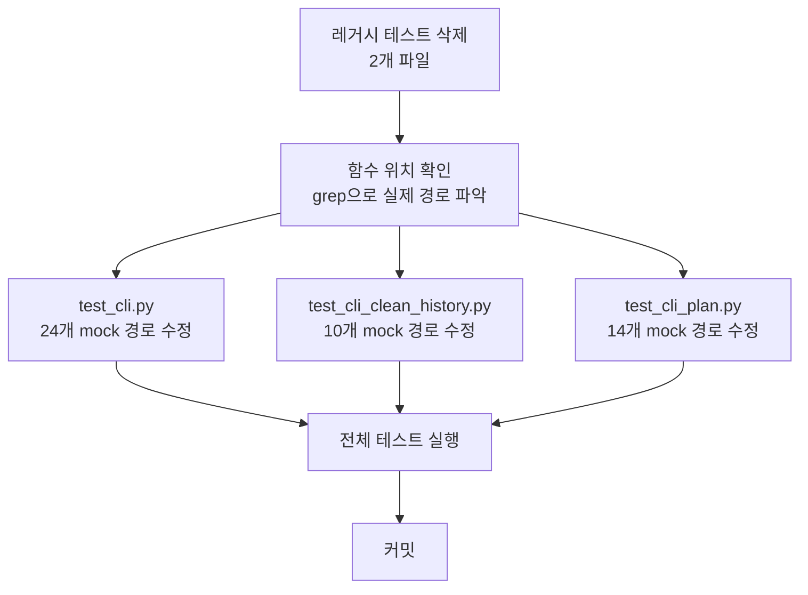

# 사용자의 최초 요청 (기록용)
최근 커밋에서 내가 모노레퍼 구조로 바꿨어서 테스트들이 잔뜩 실패하고 있거든. 그리고 플랜이랑 이런 것들도 지금 여러 가지 변경들이 많았고. 그래서 지금 이 실패하는 애들의 어떤 현황이랑 이유를 좀 분석을 잘해줬으면 해. 어떻게 하면 잘 고칠 수 있을지 뭐 그런 것들. 아니면 실제로 없는 애들에 대해서 잘못 구현되어서 존재하고 있는 테스트라던가 그런 것들 말이야.

## 추가 사용자 요청 (기록용)
고치는작업계획서 만들고 (사실상 기록용) 그대로 그냥 바로작업해

# 작업 목표 (WHAT & WHY)

## 핵심 목표 (TL;DR)
모노레포 구조 변경(커밋 60cc0c4, 9578779)으로 인해 실패한 55개 테스트를 수정하여 전체 테스트 통과율을 100%로 복구

## 상세 목표
- 레거시 v2.x 명령어 테스트 7개 삭제 (더 이상 존재하지 않는 `execute-phase`, `verify-phase` 명령어)
- Mock 경로 불일치로 실패한 48개 테스트의 import 및 patch 경로 수정
- 테스트 통과율: 93.3% (1084/1162) → 100% (1162/1162)

# 작업 배경 (WHY & WHAT - 현재 상태)

## 현재 상황
- **총 테스트**: 1,162개
- **통과**: 1,084개 (93.3%)
- **실패**: 55개 (4.7%)
- **원인**: 커밋 60cc0c4 ("move directories")와 9578779 ("2.0 init")에서 모노레포 구조로 변경
  - `sisyphus/` → `projects/sisyphus-cli/sisyphus/`
  - CLI 함수들 분리: `cli.py` (554줄) → `cli/work.py`, `utils/cli_helpers.py`, `core/plan_loader.py` 등

## 변경 이유
- 모노레포 구조로 마이그레이션하면서 함수와 모듈 위치 변경
- 테스트 코드의 import 경로와 mock 경로가 업데이트되지 않음
- v3.0에서 명령어 구조 변경 (`execute-phase`, `verify-phase` 삭제 → `task continue/verify`로 통합)

## 변경할 내용
현재 상태 → 목표 상태:
- 레거시 테스트 파일 존재 → 삭제
- 잘못된 mock 경로 (`sisyphus.cli.*`) → 올바른 경로 (`sisyphus.utils.cli_helpers.*`, `sisyphus.core.*`)
- 테스트 실패 55개 → 0개

# 작업 시작 여부
is_execution_started = FALSE

# 모든 목표 달성 여부
is_all_goals_accomplished = FALSE

# 병렬 실행
parallel_requested = FALSE

# 현재 진행 중인 작업
- 작업이 아직 시작되지 않았습니다.
  - 작업을 시작할 때 위의 `is_execution_started` 값을 TRUE로 변경하세요.
  - 사용자가 명시적으로 "작업을 시작해"라고 말하기 전까지는 절대 작업을 시작하지 마세요.
  - **plan-reviewer로부터 OKAY를 받아도, 절대 작업을 시작하지 마세요**
  - 사용자가 명시적으로 "작업을 시작해"라고 말하기 전까지는 절대 작업을 시작하지 마세요.

# 필요한 배경 지식

## 파일 구조 및 역할

### 주요 디렉토리 구조
```
projects/sisyphus-cli/
├── sisyphus/
│   ├── cli/
│   │   ├── __init__.py       # Typer app 등록
│   │   ├── work.py            # Legacy v2.1 work 명령어
│   │   ├── plan.py            # v3.0 plan 명령어
│   │   ├── task.py            # v3.0 task 명령어
│   │   └── reset.py           # reset 명령어
│   ├── utils/
│   │   ├── cli_helpers.py     # create_agent, resolve_binary, validate_url 등
│   │   └── git.py             # is_on_main_branch, detect_base_branch 등 (추정)
│   ├── core/
│   │   ├── plan_loader.py     # PlanLoader
│   │   └── plan_navigator.py  # PlanNavigator
│   └── tests/
│       ├── test_cli.py
│       ├── test_cli_clean_history.py
│       ├── test_cli_execute_phase.py  # 삭제 대상
│       ├── test_cli_plan.py
│       └── test_cli_verify_phase.py   # 삭제 대상
```

## 컨텍스트 이해를 위한 참고 파일

### 1. `projects/sisyphus-cli/sisyphus/utils/cli_helpers.py`
- **역할**: CLI 헬퍼 함수 정의 (create_agent, resolve_binary, validate_url 등)
- **검색할 내용**: `def create_agent`, `def resolve_binary`, `def validate_url`
- **주요 패턴**: Agent 생성 및 설정 로직

### 2. `projects/sisyphus-cli/sisyphus/cli/work.py`
- **역할**: Legacy v2.1 work 명령어 구현, run 함수 정의
- **검색할 내용**: `def run`, `def clean_history`, `def ignore`

### 3. `projects/sisyphus-cli/sisyphus/tests/test_cli.py`
- **역할**: CLI 함수 테스트 (이미 import는 수정됨, mock 경로만 수정 필요)
- **검색할 내용**: `patch("sisyphus.cli.*")` 패턴
- **수정 필요**: Mock 경로를 실제 함수 정의 위치로 변경

### 4. Git 커밋 히스토리
- **커밋 60cc0c4**: "move directories" - 모노레포 구조로 파일 이동
- **커밋 9578779**: "2.0 init" - 추가 구조 정리
- **커밋 5e63142**: "refactor: reduce cli.py from 554 to 23 lines by extracting helpers and commands"

# 작업 흐름 (HOW - 태스크 흐름 및 의존성)

## 태스크 의존성 다이어그램
```
Task 1 (레거시 테스트 삭제)
   ↓
Task 2 (실제 함수 위치 grep으로 확인)
   ↓
Task 3 || Task 4 || Task 5 (병렬, 각각 독립적인 파일 수정)
   ↓
Task 6 (전체 테스트 실행 및 검증)
   ↓
Task 7 (커밋)
```

## 단계별 설명
- **Phase 1 (Task 1-2)**: 레거시 제거 및 정보 수집 - 삭제할 파일 제거 후 실제 함수 위치 파악
- **Phase 2 (Task 3-5)**: Mock 경로 수정 - 각 테스트 파일 독립적으로 수정 가능 (병렬)
- **Phase 3 (Task 6-7)**: 검증 및 커밋 - 모든 수정 완료 후 통합 테스트 및 커밋

# 작업 계획

## PRD & 구조

### 수정 범위 개요


### 실패 테스트 분류
- **카테고리 1**: 레거시 명령어 테스트 (7개) - 삭제
  - `test_cli_execute_phase.py`: 6개 실패
  - `test_cli_verify_phase.py`: 1개 실패
- **카테고리 2**: Mock 경로 불일치 (48개) - 수정
  - `test_cli.py`: 24개 (asyncio + trio 각 12개)
  - `test_cli_clean_history.py`: 10개
  - `test_cli_plan.py`: 14개

## 아키텍처 제약사항
- pytest-anyio 사용: 각 테스트가 asyncio + trio 양쪽에서 실행됨
- Mock 경로는 **정의된 위치**를 패치해야 함 (사용하는 위치 아님)
- 프로젝트는 Protocol 패턴 사용 (ABC 아님)

## 엣지 케이스 처리
- grep으로 함수를 찾지 못하는 경우: 수동으로 파일 탐색 필요
- Mock 경로가 여러 곳에 분산된 경우: 각 파일의 import 구조 확인
- 테스트가 여전히 실패하는 경우: 실제 코드 실행하여 동작 확인

## 암묵적 가정을 명시적으로
- `create_agent`, `resolve_binary`, `validate_url`은 `sisyphus.utils.cli_helpers`에 존재
- `is_on_main_branch`, `detect_base_branch`는 `sisyphus.utils.git` 또는 `sisyphus.cli.work`에 존재 (확인 필요)
- `PlanLoader`, `PlanNavigator`는 각각 `sisyphus.core.plan_loader`, `sisyphus.core.plan_navigator`에 존재
- `run` 함수는 `sisyphus.cli.work`에 존재

## 프로젝트 커밋 메시지 스타일
```
git log -5 --oneline 분석 결과:
- 간결한 현재형 동사 시작: "fix:", "refactor:", "docs:", "test:" 등
- 구체적 변경사항 명시
- 예: "fix: update test mock paths for monorepo structure"
```

# TODOs

- [ ] 1. 레거시 테스트 파일 삭제

  **레거시 이유**: v3.0에서 `execute-phase`, `verify-phase` 명령어가 제거되고 `task continue/verify`로 통합됨

  - [ ] 1.1 `test_cli_execute_phase.py` 삭제
    ```bash
    rm projects/sisyphus-cli/sisyphus/tests/test_cli_execute_phase.py
    ```

  - [ ] 1.2 `test_cli_verify_phase.py` 삭제
    ```bash
    rm projects/sisyphus-cli/sisyphus/tests/test_cli_verify_phase.py
    ```

  - [ ] 1.3 삭제 확인
    **실행 명령**: `ls projects/sisyphus-cli/sisyphus/tests/test_cli_*.py`
    **예상 출력**: 두 파일이 목록에 없어야 함

  - [ ] **작업 완료 검증 체크리스트**
    - [ ] `test_cli_execute_phase.py` 파일이 존재하지 않음
    - [ ] `test_cli_verify_phase.py` 파일이 존재하지 않음

- [ ] 2. 실제 함수 위치 확인

  **목적**: Mock 경로 수정을 위해 각 함수의 실제 정의 위치 파악

  - [ ] 2.1 CLI helper 함수 위치 확인
    ```bash
    grep -rn "^def create_agent\|^def resolve_binary\|^def validate_url" projects/sisyphus-cli/sisyphus/
    ```
    **예상 결과**: `projects/sisyphus-cli/sisyphus/utils/cli_helpers.py`에서 발견

  - [ ] 2.2 Git 관련 함수 위치 확인
    ```bash
    grep -rn "^def is_on_main_branch\|^def detect_base_branch\|^def find_sisyphus_commits" projects/sisyphus-cli/sisyphus/
    ```
    **예상 결과**: `sisyphus.utils.git` 또는 `sisyphus.cli.work`에서 발견

  - [ ] 2.3 Plan 관련 클래스 위치 확인
    ```bash
    grep -rn "^class PlanLoader\|^class PlanNavigator" projects/sisyphus-cli/sisyphus/
    ```
    **예상 결과**: 각각 `sisyphus.core.plan_loader`, `sisyphus.core.plan_navigator`에서 발견

  - [ ] 2.4 UI 관련 함수 위치 확인
    ```bash
    grep -rn "^def create_ui\|^class SessionStore" projects/sisyphus-cli/sisyphus/
    ```

  - [ ] **작업 완료 검증 체크리스트**
    - [ ] 모든 함수/클래스의 실제 위치를 파악함
    - [ ] 위치 정보를 다음 태스크에서 참조 가능하도록 기록

- [ ] 3 parallel. `test_cli.py` mock 경로 수정

  **병렬 실행 조건**: `test_cli_clean_history.py`, `test_cli_plan.py`와 완전히 독립적, 다른 파일 수정, 의존성 없음

  **참고 소스**:
  - 파일: `projects/sisyphus-cli/sisyphus/tests/test_cli.py`
  - 검색할 내용: `patch("sisyphus.cli.create_agent")` 등 잘못된 mock 경로
  - Task 2에서 확인한 실제 함수 위치 참조

  - [ ] 3.1 `test_cli.py` 읽고 수정할 위치 파악
    **검색 패턴**: `patch("sisyphus.cli.`

  - [ ] 3.2 Mock 경로 일괄 수정
    - `patch("sisyphus.cli.create_agent")` → `patch("sisyphus.utils.cli_helpers.create_agent")`
    - `patch("sisyphus.cli.create_ui")` → Task 2.4 결과에 따라 수정
    - `patch("sisyphus.cli.SessionStore")` → Task 2.4 결과에 따라 수정

    **수정 방법**: Edit 도구 사용하여 각 patch 경로 변경

  - [ ] 3.3 수정된 테스트 실행
    ```bash
    uv run pytest projects/sisyphus-cli/sisyphus/tests/test_cli.py -v
    ```
    **예상 출력**: 24개 실패 → 0개 실패

  - [ ] **작업 완료 검증 체크리스트**
    - [ ] `test_cli.py`에 `patch("sisyphus.cli.*")` 패턴이 더 이상 없음
    - [ ] 모든 patch가 실제 정의 위치를 가리킴
    - [ ] `uv run pytest projects/sisyphus-cli/sisyphus/tests/test_cli.py` → 모든 테스트 통과

- [ ] 4 parallel. `test_cli_clean_history.py` mock 경로 수정

  **병렬 실행 조건**: `test_cli.py`, `test_cli_plan.py`와 완전히 독립적

  **참고 소스**:
  - 파일: `projects/sisyphus-cli/sisyphus/tests/test_cli_clean_history.py`
  - Task 2.2에서 확인한 git 함수 위치 참조

  - [ ] 4.1 `test_cli_clean_history.py` 읽고 수정할 위치 파악
    **검색 패턴**: `patch("sisyphus.cli.`

  - [ ] 4.2 Mock 경로 일괄 수정
    - `patch("sisyphus.cli.is_on_main_branch")` → Task 2.2 결과에 따라 수정
    - `patch("sisyphus.cli.detect_base_branch")` → Task 2.2 결과에 따라 수정
    - `patch("sisyphus.cli.find_sisyphus_commits")` → Task 2.2 결과에 따라 수정

  - [ ] 4.3 수정된 테스트 실행
    ```bash
    uv run pytest projects/sisyphus-cli/sisyphus/tests/test_cli_clean_history.py -v
    ```
    **예상 출력**: 10개 실패 → 0개 실패

  - [ ] **작업 완료 검증 체크리스트**
    - [ ] `test_cli_clean_history.py`에 잘못된 mock 경로 없음
    - [ ] `uv run pytest projects/sisyphus-cli/sisyphus/tests/test_cli_clean_history.py` → 모든 테스트 통과

- [ ] 5 parallel. `test_cli_plan.py` mock 경로 수정

  **병렬 실행 조건**: `test_cli.py`, `test_cli_clean_history.py`와 완전히 독립적

  **참고 소스**:
  - 파일: `projects/sisyphus-cli/sisyphus/tests/test_cli_plan.py`
  - Task 2.3에서 확인한 Plan 클래스 위치 참조

  - [ ] 5.1 `test_cli_plan.py` 읽고 수정할 위치 파악
    **검색 패턴**: `patch("sisyphus.cli.`

  - [ ] 5.2 Mock 경로 일괄 수정
    - `patch("sisyphus.cli.PlanLoader")` → `patch("sisyphus.core.plan_loader.PlanLoader")`
    - `patch("sisyphus.cli.PlanNavigator")` → `patch("sisyphus.core.plan_navigator.PlanNavigator")`
    - 기타 formatting 함수들도 실제 위치로 수정

  - [ ] 5.3 수정된 테스트 실행
    ```bash
    uv run pytest projects/sisyphus-cli/sisyphus/tests/test_cli_plan.py -v
    ```
    **예상 출력**: 14개 실패 → 0개 실패

  - [ ] **작업 완료 검증 체크리스트**
    - [ ] `test_cli_plan.py`에 잘못된 mock 경로 없음
    - [ ] `uv run pytest projects/sisyphus-cli/sisyphus/tests/test_cli_plan.py` → 모든 테스트 통과

- [ ] 6. 전체 테스트 실행 및 검증

  **목적**: 모든 수정이 완료된 후 전체 테스트 스위트 검증

  - [ ] 6.1 전체 테스트 실행
    ```bash
    uv run pytest -v
    ```
    **예상 출력**:
    ```
    ===================== 1162 passed in X.XXs =====================
    ```

  - [ ] 6.2 통과율 확인
    **기대값**: 1162/1162 (100%)

  - [ ] 6.3 실패 테스트 분석 (만약 있다면)
    - 실패 원인 파악
    - 추가 수정 필요 여부 판단

  - [ ] **작업 완료 검증 체크리스트**
    - [ ] 전체 테스트 통과율 100%
    - [ ] 이전에 실패했던 55개 테스트 모두 통과
    - [ ] 새로운 실패 테스트 없음

- [ ] 7. 변경사항 커밋

  **커밋 메시지 스타일**: 프로젝트 컨벤션 따름 (git log 분석 결과)

  - [ ] 7.1 변경된 파일 확인
    ```bash
    git status
    ```

  - [ ] 7.2 변경사항 스테이징
    ```bash
    git add projects/sisyphus-cli/sisyphus/tests/
    ```

  - [ ] 7.3 커밋
    ```bash
    git commit -m "$(cat <<'EOF'
test: fix 55 test failures from monorepo migration

- Remove legacy test files for deleted commands (execute-phase, verify-phase)
- Update mock paths in test_cli.py, test_cli_clean_history.py, test_cli_plan.py
- Fix: sisyphus.cli.* → sisyphus.utils.cli_helpers.*, sisyphus.core.*
- Test pass rate: 93.3% → 100% (1162/1162)

🤖 Generated with [Claude Code](https://claude.com/claude-code)

Co-Authored-By: Claude <noreply@anthropic.com>
EOF
)"
    ```

  - [ ] 7.4 커밋 확인
    ```bash
    git log -1 --oneline
    ```

  - [ ] **작업 완료 검증 체크리스트**
    - [ ] Git 커밋 완료됨
    - [ ] 커밋 메시지가 프로젝트 스타일 준수
    - [ ] 모든 변경사항이 커밋에 포함됨

# 성공 비전

## 사용자 관점의 성공
- 테스트 실행 시 더 이상 실패 없음
- 모노레포 구조에서 안정적으로 개발 가능
- CI/CD 파이프라인에서 테스트 통과

## 비즈니스 관점의 성공
- 개발 속도 향상 (테스트 실패로 인한 블로킹 제거)
- 코드 품질 보증 (전체 테스트 커버리지 유지)

## 기술적 성공 기준
- 전체 테스트 통과: `uv run pytest` → 1162/1162 PASSED
- 테스트 실행 시간: 기존과 동일 수준 유지 (~8-10초)
- 레거시 코드 제거: 7개 불필요한 테스트 삭제
- Mock 경로 정확성: 모든 mock이 실제 정의 위치 참조

# 최종 작업 검증 체크리스트

- [ ] 1. **기능 동작 확인**
  - [ ] `uv run pytest` → 1162/1162 통과
  - [ ] 레거시 테스트 파일 2개 삭제됨
  - [ ] Mock 경로가 모두 올바른 위치 참조

- [ ] 2. **잘못된 구현 방지**
  - [ ] Mock 경로를 "사용하는 위치"가 아닌 "정의된 위치"로 수정했는지 확인
  - [ ] 레거시 테스트를 수정하려 하지 않고 삭제했는지 확인

- [ ] 3. **범위 준수 확인**
  - [ ] 테스트 코드만 수정 (실제 구현 코드는 건드리지 않음)
  - [ ] 55개 실패 테스트만 수정 (다른 테스트는 변경 없음)

- [ ] 4. **기존 기능 회귀 테스트**
  - [ ] 모든 agent 테스트 통과 (test_base.py, test_claude.py, test_opencode.py)
  - [ ] 모든 core 테스트 통과 (test_plan_loader.py, test_plan_navigator.py 등)
  - [ ] 모든 UI 테스트 통과 (test_tui.py, test_cli.py)
  - **검증 방법**: `uv run pytest projects/sisyphus-cli/ -v | grep PASSED | wc -l` → 1162
