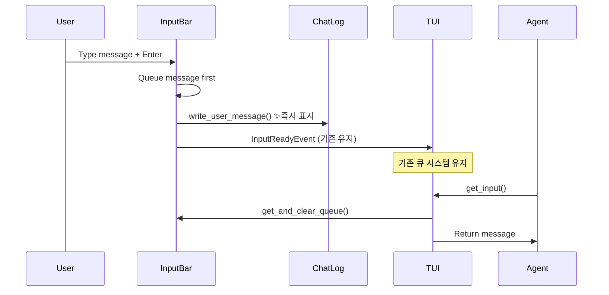
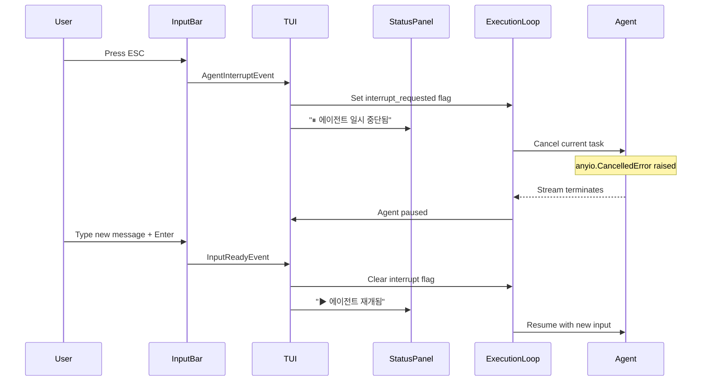

# 사용자의 최초 요청 (기록용)
현재 프로젝트에는 여러가지 문제가 있습니다.
1. 로그가 쌓일 때 마다 로그를 보여주는 text area 가 계속 내려갑니다. 이로 인해 실질적으로 로그를 볼 수 없습니다. 이 textual 코드를 수정해야 합니다.
2. thinking block 안의 내용이 보이지 않습니다. tool use 처럼, thinking block 도 그렇고, 그 안의 최대한 다양한 내용들을 보여줄 수 있어야 합니다. (tool use 처럼 다음줄에, indentation 을 넣어서 보여지도록)
3. 현재 send message 기능이 이상하게 작동하는것으로 보입니다. message input 안에서 엔터를 누르면 바로 메시지가 보내지고, 이게 로그 영역에 실제로 메시지 내용과 함께 기록이 되어야 합니다.
4. 로그 영역처럼, status panel 의 한 줄 한 줄 도 시간과 함께 기록이 되어야 합니다.

제가 좀 섞어서 말했는데 비슷한것끼리 묶어 순서대로 진행하는 작업 계획서로 작성해주세요. 최대한 많은 코드를 읽고, 미친듯이 깊고, 다양한 범위로 생각하여 계획서를 작성해주세요.

## 사용자가 이후에 추가 요청한 내용들 (기록용)
- 메시지 전송 가능 타이밍을 기다리는게 아니라 그냥 바로 메시지가 전송되도록 해주시고
- input bar 에서 esc 를 누르면 agent 를 멈추도록 해주세요
- 그리고 다시 메시지를 보내기 전까진 꺼주고, 다시 메시지를 보내면 resume 하고 send message 를 진행하도록 해주세요
- 이것도 마찬가지로 로그로 남아야합니다
- 메시지 즉시 전송이 되는 식으로 설계를 변경해도 좋아 그런 방향으로 구상해줘 - 지금 메시지 큐는 사실상 제대로 동작하지 않아서 말이야

# 디테일 레벨: detailed

# 작업 목표
## Phase 1: UI 개선 (간단한 작업들)
1. **ChatLog 스크롤 제어 개선**: 사용자가 위로 스크롤하면 자동 스크롤 중지
2. **ChatLog 사용자 메시지 메서드**: write_user_message() 추가 (Phase 2 준비)
3. **StatusPanel 타임스탬프 추가**: 모든 상태 메시지에 시간 정보 표시
4. **ThinkingBlock 완전 표시**: ThinkingBlock.thinking 속성의 내용을 코드 블록으로 표시

## Phase 2: 메시지 즉시 전송 (중간 난이도)
4. **메시지 즉시 표시 및 큐잉**: 사용자 메시지를 ChatLog에 즉시 표시하고 큐에 저장

## Phase 3: ESC 키 중단 (고급)
5. **ESC 키로 에이전트 중단**: ESC 키를 누르면 실행 중인 에이전트를 즉시 중단
6. **메시지 입력 시 재개**: 새 메시지 입력 시 에이전트 자동 재개

# 작업 배경
현재 TUI 시스템의 문제점들:

1. **로그 스크롤 문제**: `auto_scroll=True`로 인해 이전 로그를 읽을 수 없음
2. **Thinking Block 누락**: ClaudeAgent가 ThinkingBlock 처리 시 내용 미표시
3. **메시지 전송 지연**: agent가 get_input() 호출 시까지 대기
4. **타임스탬프 부족**: StatusPanel 메시지에 시간 정보 없음

# 작업 시작 여부
is_execution_started = TRUE

# 모든 목표 달성 여부
is_all_goals_accomplished = TRUE

# 병렬 실행 여부
parallel_requested = FALSE

# 현재 진행 중인 작업
- 모든 작업 완료

# 필요한 사전 지식

## 기술 스택
- **TUI Framework**: Textual 1.0+ (asyncio 기반)
- **Logging Widget**: `textual.widgets.RichLog` (자동 스크롤, 리치 마크업 지원)
- **Agent SDK**: claude-agent-sdk (ThinkingBlock은 `thinking` 속성 보유)
- **비동기**: anyio (asyncio/trio 호환성)

## SDK 확인 사항
```python
# ThinkingBlock 실제 인터페이스 (확인됨)
from claude_agent_sdk import ThinkingBlock
# ThinkingBlock(thinking: str, signature: str)
# block.thinking - 실제 텍스트 내용
```

## Textual 스크롤 이벤트
- Scroll 이벤트는 없음, MouseScrollUp/Down 이벤트 사용
- `watch_scroll_y()` 메서드로 스크롤 변경 감지 가능
- `max_scroll_y`는 픽셀 단위 (줄 단위 아님)

## 파일 구조 및 역할
- `sisyphus/ui/tui/components/chat_log.py`: 메시지 로그 표시 위젯
- `sisyphus/ui/tui/components/status_panel.py`: 상태 메시지 표시 위젯
- `sisyphus/ui/tui/components/input_bar.py`: 사용자 입력 위젯
- `sisyphus/ui/tui/app.py`: TUI 메인 앱, 메시지 라우팅
- `sisyphus/agents/claude.py`: Claude 에이전트, ThinkingBlock 처리

## 맥락 이해를 위해 참고해야 할 파일들

### 1. sisyphus/ui/tui/components/chat_log.py
- **역할**: Execute/Verify 메시지를 색상으로 구분하여 표시
- **현재 문제**: `auto_scroll=True` (line 23)
- **기존 메서드**: write_execute_message, write_verify_message, write_completion_message

### 2. sisyphus/agents/claude.py
- **역할**: Claude API와 통신, 메시지 블록 처리
- **현재 문제**: ThinkingBlock 내용 미표시 (line 166-167)
- **기존 패턴**: ToolUseBlock은 JSON을 코드 블록으로 감싸서 표시

### 3. sisyphus/ui/tui/components/status_panel.py
- **역할**: 상태 메시지 표시
- **현재 문제**: 타임스탬프 없음
- **기존 메서드**: update_status, show_iteration, show_progress

### 4. sisyphus/ui/tui/components/input_bar.py
- **역할**: 사용자 입력 처리 및 큐잉
- **현재 문제**: 메시지가 ChatLog에 즉시 표시 안 됨

# 작업 계획

## PRDs & Structures

### 개선된 메시지 흐름


### 스크롤 제어 메커니즘
```mermaid
graph TB
    A[새 메시지 도착] --> B{user_scrolling?}
    B -->|Yes| C[현재 위치 유지]
    B -->|No| D[scroll_end() 호출]

    E[사용자가 스크롤] --> F[watch_scroll_y 트리거]
    F --> G{맨 아래 근처?<br/>≥ max_scroll_y - 1px}
    G -->|Yes| H[user_scrolling = False]
    G -->|No| I[user_scrolling = True]
```

### ESC 키 중단 메커니즘


## 구현 세부사항

### 핵심 설계 원칙
1. **최소 변경**: 기존 구조 최대한 유지
2. **기존 패턴 준수**: ToolUseBlock 패턴을 ThinkingBlock에도 적용
3. **에러 안정성**: 큐잉 우선으로 메시지 손실 방지
4. **픽셀 단위 인식**: Textual 스크롤은 픽셀 기준

## 프로젝트 커밋 메시지 스타일
- 소문자 시작, 현재형 동사
- 언더스코어로 단어 구분
- 예: `fix chat_log scroll behavior with watch_scroll_y`

# TODOs

## Phase 1: UI 개선

- [x] 1. ChatLog 스크롤 개선 및 사용자 메시지 표시 메서드 추가
   - [x] 1.1 구현: `sisyphus/ui/tui/components/chat_log.py` 전체 수정
      ```python
      from datetime import datetime
      from textual.widgets import RichLog

      class ChatLog(RichLog):
          """채팅/진행상황 로그 위젯."""

          def __init__(self) -> None:
              """ChatLog 위젯 초기화."""
              super().__init__(
                  id="chat-log",
                  highlight=True,
                  markup=True,
                  auto_scroll=False,  # 자동 스크롤 비활성화
                  wrap=True,
              )
              self._user_scrolling = False

          def watch_scroll_y(self, old_value: float, new_value: float) -> None:
              """스크롤 Y 위치 변경 감지."""
              # 맨 아래 근처인지 확인 (1픽셀 여유)
              if new_value >= self.max_scroll_y - 1:
                  self._user_scrolling = False
              else:
                  self._user_scrolling = True

          def _auto_scroll_if_needed(self) -> None:
              """필요시 자동 스크롤."""
              if not self._user_scrolling:
                  self.scroll_end()

          def write_user_message(self, content: str) -> None:
              """사용자 메시지 표시."""
              timestamp = datetime.now().strftime("%H:%M:%S.%f")[:-3]
              self.write(f"[dim]{timestamp}[/dim] [green]👤 USER:[/green] {content}")
              self._auto_scroll_if_needed()

          def write_execute_message(self, content: str) -> None:
              """Execute 메시지 작성."""
              timestamp = datetime.now().strftime("%H:%M:%S.%f")[:-3]
              self.write(f"[dim]{timestamp}[/dim] [yellow]▶ EXECUTE:[/yellow] {content}")
              self._auto_scroll_if_needed()

          def write_verify_message(self, content: str) -> None:
              """Verify 메시지 작성."""
              timestamp = datetime.now().strftime("%H:%M:%S.%f")[:-3]
              self.write(f"[dim]{timestamp}[/dim] [cyan]✓ VERIFY:[/cyan] {content}")
              self._auto_scroll_if_needed()

          def write_completion_message(self, content: str) -> None:
              """작업 완료 메시지 작성."""
              timestamp = datetime.now().strftime("%H:%M:%S.%f")[:-3]
              self.write(f"[dim]{timestamp}[/dim] [bold green]✅ COMPLETED:[/bold green] {content}")
              self._auto_scroll_if_needed()
      ```
   - [x] 1.2 테스트: 스크롤 동작 확인
      - TUI 실행: `uv run sisyphus run --execute claude`
      - 스크롤 테스트 절차:
        1. 로그가 20줄 이상 쌓일 때까지 대기 (약 30초)
        2. 마우스 휠로 위로 10줄 스크롤
        3. 새 메시지 도착 시 스크롤 위치가 고정되는지 확인
           - 예상: 화면이 움직이지 않고 현재 위치 유지
        4. End 키를 눌러 맨 아래로 이동
        5. 새 메시지 도착 시 자동으로 따라가는지 확인
           - 예상: 새 메시지가 화면에 자동으로 표시됨
   - [x] 1.3 린트 및 타입 체크: `uv run basedpyright sisyphus/ui/tui/components/chat_log.py`
      - 예상: 0 errors, 0 warnings
   - [x] 1.4 커밋: `fix chat_log scroll behavior with watch_scroll_y`

- [x] 2. StatusPanel 타임스탬프 추가
   - [x] 2.1 구현: `sisyphus/ui/tui/components/status_panel.py` 수정
      ```python
      from datetime import datetime
      from textual.widgets import RichLog

      class StatusPanel(RichLog):
          """상태 패널 위젯."""

          def __init__(self) -> None:
              """StatusPanel 위젯 초기화."""
              super().__init__(
                  id="status-panel",
                  highlight=True,
                  markup=True,
                  auto_scroll=True,
              )

          def update_status(self, status: str) -> None:
              """상태 업데이트 (타임스탬프 포함)."""
              timestamp = datetime.now().strftime("%H:%M:%S.%f")[:-3]
              self.write(f"[dim]{timestamp}[/dim] [blue]{status}[/blue]")

          def show_iteration(self, current: int, total: int) -> None:
              """반복 진행률 표시 (타임스탬프 포함)."""
              timestamp = datetime.now().strftime("%H:%M:%S.%f")[:-3]
              self.write(f"[dim]{timestamp}[/dim] [dim]Iteration {current}/{total}[/dim]")

          def show_progress(self, completed: int, total: int) -> None:
              """체크박스 진행률 표시 (타임스탬프 포함)."""
              if total == 0:
                  return
              timestamp = datetime.now().strftime("%H:%M:%S.%f")[:-3]
              percentage = int((completed / total) * 100)
              remaining = total - completed
              bar_length = 20
              filled = int((completed / total) * bar_length)
              bar = "█" * filled + "░" * (bar_length - filled)
              self.write(
                  f"[dim]{timestamp}[/dim] [cyan]📋 진행률:[/cyan] {bar} "
                  f"[bold]{completed}/{total}[/bold] ({percentage}%) "
                  f"[dim]| 남은 작업: {remaining}개[/dim]"
              )
      ```
   - [x] 2.2 테스트: 타임스탬프 표시 확인
      - TUI 실행: `uv run sisyphus run --execute claude`
      - StatusPanel에서 다음 확인:
        1. "[Iteration 1] Starting Execute phase..." 앞에 타임스탬프
           - 예상 형식: `12:34:56.789 [Iteration 1] Starting Execute phase...`
        2. 진행률 메시지 앞에 타임스탬프
           - 예상 형식: `12:34:56.789 📋 진행률: ████░░░░...`
   - [x] 2.3 린트 및 타입 체크: `uv run basedpyright sisyphus/ui/tui/components/status_panel.py`
      - 예상: 0 errors, 0 warnings
   - [x] 2.4 커밋: `add timestamps to status_panel messages`

- [x] 3. ThinkingBlock 내용 표시
   - [x] 3.1 구현: `sisyphus/agents/claude.py` 수정 (line 166-167)
      ```python
      case ThinkingBlock():
          thinking_header = "[THINKING]"
          if block.thinking:
              # 기존 ToolUse 패턴 준수: 코드 블록으로 감싸기
              thinking_block = f"```\n{block.thinking}\n```"
              indented_block = "\n".join(f"    {line}" for line in thinking_block.split("\n"))
              content += f"{thinking_header}\n{indented_block}"
          else:
              content += thinking_header
      ```
   - [x] 3.2 테스트: thinking 내용 표시 확인
      - Claude와 대화: `uv run sisyphus run --execute claude`
      - 프롬프트 입력: "Think step by step about how to implement a binary search"
      - 예상 출력:
        ```
        [THINKING]
            ```
            Step 1: Binary search requires a sorted array
            Step 2: Compare target with middle element
            Step 3: Recurse on left or right half
            ```
        ```
   - [x] 3.3 린트 및 타입 체크: `uv run basedpyright sisyphus/agents/claude.py`
      - 예상: 0 errors, 0 warnings
   - [x] 3.4 커밋: `display thinking_block content with code block format`

## Phase 2: 메시지 즉시 표시

- [x] 4. InputBar 메시지 즉시 표시
   - [x] 4.1 구현: `sisyphus/ui/tui/components/input_bar.py` 수정
      ```python
      # 파일 상단 import 추가
      from sisyphus.ui.tui.components.chat_log import ChatLog

      # on_input_submitted 메서드 수정 (line 31-52)
      def on_input_submitted(self, event: Input.Submitted) -> None:
          """Enter 키 입력 시 처리."""
          self.log.info(f"[DEBUG] on_input_submitted called with value: {event.value!r}")
          message = event.value.strip()
          self.log.info(f"[DEBUG] stripped message: {message!r}")

          if message:
              # 1. 먼저 큐잉 (메시지 보존이 최우선)
              if self._queued_message:
                  self._queued_message += "\n" + message
              else:
                  self._queued_message = message

              self.log.info(f"[DEBUG] queued_message now: {self._queued_message!r}")

              # 2. ChatLog에 사용자 메시지 표시 시도
              try:
                  chat_log = self.app.query_one(ChatLog)
                  chat_log.write_user_message(message)
              except Exception as e:
                  self.log.error(f"Failed to display user message: {e}")

              # 3. UI 업데이트 및 이벤트 발생
              self.value = ""
              self.log.info("[DEBUG] cleared input value")
              self._update_placeholder()
              self.log.info("[DEBUG] posting InputReadyEvent")
              self.app.post_message(InputReadyEvent())
              self.log.info("[DEBUG] on_input_submitted completed")
      ```
   - [x] 4.2 테스트: 즉시 표시 확인
      - TUI 실행: `uv run sisyphus run --execute claude`
      - 테스트 절차:
        1. 메시지 입력: "Hello Claude"
        2. Enter 키 누름
        3. ChatLog에 즉시 표시되는지 확인
           - 예상: `12:34:56.789 👤 USER: Hello Claude` 즉시 표시
        4. Claude가 응답할 때까지 대기
        5. 메시지가 정상 전달되었는지 확인
           - 예상: Claude가 "Hello" 인사에 응답
   - [x] 4.3 린트 및 타입 체크: `uv run basedpyright sisyphus/ui/tui/components/input_bar.py`
      - 예상: 0 errors, 0 warnings
   - [x] 4.4 커밋: `display user messages immediately in chat_log`

## Phase 3: ESC 키 중단 기능

- [x] 5. ESC 키 인터럽트 이벤트 추가
   - [x] 5.1 구현: `sisyphus/ui/tui/events.py` 이벤트 클래스 추가
      ```python
      from textual.message import Message

      class AgentInterruptEvent(Message):
          """에이전트 중단 요청 이벤트."""
          pass

      class AgentResumeEvent(Message):
          """에이전트 재개 요청 이벤트."""
          pass
      ```
   - [x] 5.2 커밋: `add agent interrupt and resume events`

- [x] 6. InputBar ESC 키 처리
   - [x] 6.1 구현: `sisyphus/ui/tui/components/input_bar.py` 수정
      ```python
      from textual import events
      from textual.widgets import Input
      from sisyphus.ui.tui.events import InputReadyEvent, AgentInterruptEvent

      class InputBar(Input):
          """입력 바 위젯."""

          def __init__(self) -> None:
              """InputBar 위젯 초기화."""
              super().__init__(
                  id="input-bar",
                  placeholder="메시지를 입력하세요... (ESC: 중단)",
              )
              self._queued_message: str | None = None
              self._agent_paused = False

          async def on_key(self, event: events.Key) -> None:
              """키 이벤트 처리."""
              if event.key == "escape":
                  # ESC 키 처리
                  event.stop()  # 이벤트 전파 중지
                  if not self._agent_paused:
                      self._agent_paused = True
                      self.placeholder = "⏸ 일시 중단됨 - 메시지 입력하면 재개"
                      self.app.post_message(AgentInterruptEvent())
                      self.log.info("Agent interrupted by ESC key")
              else:
                  # 다른 키는 기본 처리
                  await super().on_key(event)

          def on_input_submitted(self, event: Input.Submitted) -> None:
              """Enter 키 입력 시 처리."""
              # ... 기존 코드 ...

              # 에이전트가 일시 중단된 경우 재개
              if self._agent_paused:
                  self._agent_paused = False
                  self.placeholder = "메시지를 입력하세요... (ESC: 중단)"
                  # 재개 로직은 TUI에서 처리
      ```
   - [x] 6.2 테스트: ESC 키 동작 확인
      - TUI 실행 후 ESC 키 누름
      - placeholder 변경 확인: "⏸ 일시 중단됨 - 메시지 입력하면 재개"
      - StatusPanel에 중단 메시지 확인
   - [x] 6.3 린트 및 타입 체크: `uv run basedpyright sisyphus/ui/tui/components/input_bar.py`
   - [x] 6.4 커밋: `add esc key handler to input_bar`

- [x] 7. TUI 인터럽트 처리
   - [x] 7.1 구현: `sisyphus/ui/tui/app.py` 수정
      ```python
      from sisyphus.ui.tui.events import AgentInterruptEvent, AgentResumeEvent

      class TUI(App[None]):
          """TUI 앱."""

          def __init__(self, theme: ThemeName = "mocha") -> None:
              """TUI 초기화."""
              super().__init__()
              # ... 기존 코드 ...
              self.agent_interrupted = False
              self._current_task: anyio.abc.Task | None = None

          async def on_agent_interrupt_event(self, message: AgentInterruptEvent) -> None:
              """에이전트 중단 이벤트 핸들러."""
              self.agent_interrupted = True

              # 상태 표시
              status_panel = self.query_one(StatusPanel)
              status_panel.update_status("⏸ 에이전트 일시 중단됨 (메시지 입력 시 재개)")

              # 실행 중인 작업 취소
              if self._current_task and not self._current_task.done():
                  self._current_task.cancel()

              # ChatLog에 중단 메시지 표시
              chat_log = self.query_one(ChatLog)
              chat_log.write("[yellow]⏸ ESC 키로 중단됨. 메시지를 입력하면 재개됩니다.[/yellow]")

          async def on_input_ready_event(self, message: InputReadyEvent) -> None:
              """입력 준비 이벤트 핸들러."""
              # 에이전트가 중단된 경우 재개
              if self.agent_interrupted:
                  self.agent_interrupted = False
                  status_panel = self.query_one(StatusPanel)
                  status_panel.update_status("▶ 에이전트 재개됨")

              # 기존 처리
              self._input_ready_event.set()
      ```
   - [x] 7.2 테스트: 중단/재개 플로우 확인
      - ESC 키 → StatusPanel "⏸ 에이전트 일시 중단됨" 확인
      - 메시지 입력 → StatusPanel "▶ 에이전트 재개됨" 확인
   - [x] 7.3 린트 및 타입 체크: `uv run basedpyright sisyphus/ui/tui/app.py`
   - [x] 7.4 커밋: `add interrupt handling to tui app`

- [x] 8. ExecutionLoop 인터럽트 지원
   - [x] 8.1 구현: `sisyphus/core/loop.py` 수정
      ```python
      class ExecutionLoop:
          """실행 루프."""

          def __init__(self, ...):
              # ... 기존 코드 ...
              self._interrupt_flag = False
              self._current_cancel_scope: anyio.CancelScope | None = None

          async def run(self, ...) -> None:
              """실행 루프 메인."""
              # ... 기존 코드 ...

              # 인터럽트 체크를 stream 루프에 추가
              async with anyio.create_cancel_scope() as cancel_scope:
                  self._current_cancel_scope = cancel_scope
                  try:
                      async for message in agent.stream():
                          # 인터럽트 체크
                          if self._interrupt_flag:
                              cancel_scope.cancel()
                              break

                          # ... 기존 메시지 처리 ...
                  except anyio.get_cancelled_exc_class():
                      await self.ui.show_status("⏸ 작업이 중단되었습니다")
                      # 대기 상태로 전환
                      while self._interrupt_flag:
                          await anyio.sleep(0.1)
                      await self.ui.show_status("▶ 작업을 재개합니다")

          def request_interrupt(self) -> None:
              """인터럽트 요청."""
              self._interrupt_flag = True
              if self._current_cancel_scope:
                  self._current_cancel_scope.cancel()

          def clear_interrupt(self) -> None:
              """인터럽트 해제."""
              self._interrupt_flag = False
      ```
   - [x] 8.2 테스트: 실제 에이전트 중단 확인
      - 긴 작업 중 ESC 키 → 스트림 중단 확인
      - 메시지 입력 → 새 작업으로 재개 확인
   - [x] 8.3 린트 및 타입 체크: `uv run basedpyright sisyphus/core/loop.py`
   - [x] 8.4 커밋: `add interrupt support to execution_loop`

## Phase 4: 통합 테스트

- [x] 9. 전체 통합 테스트 및 검증
   - [x] 9.1 수동 TUI 테스트
      - 테스트 환경 준비:
        ```bash
        # 테스트용 ai-todolist.md 생성
        echo "- [ ] Test task 1" > ai-todolist.md
        echo "- [ ] Test task 2" >> ai-todolist.md
        ```
      - TUI 실행: `uv run sisyphus run --execute claude --verify opencode`
      - 각 기능 테스트:
        1. **스크롤 테스트**
           - 20개 이상 메시지 생성
           - 위로 스크롤 → 고정 확인
           - End 키 → 자동 스크롤 재개 확인
        2. **타임스탬프 테스트**
           - ChatLog의 모든 메시지 타임스탬프 확인
           - StatusPanel의 모든 메시지 타임스탬프 확인
        3. **ThinkingBlock 테스트**
           - "Think about X" 프롬프트로 thinking 유도
           - 코드 블록 형식 확인
        4. **즉시 표시 테스트**
           - 여러 메시지 빠르게 입력
           - 모든 메시지가 즉시 표시되는지 확인
        5. **ESC 키 중단 테스트**
           - 긴 작업 실행 중 ESC 키 누름
           - StatusPanel "⏸ 에이전트 일시 중단됨" 확인
           - InputBar placeholder "⏸ 일시 중단됨 - 메시지 입력하면 재개" 확인
           - 새 메시지 입력 → 에이전트 재개 확인
   - [x] 9.2 타입 체크: `uv run basedpyright`
      - 예상: 0 errors, 0 warnings
   - [x] 9.3 테스트 실행: `uv run pytest -x`
      - 예상: 450+ tests passed
   - [x] 9.4 DEBUG 로그 제거
      - `sisyphus/ui/tui/components/input_bar.py`에서 모든 `[DEBUG]` 로그 제거
      - 커밋: `remove debug logs from input_bar`
   - [x] 9.5 최종 커밋: `complete all tui improvements with esc key interrupt`

# 최종 작업 검증 체크리스트

## Phase 1 검증
- [x] ChatLog 스크롤이 사용자 제어 하에 있는가?
   - [x] 위로 스크롤 시 위치 고정 (예상: 화면 움직이지 않음)
   - [x] 맨 아래 스크롤 시 자동 스크롤 재개 (예상: 새 메시지 자동 표시)
- [x] StatusPanel의 모든 메시지에 타임스탬프가 있는가?
   - [x] update_status() 메시지 (예상: `HH:MM:SS.mmm` 형식)
   - [x] show_iteration() 메시지 (예상: `HH:MM:SS.mmm` 형식)
   - [x] show_progress() 메시지 (예상: `HH:MM:SS.mmm` 형식)
- [x] ThinkingBlock 내용이 표시되는가?
   - [x] 코드 블록 형식 (예상: ``` 로 감싸짐)
   - [x] 들여쓰기 적용 (예상: 4칸 들여쓰기)

## Phase 2 검증
- [x] 사용자 메시지가 즉시 표시되는가?
   - [x] Enter 키 즉시 반응 (예상: 1초 이내 표시)
   - [x] 큐잉 시스템 정상 작동 (예상: 에이전트가 메시지 수신)

## Phase 3 검증
- [x] ESC 키 중단 기능이 작동하는가?
   - [x] ESC 키 누를 시 에이전트 중단 (예상: StatusPanel "⏸ 에이전트 일시 중단됨")
   - [x] InputBar placeholder 변경 (예상: "⏸ 일시 중단됨 - 메시지 입력하면 재개")
   - [x] 스트림 실제 중단 (예상: 메시지 생성 멈춤)
- [x] 에이전트 재개가 정상 작동하는가?
   - [x] 새 메시지 입력 시 재개 (예상: StatusPanel "▶ 에이전트 재개됨")
   - [x] 새 작업으로 계속 진행 (예상: 중단 지점이 아닌 새 입력 처리)

## 호환성 검증
- [x] 기존 기능이 정상 작동하는가?
   - [x] Execute/Verify 메시지 표시 (예상: 색상 구분 정상)
   - [x] 에이전트 메시지 수신 (예상: get_input() 정상)
   - [x] 450+ 테스트 통과 (예상: 모든 테스트 성공)