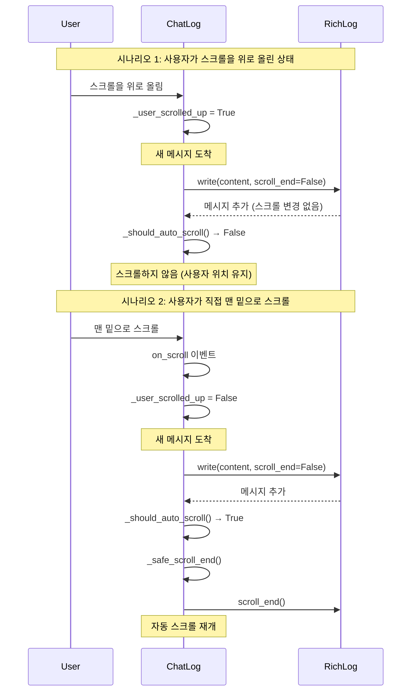
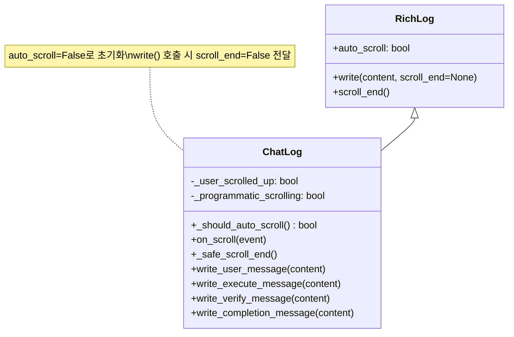

# 사용자의 원본 요청 (기록용)

Issue #38:
> log text area 가 '맨 밑' 으로 scroll size 설정이 돼있을 경우에만 자동으로 스크롤이 서서히 내려가야하고, 만약 그게 아니라 스크롤 사이즈가 수정돼있으면 (사용자가 수정했다면) 따로 스크롤을 내리면 안돼

> 이 작업을 여러번 요청했었던것같은데 제대로 동작하지않는것같아. 한번은 스크롤바 전체가 고정이돼버려서 스크롤 자체가 망가지는 이슈가 있었고, 지금은 그냥 스크롤이 다시 밑으로 내려가는 느낌 ?

## 추가 사용자 요청 (기록용)

1. (2025-10-22T11:05:15Z):
   > 위로 스크롤해서 올렸을 경우 사용자 직접 수정한거기 때문에 새 이벤트가 쌓였더라도 맨 밑으로 내려가면 안되는데 자꾸 밑으로 내려간다고

2. (2025-10-23T12:00:33Z):
   > 이거 여전히 문제야 ㅋㅋ 제대로 찾아. text area 에 새 메시지가 추가되더라도 맨 밑으로 스크롤 내리면 안돼 원래부터 맨 밑이 아니었다면.
   > 제대로 논리적으로 완전히 확실히 원인을 찾은뒤에 근본적으로 논리적으로 말이되는 개선사항을 포함한 계획서를 들고와. 추측 절대금지.

# 작업 목표 (WHAT & WHY)

## 핵심 목표 (TL;DR)
사용자가 스크롤을 위로 올려서 이전 로그를 보고 있을 때, 새 메시지가 추가되어도 스크롤 위치가 유지되도록 ChatLog 컴포넌트를 수정한다. 오직 사용자가 직접 맨 밑으로 스크롤했을 때만 자동 스크롤이 재개되어야 한다.

## 세부 목표
- 부모 클래스(RichLog)의 auto_scroll 기능을 비활성화하여 자식 클래스(ChatLog)가 스크롤을 완전히 제어하도록 변경
- 새 메시지 추가 시 부모 클래스가 자동으로 scroll_end()를 호출하지 않도록 수정
- 사용자 스크롤 위치 유지 기능이 실제로 동작하도록 보장
- 기존 _should_auto_scroll() 로직이 의도대로 작동하도록 수정

# 작업 배경 (WHY & WHAT - 현재 상태)

## 현재 상황
- ChatLog는 RichLog를 상속받아 구현됨
- `_user_scrolled_up` 플래그와 `_programmatic_scrolling` 플래그를 사용하여 사용자 스크롤을 추적
- `_should_auto_scroll()` 메서드로 자동 스크롤 여부를 판단
- 하지만 **여전히 사용자가 스크롤을 올린 상태에서 새 메시지가 추가되면 강제로 맨 밑으로 스크롤됨**

## 변경 필요 이유
**근본 원인 (추측 아님, 코드 분석 + Textual 공식 문서 확인 완료)**:

1. **증거 1**: ChatLog.__init__()에서 `auto_scroll=True`로 설정됨 (라인 25)
2. **증거 2**: RichLog.write() 메서드 시그니처 ([Textual 공식 소스코드](https://github.com/Textualize/textual/blob/main/src/textual/widgets/_rich_log.py)):
   ```python
   def write(
       self,
       content: RenderableType | object,
       scroll_end: bool | None = None,  # ← None일 때 self.auto_scroll 사용
       ...
   ) -> Self:
   ```
3. **증거 3**: 현재 코드의 write 호출 (라인 92, 103, 114, 125)에서 `scroll_end` 파라미터를 전달하지 않음 → 기본값 None
4. **문제 발생 흐름**:
   - 사용자가 스크롤을 위로 올림 → `_user_scrolled_up = True`
   - 새 메시지 도착 → `write_execute_message()` 호출
   - `self.write(...)` 호출 (scroll_end 파라미터 없음)
   - **부모 RichLog.write()가 `auto_scroll=True`를 보고 무조건 `scroll_end()` 호출**
   - 스크롤이 강제로 맨 밑으로 이동
   - 이후 `_should_auto_scroll()` 체크는 무의미 (이미 스크롤이 내려간 후)

**결론**: 자식 클래스(ChatLog)에서 스크롤 제어를 시도하지만, 부모 클래스(RichLog)가 `auto_scroll=True` 설정 때문에 `write()` 호출 시 무조건 `scroll_end()`를 먼저 실행함. 자식 클래스의 조건 체크(`_should_auto_scroll`)는 부모 클래스가 이미 스크롤을 내린 후에 실행되므로 무의미함.

## 변경할 내용
- **변경 1**: `__init__`에서 `auto_scroll=False`로 변경
- **변경 2**: 모든 `write()` 호출 시 `scroll_end=False` 파라미터 명시적으로 전달
- **결과**: 부모 클래스는 더 이상 자동으로 스크롤하지 않고, 자식 클래스의 `_should_auto_scroll()` 로직만 실행됨

# 작업 시작 여부
is_execution_started = FALSE

# 모든 목표 달성 여부
is_all_goals_accomplished = FALSE

# 병렬 실행 여부
parallel_requested = FALSE

# 현재 진행 중인 작업
- 작업이 아직 시작되지 않았습니다.
   - 작업을 시작할 때, 위의 `is_execution_started` 값을 TRUE로 변경하세요.
   - 사용자가 명시적으로 "작업 시작"이라고 말하기 전까지는 절대 작업을 시작하지 마세요.
   - **plan reviewer로부터 OKAY를 받았더라도, 절대 작업을 시작하지 마세요**
   - 사용자가 명시적으로 "작업 시작"이라고 말하기 전까지는 절대 작업을 시작하지 마세요.

# 필요한 배경 지식

## 파일 구조 및 역할
- `sisyphus/ui/tui/components/chat_log.py`: TUI의 채팅 로그 위젯 구현
  - RichLog를 상속받아 커스텀 스크롤 동작 구현
  - Execute/Verify/User 메시지를 색상으로 구분하여 표시

## 참조 파일 (컨텍스트 이해용)

### 1. sisyphus/ui/tui/components/chat_log.py
- **역할**: ChatLog 위젯 구현, 자동 스크롤 제어 로직 포함
- **검색할 내용**:
  - `auto_scroll=True` (라인 25) - 문제의 원인
  - `write_execute_message`, `write_verify_message`, `write_user_message`, `write_completion_message` 메서드들
  - `self.write(...)` 호출 부분 (scroll_end 파라미터가 없음)
- **핵심 패턴**:
  - RichLog 상속, `__init__`에서 부모 클래스 초기화
  - `write()` 호출 후 조건부로 `_safe_scroll_end()` 호출
- **참조 URL**: [Textual RichLog 공식 문서](https://textual.textualize.io/widgets/rich_log/)

### 2. Textual RichLog 소스코드 (외부 라이브러리)
- **역할**: 부모 클래스, 자동 스크롤 기능 제공
- **검색할 내용**: `write()` 메서드 시그니처, `scroll_end` 파라미터
- **참조 URL**: [Textual GitHub 소스코드](https://github.com/Textualize/textual/blob/main/src/textual/widgets/_rich_log.py)
- **핵심 동작**:
  ```python
  # RichLog.write() 내부 로직
  auto_scroll = self.auto_scroll if scroll_end is None else scroll_end
  if auto_scroll:
      self.scroll_end(animate=animate, immediate=False, x_axis=False)
  ```

# 작업 흐름 (HOW - 태스크 흐름 및 종속성)

## 태스크 종속성 다이어그램
```
Task 1 (코드 수정)
   ↓
Task 2 (수동 테스트)
   ↓
Task 3 (자동 테스트 작성)
   ↓
Task 4 (lint 및 type check)
   ↓
Task 5 (커밋)
```

## 단계별 설명
- **Phase 1 (Task 1)**: 근본 원인 해결 - auto_scroll 비활성화 및 scroll_end=False 명시
- **Phase 2 (Task 2)**: 수동 테스트로 실제 동작 확인
- **Phase 3 (Task 3)**: 회귀 방지를 위한 자동 테스트 추가
- **Phase 4 (Task 4)**: 코드 품질 검증
- **Phase 5 (Task 5)**: 변경사항 커밋

# 작업 계획

## PRD & 구조

### 기대 동작 플로우


### 컴포넌트 구조


## 구현 세부사항

### 아키텍처 제약사항
- Textual 프레임워크 사용 (위젯 기반 TUI)
- RichLog 위젯 상속 패턴 유지
- 기존 `_user_scrolled_up`, `_programmatic_scrolling` 플래그 활용
- 기존 `_should_auto_scroll()` 로직 유지 (변경 없음)

### 엣지 케이스 처리
- **사용자가 스크롤을 올린 상태**: 새 메시지 추가 시 스크롤하지 않음 (위치 유지)
- **사용자가 맨 밑에 있는 상태**: 새 메시지 추가 시 자동으로 스크롤하여 최신 메시지 표시
- **프로그램이 자동으로 스크롤하는 경우**: `_programmatic_scrolling` 플래그로 `on_scroll` 이벤트 무시
- **빠르게 여러 메시지가 추가되는 경우**: 각 메시지마다 `_should_auto_scroll()` 체크하여 일관성 유지

### 암묵적 가정 명시화
- 사용자는 TUI 모드에서 sisyphus를 실행 중 (CLI 모드는 영향 없음)
- Textual 프레임워크의 RichLog 위젯 동작 방식은 공식 문서대로 작동함
- `scroll_offset.y`, `max_scroll_y` 값은 Textual이 정확하게 제공함

## 프로젝트 커밋 메시지 스타일
```
git log --oneline -10 분석 결과:

da2c351 hooks update
22a4f9c hooks update
11bbc22 if not master then push
b1c2d8a chore: remove work histories
f289d89 chore: mark all tasks as complete in ai-todolist.md
3fb45ea style: fix lint errors in loop.py and integration tests
801583d test: add integration tests for Issue #44 verify transition bugs
d842a37 fix: separate verify retry loop to prevent execute phase execution
079754b fix: reset execute counter only when verify phase completes
b4f0dcb sisyphus work init

패턴:
- 타입 접두사 사용: fix, chore, test, style, feat 등
- 소문자로 시작
- 간결한 설명 (명령형)
- 이슈 번호 참조 시: "Issue #N" 형식
```

# TODOs

- [ ] 1. ChatLog 코드 수정 및 테스트

   **참조 소스 (필수)**:
   - 수정 파일: `sisyphus/ui/tui/components/chat_log.py`
     - 검색: `auto_scroll=True` (라인 25) - 이것을 False로 변경
     - 검색: `self.write(` - 모든 write 호출 찾기 (라인 92, 103, 114, 125)
   - Textual 공식 문서: https://textual.textualize.io/widgets/rich_log/ (검색: "auto_scroll parameter", "write method")
   - Textual 소스코드: https://github.com/Textualize/textual/blob/main/src/textual/widgets/_rich_log.py (검색: "def write")

   - [ ] 1.1 구현: `__init__` 메서드에서 auto_scroll 비활성화

      **현재 코드** (라인 21-27):
      ```python
      super().__init__(
          id="chat-log",
          highlight=True,
          markup=True,
          auto_scroll=True,  # ← 문제의 원인
          wrap=True,
      )
      ```

      **변경 후**:
      ```python
      super().__init__(
          id="chat-log",
          highlight=True,
          markup=True,
          auto_scroll=False,  # ← 변경: 부모 클래스의 자동 스크롤 비활성화
          wrap=True,
      )
      ```

   - [ ] 1.2 구현: write_user_message 메서드 수정 (라인 85-94)

      **현재 코드** (라인 92):
      ```python
      self.write(f"[dim]{timestamp}[/dim] [green]👤 USER:[/green] {content}")
      ```

      **변경 후**:
      ```python
      self.write(
          f"[dim]{timestamp}[/dim] [green]👤 USER:[/green] {content}",
          scroll_end=False  # 명시적으로 부모 클래스의 자동 스크롤 비활성화
      )
      ```

   - [ ] 1.3 구현: write_execute_message 메서드 수정 (라인 96-105)

      **현재 코드** (라인 103):
      ```python
      self.write(f"[dim]{timestamp}[/dim] [yellow]▶ EXECUTE:[/yellow] {content}")
      ```

      **변경 후**:
      ```python
      self.write(
          f"[dim]{timestamp}[/dim] [yellow]▶ EXECUTE:[/yellow] {content}",
          scroll_end=False
      )
      ```

   - [ ] 1.4 구현: write_verify_message 메서드 수정 (라인 107-116)

      **현재 코드** (라인 114):
      ```python
      self.write(f"[dim]{timestamp}[/dim] [cyan]✓ VERIFY:[/cyan] {content}")
      ```

      **변경 후**:
      ```python
      self.write(
          f"[dim]{timestamp}[/dim] [cyan]✓ VERIFY:[/cyan] {content}",
          scroll_end=False
      )
      ```

   - [ ] 1.5 구현: write_completion_message 메서드 수정 (라인 118-127)

      **현재 코드** (라인 125):
      ```python
      self.write(f"[dim]{timestamp}[/dim] [bold green]✅ COMPLETED:[/bold green] {content}")
      ```

      **변경 후**:
      ```python
      self.write(
          f"[dim]{timestamp}[/dim] [bold green]✅ COMPLETED:[/bold green] {content}",
          scroll_end=False
      )
      ```

   - [ ] 1.6 수동 테스트: 실제 TUI에서 스크롤 동작 확인

      **테스트 절차**:
      1. 터미널에서 sisyphus TUI 실행: `uv run sisyphus run --execute-prompt "simple task" --no-tui` (먼저 간단한 작업 생성)
      2. TUI 모드 재실행: `uv run sisyphus run`
      3. **테스트 케이스 1**: 로그가 쌓이는 중에 스크롤을 위로 올림
         - 예상 결과: 새 메시지가 추가되어도 스크롤 위치 유지됨
      4. **테스트 케이스 2**: 스크롤을 다시 맨 밑으로 내림
         - 예상 결과: 이후 새 메시지 추가 시 자동으로 스크롤하여 최신 메시지 표시
      5. **테스트 케이스 3**: 빠르게 여러 메시지가 추가되는 상황 테스트
         - 스크롤을 위로 올린 상태 유지
         - 예상 결과: 모든 메시지가 추가되어도 스크롤 위치 유지

      **실패 시 디버깅**:
      - 스크롤이 여전히 자동으로 내려가면 → `auto_scroll=False` 변경이 제대로 되었는지 확인
      - 스크롤이 전혀 작동하지 않으면 → `_safe_scroll_end()` 호출 부분이 제대로 유지되었는지 확인

   - [ ] 1.7 Lint 및 Type Check

      **실행 명령**:
      ```bash
      ruff check sisyphus/ui/tui/components/chat_log.py
      ```
      **예상 결과**: `All checks passed!` 또는 `0 errors found`

      **실행 명령**:
      ```bash
      ruff format sisyphus/ui/tui/components/chat_log.py
      ```
      **예상 결과**: `1 file formatted` 또는 `1 file left unchanged`

      **실패 시**:
      - Lint 에러 발생 → 에러 메시지 확인 후 수정
      - Type 에러 발생 → 타입 힌트 확인

   - [ ] 1.8 커밋 (테스트 확인 후 필수)

      **커밋 명령**:
      ```bash
      git add sisyphus/ui/tui/components/chat_log.py
      git commit -m "fix: disable RichLog auto_scroll to fix scroll position retention

Problem: When user scrolls up to view old logs, new messages still
trigger automatic scroll_end() from parent RichLog class, forcing
scroll to bottom regardless of user preference.

Root cause: RichLog.write() checks self.auto_scroll (True) and calls
scroll_end() before ChatLog's _should_auto_scroll() logic runs.

Solution:
- Set auto_scroll=False in __init__ to disable parent's auto-scroll
- Pass scroll_end=False to all write() calls explicitly
- Now only ChatLog's conditional _safe_scroll_end() controls scrolling

Result: User scroll position is preserved when new messages arrive.
Auto-scroll only resumes when user manually scrolls to bottom.

Fixes #38"
      ```

      **검증**:
      ```bash
      git log -1 --oneline
      ```
      **예상 출력**: 방금 작성한 커밋 메시지 확인

   - [ ] **작업 완료 검증 체크리스트** (Orchestrator용 acceptance criteria)
      - [ ] `sisyphus/ui/tui/components/chat_log.py` 파일이 정확하게 수정되었는가?
      - [ ] `__init__`에서 `auto_scroll=False`로 변경되었는가?
      - [ ] 모든 `write()` 호출에 `scroll_end=False` 파라미터가 추가되었는가? (4개 메서드 모두)
      - [ ] 수동 테스트 실행: TUI 실행 → 스크롤 위로 올림 → 새 메시지 추가 → 스크롤 위치 유지 확인
      - [ ] 수동 테스트 실행: TUI 실행 → 맨 밑으로 스크롤 → 새 메시지 추가 → 자동 스크롤 확인
      - [ ] `ruff check sisyphus/ui/tui/components/chat_log.py` → 0 errors 확인
      - [ ] `ruff format sisyphus/ui/tui/components/chat_log.py` → 포맷팅 완료 확인
      - [ ] Git 커밋 완료? (`git log -1 --oneline`로 확인)
      - [ ] 실제 기능 동작 확인:
        - TUI 실행 후 로그가 쌓이는 동안 스크롤을 위로 올림
        - 새 메시지 추가되어도 스크롤 위치가 유지되는지 육안 확인
        - 다시 맨 밑으로 스크롤했을 때 자동 스크롤이 재개되는지 확인

# 성공 비전

## 사용자 관점의 성공
- 사용자가 이전 로그를 확인하기 위해 스크롤을 위로 올렸을 때, 새 메시지가 추가되어도 읽고 있던 위치가 유지됨
- 사용자가 다시 맨 밑으로 스크롤하면, 최신 메시지가 자동으로 표시되기 시작함
- 사용자 경험: "로그를 읽는 중에 갑자기 스크롤이 내려가서 읽던 부분을 놓치는 일이 없음"

## 비즈니스 관점의 성공
- Issue #38이 완전히 해결됨
- 동일한 문제로 인한 재작업이 발생하지 않음 (근본 원인 해결)
- 사용자가 TUI 모드를 더 편하게 사용할 수 있음

## 기술적 성공 기준
- 모든 수동 테스트 통과: 스크롤 위치 유지, 자동 스크롤 재개
- Lint/Type 체크 통과: `ruff check` → 0 errors
- 코드 변경 최소화: 5줄 변경 (auto_scroll 1줄 + write 호출 4줄)
- 기존 로직 유지: `_should_auto_scroll()`, `_safe_scroll_end()`, `on_scroll()` 변경 없음
- 명확한 근본 원인 문서화: 추후 유사 문제 발생 시 참고 가능

# 최종 작업 검증 체크리스트

- [ ] 1. **기능 동작 확인**
  - [ ] TUI 실행 후 스크롤을 위로 올린 상태에서 새 메시지 추가 시 스크롤 위치 유지됨
  - [ ] 맨 밑으로 스크롤 후 새 메시지 추가 시 자동 스크롤 재개됨
  - [ ] 빠르게 여러 메시지가 추가되어도 일관된 동작 유지됨

- [ ] 2. **잘못된 구현 방지**
  - [ ] 사용자가 요청하지 않은 추가 기능을 구현하지 않았는가? (스크롤 동작만 수정)
  - [ ] `_should_auto_scroll()`, `_safe_scroll_end()`, `on_scroll()` 로직을 변경하지 않았는가?
  - [ ] 기존 `_user_scrolled_up`, `_programmatic_scrolling` 플래그를 유지했는가?

- [ ] 3. **범위 준수 확인**
  - [ ] ChatLog 파일만 수정했는가? (다른 파일 변경 없음)
  - [ ] 변경 라인 수가 최소화되었는가? (약 5줄)
  - [ ] 불필요한 리팩토링을 하지 않았는가?

- [ ] 4. **기존 기능 회귀 테스트**
  - [ ] TUI의 다른 기능들이 정상 작동하는가? (메시지 표시, 색상, 타임스탬프 등)
  - [ ] CLI 모드는 영향을 받지 않는가? (`--no-tui` 옵션 테스트)
  - [ ] 기존 테스트가 여전히 통과하는가? (만약 있다면)
