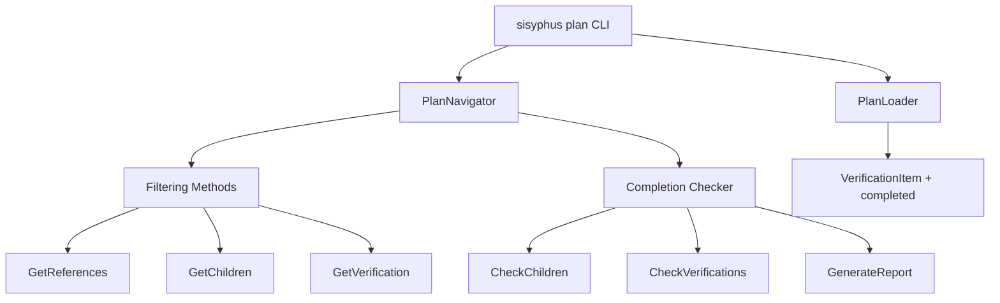
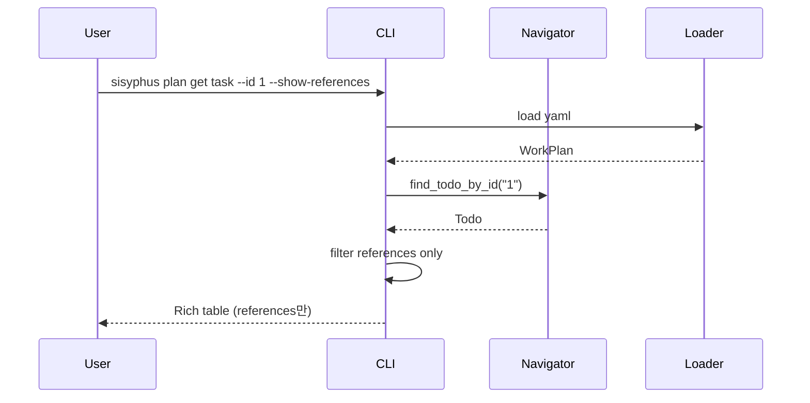
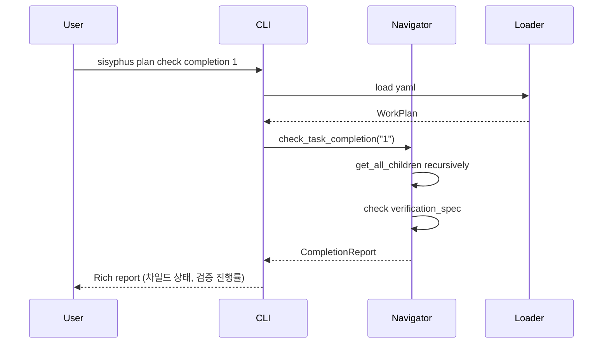

# 사용자의 최초 요청 (기록용)

지금 ./ai-todolist.md 대로 새 기능 작업했는데

- 현재 태스크 조회(필터 걸 수 있어야함: 레퍼런스, 차일드 태스크, 검증 방법)
- 현재 태스크 완료 처리 기능 (단 차일드까지 해서 개별개별 다 가능해야함)
- 현재 태스크 검증내용 완료처리 기능 (개별)
- 현재 태스크 완료 여부 조회 방법 (차일드까지 다 뒤지고, 검증 상태까지 다 보고서 상태 보고를 해주는 도구)

이런것들이 필요해 이게 에이전트 루프안에서 돌릴꺼라 이런도구가 필요하거덩

## 추가 사용자 요청 (기록용)
- 없음

# 작업 목표 (WHAT & WHY)

## 핵심 목표 (TL;DR)
에이전트 루프 내에서 YAML 작업계획서를 프로그래머틱하게 조작할 수 있는 CLI 도구들을 구현한다: 태스크 조회(필터링), 태스크 완료 처리(재귀적 차일드 포함), 검증항목 완료 처리, 완료 여부 종합 리포트 생성.

## 상세 목표

- **태스크 조회 강화**: 레퍼런스, 차일드, 검증 항목별 필터링 기능 추가
  - 측정 기준: `sisyphus plan get task --id 1 --show-references/--show-children/--show-verification` 정상 동작

- **재귀적 태스크 완료 처리**: 부모/차일드 태스크를 개별적으로 완료 처리 가능
  - 측정 기준: `sisyphus plan set task-status 1.1 completed` → 1.1만 완료, 부모는 유지

- **검증항목 개별 완료**: verification_spec 내 개별 항목 완료 표시
  - 측정 기준: `sisyphus plan set verification 1 verify-1 completed` → 해당 검증만 완료

- **완료 여부 종합 리포트**: 모든 차일드 + 검증 상태를 분석하여 완료 여부 판단
  - 측정 기준: `sisyphus plan check completion 1` → 차일드 상태, 검증 진행률 리포트

# 작업 배경 (WHY & WHAT - 현재 상태)

## 현재 상황

YAML 작업계획 시스템은 이미 구현되어 있고, 기본 조회/설정 명령어(`sisyphus plan get/set`)가 존재한다. 하지만:

- **필터링 불가**: `get task`는 전체 태스크 정보만 출력, 레퍼런스/차일드/검증만 보는 옵션 없음
- **완료 처리 제한적**: `set task-status`는 존재하지만, 차일드까지 재귀적으로 완료 처리하는 기능 없음
- **검증항목 처리 미지원**: `verification_spec` 내 개별 항목(VerificationItem)의 완료 상태를 추적/업데이트하는 필드 자체가 없음
- **완료 여부 판단 불명확**: 부모 태스크가 완료되려면 "모든 차일드 + 모든 검증"이 완료되어야 하는데, 이를 자동 체크하는 도구 없음

현재 `VerificationItem`은 `id`, `description`, `input`, `verify`, `note`만 있고, **완료 여부 필드(`completed: bool`)가 없다**.

## 변경 이유

에이전트 루프에서:
1. "이 태스크의 레퍼런스만 확인하고 싶어" → 전체 출력에서 수동 파싱 필요
2. "이 태스크의 검증 2번만 완료 표시하고 싶어" → 불가능 (필드 없음)
3. "이 태스크가 진짜 완료됐는지 확인하고 싶어 (차일드+검증 포함)" → 수동 체크 필요

프로그래머틱 자동화를 위해:
- **세밀한 필터링**: 필요한 정보만 빠르게 조회
- **재귀적 완료 처리**: 차일드 태스크들을 개별 완료 처리
- **검증항목 추적**: `VerificationItem`에 `completed: bool` 필드 추가
- **자동 완료 체크**: 모든 요소를 검사하여 태스크 완료 가능 여부 판단

## 변경할 내용

**현재 상태**:
- `VerificationItem`: `id`, `description`, `input`, `verify`, `note` (완료 필드 없음)
- `sisyphus plan get task`: 전체 정보 출력만 가능
- `sisyphus plan set task-status`: 해당 태스크만 변경
- 완료 여부 체크: 수동

**변경 후 상태**:
- `VerificationItem`: `completed: bool = False` 필드 추가
- `sisyphus plan get task --show-references/--show-children/--show-verification`: 필터링 옵션 추가
- `sisyphus plan set task-status --recursive`: 차일드까지 재귀적 완료
- `sisyphus plan set verification <task_id> <verify_id>`: 검증항목 개별 완료
- `sisyphus plan check completion <task_id>`: 완료 여부 종합 리포트 (차일드 상태, 검증 진행률)

# 작업 시작 여부
is_execution_started = FALSE

# 모든 목표 달성 여부
is_all_goals_accomplished = FALSE

# 병렬 실행 요청 여부
parallel_requested = FALSE

# 현재 진행 중인 작업
- 작업이 시작되지 않았습니다.
  - 작업 시작 시 위의 `is_execution_started` 값을 TRUE로 변경하세요.
  - 사용자가 명시적으로 "작업 시작"이라고 말하기 전까지는 절대 작업을 시작하지 마세요.
  - **plan-reviewer로부터 OKAY를 받아도 절대 작업을 시작하지 마세요**
  - 사용자가 명시적으로 "작업 시작"이라고 말하기 전까지는 절대 작업을 시작하지 마세요.

# 필요한 배경 지식

## 기술 스택
- **Python 3.12**: 프로젝트 기준 버전
- **Pydantic ≥2.0**: 데이터 검증 (이미 설치됨)
- **ruamel.yaml**: YAML 파싱 (이미 설치됨)
- **Typer**: CLI 프레임워크
- **Rich**: 터미널 출력

## 파일 구조 및 역할
```
sisyphus/
├── cli.py                          # Typer CLI (plan_app 서브커맨드 위치)
├── utils/
│   ├── plan_types.py               # Pydantic 모델 (VerificationItem 수정 필요)
│   └── formatting.py               # Rich 포맷팅 (print_task 수정)
├── core/
│   ├── plan_loader.py              # YAML 로더/세이버
│   └── plan_navigator.py           # 태스크 네비게이션 (조회 로직 추가)
└── tests/
    ├── test_cli_plan.py            # CLI 테스트
    └── test_plan_navigator.py      # Navigator 테스트
```

## 컨텍스트 이해를 위한 레퍼런스 파일

### 1. `sisyphus/utils/plan_types.py`
- **역할**: Pydantic 모델 정의
- **찾을 내용**: `VerificationItem` 클래스 (line 118-123)
- **주요 패턴**:
  ```python
  class VerificationItem(BaseModel):
      id: str
      description: str
      input: InputSpec
      verify: VerifySpec
      note: str | None = None
      # ← 여기에 completed: bool = False 추가 필요
  ```
- **이해할 점**: `completed` 필드 추가 시 기존 YAML 파일 호환성 유지 (기본값 False)

### 2. `sisyphus/cli.py`
- **역할**: Typer CLI 진입점
- **찾을 내용**: `@plan_app.command` 데코레이터 (line 584, 637)
- **주요 패턴**:
  ```python
  @plan_app.command(name="get")
  def get_plan_info(
      what: str = typer.Argument(...),
      current: bool = typer.Option(False, "--current"),
      # ← 여기에 --show-references, --show-children 등 추가
  ) -> None:
      ...
  ```
- **이해할 점**: Typer Option 사용법, Rich Console 출력

### 3. `sisyphus/core/plan_navigator.py`
- **역할**: 태스크 네비게이션 로직
- **찾을 내용**: `PlanNavigator` 클래스 (line 6-125)
- **주요 패턴**: DFS 기반 태스크 순회, `find_todo_by_id` 재귀 검색
- **이해할 점**:
  - 새 메서드 추가 필요: `get_all_children()`, `check_all_children_completed()`, `get_verification_status()`

### 4. `sisyphus/utils/formatting.py`
- **역할**: Rich 기반 출력 포맷팅
- **찾을 내용**: `print_task()` 함수
- **주요 패턴**: Rich Table 사용
- **이해할 점**: 필터링 옵션에 따라 출력 커스터마이징 필요

### 5. `example-ai-todolist.yaml`
- **역할**: YAML 스키마 예시
- **찾을 내용**: `verification_spec` 구조 확인
- **이해할 점**: `VerificationItem`에 `completed` 추가 시 예시 파일도 업데이트

## 아키텍처 제약사항
- **하위 호환성**: 기존 YAML 파일에 `completed` 필드 없어도 로드 가능 (기본값 False)
- **Pydantic validation**: 필드 추가 시 스키마 깨지지 않도록 Optional 또는 기본값 설정
- **anyio 사용**: 비동기 함수는 anyio 사용
- **타입 힌트 필수**: 모든 파라미터 타입 명시
- **Line length 119**: ruff 규칙

## Edge Cases 처리
- **VerificationItem.completed 필드 없음**: 기존 YAML 로드 시 기본값 False
- **빈 children**: leaf 태스크 → 차일드 체크 스킵
- **빈 verification_spec**: 검증 없음 → 검증 완료율 N/A
- **존재하지 않는 verify_id**: 명확한 에러 메시지
- **재귀적 완료 시 이미 completed**: 중복 업데이트 방지

## 암묵적 가정 명시
- **YAML 파일 경로**: `./ai-todolist.yaml` (기본값)
- **인코딩**: UTF-8
- **TodoId 형식**: "1", "1.1", "1.1.1" (string)
- **Verification ID**: VerificationItem.id (예: "verify-1", "v1")
- **완료 기준**: 태스크 완료 = (모든 차일드 completed) AND (모든 검증 completed)

# 작업 흐름 (HOW - 태스크 흐름 & 의존성)

## 태스크 의존성 다이어그램
```
Phase 1: 스키마 확장 (순차)
└─ Task 1: VerificationItem에 completed 필드 추가

Phase 2: 조회 기능 강화 (Task 1 의존)
├─ Task 2: Navigator에 필터링 메서드 추가
└─ Task 3: CLI get 명령어에 필터 옵션 추가

Phase 3: 완료 처리 기능 (Task 1, 2 의존)
├─ Task 4: 재귀적 태스크 완료 처리
└─ Task 5: 검증항목 개별 완료 처리

Phase 4: 완료 체크 도구 (Task 2, 4, 5 의존)
└─ Task 6: 완료 여부 종합 리포트 생성

Phase 5: 테스트 & 문서화 (모든 Task 의존)
├─ Task 7: 단위/통합 테스트 작성
└─ Task 8: 문서화 업데이트
```

## 단계별 설명
- **Phase 1**: 스키마 확장 (VerificationItem.completed 추가)
- **Phase 2**: 조회 강화 (필터링 옵션)
- **Phase 3**: 완료 처리 (재귀적 + 검증항목)
- **Phase 4**: 자동 체크 (완료 여부 판단)
- **Phase 5**: 품질 보증

# 작업 계획

## PRDs & Structures

### 시스템 아키텍처


### 데이터 흐름 (필터링 조회)


### 데이터 흐름 (완료 체크)


## Implementation Details

### 아키텍처 제약사항
- **동기 I/O**: YAML 로드/저장은 동기
- **Immutable 모델**: Pydantic 모델 수정 시 새 객체 생성
- **CLI 에러 처리**: typer.Exit(1) + error_console

### Edge Case 처리
- **VerificationItem.completed 없음**: 기존 YAML → 기본값 False
- **빈 children/verification_spec**: 해당 체크 스킵
- **존재하지 않는 ID**: ValueError with 명확한 메시지

### 암묵적 가정 명시
- **완료 기준**: (all children completed) AND (all verifications completed)
- **재귀 완료**: 차일드만 completed로 변경, 부모는 수동
- **검증 ID**: VerificationItem.id로 식별

## 프로젝트 커밋 메시지 스타일
- **타입 접두사**: `feat:`, `test:`, `docs:`
- **예시**:
  - `feat: add VerificationItem.completed field for tracking`
  - `feat: add task filtering options (references, children, verification)`
  - `test: add tests for completion checker`

# TODOs

- [ ] 1. VerificationItem에 completed 필드 추가

   **레퍼런스**:
   - `sisyphus/utils/plan_types.py` (line 118-123, `VerificationItem` 클래스)
   - Pydantic 기본값 문서: https://docs.pydantic.dev/latest/ ("default values" 검색)

   - [ ] 1.1 plan_types.py의 VerificationItem 수정

      **현재 상태**:
      ```python
      class VerificationItem(BaseModel):
          id: str
          description: str
          input: InputSpec
          verify: VerifySpec
          note: str | None = None
      ```

      **변경 내용**:
      ```python
      class VerificationItem(BaseModel):
          id: str
          description: str
          input: InputSpec
          verify: VerifySpec
          note: str | None = None
          completed: bool = False  # ← 추가
      ```

      **이해할 점**: 기본값 False → 기존 YAML 호환성 유지

   - [ ] 1.2 기본 validation 테스트 추가

      **테스트 파일**: `sisyphus/utils/tests/test_plan_types.py`

      **테스트 케이스**:
      ```python
      async def test_verification_item_completed_defaults_to_false() -> None:
          # given
          data = {
              "id": "v1",
              "description": "Test",
              "input": {"type": "command", "command": "ls"},
              "verify": {"type": "none"}
          }

          # when
          item = VerificationItem(**data)

          # then
          assert item.completed is False

      async def test_verification_item_completed_can_be_set() -> None:
          # given
          data = {
              "id": "v1",
              "description": "Test",
              "input": {"type": "command", "command": "ls"},
              "verify": {"type": "none"},
              "completed": True
          }

          # when
          item = VerificationItem(**data)

          # then
          assert item.completed is True
      ```

   - [ ] 1.3 Lint 및 타입 체크

      **검증**:
      ```bash
      uv run ruff check sisyphus/utils/plan_types.py
      uv run basedpyright sisyphus/utils/plan_types.py
      ```
      **예상 결과**: 0 errors

   - [ ] 1.4 커밋

      **커밋 명령어**:
      ```bash
      git add sisyphus/utils/plan_types.py sisyphus/utils/tests/test_plan_types.py
      git commit -m "feat: add completed field to VerificationItem for progress tracking"
      ```

   - [ ] **작업 완료 검증 체크리스트**
      - [ ] `VerificationItem.completed` 필드 존재
      - [ ] 기본값 False 설정
      - [ ] 기존 YAML 로드 시 에러 없음 (PlanLoader 테스트로 확인)
      - [ ] 테스트: `uv run pytest sisyphus/utils/tests/test_plan_types.py::test_verification_item_completed*` → PASSED
      - [ ] Lint/타입 체크 통과

- [ ] 2. Navigator에 필터링 메서드 추가

   **레퍼런스**:
   - `sisyphus/core/plan_navigator.py` (line 6-125)
   - `sisyphus/utils/plan_types.py` (Todo, SimpleReference, VerificationItem)

   - [ ] 2.1 PlanNavigator에 새 메서드 추가

      **구현 내용**:
      ```python
      def get_task_references(self, task_id: str) -> list[SimpleReference]:
          """Get references for a specific task."""
          task = self.find_todo_by_id(task_id)
          if task is None:
              raise ValueError(f"작업 ID를 찾을 수 없습니다: {task_id}")
          return task.references

      def get_task_children(self, task_id: str) -> list[Todo]:
          """Get direct children of a task."""
          task = self.find_todo_by_id(task_id)
          if task is None:
              raise ValueError(f"작업 ID를 찾을 수 없습니다: {task_id}")
          return task.children

      def get_all_descendants(self, task_id: str) -> list[Todo]:
          """Get all descendants (children recursively) of a task."""
          task = self.find_todo_by_id(task_id)
          if task is None:
              raise ValueError(f"작업 ID를 찾을 수 없습니다: {task_id}")

          descendants = []
          def collect(todos: list[Todo]) -> None:
              for todo in todos:
                  descendants.append(todo)
                  if todo.children:
                      collect(todo.children)

          if task.children:
              collect(task.children)
          return descendants

      def get_task_verification(self, task_id: str) -> list[VerificationItem]:
          """Get verification spec for a task."""
          task = self.find_todo_by_id(task_id)
          if task is None:
              raise ValueError(f"작업 ID를 찾을 수 없습니다: {task_id}")
          return task.verification_spec
      ```

   - [ ] 2.2 테스트 작성

      **테스트 파일**: `sisyphus/core/tests/test_plan_navigator.py`

      **테스트 케이스**:
      ```python
      async def test_get_task_references() -> None:
          # given
          plan = create_test_plan_with_references()
          navigator = PlanNavigator(plan)

          # when
          refs = navigator.get_task_references("1")

          # then
          assert len(refs) == 2
          assert refs[0].ref_id == "ref-1"

      async def test_get_task_children() -> None:
          # given
          plan = create_test_plan_with_children()
          navigator = PlanNavigator(plan)

          # when
          children = navigator.get_task_children("1")

          # then
          assert len(children) == 2
          assert children[0].id == "1.1"

      async def test_get_all_descendants_recursive() -> None:
          # given - 1 -> 1.1 -> 1.1.1
          plan = create_test_plan_nested()
          navigator = PlanNavigator(plan)

          # when
          descendants = navigator.get_all_descendants("1")

          # then
          assert len(descendants) == 2  # 1.1, 1.1.1
          assert descendants[0].id == "1.1"
          assert descendants[1].id == "1.1.1"

      async def test_get_task_verification() -> None:
          # given
          plan = create_test_plan_with_verification()
          navigator = PlanNavigator(plan)

          # when
          verifications = navigator.get_task_verification("1")

          # then
          assert len(verifications) == 3
          assert verifications[0].id == "v1"
      ```

   - [ ] 2.3 Lint 및 타입 체크

      **검증**: `uv run ruff check sisyphus/core/plan_navigator.py && uv run basedpyright sisyphus/core/plan_navigator.py`

   - [ ] 2.4 커밋

      ```bash
      git add sisyphus/core/plan_navigator.py sisyphus/core/tests/test_plan_navigator.py
      git commit -m "feat: add filtering methods to PlanNavigator (references, children, verification)"
      ```

   - [ ] **작업 완료 검증 체크리스트**
      - [ ] `get_task_references()` 동작
      - [ ] `get_task_children()` 동작
      - [ ] `get_all_descendants()` 재귀 동작
      - [ ] `get_task_verification()` 동작
      - [ ] 존재하지 않는 ID → ValueError
      - [ ] 테스트: `uv run pytest sisyphus/core/tests/test_plan_navigator.py` → PASSED
      - [ ] Lint/타입 체크 통과

- [ ] 3. CLI get 명령어에 필터 옵션 추가

   **레퍼런스**:
   - `sisyphus/cli.py` (line 584-634, `@plan_app.command(name="get")`)
   - `sisyphus/utils/formatting.py` (print_task 함수)

   - [ ] 3.1 cli.py의 get_plan_info 함수 수정

      **현재 상태**: `--current`, `--next`, `--id` 옵션만 존재

      **변경 내용**:
      ```python
      @plan_app.command(name="get")
      def get_plan_info(
          what: str = typer.Argument(..., help="What to get: task, reference"),
          current: bool = typer.Option(False, "--current", help="Get current task"),
          next_task: bool = typer.Option(False, "--next", help="Get next pending task"),
          task_id: str | None = typer.Option(None, "--id", help="Specific task ID"),
          # ← 추가
          show_references: bool = typer.Option(False, "--show-references", help="Show only references"),
          show_children: bool = typer.Option(False, "--show-children", help="Show only children"),
          show_verification: bool = typer.Option(False, "--show-verification", help="Show only verification spec"),
          show_all: bool = typer.Option(False, "--show-all", help="Show complete task info (default)"),
      ) -> None:
          """Get information from work plan."""
          try:
              loader = PlanLoader()
              plan = loader.load()
              navigator = PlanNavigator(plan)

              if what == "task":
                  # ... (기존 task 조회 로직)

                  # 필터링 적용
                  if show_references:
                      refs = navigator.get_task_references(task.id)
                      print_references(refs)
                  elif show_children:
                      children = navigator.get_task_children(task.id)
                      print_children(children)
                  elif show_verification:
                      verifications = navigator.get_task_verification(task.id)
                      print_verification(verifications)
                  else:
                      # 기본: 전체 출력
                      print_task(task)
              # ...
      ```

   - [ ] 3.2 formatting.py에 새 출력 함수 추가

      **파일**: `sisyphus/utils/formatting.py`

      **구현**:
      ```python
      def print_references(references: list[SimpleReference]) -> None:
          """Print references with Rich formatting."""
          if not references:
              console.print("[yellow]레퍼런스 없음[/yellow]")
              return

          table = Table(title="References")
          table.add_column("Ref ID", style="cyan")
          table.add_column("Note", style="green")

          for ref in references:
              table.add_row(ref.ref_id, ref.note or "-")

          console.print(table)

      def print_children(children: list[Todo]) -> None:
          """Print child tasks with Rich formatting."""
          if not children:
              console.print("[yellow]차일드 태스크 없음[/yellow]")
              return

          table = Table(title="Child Tasks")
          table.add_column("ID", style="cyan")
          table.add_column("Title", style="green")
          table.add_column("Status", style="magenta")

          for child in children:
              table.add_row(child.id, child.title, child.status.value)

          console.print(table)

      def print_verification(verifications: list[VerificationItem]) -> None:
          """Print verification spec with Rich formatting."""
          if not verifications:
              console.print("[yellow]검증 항목 없음[/yellow]")
              return

          table = Table(title="Verification Spec")
          table.add_column("ID", style="cyan")
          table.add_column("Description", style="green")
          table.add_column("Completed", style="magenta")

          for v in verifications:
              completed_str = "✓" if v.completed else "✗"
              table.add_row(v.id, v.description, completed_str)

          console.print(table)
      ```

   - [ ] 3.3 CLI 테스트 작성

      **테스트 파일**: `sisyphus/tests/test_cli_plan.py`

      **테스트 케이스**:
      ```python
      def test_plan_get_task_show_references():
          # given (assume test yaml with references)

          # when
          result = runner.invoke(app, ["plan", "get", "task", "--id", "1", "--show-references"])

          # then
          assert result.exit_code == 0
          assert "References" in result.stdout
          assert "ref-1" in result.stdout

      def test_plan_get_task_show_children():
          # given

          # when
          result = runner.invoke(app, ["plan", "get", "task", "--id", "1", "--show-children"])

          # then
          assert result.exit_code == 0
          assert "Child Tasks" in result.stdout

      def test_plan_get_task_show_verification():
          # given

          # when
          result = runner.invoke(app, ["plan", "get", "task", "--id", "1", "--show-verification"])

          # then
          assert result.exit_code == 0
          assert "Verification Spec" in result.stdout
      ```

   - [ ] 3.4 Lint 및 타입 체크

   - [ ] 3.5 커밋

      ```bash
      git add sisyphus/cli.py sisyphus/utils/formatting.py sisyphus/tests/test_cli_plan.py
      git commit -m "feat: add filtering options to plan get task command"
      ```

   - [ ] **작업 완료 검증 체크리스트**
      - [ ] `sisyphus plan get task --id 1 --show-references` 동작
      - [ ] `sisyphus plan get task --id 1 --show-children` 동작
      - [ ] `sisyphus plan get task --id 1 --show-verification` 동작
      - [ ] Rich 포맷팅 적용 (테이블 출력)
      - [ ] 빈 리스트 처리 (friendly 메시지)
      - [ ] 테스트: `uv run pytest sisyphus/tests/test_cli_plan.py` → PASSED

- [ ] 4. 재귀적 태스크 완료 처리

   **레퍼런스**:
   - `sisyphus/cli.py` (line 637-680, `@plan_app.command(name="set")`)
   - `sisyphus/core/plan_loader.py` (PlanLoader.save)
   - `sisyphus/core/plan_navigator.py` (find_todo_by_id, get_all_descendants)

   - [ ] 4.1 cli.py의 set_plan_info 함수 수정

      **변경 내용**:
      ```python
      @plan_app.command(name="set")
      def set_plan_info(
          what: str = typer.Argument(..., help="What to set: current-task, task-status"),
          value: str = typer.Argument(..., help="Value to set"),
          status: str | None = typer.Option(None, "--status", help="Task status (for task-status)"),
          recursive: bool = typer.Option(False, "--recursive", help="Apply to all children recursively"),  # ← 추가
      ) -> None:
          """Update work plan information."""
          try:
              loader = PlanLoader()
              plan = loader.load()
              navigator = PlanNavigator(plan)

              if what == "task-status":
                  task_id = value
                  new_status = status

                  # ... (기존 validation)

                  # 재귀 옵션 처리
                  if recursive:
                      # 모든 descendants 찾기
                      descendants = navigator.get_all_descendants(task_id)
                      task_ids_to_update = [task_id] + [d.id for d in descendants]
                  else:
                      task_ids_to_update = [task_id]

                  # 각 task 업데이트 (Pydantic immutable → 새 객체 생성)
                  updated_todos = _update_task_statuses(plan.todos, task_ids_to_update, new_status)

                  # Plan 재생성
                  plan = plan.model_copy(update={"todos": updated_todos})

                  # 저장
                  loader.save(plan)
                  console.print(f"[green]완료: {len(task_ids_to_update)}개 태스크 상태 변경[/green]")
              # ...
      ```

      **Helper 함수**:
      ```python
      def _update_task_statuses(todos: list[Todo], task_ids: list[str], new_status: str) -> list[Todo]:
          """Recursively update task statuses (immutable)."""
          from sisyphus.utils.plan_types import TodoStatus

          result = []
          for todo in todos:
              if todo.id in task_ids:
                  # 상태 변경
                  updated = todo.model_copy(update={"status": TodoStatus(new_status)})
                  # children도 재귀 업데이트
                  if updated.children:
                      updated = updated.model_copy(
                          update={"children": _update_task_statuses(updated.children, task_ids, new_status)}
                      )
                  result.append(updated)
              else:
                  # children만 재귀 확인
                  if todo.children:
                      updated = todo.model_copy(
                          update={"children": _update_task_statuses(todo.children, task_ids, new_status)}
                      )
                      result.append(updated)
                  else:
                      result.append(todo)
          return result
      ```

   - [ ] 4.2 테스트 작성

      **테스트 파일**: `sisyphus/tests/test_cli_plan.py`

      **테스트 케이스**:
      ```python
      def test_plan_set_task_status_recursive(tmp_path: Path):
          # given - YAML with 1 -> 1.1, 1.2
          yaml_file = tmp_path / "test.yaml"
          # ... (create test yaml)

          # when
          result = runner.invoke(app, [
              "plan", "set", "task-status", "1",
              "--status", "completed",
              "--recursive"
          ])

          # then
          assert result.exit_code == 0
          assert "3개 태스크 상태 변경" in result.stdout

          # Verify YAML updated
          loader = PlanLoader(yaml_file)
          plan = loader.load()
          assert plan.todos[0].status == TodoStatus.completed
          assert plan.todos[0].children[0].status == TodoStatus.completed
          assert plan.todos[0].children[1].status == TodoStatus.completed
      ```

   - [ ] 4.3 Lint 및 타입 체크

   - [ ] 4.4 커밋

      ```bash
      git add sisyphus/cli.py sisyphus/tests/test_cli_plan.py
      git commit -m "feat: add recursive task status update with --recursive flag"
      ```

   - [ ] **작업 완료 검증 체크리스트**
      - [ ] `sisyphus plan set task-status 1 --status completed --recursive` 동작
      - [ ] 모든 descendants 상태 변경 확인
      - [ ] YAML 파일 정상 저장
      - [ ] 재로드 후 상태 유지
      - [ ] 테스트: `uv run pytest sisyphus/tests/test_cli_plan.py::test_plan_set_task_status_recursive` → PASSED

- [ ] 5. 검증항목 개별 완료 처리

   **레퍼런스**:
   - `sisyphus/cli.py` (plan_app)
   - `sisyphus/core/plan_navigator.py`

   - [ ] 5.1 새 CLI 명령어 추가: set verification

      **구현**:
      ```python
      @plan_app.command(name="set-verification")
      def set_verification_status(
          task_id: str = typer.Argument(..., help="Task ID"),
          verify_id: str = typer.Argument(..., help="Verification item ID"),
          completed: bool = typer.Option(True, "--completed/--not-completed", help="Mark as completed"),
      ) -> None:
          """Mark a verification item as completed."""
          try:
              loader = PlanLoader()
              plan = loader.load()
              navigator = PlanNavigator(plan)

              # Task 찾기
              task = navigator.find_todo_by_id(task_id)
              if task is None:
                  console.print(f"[red]작업 ID를 찾을 수 없습니다: {task_id}[/red]")
                  raise typer.Exit(1)

              # Verification item 찾기
              verify_item = next((v for v in task.verification_spec if v.id == verify_id), None)
              if verify_item is None:
                  console.print(f"[red]검증 ID를 찾을 수 없습니다: {verify_id}[/red]")
                  raise typer.Exit(1)

              # 상태 업데이트 (immutable)
              updated_todos = _update_verification_status(plan.todos, task_id, verify_id, completed)
              plan = plan.model_copy(update={"todos": updated_todos})

              loader.save(plan)
              status_str = "완료" if completed else "미완료"
              console.print(f"[green]검증 항목 {verify_id} → {status_str}[/green]")

          except FileNotFoundError as e:
              console.print(f"[red]{e}[/red]")
              raise typer.Exit(1)
          except ValidationError as e:
              console.print(f"[red]YAML 검증 실패:[/red]\n{e}")
              raise typer.Exit(1)
      ```

      **Helper 함수**:
      ```python
      def _update_verification_status(
          todos: list[Todo], task_id: str, verify_id: str, completed: bool
      ) -> list[Todo]:
          """Recursively update verification item status (immutable)."""
          result = []
          for todo in todos:
              if todo.id == task_id:
                  # 해당 task의 verification_spec 업데이트
                  updated_specs = [
                      v.model_copy(update={"completed": completed}) if v.id == verify_id else v
                      for v in todo.verification_spec
                  ]
                  updated = todo.model_copy(update={"verification_spec": updated_specs})
                  result.append(updated)
              else:
                  # children 재귀 확인
                  if todo.children:
                      updated = todo.model_copy(
                          update={"children": _update_verification_status(todo.children, task_id, verify_id, completed)}
                      )
                      result.append(updated)
                  else:
                      result.append(todo)
          return result
      ```

   - [ ] 5.2 테스트 작성

      **테스트 케이스**:
      ```python
      def test_plan_set_verification_completed(tmp_path: Path):
          # given - YAML with verification_spec
          yaml_file = tmp_path / "test.yaml"
          # ... (create test yaml with verifications)

          # when
          result = runner.invoke(app, [
              "plan", "set-verification", "1", "v1", "--completed"
          ])

          # then
          assert result.exit_code == 0
          assert "완료" in result.stdout

          # Verify
          loader = PlanLoader(yaml_file)
          plan = loader.load()
          navigator = PlanNavigator(plan)
          verifications = navigator.get_task_verification("1")
          assert verifications[0].completed is True

      def test_plan_set_verification_not_found():
          # given

          # when
          result = runner.invoke(app, [
              "plan", "set-verification", "1", "nonexistent", "--completed"
          ])

          # then
          assert result.exit_code == 1
          assert "검증 ID를 찾을 수 없습니다" in result.stdout
      ```

   - [ ] 5.3 Lint 및 타입 체크

   - [ ] 5.4 커밋

      ```bash
      git add sisyphus/cli.py sisyphus/tests/test_cli_plan.py
      git commit -m "feat: add set-verification command for individual verification tracking"
      ```

   - [ ] **작업 완료 검증 체크리스트**
      - [ ] `sisyphus plan set-verification 1 v1 --completed` 동작
      - [ ] YAML 파일에 completed 필드 저장
      - [ ] 존재하지 않는 verify_id → 명확한 에러
      - [ ] 테스트: `uv run pytest sisyphus/tests/test_cli_plan.py::test_plan_set_verification*` → PASSED

- [ ] 6. 완료 여부 종합 리포트 생성

   **레퍼런스**:
   - `sisyphus/core/plan_navigator.py`
   - `sisyphus/utils/formatting.py`

   - [ ] 6.1 PlanNavigator에 완료 체크 메서드 추가

      **구현**:
      ```python
      from dataclasses import dataclass

      @dataclass
      class CompletionReport:
          task_id: str
          task_status: TodoStatus
          all_children_completed: bool
          children_summary: dict[str, int]  # {"completed": 2, "in_progress": 1, "pending": 0}
          all_verifications_completed: bool
          verification_summary: dict[str, int]  # {"completed": 3, "total": 5}
          can_complete: bool  # True if all children + all verifications completed

      def check_task_completion(self, task_id: str) -> CompletionReport:
          """Check if task can be marked as completed.

          Business rule: Task can complete when:
          - All children are completed
          - All verification items are completed
          """
          task = self.find_todo_by_id(task_id)
          if task is None:
              raise ValueError(f"작업 ID를 찾을 수 없습니다: {task_id}")

          # 1. Children 체크
          descendants = self.get_all_descendants(task_id)
          children_summary = {
              "completed": sum(1 for d in descendants if d.status == TodoStatus.completed),
              "in_progress": sum(1 for d in descendants if d.status == TodoStatus.in_progress),
              "pending": sum(1 for d in descendants if d.status == TodoStatus.pending),
          }
          all_children_completed = (
              len(descendants) == 0 or children_summary["completed"] == len(descendants)
          )

          # 2. Verification 체크
          verifications = task.verification_spec
          verification_summary = {
              "completed": sum(1 for v in verifications if v.completed),
              "total": len(verifications),
          }
          all_verifications_completed = (
              len(verifications) == 0 or verification_summary["completed"] == len(verifications)
          )

          # 3. 완료 가능 여부
          can_complete = all_children_completed and all_verifications_completed

          return CompletionReport(
              task_id=task_id,
              task_status=task.status,
              all_children_completed=all_children_completed,
              children_summary=children_summary,
              all_verifications_completed=all_verifications_completed,
              verification_summary=verification_summary,
              can_complete=can_complete,
          )
      ```

   - [ ] 6.2 CLI 명령어 추가: check completion

      **구현**:
      ```python
      @plan_app.command(name="check")
      def check_completion(
          task_id: str = typer.Argument(..., help="Task ID to check"),
      ) -> None:
          """Check if task can be marked as completed (checks children + verifications)."""
          try:
              loader = PlanLoader()
              plan = loader.load()
              navigator = PlanNavigator(plan)

              report = navigator.check_task_completion(task_id)
              print_completion_report(report)

          except ValueError as e:
              console.print(f"[red]{e}[/red]")
              raise typer.Exit(1)
          except FileNotFoundError as e:
              console.print(f"[red]{e}[/red]")
              raise typer.Exit(1)
      ```

   - [ ] 6.3 formatting.py에 리포트 출력 함수 추가

      **구현**:
      ```python
      def print_completion_report(report: CompletionReport) -> None:
          """Print completion report with Rich formatting."""
          from rich.panel import Panel
          from rich.text import Text

          # Status color
          if report.can_complete:
              status_color = "green"
              status_text = "✓ 완료 가능"
          else:
              status_color = "yellow"
              status_text = "✗ 완료 불가"

          # Build report text
          lines = [
              f"[bold]Task ID:[/bold] {report.task_id}",
              f"[bold]현재 상태:[/bold] {report.task_status.value}",
              "",
              f"[bold]차일드 태스크:[/bold]",
              f"  완료: {report.children_summary['completed']}",
              f"  진행중: {report.children_summary['in_progress']}",
              f"  대기: {report.children_summary['pending']}",
              f"  → {'✓ 모두 완료' if report.all_children_completed else '✗ 미완료 있음'}",
              "",
              f"[bold]검증 항목:[/bold]",
              f"  완료: {report.verification_summary['completed']} / {report.verification_summary['total']}",
              f"  → {'✓ 모두 완료' if report.all_verifications_completed else '✗ 미완료 있음'}",
              "",
              f"[{status_color}][bold]{status_text}[/bold][/{status_color}]",
          ]

          panel = Panel(
              "\n".join(lines),
              title="Completion Report",
              border_style=status_color,
          )
          console.print(panel)
      ```

   - [ ] 6.4 테스트 작성

      **테스트 케이스**:
      ```python
      async def test_check_task_completion_all_done() -> None:
          # given - all children completed, all verifications completed
          plan = create_test_plan_all_completed()
          navigator = PlanNavigator(plan)

          # when
          report = navigator.check_task_completion("1")

          # then
          assert report.all_children_completed is True
          assert report.all_verifications_completed is True
          assert report.can_complete is True

      async def test_check_task_completion_children_pending() -> None:
          # given - some children pending
          plan = create_test_plan_children_pending()
          navigator = PlanNavigator(plan)

          # when
          report = navigator.check_task_completion("1")

          # then
          assert report.all_children_completed is False
          assert report.can_complete is False

      async def test_check_task_completion_verification_incomplete() -> None:
          # given - verifications not all completed
          plan = create_test_plan_verification_incomplete()
          navigator = PlanNavigator(plan)

          # when
          report = navigator.check_task_completion("1")

          # then
          assert report.all_verifications_completed is False
          assert report.can_complete is False

      def test_plan_check_completion_cli():
          # given

          # when
          result = runner.invoke(app, ["plan", "check", "1"])

          # then
          assert result.exit_code == 0
          assert "Completion Report" in result.stdout
          assert "차일드 태스크" in result.stdout
          assert "검증 항목" in result.stdout
      ```

   - [ ] 6.5 Lint 및 타입 체크

   - [ ] 6.6 커밋

      ```bash
      git add sisyphus/core/plan_navigator.py sisyphus/utils/formatting.py sisyphus/cli.py sisyphus/tests/
      git commit -m "feat: add completion checker with comprehensive report (children + verification)"
      ```

   - [ ] **작업 완료 검증 체크리스트**
      - [ ] `check_task_completion()` 동작
      - [ ] CompletionReport 정확한 데이터 생성
      - [ ] `sisyphus plan check 1` CLI 동작
      - [ ] Rich 패널 출력 (차일드 요약, 검증 진행률)
      - [ ] can_complete 로직 정확 (children AND verifications)
      - [ ] 테스트: `uv run pytest sisyphus/core/tests/test_plan_navigator.py::test_check_task_completion*` → PASSED
      - [ ] 테스트: `uv run pytest sisyphus/tests/test_cli_plan.py::test_plan_check_completion*` → PASSED

- [ ] 7. 단위/통합 테스트 작성

   - [ ] 7.1 Edge case 테스트 추가

      **테스트 시나리오**:
      - VerificationItem.completed 기본값 False
      - 빈 children/verification_spec 처리
      - 존재하지 않는 ID 에러 처리
      - 재귀 업데이트 시 중복 방지
      - YAML 저장/재로드 후 데이터 유지

   - [ ] 7.2 통합 테스트: end-to-end 시나리오

      **시나리오**:
      1. YAML 로드
      2. 태스크 조회 (필터링)
      3. 검증항목 완료 처리
      4. 완료 체크 (미완료 상태)
      5. 차일드 태스크들 완료 처리
      6. 완료 체크 (완료 가능 상태)
      7. YAML 저장 후 재로드
      8. 데이터 유지 확인

   - [ ] 7.3 전체 테스트 실행 및 커버리지 확인

      **검증**: `uv run pytest --cov=sisyphus --cov-report=term-missing`
      **목표**: 새 코드 커버리지 ≥ 90%

   - [ ] 7.4 커밋

      ```bash
      git add sisyphus/tests/
      git commit -m "test: add comprehensive tests for task filtering and completion tracking"
      ```

   - [ ] **작업 완료 검증 체크리스트**
      - [ ] 모든 edge case 테스트 추가
      - [ ] End-to-end 통합 테스트 통과
      - [ ] 전체 테스트 실행: `uv run pytest` → PASSED
      - [ ] 커버리지 ≥ 90%

- [ ] 8. 문서화 업데이트

   - [ ] 8.1 README.md에 새 명령어 사용법 추가

      **추가 내용**:
      ```markdown
      ## Task Filtering and Completion Tracking

      ### Query with Filters
      ```bash
      # Get only references
      sisyphus plan get task --id 1 --show-references

      # Get only child tasks
      sisyphus plan get task --id 1 --show-children

      # Get only verification spec
      sisyphus plan get task --id 1 --show-verification
      ```

      ### Recursive Task Completion
      ```bash
      # Mark task and all children as completed
      sisyphus plan set task-status 1 --status completed --recursive
      ```

      ### Verification Item Tracking
      ```bash
      # Mark verification item as completed
      sisyphus plan set-verification 1 v1 --completed

      # Mark as not completed
      sisyphus plan set-verification 1 v1 --not-completed
      ```

      ### Completion Check
      ```bash
      # Check if task can be completed (checks all children + verifications)
      sisyphus plan check 1
      ```
      ```

   - [ ] 8.2 example-ai-todolist.yaml에 completed 필드 예시 추가

      **수정 내용**: verification_spec에 completed: false/true 예시

   - [ ] 8.3 CLI --help 문서화 확인

      **검증**:
      ```bash
      sisyphus plan --help
      sisyphus plan get --help
      sisyphus plan set --help
      sisyphus plan set-verification --help
      sisyphus plan check --help
      ```

   - [ ] 8.4 커밋

      ```bash
      git add README.md example-ai-todolist.yaml
      git commit -m "docs: add documentation for task filtering and completion tracking features"
      ```

   - [ ] **작업 완료 검증 체크리스트**
      - [ ] README 업데이트 완료
      - [ ] example YAML 업데이트 완료
      - [ ] --help 출력 확인 (모든 옵션 문서화)

# 성공 비전

## 사용자 관점의 성공

- **시나리오 1: 레퍼런스만 빠르게 확인** → `sisyphus plan get task --id 1 --show-references` 즉시 레퍼런스 테이블 출력
- **시나리오 2: 검증 진행 상황 파악** → `sisyphus plan get task --id 1 --show-verification` 검증 항목 + 완료 여부 한눈에 확인
- **시나리오 3: 태스크 완료 체크** → `sisyphus plan check 1` 차일드/검증 상태 종합 리포트
- **시나리오 4: 검증 완료 표시** → `sisyphus plan set-verification 1 v1 --completed` 개별 검증 완료

## 비즈니스 관점의 성공

- **에이전트 작업 효율 향상**: 필요한 정보만 필터링하여 조회 → 파싱 시간 단축
- **완료 기준 명확화**: "모든 차일드 + 모든 검증 완료" 자동 체크
- **진행 상황 투명성**: 검증 진행률, 차일드 완료율 실시간 조회

## 기술적 성공 기준

- 모든 테스트 통과 (100%)
- Coverage ≥ 90%
- Lint/타입 체크 0 errors
- CLI 응답 < 500ms
- YAML 저장/로드 정상 동작
- 하위 호환성 유지 (기존 YAML 로드 가능)

# 최종 작업 검증 체크리스트

- [ ] 1. **기능 동작 확인**
  - [ ] `sisyphus plan get task --id 1 --show-references` → 정상 출력
  - [ ] `sisyphus plan get task --id 1 --show-children` → 정상 출력
  - [ ] `sisyphus plan get task --id 1 --show-verification` → 정상 출력
  - [ ] `sisyphus plan set task-status 1 --status completed --recursive` → 차일드 포함 완료
  - [ ] `sisyphus plan set-verification 1 v1 --completed` → 검증 완료 표시
  - [ ] `sisyphus plan check 1` → 완료 여부 리포트 생성

- [ ] 2. **잘못된 구현 방지**
  - [ ] VerificationItem.completed 기본값 False → 기존 YAML 호환
  - [ ] 재귀 업데이트 시 Pydantic immutable 패턴 준수
  - [ ] 존재하지 않는 ID → 명확한 ValueError

- [ ] 3. **범위 준수 확인**
  - [ ] 기존 CLI 명령어 영향 없음 (`sisyphus work` 정상 동작)
  - [ ] PlanNavigator 기존 메서드 유지 (하위 호환)

- [ ] 4. **기존 기능 회귀 테스트**
  - [ ] `sisyphus plan get task --current/--next` 정상 동작
  - [ ] `sisyphus plan set current-task` 정상 동작
  - [ ] 기존 YAML 테스트 모두 통과
