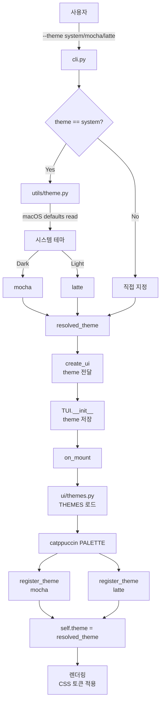
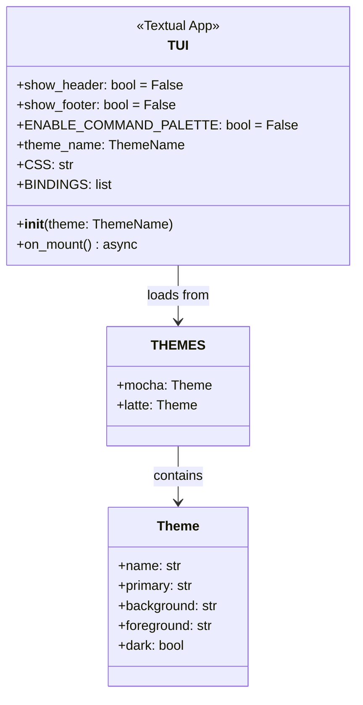
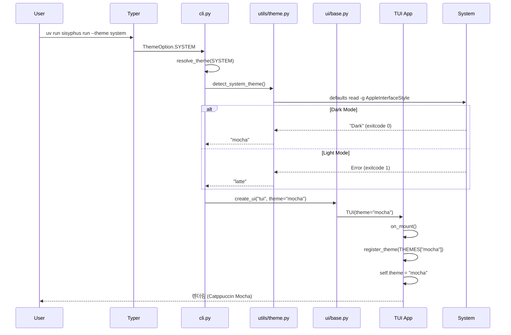

# 사용자의 최초 요청 (기록용)

textual 기본 헤더랑 푸터(^q 알림 뜨는거랑, ^p pallete 안내되고 있는 부분), 없애고 command bar (ctrl p) 도 비활성화 하고 싶어.
- 다크테마 / 라이트 테마 (catpuccin mocha / catpuccin latte) 정도만 시스템 인식이 가능하다면 시스템걸 따라가도록 하고, 그게 아니라면 typer cli 옵션으로 고를 수 있도록 (enum 으로, boolean 금지)
- textual 기본 pallete, 상단 바, 하단 바 없애는것도
- 헤더푸터없애고 커맨드바 비활성화하는거까지 포함해서

## 사용자가 이후에 추가 요청한 내용들 (기록용)

- `--theme light|dark|system` 형식으로 CLI 옵션 받기
- 작업 계획서는 `ai-tasks/enhanced-ui.md`에 작성
- 영속화 관련 내용은 현재 제외

# 작업 목표

1. **Textual TUI 기본 UI 요소 제거**: Header, Footer, Command Palette 완전 비활성화
2. **Catppuccin 테마 시스템 구현**: Mocha(다크), Latte(라이트) 두 가지 테마 지원
3. **시스템 테마 자동 감지**: macOS 시스템 테마를 감지하여 자동으로 적절한 테마 적용
4. **CLI 테마 옵션 추가**: `--theme system|mocha|latte` Enum 기반 옵션 (boolean 금지)
5. **타입 안전성 유지**: 모든 파라미터에 타입 힌트, Literal/Enum 활용

# 작업 배경

## 현재 상황
- Textual 기본 설정으로 Header(타이틀, 시간), Footer(키 힌트), Command Palette(Ctrl+P)가 활성화됨
- TUI가 기본 테마만 사용 중, 사용자 정의 테마 없음
- CLI에 테마 선택 옵션이 없어 사용자가 선호하는 색상 스킴 사용 불가

## 필요성
- 깔끔한 UI: 불필요한 UI 요소 제거로 콘텐츠에 집중
- 접근성: 다크/라이트 모드 지원으로 다양한 환경에서 사용 가능
- 개인화: 시스템 테마 자동 감지로 사용자 편의성 향상
- 일관성: Catppuccin 색상 팔레트로 통일된 디자인 경험 제공

# 작업 시작 여부
is_execution_started = TRUE

# 모든 목표 달성 여부
is_all_goals_accomplished = FALSE

# 병렬 실행 여부
parallel_requested = FALSE

# 현재 진행 중인 작업
- TODO 2: Catppuccin 테마 정의 모듈 생성

# 필요한 사전 지식

## 기술 스택
- **TUI 프레임워크**: Textual 1.0+ (asyncio 기반)
- **테마 시스템**: textual.theme.Theme 클래스 사용
- **색상 팔레트**: catppuccin Python 패키지 (`PALETTE.mocha`, `PALETTE.latte`)
- **CLI 프레임워크**: Typer (Enum 기반 옵션 파싱)
- **타입 시스템**: Python 3.12, Literal, Enum 타입 힌트

## Textual 테마 시스템 개요
- `App.show_header`, `App.show_footer`: boolean 클래스 속성으로 Header/Footer 제어
- `App.ENABLE_COMMAND_PALETTE`: boolean 클래스 속성으로 Command Palette 제어
- `App.register_theme()`: Theme 객체 등록
- `App.theme`: 테마 이름 문자열로 활성 테마 설정
- CSS 토큰: `$primary`, `$background` 등 테마 색상 자동 적용

## Catppuccin 색상 구조
```python
from catppuccin import PALETTE

# Mocha (다크)
PALETTE.mocha.colors.base.hex      # #1E1E2E (배경)
PALETTE.mocha.colors.text.hex      # #CDD6F4 (전경)
PALETTE.mocha.colors.blue.hex      # #B4BEFE (Primary)

# Latte (라이트)
PALETTE.latte.colors.base.hex      # #EFF1F5 (배경)
PALETTE.latte.colors.text.hex      # #4C4F69 (전경)
PALETTE.latte.colors.blue.hex      # #7287FD (Primary)
```

## macOS 시스템 테마 감지
```bash
# 다크 모드 확인 (exitcode 0, stdout "Dark")
defaults read -g AppleInterfaceStyle

# 라이트 모드 (exitcode 1, 키 없음 에러)
```

## 파일 구조 및 역할

```
sisyphus/
├── ui/
│   ├── themes.py              # 신규: Catppuccin 테마 정의
│   ├── base.py                # 수정: create_ui에 theme 파라미터 추가
│   └── tui/
│       └── app.py             # 수정: Header/Footer/Palette 비활성화, 테마 적용
├── utils/
│   └── theme.py               # 신규: 시스템 테마 감지 유틸리티
└── cli.py                     # 수정: --theme 옵션 추가
```

## 맥락 이해를 위해 참고해야 할 파일들

### 1. sisyphus/ui/tui/app.py
- **역할**: TUI 앱 클래스, Textual App 상속
- **참고할 부분**:
  - 클래스 속성: `CSS`, `BINDINGS` (line 80-118)
  - `__init__()` 메서드 (line 120-128)
  - `on_mount()` 메서드 (line 134-139)
- **현재 구조**:
  ```python
  class TUI(App[None]):
      CSS = """..."""  # 기존 CSS
      BINDINGS = [...]  # 기존 키 바인딩

      def __init__(self) -> None:
          super().__init__()
          # 초기화 로직

      async def on_mount(self) -> None:
          self.title = "Sisyphus - Multi-Agent Execution System"
          self.sub_title = "Execute & Verify"
          self.ready_event.set()
  ```
- **주의사항**: `title`, `sub_title`은 Header가 비활성화되면 무시됨

### 2. sisyphus/cli.py
- **역할**: Typer CLI 진입점
- **참고할 부분**:
  - `run()` 명령어 시그니처 (line 274-295)
  - `_main_tui()` 함수 (line 180-272)
  - `create_ui()` 호출 (line 325)
- **현재 구조**:
  ```python
  @app.command(name="run")
  def run(
      agent: str | None = typer.Option(...),
      execute: str | None = typer.Option(...),
      # ... 기존 옵션들 ...
      no_tui: bool = typer.Option(False, "--no-tui", help="..."),
  ) -> None:
      # ...
      ui = create_ui("cli" if no_tui else "tui")
  ```
- **주의사항**: `no_tui`는 boolean이지만 UI 모드 선택용이므로 예외, 테마는 Enum 사용 필수

### 3. sisyphus/ui/base.py
- **역할**: UI 팩토리 함수, UIProtocol 정의
- **참고할 부분**: `create_ui()` 함수
- **현재 구조**:
  ```python
  def create_ui(ui_type: str) -> UIProtocol:
      if ui_type == "tui":
          from sisyphus.ui.tui.app import TUI
          return TUI()
      elif ui_type == "cli":
          from sisyphus.ui.cli.console import CLI
          return CLI()
  ```
- **주의사항**: 함수 시그니처에 `theme` 파라미터 추가 필요

# 작업 계획

## PRDs & Structures

### 테마 시스템 아키텍처


### TUI 클래스 수정 구조


### CLI 옵션 처리 플로우


## 구현 세부사항

### Part 1: 시스템 테마 감지 유틸리티 생성

**원칙**: macOS 시스템 테마를 안전하게 감지하고 폴백 제공

**구현 방식**:
- `subprocess.run()`으로 `defaults read -g AppleInterfaceStyle` 실행
- 타임아웃 0.5초 설정 (CLI 응답성 유지)
- 에러 시 안전한 기본값 "latte" 반환

**타입 설계**:
```python
ThemeName = Literal["mocha", "latte"]
```

### Part 2: Catppuccin 테마 정의 모듈 생성

**원칙**: catppuccin 패키지에서 공식 색상 추출, Textual Theme 객체로 변환

**구현 방식**:
- Factory 함수로 테마 생성: `create_mocha_theme()`, `create_latte_theme()`
- `THEMES` 딕셔너리로 중앙 관리
- Textual CSS 토큰 매핑: `primary`, `background`, `foreground` 등

**색상 매핑**:
```python
# Mocha
primary = mocha.blue.hex      # #B4BEFE
background = mocha.base.hex   # #1E1E2E
foreground = mocha.text.hex   # #CDD6F4

# Latte
primary = latte.blue.hex      # #7287FD
background = latte.base.hex   # #EFF1F5
foreground = latte.text.hex   # #4C4F69
```

### Part 3: TUI 앱 수정

**원칙**: Textual 클래스 속성으로 UI 요소 제어, 테마 시스템 통합

**Header/Footer/Palette 비활성화**:
```python
class TUI(App[None]):
    show_header = False
    show_footer = False
    ENABLE_COMMAND_PALETTE = False
```

**테마 적용**:
- `__init__(theme: ThemeName)`: 테마 이름 저장
- `on_mount()`: 테마 등록 및 활성화

### Part 4: CLI 옵션 추가

**원칙**: Enum 기반 타입 안전한 옵션, boolean 금지

**Enum 정의**:
```python
class ThemeOption(str, Enum):
    SYSTEM = "system"  # 시스템 테마 자동 감지
    MOCHA = "mocha"    # 다크 테마 강제
    LATTE = "latte"    # 라이트 테마 강제
```

**테마 해결 로직**:
- `resolve_theme(ThemeOption) -> ThemeName`
- SYSTEM이면 `detect_system_theme()` 호출
- 그 외는 직접 매핑

### Part 5: UI 팩토리 수정

**원칙**: 테마 파라미터를 TUI에 전달

**함수 시그니처 변경**:
```python
def create_ui(
    ui_type: str,
    theme: ThemeName | None = None
) -> UIProtocol
```

## 프로젝트 커밋 메시지 스타일

최근 커밋 로그 분석 결과:
```
ai reset
prompt update
verify first
change prompt as agentsdk_loop.py one
verify now works (for sure, i tested)
```

**패턴**:
- 소문자로 시작
- 동사 명령형 (add, remove, fix, update 등)
- 간결하고 직접적인 설명
- 특별한 경우 괄호로 추가 설명

**이 작업 적용 예시**:
- `add catppuccin theme system with system detection`
- `remove textual header footer and command palette`
- `add theme cli option with enum`

# TODOs

- [x] 1. 시스템 테마 감지 유틸리티 생성
  - [x] 1.1 구현: `sisyphus/utils/theme.py` 신규 파일 생성
    ```python
    # 구현할 내용:
    import platform
    import subprocess
    from typing import Literal

    ThemeName = Literal["mocha", "latte"]

    def detect_system_theme() -> ThemeName:
        """시스템 테마를 감지합니다 (macOS 지원).

        Returns:
            "mocha" (다크) 또는 "latte" (라이트)
            감지 실패 시 기본값 "latte" 반환
        """
        if platform.system() != "Darwin":
            return "latte"

        try:
            result = subprocess.run(
                ["defaults", "read", "-g", "AppleInterfaceStyle"],
                check=False,
                capture_output=True,
                text=True,
                timeout=0.5,
            )

            if result.returncode == 0 and result.stdout.strip().lower() == "dark":
                return "mocha"

            return "latte"

        except (OSError, subprocess.SubprocessError, subprocess.TimeoutExpired):
            return "latte"
    ```
  - [x] 1.2 타입 체크: `uv run basedpyright sisyphus/utils/theme.py`
  - [x] 아래의 가이드대로 진행했을 때 Orchestrator 1번 작업 검증 성공 여부
    - [x] `sisyphus/utils/theme.py` 파일이 생성되었는가?
    - [x] `ThemeName` Literal 타입이 정의되었는가?
    - [x] `detect_system_theme()` 함수가 모든 파라미터에 타입 힌트를 가지는가? (ANN001 규칙 준수)
    - [x] macOS 외 플랫폼에서 "latte" 반환하는가?
    - [x] subprocess 타임아웃이 0.5초로 설정되었는가?
    - [x] 모든 예외를 처리하여 안전한 폴백을 제공하는가?
    - [x] basedpyright 타입 체크가 통과하는가?

- [x] 2. Catppuccin 테마 정의 모듈 생성
  - [x] 2.1 구현: `sisyphus/ui/themes.py` 신규 파일 생성
    ```python
    # 구현할 내용:
    from textual.theme import Theme
    from catppuccin import PALETTE

    def create_mocha_theme() -> Theme:
        """Create Catppuccin Mocha (dark) theme."""
        mocha = PALETTE.mocha.colors
        return Theme(
            name="catppuccin-mocha",
            primary=mocha.blue.hex,
            secondary=mocha.surface0.hex,
            accent=mocha.pink.hex,
            foreground=mocha.text.hex,
            background=mocha.base.hex,
            success=mocha.green.hex,
            warning=mocha.yellow.hex,
            error=mocha.red.hex,
            surface=mocha.surface0.hex,
            panel=mocha.mantle.hex,
            dark=True,
        )

    def create_latte_theme() -> Theme:
        """Create Catppuccin Latte (light) theme."""
        latte = PALETTE.latte.colors
        return Theme(
            name="catppuccin-latte",
            primary=latte.blue.hex,
            secondary=latte.surface0.hex,
            accent=latte.pink.hex,
            foreground=latte.text.hex,
            background=latte.base.hex,
            success=latte.green.hex,
            warning=latte.yellow.hex,
            error=latte.red.hex,
            surface=latte.surface0.hex,
            panel=latte.mantle.hex,
            dark=False,
        )

    # 테마 이름 → Theme 객체 매핑
    THEMES = {
        "mocha": create_mocha_theme(),
        "latte": create_latte_theme(),
    }
    ```
  - [x] 2.2 의존성 추가: `uv add catppuccin`
  - [x] 2.3 타입 체크: `uv run basedpyright sisyphus/ui/themes.py`
  - [x] 아래의 가이드대로 진행했을 때 Orchestrator 2번 작업 검증 성공 여부
    - [x] `sisyphus/ui/themes.py` 파일이 생성되었는가?
    - [x] `create_mocha_theme()`, `create_latte_theme()` 함수가 정의되었는가?
    - [x] 모든 함수 파라미터와 반환값에 타입 힌트가 있는가? (ANN001 규칙 준수)
    - [x] `THEMES` 딕셔너리가 "mocha", "latte" 키를 가지는가?
    - [x] catppuccin 패키지가 pyproject.toml에 추가되었는가?
    - [x] basedpyright 타입 체크가 통과하는가?
    - [x] Catppuccin 공식 색상을 정확히 사용하는가?

- [x] 3. TUI 앱에서 Header/Footer/Command Palette 비활성화 및 테마 시스템 추가
  - [x] 3.1 구현: `sisyphus/ui/tui/app.py` 수정
    ```python
    # TUI 클래스 상단에 추가 (line 73 직후):
    from sisyphus.utils.theme import ThemeName

    class TUI(App[None]):
        """OpenCode 스타일 TUI (UIProtocol 구현).

        Textual 기반 TUI로 Execute/Verify 진행상황을 실시간 표시하고
        사용자 입력을 메시지 큐로 관리합니다.
        """

        # ✨ 새로 추가: Header/Footer/Command Palette 비활성화
        show_header = False
        show_footer = False
        ENABLE_COMMAND_PALETTE = False

        CSS = """
        # ... 기존 CSS 유지 ...
        """

        BINDINGS = [
            # ... 기존 BINDINGS 유지 ...
        ]

        # __init__ 수정 (line 120):
        def __init__(self, theme: ThemeName = "mocha") -> None:
            """TUI 앱 초기화.

            Args:
                theme: 테마 이름 ("mocha" | "latte")
            """
            super().__init__()
            self.theme_name = theme  # ✨ 새로 추가
            self.ctrl_c_count = 0
            # ... 기존 초기화 코드 유지 ...

        # on_mount 수정 (line 134):
        async def on_mount(self) -> None:
            """초기화."""
            # ✨ 새로 추가: 테마 등록 및 적용
            from sisyphus.ui.themes import THEMES

            mocha_theme = THEMES["mocha"]
            latte_theme = THEMES["latte"]

            self.register_theme(mocha_theme)
            self.register_theme(latte_theme)
            self.theme = self.theme_name  # "mocha" 또는 "latte"

            self.ready_event.set()
    ```
  - [x] 3.2 타입 체크: `uv run basedpyright sisyphus/ui/tui/app.py`
  - [x] 아래의 가이드대로 진행했을 때 Orchestrator 3번 작업 검증 성공 여부
    - [x] TUI 클래스에 `show_header = False` 속성이 추가되었는가?
    - [x] TUI 클래스에 `show_footer = False` 속성이 추가되었는가?
    - [x] TUI 클래스에 `ENABLE_COMMAND_PALETTE = False` 속성이 추가되었는가?
    - [x] `__init__()` 메서드가 `theme: ThemeName` 파라미터를 받는가?
    - [x] `__init__()` 메서드에서 `self.theme_name` 인스턴스 변수를 설정하는가?
    - [x] `on_mount()`에서 THEMES를 import하고 테마를 등록하는가?
    - [x] `on_mount()`에서 `self.theme = self.theme_name`으로 테마를 설정하는가?
    - [x] 모든 파라미터에 타입 힌트가 있는가? (ANN001 규칙 준수)
    - [x] basedpyright 타입 체크가 통과하는가?
    - [x] 기존 코드 스타일을 유지하면서 수정되었는가?

- [x] 4. CLI에 테마 옵션 추가
  - [x] 4.1 구현: `sisyphus/cli.py` 수정
    ```python
    # 파일 상단 import 섹션에 추가 (line 12 근처):
    from enum import Enum
    from sisyphus.utils.theme import detect_system_theme, ThemeName

    # Enum 정의 추가 (line 32 근처, app 정의 이전):
    class ThemeOption(str, Enum):
        """TUI 테마 옵션."""
        SYSTEM = "system"  # 시스템 테마 자동 감지
        MOCHA = "mocha"    # 다크 테마 (Catppuccin Mocha)
        LATTE = "latte"    # 라이트 테마 (Catppuccin Latte)

    # 테마 해결 함수 추가 (validate_url 함수 다음):
    def resolve_theme(option: ThemeOption) -> ThemeName:
        """ThemeOption을 실제 테마 이름으로 변환.

        Args:
            option: CLI에서 받은 테마 옵션

        Returns:
            "mocha" 또는 "latte"
        """
        if option == ThemeOption.SYSTEM:
            return detect_system_theme()
        elif option == ThemeOption.MOCHA:
            return "mocha"
        else:  # ThemeOption.LATTE
            return "latte"

    # run() 명령어 시그니처 수정 (line 274):
    @app.command(name="run")
    def run(
        # ... 기존 파라미터들 ...
        no_tui: bool = typer.Option(False, "--no-tui", help="Disable TUI, use CLI mode"),
        theme: ThemeOption = typer.Option(
            ThemeOption.SYSTEM,
            "--theme",
            help="TUI theme (system: auto-detect, mocha: dark, latte: light)",
            case_sensitive=False,
        ),
        log: Path | None = typer.Option(None, "--log", help="Log file path"),
    ) -> None:
        """Run Sisyphus multi-agent system."""
        # ... 기존 로직 유지 ...

        # ui 생성 전에 테마 해결 추가 (line 325 근처):
        resolved_theme = resolve_theme(theme)
        ui = create_ui("cli" if no_tui else "tui", theme=resolved_theme)
    ```
  - [x] 4.2 타입 체크: `uv run basedpyright sisyphus/cli.py`
  - [x] 아래의 가이드대로 진행했을 때 Orchestrator 4번 작업 검증 성공 여부
    - [x] `ThemeOption` Enum이 정의되었는가?
    - [x] Enum이 SYSTEM, MOCHA, LATTE 세 가지 값을 가지는가?
    - [x] `resolve_theme()` 함수가 정의되었는가?
    - [x] 모든 함수 파라미터에 타입 힌트가 있는가? (ANN001 규칙 준수)
    - [x] `run()` 명령어에 `theme: ThemeOption` 파라미터가 추가되었는가?
    - [x] 기본값이 `ThemeOption.SYSTEM`인가?
    - [x] `case_sensitive=False` 옵션이 설정되었는가?
    - [x] `create_ui()` 호출 시 `theme=resolved_theme` 전달하는가?
    - [x] basedpyright 타입 체크가 통과하는가?
    - [x] 기존 코드 구조를 방해하지 않으면서 추가되었는가?

- [x] 5. UI 팩토리 함수에 테마 파라미터 추가
  - [x] 5.1 구현: `sisyphus/ui/base.py` 수정
    ```python
    # import 섹션에 추가:
    from sisyphus.utils.theme import ThemeName

    # create_ui 함수 시그니처 수정:
    def create_ui(
        ui_type: str,
        theme: ThemeName | None = None
    ) -> UIProtocol:
        """UI 생성 팩토리.

        Args:
            ui_type: "tui" 또는 "cli"
            theme: TUI 테마 ("mocha" | "latte"), None이면 기본값

        Returns:
            UIProtocol 구현체
        """
        if ui_type == "tui":
            from sisyphus.ui.tui.app import TUI
            return TUI(theme=theme or "mocha")  # 기본값 mocha
        elif ui_type == "cli":
            from sisyphus.ui.cli.console import CLI
            return CLI()
        else:
            raise ValueError(f"Unknown UI type: {ui_type}")
    ```
  - [x] 5.2 타입 체크: `uv run basedpyright sisyphus/ui/base.py`
  - [x] 아래의 가이드대로 진행했을 때 Orchestrator 5번 작업 검증 성공 여부
    - [x] `ThemeName` import가 추가되었는가?
    - [x] `create_ui()` 함수에 `theme: ThemeName | None` 파라미터가 추가되었는가?
    - [x] 모든 파라미터에 타입 힌트가 있는가? (ANN001 규칙 준수)
    - [x] TUI 생성 시 `theme=theme or "mocha"`를 전달하는가?
    - [x] 독스트링이 업데이트되었는가?
    - [x] basedpyright 타입 체크가 통과하는가?
    - [x] CLI 생성 로직은 영향받지 않았는가?

- [x] 6. 전체 통합 테스트 및 커밋
  - [x] 6.1 전체 타입 체크: `uv run basedpyright`
  - [x] 6.2 린트 체크: `uv run ruff check sisyphus/`
  - [x] 6.3 포맷 체크: `uv run ruff format --check sisyphus/`
  - [x] 6.4 수동 TUI 테스트:
    1. 기본 (시스템 테마): `uv run sisyphus run`
    2. 다크 테마 강제: `uv run sisyphus run --theme mocha`
    3. 라이트 테마 강제: `uv run sisyphus run --theme latte`
    4. 시스템 테마 명시: `uv run sisyphus run --theme system`
  - [ ] 6.5 커밋:
    ```bash
    git add sisyphus/utils/theme.py \
            sisyphus/ui/themes.py \
            sisyphus/ui/tui/app.py \
            sisyphus/ui/base.py \
            sisyphus/cli.py \
            pyproject.toml

    git commit -m "add catppuccin theme system with header footer removal

    - remove textual header footer and command palette
    - add catppuccin mocha and latte themes
    - add system theme detection for macos
    - add --theme cli option (system/mocha/latte enum)
    - integrate theme system into tui app

    TUI now displays with clean interface using catppuccin colors"
    ```
  - [ ] 아래의 가이드대로 진행했을 때 Orchestrator 6번 작업 검증 성공 여부
    - [ ] basedpyright 타입 체크가 완전히 통과하는가?
    - [ ] ruff lint와 format이 통과하는가?
    - [ ] 시스템 테마 자동 감지가 작동하는가? (macOS에서 테스트)
    - [ ] `--theme mocha` 옵션이 다크 테마를 적용하는가?
    - [ ] `--theme latte` 옵션이 라이트 테마를 적용하는가?
    - [ ] TUI에서 Header가 보이지 않는가?
    - [ ] TUI에서 Footer가 보이지 않는가?
    - [ ] Ctrl+P를 눌렀을 때 Command Palette가 나타나지 않는가?
    - [ ] Catppuccin 색상이 올바르게 적용되었는가?
    - [ ] 커밋 메시지가 프로젝트 스타일을 따르는가? (소문자 시작, 명령형)
    - [ ] 모든 수정된 파일이 커밋에 포함되었는가?

# 최종 작업 검증 체크리스트

- [ ] 1. UI 요소 제거 완료
  - [ ] TUI 실행 시 상단 Header(타이틀, 시간)가 표시되지 않는가?
  - [ ] TUI 실행 시 하단 Footer(키 힌트 ^q, ^p)가 표시되지 않는가?
  - [ ] Ctrl+P를 눌렀을 때 Command Palette가 나타나지 않는가?

- [ ] 2. 테마 시스템 작동
  - [ ] catppuccin 패키지가 설치되었는가?
  - [ ] `sisyphus/ui/themes.py`에 THEMES 딕셔너리가 존재하는가?
  - [ ] Mocha 테마가 다크 색상을 사용하는가?
  - [ ] Latte 테마가 라이트 색상을 사용하는가?

- [ ] 3. 시스템 테마 감지
  - [ ] macOS에서 다크 모드 활성화 시 자동으로 Mocha 적용되는가?
  - [ ] macOS에서 라이트 모드 활성화 시 자동으로 Latte 적용되는가?
  - [ ] 감지 실패 시 안전하게 Latte로 폴백하는가?

- [ ] 4. CLI 옵션 작동
  - [ ] `--theme system` 옵션이 시스템 테마를 감지하는가?
  - [ ] `--theme mocha` 옵션이 다크 테마를 강제하는가?
  - [ ] `--theme latte` 옵션이 라이트 테마를 강제하는가?
  - [ ] 대소문자 구분 없이 작동하는가? (--theme MOCHA 등)
  - [ ] typer --help 출력에 테마 옵션이 표시되는가?

- [ ] 5. 코드 품질
  - [ ] 모든 파일에서 basedpyright 타입 체크가 통과하는가?
  - [ ] ruff lint/format이 통과하는가?
  - [ ] 모든 함수 파라미터에 타입 힌트가 있는가? (ANN001 규칙 준수)
  - [ ] Literal과 Enum을 적절히 사용했는가?
  - [ ] boolean 대신 Enum을 사용했는가? (테마 옵션)

- [ ] 6. 기존 기능 영향 없음
  - [ ] CLI 모드(--no-tui)가 정상 작동하는가?
  - [ ] Execute-Verify 루프가 정상 작동하는가?
  - [ ] StatusPanel이 정상 표시되는가?
  - [ ] ChatLog가 정상 표시되는가?
  - [ ] InputBar가 정상 작동하는가?

- [ ] 7. 사용자 요구사항 완전 충족
  - [ ] Textual 기본 Header가 제거되었는가?
  - [ ] Textual 기본 Footer가 제거되었는가?
  - [ ] Command Palette(Ctrl+P)가 비활성화되었는가?
  - [ ] Catppuccin Mocha(다크) 테마가 구현되었는가?
  - [ ] Catppuccin Latte(라이트) 테마가 구현되었는가?
  - [ ] 시스템 테마 자동 감지가 작동하는가?
  - [ ] CLI에서 Enum 기반 테마 옵션을 제공하는가?
  - [ ] boolean 대신 Enum을 사용했는가?
