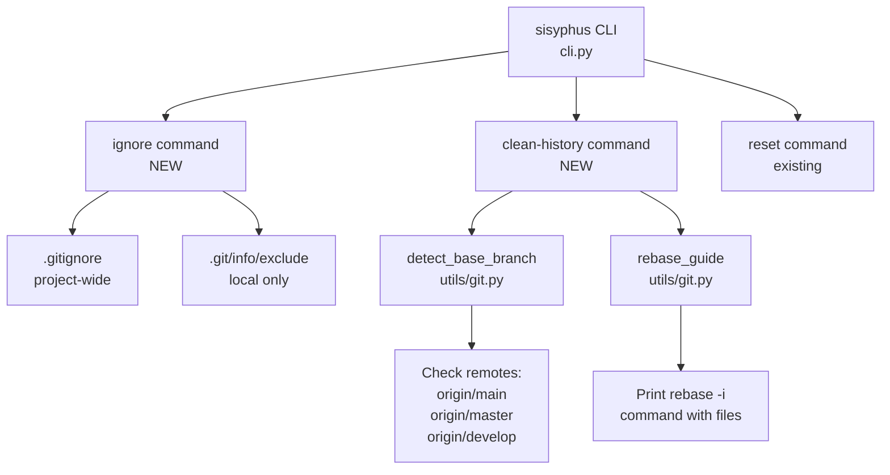

# User's Initial Request (For Record)

기존 프로젝트 위에서 작업할 경우 활용 할 수 있는 command 가 필요함

아래의 목적을 달성하기 위한 command 들이 필요함

1. 지금 sisyphus 가 생성하는 파일들 (ai-todolist.md / sessions / logs / ···.) 등록하게 해주는 typer 커맨드
	- 옵션을 받아서 아래 중 하나를 고르거나 둘 다를 선택할 수 있어야 함
		- `.git/info/exclude`
		- '.gitignore'
	- 이렇게 등록하고 사용자한테 그 내용을 출력해야 함
2. origin/main 혹은 origin/master 같은 베이스 브랜치 기준으로 히스토리에서 저 sisyphus 가 생성하는 파일들을 git 히스토리에서 삭제하는 typer 커맨드
	- 베이스 브랜치를 받거나, "적절히" 감지할 수 있어야 함

# Detail Level
detail_level = detailed

# Work Objectives

1. `.gitignore` 또는 `.git/info/exclude`에 Sisyphus 생성 파일들을 추가하는 `sisyphus ignore` 커맨드 구현
2. 현재 브랜치의 git 히스토리에서 Sisyphus 생성 파일들을 제거하는 `sisyphus clean-history` 커맨드 구현
3. 두 커맨드 모두 사용자 친화적인 UX 제공 (확인 프롬프트, 명확한 출력 등)
4. 기존 Sisyphus 코드 스타일과 패턴 준수

# Work Background

Sisyphus는 작업 중 다양한 파일들을 생성합니다 (`ai-todolist.md`, `sessions/`, `logs/` 등). 기존 프로젝트에서 Sisyphus를 사용할 때 이러한 파일들이 의도치 않게 커밋되거나, 이미 커밋된 경우 히스토리에서 제거해야 하는 상황이 발생합니다.

**현재 상태:**
- ✅ `sisyphus reset` 커맨드로 생성된 파일 삭제 가능
- ✅ 프로젝트 `.gitignore`에 일부 파일 등록되어 있음
- ❌ Sisyphus 파일을 `.gitignore`/`.git/info/exclude`에 자동 등록하는 기능 없음
- ❌ 이미 커밋된 Sisyphus 파일을 히스토리에서 제거하는 기능 없음

**필요성:**
1. **ignore 커맨드**: 프로젝트 설정 시 한 번의 명령으로 모든 Sisyphus 파일 무시 설정
2. **clean-history 커맨드**: 실수로 커밋된 Sisyphus 파일을 안전하게 히스토리에서 제거

# Execution Started
is_execution_started = FALSE

# All Goals Accomplished
is_all_goals_accomplished = FALSE

# Parallel Execution Requested
parallel_requested = FALSE

# Current Work In Progress
- Work has not started yet.
   - When work begins, change `is_execution_started` above to TRUE.
   - DO NOT start work until the user explicitly says "start the work" or equivalent.
   - **Even if plan reviewer gives OKAY, DO NOT start work**
   - DO NOT start work until the user explicitly says "start the work" or equivalent.

# Required Background Knowledge

## Typer CLI Framework
- **Command Definition**: `@app.command(name="command-name")` 데코레이터 사용
- **Options**: `typer.Option(default, "--flag", help="...")` 형식
- **User Interaction**: `typer.confirm("message")` for yes/no prompts
- **Output**: `Console().print()` from rich library
- **Error Handling**: `typer.BadParameter`, `typer.Exit(code)`

## Git Ignore 메커니즘
- **`.gitignore`**: 프로젝트 전체에 적용, 버전 관리됨, 팀 전체 공유
- **`.git/info/exclude`**: 로컬에만 적용, 버전 관리 안됨, 개인 설정용
- **패턴 문법**: 파일명(`file.txt`), 디렉토리(`dir/`), 와일드카드(`*.log`)

## Git History 수정 방법
- **git filter-branch**: 모든 환경에서 사용 가능하지만 deprecated
- **git-filter-repo**: 권장되지만 별도 설치 필요
- **git rebase -i**: 수동이지만 안전하고 직관적
- **선택**: 현재 브랜치에서 베이스 브랜치 이후 커밋만 수정 → `git rebase -i` 가이드 제공 방식 채택

## Sisyphus 생성 파일 목록
프로젝트 코드 분석 결과 (`cli.py`, `.gitignore`):
- `ai-todolist.md` - 작업 계획서
- `notepad.md` - 작업 노트
- `sessions/` - 세션 저장 디렉토리
- `logs/` - 로그 파일 디렉토리
- `agentloop.json` - 에이전트 루프 상태
- `claude_session_*.log` - Claude 세션 로그 파일

## File Structure and Roles

### Files to Reference
1. **sisyphus/cli.py**
   - **Role**: Typer 기반 CLI 진입점
   - **What to reference**:
     - 기존 커맨드 구조 (`work`, `reset`)
     - Typer Option 사용 패턴
     - Rich Console 출력 패턴
   - **Expected code structure**:
     ```python
     @app.command(name="command-name")
     def command_function(
         option: Type = typer.Option(default, "--flag", help="..."),
     ) -> None:
         """Docstring."""
         # Implementation
         console.print("[green]Success message[/green]")
     ```

2. **.gitignore**
   - **Role**: 프로젝트 전역 git ignore 설정
   - **What to reference**: 기존 Sisyphus 관련 패턴
   - **Caution**: 중복 추가 방지 필요

### Files to Create/Modify
1. **sisyphus/cli.py** - `ignore`, `clean-history` 커맨드 추가
2. **sisyphus/utils/git.py** (새 파일) - Git 관련 유틸리티 함수들

# Work Plan

## PRDs & Structures



## Implementation Details

### 1. `sisyphus ignore` 커맨드

**UX 설계:**
- 기본값: `.gitignore`에만 추가 (팀 공유 목적)
- `--exclude-only`: `.git/info/exclude`에만 추가 (개인용)
- `--both`: 양쪽 모두에 추가
- 기존 항목 중복 체크
- 추가된 내용을 사용자에게 명확히 출력

**동작 흐름:**
1. 대상 파일(들) 확인 (옵션에 따라)
2. 각 파일 읽기, 기존 패턴 확인
3. 중복되지 않는 패턴만 추가
4. 추가된 패턴 목록 출력

**Sisyphus 파일 패턴:**
```
# Sisyphus generated files
ai-todolist.md
notepad.md
sessions/
logs/
agentloop.json
claude_session_*.log
```

### 2. `sisyphus clean-history` 커맨드

**UX 설계:**
- 자동 베이스 브랜치 감지 (origin/main → origin/master → origin/develop)
- `--base-branch` 옵션으로 수동 지정 가능
- 위험한 작업이므로 **반드시 확인 프롬프트** 표시
- `git rebase -i` 가이드 출력 (자동 실행은 위험)

**동작 흐름:**
1. 베이스 브랜치 감지/확인
2. 현재 브랜치가 베이스 브랜치가 아닌지 확인
3. Sisyphus 파일이 포함된 커밋 찾기
4. 사용자에게 위험 경고 + 확인 프롬프트
5. `git rebase -i <base-branch>` 가이드 출력
   - 어떤 커밋에서 어떤 파일을 제거해야 하는지 명시
   - rebase 시 각 커밋에서 파일 제거 명령어 제공

**안전 장치:**
- main/master 브랜치에서 실행 방지
- 푸시된 커밋 경고
- dry-run 모드 제공 (실제 수정 없이 가이드만)

### 3. Git 유틸리티 함수들 (sisyphus/utils/git.py)

**함수 목록:**
- `detect_base_branch() -> str | None`: origin/main, origin/master, origin/develop 순 탐색
- `is_on_main_branch() -> bool`: 현재 브랜치가 main/master인지 확인
- `find_commits_with_files(base_branch: str, files: list[str]) -> list[dict]`: 특정 파일 포함 커밋 찾기
- `generate_rebase_guide(commits: list[dict]) -> str`: rebase 가이드 문자열 생성

## Project Commit Message Style

최근 커밋 분석 결과:
- `feat:` - 새 기능 추가
- `fix:` - 버그 수정
- `docs:` - 문서 변경
- `chore:` - 기타 작업

이 작업의 커밋 메시지:
- `feat: add ignore command for Sisyphus-generated files`
- `feat: add clean-history command to remove files from git history`
- `test: add tests for git utility functions`
- `docs: update README with new commands usage`

# TODOs

- [ ] 1. Create git utility module
   - [ ] 1.1 Create `sisyphus/utils/git.py`
      - Current: File doesn't exist
      - Change: New file with git helper functions
      - **IMPORTANT**: Start with complete import section at the top:
      ```python
      """Git utility functions for Sisyphus."""

      from __future__ import annotations

      import subprocess
      from pathlib import Path
      from fnmatch import fnmatch

      # Note: All functions below use these imports
      # - subprocess: for running git commands
      # - Path: for file path operations (though not heavily used)
      # - fnmatch: for glob pattern matching in _matches_pattern()
      ```
      - Then add function signatures (implementations in following tasks):
      ```python
      def run_git_command(args: list[str], cwd: Path | None = None) -> tuple[int, str, str]:
          """Run git command and return (returncode, stdout, stderr)."""
          # Implementation

      def detect_base_branch() -> str | None:
          """Detect base branch (origin/main > origin/master > origin/develop)."""
          # Implementation

      def is_on_main_branch() -> bool:
          """Check if current branch is main/master."""
          # Implementation

      def find_commits_with_files(base_branch: str, file_patterns: list[str]) -> list[dict]:
          """Find commits containing specified files since base branch."""
          # Implementation

      def generate_rebase_guide(commits: list[dict], files: list[str]) -> str:
          """Generate interactive rebase guide for removing files."""
          # Implementation
      ```
   - [ ] 1.2 Implement `run_git_command` helper
      ```python
      def run_git_command(args: list[str], cwd: Path | None = None) -> tuple[int, str, str]:
          """Run git command and return (returncode, stdout, stderr)."""
          try:
              result = subprocess.run(
                  ["git"] + args,
                  cwd=cwd,
                  capture_output=True,
                  text=True,
                  check=False,  # Don't raise on non-zero exit
              )
              return (result.returncode, result.stdout.strip(), result.stderr.strip())
          except FileNotFoundError:
              return (127, "", "git command not found")
      ```
   - [ ] 1.3 Implement `detect_base_branch`
      ```python
      def detect_base_branch() -> str | None:
          """Detect base branch (origin/main > origin/master > origin/develop)."""
          candidates = ["origin/main", "origin/master", "origin/develop"]
          for branch in candidates:
              # Use git show-ref to check if remote branch exists
              returncode, stdout, _ = run_git_command(
                  ["show-ref", "--verify", f"refs/remotes/{branch}"]
              )
              if returncode == 0:
                  return branch
          return None
      ```
   - [ ] 1.4 Implement `is_on_main_branch`
      - Run `git branch --show-current`
      - Check if result is "main" or "master"
   - [ ] 1.5 Implement helper function `_matches_pattern` (module-level private function)
      - Place this function at module level in git.py, before `find_commits_with_files`
      - **IMPROVED**: Add glob pattern support using `fnmatch`
      ```python
      def _matches_pattern(file: str, patterns: list[str]) -> bool:
          """Check if file matches any pattern (exact, directory prefix, or glob).

          Args:
              file: File path to check
              patterns: List of patterns (files, directories ending with /, or glob patterns)

          Returns:
              True if file matches any pattern

          Examples:
              _matches_pattern("ai-todolist.md", ["ai-todolist.md"]) → True
              _matches_pattern("sessions/test.json", ["sessions/"]) → True
              _matches_pattern("claude_session_abc.log", ["claude_session_*.log"]) → True
              _matches_pattern("other.txt", ["ai-todolist.md"]) → False
          """
          for pattern in patterns:
              if pattern.endswith('/'):
                  # Directory pattern: check if file is inside
                  dir_name = pattern.rstrip('/')
                  if file.startswith(dir_name + '/') or file == dir_name:
                      return True
              elif '*' in pattern or '?' in pattern or '[' in pattern:
                  # Glob pattern: use fnmatch
                  if fnmatch(file, pattern):
                      return True
              else:
                  # File pattern: exact match
                  if file == pattern:
                      return True
          return False
      ```
   - [ ] 1.6 Implement `find_commits_with_files`
      - Place after `_matches_pattern` function
      - **IMPROVED**: Use `--no-merges` to skip merge commits and `-z` for null-terminated output (handles filenames with spaces)
      ```python
      def find_commits_with_files(base_branch: str, file_patterns: list[str]) -> list[dict]:
          """Find commits containing specified files since base branch.

          Returns list of {"hash": str, "message": str, "files": list[str]}
          """
          # Use -z for null-terminated output (handles spaces in filenames)
          # Use --no-merges to skip merge commits
          # Use %x1f (unit separator) as delimiter between hash and message
          # This is more robust than relying on hash length detection
          returncode, stdout, _ = run_git_command(
              ["log", "--pretty=format:%H%x1f%s%x1f", "--name-only", "-z", "--no-merges", f"{base_branch}..HEAD"]
          )
          if returncode != 0:
              return []

          commits = []
          # Split by null character first
          entries = stdout.split('\0')
          i = 0

          while i < len(entries):
              if not entries[i].strip():
                  i += 1
                  continue

              # Each commit starts with "HASH\x1fMESSAGE\x1f" format
              commit_line = entries[i].strip()

              # Split by unit separator to get hash and message
              parts = commit_line.split('\x1f')
              if len(parts) < 2:
                  # Malformed entry, skip
                  i += 1
                  continue

              commit_hash = parts[0]
              message = parts[1]
              i += 1

              # Following entries are file paths until next commit or end
              files = []
              while i < len(entries):
                  entry = entries[i].strip()
                  if not entry:
                      # Empty entry marks end of file list
                      i += 1
                      break
                  # Check if this is the start of next commit (contains \x1f)
                  if '\x1f' in entry:
                      # Next commit, don't consume
                      break
                  files.append(entry)
                  i += 1

              # Check if any file matches patterns using helper
              matching_files = []
              for f in files:
                  if _matches_pattern(f, file_patterns):
                      matching_files.append(f)

              if matching_files:
                  commits.append({
                      "hash": commit_hash,
                      "message": message,
                      "files": matching_files
                  })

          return commits
      ```
   - [ ] 1.7 Implement `generate_rebase_guide`
      ```python
      def generate_rebase_guide(commits: list[dict], base_branch: str) -> str:
          """Generate interactive rebase guide for removing files.

          Args:
              commits: List of {"hash": str, "message": str, "files": list[str]}
              base_branch: Base branch name (e.g., "origin/main")

          Returns:
              Formatted guide string with Rich markup
          """
          lines = []
          lines.append("[bold yellow]⚠ Git History Cleanup Guide[/bold yellow]\n")
          lines.append(f"Found [bold]{len(commits)} commit(s)[/bold] containing Sisyphus files since [cyan]{base_branch}[/cyan]:\n")

          # List affected commits
          for i, commit in enumerate(commits, 1):
              hash_short = commit["hash"][:7]
              lines.append(f"[bold]{i}. {hash_short}[/bold] - {commit['message']}")
              lines.append(f"   Files: {', '.join(commit['files'])}\n")

          # Step-by-step instructions
          lines.append("[bold green]Step-by-step cleanup instructions:[/bold green]\n")
          lines.append("1. Start interactive rebase:")
          lines.append(f"   [dim]$[/dim] git rebase -i {base_branch}\n")

          lines.append("2. In the editor, change [bold]pick[/bold] to [bold]edit[/bold] for these commits:")
          for commit in commits:
              hash_short = commit["hash"][:7]
              lines.append(f"   • {hash_short} ({commit['message']})")
          lines.append("")

          lines.append("3. For each commit marked 'edit', run:")
          for commit in commits:
              hash_short = commit["hash"][:7]
              files_str = " ".join(f'"{f}"' if ' ' in f else f for f in commit["files"])
              lines.append(f"   [dim]$[/dim] git rm {files_str}  # For {hash_short}")
              lines.append("   [dim]$[/dim] git commit --amend --no-edit")
              lines.append("   [dim]$[/dim] git rebase --continue\n")

          lines.append("4. Verify cleanup:")
          lines.append(f"   [dim]$[/dim] git log --name-only {base_branch}..HEAD\n")

          lines.append("[yellow]Note:[/yellow] If you've already pushed these commits, you'll need to force push:")
          lines.append("   [dim]$[/dim] git push --force-with-lease")

          return "\n".join(lines)
      ```
   - [ ] 1.8 Write tests for git utilities
      - Create `sisyphus/utils/tests/test_git.py`
      - Test each function with mocked git commands using `unittest.mock.patch`
      - Use `#given`, `#when`, `#then` pattern
      - Example test structure:
      ```python
      from unittest.mock import patch, MagicMock
      import pytest

      pytestmark = [pytest.mark.anyio]

      @patch("sisyphus.utils.git.subprocess.run")
      def test_detect_base_branch__if_origin_main_exists__returns_origin_main(
          mock_run: MagicMock,
      ) -> None:
          #given
          mock_run.return_value = MagicMock(
              returncode=0,
              stdout="refs/remotes/origin/main",
              stderr="",
          )

          #when
          from sisyphus.utils.git import detect_base_branch
          result = detect_base_branch()

          #then
          assert result == "origin/main"
          mock_run.assert_called_once()

      @patch("sisyphus.utils.git.subprocess.run")
      def test_find_commits_with_files__if_commits_found__returns_list(
          mock_run: MagicMock,
      ) -> None:
          #given
          # Mock git log output with null-terminated format
          mock_run.return_value = MagicMock(
              returncode=0,
              stdout="abc123\x00Add feature\x00ai-todolist.md\x00sessions/test.json\x00\x00def456\x00Another commit\x00logs/test.log\x00",
              stderr="",
          )

          #when
          from sisyphus.utils.git import find_commits_with_files
          result = find_commits_with_files("origin/main", ["ai-todolist.md", "sessions/", "logs/"])

          #then
          assert len(result) == 2
          assert result[0]["hash"] == "abc123"
          assert "ai-todolist.md" in result[0]["files"]

      @patch("sisyphus.utils.git.subprocess.run")
      def test_matches_pattern__with_glob__matches_correctly(
          mock_run: MagicMock,
      ) -> None:
          #given
          from sisyphus.utils.git import _matches_pattern

          #when
          result1 = _matches_pattern("claude_session_abc123.log", ["claude_session_*.log"])
          result2 = _matches_pattern("other.log", ["claude_session_*.log"])

          #then
          assert result1 is True
          assert result2 is False
      ```
   - [ ] 1.9 Run tests
      ```bash
      pytest -xvs sisyphus/utils/tests/test_git.py
      ```
   - [ ] 1.10 Lint and type check
      ```bash
      ruff check sisyphus/utils/git.py sisyphus/utils/tests/test_git.py
      basedpyright sisyphus/utils/git.py sisyphus/utils/tests/test_git.py
      ```
   - [ ] 1.11 Add import to cli.py (preparation for Task 2 & 3)
      - Open `sisyphus/cli.py`
      - Locate the imports section at the top of the file (around lines 1-30)
      - Find the line containing: `from sisyphus.utils.theme import ThemeName, detect_system_theme`
      - Add immediately after that line:
      ```python
      from sisyphus.utils.git import detect_base_branch, is_on_main_branch, find_commits_with_files, generate_rebase_guide
      ```
      - **Verification**: The import section should now have:
      ```python
      from sisyphus.utils.logging import LoggerFactory
      from sisyphus.utils.theme import ThemeName, detect_system_theme
      from sisyphus.utils.git import detect_base_branch, is_on_main_branch, find_commits_with_files, generate_rebase_guide
      ```
      - Note: Line numbers may vary, use the actual line content as anchor
      - This allows cli.py to use git utilities in subsequent tasks
   - [ ] 1.12 Commit git utilities with cli.py import
      ```bash
      git add sisyphus/utils/git.py sisyphus/utils/tests/test_git.py sisyphus/cli.py
      git commit -m "feat: add git utility functions for branch detection and history analysis (#23)"
      ```
   - [ ] Orchestrator Task 1 Verification
      - [ ] `sisyphus/utils/git.py` 파일이 생성되었는가?
      - [ ] 모든 함수가 proper type hints와 docstring을 가지고 있는가?
      - [ ] `detect_base_branch()` 함수가 origin/main, origin/master, origin/develop 순으로 확인하는가?
      - [ ] `find_commits_with_files()` 함수가 베이스 브랜치 이후 커밋만 검사하는가?
      - [ ] `_matches_pattern()` 함수가 glob 패턴을 지원하는가?
      - [ ] Tests가 작성되고 통과하는가?
      - [ ] Type check와 lint가 통과하는가?
      - [ ] Commit이 생성되었는가?

- [ ] 2. Implement `sisyphus ignore` command
   - [ ] 2.1 Define Sisyphus file patterns constant
      - Open `sisyphus/cli.py`
      - Locate the line: `error_console = Console(stderr=True)` (around line 35)
      - Add immediately after that line:
      ```python
      # Sisyphus generated files patterns for .gitignore / .git/info/exclude
      SISYPHUS_IGNORE_PATTERNS = [
          "# Sisyphus generated files",
          "ai-todolist.md",
          "notepad.md",
          "sessions/",
          "logs/",
          "agentloop.json",
          "claude_session_*.log",
      ]
      ```
      - **Note**: Path import already exists, no need to add it
      - **Context**: Current .gitignore already has some of these (logs/, claude_session_*.log, agentloop.json)
      - This command will detect duplicates and skip them
   - [ ] 2.2 Implement ignore command in `cli.py`
      - Open `sisyphus/cli.py`
      - Locate the `reset` command: search for `@app.command(name="reset")`
      - Find the end of the reset function
      - Locate the line: `if __name__ == "__main__":`
      - Add immediately after the reset function and before the `if __name__` line:
      ```python
      @app.command(name="ignore")
      def ignore(
          exclude_only: bool = typer.Option(
              False, "--exclude-only", help="Add only to .git/info/exclude (local)"
          ),
          both: bool = typer.Option(
              False, "--both", help="Add to both .gitignore and .git/info/exclude"
          ),
      ) -> None:
          """Add Sisyphus-generated files to git ignore configuration."""
          # Implementation
      ```
   - [ ] 2.3 Implement target file selection logic
      - Default: only `.gitignore`
      - `--exclude-only`: only `.git/info/exclude`
      - `--both`: both files
      - Validate conflicts (can't use both flags)
   - [ ] 2.4 Implement pattern addition logic
      - Add these helper functions to `sisyphus/cli.py` as private functions (prefix with `_`)
      - Place immediately before the `ignore` command definition
      ```python
      def _is_duplicate_pattern(existing_content: str, pattern: str) -> bool:
          """Check if pattern already exists (exact match only).

          Args:
              existing_content: Full file content
              pattern: Pattern to check

          Returns:
              True if pattern exists, False otherwise
          """
          # Check exact line match (with or without trailing newline)
          lines = existing_content.splitlines()
          return pattern in lines or pattern.strip() in lines

      def _add_patterns_to_file(file_path: Path, patterns: list[str]) -> list[str]:
          """Add patterns to file, return list of added patterns."""
          # Read existing content
          if file_path.exists():
              existing_content = file_path.read_text()
          else:
              existing_content = ""

          # Filter out duplicates
          new_patterns = [p for p in patterns if not _is_duplicate_pattern(existing_content, p)]

          if not new_patterns:
              return []

          # Append new patterns (with newline before if file doesn't end with one)
          content_to_add = ""
          if existing_content and not existing_content.endswith("\n"):
              content_to_add = "\n"
          content_to_add += "\n".join(new_patterns) + "\n"

          file_path.write_text(existing_content + content_to_add)
          return new_patterns
      ```
   - [ ] 2.5 Implement output formatting
      - Show which file(s) were updated
      - List added patterns with color coding
      - Show message if all patterns already exist
      - Example output format:
      ```
      [green]✓[/green] Added to .gitignore:
        • ai-todolist.md
        • notepad.md
        • sessions/
        • logs/
        • agentloop.json
        • claude_session_*.log

      [bold green]Successfully configured git to ignore Sisyphus files![/bold green]
      ```
      - If all exist:
      ```
      [yellow]ℹ[/yellow] All Sisyphus patterns already present in .gitignore
      [dim]No changes made[/dim]
      ```
   - [ ] 2.6 Handle edge cases
      - Create `.git/info/exclude` if doesn't exist
      - Handle file permission errors
      - Validate `.git` directory exists
   - [ ] 2.7 Write tests for ignore command
      - Create `sisyphus/tests/test_cli_ignore.py`
      - Use `typer.testing.CliRunner` for testing CLI commands
      - Use temporary directories with `tmp_path` pytest fixture
      - **IMPROVED**: Use `monkeypatch.chdir()` for test isolation instead of `os.chdir()`
        - **Why this works**: CliRunner executes the command in the current process
        - `monkeypatch.chdir()` changes the working directory for the test
        - The command then runs in that changed directory
        - pytest automatically restores the original directory after the test
      - Test scenarios:
        - Default behavior (.gitignore only)
        - --exclude-only flag
        - --both flag
        - Duplicate prevention
      - Example test structure:
      ```python
      from typer.testing import CliRunner
      from pathlib import Path
      import pytest

      pytestmark = [pytest.mark.anyio]

      def test_ignore__default__adds_to_gitignore(tmp_path: Path, monkeypatch: pytest.MonkeyPatch) -> None:
          #given
          # Create a temporary git repository structure
          git_dir = tmp_path / ".git"
          git_dir.mkdir()
          (git_dir / "info").mkdir()

          runner = CliRunner()
          # Use monkeypatch for directory change (better test isolation)
          monkeypatch.chdir(tmp_path)

          #when
          from sisyphus.cli import app
          result = runner.invoke(app, ["ignore"])

          #then
          assert result.exit_code == 0
          gitignore_path = tmp_path / ".gitignore"
          assert gitignore_path.exists()
          gitignore_content = gitignore_path.read_text()
          assert "ai-todolist.md" in gitignore_content
          assert "sessions/" in gitignore_content
          assert "# Sisyphus generated files" in gitignore_content
      ```
      - Use `#given`, `#when`, `#then` pattern
   - [ ] 2.8 Run tests
      ```bash
      pytest -xvs sisyphus/tests/test_cli_ignore.py
      ```
      - **Expected**: At least 4 tests pass
        - test for default behavior (.gitignore only)
        - test for --exclude-only flag
        - test for --both flag
        - test for duplicate prevention
   - [ ] 2.9 Lint and type check
      ```bash
      ruff check sisyphus/cli.py sisyphus/tests/test_cli_ignore.py
      basedpyright sisyphus/cli.py sisyphus/tests/test_cli_ignore.py
      ```
   - [ ] 2.10 Commit ignore command
      ```bash
      git add sisyphus/cli.py sisyphus/tests/test_cli_ignore.py
      git commit -m "feat: add ignore command for Sisyphus-generated files (#23)"
      ```
   - [ ] Orchestrator Task 2 Verification
      - [ ] `sisyphus ignore` 커맨드가 `cli.py`에 추가되었는가?
      - [ ] `SISYPHUS_IGNORE_PATTERNS` 상수가 정의되었는가?
      - [ ] 기본 동작(`.gitignore`만)이 올바르게 작동하는가?
      - [ ] `--exclude-only` 옵션이 `.git/info/exclude`에만 추가하는가?
      - [ ] `--both` 옵션이 양쪽 모두에 추가하는가?
      - [ ] 중복 패턴이 올바르게 감지되고 건너뛰는가?
      - [ ] Rich로 포맷팅된 출력이 명확한가?
      - [ ] Tests가 모든 시나리오를 커버하는가?
      - [ ] Tests에서 `monkeypatch.chdir()`를 사용하는가?
      - [ ] Type check와 lint가 통과하는가?
      - [ ] Commit이 생성되었는가?

- [ ] 3. Implement `sisyphus clean-history` command
   - [ ] 3.1 Implement clean-history command skeleton
      - Locate the `ignore` command definition in cli.py
      - Add immediately after the entire `ignore` function:
      ```python
      @app.command(name="clean-history")
      def clean_history(
          base_branch: str | None = typer.Option(
              None, "--base-branch", help="Base branch (auto-detect if not specified)"
          ),
          dry_run: bool = typer.Option(
              False, "--dry-run", help="Show what would be done without making changes"
          ),
      ) -> None:
          """Remove Sisyphus-generated files from git history (current branch only)."""
          # Implementation
      ```
   - [ ] 3.2 Implement base branch detection/validation
      - Use `detect_base_branch()` if not specified
      - Validate specified branch exists
      - Error if no base branch found
   - [ ] 3.3 Implement safety checks
      - Check current branch is not main/master (use `is_on_main_branch()`)
      - **DO NOT implement remote push check** - adds complexity without significant value
        - Users will see warning in rebase guide about force-push if needed
        - Simpler implementation, fewer edge cases to handle
      - Show clear warning message about destructive operation
   - [ ] 3.4 Implement commit analysis
      - Use `find_commits_with_files()` to find affected commits
      - If no commits found, show success message and exit
      - Display found commits with file lists
   - [ ] 3.5 Implement user confirmation
      - Show affected commits count
      - Show file patterns that will be removed
      - Use `typer.confirm()` for yes/no prompt
      - Exit if user declines
   - [ ] 3.6 Implement rebase guide generation
      - Use `generate_rebase_guide()` from git utilities to create instructions
      - Output the guide using Rich console:
      ```python
      from sisyphus.utils.git import generate_rebase_guide

      guide = generate_rebase_guide(commits, base_branch)
      console.print(guide)  # Rich markup is already included in the guide string
      ```
      - Example guide format (what will be displayed):
      ```
      [bold yellow]⚠ Git History Cleanup Guide[/bold yellow]

      Found [bold]2 commits[/bold] containing Sisyphus files since [cyan]origin/main[/cyan]:

      [bold]1. abc123[/bold] - Add feature
         Files: ai-todolist.md, sessions/test.json

      [bold]2. def456[/bold] - Another commit
         Files: logs/test.log

      [bold green]Step-by-step cleanup instructions:[/bold green]

      1. Start interactive rebase:
         [dim]$[/dim] git rebase -i origin/main

      2. In the editor, change [bold]pick[/bold] to [bold]edit[/bold] for these commits:
         • abc123 (Add feature)
         • def456 (Another commit)

      3. For each commit marked 'edit', run:
         [dim]$[/dim] git rm ai-todolist.md sessions/test.json  # For abc123
         [dim]$[/dim] git commit --amend --no-edit
         [dim]$[/dim] git rebase --continue

         [dim]$[/dim] git rm logs/test.log  # For def456
         [dim]$[/dim] git commit --amend --no-edit
         [dim]$[/dim] git rebase --continue

      4. Verify cleanup:
         [dim]$[/dim] git log --name-only origin/main..HEAD

      [yellow]Note:[/yellow] If you've already pushed these commits, you'll need to force push:
      [dim]$[/dim] git push --force-with-lease
      ```
   - [ ] 3.7 Implement dry-run mode
      - Skip confirmation prompt
      - Show all analysis and guide
      - Display "DRY RUN - no changes made" message
   - [ ] 3.8 Write tests for clean-history command
      - Create `sisyphus/tests/test_cli_clean_history.py`
      - Test base branch auto-detection
      - Test safety checks (main branch prevention)
      - Test dry-run mode
      - Test user confirmation flow
      - Mock git commands
      - **IMPROVED**: Use `monkeypatch.chdir()` for test isolation
      - Use `#given`, `#when`, `#then` pattern
   - [ ] 3.9 Run tests
      ```bash
      pytest -xvs sisyphus/tests/test_cli_clean_history.py
      ```
      - **Expected**: At least 4 tests pass
        - test for base branch auto-detection
        - test for --base-branch manual specification
        - test for main branch safety check (should error)
        - test for --dry-run mode
   - [ ] 3.10 Lint and type check
      ```bash
      ruff check sisyphus/cli.py sisyphus/tests/test_cli_clean_history.py
      basedpyright sisyphus/cli.py sisyphus/tests/test_cli_clean_history.py
      ```
   - [ ] 3.11 Commit clean-history command
      ```bash
      git add sisyphus/cli.py sisyphus/tests/test_cli_clean_history.py
      git commit -m "feat: add clean-history command to remove files from git history (#23)"
      ```
   - [ ] Orchestrator Task 3 Verification
      - [ ] `sisyphus clean-history` 커맨드가 `cli.py`에 추가되었는가?
      - [ ] 베이스 브랜치 자동 감지가 작동하는가?
      - [ ] `--base-branch` 옵션으로 수동 지정이 가능한가?
      - [ ] main/master 브랜치에서 실행 시 에러가 발생하는가?
      - [ ] 사용자 확인 프롬프트가 표시되는가?
      - [ ] `--dry-run` 모드가 변경 없이 가이드만 출력하는가?
      - [ ] 생성된 rebase 가이드가 명확하고 실행 가능한가?
      - [ ] Sisyphus 파일이 없는 경우 적절한 메시지가 표시되는가?
      - [ ] Tests가 모든 시나리오와 에러 케이스를 커버하는가?
      - [ ] Tests에서 `monkeypatch.chdir()`를 사용하는가?
      - [ ] Type check와 lint가 통과하는가?
      - [ ] Commit이 생성되었는가?

- [ ] 4. Integration testing and documentation
   - [ ] 4.1 Manual integration test - ignore command
      - Create test repository with sisyphus files
      ```bash
      mkdir /tmp/sisyphus-test && cd /tmp/sisyphus-test
      git init
      mkdir sessions logs
      touch ai-todolist.md sessions/test.json logs/test.log
      ```
      - Run `sisyphus ignore` (default)
      - **Expected**: Command exits with code 0, shows success message
      - **If fails**: Check error message, verify .git directory exists, check file permissions
      - Verify `.gitignore` updated correctly:
      ```bash
      cat .gitignore
      # Expected output should contain all these patterns
      ```
      - **Precise verification**:
      ```bash
      git check-ignore -v ai-todolist.md
      # Expected: .gitignore:N:ai-todolist.md    ai-todolist.md

      git check-ignore -v sessions/test.json
      # Expected: .gitignore:N:sessions/        sessions/test.json

      git status --short
      # Expected: Only .gitignore appears (as M or ??), NOT ai-todolist.md or sessions/
      ```
      - **If patterns missing**: Review command output for errors, check file write permissions
      - **If files still appear**: Check .gitignore syntax with `git check-ignore -v <file>`
      - Run `sisyphus ignore --exclude-only` in new test dir
      - Verify with:
      ```bash
      git check-ignore --no-index -v ai-todolist.md
      # Should show .git/info/exclude as source
      ```
      - **If fails**: Verify .git/info directory exists and is writable
   - [ ] 4.2 Manual integration test - clean-history command
      - Set up test repository with commits
      ```bash
      cd /tmp/sisyphus-test2 && mkdir -p /tmp/sisyphus-test2
      git init
      git checkout -b main  # Create main branch
      echo "initial" > README.md
      git add README.md && git commit -m "initial commit"

      # Create branch with sisyphus files
      git checkout -b feature-branch
      touch ai-todolist.md
      git add ai-todolist.md && git commit -m "add todolist"
      mkdir sessions && touch sessions/test.json
      git add sessions/ && git commit -m "add sessions"
      ```
      - Run `sisyphus clean-history --dry-run`
      - Expected: Shows 2 commits (add todolist, add sessions)
      - Expected: Guide shows step-by-step rebase instructions
      - Verify guide contains:
        - `git rebase -i main` command
        - List of commits to edit (with hashes)
        - Exact `git rm` commands for each commit
        - `git commit --amend --no-edit` and `git rebase --continue` steps
      - Verify no actual changes made (dry-run mode)
   - [ ] 4.3 Update CLI help documentation
      - Verify `sisyphus --help` shows new commands
      - Verify `sisyphus ignore --help` shows clear usage
      - Verify `sisyphus clean-history --help` shows clear usage
   - [ ] 4.4 Create usage examples in README
      - Locate the "Commands" or "Usage" section in README.md
      - Add section "Managing Sisyphus Files in Existing Projects" with subsections:
        - "Adding Files to .gitignore"
        - "Cleaning Git History"
        - "Best Practices"
      - Document `ignore` command with examples
      - Document `clean-history` command with examples
      - Include best practices (when to use each)
   - [ ] 4.5 Update CLAUDE.md if needed
      - Locate the "PROJECT KNOWLEDGE BASE" section
      - Add new commands to relevant subsections
      - Update "DEVELOPMENT COMMANDS" section with new command examples
      - Document new git utilities in "PROJECT STRUCTURE" or "ARCHITECTURE" section
   - [ ] 4.6 Final test suite run
      ```bash
      pytest -xvs
      ```
      - Verify all tests pass
      - Check coverage for new code
   - [ ] 4.7 Final lint and type check
      ```bash
      ruff check
      basedpyright
      ```
      - Fix any remaining issues
   - [ ] 4.8 Commit documentation
      ```bash
      git add README.md CLAUDE.md
      git commit -m "docs: document ignore and clean-history commands (#23)"
      ```
   - [ ] Orchestrator Task 4 Verification
      - [ ] Manual integration tests 실행하고 성공했는가?
      - [ ] `sisyphus --help` 출력이 새 커맨드를 포함하는가?
      - [ ] README.md에 사용 예제가 추가되었는가?
      - [ ] CLAUDE.md가 필요시 업데이트되었는가?
      - [ ] 전체 test suite가 통과하는가?
      - [ ] 전체 codebase에서 lint와 type check가 통과하는가?
      - [ ] Documentation commit이 생성되었는가?

- [ ] 5. Final verification and cleanup
   - [ ] 5.1 Verify all commits
      ```bash
      git log --oneline -5
      ```
      - Expected 4 commits:
        1. feat: add git utility functions for branch detection and history analysis (#23)
        2. feat: add ignore command for Sisyphus-generated files (#23)
        3. feat: add clean-history command to remove files from git history (#23)
        4. docs: document ignore and clean-history commands (#23)
   - [ ] 5.2 Verify implementation completeness
      - [ ] `sisyphus/utils/git.py` exists with all functions
      - [ ] `sisyphus ignore` command works as specified
      - [ ] `sisyphus clean-history` command works as specified
      - [ ] All tests exist and pass
      - [ ] Documentation updated
   - [ ] 5.3 Run final comprehensive test
      ```bash
      # In project root
      sisyphus ignore --both
      git status  # Should ignore sisyphus files
      sisyphus clean-history --dry-run  # Should show guide
      ```
   - [ ] 5.4 Check for any uncommitted changes
      ```bash
      git status
      ```
      - Should be clean
   - [ ] 5.5 Verify no extraneous changes
      - Review `git diff master` (or base branch)
      - Ensure only intended files modified
      - No unrelated fixes or refactoring
   - [ ] 5.6 Update is_all_goals_accomplished = TRUE
   - [ ] Orchestrator Task 5 Verification
      - [ ] 정확히 4개의 커밋이 생성되었는가?
      - [ ] 모든 기능이 요구사항대로 구현되었는가?
      - [ ] Test suite 전체가 통과하는가?
      - [ ] Documentation이 완전한가?
      - [ ] Git status가 clean한가?
      - [ ] 의도하지 않은 파일 수정이 없는가?
      - [ ] is_all_goals_accomplished가 TRUE로 설정되었는가?

# Final Work Verification Checklist

- [ ] 1. Command Implementation
   - [ ] `sisyphus ignore` 커맨드가 존재하고 작동하는가?
   - [ ] `sisyphus clean-history` 커맨드가 존재하고 작동하는가?
   - [ ] 두 커맨드 모두 `sisyphus --help`에 표시되는가?

- [ ] 2. ignore Command Functionality
   - [ ] 기본 동작: `.gitignore`에만 패턴 추가
   - [ ] `--exclude-only`: `.git/info/exclude`에만 추가
   - [ ] `--both`: 양쪽 모두에 추가
   - [ ] 중복 패턴 감지 및 건너뛰기
   - [ ] 추가된 패턴을 사용자에게 명확히 출력
   - [ ] 모든 Sisyphus 파일 패턴 포함 (ai-todolist.md, sessions/, logs/, etc.)

- [ ] 3. clean-history Command Functionality
   - [ ] 베이스 브랜치 자동 감지 (origin/main → origin/master → origin/develop)
   - [ ] `--base-branch` 옵션으로 수동 지정 가능
   - [ ] main/master 브랜치에서 실행 방지
   - [ ] 사용자 확인 프롬프트 표시
   - [ ] `--dry-run` 모드 제공
   - [ ] 명확하고 실행 가능한 rebase 가이드 생성
   - [ ] Sisyphus 파일 포함 커밋 정확히 탐지 (glob 패턴 지원)

- [ ] 4. Git Utilities (sisyphus/utils/git.py)
   - [ ] `detect_base_branch()` 함수 구현 및 작동
   - [ ] `is_on_main_branch()` 함수 구현 및 작동
   - [ ] `find_commits_with_files()` 함수 구현 및 작동
   - [ ] `generate_rebase_guide()` 함수 구현 및 작동
   - [ ] `_matches_pattern()` helper가 glob 패턴 지원 (fnmatch)
   - [ ] 모든 함수에 type hints와 docstring 존재
   - [ ] subprocess를 통한 git 명령 실행 구현
   - [ ] Git 명령에 `--no-merges`와 `-z` 플래그 사용

- [ ] 5. Testing
   - [ ] `sisyphus/utils/tests/test_git.py` 존재하고 통과
   - [ ] `sisyphus/tests/test_cli_ignore.py` 존재하고 통과
   - [ ] `sisyphus/tests/test_cli_clean_history.py` 존재하고 통과
   - [ ] 모든 테스트가 `#given`, `#when`, `#then` 패턴 사용
   - [ ] Tests가 `monkeypatch.chdir()` 사용 (not `os.chdir()`)
   - [ ] Edge cases와 error cases 테스트 커버
   - [ ] 전체 test suite 통과 (`pytest -xvs`)

- [ ] 6. Code Quality
   - [ ] `ruff check` 통과 (no lint errors)
   - [ ] `basedpyright` 통과 (no type errors)
   - [ ] 기존 코드 스타일과 패턴 일치
   - [ ] 불필요한 리팩토링이나 수정 없음
   - [ ] Rich Console 사용하여 명확한 출력 포맷팅

- [ ] 7. Documentation
   - [ ] README.md에 새 커맨드 사용법 추가
   - [ ] `sisyphus ignore --help` 출력이 명확함
   - [ ] `sisyphus clean-history --help` 출력이 명확함
   - [ ] CLAUDE.md 업데이트 (필요시)
   - [ ] 사용 예제와 best practices 포함

- [ ] 8. UX Quality
   - [ ] ignore 커맨드의 출력이 명확하고 유용함
   - [ ] clean-history 커맨드의 위험 경고가 적절함
   - [ ] rebase 가이드가 실제로 따라할 수 있을 정도로 명확함
   - [ ] 에러 메시지가 명확하고 실행 가능한 해결책 제시
   - [ ] 색상 코딩이 적절하게 사용됨 (Rich)

- [ ] 9. Safety and Edge Cases
   - [ ] main/master 브랜치 보호 작동
   - [ ] 파일 권한 에러 적절히 처리
   - [ ] `.git` 디렉토리 부재 시 적절한 에러
   - [ ] 베이스 브랜치 없음 시 적절한 에러
   - [ ] 사용자 취소 시 정상 종료
   - [ ] dry-run 모드가 실제 변경하지 않음

- [ ] 10. Git Commits
   - [ ] Commit 1: git utilities 추가
   - [ ] Commit 2: ignore 커맨드 추가
   - [ ] Commit 3: clean-history 커맨드 추가
   - [ ] Commit 4: documentation 업데이트
   - [ ] 모든 커밋 메시지가 프로젝트 컨벤션 준수
   - [ ] Git status clean (uncommitted changes 없음)
