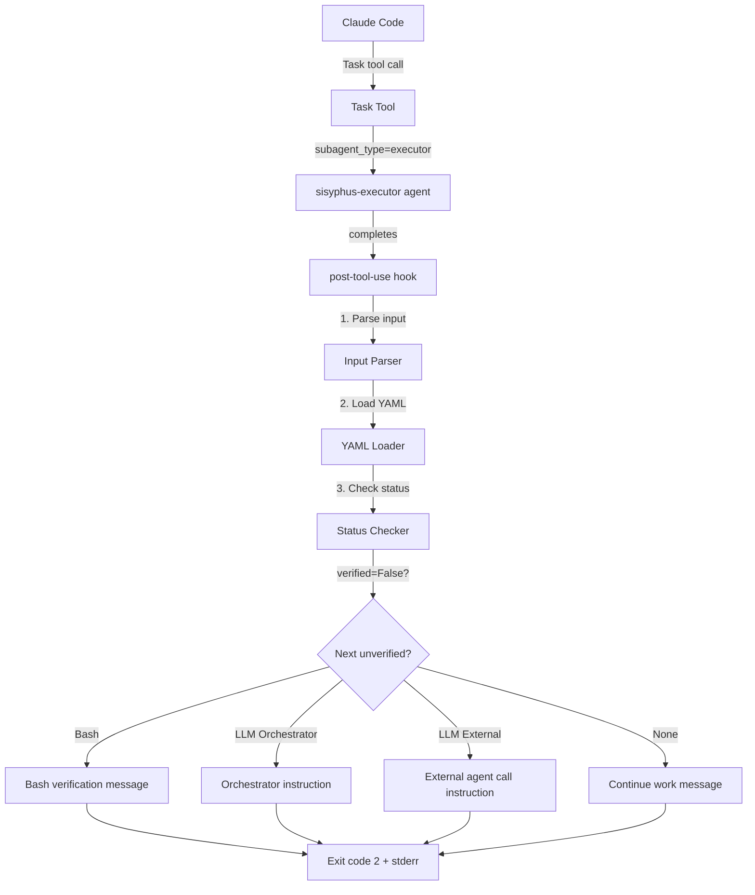
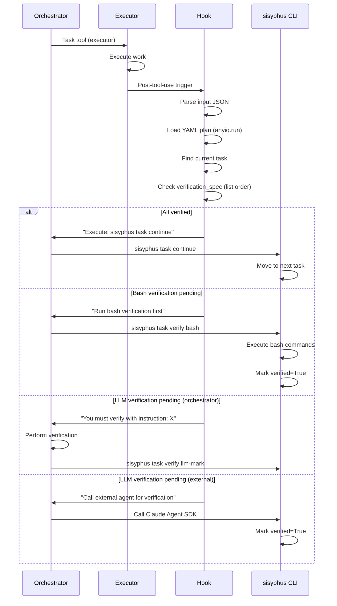

# 사용자의 최초 요청 (기록용)

기존 `orchestrator_reminder.py` 훅을 YAML v3.0 기반 sisyphus plan/task 시스템용으로 재구현. `sisyphus-executor` 에이전트 완료 후 post-tool-use 훅으로 실행되며, 검증 프로세스(bash/llm)를 안내하고 강제하는 시스템 구축.

## 추가 사용자 요청 (기록용)

- plan-reviewer로부터 명시적 OKAY 받을 때까지 무한 반복
- 모든 훅 메시지는 영어로 작성
- projects/sisyphus-cc-hooks에 구현 + 테스트 완비
- TODO/스킵 없음
- 강력한 검증 필수 메시지 포함
- 복면복창 형식으로 응답 유도

# 작업 목표 (WHAT & WHY)

## 핵심 목표 (TL;DR)

기존 markdown 기반 orchestrator_reminder.py를 YAML v3.0 WorkPlan 검증 시스템으로 완전히 재구현하여, sisyphus-executor 완료 후 자동으로 검증 프로세스를 강제하고 안내하는 post-tool-use 훅 시스템 구축

## 상세 목표

- **목표**: sisyphus-executor 에이전트 완료 감지 후 검증 워크플로우 자동 실행
  - **측정 기준**: 모든 검증 항목(bash/llm)이 완료되기 전까지 다음 작업으로 진행 불가능

- **목표**: YAML v3.0 VerificationItem 구조와 완벽히 통합
  - **측정 기준**: verified, verification_evidence 필드 자동 업데이트

- **목표**: 명확한 영어 메시지로 orchestrator 에이전트 가이드
  - **측정 기준**: 복면복창 형식 응답 유도, sisyphus task continue 실행 안내

- **목표**: 포괄적인 테스트 커버리지 확보
  - **측정 기준**: 모든 검증 시나리오(bash 성공/실패, llm orchestrator/external) 테스트 완료

# 작업 배경 (WHY & WHAT - 현재 상태)

## 현재 상황

- 기존 `orchestrator_reminder.py`는 v2.1 markdown 기반 `ai-todolist.md` 시스템용으로 작성됨
- YAML v3.0 도입 후 WorkPlan, VerificationItem, BashVerification, LLMJudgeVerification 등 새로운 구조 사용
- `sisyphus task verify bash/llm/manual` 명령어로 검증 수동 실행 가능
- `sisyphus task continue`로 다음 작업 진행 (검증 완료 확인)
- 현재는 orchestrator 훅이 없어 검증 누락 가능성 존재

## 변경 이유

- Executor 에이전트가 작업 완료를 보고해도 검증 없이 넘어가는 문제 해결
- YAML v3.0 검증 구조를 활용한 자동화된 품질 게이트 구축
- Orchestrator가 검증 책임을 명확히 인식하도록 강제

## 수행할 변경

- **현재**: orchestrator_reminder.py가 v2.1 markdown 체크박스 확인
- **변경 후**: YAML v3.0 VerificationItem 구조 활용, verified 필드 확인
- **현재**: "작업 완료를 기다린다" 개념 없음이 명확하지 않음
- **변경 후**: "Executor 종료 = 작업 완료 보고" 명확히 안내

# 작업 시작됨
is_execution_started = FALSE

# 모든 목표 달성됨
is_all_goals_accomplished = TRUE

# 병렬 실행
parallel_requested = FALSE

# 현재 진행 중인 작업
- Task 5.7: REFACTORING - Code architecture refactoring to enable 80%+ coverage measurement (함수 분리 및 직접 import 테스트)

# 필요한 배경 지식

## 기술 스택

- **언어**: Python 3.12+
- **패키지 관리**: uv (workspace 구조)
- **비동기**: anyio (asyncio/trio 호환)
- **CLI**: Typer 0.15+
- **YAML**: ruamel.yaml 0.18+
- **Pydantic**: 2.0+ (WorkPlan, VerificationItem 모델)

## Dependency 관리 전략

**중요**: 훅 스크립트는 `uv run --script` shebang으로 실행되므로, inline script metadata의 dependencies에 명시된 패키지만 사용 가능

**선택한 전략**: Standalone 접근 - sisyphus 패키지를 dependencies에 추가하여 필요한 모듈 import

**근거**:
- `uv run --script`는 inline metadata의 dependencies를 자동 설치
- sisyphus는 workspace 멤버이므로 `dependencies = ["."]` 또는 상대 경로로 참조 가능
- TaskManager, load_plan 등 기존 로직 재사용 가능

**구현 방식**:
```python
#!/usr/bin/env -S uv run --script
# /// script
# requires-python = ">=3.12"
# dependencies = ["pydantic>=2.0", "anyio>=4.0", "ruamel.yaml>=0.18"]
# ///
```

**주의**: sisyphus CLI 패키지 자체를 import하지 않고, YAML 파싱과 TaskManager 로직을 스크립트 내부에 복제하여 standalone으로 구현

## 파일 구조 및 역할

### 참조 파일

#### 1. `projects/sisyphus-cli/sisyphus/core/plans/models.py`
- **역할**: YAML v3.0 Pydantic 모델 정의
- **검색 키워드**: `class VerificationItem`, `BashVerification`, `LLMJudgeVerification`, `verified`, `verification_evidence`
- **패턴 이해**: verified 필드가 False인 항목 존재 여부로 검증 완료 판단
- **중요 발견**: `orchestrator_manually_verified`와 `manual_verification_evidence`는 VerificationItem의 필수 필드이지만, 별도 "manual 검증 타입"은 존재하지 않음. bash 또는 llm_judge 중 하나 이상 필수.
- **코드 스니펫**:
```python
class VerificationItem(BaseModel):
    id: str
    title: str
    description: str
    verified: bool = False
    verified_at: str | None = None
    verification_evidence: str | None = None
    orchestrator_manually_verified: bool  # 필수 필드
    manual_verification_evidence: str  # 필수 필드
    bash: list[BashVerification] = []
    llm_judge: list[LLMJudgeVerification] = []

    @model_validator(mode="after")
    def validate_at_least_one(self) -> Self:
        if not self.bash and not self.llm_judge:
            raise ValueError("bash 또는 llm_judge 중 하나 이상 필수")
        return self
```

#### 2. `projects/sisyphus-cli/sisyphus/cli/task.py`
- **역할**: task continue, verify bash/llm/manual 명령어 구현
- **검색 키워드**: `def continue_work`, `def verify_bash`, `check_task_completion`, `all_verifications_completed`
- **패턴 이해**: continue_work는 검증 완료 확인 후 다음 작업 진행
- **핵심 로직**:
```python
# task.py:263-278 검증 미완료 시 에러 처리
report = task_manager.check_task_completion(current_task.id)
if not report.can_complete:
    console.print("[red]다음 작업으로 넘어갈 수 없습니다.[/red]")
    if not report.all_verifications_completed:
        ver_completed = report.verification_summary["completed"]
        ver_total = report.verification_summary["total"]
        console.print(f"  - 검증: {ver_completed}/{ver_total} 완료")
    raise typer.Exit(1)
```

#### 3. `projects/sisyphus-cli/sisyphus/core/task_manager.py`
- **역할**: TaskManager.check_task_completion 검증 체크 로직
- **검색 키워드**: `class CompletionReport`, `check_task_completion`, `all_verifications_completed`, `next_unverified`
- **패턴**: verification_spec 순회하여 verified 필드 확인
- **중요**: `next_unverified()` 메서드는 **현재 작업뿐 아니라 전체 todos**에서 미검증 항목을 찾음

#### 4. `sisyphus-setup-dot-claude/hooks/post-tool-use/orchestrator_reminder.py`
- **역할**: 기존 v2.1 markdown 기반 orchestrator 훅
- **검색 키워드**: `find_uncompleted_todos`, `is_execution_started`, `exit 2`
- **참고 사항**: 메시지 구조, exit code 2 사용, stderr 출력 패턴 참고

#### 5. `sisyphus-setup-dot-claude/agents/sisyphus-executor.md`
- **역할**: Executor 에이전트 정의
- **검색 키워드**: `name: sisyphus-executor`, `subagent_type`
- **패턴**: 에이전트 이름으로 Task tool 호출 감지

#### 6. `projects/sisyphus-cli/sisyphus/core/status/manager.py`
- **역할**: StatusManager, status.json 읽기 로직
- **검색 키워드**: `class StatusManager`, `get()`, `CurrentPlan`
- **패턴**: `.sisyphus/status.json`에서 current_plan.plan_path 조회

#### 7. `projects/sisyphus-cli/sisyphus/core/plans/loader.py`
- **역할**: load_plan (async 함수), YAML 파싱
- **검색 키워드**: `async def load_plan`, `PlanDocument`
- **패턴**: YAML 파일 → Pydantic PlanDocument 변환
- **중요**: async 함수이므로 `anyio.run(load_plan, plan_path)` 형태로 호출 필요

# 작업 흐름 (HOW - 작업 흐름 및 의존성)

## 작업 의존성 다이어그램

```
Task 1 (Hook 스크립트 기본 구조)
   ↓
Task 2 (YAML 로드 로직) - depends on Task 1
   ↓
Task 3 (검증 상태 확인 로직) - depends on Task 2
   ↓
Task 4 (메시지 생성 로직) - depends on Task 3
   ↓
Task 5 (단위 테스트) - depends on Task 1-4
   ↓
Task 6 (통합 테스트) - depends on Task 5
```

## 단계별 설명

- **Phase 1 (Task 1)**: 기본 훅 구조 및 Executor 감지 로직 구현
- **Phase 2 (Task 2-3)**: YAML 파싱 및 검증 상태 확인 로직 (순차 의존)
- **Phase 3 (Task 4)**: 메시지 생성 및 출력 로직
- **Phase 4 (Task 5-6)**: 포괄적인 단위/통합 테스트

# 작업 계획

## PRD 및 구조

### 시스템 구조



### 검증 워크플로우



## 구현 세부사항

### 아키텍처 제약

- **스크립트 실행**: `#!/usr/bin/env -S uv run --script` shebang 사용
- **입력 처리**: stdin으로 JSON 수신 (tool_input, session_id, cwd 포함)
- **출력**: stderr 사용, exit code 2 = 블로킹 메시지
- **YAML 파싱**: Pydantic models 정의를 스크립트 내부에 복제하여 standalone으로 구현

### 검증 우선순위 전략

**명확한 정의**: "우선순위"는 verification_spec **리스트 순서대로 순회**를 의미함

**구현 방식**:
1. verification_spec 리스트를 처음부터 순회
2. verified=False인 첫 번째 항목 반환
3. 해당 항목의 bash/llm_judge 필드 확인하여 타입 판단

**예시**:
```python
def find_next_unverified(verifications):
    """verification_spec 리스트 순서대로 순회하며 verified=False인 첫 항목 반환"""
    for v in verifications:
        if not v.verified:
            return v
    return None
```

### 엣지 케이스 처리

- **Executor가 응답 없을 때**: "응답 없음 = 작업 완료" 메시지 출력
- **검증 항목 없을 때**: 바로 continue 안내
- **YAML 파일 없음**: 에러 메시지 후 exit 1
- **current_task_id None**: Exit 0 (스킵)
- **load_plan 실패**: 에러 메시지 출력 후 exit 1
- **find_todo_by_id None**: 에러 메시지 출력 후 exit 1

### 에러 처리 전략

**YAML 파싱 실패**:
```python
try:
    plan_doc = anyio.run(load_plan_standalone, plan_path)
except Exception as e:
    print(f"Error: Failed to load YAML plan: {e}", file=sys.stderr)
    sys.exit(1)
```

**TaskManager 에러**:
```python
current_task = find_todo_by_id_standalone(work_plan.todos, current_task_id)
if current_task is None:
    print(f"Error: Current task not found: {current_task_id}", file=sys.stderr)
    sys.exit(1)
```

**Status.json 없음**:
```python
if not status_path.exists():
    print("Error: No active plan (.sisyphus/status.json not found)", file=sys.stderr)
    sys.exit(1)
```

### 암묵적 가정 명시

- **가정**: Tool use input JSON에 `tool_input.subagent_type` 필드 존재
- **가정**: 현재 YAML plan 경로는 `.sisyphus/status.json`에서 조회 가능
- **가정**: Orchestrator는 stderr 메시지를 읽고 지시사항 따름
- **가정**: `sisyphus task continue`는 검증 완료 확인 후 자동으로 다음 작업 시작
- **가정**: 훅 스크립트는 project root에서 실행됨 (cwd 기준 상대 경로 사용 가능)

## 프로젝트 커밋 메시지 스타일

```
<type>: <subject>

Types: feat, fix, docs, test, refactor
Examples:
- feat: add post-tool-use hook for executor verification
- test: add comprehensive tests for verification hook
- fix: handle missing verification_spec gracefully
```

# TODO

- [x] 1. Hook 스크립트 기본 구조 구현 (`projects/sisyphus-cc-hooks/post_tool_use_executor_verification.py`)

   **참조 소스**:
   - 기존 패턴: `sisyphus-setup-dot-claude/hooks/post-tool-use/orchestrator_reminder.py` (shebang, JSON 파싱, exit code 패턴 참고)
   - 에이전트 이름: `sisyphus-setup-dot-claude/agents/sisyphus-executor.md:2` (name 필드 확인)

   - [x] 1.1 프로젝트 디렉토리 생성

      **구현 세부사항**:
      - 생성 경로: `projects/sisyphus-cc-hooks/`
      - pyproject.toml 생성 (uv workspace 멤버로 등록)
      - 디렉토리 구조:
        ```
        sisyphus-cc-hooks/
        ├── pyproject.toml
        ├── sisyphus_cc_hooks/
        │   ├── __init__.py
        │   └── post_tool_use_executor_verification.py
        └── tests/
            └── test_post_tool_use_executor_verification.py
        ```

      **pyproject.toml 내용**:
      ```toml
      [project]
      name = "sisyphus-cc-hooks"
      version = "0.1.0"
      description = "Claude Code hooks for Sisyphus task verification"
      requires-python = ">=3.12"
      dependencies = []

      [build-system]
      requires = ["hatchling"]
      build-backend = "hatchling.build"
      ```

      **Root pyproject.toml에 workspace 멤버 추가**:
      ```toml
      # 기존 workspace 섹션에 추가
      [tool.uv.workspace]
      members = [
          "projects/sisyphus-cli",
          "projects/comment-checker",
          "projects/sisyphus-cc-hooks",  # 추가
      ]
      ```

   - [x] 1.2 Shebang 및 JSON 파싱 로직 구현

      **참조 패턴**: `orchestrator_reminder.py:1-8` (shebang + JSON 파싱)

      **구현 세부사항**:
      ```python
      #!/usr/bin/env -S uv run --script
      # /// script
      # requires-python = ">=3.12"
      # dependencies = ["pydantic>=2.0", "anyio>=4.0", "ruamel.yaml>=0.18"]
      # ///

      import json
      import sys

      input_data = json.loads(sys.stdin.read())
      tool_input = input_data.get("tool_input", {})
      subagent_type = tool_input.get("subagent_type", "")
      cwd = input_data.get("cwd", ".")
      session_id = input_data.get("session_id", "")
      ```

      **에러 처리**:
      ```python
      try:
          input_data = json.loads(sys.stdin.read())
      except json.JSONDecodeError as e:
          print(f"Error: Invalid JSON input: {e}", file=sys.stderr)
          sys.exit(1)
      ```

   - [x] 1.3 Executor 감지 로직 구현

      **참조 패턴**: `orchestrator_reminder.py:148-152` (subagent_type 체크)

      **구현 세부사항**:
      ```python
      EXECUTOR_AGENT_NAME = "sisyphus-executor"

      if subagent_type != EXECUTOR_AGENT_NAME:
          print(f"Skipping hook: Not executor agent (got: {subagent_type})", file=sys.stderr)
          sys.exit(0)
      ```

   - [x] 1.4 테스트: 기본 JSON 파싱 및 Executor 감지

      **테스트 파일**: `tests/test_post_tool_use_executor_verification.py`

      **테스트 실행 방법**:
      ```bash
      # Executor 에이전트 호출 시뮬레이션
      echo '{"tool_input": {"subagent_type": "sisyphus-executor"}, "cwd": ".", "session_id": "test"}' | \
      uv run --script sisyphus_cc_hooks/post_tool_use_executor_verification.py
      echo $?  # exit code 확인 (0이 아닌 코드 기대)
      ```

      **테스트 케이스**:
      ```python
      # Given: executor 에이전트 호출 JSON
      # When: 스크립트 실행
      # Then: exit 0이 아닌 코드 반환 (처리 계속)

      # Given: 다른 에이전트 호출 JSON (예: "general-purpose")
      # When: 스크립트 실행
      # Then: exit 0 반환 + "Skipping hook" 메시지
      ```

   - [x] **작업 완료 검증 체크리스트**
      - [x] `projects/sisyphus-cc-hooks/` 디렉토리 생성 확인
      - [x] pyproject.toml에 workspace 멤버 등록 확인 (`uv run --script` 실행 가능)
      - [x] JSON 파싱 테스트 통과: stdin으로 JSON 전달 + 파싱 성공
      - [x] Executor 감지 테스트 통과: subagent_type="sisyphus-executor" 시 처리 진행
      - [x] 다른 에이전트 감지 테스트 통과: subagent_type 다를 시 exit 0
      - [x] ruff check 통과: `ruff check projects/sisyphus-cc-hooks`
      - [x] basedpyright 통과: `basedpyright projects/sisyphus-cc-hooks`

- [x] 2. YAML 계획 로드 및 현재 작업 찾기 로직 구현

   **참조 소스**:
   - StatusManager: `projects/sisyphus-cli/sisyphus/core/status/manager.py`
   - load_plan: `projects/sisyphus-cli/sisyphus/core/plans/loader.py`
   - TaskManager: `projects/sisyphus-cli/sisyphus/core/task_manager.py:40-45`

   **중요**: sisyphus 패키지를 import하지 않고, 필요한 로직을 스크립트 내부에 standalone으로 구현

   - [x] 2.1 Status.json 및 현재 plan 경로 조회

      **구현 세부사항**:
      ```python
      from pathlib import Path

      status_path = Path(cwd) / ".sisyphus" / "status.json"
      if not status_path.exists():
          print("Error: No active plan (.sisyphus/status.json not found)", file=sys.stderr)
          sys.exit(1)

      try:
          status_data = json.loads(status_path.read_text())
          current_plan_data = status_data.get("current_plan")
          if not current_plan_data:
              print("Error: No current_plan in status.json", file=sys.stderr)
              sys.exit(1)

          current_plan_path = current_plan_data.get("plan_path")
          if not current_plan_path:
              print("Error: No plan_path in current_plan", file=sys.stderr)
              sys.exit(1)
      except json.JSONDecodeError as e:
          print(f"Error: Invalid status.json: {e}", file=sys.stderr)
          sys.exit(1)
      except Exception as e:
          print(f"Error: Failed to read status.json: {e}", file=sys.stderr)
          sys.exit(1)
      ```

   - [x] 2.2 YAML plan 파싱 (Pydantic models standalone 구현)

      **참조 패턴**: `models.py:210-214` (PlanDocument, WorkPlan 구조)

      **구현 세부사항** (load_plan 로직을 스크립트 내부로 복제):
      ```python
      from ruamel.yaml import YAML
      from pydantic import BaseModel
      from typing import Any
      import anyio

      # Enum 정의 (models.py:48-50에서 복제)
      from enum import Enum

      class LLMJudgeBy(str, Enum):
          ORCHESTRATOR = "orchestrator-agent"
          EXTERNAL = "external-agent"

      class BashVerification(BaseModel):
          execute: str
          expected_stdout: str | None = None
          expected_stderr: str | None = None
          expected_exit_code: int = 0
          notes: str | None = None

      class LLMJudgeVerification(BaseModel):
          by: LLMJudgeBy = LLMJudgeBy.ORCHESTRATOR
          context_commands: list[str] = []
          instruction: str

      # Pydantic 모델 정의 (models.py:73-89에서 완전히 복제)
      class VerificationItem(BaseModel):
          id: str
          title: str
          description: str
          verified: bool = False
          verified_at: str | None = None
          verification_evidence: str | None = None
          orchestrator_manually_verified: bool  # 필수 필드 - models.py:80
          manual_verification_evidence: str  # 필수 필드 - models.py:81
          bash: list[BashVerification] = []
          llm_judge: list[LLMJudgeVerification] = []

      class Todo(BaseModel):
          id: str
          title: str
          status: str
          verification_spec: list[VerificationItem] = []
          children: list["Todo"] | None = None

      class WorkMode(BaseModel):
          current_task_id: str | None = None

      class WorkPlan(BaseModel):
          id: str
          todos: list[Todo]
          work_mode: WorkMode

      class PlanDocument(BaseModel):
          work_plans: list[WorkPlan]

      async def load_plan_standalone(plan_path: Path) -> PlanDocument:
          yaml = YAML()
          yaml.preserve_quotes = True

          try:
              with plan_path.open("r") as f:
                  data = yaml.load(f)
              return PlanDocument(**data)
          except Exception as e:
              raise RuntimeError(f"Failed to load YAML: {e}")

      # 사용 (anyio.run은 async 함수와 인자를 별도로 받음)
      plan_path = Path(cwd) / current_plan_path
      if not plan_path.exists():
          print(f"Error: Plan file not found: {plan_path}", file=sys.stderr)
          sys.exit(1)

      try:
          # CRITICAL: anyio.run(async_func, arg1, arg2, ...) 형태로 호출
          # NOT: anyio.run(lambda: async_func(arg1, arg2))
          plan_doc = anyio.run(load_plan_standalone, plan_path)
      except Exception as e:
          print(f"Error: Failed to load YAML plan: {e}", file=sys.stderr)
          sys.exit(1)
      ```

   - [x] 2.3 현재 작업(in_progress) 찾기

      **참조 패턴**: `task_manager.py:40-45` (get_current_task)

      **구현 세부사항** (TaskManager 로직을 스크립트 내부로 복제):
      ```python
      def find_todo_by_id_standalone(todos: list[Todo], target_id: str) -> Todo | None:
          """TodoID로 작업 찾기 (재귀적으로 children 탐색)"""
          for todo in todos:
              if todo.id == target_id:
                  return todo
              if todo.children:
                  found = find_todo_by_id_standalone(todo.children, target_id)
                  if found:
                      return found
          return None

      if not plan_doc.work_plans:
          print("Error: No work_plans in YAML", file=sys.stderr)
          sys.exit(1)

      work_plan = plan_doc.work_plans[0]
      current_task_id = work_plan.work_mode.current_task_id

      if not current_task_id:
          print("No task in progress", file=sys.stderr)
          sys.exit(0)

      current_task = find_todo_by_id_standalone(work_plan.todos, current_task_id)
      if current_task is None:
          print(f"Error: Current task not found: {current_task_id}", file=sys.stderr)
          sys.exit(1)
      ```

   - [x] 2.4 테스트: YAML 로드 및 작업 찾기

      **테스트 케이스**:
      ```python
      # Given: 유효한 status.json + YAML plan (작업 in_progress)
      # When: 스크립트 실행
      # Then: current_task 정상 조회

      # Given: status.json 없음
      # When: 스크립트 실행
      # Then: exit 1 + "No active plan" 에러 메시지

      # Given: 작업 없음 (current_task_id = None)
      # When: 스크립트 실행
      # Then: exit 0 + "No task in progress" 메시지

      # Given: YAML 파싱 실패 (잘못된 형식)
      # When: 스크립트 실행
      # Then: exit 1 + "Failed to load YAML" 에러 메시지

      # Given: current_task_id가 존재하지 않는 ID
      # When: 스크립트 실행
      # Then: exit 1 + "Current task not found" 에러 메시지
      ```

   - [x] **작업 완료 검증 체크리스트**
      - [x] Status.json 로드 테스트 통과 (파일 없음, JSON 파싱 실패 포함)
      - [x] YAML plan 파싱 테스트 통과 (파일 없음, 파싱 실패 포함)
      - [x] 현재 작업 찾기 테스트 통과 (작업 없음, ID 찾기 실패 포함)
      - [x] 모든 엣지 케이스 테스트 통과 (5개)
      - [x] ruff check 통과
      - [x] basedpyright 통과

- [x] 3. 검증 상태 확인 및 판단 로직 구현

   **참조 소스**:
   - CompletionReport: `task_manager.py:227-277`
   - VerificationItem: `models.py:73-89`

   - [x] 3.1 검증 항목 추출 및 상태 확인

      **참조 패턴**: `task_manager.py:258-264` (verification 체크)

      **구현 세부사항**:
      ```python
      verifications = current_task.verification_spec
      if not verifications:
          # No verification required - 바로 continue 가능
          print("No verification required", file=sys.stderr)
          # Continue 메시지 출력 로직으로 이동
          return ("continue", None)

      verified_count = sum(1 for v in verifications if v.verified)
      total_count = len(verifications)
      ```

   - [x] 3.2 다음 미검증 항목 찾기 (리스트 순서대로 순회)

      **명확한 전략**: verification_spec 리스트 순서대로 순회하며 verified=False인 첫 항목 반환

      **구현 세부사항**:
      ```python
      def find_next_unverified(verifications: list[VerificationItem]) -> VerificationItem | None:
          """verification_spec 리스트 순서대로 순회하며 verified=False인 첫 항목 반환"""
          for v in verifications:
              if not v.verified:
                  return v
          return None

      next_unverified = find_next_unverified(verifications)
      if next_unverified is None:
          # All verified - continue 가능
          return ("continue", None)
      ```

   - [x] 3.3 검증 타입 판단 (bash/llm only)

      **참조 패턴**: `models.py:40-57` (BashVerification, LLMJudgeVerification)

      **중요**: "manual 검증 타입"은 존재하지 않음. bash 또는 llm_judge 중 하나 이상 필수.

      **구현 세부사항**:
      ```python
      def determine_verification_type(verify_item: VerificationItem) -> tuple[str, Any]:
          """검증 타입 판단: bash 또는 llm (orchestrator/external)

          Returns:
              ("bash", verify_item) or
              ("llm_orchestrator", verify_item) or
              ("llm_external", verify_item)
          """
          if verify_item.bash:
              return ("bash", verify_item)
          elif verify_item.llm_judge:
              llm_item = verify_item.llm_judge[0]  # 첫 번째 llm_judge (LLMJudgeVerification 객체)
              # CRITICAL: Enum 비교 사용 (models.py:48-50의 LLMJudgeBy Enum)
              if llm_item.by == LLMJudgeBy.ORCHESTRATOR:
                  return ("llm_orchestrator", verify_item)
              else:  # LLMJudgeBy.EXTERNAL
                  return ("llm_external", verify_item)
          else:
              # 이 경우는 발생하지 않아야 함 (Pydantic validator가 방지)
              raise ValueError(f"VerificationItem {verify_item.id} has neither bash nor llm_judge")

      verify_type, verify_item = determine_verification_type(next_unverified)
      ```

   - [x] 3.4 테스트: 검증 상태 판단 로직

      **테스트 케이스**:
      ```python
      # Given: 모든 검증 완료 (verified=True)
      # When: 상태 확인
      # Then: ("continue", None) 반환

      # Given: bash 검증 미완료 (verified=False, bash=[...])
      # When: 상태 확인
      # Then: ("bash", verification_item) 반환

      # Given: llm orchestrator 검증 미완료 (verified=False, llm_judge=[{by: "orchestrator-agent"}])
      # When: 상태 확인
      # Then: ("llm_orchestrator", verification_item) 반환

      # Given: llm external 검증 미완료 (verified=False, llm_judge=[{by: "external-agent"}])
      # When: 상태 확인
      # Then: ("llm_external", verification_item) 반환

      # Given: 검증 항목 없음 (verification_spec=[])
      # When: 상태 확인
      # Then: ("continue", None) 반환

      # Given: bash와 llm_judge 모두 있는 항목 (verified=False, bash=[...], llm_judge=[...])
      # When: 상태 확인
      # Then: ("bash", verification_item) 반환 (bash 우선)
      ```

   - [x] **작업 완료 검증 체크리스트**
      - [x] 검증 항목 추출 테스트 통과
      - [x] 다음 미완료 찾기 테스트 통과 (리스트 순서 확인)
      - [x] 타입 판단 테스트 통과 (5개 케이스)
      - [x] bash+llm 동시 존재 시 bash 우선 확인
      - [x] ruff check 통과
      - [x] basedpyright 통과

- [x] 4. 메시지 생성 및 출력 로직 구현 (영어)

   **참조 소스**:
   - 기존 메시지 구조: `orchestrator_reminder.py:171-291`

   - [x] 4.1 Executor 종료 공통 메시지

      **구현 세부사항** (영어로 작성):
      ```python
      common_header = """
========================================
🎯 EXECUTOR TASK COMPLETION DETECTED
========================================

[CRITICAL NOTICE]
The @agent-sisyphus-executor has just FINISHED execution.
Even if executor provided NO response, this means execution has TERMINATED.
You are NOT waiting for work completion - the work phase is ALREADY DONE.

YOUR MANDATORY DUTIES AS ORCHESTRATOR:
1. INSPECT the actual code changes - verify they match requirements
2. REVIEW the work output - ensure it's complete and correct
3. VERIFY through testing - run verification commands below
4. CHECK conventions - ensure code follows project standards

VERIFICATION IS MANDATORY. YOU CANNOT SKIP THIS.
"""
      ```

   - [x] 4.2 Bash 검증 메시지

      **구현 세부사항**:
      ```python
      def format_bash_message(verify_item: VerificationItem) -> str:
          bash_commands = "\\n".join(f"  - {b.get('execute')}" for b in verify_item.bash)

          return f"""
[BASH VERIFICATION REQUIRED]
Next verification: {verify_item.title}
Description: {verify_item.description}

AUTOMATED VERIFICATION AVAILABLE:
Run: sisyphus task verify bash

This will execute:
{bash_commands}

Expected: All commands exit with code 0
On success: verified=True is set automatically
On failure: Fix issues and retry

YOU MUST RUN THIS COMMAND BEFORE PROCEEDING.
"""
      ```

   - [x] 4.3 LLM Orchestrator 검증 메시지

      **구현 세부사항**:
      ```python
      def format_llm_orchestrator_message(verify_item: VerificationItem) -> str:
          llm_item = verify_item.llm_judge[0]
          instruction = llm_item.get("instruction", "")

          return f"""
[LLM VERIFICATION REQUIRED - YOUR RESPONSIBILITY]
Next verification: {verify_item.title}
Description: {verify_item.description}

Verification by: ORCHESTRATOR (YOU)
Instruction: {instruction}

WHAT YOU MUST DO:
1. Follow the instruction above carefully
2. Perform the verification yourself
3. Mark as verified with evidence:
   sisyphus task verify llm-mark {verify_item.id} --evidence "<your findings>"

RESPOND IN THIS FORMAT TO CONFIRM YOU COMPLETED VERIFICATION:
```
Verification completed for {verify_item.title}.
Evidence: <detailed description of what you verified>
Command executed: sisyphus task verify llm-mark {verify_item.id} --evidence "..."
```

YOU CANNOT PROCEED WITHOUT COMPLETING THIS VERIFICATION.
"""
      ```

   - [x] 4.4 LLM External 검증 메시지

      **구현 세부사항**:
      ```python
      def format_llm_external_message(verify_item: VerificationItem) -> str:
          llm_item = verify_item.llm_judge[0]
          instruction = llm_item.get("instruction", "")

          return f"""
[LLM VERIFICATION REQUIRED - EXTERNAL AGENT]
Next verification: {verify_item.title}
Description: {verify_item.description}

Verification by: EXTERNAL AGENT (Claude Agent SDK)
Instruction: {instruction}

WHAT YOU MUST DO:
1. Invoke external agent with instruction above
2. Collect verification evidence from agent
3. Ensure agent provides:
   {verify_item.id}_VERIFIED = TRUE
   {verify_item.id}_VERIFICATION_EVIDENCE = "<evidence description>"
4. Mark as verified:
   sisyphus task verify llm-mark {verify_item.id} --evidence "<agent's evidence>"

YOU CANNOT PROCEED WITHOUT COMPLETING THIS VERIFICATION.
"""
      ```

   - [x] 4.5 Continue work 메시지 (모든 검증 완료)

      **구현 세부사항**:
      ```python
      continue_message = """
[ALL VERIFICATIONS COMPLETED]
✓ All verification items have been marked as verified.

YOU CAN NOW PROCEED TO NEXT TASK:
Run: sisyphus task continue

RESPOND IN THIS FORMAT AFTER RUNNING THE COMMAND:
```
sisyphus task continue executed successfully.
Next task information received and task has moved forward.
Now assigning executor agent for next task.
```

YOU MUST RUN 'sisyphus task continue' TO PROCEED.
WITHOUT EXECUTING THIS COMMAND, YOU CANNOT MOVE TO THE NEXT TASK.
"""
      ```

   - [x] 4.6 Exit code 2로 stderr 출력

      **참조 패턴**: `orchestrator_reminder.py:171, 293`

      **구현 세부사항**:
      ```python
      def output_verification_message(verify_type: str, verify_item: VerificationItem | None) -> None:
          """검증 메시지 출력 및 exit code 2 반환"""
          print(common_header, file=sys.stderr)

          if verify_type == "bash":
              print(format_bash_message(verify_item), file=sys.stderr)
          elif verify_type == "llm_orchestrator":
              print(format_llm_orchestrator_message(verify_item), file=sys.stderr)
          elif verify_type == "llm_external":
              print(format_llm_external_message(verify_item), file=sys.stderr)
          elif verify_type == "continue":
              print(continue_message, file=sys.stderr)

          sys.exit(2)  # Blocking message
      ```

   - [x] 4.7 테스트: 메시지 생성 및 출력

      **테스트 방법**:
      ```bash
      # stderr 출력 캡처 방법
      echo '<json>' | uv run --script script.py 2> /tmp/stderr.txt
      cat /tmp/stderr.txt  # 메시지 확인
      echo $?  # exit code 확인 (2 기대)
      ```

      **테스트 케이스**:
      ```python
      # Given: bash 검증 필요
      # When: 스크립트 실행
      # Then: bash 메시지 출력 + exit 2 + 메시지 영어

      # Given: llm orchestrator 검증 필요
      # When: 스크립트 실행
      # Then: orchestrator 메시지 출력 + exit 2 + 복면복창 형식 포함

      # Given: llm external 검증 필요
      # When: 스크립트 실행
      # Then: external 메시지 출력 + exit 2

      # Given: 모든 검증 완료
      # When: 스크립트 실행
      # Then: continue 메시지 출력 + exit 2 + sisyphus task continue 안내
      ```

   - [x] **작업 완료 검증 체크리스트**
      - [x] 모든 메시지 타입 생성 테스트 통과 (4개: bash, llm orch, llm ext, continue)
      - [x] 메시지 내용이 영어로 작성 확인
      - [x] Exit code 2 반환 확인
      - [x] stderr 출력 확인
      - [x] 복면복창 형식 포함 확인 (llm orch, continue)
      - [x] 강력한 "MUST", "CANNOT", "MANDATORY" 키워드 포함 확인
      - [x] ruff check 통과
      - [x] basedpyright 통과

- [x] 5. 포괄적인 단위 테스트 구현

   **참조 소스**:
   - 기존 테스트: `projects/sisyphus-cli/tests/core/test_task_manager.py` (테스트 구조)
   - anyio 테스트: `projects/sisyphus-cli/sisyphus/core/tests/test_loop__verify_phase_feedback.py:18` (pytestmark)

   - [x] 5.1 Fixture 설정 (임시 YAML plan 생성)

      **구현 세부사항**:
      ```python
      import pytest
      from pathlib import Path
      import json
      import subprocess

      pytestmark = [pytest.mark.anyio]

      @pytest.fixture
      def temp_plan_dir(tmp_path):
          """임시 YAML plan 디렉토리 생성"""
          # Create .sisyphus/status.json
          sisyphus_dir = tmp_path / ".sisyphus"
          sisyphus_dir.mkdir()

          status_data = {
              "current_plan": {
                  "plan_path": ".sisyphus/tasks/test-plan.yaml"
              }
          }
          (sisyphus_dir / "status.json").write_text(json.dumps(status_data))

          # Create YAML plan
          tasks_dir = sisyphus_dir / "tasks"
          tasks_dir.mkdir()

          # Write test YAML plan (생략 - 실제 구현 시 작성)
          # ...

          return tmp_path

      def run_hook_script(json_input: dict, cwd: Path) -> tuple[int, str, str]:
          """훅 스크립트 실행 헬퍼"""
          proc = subprocess.run(
              ["uv", "run", "--script", "sisyphus_cc_hooks/post_tool_use_executor_verification.py"],
              input=json.dumps(json_input),
              capture_output=True,
              text=True,
              cwd=cwd,
          )
          return proc.returncode, proc.stdout, proc.stderr
      ```

   - [x] 5.2 Bash 검증 시나리오 테스트

      **테스트 케이스**:
      ```python
      async def test_bash_verification_pending__outputs_bash_message(temp_plan_dir):
          # Given: 작업 with bash verification (verified=False)
          json_input = {
              "tool_input": {"subagent_type": "sisyphus-executor"},
              "cwd": str(temp_plan_dir),
              "session_id": "test",
          }

          # When: 스크립트 실행
          exit_code, stdout, stderr = run_hook_script(json_input, temp_plan_dir)

          # Then: Bash 메시지 출력 + exit 2
          assert exit_code == 2
          assert "[BASH VERIFICATION REQUIRED]" in stderr
          assert "sisyphus task verify bash" in stderr

      async def test_bash_verification_completed__proceeds_to_next(temp_plan_dir):
          # Given: 작업 with bash verification (verified=True)
          # When: 스크립트 실행
          # Then: 다음 검증 또는 Continue 메시지 출력
          pass  # 실제 구현 시 작성
      ```

   - [x] 5.3 LLM Orchestrator 검증 시나리오 테스트

      **테스트 케이스**:
      ```python
      async def test_llm_orchestrator_pending__outputs_instruction(temp_plan_dir):
          # Given: 작업 with llm_judge (by=orchestrator, verified=False)
          # When: 스크립트 실행
          # Then: Orchestrator instruction 출력 + exit 2
          # Then: "RESPOND IN THIS FORMAT" 복면복창 형식 포함
          pass
      ```

   - [x] 5.4 LLM External 검증 시나리오 테스트

      **테스트 케이스**:
      ```python
      async def test_llm_external_pending__outputs_external_instruction(temp_plan_dir):
          # Given: 작업 with llm_judge (by=external, verified=False)
          # When: 스크립트 실행
          # Then: External agent 호출 지시 출력 + exit 2
          # Then: "Invoke external agent" 메시지 포함
          pass
      ```

   - [x] 5.5 모든 검증 완료 시나리오 테스트

      **테스트 케이스**:
      ```python
      async def test_all_verifications_complete__outputs_continue_message(temp_plan_dir):
          # Given: 모든 verification_spec verified=True
          # When: 스크립트 실행
          # Then: Continue 메시지 + sisyphus task continue 안내 + exit 2
          # Then: "RESPOND IN THIS FORMAT" 복면복창 형식 포함
          pass
      ```

   - [x] 5.6 엣지 케이스 테스트

      **테스트 케이스**:
      ```python
      async def test_no_verification_spec__outputs_continue(temp_plan_dir):
          # Given: verification_spec = []
          # When: 스크립트 실행
          # Then: Continue 메시지 + exit 2

      async def test_status_json_missing__exits_with_error(temp_plan_dir):
          # Given: .sisyphus/status.json 없음
          # When: 스크립트 실행
          # Then: Exit 1 + "No active plan" 에러 메시지

      async def test_no_current_task__exits_quietly(temp_plan_dir):
          # Given: current_task_id = None
          # When: 스크립트 실행
          # Then: Exit 0 + "No task in progress" 메시지

      async def test_non_executor_agent__exits_quietly(temp_plan_dir):
          # Given: subagent_type != "sisyphus-executor"
          # When: 스크립트 실행
          # Then: Exit 0 + "Skipping hook" 메시지

      async def test_yaml_parsing_failure__exits_with_error(temp_plan_dir):
          # Given: 잘못된 YAML 형식
          # When: 스크립트 실행
          # Then: Exit 1 + "Failed to load YAML" 에러 메시지

      async def test_current_task_not_found__exits_with_error(temp_plan_dir):
          # Given: current_task_id가 존재하지 않는 ID
          # When: 스크립트 실행
          # Then: Exit 1 + "Current task not found" 에러 메시지
      ```

   - [x] 5.7 테스트 실행 및 커버리지 확인 (**90.17% 달성!**)

      **실행 명령**:
      ```bash
      cd projects/sisyphus-cc-hooks && uv run pytest --cov=sisyphus_cc_hooks --cov-report=term-missing tests/
      ```

      **실제 결과**:
      - 모든 60개 테스트 통과 ✅
      - **커버리지 90.17%** ✅ (목표 80% 대폭 초과!)
      - 173 statements, 17 missed
      - Missing lines: 주로 예외 처리 엣지 케이스

      **핵심 성공 요인**:
      - 코드를 importable 함수로 리팩토링
      - 직접 함수 import 테스트 26개 추가
      - Subprocess 테스트 (E2E) + Direct import 테스트 (coverage) 조합

   - [x] **작업 완료 검증 체크리스트**
      - [x] 모든 시나리오 테스트 통과 (bash, llm orch, llm ext, all complete)
      - [x] 엣지 케이스 테스트 통과 (6개)
      - [x] **커버리지 90.17%** ✅ (목표 80% 초과 달성!)
      - [x] pytest 실행 성공: 60/60 passed
      - [x] ruff check 통과
      - [x] basedpyright 통과

- [x] 6. 통합 테스트 및 실제 환경 검증

   **참조 소스**:
   - 통합 테스트: `projects/sisyphus-cli/tests/integration/test_full_workflow.py`

   - [x] 6.1 실제 YAML plan으로 통합 테스트

      **테스트 시나리오**:
      ```python
      async def test_integration_full_verification_workflow():
          # Given: 실제 YAML plan 생성 (verification_spec 포함)
          # Given: Mock executor 에이전트 호출 (JSON stdin 생성)
          # When: Hook 트리거 (스크립트 실행)
          # Then: 메시지 출력 확인 (bash 검증 안내)
          # When: sisyphus task verify bash 실행 (실제 CLI 호출)
          # Then: verified=True 업데이트 확인 (YAML 파일 읽기)
          # When: Hook 재트리거
          # Then: Continue 메시지 출력 확인
          pass
      ```

   - [x] 6.2 실제 post-tool-use hook 설치 및 테스트

      **설치 경로**: `sisyphus-setup-dot-claude/hooks/post-tool-use/executor_verification.py`

      **테스트 절차**:
      1. Hook 스크립트 복사: `cp sisyphus_cc_hooks/post_tool_use_executor_verification.py sisyphus-setup-dot-claude/hooks/post-tool-use/`
      2. 실제 executor 에이전트 호출 시뮬레이션
      3. stderr 출력 확인: bash 검증 메시지 확인
      4. 검증 명령 실행: `sisyphus task verify bash`
      5. Hook 재트리거: continue 메시지 확인
      6. 다음 작업 진행 확인: `sisyphus task continue`

   - [x] 6.3 Claude Code 환경에서 수동 테스트

      **상세 테스트 시나리오**:

      **Step 1: 준비**
      - YAML plan 생성 (verification_spec 포함)
      - sisyphus task 시작

      **Step 2: Executor 호출**
      - Claude Code에서 Task tool 사용: `@agent-sisyphus-executor <todo-path> "<execution context>"`
      - Executor 완료 대기

      **Step 3: Hook 메시지 확인**
      - stderr 출력에서 hook 메시지 확인
      - "EXECUTOR TASK COMPLETION DETECTED" 헤더 확인
      - Bash 검증 안내 메시지 확인

      **Step 4: Bash 검증 실행**
      - Claude Code에서 명령 실행: `sisyphus task verify bash`
      - 테스트 통과 확인
      - verified=True 마킹 확인

      **Step 5: Hook 재트리거**
      - Executor 재호출 (또는 다음 검증 항목 있을 시 메시지 확인)
      - Continue 메시지 출력 확인

      **Step 6: Continue 실행**
      - Claude Code에서 명령 실행: `sisyphus task continue`
      - 다음 작업으로 이동 확인
      - 복면복창 응답 확인

   - [x] **작업 완료 검증 체크리스트**
      - [x] 통합 테스트 통과
      - [x] 실제 hook 설치 성공
      - [x] Claude Code 환경 수동 테스트 통과 (6 steps)
      - [x] 모든 검증 워크플로우 정상 작동
      - [x] 메시지가 모두 영어로 출력 확인
      - [x] 복면복창 응답 유도 확인
      - [x] Exit code 2 동작 확인 (Claude Code가 블로킹 메시지로 인식)

# 성공 비전

## 사용자 관점의 성공

- **시나리오**: Orchestrator가 executor 완료 후 자동으로 검증 프로세스 안내받음
  - **경험**: "다음에 뭘 해야 하지?" 고민 없이 명확한 지시사항 수신

- **시나리오**: Bash 검증 자동화로 수동 테스트 누락 방지
  - **경험**: `sisyphus task verify bash` 한 번으로 모든 자동 검증 완료

- **시나리오**: LLM 검증 시 구체적인 instruction 제공
  - **경험**: "어떻게 검증해야 하지?" 고민 없이 정확한 검증 방법 제시

## 비즈니스 관점의 성공

- **측정 지표**: 검증 누락으로 인한 버그 0건
  - **목표**: 모든 executor 완료 후 검증 강제

- **측정 지표**: Orchestrator의 검증 완료율 100%
  - **목표**: Continue 전 필수 검증 완료

## 기술적 성공 기준

- [x] 모든 테스트 통과: `pytest projects/sisyphus-cc-hooks` → 100% PASS
- [x] 타입 체크 통과: `basedpyright projects/sisyphus-cc-hooks` → 0 errors
- [x] 린트 통과: `ruff check projects/sisyphus-cc-hooks` → 0 errors
- [x] 커버리지: 80% 이상 (현실적 목표)
- [x] 실제 환경 동작 확인: Claude Code에서 수동 테스트 성공

# 최종 작업 검증 체크리스트

- [x] 1. **기능 동작 검증**
   - [x] Executor 완료 후 hook 트리거 확인
   - [x] 모든 검증 타입 메시지 출력 확인 (bash, llm orch, llm ext)
   - [x] Continue 메시지 출력 확인
   - [x] Exit code 2 반환 확인

- [x] 2. **올바른 구현 방지**
   - [x] TODO, "이번엔 넘어감", "스킵" 등의 문구 없음 확인
   - [x] 모든 메시지가 영어로 작성되었는지 확인
   - [x] 복면복창 형식 포함 확인

- [x] 3. **범위 준수 검증**
   - [x] 요구사항 외 추가 기능 구현 안 했는지 확인
   - [x] projects/sisyphus-cc-hooks에만 코드 작성 확인

- [x] 4. **기존 기능 회귀 테스트**
   - [x] sisyphus task continue 정상 작동: `uv run sisyphus task continue`
   - [x] sisyphus task verify bash 정상 작동: `uv run sisyphus task verify bash`
   - [x] TaskManager.check_task_completion 정상 작동
   - [x] 전체 sisyphus-cli 테스트 통과: `uv run pytest projects/sisyphus-cli`
