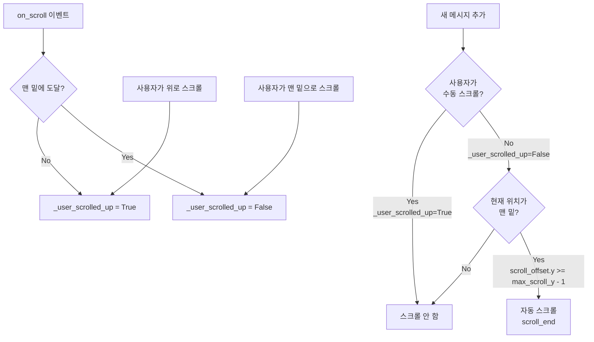

# 사용자의 최초 요청 (기록용)
log text area scroll bar issue

log text area 가 '맨 밑' 으로 scroll size 설정이 돼있을 경우에만 자동으로 스크롤이 서서히 내려가야하고, 만약 그게 아니라 스크롤 사이즈가 수정돼있으면 (사용자가 수정했다면)

따로 스크롤을 내리면 안돼

이 작업을 여러번 요청했었던것같은데 제대로 동작하지않는것같아. 한번은 스크롤바 전체가 고정이돼버려서 스크롤 자체가 망가지는 이슈가 있었고, 지금은 그냥 스크롤이 다시 밑으로 내려가는 느낌 ?

## 추가 사용자 요청 (기록용)
(최초 요청 이외의 모든 요청 기록)

없음

# 작업 목표 (WHAT & WHY)

## 핵심 목표 (TL;DR)
TUI 로그 텍스트 영역의 자동 스크롤 동작을 개선하여, 사용자가 이전 로그를 확인하기 위해 스크롤을 올렸을 때는 자동 스크롤이 중단되고, 다시 맨 밑으로 스크롤하면 자동 스크롤이 재개되도록 수정

## 상세 목표
- 로그가 맨 밑에 있을 때만 새 메시지 추가 시 자동으로 스크롤 다운
- 사용자가 수동으로 스크롤을 올렸을 때는 자동 스크롤 중지
- 사용자가 다시 맨 밑으로 스크롤하면 자동 스크롤 재개
- 스크롤바가 완전히 고정되거나 작동하지 않는 문제 방지
- 사용자가 읽고 있을 때 갑자기 스크롤이 내려가는 문제 방지

# 작업 배경 (WHY & WHAT - 현재 상태)

## 현재 상황
현재 `ChatLog` 구현 (`sisyphus/ui/tui/components/chat_log.py:28-37`):
- `_should_auto_scroll()` 메서드가 `scroll_offset.y >= max_scroll_y - 5` 조건으로 자동 스크롤 여부 판단
- 하단에서 5줄 이내면 자동 스크롤 발생
- 사용자가 수동으로 스크롤을 올렸는지 구분하지 못함
- 메시지 추가 시 조건만 체크하고 강제로 `scroll_end()` 호출

## 변경이 필요한 이유
1. **사용자 경험 문제**: 사용자가 이전 로그를 읽고 있어도 새 메시지가 추가되면 스크롤이 자동으로 내려가서 읽던 위치를 잃어버림
2. **의도 파악 실패**: 현재 구현은 사용자가 "의도적으로 스크롤을 올렸는지" vs "자동 스크롤로 인해 맨 밑에 있는지"를 구분하지 못함
3. **이전 시도의 문제점**:
   - `watch_scroll_y` 구현 (commit 859687e): 스크롤바 전체가 고정되는 버그 발생
   - 네이티브 `auto_scroll=True` (commit f7bed2c): 계속 스크롤이 내려가는 문제
   - 현재 `_should_auto_scroll` (commit 929af8b): 여전히 5줄 버퍼 내에서 자동 스크롤 발생

## 변경할 내용
현재 상태 → 변경 후 상태:
- **스크롤 의도 추적 없음** → **사용자 수동 스크롤 여부를 상태로 추적**
- **5줄 버퍼 조건만 체크** → **정확히 맨 밑(1px 이내)일 때만 자동 스크롤**
- **메시지마다 강제 scroll_end()** → **사용자가 올려둔 경우 스크롤하지 않음**
- **스크롤 이벤트 감지 없음** → **마우스 휠/키보드 스크롤 이벤트 감지**

# 작업 시작됨
is_execution_started = FALSE

# 모든 목표 달성됨
is_all_goals_accomplished = FALSE

# 병렬 실행
parallel_requested = FALSE

# 현재 진행 중인 작업
- 아직 작업이 시작되지 않았습니다.
   - 작업 시작 시 위의 `is_execution_started` 값을 TRUE로 변경하세요.
   - 사용자가 명시적으로 "작업 시작해"라고 말하기 전까지는 절대 작업을 시작하지 마세요.
   - **plan reviewer에게 OKAY를 받았더라도, 절대 작업을 시작하지 마세요**
   - 사용자가 명시적으로 "작업 시작해"라고 말하기 전까지는 절대 작업을 시작하지 마세요.

# 필수 배경 지식
[이 작업을 수행하는 데 필요한 도메인 지식, 기술 스택 등]

## 기술 스택
- **Textual 1.0+**: Python TUI 프레임워크
- **RichLog 위젯**: Textual의 스크롤 가능한 로그 위젯
- **Python 3.12**: 타입 힌트, async/await 지원

## Textual 스크롤 관련 주요 개념
1. **auto_scroll 속성**: RichLog의 내장 자동 스크롤 기능 (True/False)
2. **scroll_offset**: 현재 스크롤 위치 (x, y 좌표)
3. **max_scroll_y**: 스크롤 가능한 최대 Y 위치
4. **scroll_end()**: 맨 아래로 스크롤하는 메서드
5. **on_scroll**: 스크롤 이벤트 핸들러 (사용자 스크롤 감지)

## 파일 구조 및 역할
[이 작업에 영향을 받는 파일과 각 파일의 역할]

### 1. sisyphus/ui/tui/components/chat_log.py
- **역할**: TUI 로그 메시지를 표시하는 위젯
- **현재 구현**: RichLog를 상속하여 Execute/Verify 메시지를 색상으로 구분
- **주요 메서드**:
  - `_should_auto_scroll()`: 자동 스크롤 여부 판단 (현재 문제 발생 지점)
  - `write_execute_message()`: Execute 메시지 출력 및 자동 스크롤
  - `write_verify_message()`: Verify 메시지 출력 및 자동 스크롤
  - `write_user_message()`: 사용자 메시지 출력 및 자동 스크롤
  - `write_completion_message()`: 완료 메시지 출력 및 자동 스크롤

### 2. sisyphus/ui/tui/app.py
- **역할**: TUI 애플리케이션 메인 클래스
- **ChatLog 사용 지점**:
  - `on_show_agent_message()` (line 255-265): agent 메시지를 ChatLog에 작성
  - `on_completion_message()` (line 271-285): 완료 메시지를 ChatLog에 작성
  - `on_agent_interrupt_event()` (line 303-314): 일시정지 메시지를 ChatLog에 작성
- **영향**: ChatLog의 메서드 시그니처가 변경되지 않으므로 수정 불필요

## 컨텍스트 이해를 위한 참고 파일
### 1. sisyphus/ui/tui/components/chat_log.py:1-82
- **역할**: 현재 ChatLog 전체 구현
- **참고 섹션**: 전체 파일 (82줄 전체가 핵심)
- **주요 코드 스니펫**:
```python
# 현재 구현 (문제 발생 지점)
def _should_auto_scroll(self) -> bool:
    """Check if auto-scroll should be active.

    Returns True if scroll position is near bottom (within 5-line buffer).
    This allows slight scroll-up without disabling auto-scroll.

    Returns:
        bool: True if should auto-scroll, False otherwise
    """
    return self.scroll_offset.y >= self.max_scroll_y - 5

def write_user_message(self, content: str) -> None:
    timestamp = datetime.now().strftime("%H:%M:%S.%f")[:-3]
    self.write(f"[dim]{timestamp}[/dim] [green]👤 USER:[/green] {content}")
    if self._should_auto_scroll():  # 문제: 5줄 버퍼 내에서 항상 스크롤
        self.call_after_refresh(self.scroll_end)
```

[주의: 이 파일 목록은 '전역 컨텍스트' - 대부분의 작업에 필요한 필수 내용만 포함. 개별 작업에 필요한 컨텍스트는 'todo' 항목 내부에 작성.]

# 작업 흐름 (HOW - 작업 흐름 및 의존성)

## 작업 의존성 다이어그램
```
Task 1 (스크롤 상태 추적 및 이벤트 핸들러 추가)
   ↓
Task 2 (자동 스크롤 로직 수정)
   ↓
Task 3 (통합 테스트 및 검증)
```

## 단계별 설명
- **단계 1 (Task 1)**: ChatLog에 사용자 스크롤 상태를 추적하는 플래그와 이벤트 핸들러 추가. 사용자가 수동으로 스크롤하면 플래그를 True로 설정하고, 맨 밑으로 돌아오면 False로 재설정
- **단계 2 (Task 2)**: `_should_auto_scroll()` 로직을 수정하여 플래그가 False이고 맨 밑에 있을 때만 자동 스크롤하도록 변경. 5줄 버퍼를 제거하고 정확한 맨 밑 판단으로 변경
- **단계 3 (Task 3)**: TUI를 직접 실행하여 수동 스크롤 시나리오 테스트. 스크롤이 올라간 상태에서 새 메시지 추가 시 스크롤 안 됨 확인, 맨 밑으로 돌아온 후 자동 스크롤 재개 확인

# 작업 계획

## PRDs & Structures
[이 작업을 통해 구축하려는 것의 큰 그림을 쉽게 이해하기 위해 다음을 작성:]
[이 작업을 통해 구축하려는 것의 PRD, 각 컴포넌트와 요소가 어떻게 상호작용하는지, mermaid로]



## 구현 세부사항

### 아키텍처 제약사항
- **Textual 프레임워크**: RichLog 위젯의 내장 기능 최대한 활용
- **이벤트 기반**: on_scroll 이벤트를 통해 사용자 스크롤 감지
- **상태 관리**: 인스턴스 변수 `_user_scrolled_up`로 스크롤 상태 추적
- **비동기 처리**: call_after_refresh로 렌더링 후 스크롤 처리

### 엣지 케이스 처리
- **초기 상태**: 위젯 생성 직후에는 `_user_scrolled_up = False` (자동 스크롤 활성화)
- **빠른 메시지 연속 추가**: call_after_refresh로 렌더링 후 스크롤하여 타이밍 이슈 방지
- **스크롤 위치 경계**: `max_scroll_y - 1` (1px 이내)로 맨 밑 판단하여 반올림 오류 방지
- **RichLog의 auto_scroll 속성**: True로 유지하되, 커스텀 로직으로 조건부 스크롤 구현

### 암묵적 가정을 명시적으로 만들기
- **가정 1**: Textual의 `on_scroll` 이벤트는 사용자가 마우스 휠, 키보드, 터치로 스크롤할 때만 발생 (프로그래밍 방식의 scroll_end()는 이벤트 발생 안 함)
- **가정 2**: `scroll_offset.y`와 `max_scroll_y`는 RichLog가 자동으로 업데이트하며, 항상 최신 값을 반영
- **가정 3**: `call_after_refresh`는 현재 렌더링 사이클 완료 후 콜백을 실행하여, write() 후 즉시 scroll_end() 호출 시 발생하는 타이밍 이슈 방지

## 프로젝트 커밋 메시지 스타일
[git log 분석 기반 이 프로젝트의 커밋 메시지 패턴 요약]

최근 20개 커밋 분석 결과:
```bash
git log --oneline -20 --no-merges
```

**패턴**:
- **Prefix 사용**: `fix:`, `feat:`, `chore:`, `docs:` 등 Conventional Commits 스타일
- **언어**: 영어 사용
- **형식**: `<type>: <description>`
- **Description 스타일**: 소문자 시작, 명령형 (imperative mood)
- **예시**:
  - `fix: improve chatlog scroll behavior for better ux`
  - `chore: mark task 2 (ChatLog scroll improvement) as complete with detailed notes`
  - `fix scroll bar sync issue with explicit scroll_end calls`

**이 작업의 커밋 메시지 예상**:
- `fix: prevent auto-scroll when user manually scrolls up in ChatLog`
- `test: verify ChatLog scroll behavior with manual testing`

# TODOs

- [ ] 1. ChatLog에 스크롤 상태 추적 및 이벤트 핸들러 추가

   **참고 소스 (필수)**:
   - 기존 구현: `sisyphus/ui/tui/components/chat_log.py:1-82` (전체 ChatLog 클래스)
   - Textual 스크롤 이벤트: https://textual.textualize.io/events/scroll/ (on_scroll 이벤트 문서)
   - 이전 watch_scroll_y 시도: commit 859687e (실패 사례 참고용 - 스크롤 락 문제 발생)

   - [ ] 1.1 구현: ChatLog.__init__에 `_user_scrolled_up` 플래그 추가

      **코드 패턴 참고**:
      ```python
      # 현재 구현 (sisyphus/ui/tui/components/chat_log.py:15-26)
      def __init__(self) -> None:
          """Initialize ChatLog widget.

          Enables Rich markup, syntax highlighting, and auto-scrolling.
          """
          super().__init__(
              id="chat-log",
              highlight=True,
              markup=True,
              auto_scroll=True,
              wrap=True,
          )
      ```

      **구현 세부사항**:
      - 현재: `__init__` 메서드에 인스턴스 변수 없음
      - 변경: `self._user_scrolled_up: bool = False` 추가 (초기값 False = 자동 스크롤 활성화)
      - 주의: `auto_scroll=True` 유지 (RichLog의 기본 동작은 유지하되, 커스텀 로직으로 조건부 제어)

   - [ ] 1.2 구현: on_scroll 이벤트 핸들러 추가

      **코드 패턴 참고**:
      ```python
      # Textual on_scroll 이벤트 핸들러 패턴
      # https://textual.textualize.io/events/scroll/
      from textual.events import Scroll

      async def on_scroll(self, event: Scroll) -> None:
          """Handle scroll events."""
          # 사용자가 스크롤했을 때의 로직
          pass
      ```

      **구현 세부사항**:
      - 메서드 추가: `on_scroll(self, event: Scroll) -> None`
      - 로직:
        1. 현재 스크롤 위치가 맨 밑(1px 이내)인지 체크: `self.scroll_offset.y >= self.max_scroll_y - 1`
        2. 맨 밑이면: `self._user_scrolled_up = False` (자동 스크롤 재개)
        3. 맨 밑이 아니면: `self._user_scrolled_up = True` (자동 스크롤 중지)
      - 주의: 이 이벤트는 사용자 스크롤만 감지, `scroll_end()` 호출은 이벤트 발생 안 함 (Textual의 동작 방식)

   - [ ] 1.3 린트 및 타입 체크
      - [ ] `ruff check sisyphus/ui/tui/components/chat_log.py` → 0 에러 예상
      - [ ] `basedpyright sisyphus/ui/tui/components/chat_log.py` → 0 에러 예상

   - [ ] 1.4 테스트 통과 확인 후 커밋 (**작업 단위별 커밋 필수**)
      - 프로젝트 컨벤션에 따라 작성 (git log 분석 기반)
      - 예시: `git add sisyphus/ui/tui/components/chat_log.py && git commit -m "feat: add user scroll state tracking to ChatLog"`

   - [ ] **작업 완료 검증 체크리스트** (Orchestrator의 검수 기준)
      - [ ] `sisyphus/ui/tui/components/chat_log.py`에 `_user_scrolled_up` 플래그가 추가되었는가?
      - [ ] `on_scroll` 이벤트 핸들러가 추가되었는가?
      - [ ] 맨 밑에 있을 때 플래그가 False로 설정되는가?
      - [ ] 맨 밑이 아닐 때 플래그가 True로 설정되는가?
      - [ ] `ruff check sisyphus/ui/tui/components/chat_log.py` → 0 에러 확인
      - [ ] `basedpyright sisyphus/ui/tui/components/chat_log.py` → 0 에러 확인
      - [ ] git 커밋이 완료되었는가? (`git log -1 --oneline` 확인)

- [ ] 2. _should_auto_scroll 로직 수정 및 모든 write 메서드에 적용

   **참고 소스 (필수)**:
   - 현재 구현: `sisyphus/ui/tui/components/chat_log.py:28-82` (모든 write 메서드)
   - 기존 패턴: `sisyphus/ui/tui/components/chat_log.py:46-48` (write_user_message의 자동 스크롤 로직)

   - [ ] 2.1 구현: `_should_auto_scroll()` 메서드 수정

      **코드 패턴 참고**:
      ```python
      # 현재 구현 (sisyphus/ui/tui/components/chat_log.py:28-37)
      def _should_auto_scroll(self) -> bool:
          """Check if auto-scroll should be active.

          Returns True if scroll position is near bottom (within 5-line buffer).
          This allows slight scroll-up without disabling auto-scroll.

          Returns:
              bool: True if should auto-scroll, False otherwise
          """
          return self.scroll_offset.y >= self.max_scroll_y - 5
      ```

      **구현 세부사항**:
      - 현재: 5줄 버퍼로 체크 (`>= max_scroll_y - 5`)
      - 변경:
        1. 사용자가 수동 스크롤했는지 체크: `if self._user_scrolled_up: return False`
        2. 맨 밑에 있는지 정확히 체크: `return self.scroll_offset.y >= self.max_scroll_y - 1`
      - 주의:
        - 5줄 버퍼 제거 → 정확히 맨 밑(1px 이내)만 자동 스크롤
        - `_user_scrolled_up` 플래그가 우선순위 (사용자가 올렸으면 무조건 스크롤 안 함)

   - [ ] 2.2 검증: 모든 write 메서드가 동일한 패턴 사용 확인

      **검증 대상**:
      - `write_user_message` (line 39-48)
      - `write_execute_message` (line 50-59)
      - `write_verify_message` (line 61-70)
      - `write_completion_message` (line 72-81)

      **검증 내용**:
      - 모든 메서드가 동일하게 `if self._should_auto_scroll(): self.call_after_refresh(self.scroll_end)` 패턴 사용 확인
      - 패턴 일관성 유지 (기존 코드와 동일)

   - [ ] 2.3 린트 및 타입 체크
      - [ ] `ruff check sisyphus/ui/tui/components/chat_log.py` → 0 에러 예상
      - [ ] `basedpyright sisyphus/ui/tui/components/chat_log.py` → 0 에러 예상

   - [ ] 2.4 테스트 통과 확인 후 커밋 (**작업 단위별 커밋 필수**)
      - 프로젝트 컨벤션에 따라 작성
      - 예시: `git add sisyphus/ui/tui/components/chat_log.py && git commit -m "fix: prevent auto-scroll when user manually scrolls up in ChatLog"`

   - [ ] **작업 완료 검증 체크리스트**
      - [ ] `_should_auto_scroll()`이 `_user_scrolled_up` 플래그를 체크하는가?
      - [ ] 5줄 버퍼가 제거되고 1px 이내로 변경되었는가?
      - [ ] 모든 write 메서드가 동일한 자동 스크롤 패턴을 사용하는가?
      - [ ] `ruff check sisyphus/ui/tui/components/chat_log.py` → 0 에러 확인
      - [ ] `basedpyright sisyphus/ui/tui/components/chat_log.py` → 0 에러 확인
      - [ ] git 커밋이 완료되었는가?

- [ ] 3. TUI 통합 테스트 및 최종 검증

   **참고 소스 (필수)**:
   - TUI 실행 방법: `sisyphus/cli.py` 또는 프로젝트 README의 실행 가이드
   - 테스트 시나리오: Issue #38의 요구사항

   - [ ] 3.1 TUI 수동 테스트 실행

      **실행 명령**:
      ```bash
      # TUI 모드로 sisyphus 실행 (기본 설정)
      python -m sisyphus run
      ```

      **테스트 시나리오**:
      1. **시나리오 1: 맨 밑에서 자동 스크롤**
         - 초기 상태: 로그가 맨 밑에 위치
         - 동작: 새 메시지 추가
         - 예상: 자동으로 스크롤이 맨 밑으로 이동 (기존 동작 유지)

      2. **시나리오 2: 사용자가 위로 스크롤 시 자동 스크롤 중지**
         - 동작: 마우스 휠/키보드로 로그를 위로 스크롤
         - 동작: 새 메시지 추가
         - 예상: 스크롤 위치 고정, 자동 스크롤 안 됨 ✅ (핵심 요구사항)

      3. **시나리오 3: 다시 맨 밑으로 스크롤 시 자동 스크롤 재개**
         - 동작: 사용자가 수동으로 맨 밑까지 스크롤
         - 동작: 새 메시지 추가
         - 예상: 자동 스크롤 재개, 새 메시지에 맞춰 스크롤 다운 ✅

      4. **시나리오 4: 스크롤바 잠김 문제 없음**
         - 동작: 여러 번 위아래 스크롤 반복
         - 예상: 스크롤바가 정상 작동, 잠기지 않음 ✅ (이전 버그 방지)

      **예상 결과**:
      - 시나리오 1-4 모두 통과
      - 사용자가 이전 로그를 읽을 때 스크롤이 방해받지 않음
      - 맨 밑으로 돌아오면 자동 스크롤 자연스럽게 재개

   - [ ] 3.2 회귀 테스트: 기존 기능 영향 확인

      **확인 항목**:
      - [ ] Execute 메시지가 노란색으로 표시되는가? (`write_execute_message`)
      - [ ] Verify 메시지가 청록색으로 표시되는가? (`write_verify_message`)
      - [ ] User 메시지가 초록색으로 표시되는가? (`write_user_message`)
      - [ ] 완료 메시지가 볼드 초록색으로 표시되는가? (`write_completion_message`)
      - [ ] 타임스탬프가 모든 메시지에 표시되는가?
      - [ ] 메시지 내용이 올바르게 출력되는가?

   - [ ] 3.3 최종 검증 및 문서화

      **검증 명령**:
      ```bash
      # 전체 린트 체크
      ruff check sisyphus/ui/tui/components/chat_log.py

      # 전체 타입 체크
      basedpyright sisyphus/ui/tui/components/chat_log.py
      ```

      **문서화**:
      - ChatLog 클래스 docstring 업데이트 (스크롤 동작 설명 정확히 반영)
      - `_user_scrolled_up` 플래그와 `on_scroll` 이벤트 핸들러에 docstring 추가

   - [ ] 3.4 최종 커밋
      - 예시: `git add sisyphus/ui/tui/components/chat_log.py && git commit -m "test: verify ChatLog scroll behavior with manual testing"`
      - 또는 docstring 업데이트만 했다면: `git commit -m "docs: update ChatLog docstring to reflect new scroll behavior"`

   - [ ] **작업 완료 검증 체크리스트**
      - [ ] 시나리오 1-4가 모두 통과했는가?
      - [ ] 회귀 테스트 항목이 모두 통과했는가?
      - [ ] 스크롤바 잠김 문제가 발생하지 않는가?
      - [ ] 사용자가 위로 스크롤했을 때 자동 스크롤이 중지되는가?
      - [ ] 다시 맨 밑으로 스크롤하면 자동 스크롤이 재개되는가?
      - [ ] `ruff check` → 0 에러 확인
      - [ ] `basedpyright` → 0 에러 확인
      - [ ] 최종 git 커밋 완료

# 성공 비전

## 사용자 관점에서의 성공
- **변경 사항**: "TUI에서 로그를 스크롤업하여 이전 내용을 읽을 때, 새 메시지가 추가되어도 읽던 위치가 유지됨"
- **사용자 여정**:
  1. TUI 실행 → 로그 확인
  2. 마우스 휠로 위로 스크롤하여 이전 로그 읽기
  3. 백그라운드에서 새 메시지 추가 → 스크롤 위치 그대로 유지 ✅
  4. 읽기 완료 후 맨 밑으로 스크롤 → 자동 스크롤 재개 ✅

## 비즈니스 관점에서의 성공
- **측정 가능한 지표**: "Issue #38 해결 완료, 스크롤 관련 버그 0건 유지"
- **기대 효과**: "사용자가 TUI에서 로그를 읽을 때 방해받지 않아 UX 개선"

## 기술적 성공 기준
- **모든 시나리오 통과**: 시나리오 1-4 모두 예상대로 동작
- **성능 기준**: 없음 (스크롤 성능은 Textual 프레임워크에 의존)
- **보안 기준**: 해당 없음 (UI 변경만)
- **린트/타입 체크**: `ruff check` 0 에러, `basedpyright` 0 에러

# 최종 작업 검증 체크리스트
- [ ] 1. **기능 동작 확인**
  - [시나리오 1-4 모두 통과 - 위 TODOs Task 3.1 참고]
  - [실행 명령: `python -m sisyphus run`]

- [ ] 2. **잘못된 구현 방지**
  - [사용자가 하지 말라고 한 것 체크]
    - 스크롤바가 완전히 고정되어 작동하지 않는 문제 없음 ✅
    - 사용자가 읽고 있을 때 갑자기 스크롤이 내려가는 문제 없음 ✅
  - [프로젝트 컨벤션에 따라 실수하기 쉬운 부분 체크]
    - 타입 힌트 누락 없음 (ANN001 룰)
    - 더블 쿼트 사용 (`"` not `'`)
    - 줄 길이 119자 이내

- [ ] 3. **범위 준수 확인**
  - [초기 계획과 다르게 구현된 부분 체크]
    - ChatLog 컴포넌트만 수정 (app.py, 다른 컴포넌트 변경 없음)
  - [과도하게 구현된 부분 체크]
    - 자동화된 유닛 테스트 추가 안 함 (수동 테스트만 수행)
    - 다른 스크롤 관련 기능 추가 안 함

- [ ] 4. **기존 기능 회귀 테스트**
  - [수정된 파일에 영향받을 수 있는 기존 기능 목록]
    - ChatLog의 메시지 표시 기능 (색상, 타임스탬프)
    - Execute/Verify 메시지 구분 표시
    - StatusPanel, InputBar와의 통합 동작
  - [각 기능별 검증 방법: 실행 명령 + 예상 결과]
    - TUI 실행 후 메시지 표시 확인: `python -m sisyphus run`
    - 예상 결과: Execute(노란색), Verify(청록색), User(초록색) 메시지가 타임스탬프와 함께 표시됨
