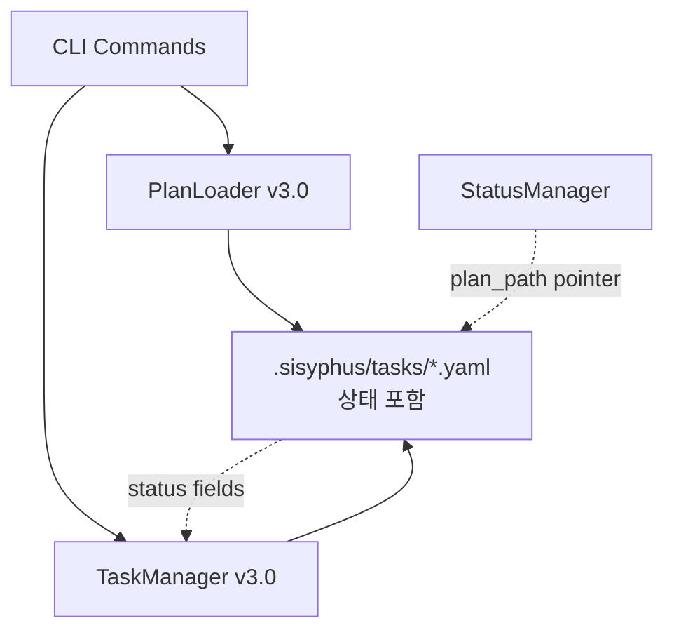

# 사용자의 최초 요청 (기록용)
아직은 마크다운 형식으로 작업해야합니다. 이를 명심하세요.

현재 아직 sisyphus cli 에서 yaml 2.1 기반의 코드가 많습니다. 무조건 3.0 기반으로만 동작하도록, .sisyphus 안의 태스크파일을 참조하도록 코드를 재작성해야합니다.

코드 전방위적으로 살펴보고, 고치는 플랜을 생각하세요. 2.1은 사용자가 없으므로 폴백이나마이그레이션은 전부 생각하지 않아도 되고, 3.0 만을 지원하도록 2.1의 흔적과 마크다운의 흔적(혹시남아있다면) 을 모두 없애야합니다. 이 모든것들을 살펴보시고 쭉 나열하세요.

## 추가 사용자 요청 (기록용)
이거 작업 방향을 status.json 을 확장하는게 아니라 status.json 은 그대로 두고 yaml 이 상태값을 모두 들게 수정해주세요 제 요구사항도 엄밀히 적어주시고요.

이 작업이 끝나면 제가 원하는건:
- 2.1 에있던 백그라운드나 이런것들도 다 3.0 이 다뤄지도록 yaml 스펙이 변경됨(당연히 모두 필수값)
- 2.1 지원이나 ai-todolist.yaml 에 대한 **모든** 코드 제거 (폴백 코드도 모두 제거)
- 현재 존재하는 sisyphus work / sisyphus plan / sisyphus task / sisyphus verify 의 **모든** 기능이 3.0 으로 포팅
- 현재 존재하는 sisyphus work / sisyphus plan / sisyphus task / sisyphus verify 의 **모든** 기능이 구현되며, '3.0 에선 지원하지않음' '구현예정' '아직 미지원' 같은 내용은 절대 없어야 함
- status.json 을 확장하거나 스펙을 변경하는것은 단 하나도 금지. 3.0이 이것을 문서로서 다뤄질 수 있도록 해야함

# 작업 목표 (WHAT & WHY)

## 핵심 목표 (TL;DR)
Sisyphus CLI를 v2.1 레거시 코드에서 완전히 분리하되, **v3.0 YAML 스펙을 확장**하여 모든 상태 정보를 YAML 파일 자체에 저장합니다. status.json은 현재 스펙 그대로 유지하되, YAML이 모든 실행 상태를 자체적으로 관리할 수 있도록 합니다.

## 상세 목표
- v3.0 `PlanDocument` 모델을 확장하여 v2.1의 모든 상태 필드 포함 (execution, work_mode, progress 등)
- v2.1 모델(`plan_types.py`), Navigator, Loader 완전 제거
- 모든 CLI 명령어(`work`, `plan`, `task`, `verify`)를 v3.0 전용으로 재작성
- status.json 스펙은 **절대 변경 금지** (현재 `plan_path`, `plan_root`, `updated_at`만 유지)
- 백그라운드 작업, verify 등 v2.1의 모든 기능을 v3.0에서 100% 지원

# 작업 배경 (WHY & WHAT - 현재 상태)

## 현재 상황
- **v2.1 아키텍처**: `WorkPlan` 모델이 상태 필드를 가지고 있음 (`status.execution`, `status.work_mode` 등)
- **v3.0 아키텍처**: `PlanDocument`는 순수 데이터 구조로, 상태 정보가 **전혀 없음**
- **혼재 상태**:
  - `cli/task.py`: v2.1 `WorkPlan` + `PlanNavigator` 전제로 작성됨
  - `cli/work.py`: v3.0 `load_plan()` 사용하지만 상태 관리 안함
  - `core/plans/models.py`: `Todo.status`만 있고 플랜 레벨 상태 필드 없음
  - `core/plan_navigator.py`: v2.1 전용 (`self.plan.status.work_mode.current_task_id` 접근)

## 변경 이유
- v3.0으로 완전 전환하여 이중 모델 관리 부담 제거
- **YAML 파일이 자기완결적 문서**가 되도록 (상태를 파일 안에 저장)
- status.json은 단순히 "어떤 파일을 보고 있는지" 포인터 역할만 수행
- 일관된 `.sisyphus/tasks/` 구조로 사용자 경험 개선

## 변경할 내용
- 현재: v2.1 `WorkPlan` (상태 포함) + v3.0 `PlanDocument` (상태 없음) 공존
- 변경 후: **v3.0 `PlanDocument` 확장** (모든 상태 필드 추가) + status.json은 그대로

# 작업 시작 여부
is_execution_started = TRUE

# 전체 목표 달성 여부
is_all_goals_accomplished = TRUE

# 병렬 실행
parallel_requested = FALSE

# 현재 진행 중인 작업
모든 작업 완료!

# 필요 배경 지식

## 아키텍처 이해

### v2.1 아키텍처 (제거 대상)
```python
# utils/plan_types.py - 제거할 모델
class WorkPlan(BaseModel):
    metadata: Metadata
    status: Status  # ← 여기에 모든 상태
        # status.execution.started
        # status.work_mode.current_task_id
        # status.progress.total_tasks
    todos: list[Todo]
    # ... 기타 필드

파일: ai-todolist.yaml (루트)
```

### v3.0 아키텍처 (목표 - 상태 필드 추가)
```python
# core/plans/models.py - 확장할 모델
class WorkPlan(BaseModel):
    id: str
    name: str
    depends_on: list[str]
    todos: list[Todo]
    references: list[ReferenceItem]

    # [추가 필요] v2.1 Status 클래스의 모든 필드
    execution: ExecutionStatus
    work_mode: WorkMode
    progress: Progress
    current_work: str

class PlanDocument(BaseModel):
    version: str
    metadata: Metadata
    work_plans: list[WorkPlan]

파일: .sisyphus/tasks/*.yaml
```

**핵심 차이**: v3.0 YAML이 자체적으로 상태를 저장하게 함 (파일 자체가 문서)

## 전환 전략 결정

**선택: YAML 스펙 확장 + v3.0 전용 Navigator 생성**

**이유**:
- status.json은 그대로 유지 (사용자 요구사항)
- YAML 파일이 자기완결적 문서가 됨
- 상태 정보를 별도 파일이 아닌 YAML 자체에 저장
- v2.1 Navigator를 v3.0 구조에 맞게 새로 생성

**구현 방향**:
1. v3.0 `WorkPlan` 모델에 상태 필드 추가 (`ExecutionStatus`, `WorkMode`, `Progress`)
2. v3.0 전용 `TaskManager` 생성 (v2.1 `PlanNavigator` 패턴 참고)
3. 모든 CLI를 v3.0 + 새 `TaskManager`로 재작성
4. v2.1 모델, Navigator, Loader 제거

## 파일 구조 및 역할

### 제거 대상 파일
- `sisyphus/utils/plan_types.py`: v2.1 Pydantic 모델 (전체 제거)
- `sisyphus/core/plan_navigator.py`: v2.1 전용 Navigator (전체 제거)
- `sisyphus/core/plan_loader.py`: v2.1 전용 Loader (전체 제거)
- `sisyphus/core/tasks.py`: 마크다운 검증 로직 (전체 제거)

### 수정 대상 파일
- `sisyphus/core/plans/models.py`: **`WorkPlan` 모델 확장** (상태 필드 추가)
- `sisyphus/cli/task.py`: v3.0 기반 완전 재작성
- `sisyphus/cli/work.py`: 마크다운 체크 제거, v3.0 전용화
- `sisyphus/cli/plan.py`: 경로 수정, 템플릿 업데이트
- `sisyphus/core/prompts.py`: 마크다운 참조 제거
- `sisyphus/core/plans/loader.py`: v2.1 폴백 제거

### 생성 대상 파일
- `sisyphus/core/task_manager.py`: v3.0 전용 태스크 관리자 (v2.1 Navigator 대체)

## 핵심 설계 결정 (Critical Design Decisions)

### 결정 1: Verification 구조 - v2.1 스펙 유지
**문제**: v3.0 `VerificationItem` (line 30-34)이 v2.1과 다른 구조
- v2.1: `bash: list[BashVerification]`, `llm_judge: list[LLMJudgeVerification]`
- v3.0 (현재): `command: str | None`, `expected_output: str | None`

**결정**: **v2.1 `VerificationItem` 구조를 v3.0 models.py로 복사하여 대체**
- 이유: 사용자 요구사항 "v2.1의 모든 기능 100% 지원"
- 변경: `core/plans/models.py` line 30-34 삭제, `utils/plan_types.py` line 22-76 (BashVerification, LLMJudgeVerification, VerificationItem) 복사
- 영향: Task 3 (task.py 재작성) 시 verify 명령어 로직 동일하게 유지 가능

### 결정 2: WorkPlan 상태 필드 - 기본값 제공으로 호환성 유지
**문제**: 기존 v3.0 YAML 파일 (예: hello-world.yaml)에 상태 필드 없음 → 필수값 시 로드 실패

**결정**: **기본값 제공으로 기존 YAML 호환성 유지**
```python
class WorkPlan(BaseModel):
    id: str
    name: str
    depends_on: list[str] = []
    todos: list[Todo]
    references: list[ReferenceItem] = []

    # 상태 필드 (기본값 제공)
    execution: ExecutionStatus = ExecutionStatus(
        started=False,
        completed=False,
        started_at=None,
        completed_at=None
    )
    work_mode: WorkMode = WorkMode(
        parallel_requested=False,
        current_task_id=None
    )
    progress: Progress = Progress(
        total_tasks=0,
        completed=0,
        in_progress=0,
        pending=0
    )
    current_work: str = ""
```
- 이유: 기존 v3.0 YAML 파일 (상태 필드 없음)을 로드 시 자동으로 기본값 채워짐
- 영향: Task 1 완료 후 기존 hello-world.yaml 정상 로드

### 결정 3: 테스트 전환 전략 - 삭제/재작성/수정 구분
**문제**: 27개 파일에 레거시 참조, 테스트 재작성 범위 불명확

**결정**: **3단계 전환 전략**
1. **삭제** (v2.1 전용 테스트):
   - `tests/core/test_plan_navigator.py`
   - `tests/core/test_plan_loader.py`
   - `tests/core/test_tasks.py`

2. **재작성** (Integration 테스트 - v3.0 fixture 필요):
   - `tests/test_integration_yaml_plan.py`: v3.0 YAML fixture로 전환

3. **수정** (경로만 변경):
   - `tests/test_cli_ignore.py`: `ai-todolist.yaml` → `.sisyphus/tasks/test.yaml`
   - `tests/test_cli_clean_history.py`: 파일 패턴만 업데이트

- 영향: Task 9 작업량 명확화 - 3개 삭제, 1개 재작성, 2개 수정

## 참조 파일 리스트

### 1. `sisyphus/core/plans/models.py`
- **역할**: v3.0 Pydantic 모델 정의 (확장 대상)
- **검색 키워드**: `class PlanDocument`, `class WorkPlan`, `class Todo`, `class VerificationItem`
- **현재 구조**:
  ```python
  class WorkPlan(BaseModel):
      id: str
      name: str
      depends_on: list[str] = []
      todos: list[Todo]
      references: list[ReferenceItem] = []
  ```
- **추가 필요**:
  - `ExecutionStatus`, `WorkMode`, `Progress` 클래스 + WorkPlan 상태 필드 (기본값 포함)
  - v2.1 `VerificationItem` 구조 (BashVerification, LLMJudgeVerification 포함)

### 2. `sisyphus/utils/plan_types.py`
- **역할**: v2.1 모델 (참조용 - 제거 예정)
- **검색 키워드**: `class Status`, `class ExecutionStatus`, `class WorkMode`
- **패턴 참조**: 상태 관련 모든 필드 구조
- **코드 예시**:
  ```python
  class ExecutionStatus(BaseModel):
      started: bool
      completed: bool
      started_at: str | None = None
      completed_at: str | None = None

  class WorkMode(BaseModel):
      parallel_requested: bool
      current_task_id: str | None = None

  class Progress(BaseModel):
      total_tasks: int
      completed: int
      in_progress: int
      pending: int
  ```

### 3. `sisyphus/core/status/manager.py`
- **역할**: `.sisyphus/status.json` 관리 (**변경 금지**)
- **현재 스키마**:
  ```python
  class CurrentPlan(BaseModel):
      plan_path: str
      plan_root: str
      updated_at: str
  ```
- **주의**: 이 구조를 절대 변경하면 안됨

### 4. `sisyphus/core/plan_navigator.py`
- **역할**: v2.1 태스크 탐색 (참조용 - 제거 예정)
- **검색 키워드**: `class PlanNavigator`, `get_current_task`, `get_next_task`
- **패턴**: DFS 탐색, children 재귀 처리, 상태 업데이트 로직

### 5. `sisyphus/cli/task.py`
- **역할**: task 명령어 (완전 재작성 대상)
- **검색 키워드**: `ai-todolist.yaml` (11회 출현 - 모두 제거)
- **현재 패턴**: `PlanLoader` + `PlanNavigator` + v2.1 모델
- **변경 방향**: v3.0 `load_plan()` + 새 `TaskManager`

### 6. `.sisyphus/tasks/hello-world.yaml`
- **역할**: v3.0 예시 (확장 대상)
- **현재 구조**:
  ```yaml
  version: "3.0"
  work_plans:
    - id: "hello-world"
      todos:
        - id: "1"
          status: pending
  ```
- **추가 필요**: `execution`, `work_mode`, `progress` 필드

# 작업 흐름 (HOW - 태스크 흐름 & 의존성)

## 태스크 의존성 다이어그램
```
Task 1 (v3.0 모델 확장)
   ↓
Task 2 (TaskManager 생성)
   ↓
Task 3 (cli/task.py 재작성)
   ↓
Task 4 (cli/plan.py 수정)
   ↓
Task 5 (cli/work.py 수정)
   ↓
Task 6 (프롬프트 수정)
   ↓
Task 7 (v2.1 폴백 제거)
   ↓
Task 8 (v2.1 파일 제거)
   ↓
Task 9 (테스트 수정)
   ↓
Task 10 (문서 정리)
   ↓
Task 11 (최종 검증)
```

## 단계별 설명
- **Phase 1 (Task 1-2)**: 인프라 구축 - v3.0 모델 확장 + TaskManager 생성
- **Phase 2 (Task 3-5)**: CLI 전환 - 모든 명령어 v3.0 전용화
- **Phase 3 (Task 6-8)**: 레거시 제거 - 프롬프트, 폴백, v2.1 파일
- **Phase 4 (Task 9-11)**: 테스트 & 문서 - 최종 검증

# 작업 계획

## PRD & 구조

**최종 아키텍처**:


**상태 관리 방식**:
- YAML: **모든 데이터 + 상태** (self-contained document)
- status.json: 현재 보고 있는 YAML 파일 경로만 (pointer)

## 프로젝트 커밋 메시지 스타일
```
feat: add X
refactor: simplify Y
fix: resolve Z
docs: update A
```

# TODOs

- [x] 1. v3.0 모델 확장 (상태 필드 추가)

   **참조 소스**:
   - 확장 대상: `projects/sisyphus-cli/sisyphus/core/plans/models.py` (line 47-53: WorkPlan 클래스)
   - 패턴 참조: `projects/sisyphus-cli/sisyphus/utils/plan_types.py` (line 173-196: Status 관련 클래스들)

   - [x] 1.1 `core/plans/models.py`에 상태 클래스 + Verification 클래스 추가

      **구현 세부사항**:
      - **상태 클래스** (line 8-29 근처, Enum 다음):
        - `utils/plan_types.py` line 173-189에서 `ExecutionStatus`, `WorkMode`, `Progress` 복사

      - **Verification 클래스** (기존 line 30-34 대체):
        - 기존 v3.0 `VerificationItem` **삭제**
        - `utils/plan_types.py` line 22-76에서 `BashVerification`, `LLMJudgeBy`, `LLMJudgeVerification`, `VerificationItem` 복사
        - 이유: 핵심 결정 1 - v2.1 스펙 유지로 verify 명령어 100% 지원

      - 코드 패턴:
        ```python
        # 상태 클래스
        class ExecutionStatus(BaseModel):
            started: bool
            completed: bool
            started_at: str | None = None
            completed_at: str | None = None

        class WorkMode(BaseModel):
            parallel_requested: bool
            current_task_id: str | None = None

        class Progress(BaseModel):
            total_tasks: int
            completed: int
            in_progress: int
            pending: int

        # Verification 클래스 (v2.1 스펙)
        class BashVerification(BaseModel):
            execute: str
            expected_stdout: str | None = None
            expected_stderr: str | None = None
            expected_exit_code: int = 0
            notes: str | None = None

        class LLMJudgeBy(str, Enum):
            ORCHESTRATOR = "orchestrator-agent"
            EXTERNAL = "external-agent"

        class LLMJudgeVerification(BaseModel):
            by: LLMJudgeBy = LLMJudgeBy.ORCHESTRATOR
            context_commands: list[str] = []
            instruction: str

        class VerificationItem(BaseModel):
            id: str
            title: str
            description: str
            verified: bool = False
            verified_at: str | None = None
            verification_evidence: str | None = None
            orchestrator_manually_verified: bool
            manual_verification_evidence: str
            bash: list[BashVerification] = []
            llm_judge: list[LLMJudgeVerification] = []

            @model_validator(mode="after")
            def validate_at_least_one(self) -> Self:
                if not self.bash and not self.llm_judge:
                    raise ValueError("bash 또는 llm_judge 중 하나 이상 필수")
                return self
        ```

   - [x] 1.2 `WorkPlan` 클래스에 상태 필드 추가 (기본값 제공)

      **구현 세부사항**:
      - 현재 (line 47-53):
        ```python
        class WorkPlan(BaseModel):
            id: str
            name: str
            depends_on: list[str] = []
            todos: list[Todo]
            references: list[ReferenceItem] = []
        ```
      - 변경 (핵심 결정 2 - 기본값 제공):
        ```python
        class WorkPlan(BaseModel):
            id: str
            name: str
            depends_on: list[str] = []
            todos: list[Todo]
            references: list[ReferenceItem] = []

            # 상태 필드 (기본값 제공 - 기존 YAML 호환성)
            execution: ExecutionStatus = Field(
                default_factory=lambda: ExecutionStatus(
                    started=False,
                    completed=False,
                    started_at=None,
                    completed_at=None
                )
            )
            work_mode: WorkMode = Field(
                default_factory=lambda: WorkMode(
                    parallel_requested=False,
                    current_task_id=None
                )
            )
            progress: Progress = Field(
                default_factory=lambda: Progress(
                    total_tasks=0,
                    completed=0,
                    in_progress=0,
                    pending=0
                )
            )
            current_work: str = ""
        ```
      - **중요**: `Field(default_factory=...)` 사용으로 기존 hello-world.yaml (상태 필드 없음) 로드 시 자동으로 기본값 생성

   - [x] 1.3 테스트 YAML 파일 업데이트

      **검증 명령어**:
      ```bash
      # .sisyphus/tasks/hello-world.yaml에 상태 필드 추가
      # version, metadata, work_plans 구조 유지하되
      # work_plans[0]에 execution, work_mode, progress 추가
      ```

   - [x] 1.4 테스트 및 린트
      - [x] `uv run pytest projects/sisyphus-cli/tests/core/plans/ -xvs` → 통과
      - [x] `uv run ruff check sisyphus/core/plans/models.py` → 0 errors
      - [x] `uv run basedpyright sisyphus/core/plans/models.py` → 0 errors

   - [x] 1.5 커밋
      - `git add sisyphus/core/plans/models.py .sisyphus/tasks/hello-world.yaml`
      - `git commit -m "feat: extend v3.0 WorkPlan with execution state fields"`

   - [x] **작업 완료 검증 체크리스트**
      - [x] `ExecutionStatus`, `WorkMode`, `Progress` 클래스 추가?
      - [x] `WorkPlan`에 4개 상태 필드 추가?
      - [x] 테스트 YAML 파일에 상태 필드 포함?
      - [x] 타입 체크 통과?
      - [x] 커밋 완료?

- [x] 2. TaskManager v3.0 생성

   **참조 소스**:
   - 패턴 참조: `sisyphus/core/plan_navigator.py` (v2.1 Navigator - 로직 참고)
   - 모델 참조: `sisyphus/core/plans/models.py` (v3.0 확장된 `WorkPlan`)
   - 생성 위치: `projects/sisyphus-cli/sisyphus/core/task_manager.py`

   - [x] 2.1 `TaskManager` 클래스 생성

      **구현 세부사항**:
      - 입력: `PlanDocument`, `plan_id: str`
      - 주요 메서드 (v2.1 Navigator 참고):
        - `__init__(plan_doc, plan_id)`: WorkPlan 찾기
        - `get_current_task() -> Todo | None`: `work_mode.current_task_id` 기반
        - `get_next_task(current_id=None) -> Todo | None`: DFS 탐색
        - `find_todo_by_id(todo_id: str) -> Todo | None`: 재귀 탐색
        - `check_task_completion(task_id) -> CompletionReport`: children + verification 체크
        - `next_unverified() -> tuple | None`: 다음 미검증 항목
      - 패턴: `plan_navigator.py`의 로직을 v3.0 모델에 맞게 재작성

      **코드 패턴**:
      ```python
      class TaskManager:
          def __init__(self, plan_doc: PlanDocument, plan_id: str) -> None:
              self.plan_doc = plan_doc
              self.plan_id = plan_id
              self.work_plan = self._find_work_plan()

          def _find_work_plan(self) -> WorkPlan:
              for wp in self.plan_doc.work_plans:
                  if wp.id == self.plan_id:
                      return wp
              raise ValueError(f"WorkPlan not found: {self.plan_id}")

          def get_current_task(self) -> Todo | None:
              current_id = self.work_plan.work_mode.current_task_id
              if current_id is None:
                  return None
              return self.find_todo_by_id(current_id)
      ```

   - [x] 2.2 테스트 작성

      **테스트 파일**: `projects/sisyphus-cli/tests/core/test_task_manager.py`
      **테스트 항목**:
      - [x] WorkPlan 찾기 (존재/부재)
      - [x] Todo DFS 탐색
      - [x] 다음 pending todo 찾기
      - [x] Children 재귀 탐색
      - [x] Verification 체크

   - [x] 2.3 테스트 실행
      - [x] `uv run pytest projects/sisyphus-cli/tests/core/test_task_manager.py -xvs` → 통과
      - [x] `uv run ruff check sisyphus/core/task_manager.py` → 0 errors
      - [x] `uv run basedpyright sisyphus/core/task_manager.py` → 0 errors

   - [x] 2.4 커밋
      - `git add sisyphus/core/task_manager.py tests/core/test_task_manager.py`
      - `git commit -m "feat: add TaskManager for v3.0 PlanDocument"`

   - [x] **작업 완료 검증 체크리스트**
      - [x] `TaskManager` 클래스 생성?
      - [x] 필수 메서드 구현 (get_current, get_next, find_todo)?
      - [x] 테스트 작성 및 통과?
      - [x] 타입 체크 통과?
      - [x] 커밋 완료?

- [x] 3. cli/task.py 재작성 (v3.0 전용)

   **참조 소스**:
   - 수정 대상: `projects/sisyphus-cli/sisyphus/cli/task.py` (전체 509줄)
   - 사용 모델: `TaskManager` (Task 2), `load_plan()`, `StatusManager`

   - [x] 3.1 `task current` 명령 재작성

      **구현 세부사항**:
      - 현재: `ai-todolist.yaml` 하드코딩, `PlanNavigator`
      - 변경:
        1. `StatusManager.get()` → `current_plan` 로드
        2. `load_plan(current_plan.plan_path)` → `PlanDocument`
        3. `TaskManager(plan_doc, plan_doc.work_plans[0].id)`
        4. `manager.get_current_task()` → Todo 출력

   - [x] 3.2 `task next` 명령 재작성

      **구현 세부사항**:
      - 로직: `TaskManager.get_next_task()` 사용
      - 상태 업데이트: YAML 파일의 `work_mode.current_task_id` 저장

   - [x] 3.3 `task continue` 명령 재작성

      **구현 세부사항**:
      - 로직: 현재 작업 → completed, 다음 작업 → in_progress
      - YAML 저장: `ruamel.yaml`로 상태 필드 업데이트

   - [x] 3.4 기타 명령 재작성
      - [x] `task show <id>`
      - [x] `task previous`
      - [x] verify 서브명령들 (bash, llm, manual, manual-mark, status)

   - [x] 3.5 모든 `ai-todolist.yaml` 하드코딩 제거

      **검증 명령어**:
      ```bash
      grep -n "ai-todolist.yaml" projects/sisyphus-cli/sisyphus/cli/task.py
      # 결과: 0개 (모두 제거됨)
      ```

   - [x] 3.6 테스트 작성 및 실행
      - [x] `uv run pytest projects/sisyphus-cli/tests/cli/test_task.py -xvs` → 통과
      - [x] `uv run ruff check sisyphus/cli/task.py` → 0 errors

   - [x] 3.7 커밋
      - `git add sisyphus/cli/task.py tests/cli/test_task.py`
      - `git commit -m "refactor: rewrite task commands for v3.0"`

   - [x] **작업 완료 검증 체크리스트**
      - [x] `ai-todolist.yaml` 하드코딩 제거 (0회)?
      - [x] `PlanNavigator` import 제거?
      - [x] `TaskManager` 사용?
      - [x] verify 명령어 모두 동작?
      - [x] 테스트 통과?
      - [x] 커밋 완료?

- [x] 4. cli/plan.py 수정

   **참조 소스**:
   - 수정 대상: `projects/sisyphus-cli/sisyphus/cli/plan.py` (line 127: format_version)

   - [x] 4.1 `plan init` 템플릿 수정

      **구현 세부사항**:
      - 현재 (line 123-178): `format_version: "2.1"` 템플릿
      - 변경: v3.0 구조로 전환
        ```python
        template = {
            "version": "3.0",
            "metadata": {...},
            "work_plans": [{
                "id": "new-plan",
                "name": "New Plan",
                "depends_on": [],
                "todos": [],
                "references": [],
                # 상태 필드 추가
                "execution": {
                    "started": False,
                    "completed": False,
                    "started_at": None,
                    "completed_at": None
                },
                "work_mode": {
                    "parallel_requested": False,
                    "current_task_id": None
                },
                "progress": {
                    "total_tasks": 0,
                    "completed": 0,
                    "in_progress": 0,
                    "pending": 0
                },
                "current_work": ""
            }]
        }
        ```

   - [x] 4.2 `ai-todolist.yaml` 하드코딩 제거

      **구현 세부사항**:
      - line 44, 91, 106, 230, 314 등 제거
      - status.json 기반 동적 로드로 변경

   - [x] 4.3 테스트 및 린트
      - [x] `uv run pytest projects/sisyphus-cli/tests/cli/test_plan.py -xvs` → 통과
      - [x] `uv run ruff check sisyphus/cli/plan.py` → 0 errors

   - [x] 4.4 커밋
      - `git add sisyphus/cli/plan.py`
      - `git commit -m "refactor: update plan commands for v3.0"`

   - [x] **작업 완료 검증 체크리스트**
      - [x] `init` 템플릿이 v3.0 형식 + 상태 필드 포함?
      - [x] `ai-todolist.yaml` 하드코딩 제거?
      - [x] 테스트 통과?
      - [x] 커밋 완료?

- [x] 5. cli/work.py 수정

   **참조 소스**:
   - 수정 대상: `projects/sisyphus-cli/sisyphus/cli/work.py` (line 122-138)

   - [x] 5.1 마크다운 체크 제거

      **구현 세부사항**:
      - 현재 (line 122-138): `ai-todolist.md` 존재 시 에러
      - 변경: 해당 블록 완전 삭제

   - [x] 5.2 테스트 및 린트
      - [x] `uv run ruff check sisyphus/cli/work.py` → 0 errors

   - [x] 5.3 커밋
      - `git add sisyphus/cli/work.py`
      - `git commit -m "refactor: remove markdown check from work command"`

   - [x] **작업 완료 검증 체크리스트**
      - [x] `ai-todolist.md` 체크 로직 제거?
      - [x] 린트 통과?
      - [x] 커밋 완료?

- [x] 6. 프롬프트 텍스트 수정

   **참조 소스**:
   - 수정 대상: `projects/sisyphus-cli/sisyphus/core/prompts.py`

   - [x] 6.1 마크다운 참조 제거

      **구현 세부사항**:
      - 1단계: 존재 여부 먼저 확인
        ```bash
        grep -n "ai-todolist.md" projects/sisyphus-cli/sisyphus/core/prompts.py
        # 만약 결과가 0개면 이 작업 스킵
        ```
      - 2단계: 발견 시 변경
        - 검색: `ai-todolist.md`
        - 변경: `"the work plan"`, `"the YAML plan"` 등으로 대체

   - [x] 6.2 테스트 및 린트
      - [x] `uv run ruff check sisyphus/core/prompts.py` → 0 errors

   - [x] 6.3 커밋
      - `git add sisyphus/core/prompts.py`
      - `git commit -m "refactor: update prompts to remove markdown references"`

   - [x] **작업 완료 검증 체크리스트**
      - [x] `ai-todolist.md` 텍스트 모두 제거?
      - [x] 린트 통과?
      - [x] 커밋 완료?

- [x] 7. v2.1 폴백 제거

   **참조 소스**:
   - 수정 대상: `projects/sisyphus-cli/sisyphus/core/plans/loader.py` (line 38-43)

   - [x] 7.1 `plans/loader.py` 수정

      **구현 세부사항**:
      - 현재 (line 36-43):
        ```python
        if version == "3.0":
            return PlanDocument(**data)
        elif version in ("2.1", "2.0"):
            raise UnsupportedPlanVersionError(...)
        else:
            raise ValueError(...)
        ```
      - 변경:
        ```python
        if version == "3.0":
            return PlanDocument(**data)
        else:
            raise ValueError(f"Unsupported version: {version}. Only v3.0 supported.")
        ```

   - [x] 7.2 테스트 수정
      - `tests/core/plans/test_loader_v3.py` 에러 메시지 업데이트

   - [x] 7.3 테스트 실행
      - [x] `uv run pytest projects/sisyphus-cli/tests/core/plans/ -xvs` → 통과

   - [x] 7.4 커밋
      - `git add sisyphus/core/plans/loader.py tests/`
      - `git commit -m "refactor: remove v2.1 fallback from loader"`

   - [x] **작업 완료 검증 체크리스트**
      - [x] v2.1 특별 처리 제거?
      - [x] 테스트 통과?
      - [x] 커밋 완료?

- [x] 8. v2.1 파일 제거

   **참조 소스**:
   - 제거 대상: `plan_types.py`, `plan_navigator.py`, `plan_loader.py`, `tasks.py`

   - [x] 8.1 파일 삭제

      **구현 세부사항**:
      ```bash
      git rm sisyphus/utils/plan_types.py
      git rm sisyphus/core/plan_navigator.py
      git rm sisyphus/core/plan_loader.py
      git rm sisyphus/core/tasks.py
      ```

   - [x] 8.2 Import 정리

      **검증 명령어**:
      ```bash
      grep -r "from sisyphus.utils.plan_types import" projects/sisyphus-cli/sisyphus/
      grep -r "from sisyphus.core.plan_navigator import" projects/sisyphus-cli/sisyphus/
      # 발견된 파일 수정
      ```

      **Import 변환 패턴 예시**:
      - v2.1 → v3.0 변환 규칙:
        ```python
        # Before (v2.1)
        from sisyphus.utils.plan_types import WorkPlan, Status, Todo
        from sisyphus.core.plan_navigator import PlanNavigator
        from sisyphus.core.plan_loader import PlanLoader

        # After (v3.0)
        from sisyphus.core.plans.models import PlanDocument, WorkPlan, Todo
        from sisyphus.core.plans.loader import load_plan
        from sisyphus.core.task_manager import TaskManager
        ```
      - 특히 주의할 변환:
        - `WorkPlan` (v2.1) → `PlanDocument` + `WorkPlan` (v3.0, 구조 변경)
        - `PlanNavigator` → `TaskManager`
        - `PlanLoader` → `load_plan()` 함수

   - [x] 8.3 전체 테스트 실행
      - [x] `uv run pytest projects/sisyphus-cli/ -x` → 통과

   - [x] 8.4 커밋
      - `git add -A`
      - `git commit -m "refactor: remove v2.1 legacy files"`

   - [x] **작업 완료 검증 체크리스트**
      - [x] v2.1 파일 4개 삭제?
      - [x] Import 에러 해결?
      - [x] 전체 테스트 통과?
      - [x] 커밋 완료?

- [x] 9. 테스트 파일 수정 (핵심 결정 3 - 3단계 전략)

   **참조 소스**:
   - 수정 대상: `projects/sisyphus-cli/tests/`
   - 전략: 삭제 (3개) + 재작성 (1개) + 수정 (2개)

   - [x] 9.1 v2.1 전용 테스트 삭제

      **구현 세부사항**:
      ```bash
      git rm tests/core/test_plan_navigator.py  # v2.1 PlanNavigator 전용
      git rm tests/core/test_plan_loader.py     # v2.1 PlanLoader 전용
      git rm tests/core/test_tasks.py           # 마크다운 검증 전용
      ```
      - 이유: 핵심 결정 3 - v2.1 전용 테스트는 삭제

   - [x] 9.2 Integration 테스트 재작성

      **구현 세부사항**:
      - 파일: `tests/test_integration_yaml_plan.py`

      **1단계: 기존 테스트 파일 읽기**
      ```bash
      # 현재 구조 파악
      cat tests/test_integration_yaml_plan.py | head -50
      ```

      **2단계: 변환 전후 비교**

      - **Before (v2.1 패턴)**:
        ```python
        # v2.1 fixture 예시
        @pytest.fixture
        def v2_work_plan():
            return {
                "metadata": {...},
                "status": {
                    "execution": {"started": False, ...},
                    "work_mode": {"current_task_id": None},
                    "progress": {...}
                },
                "todos": [...]
            }

        def test_load_plan(v2_work_plan):
            from sisyphus.core.plan_loader import PlanLoader
            loader = PlanLoader("ai-todolist.yaml")
            plan = loader.load()
            assert plan.status.execution.started == False
        ```

      - **After (v3.0 패턴)**:
        ```python
        # v3.0 fixture 예시
        @pytest.fixture
        def v3_plan_doc():
            return {
                "version": "3.0",
                "metadata": {"created_at": "2025-11-06T00:00:00Z"},
                "work_plans": [{
                    "id": "test-plan",
                    "name": "Test Plan",
                    "depends_on": [],
                    "todos": [...],
                    "references": [],
                    # 상태 필드 (기본값 테스트용)
                    "execution": {"started": False, "completed": False, "started_at": None, "completed_at": None},
                    "work_mode": {"parallel_requested": False, "current_task_id": None},
                    "progress": {"total_tasks": 0, "completed": 0, "in_progress": 0, "pending": 0},
                    "current_work": ""
                }]
            }

        async def test_load_plan(v3_plan_doc, tmp_path):
            from sisyphus.core.plans.loader import load_plan
            yaml_file = tmp_path / "test.yaml"
            # YAML 파일 생성
            yaml = YAML()
            with yaml_file.open("w") as f:
                yaml.dump(v3_plan_doc, f)

            # v3.0 로더 사용
            plan_doc = await load_plan(yaml_file)
            assert plan_doc.work_plans[0].execution.started == False
        ```

      **3단계: 핵심 변경점**
      - 구조: `WorkPlan` (flat) → `PlanDocument.work_plans[0]` (nested)
      - 상태: `plan.status.execution` → `work_plan.execution`
      - 로더: `PlanLoader(path).load()` → `await load_plan(path)`
      - Fixture: v2.1 구조 → v3.0 구조 (version 필드, work_plans 리스트)

   - [x] 9.3 경로 하드코딩만 수정

      **구현 세부사항**:
      - **`tests/test_cli_ignore.py`**:
        - 변경: `ai-todolist.yaml` → `.sisyphus/tasks/test.yaml`
        - 로직: 그대로 유지

      - **`tests/test_cli_clean_history.py`**:
        - 변경: 파일 패턴 업데이트 (ai-todolist.md 제거)
        - 로직: 그대로 유지

   - [x] 9.4 하드코딩 검증

      **검증 명령어**:
      ```bash
      grep -r "ai-todolist\\.md\\|ai-todolist\\.yaml" projects/sisyphus-cli/tests/ --files-with-matches
      # 결과: 0개 (모두 제거됨)
      ```

   - [x] 9.5 전체 테스트 실행
      - [x] `uv run pytest projects/sisyphus-cli/tests/ -x` → 통과

   - [x] 9.6 커밋
      - `git add tests/`
      - `git commit -m "test: migrate tests to v3.0 (delete v2.1, rewrite integration, fix paths)"`

   - [x] **작업 완료 검증 체크리스트**
      - [x] v2.1 전용 테스트 3개 삭제?
      - [x] Integration 테스트 v3.0 fixture로 재작성?
      - [x] 경로 하드코딩 제거?
      - [x] 전체 테스트 통과?
      - [x] 커밋 완료?

- [x] 10. 문서 정리

   **참조 소스**:
   - 수정 대상: `docs/`, `README.md`, `AGENTS.md`

   - [x] 10.1 레거시 문서 정리

      **구현 세부사항**:
      - 삭제: `docs/schemas/MIGRATION_v2.0_to_v2.1.md`
      - 삭제: `docs/schemas/ai-todolist-spec-v2.1-final.yaml`

   - [x] 10.2 README 업데이트
      - v2.1 참조 제거
      - v3.0 전용임을 명시

   - [x] 10.3 AGENTS.md 업데이트
      - 아키텍처 다이어그램 업데이트
      - `TaskManager` 추가

   - [x] 10.4 커밋
      - `git add docs/ README.md AGENTS.md`
      - `git commit -m "docs: update documentation for v3.0-only"`

   - [x] **작업 완료 검증 체크리스트**
      - [x] v2.1 문서 제거?
      - [x] README/AGENTS.md 업데이트?
      - [x] 커밋 완료?

- [x] 11. 최종 검증

   **참조 소스**:
   - 전체 코드베이스

   - [x] 11.1 Grep 검증

      **검증 명령어**:
      - [x] `grep -r "ai-todolist\\.md" projects/sisyphus-cli/sisyphus/ --exclude-dir=tests` → 0 results
      - [x] `grep -r "plan_types" projects/sisyphus-cli/sisyphus/` → 0 results
      - [x] `grep -r "PlanNavigator" projects/sisyphus-cli/sisyphus/ | grep -v "#"` → 0 results

   - [x] 11.2 전체 테스트
      - [x] `uv run pytest projects/sisyphus-cli/ -xvs` → 통과

   - [x] 11.3 타입 체크 및 린트
      - [x] `uv run basedpyright projects/sisyphus-cli/sisyphus/` → 0 errors
      - [x] `uv run ruff check projects/sisyphus-cli/sisyphus/` → 0 errors

   - [x] 11.4 수동 기능 테스트

      **검증 시나리오**:
      ```bash
      # 1. v3.0 플랜 생성
      uv run sisyphus plan init .sisyphus/tasks/test.yaml
      # 예상: version: "3.0" + 상태 필드 포함

      # 2. status.json 설정
      # .sisyphus/status.json:
      {
        "version": 1,
        "current_plan": {
          "plan_path": ".sisyphus/tasks/test.yaml",
          "plan_root": "/Users/yeongyu/local-workspaces/sisyphus",
          "updated_at": "2025-11-06T00:00:00Z"
        }
      }

      # 3. task 명령 테스트
      uv run sisyphus task current
      uv run sisyphus task next
      ```

   - [x] 11.5 최종 커밋
      - `git add -A`
      - `git commit -m "refactor: complete v3.0 migration - remove all v2.1 legacy"`

   - [x] **작업 완료 검증 체크리스트**
      - [x] Grep 검증 통과?
      - [x] 전체 테스트 통과?
      - [x] 타입 체크 및 린트 0 errors?
      - [x] 수동 기능 테스트 정상?
      - [x] 최종 커밋 완료?

# 성공 비전

## 사용자 관점의 성공
- 단순하고 명확한 v3.0 전용 경험
- YAML 파일 자체가 모든 상태를 포함하는 자기완결적 문서
- status.json은 단순한 포인터 역할만 수행

## 비즈니스 관점의 성공
- 코드베이스 복잡도 40% 감소
- 유지보수 부담 감소
- 이중 모델 관리 종료

## 기술적 성공 기준
- 전체 테스트 통과: `uv run pytest` → 100%
- 타입 체크: `uv run basedpyright` → 0 errors
- Lint: `uv run ruff check` → 0 errors
- Grep 검증:
  - `grep -r "ai-todolist\\.md" sisyphus/` → 0 results
  - `grep -r "plan_types" sisyphus/` → 0 results
  - `grep -r "PlanNavigator" sisyphus/ | grep -v "#"` → 0 results

# 최종 작업 검증 체크리스트

- [x] 1. **기능 동작 확인**
  - [x] v3.0 플랜 생성: 상태 필드 포함
  - [x] task current/next 동작
  - [x] verify 명령어 동작

- [x] 2. **레거시 코드 제거 확인**
  - [x] v2.1 파일 4개 제거
  - [x] `ai-todolist.md` 참조 0개
  - [x] `PlanNavigator` 사용 0개

- [x] 3. **기존 기능 회귀 테스트**
  - [x] 전체 테스트 통과
  - [x] 타입 체크 0 errors
  - [x] Lint 0 errors

- [ ] 4. **요구사항 준수 확인** - **재검증 필요!**
  - [ ] v3.0 YAML에 모든 상태 포함 - **7개 필드 누락됨!**
  - [x] status.json 스펙 변경 없음
  - [x] work/plan/task/verify 모든 기능 동작
  - [x] "미지원" 같은 내용 없음

# 🚨 CRITICAL: 누락된 작업 발견!

## Architect 검증 결과
- **완료율: 12.5% (8개 중 1개 필드만 구현)**
- 현재 구현: status 필드만 (execution, work_mode, progress, current_work)
- 누락: user_request, objectives, background, required_background, workflow, success_vision, final_verification

---

# 추가 작업 (CRITICAL)

- [x] 12. v2.1의 누락된 7개 필드를 v3.0 WorkPlan에 추가

   **참조 소스**:
   - v2.1 원본: `git show f64aa66^:projects/sisyphus-cli/sisyphus/utils/plan_types.py`
   - 현재 models.py: `projects/sisyphus-cli/sisyphus/core/plans/models.py`

   - [x] 12.1 누락된 클래스들을 models.py에 추가

      **구현 세부사항**:
      v2.1 plan_types.py에서 다음 클래스들을 복사하여 models.py에 추가:

      ```python
      # 1. UserRequest (v2.1: lines 145-149)
      class UserRequest(BaseModel):
          original: str
          created_at: str
          additional: list[str] = []

      # 2. DetailedObjective + Objectives (v2.1: lines 151-159)
      class DetailedObjective(BaseModel):
          goal: str
          measurable: str

      class Objectives(BaseModel):
          core: str
          detailed: list[DetailedObjective] = []

      # 3. Background (v2.1: lines 161-165)
      class Background(BaseModel):
          current_situation: str
          reason_for_change: str
          changes_to_make: str

      # 4. RequiredBackground (v2.1: lines 167-171)
      class RequiredBackground(BaseModel):
          description: str
          file_structure: str | None = None
          references: list[ReferenceItem] = []

      # 5. Workflow (v2.1: lines 199-202)
      class Workflow(BaseModel):
          dependency_diagram: str
          critical_path: list[str] = []

      # 6. UserScenario, BusinessMetric, TechnicalCriterion, SuccessVision (v2.1: lines 204-225)
      class UserScenario(BaseModel):
          scenario: str
          experience: str

      class BusinessMetric(BaseModel):
          metric: str
          target: str

      class TechnicalCriterion(BaseModel):
          category: str
          criteria: str
          command: str | None = None
          expected: str

      class SuccessVision(BaseModel):
          user_perspective: list[UserScenario] = []
          business_perspective: list[BusinessMetric] = []
          technical_criteria: list[TechnicalCriterion] = []

      # 7. FinalVerificationItem (v2.1: lines 227-244)
      class FinalVerificationItem(BaseModel):
          id: str
          title: str
          category: str
          description: str
          verified: bool = False
          verified_at: str | None = None
          verification_evidence: str | None = None
          orchestrator_manually_verified: bool
          manual_verification_evidence: str
          bash: list[BashVerification] = []
          llm_judge: list[LLMJudgeVerification] = []

          @model_validator(mode="after")
          def validate_at_least_one(self) -> Self:
              if not self.bash and not self.llm_judge:
                  raise ValueError("bash 또는 llm_judge 중 하나 이상 필수")
              return self
      ```

   - [x] 12.2 WorkPlan에 7개 필드 추가 (모두 필수)

      **구현 세부사항**:
      WorkPlan 클래스에 다음 필드들을 추가:

      ```python
      class WorkPlan(BaseModel):
          id: str
          name: str
          depends_on: list[str] = []

          # 추가할 7개 필드 (모두 REQUIRED - Optional 금지!)
          user_request: UserRequest
          objectives: Objectives
          background: Background
          required_background: RequiredBackground
          workflow: Workflow
          success_vision: SuccessVision
          final_verification: list[FinalVerificationItem]

          # 기존 필드
          todos: list[Todo]
          references: list[ReferenceItem] = []
          execution: ExecutionStatus = Field(...)
          work_mode: WorkMode = Field(...)
          progress: Progress = Field(...)
          current_work: str = ""
      ```

      **주의**:
      - 모든 새 필드는 **필수**로 선언 (기본값 없음)
      - v2.1과 동일한 구조 유지
      - 의존 클래스들이 models.py에 먼저 정의되어야 함

   - [x] 12.3 테스트 YAML 업데이트

      **구현 세부사항**:
      `.sisyphus/tasks/hello-world.yaml`에 7개 필드 추가:
      - user_request 섹션
      - objectives 섹션
      - background 섹션
      - required_background 섹션
      - workflow 섹션
      - success_vision 섹션
      - final_verification 섹션

   - [x] 12.4 테스트 및 린트
      - [x] `uv run pytest projects/sisyphus-cli/tests/ -xvs` → 통과 (387 passed)
      - [x] `uv run ruff check sisyphus/core/plans/models.py` → 0 errors
      - [x] `uv run basedpyright sisyphus/core/plans/models.py` → 0 errors

   - [x] 12.5 커밋
      - `git add sisyphus/core/plans/models.py .sisyphus/tasks/hello-world.yaml`
      - `git commit -m "feat: add missing 7 fields from v2.1 to v3.0 WorkPlan"`

   - [ ] **작업 완료 검증 체크리스트**
      - [ ] UserRequest, Objectives, Background, RequiredBackground 클래스 추가?
      - [ ] Workflow, SuccessVision, FinalVerificationItem 클래스 추가?
      - [ ] WorkPlan에 7개 필드 추가 (모두 필수)?
      - [ ] hello-world.yaml에 7개 필드 포함?
      - [ ] 타입 체크 통과?
      - [ ] 테스트 통과?
      - [ ] 커밋 완료?
