# 사용자 원본 요청 (기록용)

@sisyphus-dev-ai

아니, 지금 클로드 resuming 이 제대로 안되고 있는거같다고. 코드는있ㅈ미나 동작을 제대로 안하고 있는거같다고. 지금 이거만 생각하라고. 제대로 조사해서 원인분석하고 댓글달아. 네가 방금 막 단 댓글은 완전히 방향이 틀렸어.

verify phase 전환에 문제가 지금 있는 그것도 고치는거 포함해서 작업계획서 작성해.

진짜 원인을 근본적으로 완전히 분석해 필요하다면 실행도 해가면서. 코드 다 뒤져가면서. 지금 resume 문제가 있어보여 나는.

작성시작.

## 추가 사용자 요청 (기록용)

- 전반적으로 좋긴한데 지금 session id 저장은 제대로 되고있어.

# 작업 목표 (WHAT & WHY)

## 핵심 목표 (TL;DR)

Claude session resuming 기능의 치명적 버그 3가지를 수정하여 작업 중단 후 재개 시 이전 대화 내역이 올바르게 복원되고, Verify phase로의 전환이 정상 동작하도록 수정.

## 세부 목표

1. **Bug 1 (CRITICAL)**: Resume된 session에 initial prompt를 재전송하는 문제 수정
   - Resume 성공 시 prompt 전송을 건너뛰어 중복 지시 방지
   - 새 session 시작 시에만 initial prompt 전송

2. **Bug 2 (HIGH)**: Counter reset timing 수정
   - Verify phase 진입 시점이 아닌 완료 시점(fully_done=TRUE)에 counter 리셋
   - Verify FALSE 반환 후 즉시 재진입 가능하도록 보장

3. **Bug 3 (MEDIUM)**: Verify retry 로직 분리
   - Verify phase retry 시 Execute phase가 실행되지 않도록 별도 loop 추가
   - Rate limit 등 retry 시나리오에서 올바른 phase 재시도

4. **통합 테스트**: Issue #44 전체 시나리오 검증
   - Resume → Verify 전환 → Feedback loop 동작 확인

# 작업 배경 (WHY & WHAT - 현재 상태)

## 현재 상황

사용자가 Issue #44를 통해 보고한 문제:
- **증상**: Verify phase로 전환되지 않고 Execute phase가 무한 반복
- **근본 원인 분석 결과**: 3가지 치명적 버그 발견
  1. Resume된 session에 initial prompt 재전송 (Line 297-300)
  2. Counter reset timing 오류 (Line 198)
  3. Verify retry 로직 오류 (Line 230-231)

## 변경 이유

### Bug 1: Resume된 session에 initial prompt 재전송
- **문제**: `start_session(session_id)` 성공 후 무조건 `send(final_prompt)` 호출
- **영향**: Resume된 session은 이미 대화 내역이 있는데 같은 prompt를 재전송
- **결과**: Agent가 "이미 작업 중" 응답 또는 작업 처음부터 재시작 → Resume 의미 없음

### Bug 2: Counter reset timing
- **문제**: Verify 진입 시점에 `_consecutive_execute_count = 0` 리셋
- **영향**: Verify FALSE 반환 후 counter가 0부터 재시작 → 9번 execute 후 should_verify 조건 미충족
- **결과**: 10번 execute → verify FALSE → 9번 execute → verify FALSE 무한 반복

### Bug 3: Verify retry 로직
- **문제**: Verify retry 필요 시 `continue`로 main loop 처음으로 이동 (Line 230-231)
- **영향**: Execute phase가 실행됨 (Line 150부터)
- **결과**: Rate limit 등에서 Verify 대신 Execute가 실행됨

## 변경 내역

- **Before**: Resume 시 무조건 prompt 재전송 + Verify 진입 시 counter 리셋 + Verify retry 시 Execute 실행
- **After**: Resume 시 prompt 전송 스킵 + Verify 완료 시에만 counter 리셋 + Verify retry 별도 loop

# 작업 시작 여부
is_execution_started = FALSE

# 모든 목표 달성 여부
is_all_goals_accomplished = FALSE

# 병렬 실행 여부
parallel_requested = FALSE

# 현재 진행 중인 작업
- 작업이 아직 시작되지 않았습니다.
  - 작업을 시작할 때는 위의 `is_execution_started` 값을 TRUE로 변경하세요.
  - 사용자가 명시적으로 "작업 시작해"라고 말하기 전까지는 절대 작업을 시작하지 마세요.
  - **Plan reviewer로부터 OKAY를 받더라도 절대 작업을 시작하지 마세요**
  - 사용자가 명시적으로 "작업 시작해"라고 말하기 전까지는 절대 작업을 시작하지 마세요.

# 필수 배경 지식

## 기술 스택
- **Language**: Python 3.12
- **Async**: anyio 4.11+ (asyncio/trio 호환)
- **Agent SDK**: claude-agent-sdk 0.1+ (Claude 공식)
- **Testing**: pytest-anyio 0.0.0+

## 파일 구조 및 역할

### 핵심 수정 대상 파일

#### 1. `sisyphus/core/loop.py`
- **역할**: ExecutionLoop - Execute/Verify 2-phase orchestration
- **수정 위치**:
  - Line 297-300: Resume 시 prompt 전송 로직
  - Line 196-198: Counter reset timing
  - Line 223-231: Verify retry 로직

#### 2. `sisyphus/agents/claude.py`
- **역할**: ClaudeAgent - Claude Agent SDK wrapper
- **참고 사항**: `start_session(session_id)` 메서드가 SDK의 resume 옵션 사용 (Line 108-117)

### 테스트 참고 파일

#### 3. `sisyphus/core/tests/test_loop.py`
- **역할**: ExecutionLoop 기본 테스트
- **검색 키워드**: `test_execute_phase`, `test_verify_phase`

#### 4. `sisyphus/agents/tests/test_claude.py`
- **역할**: ClaudeAgent 테스트
- **검색 키워드**: `test_start_session_resume` (Line 104-121)
- **패턴**: Resume 시 SDK의 `connect()` 호출 확인

#### 5. `sisyphus/core/session.py`
- **역할**: SessionStore - session ID 저장/로드
- **참고 사항**: session ID 저장은 정상 동작 중 (사용자 확인)

# 작업 흐름 (HOW - Task Flow & Dependencies)

## Task 의존성 다이어그램

```
Task 1 (Bug 1 수정 - Resume 시 prompt 재전송 방지)
   ↓
Task 2 (Bug 2 수정 - Counter reset timing 수정)
   ↓
Task 3 (Bug 3 수정 - Verify retry loop 분리)
   ↓
Task 4 (통합 테스트 - Issue #44 전체 시나리오 검증)
   ↓
Task 5 (Lint & Type Check)
```

## Phase별 설명

- **Phase 1 (Task 1)**: Resume 버그 수정 (CRITICAL) - Resume 기능 자체가 무용지물이므로 최우선
- **Phase 2 (Task 2)**: Counter reset timing 수정 (HIGH) - Verify 전환 무한 반복 문제
- **Phase 3 (Task 3)**: Verify retry 로직 수정 (MEDIUM) - Rate limit 등 retry 시나리오
- **Phase 4 (Task 4)**: 통합 테스트 - 모든 버그 수정 후 전체 시나리오 검증
- **Phase 5 (Task 5)**: Code Quality - Lint 및 Type Check

# 작업 계획

## PRDs & Structures

```mermaid
graph TB
    subgraph "Bug 1: Resume 시 Prompt 재전송 방지"
        A1[SessionStore에서 session_id 로드]
        A2{session_id 존재?}
        A3[start_session with session_id]
        A4[start_session with None]
        A5{Resume 성공?}
        A6[Prompt 전송 스킵]
        A7[Initial prompt 전송]

        A1 --> A2
        A2 -->|Yes| A3
        A2 -->|No| A4
        A3 --> A5
        A5 -->|Yes| A6
        A5 -->|No SessionResumeError| A4
        A4 --> A7
    end

    subgraph "Bug 2: Counter Reset Timing"
        B1[Verify phase 진입]
        B2[Verify phase 실행]
        B3{fully_done?}
        B4[Counter 리셋]
        B5[Counter 유지]

        B1 --> B2
        B2 --> B3
        B3 -->|TRUE| B4
        B3 -->|FALSE| B5
    end

    subgraph "Bug 3: Verify Retry Loop"
        C1[Verify phase 시작]
        C2{RetryRequiredError?}
        C3[Sleep/Wait]
        C4[Verify retry]
        C5[Continue to next iteration]

        C1 --> C2
        C2 -->|Yes| C3
        C3 --> C4
        C4 --> C1
        C2 -->|No| C5
    end
```



## 구현 세부사항

### Architecture Constraints
- **Async**: anyio 기반 (asyncio/trio 호환)
- **Error Handling**: SessionResumeError는 try-except로 catch, 3번 실패 시 session 삭제
- **State Management**: `_consecutive_execute_count`는 ExecutionLoop 인스턴스 변수

### Edge Case 처리
- **Resume 실패 3번**: SessionStore에서 session 삭제 후 새 session 시작
- **Verify retry 무한 루프**: RetryRequiredError 발생 시 별도 loop에서 처리
- **Counter overflow**: 10번 초과 시 force_verify 발동

### 암묵적 가정의 명시화
- **Session ID 저장**: SessionStore가 정상 동작 중 (사용자 확인)
- **ClaudeAgent Resume**: SDK의 `resume` 옵션이 정상 동작 (Line 108-117 참고)
- **Verify Agent**: 항상 새 session으로 시작 (설계상 의도, Line 196-198)

## 프로젝트 Commit Message 스타일

프로젝트의 최근 20개 commit 분석 결과:
```
fix: [구체적 문제 설명]
feat: [새 기능 설명]
docs: [문서 변경 설명]
chore: [기타 작업 설명]
```

패턴:
- Prefix 사용: `fix:`, `feat:`, `docs:`, `chore:`
- 첫 글자 소문자, 마침표 없음
- 구체적이고 간결한 설명 (한 줄)

# TODOs

- [ ] 1. Bug 1 수정: Resume 시 initial prompt 재전송 방지

   **Reference Sources**:
   - 수정 파일: `sisyphus/core/loop.py` (Line 273-301 검색, `start_session` 호출 후 `send` 호출 부분)
   - 참고 파일: `sisyphus/agents/claude.py` (Line 93-117 검색, `start_session` 메서드에서 `resume` 옵션 사용 패턴 확인)
   - 테스트 참고: `sisyphus/agents/tests/test_claude.py` (Line 104-121 검색, `test_start_session_resume` 함수)

   - [ ] 1.1 구현: `sisyphus/core/loop.py`의 `_execute_phase` 메서드 수정

      **검색할 내용**: `await self.execute_agent.start_session(session_id)` 라인 찾기 (Line 274 근처)

      **현재 코드 패턴**:
      ```python
      # Line 273-301
      try:
          actual_session_id = await self.execute_agent.start_session(session_id)

          if session_id:
              self.execute_logger.info(f"✅ Session resumed successfully: {session_id}")
          else:
              self.execute_logger.info("New session initialized (ID will be received during stream)")

          self._execute_resume_fail_count = 0

      except SessionResumeError as e:
          # ... 에러 처리 ...
          actual_session_id = await self.execute_agent.start_session(None)

      await self.session_store.save_session(agent_type, actual_session_id)

      # Send initial prompt (outside while loop - only once)
      await self.execute_agent.send(final_prompt)  # ← BUG! 무조건 전송
      self.execute_logger.info("Prompt sent")
      ```

      **수정 방향**:
      - `session_id`가 None인 경우(새 session)에만 `send(final_prompt)` 호출
      - Resume된 경우 prompt 전송 스킵하고 로그만 남김
      - SessionResumeError 발생 후 새 session 시작한 경우도 prompt 전송

      **구현 세부사항**:
      ```python
      # Line 273-301 수정
      resumed_successfully = False

      try:
          actual_session_id = await self.execute_agent.start_session(session_id)

          if session_id:
              self.execute_logger.info(f"✅ Session resumed successfully: {session_id}")
              resumed_successfully = True  # Resume 성공 플래그
          else:
              self.execute_logger.info("New session initialized (ID will be received during stream)")

          self._execute_resume_fail_count = 0

      except SessionResumeError as e:
          self._execute_resume_fail_count += 1
          self.execute_logger.warning(
              f"❌ Failed to resume session {session_id}: {e} (attempt {self._execute_resume_fail_count}/3)"
          )

          if self._execute_resume_fail_count >= 3:
              self.execute_logger.info("Session resume failed 3 times. Resetting session store.")
              await self.session_store.delete_session(agent_type)
              self._execute_resume_fail_count = 0

          self.execute_logger.info("Starting new session instead")
          actual_session_id = await self.execute_agent.start_session(None)
          # Resume 실패 후 새 session → resumed_successfully는 False 유지

      await self.session_store.save_session(agent_type, actual_session_id)

      # Resume 성공한 경우에는 prompt 전송 스킵
      if not resumed_successfully:
          await self.execute_agent.send(final_prompt)
          self.execute_logger.info("Initial prompt sent")
      else:
          self.execute_logger.info("Session resumed, skipping initial prompt (conversation history preserved)")
      ```

   - [ ] 1.2 테스트: Resume 시나리오 수동 테스트

      **테스트 시나리오**:
      1. 첫 실행: Execute phase 시작 → 중단
      2. 두 번째 실행: Resume 시도
      3. 로그 확인: "skipping initial prompt" 메시지 확인
      4. Agent 응답 확인: 중복 지시 없이 이전 작업 계속

      **검증 명령**:
      ```bash
      # 로그 확인
      grep -A2 "Session resumed successfully" logs/claude_*.log
      grep "skipping initial prompt" logs/claude_*.log

      # 기대 출력:
      # ✅ Session resumed successfully: ses_xxx
      # Session resumed, skipping initial prompt (conversation history preserved)
      ```

   - [ ] 1.3 Commit

      **Commit 명령**:
      ```bash
      git add sisyphus/core/loop.py
      git commit -m "fix: prevent duplicate prompt sending when resuming session

- Skip initial prompt when session resume succeeds
- Only send prompt for new sessions or failed resume
- Fixes #44 Bug 1 (CRITICAL)"
      ```

   - [ ] **작업 완료 검증 체크리스트**
      - [ ] `sisyphus/core/loop.py` Line 273-301 부분이 정확히 수정되었는가?
      - [ ] `resumed_successfully` 플래그가 올바르게 설정되는가?
      - [ ] Resume 성공 시 `send(final_prompt)` 호출이 스킵되는가?
      - [ ] 새 session 시작 시 `send(final_prompt)` 호출되는가?
      - [ ] SessionResumeError 발생 후 새 session 시작 시 `send(final_prompt)` 호출되는가?
      - [ ] 로그 메시지가 명확한가? ("skipping initial prompt" 메시지)
      - [ ] Git commit이 완료되었는가? (`git log -1 --oneline` 확인)

- [ ] 2. Bug 2 수정: Counter reset timing을 Verify 완료 시점으로 변경

   **Reference Sources**:
   - 수정 파일: `sisyphus/core/loop.py` (Line 196-231 검색, `should_verify` 조건문 및 verify phase 실행 부분)
   - 검색 키워드: `self._consecutive_execute_count = 0`, `should_verify and self.verify_agent`

   - [ ] 2.1 구현: Counter reset 로직을 Verify 완료 시점으로 이동

      **현재 코드 패턴**:
      ```python
      # Line 196-222
      if should_verify and self.verify_agent:
          # Reset consecutive execute counter when entering verify phase
          self._consecutive_execute_count = 0  # ← BUG: 너무 이름!

          actual_verify_prompt = verify_prompt if verify_prompt is not None else DEFAULT_VERIFY_PROMPT

          # ... verify prompt 준비 ...

          await self.ui.show_status(f"[Iteration {iteration}] Starting Verify phase...")

          should_retry_verify = False
          try:
              feedback, fully_done = await self._verify_phase(actual_verify_prompt, verify_extra)

              if fully_done:
                  await self.ui.show_status("✅ Architect confirmed FULLY_DONE. All work verified!")
                  break

              verify_feedback_history.append(feedback)
              await self.ui.show_status(
                  f"[Iteration {iteration}] Verify FALSE. Feedback received, will execute..."
              )
      ```

      **수정 방향**:
      - Line 198의 `self._consecutive_execute_count = 0` 제거
      - `fully_done = True` 조건 내부(Line 215-217)로 counter reset 이동
      - Verify FALSE 반환 시 counter 유지 → 다음에도 즉시 verify 진입

      **구현 세부사항**:
      ```python
      # Line 196-222 수정
      if should_verify and self.verify_agent:
          # Counter reset은 Verify 완료 시점으로 이동 (아래 참조)

          actual_verify_prompt = verify_prompt if verify_prompt is not None else DEFAULT_VERIFY_PROMPT

          if verify_feedback_history:
              history_section = "<previous_architect_reviews>\n"
              for i, feedback in enumerate(verify_feedback_history, 1):
                  history_section += f'<review iteration="{i}">\n{feedback}\n</review>\n\n'
              history_section += "</previous_architect_reviews>\n\n"
              actual_verify_prompt = history_section + actual_verify_prompt

          await self.ui.show_status(f"[Iteration {iteration}] Starting Verify phase...")

          should_retry_verify = False
          try:
              feedback, fully_done = await self._verify_phase(actual_verify_prompt, verify_extra)

              if fully_done:
                  # Verify 완료 시에만 counter 리셋
                  self._consecutive_execute_count = 0
                  await self.ui.show_status("✅ Architect confirmed FULLY_DONE. All work verified!")
                  break

              # Verify FALSE인 경우 counter 유지 → 다음에도 즉시 verify 진입
              verify_feedback_history.append(feedback)
              await self.ui.show_status(
                  f"[Iteration {iteration}] Verify FALSE. Feedback received, will execute..."
              )
      ```

   - [ ] 2.2 테스트: Counter reset timing 시나리오 수동 테스트

      **테스트 시나리오**:
      1. Execute 10번 → force_verify 발동
      2. Verify phase 실행 → FALSE 반환
      3. 다음 iteration에서 should_verify 확인 (counter 유지되어야 함)
      4. Verify phase 즉시 재진입 확인

      **검증 명령**:
      ```bash
      # 로그에서 counter 값 추적
      grep "_consecutive_execute_count" logs/*.log

      # 기대 동작:
      # Iteration 10 → counter = 10 → force_verify = True
      # Verify FALSE 반환
      # Iteration 11 → counter = 11 (유지) → should_verify = True (force_verify)
      # Verify 즉시 재진입
      ```

   - [ ] 2.3 Commit

      **Commit 명령**:
      ```bash
      git add sisyphus/core/loop.py
      git commit -m "fix: reset execute counter only when verify phase completes

- Move counter reset from verify entry to verify completion
- Maintain counter when verify returns FALSE
- Ensures immediate verify re-entry on next iteration
- Fixes #44 Bug 2 (HIGH)"
      ```

   - [ ] **작업 완료 검증 체크리스트**
      - [ ] Line 198의 counter reset이 제거되었는가?
      - [ ] `fully_done = True` 내부에 counter reset이 추가되었는가?
      - [ ] Verify FALSE 반환 시 counter가 유지되는가?
      - [ ] 로직상 다음 iteration에서 즉시 verify 재진입 가능한가?
      - [ ] Git commit이 완료되었는가?

- [ ] 3. Bug 3 수정: Verify retry 로직을 별도 loop로 분리

   **Reference Sources**:
   - 수정 파일: `sisyphus/core/loop.py` (Line 211-231 검색, verify phase retry 처리 부분)
   - 검색 키워드: `should_retry_verify`, `except* RetryRequiredError`

   - [ ] 3.1 구현: Verify retry를 별도 while loop로 분리

      **현재 코드 패턴**:
      ```python
      # Line 211-231
      should_retry_verify = False
      try:
          feedback, fully_done = await self._verify_phase(actual_verify_prompt, verify_extra)

          if fully_done:
              # Counter reset은 Task 2에서 이동됨
              await self.ui.show_status("✅ Architect confirmed FULLY_DONE. All work verified!")
              break

          verify_feedback_history.append(feedback)
          await self.ui.show_status(
              f"[Iteration {iteration}] Verify FALSE. Feedback received, will execute..."
          )
      except* RetryRequiredError as exception_group:
          error = exception_group.exceptions[0]
          await self.ui.show_status(
              f"[Iteration {iteration}] Retry required ({error.__class__.__name__}): {error}"
          )
          should_retry_verify = True

      if should_retry_verify:
          continue  # ← BUG: main loop 처음으로 돌아가서 Execute 실행!
      ```

      **수정 방향**:
      - Verify phase를 별도 `while True` loop로 감싸기
      - RetryRequiredError 발생 시 내부 loop에서 retry
      - 성공 시 내부 loop 탈출 → main loop continue

      **구현 세부사항**:
      ```python
      # Line 211-231 수정
      # Verify retry loop (별도 loop로 분리)
      verify_retry_count = 0
      max_verify_retries = 3

      while verify_retry_count < max_verify_retries:
          try:
              feedback, fully_done = await self._verify_phase(actual_verify_prompt, verify_extra)

              # Verify 성공 → loop 탈출
              break

          except* RetryRequiredError as exception_group:
              error = exception_group.exceptions[0]
              verify_retry_count += 1

              if verify_retry_count >= max_verify_retries:
                  await self.ui.show_status(
                      f"⚠️ Verify phase failed {max_verify_retries} times. Skipping verify this iteration."
                  )
                  # max retry 초과 시 verify 건너뛰고 execute 계속
                  feedback = ""
                  fully_done = False
                  break

              await self.ui.show_status(
                  f"[Iteration {iteration}] Verify retry required ({error.__class__.__name__}): {error} "
                  f"(attempt {verify_retry_count}/{max_verify_retries})"
              )
              # RetryRequiredError는 이미 내부에서 sleep 처리됨 (sleep_until_reset 등)
              # continue로 verify만 재시도
              continue

      # Verify 완료 후 결과 처리
      if fully_done:
          # Counter reset (Task 2에서 추가됨)
          self._consecutive_execute_count = 0
          await self.ui.show_status("✅ Architect confirmed FULLY_DONE. All work verified!")
          break

      verify_feedback_history.append(feedback)
      await self.ui.show_status(
          f"[Iteration {iteration}] Verify FALSE. Feedback received, will execute..."
      )
      ```

   - [ ] 3.2 테스트: Verify retry 시나리오 수동 테스트

      **테스트 시나리오**:
      1. Verify phase에서 SessionLimitError 발생 (강제로 유발 가능)
      2. Retry loop 진입 확인
      3. Verify만 재시도되는지 확인 (Execute 실행 안 되어야 함)
      4. 최대 retry 초과 시 동작 확인

      **검증 명령**:
      ```bash
      # 로그 확인
      grep -A5 "Verify retry required" logs/*.log
      grep "Execute phase" logs/*.log

      # 기대 동작:
      # "Verify retry required (SessionLimitError)" 출력
      # 다음 라인에 "Starting Verify phase" (Execute 아님!)
      ```

   - [ ] 3.3 Commit

      **Commit 명령**:
      ```bash
      git add sisyphus/core/loop.py
      git commit -m "fix: separate verify retry loop to prevent execute phase execution

- Add dedicated while loop for verify retry logic
- Retry only verify phase when RetryRequiredError occurs
- Prevent incorrect execute phase execution on rate limit
- Fixes #44 Bug 3 (MEDIUM)"
      ```

   - [ ] **작업 완료 검증 체크리스트**
      - [ ] Verify retry loop가 별도 `while` 문으로 분리되었는가?
      - [ ] RetryRequiredError 발생 시 내부 loop에서 retry하는가?
      - [ ] Main loop으로의 `continue`가 제거되었는가?
      - [ ] Max retry 초과 시 처리 로직이 있는가?
      - [ ] Git commit이 완료되었는가?

- [ ] 4. 통합 테스트: Issue #44 전체 시나리오 검증

   **Reference Sources**:
   - 테스트 파일: `sisyphus/core/tests/test_loop.py` (기존 테스트 구조 참고)
   - 검색 키워드: `pytest.mark.anyio`, `ExecutionLoop`

   - [ ] 4.1 통합 테스트 작성: `sisyphus/core/tests/test_loop__issue44_integration.py`

      **테스트 시나리오**:
      1. Resume 시 prompt 재전송 방지 검증
      2. Counter reset timing 검증 (Verify 완료 시에만)
      3. Verify retry loop 검증 (Execute 실행 안 되는지)

      **구현 세부사항**:
      ```python
      """Integration tests for Issue #44 bug fixes."""

      from __future__ import annotations

      from collections.abc import AsyncIterator
      from typing import TYPE_CHECKING
      from unittest.mock import MagicMock, AsyncMock

      import pytest

      from sisyphus.core.loop import ExecutionLoop
      from sisyphus.utils.types import AgentMessage
      from sisyphus.utils.errors import SessionResumeError, SessionLimitError

      if TYPE_CHECKING:
          pass

      pytestmark = [pytest.mark.anyio]


      async def test_issue44_bug1__resume_session__does_not_send_initial_prompt() -> None:
          """Bug 1: Resume된 session에 initial prompt 재전송 방지"""
          # given
          mock_execute_agent = MagicMock()
          mock_execute_agent.initialize = AsyncMock()
          mock_execute_agent.start_session = AsyncMock(return_value="ses_resumed_123")
          mock_execute_agent.send = AsyncMock()
          mock_execute_agent.close = AsyncMock()
          mock_execute_agent.session_id = "ses_resumed_123"

          async def mock_stream() -> AsyncIterator[AgentMessage]:
              yield AgentMessage(role="assistant", content="Continuing previous work...")

          mock_execute_agent.stream = mock_stream

          mock_ui = MagicMock()
          mock_ui.initialize = AsyncMock()
          mock_ui.show_status = AsyncMock()
          mock_ui.show_message = AsyncMock()
          mock_ui.get_input = AsyncMock(return_value=None)

          mock_session_store = MagicMock()
          mock_session_store.get_session = AsyncMock(return_value="ses_old_123")
          mock_session_store.save_session = AsyncMock()

          mock_prompt_resolver = MagicMock()
          mock_prompt_resolver.resolve = AsyncMock(return_value="Test prompt")

          mock_logger_factory = MagicMock()
          mock_logger = MagicMock()
          mock_logger.info = MagicMock()
          mock_logger_factory.create_logger = MagicMock(return_value=mock_logger)

          loop = ExecutionLoop(
              execute_agent=mock_execute_agent,
              ui=mock_ui,
              session_store=mock_session_store,
              prompt_resolver=mock_prompt_resolver,
              logger_factory=mock_logger_factory,
          )

          # when
          await loop._execute_phase("test prompt", None)

          # then
          # Resume 시도 확인
          mock_execute_agent.start_session.assert_called_once_with("ses_old_123")

          # Initial prompt 전송되지 않음 (Resume 성공)
          mock_execute_agent.send.assert_not_called()

          # 로그 확인
          log_calls = [str(call) for call in mock_logger.info.call_args_list]
          assert any("skipping initial prompt" in call.lower() for call in log_calls)


      async def test_issue44_bug1__new_session__sends_initial_prompt() -> None:
          """Bug 1: 새 session 시작 시에는 initial prompt 전송"""
          # given
          mock_execute_agent = MagicMock()
          mock_execute_agent.initialize = AsyncMock()
          mock_execute_agent.start_session = AsyncMock(return_value="ses_new_123")
          mock_execute_agent.send = AsyncMock()
          mock_execute_agent.close = AsyncMock()
          mock_execute_agent.session_id = "ses_new_123"

          async def mock_stream() -> AsyncIterator[AgentMessage]:
              yield AgentMessage(role="assistant", content="Starting new work...")

          mock_execute_agent.stream = mock_stream

          mock_ui = MagicMock()
          mock_ui.initialize = AsyncMock()
          mock_ui.show_status = AsyncMock()
          mock_ui.show_message = AsyncMock()
          mock_ui.get_input = AsyncMock(return_value=None)

          mock_session_store = MagicMock()
          mock_session_store.get_session = AsyncMock(return_value=None)  # No existing session
          mock_session_store.save_session = AsyncMock()

          mock_prompt_resolver = MagicMock()
          mock_prompt_resolver.resolve = AsyncMock(return_value="Test prompt")

          mock_logger_factory = MagicMock()
          mock_logger = MagicMock()
          mock_logger.info = MagicMock()
          mock_logger_factory.create_logger = MagicMock(return_value=mock_logger)

          loop = ExecutionLoop(
              execute_agent=mock_execute_agent,
              ui=mock_ui,
              session_store=mock_session_store,
              prompt_resolver=mock_prompt_resolver,
              logger_factory=mock_logger_factory,
          )

          # when
          await loop._execute_phase("test prompt", None)

          # then
          # 새 session 시작 확인
          mock_execute_agent.start_session.assert_called_once_with(None)

          # Initial prompt 전송됨
          mock_execute_agent.send.assert_called_once_with("Test prompt")

          # 로그 확인
          log_calls = [str(call) for call in mock_logger.info.call_args_list]
          assert any("initial prompt sent" in call.lower() for call in log_calls)


      async def test_issue44_bug2__counter_reset_only_on_verify_complete() -> None:
          """Bug 2: Counter reset은 Verify 완료 시에만"""
          # This test requires more complex setup with verify_agent
          # Placeholder for now - verify manually through logs
          pass


      async def test_issue44_bug3__verify_retry_does_not_execute() -> None:
          """Bug 3: Verify retry 시 Execute phase 실행 안 됨"""
          # This test requires RetryRequiredError injection in verify phase
          # Placeholder for now - verify manually through logs
          pass
      ```

   - [ ] 4.2 테스트 실행

      **실행 명령**:
      ```bash
      pytest -xvs sisyphus/core/tests/test_loop__issue44_integration.py
      ```

      **기대 출력**:
      ```
      test_issue44_bug1__resume_session__does_not_send_initial_prompt PASSED
      test_issue44_bug1__new_session__sends_initial_prompt PASSED
      ===================== 2 passed in X.XXs =====================
      ```

   - [ ] 4.3 Commit

      **Commit 명령**:
      ```bash
      git add sisyphus/core/tests/test_loop__issue44_integration.py
      git commit -m "test: add integration tests for Issue #44 bug fixes

- Test Bug 1: Resume session does not send initial prompt
- Test Bug 1: New session sends initial prompt
- Verify fixes for all three critical bugs"
      ```

   - [ ] **작업 완료 검증 체크리스트**
      - [ ] 통합 테스트 파일이 생성되었는가?
      - [ ] Bug 1 테스트 2개가 작성되었는가?
      - [ ] 테스트 실행 시 모두 PASSED하는가?
      - [ ] Git commit이 완료되었는가?

- [ ] 5. Lint 및 Type Check

   **Reference Sources**:
   - Lint: `ruff check`
   - Type Check: `basedpyright`

   - [ ] 5.1 Lint 검사

      **실행 명령**:
      ```bash
      ruff check sisyphus/core/loop.py sisyphus/core/tests/test_loop__issue44_integration.py
      ```

      **기대 출력**:
      ```
      All checks passed!
      ```

      **오류 발생 시**:
      ```bash
      ruff check --fix sisyphus/core/loop.py sisyphus/core/tests/test_loop__issue44_integration.py
      ```

   - [ ] 5.2 Type Check

      **실행 명령**:
      ```bash
      basedpyright sisyphus/core/loop.py sisyphus/core/tests/test_loop__issue44_integration.py
      ```

      **기대 출력**:
      ```
      0 errors, 0 warnings
      ```

   - [ ] 5.3 전체 테스트 실행 (회귀 테스트)

      **실행 명령**:
      ```bash
      pytest sisyphus/core/tests/ -x
      ```

      **기대 출력**:
      ```
      ===================== N passed in X.XXs =====================
      ```

   - [ ] 5.4 Commit (필요 시)

      **Commit 명령** (수정 사항이 있는 경우에만):
      ```bash
      git add sisyphus/core/loop.py sisyphus/core/tests/test_loop__issue44_integration.py
      git commit -m "style: fix lint and type errors"
      ```

   - [ ] **작업 완료 검증 체크리스트**
      - [ ] `ruff check` 결과 0 errors인가?
      - [ ] `basedpyright` 결과 0 errors, 0 warnings인가?
      - [ ] 전체 테스트가 통과하는가? (회귀 테스트)
      - [ ] 수정 사항이 있었다면 commit했는가?

# 성공 비전

## 사용자 관점의 성공

- **작업 중단 후 재개 시**: 이전 대화 내역이 정확히 복원되어 중복 지시 없이 작업 계속
- **Verify phase 전환**: Execute 10번 후 Verify로 정상 전환, 무한 반복 없음
- **Rate limit 처리**: Verify retry 시 Execute가 아닌 Verify만 재시도

## 비즈니스 관점의 성공

- **Resume 기능 복원**: Session resume 기능이 의도대로 동작
- **Feedback loop 정상화**: Execute-Verify 피드백 루프가 올바르게 순환
- **안정성 향상**: Rate limit 등 에러 상황에서도 올바른 phase 재시도

## 기술적 성공 기준

- [ ] 모든 테스트 통과: `pytest sisyphus/core/tests/ -x` → N/N PASSED
- [ ] Lint 통과: `ruff check` → 0 errors
- [ ] Type Check 통과: `basedpyright` → 0 errors, 0 warnings
- [ ] 통합 테스트 통과: Issue #44 시나리오 검증 완료
- [ ] 로그 검증:
  - Resume 성공 시 "skipping initial prompt" 메시지
  - Verify 완료 시에만 counter reset
  - Verify retry 시 Execute 미실행

# 최종 작업 검증 체크리스트

- [ ] 1. **기능 동작 확인**
  - [ ] Bug 1: Resume 시 prompt 재전송 안 됨 (로그 확인: "skipping initial prompt")
  - [ ] Bug 2: Counter reset이 Verify 완료 시에만 발생 (로그 확인: counter 값 추적)
  - [ ] Bug 3: Verify retry 시 Execute 미실행 (로그 확인: "Verify retry" 후 "Starting Verify")

- [ ] 2. **잘못된 구현 방지**
  - [ ] Resume 성공 시 `send()` 호출되지 않음
  - [ ] Verify 진입 시점에 counter reset 안 됨
  - [ ] Verify retry 시 main loop `continue` 사용 안 함

- [ ] 3. **Scope 준수 확인**
  - [ ] 3가지 버그만 수정, 추가 기능 없음
  - [ ] 기존 동작 변경 최소화 (Resume/Verify 로직만 수정)

- [ ] 4. **기존 기능 회귀 테스트**
  - [ ] Execute phase 정상 동작: `pytest sisyphus/core/tests/test_loop.py::test_execute_phase -xvs`
  - [ ] Verify phase 정상 동작: `pytest sisyphus/core/tests/test_loop.py::test_verify_phase -xvs`
  - [ ] SessionStore 정상 동작: Session ID 저장/로드 확인
  - [ ] 전체 테스트 통과: `pytest sisyphus/core/tests/ -x`
