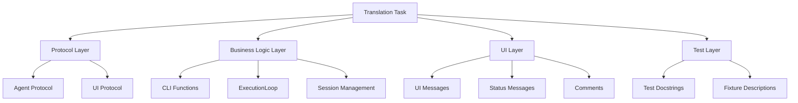

# 사용자의 최초 요청 (기록용)
그 내용 다 넣어서 모든 한국어를 영어로 번역하는 작업 계획서 작성 --parrallel (극도로 보수적 기준에서)

## 사용자가 이후에 추가 요청한 내용들 (기록용)
없음

# 작업 목표
- 코드베이스 내 모든 한국어 docstring, comment, UI 메시지를 영어로 번역
- Protocol/Interface documentation을 영어로 변환
- 사용자 대면 UI 메시지를 영어로 변환
- 테스트 케이스 docstring을 영어로 변환
- 프로젝트의 국제화(i18n) 기반 마련

# 작업 배경
현재 Sisyphus 프로젝트는 한국어로 작성된 docstring, 주석, UI 메시지가 혼재되어 있습니다. 국제 협업 및 오픈소스 프로젝트로의 전환을 위해 모든 코드 문서와 인터페이스를 영어로 통일해야 합니다.

분석 결과:
- 20개 Python 파일에서 한국어 텍스트 발견
- Protocol docstrings (Agent, UIProtocol): 15개
- Function docstrings: 약 8개 함수
- UI 메시지: 6개 항목
- 코드 주석: 약 15개
- 테스트 docstrings: 200개 이상

# 작업 시작 여부
is_execution_started = TRUE

# 모든 목표 달성 여부
is_all_goals_accomplished = FALSE

# 병렬 실행 여부
parallel_requested = TRUE

# 현재 진행 중인 작업
- Phase 2 - Task 4: Translate SessionStore docstrings (sisyphus/core/session.py) - IN PROGRESS ⚙️
  - 작업 내용: sisyphus/core/session.py의 모든 docstring을 영어로 번역

# 필요한 사전 지식

## 기술 스택
- Python 3.12
- Async framework: anyio (asyncio/trio compatibility)
- CLI framework: Typer
- TUI framework: Textual
- Testing: pytest, pytest-anyio
- Type checking: basedpyright
- Linting: ruff

## 번역 원칙
1. **Docstring 번역**: Google style docstring 형식 유지
2. **주석 번역**: 명확하고 간결한 영어 표현 사용
3. **UI 메시지**: 사용자 친화적인 영어로 변환
4. **기술 용어**: 일관된 번역 사용 (Agent, Session, Execute, Verify 등)

## 파일 구조 및 역할

### Core Components
- `sisyphus/agents/base.py`: Agent Protocol 정의
- `sisyphus/ui/base.py`: UI Protocol 정의
- `sisyphus/cli.py`: CLI 진입점 및 메인 로직
- `sisyphus/core/loop.py`: ExecutionLoop 구현
- `sisyphus/core/session.py`: Session 관리
- `sisyphus/core/tasks.py`: Task 검증

### UI Components
- `sisyphus/ui/tui/app.py`: TUI 메인 애플리케이션
- `sisyphus/ui/tui/components/`: TUI 컴포넌트들
- `sisyphus/ui/cli/console.py`: CLI 콘솔

### Tests
- `sisyphus/tests/`: CLI 테스트
- `sisyphus/agents/tests/`: Agent 테스트
- `sisyphus/core/tests/`: Core 로직 테스트
- `sisyphus/ui/tests/`: UI 테스트
- `sisyphus/utils/tests/`: Utility 테스트

## 맥락 이해를 위해 참고해야 할 파일들

### 1. sisyphus/agents/base.py
- **역할**: Agent Protocol 정의 (모든 에이전트가 구현해야 할 인터페이스)
- **참고할 부분**: Protocol 클래스의 docstring과 메서드 docstring
- **예상 코드 구조**:
   ```python
   @runtime_checkable
   class Agent(Protocol):
       """모든 에이전트가 구현해야 하는 프로토콜."""  # 이 부분 번역 필요

       async def initialize(self) -> None:
           """에이전트 초기화."""  # 이 부분 번역 필요
   ```

### 2. sisyphus/ui/base.py
- **역할**: UI Protocol 정의 (모든 UI 구현체가 따라야 할 인터페이스)
- **참고할 부분**: UIProtocol 클래스 및 factory 함수의 docstring
- **주의사항**: UI 생명주기 관련 설명이 포함되어 있어 정확한 번역 필요

### 3. sisyphus/cli.py
- **역할**: CLI 진입점, 메인 실행 로직, UI 메시지
- **참고할 부분**:
   - Function docstrings (validate_url, resolve_theme, create_agent 등)
   - UI 완료 메시지 (시간, 분, 초 표시 포함)
   - 주석들

## 프로젝트 커밋 메시지 스타일
- 간결한 명령형 현재 시제 사용
- 기능 중심 설명: "add", "fix", "refactor", "update"
- 예시:
  - "refactor cli to use work and reset subcommands"
  - "add verify phase resume support with tests"
  - "fix phase transition bug on resume by tracking resume state"

# 작업 계획

## PRDs & Structures



## 구현 세부사항

### 병렬 실행 가능성 분석 (극도로 보수적 기준)

**병렬 실행 가능 그룹**:
1. **Protocol Layer (Group 1)**: `agents/base.py`, `ui/base.py`
   - 이유: 서로 다른 Protocol 정의, 의존성 없음
   - 파일이 완전히 독립적임

2. **Core Business Logic (Group 2)**: `cli.py`, `core/loop.py`, `core/session.py`
   - 주의: cli.py가 loop.py를 import하지만, docstring 번역은 코드 로직에 영향 없음
   - 단, 같은 용어를 일관되게 번역해야 하므로 번역 용어집 필요

3. **Test Files (Group 3)**: 각 테스트 파일들
   - 이유: 테스트 파일들은 서로 독립적
   - 단, 파일 수가 많아 그룹으로 묶어 처리

**순차 실행 필요**:
- UI 메시지는 일관성 검토 필요 → CLI와 TUI 메시지를 순차적으로 처리

### 번역 용어집 (일관성 보장)
| 한국어 | 영어 |
|--------|------|
| 에이전트 | agent |
| 초기화 | initialize |
| 세션 | session |
| 프로토콜 | protocol |
| 메시지 | message |
| 상태 | status |
| 사용자 입력 | user input |
| 실행 루프 | execution loop |
| 정리 | cleanup |
| 검증 | validation |
| 바이너리 경로 | binary path |
| 테마 옵션 | theme option |
| 모든 작업이 완료되었습니다 | All tasks completed |
| 소요 시간 | elapsed time |
| 시간 | hour(s) |
| 분 | minute(s) |
| 초 | second(s) |

# TODOs

## Phase 1: Protocol Layer Translation (Parallel Group 1)

- [x] 1 parallel. Translate Agent Protocol (sisyphus/agents/base.py)
   - [x] 1.1 구현: sisyphus/agents/base.py의 모든 docstring 번역
      - 현재 한국어 docstrings:
        - `"""모든 에이전트가 구현해야 하는 프로토콜."""`
        - `"""에이전트 초기화."""`
        - `"""세션 시작 또는 재개, 실제 세션 ID 반환."""`
        - `"""메시지 전송."""`
        - `"""응답 스트리밍.\n\nNote: 구현체에서는 async generator function (async def + yield)로 구현할 수 있습니다.\n"""`
        - `"""정리."""`
      - 번역 후 영어 docstrings:
        - `"""Protocol that all agents must implement."""`
        - `"""Initialize the agent."""`
        - `"""Start or resume a session, returning the actual session ID."""`
        - `"""Send a message."""`
        - `"""Stream responses.\n\nNote: Implementations can use async generator functions (async def + yield).\n"""`
        - `"""Cleanup resources."""`
   - [x] 1.2 테스트: 변경 후 타입 체크 및 lint 확인
      - [x] `uv run basedpyright sisyphus/agents/base.py`
      - [x] `uv run ruff check sisyphus/agents/base.py`
   - [x] 1.3 관련 테스트 실행
      - [x] `uv run pytest -xvs sisyphus/agents/tests/test_base.py`
   - [x] 1.4 커밋
      - `git add sisyphus/agents/base.py && git commit -m "translate Agent Protocol docstrings to English"`
   - [x] 아래의 가이드대로 진행했을 때 작업 검증 성공 여부
      - [x] 실제로 모든 한국어 docstring이 영어로 번역되었는가?
      - [x] 번역된 docstring이 원래 의미를 정확히 전달하는가?
      - [x] 타입 체크와 lint가 통과하는가?
      - [x] 관련 테스트가 모두 통과하는가?
      - [x] 커밋이 프로젝트 컨벤션에 맞게 작성되었는가?

- [x] 1 parallel. Translate UI Protocol (sisyphus/ui/base.py)
   - **※ 병렬 실행 조건**: Task 1과 완전히 독립적이며, 서로 다른 파일(ui/base.py vs agents/base.py)을 수정하고, 의존성이 전혀 없음
   - [x] 1.1 구현: sisyphus/ui/base.py의 모든 docstring 번역
      - 현재 한국어 docstrings:
        - `"""UI 구현이 따라야 할 프로토콜.\n\nUI 생명주기는 UI 자신이 관리합니다. ExecutionLoop는 UI 생명주기에\n관여하지 않으며, 단지 메시지와 상태를 표시하는 인터페이스만 사용합니다.\n"""`
        - `"""UI 초기화."""`
        - `"""메시지 표시 (source: 'execute' or 'verify')."""`
        - `"""상태 메시지 표시."""`
        - `"""사용자 입력 받기 (TUI only, CLI는 None 반환)."""`
        - `"""UI 팩토리.\n\nArgs:\n    mode: UI 모드 ('tui' 또는 'cli')\n    theme: TUI 테마 ("mocha" | "latte"), None이면 기본값\n\nReturns:\n    UIProtocol을 구현하는 UI 인스턴스\n"""`
      - 번역 후 영어 docstrings:
        - `"""Protocol that UI implementations must follow.\n\nThe UI manages its own lifecycle. ExecutionLoop does not\ninterfere with the UI lifecycle, it only uses the interface to display messages and status.\n"""`
        - `"""Initialize the UI."""`
        - `"""Display a message (source: 'execute' or 'verify')."""`
        - `"""Display a status message."""`
        - `"""Get user input (TUI only, CLI returns None)."""`
        - `"""UI factory.\n\nArgs:\n    mode: UI mode ('tui' or 'cli')\n    theme: TUI theme ("mocha" | "latte"), defaults if None\n\nReturns:\n    UI instance implementing UIProtocol\n"""`
   - [x] 1.2 테스트: 변경 후 타입 체크 및 lint 확인
      - [x] `uv run basedpyright sisyphus/ui/base.py`
      - [x] `uv run ruff check sisyphus/ui/base.py`
   - [x] 1.3 관련 테스트 실행
      - [x] `uv run pytest -xvs sisyphus/ui/tests/test_base.py`
   - [x] 1.4 커밋
      - `git add sisyphus/ui/base.py && git commit -m "translate UI Protocol docstrings to English"`
   - [x] 아래의 가이드대로 진행했을 때 작업 검증 성공 여부
      - [x] 실제로 모든 한국어 docstring이 영어로 번역되었는가?
      - [x] UI 생명주기 설명이 정확히 번역되었는가?
      - [x] 타입 체크와 lint가 통과하는가?
      - [x] 관련 테스트가 모두 통과하는가?
      - [x] 커밋이 프로젝트 컨벤션에 맞게 작성되었는가?

## Phase 2: Core Business Logic Translation (Parallel Group 2 - Phase 1 완료 후 실행)

- [x] 2 parallel. Translate CLI module docstrings and comments (sisyphus/cli.py)
   - **※ 병렬 실행 조건**: Phase 1 완료 후, Task 3, 4와 서로 다른 파일을 수정하며 독립적
   - [x] 2.1 구현: sisyphus/cli.py의 모든 docstring과 주석 번역 (UI 메시지 제외)
      - 번역할 항목들:
        1. ThemeOption enum docstring
        2. validate_url 함수 docstring
        3. resolve_theme 함수 docstring
        4. resolve_binary 함수 docstring
        5. create_agent 함수 docstring
        6. _main_cli 함수 docstring
        7. _main_tui 함수 docstring
        8. monitor_shutdown 함수 docstring
        9. run_execution_loop 함수 docstring
        10. 모든 인라인 주석
   - [x] 2.2 테스트: 변경 후 타입 체크 및 lint 확인
      - [x] `uv run basedpyright sisyphus/cli.py`
      - [x] `uv run ruff check sisyphus/cli.py`
   - [x] 2.3 관련 테스트 실행
      - [x] `uv run pytest -xvs sisyphus/tests/test_cli.py`
   - [x] 2.4 커밋
      - `git add sisyphus/cli.py && git commit -m "translate CLI docstrings and comments to English"`
   - [x] 아래의 가이드대로 진행했을 때 작업 검증 성공 여부
      - [x] 모든 함수 docstring이 영어로 번역되었는가?
      - [x] 모든 주석이 영어로 번역되었는가?
      - [x] UI 메시지는 그대로 남겨두었는가? (Phase 4에서 처리)
      - [x] 타입 체크와 lint가 통과하는가?
      - [x] 테스트가 모두 통과하는가?

- [x] 2 parallel. Translate ExecutionLoop docstrings (sisyphus/core/loop.py)
   - **※ 병렬 실행 조건**: Task 2, 4와 독립적이며 서로 다른 파일 수정
   - [x] 2.1 구현: sisyphus/core/loop.py의 모든 docstring과 주석 번역
      - 번역할 항목들:
        1. ExecutionLoop 클래스 docstring
        2. `__init__` 메서드 docstring
        3. `run` 메서드 docstring (매우 상세함)
        4. 모든 주석들
   - [x] 2.2 테스트: 변경 후 타입 체크 및 lint 확인
      - [x] `uv run basedpyright sisyphus/core/loop.py`
      - [x] `uv run ruff check sisyphus/core/loop.py`
   - [x] 2.3 관련 테스트 실행
      - [x] `uv run pytest -xvs sisyphus/core/tests/test_loop.py`
      - [x] `uv run pytest -xvs sisyphus/core/tests/test_loop__*.py`
   - [x] 2.4 커밋
      - `git add sisyphus/core/loop.py && git commit -m "translate ExecutionLoop docstrings to English"`
   - [x] 아래의 가이드대로 진행했을 때 작업 검증 성공 여부
      - [x] 모든 docstring이 영어로 번역되었는가?
      - [x] ExecutionLoop의 복잡한 로직 설명이 정확히 번역되었는가?
      - [x] 타입 체크와 lint가 통과하는가?
      - [x] 모든 loop 관련 테스트가 통과하는가?

- [x] 2 parallel. Translate SessionStore docstrings (sisyphus/core/session.py)
   - **※ 병렬 실행 조건**: Task 2, 3과 독립적이며 서로 다른 파일 수정
   - [x] 2.1 구현: sisyphus/core/session.py의 모든 docstring 번역
      - 번역할 항목들:
        1. SessionStore 클래스 docstring
        2. `_save_sessions_atomic` 메서드 docstring
        3. 기타 메서드 docstrings
   - [x] 2.2 테스트: 변경 후 타입 체크 및 lint 확인
      - [x] `uv run basedpyright sisyphus/core/session.py`
      - [x] `uv run ruff check sisyphus/core/session.py`
   - [x] 2.3 관련 테스트 실행
      - [x] `uv run pytest -xvs sisyphus/core/tests/test_session.py`
   - [x] 2.4 커밋
      - `git add sisyphus/core/session.py && git commit -m "translate SessionStore docstrings to English"`
   - [x] 아래의 가이드대로 진행했을 때 작업 검증 성공 여부
      - [x] 모든 docstring이 영어로 번역되었는가?
      - [x] 타입 체크와 lint가 통과하는가?
      - [x] 세션 관련 테스트가 모두 통과하는가?

## Phase 3: Test Files Translation (Phase 2 완료 후, 그룹 간 병렬 실행)

- [ ] 3 parallel. Translate CLI test docstrings (sisyphus/tests/test_cli.py)
   - **※ 병렬 실행 조건**: Phase 2 완료 후, 다른 테스트 파일들과 독립적
   - [ ] 3.1 구현: sisyphus/tests/test_cli.py의 모든 테스트 docstring 번역 (약 13개 이상)
   - [ ] 3.2 테스트: 타입 체크 및 lint
      - [ ] `uv run basedpyright sisyphus/tests/test_cli.py`
      - [ ] `uv run ruff check sisyphus/tests/test_cli.py`
   - [ ] 3.3 테스트 실행
      - [ ] `uv run pytest -xvs sisyphus/tests/test_cli.py`
   - [ ] 3.4 커밋
      - `git add sisyphus/tests/test_cli.py && git commit -m "translate CLI test docstrings to English"`
   - [ ] 아래의 가이드대로 진행했을 때 작업 검증 성공 여부
      - [ ] 모든 테스트 docstring이 영어로 번역되었는가?
      - [ ] 테스트가 모두 통과하는가?

- [ ] 3 parallel. Translate Agent test docstrings (sisyphus/agents/tests/)
   - **※ 병렬 실행 조건**: Task 5, 7과 독립적이며 서로 다른 파일들 수정
   - [ ] 3.1 구현: sisyphus/agents/tests/의 모든 테스트 docstring 번역
      - test_claude.py
      - test_opencode.py
      - test_base.py
   - [ ] 3.2 테스트: 타입 체크 및 lint
      - [ ] `uv run basedpyright sisyphus/agents/tests/`
      - [ ] `uv run ruff check sisyphus/agents/tests/`
   - [ ] 3.3 테스트 실행
      - [ ] `uv run pytest -xvs sisyphus/agents/tests/`
   - [ ] 3.4 커밋
      - `git add sisyphus/agents/tests/ && git commit -m "translate agent test docstrings to English"`
   - [ ] 아래의 가이드대로 진행했을 때 작업 검증 성공 여부
      - [ ] 모든 에이전트 테스트 docstring이 번역되었는가?
      - [ ] 모든 테스트가 통과하는가?

- [ ] 3 parallel. Translate Core test docstrings (sisyphus/core/tests/)
   - **※ 병렬 실행 조건**: Task 5, 6과 독립적이며 서로 다른 파일들 수정
   - [ ] 3.1 구현: sisyphus/core/tests/ 내 모든 테스트 파일의 docstring 번역
      - test_loop.py
      - test_loop__*.py (여러 파일)
      - test_prompts.py
      - test_session.py
      - test_tasks.py
   - [ ] 3.2 테스트: 타입 체크 및 lint
      - [ ] `uv run basedpyright sisyphus/core/tests/`
      - [ ] `uv run ruff check sisyphus/core/tests/`
   - [ ] 3.3 테스트 실행
      - [ ] `uv run pytest -xvs sisyphus/core/tests/`
   - [ ] 3.4 커밋
      - `git add sisyphus/core/tests/ && git commit -m "translate core test docstrings to English"`
   - [ ] 아래의 가이드대로 진행했을 때 작업 검증 성공 여부
      - [ ] 모든 core 테스트 docstring이 번역되었는가?
      - [ ] 모든 테스트가 통과하는가?

- [ ] 4. Translate UI and Utils test docstrings (순차 실행)
   - [ ] 4.1 구현: UI 및 Utils 테스트 파일들의 docstring 번역
      - sisyphus/ui/tests/test_base.py
      - sisyphus/ui/tests/test_cli.py
      - sisyphus/ui/tests/test_tui.py
      - sisyphus/utils/tests/test_*.py
   - [ ] 4.2 테스트: 타입 체크 및 lint
      - [ ] `uv run basedpyright sisyphus/ui/tests/ sisyphus/utils/tests/`
      - [ ] `uv run ruff check sisyphus/ui/tests/ sisyphus/utils/tests/`
   - [ ] 4.3 테스트 실행
      - [ ] `uv run pytest -xvs sisyphus/ui/tests/`
      - [ ] `uv run pytest -xvs sisyphus/utils/tests/`
   - [ ] 4.4 커밋
      - `git add sisyphus/ui/tests/ sisyphus/utils/tests/ && git commit -m "translate UI and utils test docstrings to English"`
   - [ ] 아래의 가이드대로 진행했을 때 작업 검증 성공 여부
      - [ ] 모든 UI/Utils 테스트 docstring이 번역되었는가?
      - [ ] 모든 테스트가 통과하는가?

## Phase 4: UI Messages Translation (순차 실행 - 일관성 중요)

- [ ] 5. Translate UI messages in CLI (sisyphus/cli.py)
   - [ ] 5.1 구현: sisyphus/cli.py의 사용자 대면 메시지 번역
      - Line 190: `f"{hours}시간"` → `f"{hours} hour(s)"`
      - Line 192: `f"{minutes}분"` → `f"{minutes} minute(s)"`
      - Line 194: `f"{secs}초"` → `f"{secs} second(s)"`
      - Line 197: `f"✅ 모든 작업이 완료되었습니다. (소요 시간: {elapsed_str})"` → `f"✅ All tasks completed. (Elapsed time: {elapsed_str})"`
      - Line 198: `"Ctrl+C를 눌러 종료하세요."` → `"Press Ctrl+C to exit."`
      - Line 278: `CompletionMessage("모든 작업이 완료되었습니다.", ...)` → `CompletionMessage("All tasks completed.", ...)`
   - [ ] 5.2 테스트: 변경 후 타입 체크 및 lint 확인
      - [ ] `uv run basedpyright sisyphus/cli.py`
      - [ ] `uv run ruff check sisyphus/cli.py`
   - [ ] 5.3 수동 테스트: 실제 CLI 실행하여 메시지 확인
      - [ ] `uv run sisyphus work --no-tui` 실행 후 완료 메시지 확인
      - [ ] 시간 표시 형식이 올바른지 확인
   - [ ] 5.4 커밋
      - `git add sisyphus/cli.py && git commit -m "translate CLI user-facing messages to English"`
   - [ ] 아래의 가이드대로 진행했을 때 작업 검증 성공 여부
      - [ ] 모든 UI 메시지가 영어로 번역되었는가?
      - [ ] 시간 표시 형식이 자연스러운가?
      - [ ] 실제 실행 시 메시지가 올바르게 표시되는가?
      - [ ] 타입 체크와 lint가 통과하는가?

- [ ] 6. Translate remaining UI component messages (if any)
   - [ ] 6.1 구현: TUI 컴포넌트 등에 남아있는 한국어 메시지 번역
      - sisyphus/ui/tui/app.py
      - sisyphus/ui/tui/components/*.py
      - sisyphus/ui/tui/layouts/*.py
   - [ ] 6.2 한국어 텍스트 재검색
      - [ ] `rg "[가-힣]" sisyphus/ui/` 실행하여 누락 확인
   - [ ] 6.3 테스트: 타입 체크 및 lint
      - [ ] `uv run basedpyright sisyphus/ui/`
      - [ ] `uv run ruff check sisyphus/ui/`
   - [ ] 6.4 수동 테스트: TUI 실행하여 메시지 확인
      - [ ] `uv run sisyphus work` 실행 후 UI 메시지 확인
   - [ ] 6.5 커밋 (변경사항이 있는 경우만)
      - `git add sisyphus/ui/ && git commit -m "translate TUI component messages to English"`
   - [ ] 아래의 가이드대로 진행했을 때 작업 검증 성공 여부
      - [ ] UI 컴포넌트에 한국어가 남아있지 않은가?
      - [ ] 실제 TUI 실행 시 모든 메시지가 영어인가?

## Phase 5: Final Verification

- [ ] 7. Global Korean text search and verification
   - [ ] 7.1 전체 한국어 텍스트 검색
      ```bash
      rg "[가-힣]" sisyphus/ --type py
      ```
   - [ ] 7.2 발견된 한국어가 있다면 번역 또는 정당한 이유 확인
      - 예: 테스트 데이터로 사용되는 한글은 유지 가능
   - [ ] 7.3 전체 테스트 스위트 실행
      - [ ] `uv run pytest`
   - [ ] 7.4 전체 타입 체크
      - [ ] `uv run basedpyright sisyphus/`
   - [ ] 7.5 전체 lint 체크
      - [ ] `uv run ruff check sisyphus/`
   - [ ] 7.6 최종 커밋 (수정사항이 있는 경우)
      - `git add -A && git commit -m "fix remaining Korean text in codebase"`
   - [ ] 아래의 가이드대로 진행했을 때 작업 검증 성공 여부
      - [ ] 전체 코드베이스에 문서화 목적의 한국어가 남아있지 않은가?
      - [ ] 모든 테스트가 통과하는가?
      - [ ] 타입 체크와 lint가 모두 통과하는가?
      - [ ] git status가 clean한가?

# 최종 작업 검증 체크리스트
- [ ] 1. Protocol docstrings이 모두 영어로 번역되었는가?
   - 검증: `rg "\"\"\".*[가-힣]" sisyphus/agents/base.py sisyphus/ui/base.py` → 결과 없음
- [ ] 2. Function docstrings이 모두 영어로 번역되었는가?
   - 검증: `rg "\"\"\".*[가-힣]" sisyphus/cli.py sisyphus/core/` → 결과 없음
- [ ] 3. 주석이 모두 영어로 번역되었는가?
   - 검증: `rg "#.*[가-힣]" sisyphus/ --type py` → 테스트 데이터 제외하고 결과 없음
- [ ] 4. UI 메시지가 모두 영어로 번역되었는가?
   - 검증: 실제 CLI 실행 `uv run sisyphus work --no-tui` → 영어 메시지 확인
   - 검증: 실제 TUI 실행 `uv run sisyphus work` → 영어 메시지 확인
- [ ] 5. 테스트 docstrings이 모두 영어로 번역되었는가?
   - 검증: `rg "\"\"\".*[가-힣]" sisyphus/*/tests/ sisyphus/tests/` → 결과 없음
- [ ] 6. 번역 일관성이 유지되었는가?
   - 검증: Agent, Session, Protocol 등 핵심 용어가 일관되게 사용되었는지 확인
   - 검증: 같은 한국어가 같은 영어로 번역되었는지 spot check
- [ ] 7. 모든 테스트가 통과하는가?
   - 검증: `uv run pytest` → 전체 통과
- [ ] 8. 타입 체크가 통과하는가?
   - 검증: `uv run basedpyright sisyphus/` → 에러 없음
- [ ] 9. Lint 체크가 통과하는가?
   - 검증: `uv run ruff check sisyphus/` → 에러 없음
- [ ] 10. 기존 기능이 모두 정상 작동하는가?
   - 검증: CLI 모드 실행 테스트
   - 검증: TUI 모드 실행 테스트
   - 검증: Agent 초기화 및 세션 관리 동작 확인
