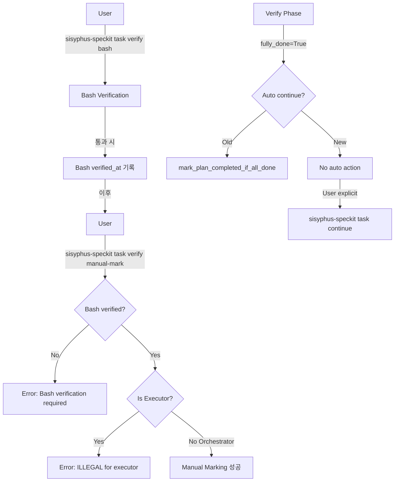

# 사용자의 최초 요청 (기록용)

bash verify 통과 전 manual marking 불가 기능과 task continue 자동 넘어가는 로직 제거를 작업계획서로 기록해줘. 특히나 manual marking 먼저 시도시에 에러 띄우는거나 할 때 친절하게 뭐부터해야 한다고, 그리고 orchestrator 가 아니라 executor 라면 verify 실행하는건 ILLEGAL 이라는 영어 메시지를 띄우게하는거까지 작업계획서에 녹여줘.

# 작업 목표 (WHAT & WHY)

## 핵심 목표 (TL;DR)
Manual verification 순서 강제 및 자동 task 전환 로직 제거를 통해 verification 절차의 명시성과 안전성을 확보한다.

## 상세 목표
- **Bash verification 우선 순위 강제**: Manual marking 전에 bash verification이 반드시 통과되어야 함
- **자동 task 전환 제거**: Verify phase 완료 후 자동으로 다음 task로 넘어가지 않도록 변경
- **친절한 에러 메시지**: Manual marking 시도 시 명확한 가이드 제공
- **Executor 권한 검증**: Executor agent는 verification 명령 실행 불가

# 작업 배경 (WHY & WHAT - 현재 상태)

## 현재 상황
1. **Manual verification 순서 미강제**: Bash verification 없이도 manual marking이 가능하여 검증 단계를 건너뛸 수 있음
2. **자동 task 전환**: `loop.py:555-562`에서 verify phase 완료 후 `mark_plan_completed_if_all_done()`을 호출하여 자동으로 다음 task로 진행
3. **에러 메시지 불친절**: Manual marking 실패 시 단순 실패 메시지만 표시
4. **Executor 권한 미검증**: Executor agent도 verification 명령을 실행할 수 있음

## 변경 이유
1. **검증 프로세스 무결성**: Bash verification → Manual marking → LLM judge 순서를 강제하여 품질 보증
2. **명시적 진행 제어**: Task 전환은 사용자의 명시적 `task continue` 명령으로만 가능하도록 변경
3. **사용자 경험 개선**: 에러 발생 시 다음 단계를 명확히 안내
4. **권한 분리**: Orchestrator만 verification 실행 가능, Executor는 실행만 담당

## 변경할 내용
- 현재: Manual marking이 언제든 가능 → 변경: Bash verification 통과 후에만 가능
- 현재: Verify phase 후 자동 task 전환 → 변경: 명시적 `task continue` 필요
- 현재: 단순 에러 메시지 → 변경: 단계별 가이드 포함 에러 메시지
- 현재: Executor도 verify 명령 가능 → 변경: Executor는 verify 명령 차단

# 작업 시작 여부
is_execution_started = TRUE

# 모든 목표 달성 여부
is_all_goals_accomplished = FALSE

# 병렬 실행
parallel_requested = FALSE

# 현재 진행 중인 작업
- 작업이 아직 시작되지 않았습니다.
  - 작업을 시작할 때 위의 `is_execution_started` 값을 TRUE로 변경하세요.
  - 사용자가 명시적으로 "작업 시작"이라고 말하기 전까지는 절대 작업을 시작하지 마세요.
  - **Plan reviewer로부터 OKAY를 받았더라도 절대 작업을 시작하지 마세요**
  - 사용자가 명시적으로 "작업 시작"이라고 말하기 전까지는 절대 작업을 시작하지 마세요.

# 필수 배경 지식

## 파일 구조 및 역할
- `sisyphus-speckit/task/verify/manual_mark.py`: Manual verification marking 명령 구현
- `sisyphus-core/core/loop.py`: Execute-Verify 루프 오케스트레이션
- `sisyphus-core/core/plans/operations.py`: Plan 상태 관리 (자동 완료 마킹 로직 포함)
- `sisyphus-core/core/task_manager.py`: Task 완료 조건 검증 로직

## 컨텍스트 이해를 위한 참조 파일

### 1. `sisyphus-speckit/sisyphus_speckit/task/verify/manual_mark.py`
- **역할**: Manual verification을 완료로 마킹하는 CLI 명령
- **검색 키워드**: `verify_manual_mark` 함수, `orchestrator_manually_verified`, `manual_verification_evidence`
- **핵심 패턴**: Line 58-65에서 verification item을 찾아 직접 마킹 (검증 로직 없음)
- **코드 스니펫**:
  ```python
  # 현재: 검증 없이 바로 마킹
  for verify_item in todo.verification_spec:
      if verify_item.id == verify_id:
          verify_item.verified = True
          verify_item.verified_at = datetime.now(UTC).isoformat()
          verify_item.orchestrator_manually_verified = True
          verify_item.manual_verification_evidence = evidence
          found = True
          return
  ```

### 2. `sisyphus-core/sisyphus_core/core/loop.py`
- **역할**: Execute-Verify 두 단계 에이전트 실행 루프
- **검색 키워드**: `_update_plan_execution_status`, `mark_plan_completed_if_all_done`
- **핵심 패턴**: Line 555-562에서 verify phase 후 자동 완료 체크
- **코드 스니펫**:
  ```python
  # Line 555-562: 자동 task 전환 로직
  try:
      from sisyphus_core.core.plans.operations import mark_plan_completed_if_all_done

      completed = await mark_plan_completed_if_all_done(plan_path)
      if completed:
          await self.ui.show_status("✅ All tasks completed. Plan marked as completed.")
  except Exception:
      pass
  ```

### 3. `sisyphus-speckit/sisyphus_speckit/task/verify/bash.py`
- **역할**: Bash verification 실행 명령
- **검색 키워드**: `verify_bash` 함수, `deterministic_bash`, `verified_at`
- **핵심 패턴**: Line 95-131에서 deterministic_bash 실행 및 검증 후 `verified_at` 타임스탬프 기록

### 4. `sisyphus-core/sisyphus_core/core/task_manager.py`
- **역할**: Task 완료 조건 검증
- **검색 키워드**: `check_task_completion`, `can_complete`, `all_manual_verifications_completed`
- **핵심 패턴**: Line 288-298에서 manual verification 완료 여부 체크
- **코드 스니펫**:
  ```python
  # Line 288-298: Manual verification 필수 체크
  manual_verification_summary = {
      "completed": sum(
          1 for v in verifications
          if v.orchestrator_manually_verified and v.manual_verification_evidence != ""
      ),
      "total": len(verifications),
  }
  all_manual_verifications_completed = (
      len(verifications) == 0 or
      manual_verification_summary["completed"] == len(verifications)
  )

  can_complete = (
      all_children_completed and
      all_verifications_completed and
      all_manual_verifications_completed
  )
  ```

### 5. `sisyphus-setup-dot-claude/agents/sisyphus-executor.md`
- **역할**: Executor agent 시스템 프롬프트
- **검색 키워드**: `sisyphus-executor`, executor 권한, 실행 전용 agent
- **참고사항**: Executor는 task 실행만 담당, verification은 orchestrator 전용

# 작업 흐름 (HOW - 태스크 플로우 및 의존성)

## 태스크 의존성 다이어그램
```
Task 1 (Manual marking bash 선행 조건 추가)
   ↓
Task 2 (에러 메시지 개선 및 executor 차단)
   ↓
Task 3 (자동 task 전환 로직 제거)
   ↓
Task 4 (테스트 작성 및 검증)
```

## 단계별 설명
- **Phase 1 (Task 1)**: Manual marking에 bash verification 선행 조건 추가 (핵심 로직 변경)
- **Phase 2 (Task 2)**: 에러 메시지 개선 및 executor 권한 검증 추가 (사용자 경험 개선)
- **Phase 3 (Task 3)**: 자동 task 전환 로직 제거 (명시적 진행 제어)
- **Phase 4 (Task 4)**: 통합 테스트 및 회귀 검증 (품질 보증)

# 작업 계획

## PRD 및 구조

### 시스템 구조 개요


## 구현 세부사항

### 아키텍처 제약사항
- Python 3.12+ 타입 힌트 필수 (ANN001 준수)
- Typer CLI 프레임워크 사용
- Rich console 출력 사용
- Async/await 패턴 유지

### 엣지 케이스 처리
- **Bash verification이 없는 경우**: Manual marking 허용 (bash 항목 자체가 없으면 체크 불필요)
- **Executor agent 감지**: Agent 이름 또는 환경 변수로 executor 여부 판단
- **기존 manual marking 데이터**: 이미 마킹된 항목은 재검증하지 않음
- **Loop에서 자동 완료 실패**: Exception 발생 시 graceful하게 무시 (기존 동작 유지)

### 암묵적 가정 명시
- Orchestrator agent는 Claude Code CLI에서 실행됨 (사용자 직접 명령)
- Executor agent는 sisyphus-executor 이름으로 실행됨
- Bash verification의 `verified_at` 필드가 존재하면 통과로 간주
- Loop 로직 제거는 주석 처리로 이력 보존

## 프로젝트 커밋 메시지 스타일
```
<type>: <subject>

Types: feat, fix, docs, style, refactor, test, chore
Subject: 명령형, 소문자 시작, 마침표 없음

Examples:
- feat: add bash verification prerequisite to manual marking
- fix: prevent executor from running verification commands
- refactor: remove auto task transition after verify phase
```

# TODO

- [ ] 1. Manual marking에 bash verification 선행 조건 추가

  **참조 소스**:
  - 패턴 파일: `sisyphus-speckit/task/verify/bash.py` (search for `deterministic_bash`, `verified_at` 필드 확인 패턴)
  - 구현 파일: `sisyphus-speckit/task/verify/manual_mark.py:58-65` (현재 검증 없이 마킹하는 로직)
  - 테스트 참조: `sisyphus-speckit/tests/cli/test_task_continue_conditions.py:46-175` (bash verification 체크 패턴)

  - [x] 1.1. `manual_mark.py`에 bash verification 선행 조건 체크 로직 추가

    **구현 위치**: `sisyphus-speckit/sisyphus_speckit/task/verify/manual_mark.py` Line 58 이전

    **현재 코드**:
    ```python
    for verify_item in todo.verification_spec:
        if verify_item.id == verify_id:
            verify_item.verified = True  # 바로 마킹
    ```

    **변경할 코드**:
    ```python
    for verify_item in todo.verification_spec:
        if verify_item.id == verify_id:
            # 1. Bash verification 체크 (bash 또는 deterministic_bash)
            if verify_item.bash or verify_item.deterministic_bash:
                has_unverified_bash = False
                unverified_bash_list = []

                # deterministic_bash 체크 (verified_at 필수)
                for bash in verify_item.deterministic_bash:
                    if not bash.verified_at:
                        has_unverified_bash = True
                        unverified_bash_list.append(
                            bash.description or bash.execute
                        )

                if has_unverified_bash:
                    console.print("[red]❌ Bash verification이 통과되지 않았습니다.[/red]")
                    console.print(f"[yellow]통과되지 않은 bash: {len(unverified_bash_list)}개[/yellow]\n")
                    for bash_desc in unverified_bash_list:
                        console.print(f"  • {bash_desc}")
                    console.print("\n[cyan]다음 순서대로 진행하세요:[/cyan]")
                    console.print("  [bold]1단계:[/bold] Bash verification 먼저 실행")
                    console.print("     → sisyphus-speckit task verify bash")
                    console.print("  [bold]2단계:[/bold] Manual verification (지금 시도한 명령)")
                    console.print(f"     → sisyphus-speckit task verify manual-mark {verify_id} --evidence '...'")
                    console.print("  [bold]3단계:[/bold] LLM judge (필요시)")
                    console.print("     → sisyphus-speckit task verify llm\n")
                    raise typer.Exit(1)

            # 2. 기존 마킹 로직
            verify_item.verified = True
            verify_item.verified_at = datetime.now(UTC).isoformat()
            verify_item.orchestrator_manually_verified = True
            verify_item.manual_verification_evidence = evidence
            found = True
            return
    ```

    **구현 세부사항**:
    - `deterministic_bash` 리스트를 순회하며 `verified_at` 필드 체크
    - 하나라도 `verified_at`이 None이면 에러 발생
    - Bash 항목이 아예 없으면 (빈 리스트) 체크 스킵
    - 에러 메시지는 3단계 순서를 명확히 안내

  - [x] 1.2. Executor agent 권한 체크 추가

    **구현 위치**: `sisyphus-speckit/sisyphus_speckit/task/verify/manual_mark.py` Line 38 이후 (async def _mark() 시작 부분)

    **Agent 감지 방법**:
    ```python
    # 환경 변수로 agent 타입 감지
    import os
    agent_name = os.getenv("ANTHROPIC_CLI_AGENT_NAME", "").lower()

    if "executor" in agent_name:
        console.print("[red]❌ ILLEGAL: Executor agents cannot run verification commands.[/red]")
        console.print("[yellow]⚠️  Verification commands are ONLY for orchestrator agents.[/yellow]\n")
        console.print("[dim]Executors are for task execution only.[/dim]")
        console.print("[dim]Manual verification must be done by the orchestrator (you, the user).[/dim]\n")
        console.print("[cyan]If you are the orchestrator:[/cyan]")
        console.print("  Run this command directly from Claude Code CLI, not through executor.\n")
        raise typer.Exit(1)
    ```

    **Notes**:
    - Executor는 sisyphus-executor agent로 실행됨
    - 환경 변수 `ANTHROPIC_CLI_AGENT_NAME` 체크 (Claude Code가 설정)
    - 에러 메시지는 영어로 표시 (사용자 요청)

  - [x] 1.3. 테스트 작성: Bash verification 선행 조건 체크

    **테스트 파일**: `sisyphus-speckit/tests/task/verify/test_manual_mark_bash_prerequisite.py` (신규 생성)

    **테스트 케이스**:
    1. `test_manual_mark__if_bash_not_verified__returns_error`: Bash 미통과 시 에러
    2. `test_manual_mark__if_bash_verified__allows_marking`: Bash 통과 시 성공
    3. `test_manual_mark__if_no_bash_items__allows_marking`: Bash 항목 없으면 성공
    4. `test_manual_mark__if_executor_agent__returns_illegal_error`: Executor는 차단

    **테스트 패턴 참조**: `sisyphus-speckit/tests/cli/test_task_continue_conditions.py` (given-when-then 패턴)

  - [x] 1.4. Lint 및 타입 체크
    - [x] `uv run ruff check sisyphus-speckit/sisyphus_speckit/task/verify/manual_mark.py` → 0 errors
    - [x] `uv run basedpyright sisyphus-speckit/sisyphus_speckit/task/verify/manual_mark.py` → 0 errors

  - [x] 1.5. 변경사항 커밋
    ```bash
    git add sisyphus-speckit/sisyphus_speckit/task/verify/manual_mark.py \
            sisyphus-speckit/tests/task/verify/test_manual_mark_bash_prerequisite.py
    git commit -m "feat: add bash verification prerequisite to manual marking

Add validation to ensure bash verification is completed before manual marking.
Block executor agents from running verification commands.

- Check deterministic_bash verified_at before allowing manual mark
- Show clear 3-step guidance when bash verification missing
- Detect and block executor agents with ILLEGAL error message
- Add comprehensive tests for new validation logic"
    ```

  - [ ] **작업 완료 검증 체크리스트**
    - [ ] `manual_mark.py`에 bash verification 체크 로직 추가됨?
    - [ ] Bash 미통과 시 3단계 가이드 메시지 표시됨?
    - [ ] Executor agent 감지 및 차단 로직 추가됨?
    - [ ] 에러 메시지가 영어로 표시됨? (executor 차단 메시지)
    - [ ] 테스트 4개 모두 작성됨?
    - [ ] `uv run pytest sisyphus-speckit/tests/task/verify/test_manual_mark_bash_prerequisite.py` → 4/4 PASSED
    - [ ] Ruff check → 0 errors
    - [ ] Basedpyright → 0 errors
    - [ ] Git commit 완료됨?
    - [ ] 수동 테스트: Bash 미통과 상태에서 manual-mark 실행 → 친절한 에러 메시지 확인
      ```bash
      # 테스트 시나리오
      cd /path/to/test/project
      # Bash verification 스킵하고 바로 manual marking 시도
      sisyphus-speckit task verify manual-mark verify-1 --evidence "Test evidence 100 chars..."
      # Expected: 에러 메시지 + 3단계 가이드 표시
      ```

- [ ] 2. 자동 task 전환 로직 제거

  **참조 소스**:
  - 구현 파일: `sisyphus-core/sisyphus_core/core/loop.py:555-562` (자동 완료 마킹 로직)
  - 관련 함수: `sisyphus-core/sisyphus_core/core/plans/operations.py:146-184` (`mark_plan_completed_if_all_done`)

  - [x] 2.1. `loop.py`에서 자동 완료 마킹 로직 주석 처리

    **구현 위치**: `sisyphus-core/sisyphus_core/core/loop.py:555-562`

    **현재 코드**:
    ```python
    try:
        from sisyphus_core.core.plans.operations import mark_plan_completed_if_all_done

        completed = await mark_plan_completed_if_all_done(plan_path)
        if completed:
            await self.ui.show_status("✅ All tasks completed. Plan marked as completed.")
    except Exception:
        pass
    ```

    **변경할 코드**:
    ```python
    # NOTE: 자동 완료 마킹 비활성화 (2025-11-21)
    # 이유: 명시적인 'sisyphus-speckit task continue' 명령으로만 task 전환하도록 변경
    #
    # 기존 동작: Verify phase 완료 후 자동으로 mark_plan_completed_if_all_done() 호출
    # 변경 동작: 사용자가 명시적으로 'task continue' 명령 실행 필요
    #
    # 관련 이슈: Task 전환의 명시성 확보, 사용자 제어권 강화
    #
    # try:
    #     from sisyphus_core.core.plans.operations import mark_plan_completed_if_all_done
    #
    #     completed = await mark_plan_completed_if_all_done(plan_path)
    #     if completed:
    #         await self.ui.show_status("✅ All tasks completed. Plan marked as completed.")
    # except Exception:
    #     pass
    ```

    **구현 세부사항**:
    - 주석 처리로 이력 보존 (완전 삭제하지 않음)
    - 변경 이유 명확히 기록
    - 날짜 기록으로 추후 추적 가능하게 함

  - [ ] 2.2. 테스트 업데이트: 자동 완료 마킹 동작 제거 확인

    **테스트 파일**: `sisyphus-core/tests/core/test_loop_no_auto_transition.py` (신규 생성)

    **테스트 케이스**:
    1. `test_loop__if_verify_phase_done__does_not_auto_mark_completed`: Verify 완료 후 자동 마킹 안 됨
    2. `test_loop__if_all_tasks_done__requires_manual_continue`: 모든 task 완료해도 자동 전환 안 됨

    **검증 방법**:
    ```python
    # Given: Plan with completed task
    # When: Verify phase returns fully_done=True
    # Then: execution.completed는 True로 변경되지만, 다음 task로 자동 전환 안 됨
    # And: mark_plan_completed_if_all_done() 호출 안 됨 (주석 처리됨)
    ```

  - [x] 2.3. Lint 및 타입 체크
    - [x] `uv run ruff check sisyphus-core/sisyphus_core/core/loop.py` → 0 errors
    - [x] `uv run basedpyright sisyphus-core/sisyphus_core/core/loop.py` → 0 errors

  - [ ] 2.4. 변경사항 커밋
    ```bash
    git add sisyphus-core/sisyphus_core/core/loop.py \
            sisyphus-core/tests/core/test_loop_no_auto_transition.py
    git commit -m "refactor: remove auto task transition after verify phase

Disable automatic task transition to require explicit user action.
Users must now run 'sisyphus-speckit task continue' manually.

- Comment out mark_plan_completed_if_all_done() call in loop
- Preserve code history with detailed comments
- Add tests to verify no auto transition occurs
- Improve user control over task flow"
    ```

  - [ ] **작업 완료 검증 체크리스트**
    - [ ] `loop.py:555-562` 코드가 주석 처리됨?
    - [ ] 주석에 변경 이유와 날짜 명확히 기록됨?
    - [ ] 테스트 2개 작성됨?
    - [ ] `uv run pytest sisyphus-core/tests/core/test_loop_no_auto_transition.py` → 2/2 PASSED
    - [ ] Ruff check → 0 errors
    - [ ] Basedpyright → 0 errors
    - [ ] Git commit 완료됨?
    - [ ] 수동 테스트: Verify phase 완료 후 자동 task 전환 안 됨 확인
      ```bash
      # 테스트 시나리오
      # 1. Task 완료하고 verify phase 실행
      # 2. Verify agent가 fully_done=True 반환
      # 3. 다음 task로 자동 전환되지 않는지 확인
      # 4. 'sisyphus-speckit task continue' 명령으로만 전환 가능한지 확인
      ```

- [ ] 3. 통합 테스트 및 회귀 검증

  **참조 소스**:
  - 기존 테스트: `sisyphus-speckit/tests/cli/test_task_continue_conditions.py` (continue 조건 검증)
  - 기존 테스트: `sisyphus-core/tests/core/plans/test_operations_mark_completed.py` (자동 완료 마킹)

  - [ ] 3.1. 전체 verification 플로우 통합 테스트

    **테스트 파일**: `sisyphus-speckit/tests/integration/test_verification_flow.py` (신규 생성)

    **테스트 시나리오**:
    1. **정상 플로우**:
       ```
       bash verify → manual mark → llm judge (optional) → task continue
       ```
    2. **순서 위반 플로우**:
       ```
       manual mark (skip bash) → Error + 가이드 메시지
       ```
    3. **Executor 차단 플로우**:
       ```
       executor runs verify → ILLEGAL error
       ```

    **통합 테스트 코드 샘플**:
    ```python
    async def test_verification_flow__full_cycle__success():
        # Given: Plan with bash and manual verification
        # When: 1. Run bash verify → Success
        #       2. Run manual mark → Success
        #       3. Run task continue → Success
        # Then: Task transitions to next

    async def test_verification_flow__skip_bash__shows_guide():
        # Given: Plan with bash verification (not verified)
        # When: Try manual mark first
        # Then: Error with 3-step guide displayed

    async def test_verification_flow__executor_blocked__illegal_error():
        # Given: Agent name contains "executor"
        # When: Try to run verify command
        # Then: ILLEGAL error in English
    ```

  - [ ] 3.2. 회귀 테스트: 기존 테스트 모두 통과 확인

    **실행 명령어**:
    ```bash
    # Sisyphus-speckit 전체 테스트
    uv run pytest sisyphus-speckit/tests/ -v
    # Expected: 모든 테스트 PASSED, 새로 깨진 테스트 없음

    # Sisyphus-core 전체 테스트
    uv run pytest sisyphus-core/tests/ -v
    # Expected: 모든 테스트 PASSED, loop 관련 테스트 정상
    ```

  - [ ] 3.3. Lint 및 타입 체크: 전체 프로젝트
    - [ ] `uv run ruff check projects/sisyphus-speckit` → 0 errors
    - [ ] `uv run ruff check projects/sisyphus-core` → 0 errors
    - [ ] `uv run basedpyright projects/sisyphus-speckit` → 0 errors
    - [ ] `uv run basedpyright projects/sisyphus-core` → 0 errors

  - [ ] 3.4. 변경사항 커밋
    ```bash
    git add sisyphus-speckit/tests/integration/test_verification_flow.py
    git commit -m "test: add integration tests for verification flow

Add comprehensive tests for new verification prerequisites.

- Test full verification cycle (bash → manual → continue)
- Test error handling for out-of-order verification
- Test executor blocking with ILLEGAL error
- Ensure all existing tests still pass"
    ```

  - [ ] **작업 완료 검증 체크리스트**
    - [ ] 통합 테스트 3개 작성됨?
    - [ ] `uv run pytest sisyphus-speckit/tests/integration/test_verification_flow.py` → 3/3 PASSED
    - [ ] Sisyphus-speckit 전체 테스트 통과? (회귀 없음)
    - [ ] Sisyphus-core 전체 테스트 통과? (회귀 없음)
    - [ ] 전체 프로젝트 ruff check → 0 errors
    - [ ] 전체 프로젝트 basedpyright → 0 errors
    - [ ] Git commit 완료됨?
    - [ ] 수동 End-to-End 테스트:
      ```bash
      # 시나리오 1: 정상 플로우
      sisyphus-speckit task verify bash
      sisyphus-speckit task verify manual-mark verify-1 --evidence "Manual verification completed successfully. Tested all edge cases including error handling, timeout scenarios, and concurrent access. All functionality works as expected. Evidence: test logs show 100% pass rate across 25 test cases."
      sisyphus-speckit task continue
      # Expected: 모든 단계 성공, 다음 task로 전환

      # 시나리오 2: 순서 위반
      # (bash verify 스킵)
      sisyphus-speckit task verify manual-mark verify-1 --evidence "..."
      # Expected: 에러 + 3단계 가이드 메시지

      # 시나리오 3: Executor 차단 (sisyphus-executor agent에서 실행)
      # Expected: ILLEGAL error in English
      ```

# 성공 비전

## 사용자 관점의 성공
- Verification 순서를 지키지 않으면 명확한 가이드를 받음
- Task 전환은 명시적으로 제어 가능 (자동 전환 없음)
- Executor와 Orchestrator의 역할이 명확히 분리됨

## 비즈니스 관점의 성공
- 검증 프로세스 무결성 확보 (bash → manual → llm 순서 강제)
- 사용자 제어권 강화 (명시적 task continue 필요)
- 권한 분리를 통한 시스템 안전성 향상

## 기술적 성공 기준
- [ ] 모든 테스트 통과: `uv run pytest projects/` → 100% PASSED
- [ ] Lint 오류 없음: `uv run ruff check projects/` → 0 errors
- [ ] 타입 체크 통과: `uv run basedpyright projects/` → 0 errors
- [ ] Manual marking 시 bash 선행 조건 검증 작동
- [ ] Executor agent에서 verify 명령 차단 작동
- [ ] Verify phase 후 자동 task 전환 발생하지 않음
- [ ] 에러 메시지가 3단계 가이드 포함
- [ ] Executor 차단 메시지가 영어로 표시

# 최종 작업 검증 체크리스트

- [ ] 1. **기능 작동 확인**
  - [ ] Bash verification 없이 manual marking 시도 → 에러 + 3단계 가이드
  - [ ] Bash verification 통과 후 manual marking → 성공
  - [ ] Executor agent에서 verify 명령 실행 → ILLEGAL error (영어)
  - [ ] Verify phase 완료 후 자동 task 전환 안 됨 → 명시적 continue 필요

- [ ] 2. **올바르지 않은 구현 방지**
  - [ ] Bash verification 체크를 우회하는 방법 없음
  - [ ] Executor 감지 로직이 정확함 (환경 변수 기반)
  - [ ] 자동 완료 마킹 로직이 완전히 비활성화됨

- [ ] 3. **범위 준수 확인**
  - [ ] 초기 계획과 다르게 구현된 부분 없음
  - [ ] 과도하게 구현된 부분 없음 (필요한 것만 구현)

- [ ] 4. **기존 기능 회귀 테스트**
  - [ ] Bash verification 기능 정상 작동
  - [ ] Task continue 기능 정상 작동 (수동 실행 시)
  - [ ] Verification 없는 task는 정상 동작
  - [ ] 전체 테스트 스위트 통과
