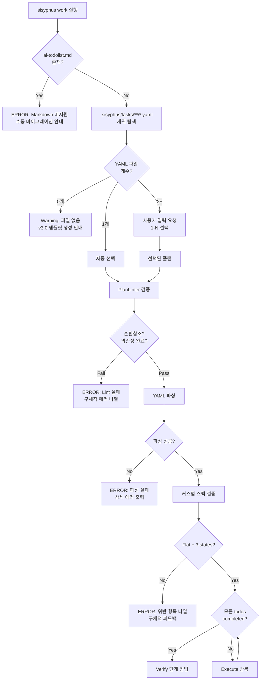

# 작업 계획서: sisyphus work → YAML v3.0 단독 지원 (개정판)

## 사용자 원본 요청

> md 기반의 sisyphus work 명령어를 yaml 3.0 단독으로 지원할 수 있도록 변경.
> .sisyphus 안에 태스크가 단 하나만 있다면 그것을 보게하면되고, 여러개가 있는 상태라면 그 중 하나를 입력받아서 돌리면 됨.
> 유효한 작업계획서인지를 항상 lint 명령어로 검사 - 순환참조, 의존성 완료 여부 체크.

## 작업 목표

### 핵심 목표

`sisyphus work` 명령어를 Markdown(ai-todolist.md) 전용에서 **YAML v3.0 전용**으로 변경. Markdown 사용 시 명시적 에러 + 마이그레이션 안내 제공.

### 상세 목표

- Markdown 파일 감지 시 에러 메시지 + 실행 가능한 대안 안내
- `.sisyphus/tasks/**/*.yaml` 파일 재귀 탐색 (1개: 자동 선택, 2+: 명시적 선택 요구)
- YAML 작업 완료 여부 판단: Flat 구조, 3가지 상태(pending/in_progress/completed)만 허용
- 커스텀 스펙 위반 시 구체적 피드백 제공
- 에러 상황별 명확한 메시지 (파싱, 권한, 버전 불일치 등)

## 작업 배경

### 현재 상황

- `work.py` line 65/137: `Path("ai-todolist.md").exists()` 하드코딩 → Markdown 전용
- `TaskValidator._check_yaml_accomplished()` (line 137-147): v2.1 `PlanLoader` 사용 중
- YAML v3.0 스펙(`models.py`): blocked 상태 + children 재귀 지원 (4가지 상태)
- **사용자 커스텀 스펙**: Flat 구조 + 3가지 상태만 (blocked/children 금지)

### 변경 이유

- Markdown ai-todolist.md 유지보수 부담 제거
- YAML v3.0 구조화된 포맷으로 통일
- 사용자 혼란 최소화 (명확한 에러 메시지)

### 변경 내용

- **Before**: Markdown 감지 → TaskValidator 생성 → 정규식 체크
- **After**: YAML 재귀 탐색 → 커스텀 스펙 검증 → 명확한 피드백

## 작업 시작 여부

is_execution_started = FALSE

## 전체 작업 완료 여부

is_all_goals_accomplished = FALSE

## 병렬 실행 요청

parallel_requested = FALSE

## 현재 진행 중인 작업

- 아직 작업을 시작하지 않았습니다.
  - 사용자가 **명시적으로 "작업 시작"**이라고 말할 때까지 절대 시작하지 마세요.
  - plan-reviewer로부터 OKAY를 받아도 **절대** 작업을 시작하지 마세요.

## 필수 배경 지식

### 사용자 커스텀 v3.0 스펙 (work 명령어 전용)

```python
# models.py 실제 스펙 (기존)
class TodoStatus(str, Enum):
    pending = "pending"
    in_progress = "in_progress"
    completed = "completed"
    blocked = "blocked"  # 4가지 상태

class Todo(BaseModel):
    children: list[Todo] | None = None  # 재귀 구조 허용
```

**work 명령어 커스텀 스펙 (사용자 요청)**:
- **3가지 상태만**: `pending`, `in_progress`, `completed` (blocked 금지)
- **Flat 구조만**: `children` 필드 금지
- **중요**: `models.py`는 수정하지 않음 (`sisyphus task` 명령어 호환성 유지)

### 선택 단위 정의 (plan-reviewer 지적 반영)

**"태스크" 선택 단위**: **YAML 파일**
- 사용자 요청: ".sisyphus 안에 태스크가 여러 개면 하나를 입력받아서"
- 해석: `.sisyphus/tasks/**/*.yaml` 파일 중 하나 선택

**단일 YAML 내 복수 work_plans 처리**:
- **기본 정책**: 첫 번째 work_plan만 사용 (`doc.work_plans[0]`)
- **근거**: work 명령어는 simple use case 타겟 (복잡한 멀티플랜은 `sisyphus task` 사용)
- **향후 확장**: 필요 시 work_plan 선택 UI 추가 가능

### 파일 구조

```
sisyphus-cli/
├── sisyphus/cli/work.py         # Line 65,137: Markdown 하드코딩
├── sisyphus/core/tasks.py       # TaskValidator, Line 137-147: v2.1 로더 사용
├── sisyphus/core/plans/
│   ├── models.py               # PlanDocument, Todo (blocked+children 포함)
│   └── loader.py               # load_plan() - async 함수
├── sisyphus/core/plan_linter.py # 순환참조/의존성 검증
└── sisyphus/core/status/manager.py  # StatusManager
```

### 핵심 참조 파일

**1. `work.py:65,137` (파일 감지 로직)**
- 검색: `Path("ai-todolist.md").exists()`
- 현재: Markdown 하드코딩
- 변경: YAML 재귀 탐색 로직으로 교체

**2. `tasks.py:137-147` (`_check_yaml_accomplished()`)**
- 검색: `from sisyphus.core.plan_loader import PlanLoader`
- 현재: v2.1 로더 사용 (`plan.status.execution.completed`)
- 변경: v3.0 로더 + 커스텀 스펙 검증 + 피드백

**3. `loader.py:11-43` (`load_plan()` 함수)**
- 검색: `async def load_plan(path: Path) -> PlanDocument`
- 패턴: anyio 기반 async 파일 읽기 + ruamel.yaml 파싱
- **중요**: async 함수 → TaskValidator는 동기 → 동기 래퍼 필요

**4. `plan_linter.py:1025-1060` (의존성 검증)**
- 검색: `validate_depends_on()`
- 기능: 순환참조(`detect_cycles`) + 존재하지 않는 plan_id 체크
- 활용: 커스텀 스펙 검증 시 참고

**5. `status/manager.py:84-131` (worktree 감지)**
- 검색: `async def detect_worktree(cls)`
- 기능: git worktree root 찾기
- 활용: 상대 경로 → 절대 경로 변환

**6. `models.py:9-14` (TodoStatus Enum)**
- 검색: `class TodoStatus(str, Enum)`
- 사용: `TodoStatus.pending`, `TodoStatus.completed` 등
- **중요**: Enum 직접 비교 필수 (`todo.status == TodoStatus.completed`)

## 작업 흐름



## 세부 구현 계획

### 1. work.py: YAML 파일 감지 로직 추가 (UX 개선 반영)

**파일**: `projects/sisyphus-cli/sisyphus/cli/work.py`

**수정 위치**: Line 65, Line 137

**현재 코드**:
```python
# Line 65 (_main_cli)
task_validator = TaskValidator() if Path("ai-todolist.md").exists() else None

# Line 137 (_main_tui)
task_validator = TaskValidator() if Path("ai-todolist.md").exists() else None
```

**변경 코드** (plan-reviewer 권장사항 반영):
```python
# _validate_plan() 함수 추가 (Lint 연동 - 사용자 요청 반영)
async def _validate_plan(plan_path: Path, ui: UIProtocol) -> None:
    """Validate YAML plan with PlanLinter (순환참조, 의존성 완료 체크).

    Scope: 단일 YAML 파일 내부 work_plans 간 검증
    (사용자 요구사항: "하나를 입력받아서 돌리면 됨" → 단일 파일 실행)

    Args:
        plan_path: Path to YAML plan file
        ui: UI Protocol implementation

    Raises:
        ValueError: If validation fails (circular dependencies, missing plans, incomplete dependencies)
    """
    from sisyphus.core.plan_linter import PlanLinter
    from sisyphus.core.plans.loader import load_plan
    from sisyphus.core.plans.models import TodoStatus

    # YAML 파싱 (async)
    try:
        plan_doc = await load_plan(plan_path)
    except Exception as e:
        await ui.show_status(f"[red]Failed to load plan: {e}[/red]")
        raise ValueError(f"Plan load failed: {plan_path}") from e

    # PlanLinter 검증 (순환참조, 존재하지 않는 depends_on)
    # NOTE: validate_depends_on()은 단일 PlanDocument 내부 work_plans만 검증
    linter = PlanLinter(schema_doc={})
    depends_errors = linter.validate_depends_on(plan_doc, plan_path)

    if depends_errors:
        await ui.show_status(
            "[bold red]Plan validation failed (lint errors):[/bold red]\n\n"
            + "\n".join(f"  - {err}" for err in depends_errors) + "\n\n"
            "Fix: Address all lint errors before running 'sisyphus work'."
        )
        raise ValueError(f"Lint validation failed: {len(depends_errors)} errors")

    # 의존성 완료 여부 체크 (단일 PlanDocument 내부만)
    # NOTE: 다른 YAML 파일을 참조하는 depends_on은 현재 범위 밖 (향후 확장 가능)
    plans_map = {plan.id: plan for plan in plan_doc.work_plans}

    for plan in plan_doc.work_plans:
        for dep_id in plan.depends_on:
            # 같은 파일 내부의 의존 플랜만 체크
            if dep_id in plans_map:
                dep_plan = plans_map[dep_id]
                # 모든 todos가 completed인지 체크
                all_completed = all(t.status == TodoStatus.completed for t in dep_plan.todos)
                if not all_completed:
                    incomplete_count = sum(
                        1 for t in dep_plan.todos if t.status != TodoStatus.completed
                    )
                    await ui.show_status(
                        f"[red]Dependency not completed:[/red]\n\n"
                        f"  Plan '{plan.id}' depends on '{dep_id}', "
                        f"but '{dep_id}' has {incomplete_count} incomplete todo(s).\n\n"
                        "Fix: Complete all todos in dependent plans first."
                    )
                    raise ValueError(f"Dependency '{dep_id}' not completed")
            # 다른 파일 참조는 PlanLinter.validate_depends_on()에서 이미 에러 발생
            # (존재하지 않는 plan_id로 감지됨)

# _detect_plan_path() 함수 추가 (anyio 컨텍스트 내부용)
async def _detect_plan_path(ui: UIProtocol) -> Path | None:
    """Detect YAML plan file with improved UX.

    Priority:
    1. Error if ai-todolist.md exists (Markdown not supported)
    2. Auto-select if .sisyphus/tasks/**/*.yaml == 1 file (재귀 탐색)
    3. Error if multiple YAML files (need manual selection)

    Returns:
        Path to YAML file or None

    Raises:
        ValueError: If Markdown exists or multiple plans found
    """
    # 1. Markdown 에러 (개선: 실행 가능한 마이그레이션 안내)
    if Path("ai-todolist.md").exists():
        await ui.show_status(
            "[bold red]ERROR: ai-todolist.md not supported in v3.0 work command.[/bold red]\n\n"
            "Migration options:\n"
            "1. Manual: Create YAML plan with 'vi .sisyphus/tasks/my-plan.yaml'\n"
            "2. Use legacy v2.1 workflow (if available in your version)\n\n"
            "v3.0 YAML template example:\n"
            "  version: \"3.0\"\n"
            "  metadata:\n"
            "    created_at: \"2025-11-04T00:00:00Z\"\n"
            "  work_plans:\n"
            "    - id: \"plan-001\"\n"
            "      name: \"My Work\"\n"
            "      todos: [...]"
        )
        raise ValueError("Markdown not supported")

    # 2. YAML 파일 재귀 탐색 (워크트리 기준 경로 - Codex 권장)
    from sisyphus.core.status.manager import StatusManager

    # 워크트리 루트 기준 경로 (서브디렉터리에서 실행 시에도 정상 탐색)
    worktree_root = await StatusManager.detect_worktree()
    tasks_dir = worktree_root / ".sisyphus" / "tasks"

    if not tasks_dir.exists():
        await ui.show_status(
            "[yellow]No '.sisyphus/tasks/' directory found.[/yellow]\n\n"
            "Create v3.0 YAML plan:\n"
            "  mkdir -p .sisyphus/tasks\n"
            "  vi .sisyphus/tasks/my-plan.yaml"
        )
        return None

    # 재귀 탐색 + 대소문자 무시
    yaml_files = [
        f for f in tasks_dir.glob("**/*.y*ml")
        if f.suffix.lower() in (".yaml", ".yml")
    ]

    if len(yaml_files) == 0:
        await ui.show_status(
            "[yellow]No YAML plans in '.sisyphus/tasks/'.[/yellow]\n\n"
            "Create v3.0 YAML plan:\n"
            "  vi .sisyphus/tasks/my-plan.yaml"
        )
        return None
    elif len(yaml_files) == 1:
        return yaml_files[0].absolute()
    else:
        # 다중 YAML: 사용자 선택 입력 (사용자 요청 반영)
        rel_paths = [f.relative_to(Path.cwd()) for f in yaml_files]

        # CLI 모드: typer.prompt 사용 가능
        # TUI 모드: ui.get_input() 사용 (UIProtocol 메서드)
        await ui.show_status(
            f"[yellow]Multiple YAML plans found ({len(yaml_files)} files).[/yellow]\n\n"
            "Available plans:"
        )

        for idx, path in enumerate(rel_paths, start=1):
            await ui.show_status(f"  {idx}. {path}")

        # 입력 받기 (TUI: get_input returns queued input, CLI: typer.prompt with anyio wrapper)
        # UIProtocol.get_input() signature: async def get_input(self) -> str | None (NO parameters)

        # TUI 모드: show_status로 프롬프트 표시 후 get_input() 호출
        from sisyphus.ui.tui import TUI
        if isinstance(ui, TUI):
            await ui.show_status(f"\n[yellow]Enter selection (1-{len(yaml_files)}):[/yellow]")
            selection = await ui.get_input()
            if selection is None:
                raise ValueError("User cancelled selection")
        else:
            # CLI 모드: anyio.to_thread.run_sync로 typer.prompt 래핑 (이벤트 루프 블로킹 방지)
            import typer
            selection = str(await anyio.to_thread.run_sync(
                lambda: typer.prompt(
                    f"Select plan (1-{len(yaml_files)})",
                    default=1,
                    type=int
                )
            ))

        try:
            idx = int(selection) - 1
            if idx < 0 or idx >= len(yaml_files):
                raise ValueError("Index out of range")
            return yaml_files[idx].absolute()
        except (ValueError, IndexError) as e:
            await ui.show_status(f"[red]Invalid selection: {selection}[/red]")
            raise ValueError(f"Invalid plan selection: {selection}") from e

# Line 65 수정 (Lint 연동 추가)
plan_path = await _detect_plan_path(ui)
if plan_path:
    # Lint 검사 (순환참조, 의존성 완료 여부)
    await _validate_plan(plan_path, ui)
task_validator = TaskValidator(plan_path) if plan_path else None

# Line 137 수정 (Lint 연동 추가)
plan_path = await _detect_plan_path(ui)
if plan_path:
    # Lint 검사 (순환참조, 의존성 완료 여부)
    await _validate_plan(plan_path, ui)
task_validator = TaskValidator(plan_path) if plan_path else None
```

### 2. tasks.py: 동기 v3.0 로더 추가 (에러 처리 강화)

**파일**: `projects/sisyphus-cli/sisyphus/core/tasks.py`

**작업 1**: `__init__` 수정 (캐시 추가)

```python
def __init__(self, todolist_path: Path = Path("./ai-todolist.md")) -> None:
    self.todolist_path = todolist_path
    self._last_valid_doc: PlanDocument | None = None
    self._last_mtime: float | None = None
```

**작업 2**: 동기 로더 메서드 추가 (기존 load_plan() 재사용 - Codex 권장)

```python
def _load_yaml_with_cache(self) -> PlanDocument:
    """Load v3.0 YAML with mtime caching (기존 load_plan() 재사용).

    Returns:
        PlanDocument

    Raises:
        PermissionError: If file is not readable
        ValueError: If version is not 3.0 or parse error
        FileNotFoundError: If file doesn't exist
    """
    from sisyphus.core.plans.loader import load_plan
    import anyio

    # 파일 존재 확인
    if not self.todolist_path.exists():
        raise FileNotFoundError(f"Plan file not found: {self.todolist_path}")

    # mtime 캐시 체크
    try:
        current_mtime = self.todolist_path.stat().st_mtime
    except PermissionError as e:
        raise PermissionError(f"Cannot access file: {self.todolist_path}") from e

    if self._last_mtime == current_mtime and self._last_valid_doc:
        return self._last_valid_doc

    # 기존 async load_plan() 재사용 (동기 래핑)
    # NOTE: anyio.from_thread.run()은 async 컨텍스트 밖에서 async 함수 호출
    # TaskValidator는 동기 코드이므로 anyio.run() 사용
    try:
        doc = anyio.run(load_plan, self.todolist_path)
    except Exception as e:
        # load_plan()에서 발생하는 에러를 그대로 전파
        raise

    # 캐시 갱신
    self._last_valid_doc = doc
    self._last_mtime = current_mtime
    return doc
```

**장점** (Codex 권장):
- 버전 검증 로직 단일 소스 (loader.py)
- 에러 메시지 일관성
- YAML 파싱 로직 중복 제거 → 유지보수 부담 감소

**작업 3**: `_check_yaml_accomplished()` v2.1 로직 삭제 + v3.0 교체 (피드백 강화)

```python
def _check_yaml_accomplished(self) -> bool:
    """Check v3.0 YAML completion with detailed feedback.

    Custom spec (work command):
    - Flat structure (no children)
    - 3 states only (pending/in_progress/completed)

    Returns:
        True if all completed and custom spec valid
    """
    from sisyphus.core.plans.models import TodoStatus
    import logging

    logger = logging.getLogger(__name__)

    doc = self._load_yaml_with_cache()

    # 빈 work_plans 체크
    if not doc.work_plans:
        logger.warning(
            f"YAML has no work_plans: {self.todolist_path}. "
            "Cannot determine completion status."
        )
        return False

    if not doc.work_plans[0].todos:
        logger.warning(
            f"Work plan '{doc.work_plans[0].id}' has no todos. "
            "Cannot determine completion status."
        )
        return False

    work_plan = doc.work_plans[0]
    violations = []  # 커스텀 스펙 위반 수집

    for todo in work_plan.todos:
        # 커스텀 스펙 검증
        # NOTE: children is not None (빈 리스트도 금지, 필드 존재 자체를 금지)
        if todo.children is not None:
            violations.append(
                f"Todo '{todo.id}' ('{todo.title}') has children field. "
                "work command requires flat structure (children field must be None)."
            )
        if todo.status == TodoStatus.blocked:
            violations.append(
                f"Todo '{todo.id}' ('{todo.title}') has 'blocked' status. "
                "work command allows only: pending, in_progress, completed."
            )
        if todo.status != TodoStatus.completed:
            # 미완료 (스펙은 통과했지만 작업 진행 중)
            pass

    # 커스텀 스펙 위반 발견 시 Hard Fail (work 명령 커스텀 스펙은 강제 요구사항)
    if violations:
        error_msg = (
            f"Custom spec violations in {self.todolist_path}:\n"
            + "\n".join(f"  - {v}" for v in violations) + "\n\n"
            "work command requires:\n"
            "  - Flat structure (no children field)\n"
            "  - 3 states only (pending, in_progress, completed)\n\n"
            "Tip: Use 'sisyphus task continue' for full v3.0 support (blocked state, children)."
        )
        logger.error(error_msg)
        raise ValueError(f"Custom spec violated: {len(violations)} error(s)")

    # 모든 todos completed 확인
    return all(t.status == TodoStatus.completed for t in work_plan.todos)
```

### 3. tasks.py: check_all_* 메서드 v3.0 대응 (대소문자 확장자)

**작업**: `check_all_goals_accomplished()` 수정

```python
def check_all_goals_accomplished(self, content: str | None = None) -> bool:
    """Check if all goals accomplished (Markdown or v3.0 YAML)."""
    # 대소문자 무시 확장자 체크
    if self.todolist_path.suffix.lower() in (".yaml", ".yml"):
        return self._check_yaml_accomplished()

    # Markdown (기존 로직)
    if content is None:
        content = self.read_content()
    pattern = r"is_all_goals_accomplished\s*=\s*TRUE"
    return bool(re.search(pattern, content, re.IGNORECASE))
```

**작업**: `check_all_checkboxes_completed()` 수정

```python
def check_all_checkboxes_completed(self, content: str | None = None) -> bool:
    """Check if all checkboxes completed (Markdown or v3.0 YAML)."""
    # 대소문자 무시 확장자 체크
    if self.todolist_path.suffix.lower() in (".yaml", ".yml"):
        # YAML: Markdown 체크박스 로직 우회
        return True  # ExecutionLoop AND 조건 통과용

    # Markdown (기존 로직)
    if content is None:
        content = self.read_content()
    unchecked = re.findall(r"^\s*-\s*\[\s*\]", content, re.MULTILINE)
    if unchecked:
        return False
    checked = re.findall(r"^\s*-\s*\[x\]", content, re.MULTILINE | re.IGNORECASE)
    return len(checked) > 0
```

### 4. tasks.py: TUI 진행률 v3.0 대응 (대소문자 확장자)

**작업 1**: `count_total_checkboxes()` 수정

```python
def count_total_checkboxes(self, content: str | None = None) -> int:
    """Count total checkboxes (Markdown or v3.0 YAML todos)."""
    # 대소문자 무시 확장자 체크
    if self.todolist_path.suffix.lower() in (".yaml", ".yml"):
        doc = self._load_yaml_with_cache()
        if not doc.work_plans:
            return 0
        return len(doc.work_plans[0].todos)

    # Markdown (기존 로직)
    if content is None:
        content = self.read_content()
    unchecked = re.findall(r"^\s*-\s*\[\s*\]", content, re.MULTILINE)
    checked = re.findall(r"^\s*-\s*\[x\]", content, re.MULTILINE | re.IGNORECASE)
    return len(unchecked) + len(checked)
```

**작업 2**: `count_completed_checkboxes()` 수정

```python
def count_completed_checkboxes(self, content: str | None = None) -> int:
    """Count completed checkboxes (Markdown or v3.0 YAML todos)."""
    # 대소문자 무시 확장자 체크
    if self.todolist_path.suffix.lower() in (".yaml", ".yml"):
        from sisyphus.core.plans.models import TodoStatus

        doc = self._load_yaml_with_cache()
        if not doc.work_plans:
            return 0
        work_plan = doc.work_plans[0]
        return sum(1 for t in work_plan.todos if t.status == TodoStatus.completed)

    # Markdown (기존 로직)
    if content is None:
        content = self.read_content()
    checked = re.findall(r"^\s*-\s*\[x\]", content, re.MULTILINE | re.IGNORECASE)
    return len(checked)
```

## 성공 비전

### 사용자 관점

- Markdown 파일 사용 시 명확한 에러 메시지 + **실행 가능한 대안** 제시
- YAML 파일 1개: 자동 선택되어 즉시 작업 진행
- YAML 파일 여러 개: **상대 경로 나열** + 임시 해결책 안내
- 커스텀 스펙 위반 시: **어떤 todo가 왜 실패했는지** 명확히 확인

### 기술적 성공 기준

- `sisyphus work` 실행 → Markdown 감지 시 구체적 에러 + 마이그레이션 템플릿
- YAML 1개 → 자동 선택 → TaskValidator 정상 동작
- YAML 여러 개 → 파일 목록 + 임시 해결책
- YAML 파싱 에러 → 에러 타입별 명확한 메시지
- TUI 진행률: "X/Y" 정상 표시 (YAML 기반)
- 커스텀 스펙 위반 → **로그에 위반 항목 나열** + 작업 진행 안 됨

## plan-reviewer 권장사항 반영 내역

### ✅ CRITICAL-1. UIProtocol API 수정 (Codex 지적)

**문제점**:
```python
# 잘못된 API 사용 (런타임 TypeError 발생)
selection = await ui.get_input(prompt, default="1")  # get_input()은 인자가 없음!
```

**수정 후**:
```python
# TUI: show_status로 프롬프트 표시 + get_input() 인자 없이 호출
from sisyphus.ui.tui import TUI
if isinstance(ui, TUI):
    await ui.show_status(f"\n[yellow]Enter selection (1-{len(yaml_files)}):[/yellow]")
    selection = await ui.get_input()  # 인자 없음

# CLI: anyio.to_thread.run_sync로 typer.prompt 래핑 (이벤트 루프 블로킹 방지)
else:
    selection = str(await anyio.to_thread.run_sync(
        lambda: typer.prompt(f"Select plan (1-{len(yaml_files)})", default=1, type=int)
    ))
```

### ✅ CRITICAL-2. 의존성 완료 검사 범위 명확화 (Codex 지적)

**문제점**:
- 멀티파일 간 의존성 검사 로직 없음
- 사용자 요구사항("하나를 입력받아서 돌리면 됨")과 불일치

**수정 후**:
```python
# Scope 명시: 단일 YAML 파일 내부 work_plans만 검증
# NOTE: validate_depends_on()은 단일 PlanDocument 내부만 검증
# NOTE: 다른 YAML 파일을 참조하는 depends_on은 현재 범위 밖 (향후 확장 가능)
plans_map = {plan.id: plan for plan in plan_doc.work_plans}
for plan in plan_doc.work_plans:
    for dep_id in plan.depends_on:
        if dep_id in plans_map:  # 같은 파일 내부만
            # ... 완료 여부 검사
```

### ✅ CRITICAL-3. 커스텀 스펙 Hard Fail 정책 명시 (Codex 지적)

**수정 전**:
```python
if violations:
    logger.error(...)
    return False  # 단순 False 반환 (작업 계속 진행 가능?)
```

**수정 후**:
```python
# Hard Fail: work 명령 커스텀 스펙은 강제 요구사항
if violations:
    error_msg = (
        f"Custom spec violations in {self.todolist_path}:\n"
        + "\n".join(f"  - {v}" for v in violations) + "\n\n"
        "work command requires:\n"
        "  - Flat structure (no children field)\n"
        "  - 3 states only (pending, in_progress, completed)\n"
    )
    logger.error(error_msg)
    raise ValueError(f"Custom spec violated: {len(violations)} error(s)")  # Hard Fail
```

### ✅ 1. UX 메시지 정합성 확보 [HIGH]

**수정 전**:
```python
"Use 'sisyphus plan select <name>'."  # 존재하지 않는 명령어
"Run 'sisyphus plan init'"  # v2.1 템플릿 생성 (work 명령어와 충돌)
"Use 'sisyphus plan convert-legacy'"  # 미구현 명령어
```

**수정 후**:
```python
# 다중 플랜: 상대 경로 나열 + 임시 해결책
"Workaround: Temporarily move unused plans outside .sisyphus/tasks/"

# YAML 0개: v3.0 템플릿 직접 생성 안내
"Create v3.0 YAML plan:\n  vi .sisyphus/tasks/my-plan.yaml"

# Markdown: 수동 마이그레이션 + v3.0 템플릿 예시
"Migration options:\n1. Manual: Create YAML plan with 'vi ...'"
```

### ✅ 2. YAML 탐색 패턴 통일 [MEDIUM]

**수정 전**:
```python
yaml_files = list(tasks_dir.glob("*.y*ml"))  # 비재귀 (v3.0 로더와 불일치)
```

**수정 후**:
```python
yaml_files = [
    f for f in tasks_dir.glob("**/*.y*ml")  # 재귀 탐색 (v3.0 로더와 일관성)
    if f.suffix.lower() in (".yaml", ".yml")  # 대소문자 무시 추가
]
```

### ✅ 3. 커스텀 스펙 위반 시 피드백 강화 [MEDIUM]

**수정 전**:
```python
if todo.children:
    return False  # 단순 False 반환, 이유 전달 안 됨
if todo.status == TodoStatus.blocked:
    return False
```

**수정 후**:
```python
violations = []
for todo in work_plan.todos:
    if todo.children:
        violations.append(
            f"Todo '{todo.id}' ('{todo.title}') has children. "
            "work command requires flat structure."
        )
    if todo.status == TodoStatus.blocked:
        violations.append(
            f"Todo '{todo.id}' ('{todo.title}') has 'blocked' status. "
            "work command allows only: pending, in_progress, completed."
        )

if violations:
    logger.error(
        f"Custom spec violations in {self.todolist_path}:\n"
        + "\n".join(f"  - {v}" for v in violations)
    )
    return False
```

### ✅ 4. 대소문자 확장자 처리 [LOW]

**수정 전**:
```python
if self.todolist_path.suffix in (".yaml", ".yml"):  # .YAML, .YML 미지원
```

**수정 후**:
```python
if self.todolist_path.suffix.lower() in (".yaml", ".yml"):  # 대소문자 무시
```

### ✅ 5. 에러 메시지 세분화 [LOW]

**수정 전**:
```python
raise ValueError(f"Expected v3.0, got {version}")  # 단순 메시지
```

**수정 후**:
```python
# 버전 필드 누락
if not version:
    raise ValueError(
        f"Missing 'version' field in {self.todolist_path}. "
        "v3.0 YAML requires 'version: \"3.0\"' at root."
    )

# 버전 불일치
if version != "3.0":
    raise ValueError(
        f"Unsupported version '{version}' in {self.todolist_path}. "
        "work command requires version 3.0."
    )

# YAML 파싱 에러
except YAMLError as e:
    raise ValueError(f"YAML parse error in {self.todolist_path}: {e}")

# 파일 권한 에러
except PermissionError as e:
    raise PermissionError(f"Cannot read file: {self.todolist_path}")
```

## TODO 리스트

- [ ] 1. work.py에 `_detect_plan_path()` 함수 추가 (UX 개선 반영)

  **참조**:
  - 패턴: `loader.py:11-43` (async 파일 읽기 패턴)
  - 재귀 탐색: `**/*.y*ml` (v3.0 로더 일관성)

  - [ ] 1.1 구현: `_validate_plan()` 함수 작성 (Lint 연동 - 사용자 핵심 요구사항)
    - PlanLinter.validate_depends_on() 호출
    - 순환참조 검사
    - 의존성 완료 여부 검사 (depends_on의 모든 todos가 completed인지)
    - 에러 시 구체적 메시지 + 실행 중단

  - [ ] 1.2 구현: `_detect_plan_path()` 함수 작성
    - Markdown 감지 → 에러 + v3.0 템플릿 예시
    - YAML 파일 재귀 탐색 + 대소문자 무시
    - 여러 개 시 사용자 선택 입력 (TUI: ui.get_input, CLI: typer.prompt)

  - [ ] 1.3 수정: `_main_cli()` line 65
    - 기존: `TaskValidator() if Path("ai-todolist.md").exists() else None`
    - 변경: `await _detect_plan_path(ui)` + `await _validate_plan(plan_path, ui)` 호출

  - [ ] 1.4 수정: `_main_tui()` line 137
    - 동일하게 `await _detect_plan_path(ui)` + `await _validate_plan(plan_path, ui)` 호출

  - [ ] **검증**:
    - [ ] Markdown 있을 때 → 에러 + 템플릿 출력
    - [ ] YAML 0개 → v3.0 생성 안내
    - [ ] YAML 1개 → 자동 선택
    - [ ] YAML 2+개 → 사용자 선택 프롬프트 + 입력
    - [ ] 서브디렉터리 YAML → 재귀 탐색 확인
    - [ ] .YAML, .YML 확장자 → 대소문자 무시 확인
    - [ ] Lint: 순환참조 → 에러 + 구체적 메시지
    - [ ] Lint: 의존성 미완료 → 에러 + 구체적 메시지
    - [ ] Lint: 정상 플랜 → 검증 통과

- [ ] 2. tasks.py에 v3.0 동기 로더 추가 (에러 세분화 반영)

  **참조**:
  - 파싱: `loader.py:29-30` (ruamel.yaml 패턴)
  - Enum: `models.py:9-14` (`TodoStatus` 직접 비교)

  - [ ] 2.1 수정: `__init__` 메서드에 캐시 필드 추가
    - `_last_valid_doc: PlanDocument | None = None`
    - `_last_mtime: float | None = None`

  - [ ] 2.2 구현: `_load_yaml_with_cache()` 메서드 (에러 세분화)
    - mtime 기반 캐싱
    - 파일 권한 체크
    - YAML 파싱 에러 구분
    - 버전 필드 누락/불일치 메시지

  - [ ] 2.3 수정: `_check_yaml_accomplished()` v2.1 로직 삭제 (피드백 강화)
    - v2.1 `PlanLoader` import 제거
    - v3.0 로직으로 완전 교체
    - 커스텀 스펙 위반 리스트 수집 → 로깅

  - [ ] **검증**:
    - [ ] YAML 파싱 성공
    - [ ] 캐싱 동작 (mtime)
    - [ ] 권한 에러 → PermissionError
    - [ ] 버전 누락 → 명확한 메시지
    - [ ] 버전 불일치 → 명확한 메시지
    - [ ] 커스텀 스펙 위반 → 로그에 항목 나열

- [ ] 3. tasks.py check_all_* 메서드 v3.0 대응 (대소문자 반영)

  **참조**:
  - Enum 비교: `TodoStatus.completed` (문자열 비교 금지)

  - [ ] 3.1 수정: `check_all_goals_accomplished()`
    - `.suffix.lower() in (".yaml", ".yml")` 분기
    - YAML: `_check_yaml_accomplished()` 호출
    - Markdown: 기존 regex 로직 유지

  - [ ] 3.2 수정: `check_all_checkboxes_completed()`
    - `.suffix.lower()` 대소문자 무시
    - YAML: 무조건 `True` 반환
    - Markdown: 기존 로직 유지

  - [ ] **검증**:
    - [ ] .YAML 확장자 → 정상 인식
    - [ ] YAML 모든 completed → True
    - [ ] YAML blocked/children → False + 로그

- [ ] 4. tasks.py TUI 진행률 v3.0 대응 (대소문자 반영)

  **참조**:
  - 첫 번째 work_plan만 사용 (`doc.work_plans[0]`)

  - [ ] 4.1 수정: `count_total_checkboxes()`
    - `.suffix.lower()` 대소문자 무시
    - YAML: `len(doc.work_plans[0].todos)`
    - Markdown: 기존 regex 로직

  - [ ] 4.2 수정: `count_completed_checkboxes()`
    - `.suffix.lower()` 대소문자 무시
    - YAML: `sum(1 for t in todos if t.status == TodoStatus.completed)`
    - Markdown: 기존 regex 로직

  - [ ] **검증**:
    - [ ] TUI 실행 → 진행률 "X/Y" 정상 표시
    - [ ] .YAML 확장자 → 정상 카운트

- [ ] 5. 통합 테스트 (Lint 연동 포함)

  - [ ] 5.1 시나리오 1: Markdown 에러 + 템플릿
    - ai-todolist.md 생성
    - `sisyphus work` 실행 → v3.0 템플릿 출력 확인

  - [ ] 5.2 시나리오 2: YAML 1개 자동 선택
    - `.sisyphus/tasks/test.yaml` 생성 (5/10 완료)
    - `sisyphus work --no-tui` 실행 → 진행 확인

  - [ ] 5.3 시나리오 3: YAML 여러 개 + 사용자 선택
    - `.sisyphus/tasks/plan1.yaml`, `subdir/plan2.yaml` 생성
    - `sisyphus work --no-tui` 실행 → 선택 프롬프트 확인
    - "1" 입력 → plan1.yaml 실행 확인

  - [ ] 5.4 시나리오 4: 커스텀 스펙 위반 + 피드백
    - YAML에 blocked 상태 + children 추가
    - `sisyphus work --no-tui` 실행 → 로그에 위반 항목 출력 확인

  - [ ] 5.5 시나리오 5: Lint - 순환참조 감지
    - 2개 work_plans with 순환 depends_on (A→B, B→A)
    - `sisyphus work` 실행 → Lint 에러 + 순환 경로 출력

  - [ ] 5.6 시나리오 6: Lint - 의존성 미완료
    - plan-A depends_on: [plan-B], plan-B todos 50% completed
    - `sisyphus work` 실행 → Lint 에러 + 의존성 미완료 메시지

  - [ ] 5.7 시나리오 7: 서브디렉터리 재귀 탐색
    - `.sisyphus/tasks/2024/q4/plan.yaml` 생성
    - 자동 선택 확인

  - [ ] 5.8 시나리오 8: 대소문자 확장자
    - `.sisyphus/tasks/test.YAML` 생성
    - 정상 인식 확인

  - [ ] 5.9 시나리오 9: 파싱 에러
    - 잘못된 YAML 생성
    - 명확한 에러 메시지 확인

## 최종 검증 체크리스트

- [ ] 1. **기능 동작 확인**
  - [ ] Markdown 감지 시 명확한 에러 + v3.0 템플릿
  - [ ] YAML 1개 자동 선택 동작
  - [ ] YAML 여러 개 → 사용자 선택 프롬프트 동작
  - [ ] Lint: 순환참조 감지 + 에러 출력
  - [ ] Lint: 의존성 미완료 감지 + 에러 출력
  - [ ] 커스텀 스펙 위반 로그 출력
  - [ ] 재귀 탐색 동작 (서브디렉터리)
  - [ ] 대소문자 확장자 인식

- [ ] 2. **코드 품질**
  - [ ] 타입 힌트 모든 파라미터에 존재
  - [ ] anyio 사용 (raw asyncio 금지)
  - [ ] 더블 쿼트 문자열
  - [ ] Line length 119 이내

- [ ] 3. **기존 기능 회귀 테스트**
  - [ ] `sisyphus task continue` 정상 동작 (v3.0 명령어)
  - [ ] TUI 모드 정상 동작
  - [ ] CLI 모드 정상 동작

- [ ] 4. **UX 개선 확인**
  - [ ] 모든 에러 메시지가 실행 가능한 대안 제공
  - [ ] 에러 타입별 명확한 메시지
  - [ ] 로그에 충분한 컨텍스트

is_all_goals_accomplished = FALSE
