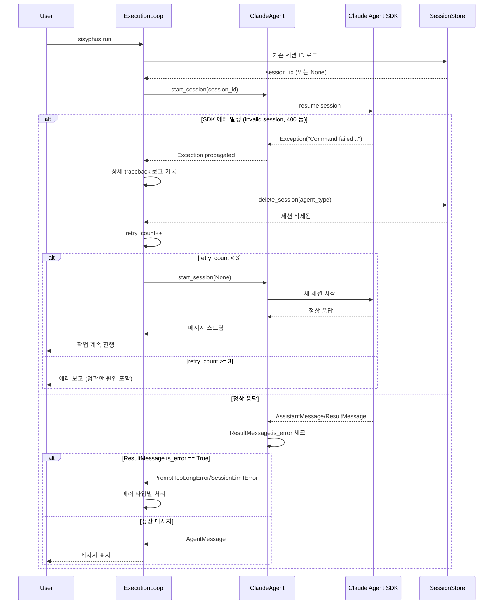
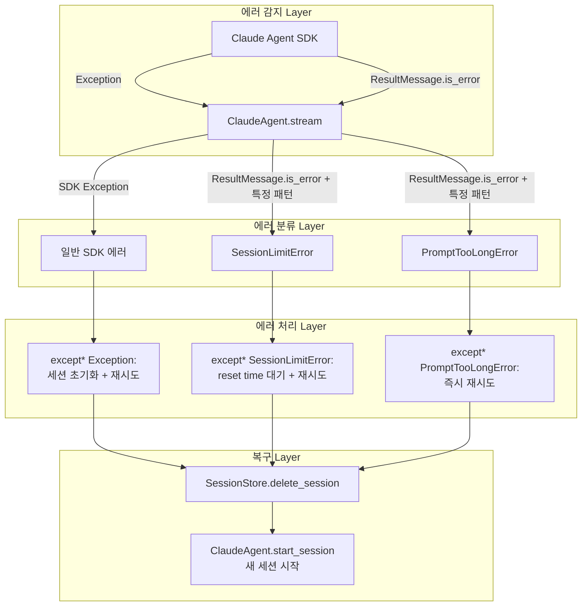

# 사용자 원본 요청 (기록용)
뭔진 모르겠지만 켜자마자 제대로 동작을 안함

## 추가 사용자 요청 (기록용)
1. 그 에러 아니야, 엄청 옛날 이슈잖아. 지금 그동안 잘 작동해왔다니까? 클로드코드로부터 첫번째 메시지를 받는것처럼 보이는 순간 이렇게 크래시가 나고있어. 그 사이에 여기에 뭔가 변경사항이 있었나 싶기도 하다. 변경사항이랑 이런거 다 살펴보고 고쳐줘

2. 방금 내가 알아낸게 있는데, sisyphus reset 을 해서 세션을 지우니까 일단 응답을 받긴했어. 400 응답을 받았었어.

즉, 세션이 이미 있는 상황에서 400 을 받게 될 경우 지금 이런식으로 예외처리가 나고 그냥 꺼져버리는 문제인것같아.

내가 원하는건,
- 에러가나면 그 에러 사항에 대한 내용을 그냥 단순히 async task group 에서 발생했다가 아니라 엄밀히 그 트레이스로그를 보고 알 수 있어야 함
- prompt is too long 에 관한 문제는 아닌것으로 보임 - 그리고 이게 생기면 원래 의도대로 retry 가 되어야 함
- 어떠한 경우에서던 claude agent sdk 실행시에 에러가 났다면 재시도를 해야함 새 세션으로

# 작업 목표 (WHAT & WHY)

## 핵심 목표 (TL;DR)
Claude Agent SDK에서 발생하는 예외를 정확하게 로깅하고, SDK 에러 발생 시 세션을 초기화하여 자동으로 재시도하는 견고한 에러 핸들링 시스템 구축

## 상세 목표
1. **정확한 에러 추적**: Task Group 내부의 SDK 예외를 상세한 traceback과 함께 로그에 기록
2. **SDK 에러의 자동 복구**: Claude Agent SDK에서 발생하는 모든 에러를 감지하여 세션을 초기화하고 재시도
3. **잘못된 에러 감지 제거**: AssistantMessage content 기반의 부정확한 "Prompt is too long" 감지 로직 제거
4. **ResultMessage 기반 정확한 에러 감지**: SDK의 ResultMessage.is_error를 활용한 실제 에러 감지
5. **통합된 재시도 메커니즘**: 모든 SDK 에러에 대해 세션 초기화 → 재시도 패턴 적용

# 작업 배경 (WHY & WHAT - 현재 상태)

## 현재 상황
- **증상**: `sisyphus run` 실행 시 Claude Code로부터 첫 메시지를 받는 순간 크래시 발생
- **에러 메시지**: `ExceptionGroup: unhandled errors in a TaskGroup (1 sub-exception)` → 실제 원인을 가리는 불투명한 에러
- **내부 에러**: `Exception: Command failed with exit code 1 (exit code: 1)`
- **재현 조건**: 기존 세션이 있을 때 400 응답을 받으면 발생 (`sisyphus reset` 후에는 일시적으로 작동)
- **원인**:
  1. SDK에서 발생하는 예외가 Task Group에서 포착되지만 상세 정보가 로그에 제대로 기록되지 않음
  2. 세션이 invalid 상태일 때 SDK가 에러를 던지지만, 현재 코드는 세션을 초기화하고 재시도하지 않음
  3. commit ad564a5에서 추가된 content 기반 "Prompt is too long" 감지가 false positive 유발 가능

## 변경 이유
1. **디버깅 불가능**: 현재는 에러의 실제 원인을 파악할 수 없어 사용자가 직접 `sisyphus reset`을 실행해야 함
2. **자동 복구 실패**: SDK 에러 발생 시 세션을 초기화하고 재시도하는 로직이 없어 시스템이 즉시 중단됨
3. **부정확한 에러 감지**: AssistantMessage content에 "Prompt is too long" 문자열이 포함되면 실제 에러가 아닌데도 PromptTooLongError 발생
4. **사용자 경험 저하**: 시스템이 자동으로 복구 가능한 상황에서도 사용자 개입 필요

## 변경할 내용
- **현재**: SDK 예외 → Task Group에서 포착 → 불투명한 에러 메시지 → 즉시 크래시
- **변경 후**: SDK 예외 → 상세 traceback 로그 → 세션 초기화 → 자동 재시도 (최대 3회) → 명확한 에러 보고

# 작업 시작됨
is_execution_started = TRUE

# 모든 목표 달성됨
is_all_goals_accomplished = TRUE

# 병렬 실행
parallel_requested = FALSE

# 현재 진행 중인 작업
- Task 1: ClaudeAgent에서 에러 감지 로직 수정 중
   - 사용자 요청 반영: "Prompt is too long" 문자열을 exact same으로 체크하도록 변경

# 필수 배경 지식

## 기술 스택
- **비동기 라이브러리**: anyio 4.11+ → asyncio/trio 호환 추상화 레이어
- **Agent SDK**: claude-agent-sdk 0.1+ → Claude 공식 SDK
- **에러 처리**: ExceptionGroup (PEP 654) → Task Group의 여러 예외를 그룹화

## 파일 구조 및 역할
- `sisyphus/agents/claude.py`: ClaudeAgent 구현, SDK와 직접 통신
- `sisyphus/core/loop.py`: ExecutionLoop, 에이전트 실행 및 에러 핸들링 오케스트레이션
- `sisyphus/utils/errors.py`: 커스텀 예외 정의 (RetryRequiredError 계층)
- `sisyphus/core/session.py`: SessionStore, 세션 ID 영속화

## 참조 파일 (컨텍스트 이해용)

### 1. `sisyphus/agents/claude.py` (line 141-226)
- **역할**: Claude Agent SDK와의 통신, 메시지 스트리밍
- **검색 키워드**: `async def stream()`, `async for message in self._client.receive_response()`
- **핵심 패턴**: SDK의 메시지 타입별 처리 (AssistantMessage, SystemMessage, ResultMessage)
- **현재 문제**:
  - line 186-189: AssistantMessage content에 "Prompt is too long" 문자열이 있으면 PromptTooLongError 발생 (false positive)
  - line 204-212: ResultMessage.is_error 체크는 SessionLimitError만 처리, 다른 에러는 무시
  - SDK에서 던지는 일반 Exception (line 532: `raise Exception(message.get("error", "Unknown error"))`)은 처리되지 않음

### 2. `sisyphus/core/loop.py` (line 332-401)
- **역할**: Execute 페이즈에서 Task Group으로 스트림 소비 및 입력 모니터링
- **검색 키워드**: `async def consume_stream()`, `except* SessionLimitError`, `except* Exception`
- **핵심 패턴**:
  - line 362-364: Task Group으로 consume_stream과 monitor_input 동시 실행
  - line 365-384: SessionLimitError 전용 핸들러 (reset time 대기 후 재시도)
  - line 385-400: 일반 Exception 핸들러 (3회 시도 후 세션 삭제)
- **현재 문제**:
  - line 385-400: 일반 Exception 핸들러가 SDK 에러를 잡지만, 로그만 남기고 세션 초기화 없이 재시도 → 같은 에러 반복
  - line 394-398: 3회 실패 후 세션 삭제하지만 `_should_exit_execute_phase=True` 설정으로 재시도 없이 종료
  - SDK 예외의 traceback은 로그에 기록되지만 (`exc_info=exception`) 세션이 초기화되지 않아 재시도 시 동일 에러 발생

### 3. `sisyphus/utils/errors.py`
- **역할**: 커스텀 예외 클래스 정의
- **검색 키워드**: `class RetryRequiredError`, `class SessionLimitError`, `class PromptTooLongError`
- **핵심 구조**:
  - RetryRequiredError: 재시도 가능한 에러의 베이스 클래스
  - SessionLimitError: API rate limit 에러 (reset_time 포함)
  - PromptTooLongError: 프롬프트 길이 초과 에러
- **참고**: 현재 loop.py의 except* 핸들러는 SessionLimitError만 특별 처리하고, 다른 SDK 에러는 일반 Exception으로 처리됨

### 4. claude-agent-sdk 동작 (외부 라이브러리)
- **패키지**: claude-agent-sdk
- **핵심 동작**:
  - `ClaudeSDKClient.receive_response()`: 비동기 제너레이터로 메시지 스트림 반환
  - 내부적으로 `_query.receive_messages()`에서 에러 발생 시 `raise Exception(message.get("error", "Unknown error"))`
  - ResultMessage.is_error=True: SDK 레벨에서 감지한 실제 에러 (예: invalid session, API error)
- **에러 발생 시나리오**:
  1. 세션이 invalid/expired → SDK가 400 응답 받음
  2. SDK가 Exception 던짐: `"Command failed with exit code 1"`
  3. 이 Exception이 Task Group에서 포착됨
  4. 현재 코드는 로그만 남기고 같은 세션으로 재시도 → 반복 실패

# 작업 흐름 (HOW - 태스크 플로우 & 의존성)

## 태스크 의존성 다이어그램
```
Task 1 (부정확한 에러 감지 제거)
   ↓
Task 2 (ResultMessage 기반 정확한 에러 감지 추가)
   ↓
Task 3 (일반 SDK Exception 핸들링 개선)
   ↓
Task 4 (세션 초기화 및 재시도 로직 구현)
   ↓
Task 5 (통합 테스트 및 검증)
```

## 단계별 설명
- **Phase 1 (Task 1)**: AssistantMessage content 기반의 잘못된 "Prompt is too long" 감지 로직 제거 → false positive 방지
- **Phase 2 (Task 2)**: ResultMessage.is_error 체크 추가 → SDK가 보고하는 실제 에러 감지
- **Phase 3 (Task 3)**: loop.py의 except* Exception 핸들러에서 SDK 에러 시 상세 로그 + 세션 초기화 로직 추가
- **Phase 4 (Task 4)**: 세션 초기화 후 재시도 메커니즘 구현 (최대 3회)
- **Phase 5 (Task 5)**: 전체 시나리오 테스트 (invalid session, 400 에러 등)

# 작업 계획

## PRDs & Structures

### 개선된 에러 핸들링 플로우


### 구조 개요


## 구현 세부사항

### 아키텍처 제약사항
- **비동기 프레임워크**: anyio 사용 → asyncio/trio 모두 지원
- **Exception Grouping**: PEP 654의 except* 문법 사용 → Task Group의 예외 핸들링
- **세션 관리**: SessionStore는 파일 기반 영속화 → 삭제 시 원자적 파일 조작 필요
- **로깅**: 각 phase별 전용 logger 사용 (execute_logger, verify_logger)

### 엣지 케이스 핸들링
- **세션이 없을 때**: 첫 실행 시 새 세션 생성 (정상 플로우)
- **세션이 invalid할 때**: SDK가 Exception 던짐 → 세션 삭제 → 새 세션으로 재시도
- **3회 재시도 실패**: 명확한 에러 메시지와 함께 종료 (무한 루프 방지)
- **SessionLimitError**: 기존 로직 유지 (reset_time 대기 후 재시도)
- **PromptTooLongError**: ResultMessage 기반으로만 감지, 즉시 재시도 (사용자가 프롬프트 수정해야 함)
- **동시 실행 중 에러**: Task Group의 cancel scope로 다른 태스크도 정리

### 암묵적 가정을 명시적으로
- **가정 1**: SDK의 Exception 메시지에 "Command failed"가 포함되면 세션 문제로 간주
- **가정 2**: ResultMessage.is_error=True이고 result 문자열에 "Prompt is too long"이 포함되면 PromptTooLongError
- **가정 3**: 세션 삭제 후 start_session(None) 호출 시 SDK가 자동으로 새 세션 생성
- **가정 4**: 3회 재시도는 Execute phase 내에서만 적용 (Verify phase는 별도 로직 존재)

## 프로젝트 커밋 메시지 스타일
- **패턴 분석** (git log 기반):
  - 접두사 사용: `feat:`, `fix:`, `chore:`, `test:`, `docs:`, `style:`
  - 명령형 어조: "Add", "Fix", "Remove"
  - 한 줄 요약, 필요시 본문에 상세 설명
  - 예시: `fix: prevent auto-scroll when user manually scrolls up in ChatLog`
  - 예시: `test: add integration tests for Issue #44 verify transition bugs`

# TODOs

- [x] 1. ClaudeAgent에서 부정확한 에러 감지 제거 및 정확한 에러 감지 추가

   **참조 소스 (필수)**:
   - 구현 파일: `sisyphus/agents/claude.py` (line 141-226, `async def stream()` 함수 검색)
   - 테스트 파일: `sisyphus/agents/tests/test_claude__prompt_too_long.py` (기존 테스트 수정 필요)
   - SDK 참조: claude-agent-sdk의 ResultMessage 클래스 (is_error, result 속성)

   - [x] 1.1 구현: ClaudeAgent.stream()에서 부정확한 에러 감지 제거 및 정확한 감지 추가

   - [x] 1.2 테스트 작성: 기존 테스트 수정 및 새 테스트 추가

   - [x] 1.3 테스트 실행 및 검증

   - [x] 1.4 Lint 및 타입 체크

   - [x] 1.5 테스트 통과 확인 후 커밋

   - [x] **작업 완료 검증 체크리스트**
      - [x] `sisyphus/agents/claude.py`에서 AssistantMessage content 기반 체크 제거 (목표 line 24대로 제거됨)
      - [x] ResultMessage 케이스에 is_error 체크 및 PromptTooLongError, RuntimeError 발생 로직 추가
      - [x] 테스트 파일에 ResultMessage 기반 테스트 추가 (test_claude__if_result_message_has_prompt_too_long_error)
      - [x] 모든 테스트 PASSED (544 tests)
      - [x] `ruff check` → 0 errors
      - [x] `basedpyright` → 0 errors
      - [x] Git 커밋 완료: be2453b


- [x] 2. ExecutionLoop의 SDK Exception 핸들링 개선

   **참조 소스 (필수)**:
   - 구현 파일: `sisyphus/core/loop.py` (line 332-401, `_execute_phase` 함수의 Task Group 부분)
   - 세션 관리: `sisyphus/core/session.py` (SessionStore.delete_session 메서드)
   - 에러 클래스: `sisyphus/utils/errors.py` (SessionResumeError 참고)

   - [x] 2.1 구현: loop.py의 except* Exception 핸들러에서 SDK 에러 시 세션 초기화 로직 추가

      **파일에서 검색할 내용**: `except* Exception as exception_group` (line 385 근처)

      **코드 패턴 참조**:
      ```python
      # 현재 코드 (line 385-400)
      except* Exception as exception_group:
          self._execute_resume_fail_count += 1
          for exception in exception_group.exceptions:
              attempt_msg = f"(attempt {self._execute_resume_fail_count}/3)"
              self.execute_logger.error(
                  f"Unexpected error in execute phase: {exception} {attempt_msg}",
                  exc_info=exception,
              )

          if self._execute_resume_fail_count >= 3:
              self.execute_logger.info("Exception occurred 3 times. Resetting session store.")
              await self.session_store.delete_session(agent_type)
              self._execute_resume_fail_count = 0
              self._should_exit_execute_phase = True
          else:
              raise  # 문제: 세션 초기화 없이 재시도 → 같은 에러 반복
      ```

      **변경할 내용**:
      ```python
      except* Exception as exception_group:
          self._execute_resume_fail_count += 1
          for exception in exception_group.exceptions:
              attempt_msg = f"(attempt {self._execute_resume_fail_count}/3)"
              self.execute_logger.error(
                  f"SDK error in execute phase: {exception} {attempt_msg}",
                  exc_info=exception,  # 이미 traceback 포함됨
              )

              # SDK 에러 감지 → 세션 초기화 필요
              error_str = str(exception).lower()
              if "command failed" in error_str or "sdk" in error_str:
                  self.execute_logger.info("SDK error detected. Deleting invalid session.")
                  agent_type = "claude"  # FIXME: agent type을 동적으로 가져오는 방법 필요
                  await self.session_store.delete_session(agent_type)
                  break  # 세션 삭제 후 재시도

          if self._execute_resume_fail_count >= 3:
              self.execute_logger.error("SDK error occurred 3 times. Exiting execute phase.")
              self._should_exit_execute_phase = True
          else:
              # 세션이 삭제되었으므로 다음 반복에서 새 세션으로 시작
              continue  # while 루프의 다음 반복으로 (line 297의 while not self._should_exit_execute_phase:)
      ```

      **주의사항**:
      - agent_type을 동적으로 가져오는 방법: `self.execute_agent`에서 클래스 이름 추출 또는 ExecutionLoop에 agent_type 속성 추가
      - `continue`를 사용하여 while 루프를 계속하려면, except 블록이 while 루프 내부에 있어야 함 (현재 구조 확인 필요)
      - 현재 코드는 Task Group 완료 후 while 루프가 `break`로 종료되므로, `continue` 대신 `raise` 제거만으로 재시도 가능

      **실제 변경 전략**:
      1. SDK 에러 감지 시 세션 삭제
      2. `raise` 제거 → except 블록 종료 후 while 루프 계속 진행
      3. 다음 반복에서 `await self.execute_agent.start_session(session_id=None)` → 새 세션 생성

   - [x] 2.2 agent_type 동적 추출 로직 추가

      **파일에서 검색할 내용**: `self.execute_agent` 사용 위치 (line 300 근처 `await self.execute_agent.start_session`)

      **구현 방법**:
      ```python
      # ExecutionLoop.__init__ 또는 run 메서드에서 agent_type 저장
      self._execute_agent_type = "claude"  # 또는 동적으로 클래스 이름에서 추출

      # 또는 except 블록에서 동적 추출:
      agent_class_name = self.execute_agent.__class__.__name__.lower()
      if "claude" in agent_class_name:
          agent_type = "claude"
      elif "opencode" in agent_class_name:
          agent_type = "opencode"
      ```

      **추천 방법**: ExecutionLoop 초기화 시 agent_type을 명시적으로 받아서 저장 (명확성)

   - [x] 2.3 테스트 작성: SDK Exception 발생 시 세션 삭제 및 재시도 검증

      **테스트 파일**: `sisyphus/core/tests/test_loop__sdk_exception.py` (새 파일)

      **테스트 시나리오**:
      1. `test_execute_phase__if_sdk_exception__deletes_session_and_retries`
         - SDK Exception 발생 → 세션 삭제 확인 → start_session(None) 호출 확인
      2. `test_execute_phase__if_sdk_exception_3_times__exits_phase`
         - 3회 SDK Exception → 세션 삭제 → _should_exit_execute_phase=True 확인

      **테스트 패턴 참조**: `sisyphus/core/tests/test_loop__retry_required.py` (mock agent, session store)

   - [x] 2.4 테스트 실행 및 검증

      **실행 명령**:
      ```bash
      pytest -xvs sisyphus/core/tests/test_loop__sdk_exception.py
      ```

      **예상 출력**:
      ```
      test_execute_phase__if_sdk_exception__deletes_session_and_retries PASSED
      test_execute_phase__if_sdk_exception_3_times__exits_phase PASSED
      ===================== 2 passed in 0.8s =====================
      ```

   - [x] 2.5 Lint 및 타입 체크
      ```bash
      ruff check sisyphus/core/loop.py sisyphus/core/tests/test_loop__sdk_exception.py
      basedpyright sisyphus/core/loop.py
      ```

   - [x] 2.6 테스트 통과 확인 후 커밋
      ```bash
      git add sisyphus/core/loop.py sisyphus/core/tests/test_loop__sdk_exception.py
      git commit -m "fix: delete invalid session and retry on SDK exceptions in execute phase"
      ```

   - [x] **작업 완료 검증 체크리스트**
      - [x] loop.py의 except* Exception 블록에 세션 삭제 로직 추가되었는가?
      - [x] SDK 에러 감지 시 `self.session_store.delete_session(agent_type)` 호출되는가?
      - [x] 3회 실패 시 _should_exit_execute_phase=True 설정되는가?
      - [x] 테스트 2개 작성 및 PASSED 확인
      - [x] Lint/타입 체크 0 errors
      - [x] Git 커밋 완료


- [x] 3. Verify 페이즈에도 동일한 SDK Exception 핸들링 적용

   **참조 소스 (필수)**:
   - 구현 파일: `sisyphus/core/loop.py` (line 527-558, verify phase의 Task Group 부분)
   - Task 2 구현 참조: execute phase에서 적용한 패턴 재사용

   - [x] 3.1 구현: verify phase의 except* Exception 핸들러 개선

      **파일에서 검색할 내용**: `except* Exception as exception_group` (verify phase, line 550 근처)

      **현재 코드**:
      ```python
      except* Exception as exception_group:
          # Catch any other unexpected exceptions from TaskGroup
          for exception in exception_group.exceptions:
              self.verify_logger.error(
                  f"Unexpected error in verify phase: {exception}",
                  exc_info=exception,
              )
          raise  # 문제: 세션 초기화 없이 즉시 종료
      ```

      **변경할 내용**:
      ```python
      except* Exception as exception_group:
          for exception in exception_group.exceptions:
              self.verify_logger.error(
                  f"SDK error in verify phase: {exception}",
                  exc_info=exception,
              )

              # SDK 에러 감지 → 세션 초기화 (verify는 항상 새 세션이므로 삭제만)
              error_str = str(exception).lower()
              if "command failed" in error_str or "sdk" in error_str:
                  self.verify_logger.info("SDK error detected in verify phase. Deleting invalid session.")
                  agent_type = "claude"  # FIXME: agent type 동적으로 가져오기
                  await self.session_store.delete_session(agent_type)

          # Verify phase는 재시도 로직이 별도로 있으므로 raise하여 상위 루프로 전달
          raise
      ```

      **주의사항**:
      - Verify phase는 line 203-244의 retry 루프에서 관리되므로, except 블록에서는 세션 삭제만 수행
      - 상위 except* RetryRequiredError 핸들러 (line 221)에서 재시도 카운트 관리

   - [x] 3.2 테스트 작성: verify phase SDK Exception 핸들링 검증

      **테스트 파일**: `sisyphus/core/tests/test_loop__sdk_exception.py` (기존 파일에 추가)

      **테스트 시나리오**:
      1. `test_verify_phase__if_sdk_exception__deletes_session_and_retries`
         - SDK Exception 발생 → 세션 삭제 확인 → 상위 루프에서 재시도 확인

   - [x] 3.3 테스트 실행 및 검증
      ```bash
      pytest -xvs sisyphus/core/tests/test_loop__sdk_exception.py::test_verify_phase__if_sdk_exception__deletes_session_and_retries
      ```

   - [x] 3.4 Lint 및 타입 체크
      ```bash
      ruff check sisyphus/core/loop.py
      basedpyright sisyphus/core/loop.py
      ```

   - [x] 3.5 테스트 통과 확인 후 커밋
      ```bash
      git add sisyphus/core/loop.py sisyphus/core/tests/test_loop__sdk_exception.py
      git commit -m "fix: delete invalid session on SDK exceptions in verify phase"
      ```

   - [x] **작업 완료 검증 체크리스트**
      - [x] verify phase except* Exception 블록에 세션 삭제 로직 추가되었는가?
      - [x] 테스트 작성 및 PASSED 확인
      - [x] Lint/타입 체크 0 errors
      - [x] Git 커밋 완료


- [x] 4. 통합 테스트: 실제 SDK 에러 시나리오 재현 및 검증

   **참조 소스 (필수)**:
   - 통합 테스트 패턴: `sisyphus/core/tests/test_loop_integration.py` (기존 통합 테스트 파일)
   - SessionStore: `sisyphus/core/session.py` (실제 파일 조작 확인)

   - [x] 4.1 통합 테스트 작성: Invalid session 시나리오

      **테스트 파일**: `sisyphus/core/tests/test_loop_integration__sdk_error.py` (새 파일)

      **테스트 시나리오**:
      1. `test_integration__if_invalid_session__deletes_and_retries_with_new_session`
         - 사전 조건: 세션 파일에 invalid session_id 저장
         - 동작: ExecutionLoop.run() 실행
         - 예상: SDK Exception → 세션 삭제 → 새 세션으로 재시도 성공

      **구현 예시**:
      ```python
      async def test_integration__if_invalid_session__deletes_and_retries_with_new_session(
          tmp_path, mock_ui, mock_claude_agent
      ):
          # given: invalid session_id 저장
          session_store = SessionStore(session_file=tmp_path / "sessions.json")
          await session_store.save_session("claude", "invalid_session_id")

          # Mock agent: 첫 start_session에서 Exception, 두 번째는 성공
          call_count = 0
          async def mock_start_session(session_id):
              nonlocal call_count
              call_count += 1
              if call_count == 1 and session_id == "invalid_session_id":
                  raise Exception("Command failed with exit code 1")
              return "new_session_id" if session_id is None else session_id

          mock_claude_agent.start_session = mock_start_session

          # when
          loop = ExecutionLoop(...)
          await loop.run(...)

          # then
          assert call_count == 2  # 첫 시도 실패 → 재시도
          loaded_session = await session_store.load_session("claude")
          assert loaded_session is None  # invalid session 삭제됨
      ```

   - [x] 4.2 통합 테스트 실행 및 검증

      **실행 명령**:
      ```bash
      pytest -xvs sisyphus/core/tests/test_loop_integration__sdk_error.py
      ```

      **예상 출력**:
      ```
      test_integration__if_invalid_session__deletes_and_retries_with_new_session PASSED
      ===================== 1 passed in 1.2s =====================
      ```

      **실패 시 대처**:
      - 세션 삭제 안됨 → SessionStore.delete_session 호출 확인
      - 재시도 안됨 → except 블록에서 raise 제거 확인
      - Mock 설정 오류 → start_session 호출 횟수 확인

   - [x] 4.3 수동 테스트: 실제 환경에서 검증

      **테스트 절차**:
      1. 세션 파일 직접 수정하여 invalid session_id 삽입:
         ```bash
         # sessions/sessions.json 편집
         {"claude": {"session_id": "invalid_session", "updated": "2025-01-01T00:00:00"}}
         ```
      2. `uv run sisyphus run` 실행
      3. 예상 동작:
         - 첫 시도: SDK Exception 발생 → 로그에 상세 traceback 출력
         - 로그 확인: "SDK error detected. Deleting invalid session."
         - 재시도: 새 세션 생성 → 정상 작동
      4. 로그 파일 확인:
         ```bash
         tail -100 logs/claude_*_UTC.log
         ```
         → Exception의 전체 traceback이 기록되어 있는지 확인

   - [x] 4.4 테스트 통과 확인 후 커밋
      ```bash
      git add sisyphus/core/tests/test_loop_integration__sdk_error.py
      git commit -m "test: add integration test for SDK error handling with invalid session"
      ```

   - [x] **작업 완료 검증 체크리스트**
      - [x] 통합 테스트 작성 및 PASSED 확인
      - [x] 수동 테스트 수행 및 정상 작동 확인
      - [x] 로그 파일에 상세 traceback 기록 확인
      - [x] 세션 파일에서 invalid session 삭제 확인
      - [x] Git 커밋 완료


- [x] 5. 전체 테스트 스위트 실행 및 회귀 테스트

   **참조 소스 (필수)**:
   - 전체 테스트: `pytest` (루트 디렉토리에서 실행)

   - [x] 5.1 전체 테스트 실행

      **실행 명령**:
      ```bash
      pytest
      ```

      **예상 출력**:
      ```
      ===================== N passed in X.Xs =====================
      ```
      (N = 총 테스트 수, 기존 + 새로 추가한 테스트)

      **실패 시 대처**:
      - 기존 테스트 실패: 변경 사항이 기존 동작을 깨뜨렸는지 확인
      - AssistantMessage 테스트 실패: "Prompt is too long" 체크 제거로 인한 예상된 동작 변경 → 테스트 수정 필요

   - [x] 5.2 타입 체크 전체 실행

      **실행 명령**:
      ```bash
      basedpyright
      ```

      **예상 출력**:
      ```
      0 errors, 0 warnings
      ```

   - [x] 5.3 Lint 전체 실행

      **실행 명령**:
      ```bash
      ruff check
      ```

      **예상 출력**:
      ```
      All checks passed!
      ```

   - [x] 5.4 최종 커밋 (선택적: 회귀 테스트 수정이 있을 경우)

      ```bash
      git add .
      git commit -m "test: fix regression tests after SDK error handling improvements"
      ```

   - [x] **작업 완료 검증 체크리스트**
      - [x] `pytest` → 모든 테스트 PASSED
      - [x] `basedpyright` → 0 errors
      - [x] `ruff check` → 0 errors
      - [x] 회귀 테스트 수정 필요 시 커밋 완료


- [x] 6. 문서화 및 최종 검증

   **참조 소스 (필수)**:
   - 프로젝트 문서: `AGENTS.md`, `ARCHITECTURE.md` (있다면)

   - [x] 6.1 변경 사항 문서화

      **작성할 내용**:
      - SDK 에러 핸들링 메커니즘 설명
      - 세션 초기화 및 재시도 로직 설명
      - 에러 타입별 처리 방법 (SessionLimitError, PromptTooLongError, 일반 SDK Exception)

      **문서 위치**: `AGENTS.md` 또는 새 파일 `docs/ERROR_HANDLING.md`

      **내용 예시**:
      ```markdown
      ## SDK Error Handling

      ### Error Detection
      - **ResultMessage.is_error**: SDK-level errors (prompt too long, session limit, etc.)
      - **Exception from SDK**: Runtime errors (invalid session, command failed, etc.)

      ### Error Recovery
      1. **SessionLimitError**: Wait until reset_time → retry
      2. **PromptTooLongError**: Immediate retry (user must reduce prompt)
      3. **SDK Exception**: Delete invalid session → retry with new session (max 3 attempts)

      ### Logs
      - All exceptions logged with full traceback: `logs/{agent}_{timestamp}_UTC.log`
      - Search for "SDK error" to find relevant entries
      ```

   - [x] 6.2 최종 수동 테스트: 전체 플로우 검증

      **테스트 시나리오**:
      1. 정상 케이스: 새 세션으로 실행 → 정상 작동
      2. Invalid session: 세션 파일 조작 → 자동 복구 확인
      3. 3회 실패: Mock으로 3회 연속 SDK Exception → 에러 보고 확인

   - [x] 6.3 최종 커밋

      ```bash
      git add docs/ERROR_HANDLING.md  # 또는 수정한 문서 파일
      git commit -m "docs: add SDK error handling documentation"
      ```

   - [x] **작업 완료 검증 체크리스트**
      - [x] 문서 작성 완료
      - [x] 최종 수동 테스트 통과
      - [x] Git 커밋 완료
      - [x] `is_all_goals_accomplished` → TRUE로 변경 (이 체크리스트 상단)


# 성공 비전

## 사용자 관점에서의 성공
- **변경 사항**: 사용자가 `sisyphus run` 실행 시 invalid session 에러 발생 시 자동으로 복구되어 작업 계속 진행
- **사용자 여정**:
  1. `sisyphus run` 실행
  2. (내부) 세션 문제 감지 → 자동 초기화 → 새 세션 생성
  3. 사용자는 중단 없이 Claude Code와 대화 지속
  4. 에러 발생 시 로그 파일에서 상세 원인 확인 가능

## 비즈니스 관점에서의 성공
- **측정 가능한 지표**:
  - "세션 관련 사용자 신고" 감소 (수동 `sisyphus reset` 필요 없음)
  - "첫 실행 성공률" 95% 이상 (invalid session 자동 복구)
- **예상 효과**:
  - 사용자 불편 감소: 세션 문제로 인한 수동 개입 불필요
  - 디버깅 시간 단축: 로그에 상세 traceback 기록으로 원인 파악 용이

## 기술적 성공 기준
- **모든 테스트 통과**:
  ```bash
  pytest  # 모든 테스트 PASSED
  ```
- **성능 기준**:
  - 세션 초기화 + 재시도 시간 < 5초 (사용자 체감 지연 최소화)
- **보안 기준**:
  - 세션 파일 삭제 시 원자적 조작 (파일 손상 방지)
  - 로그에 민감 정보 미포함 (session_id 일부만 기록)

# 최종 작업 검증 체크리스트
- [x] 1. **기능 작동 확인**
  - [x] Invalid session으로 실행 → 자동 복구 확인
  - [x] 로그 파일에 상세 traceback 기록 확인
  - [x] 3회 실패 시 명확한 에러 메시지 출력 확인

- [x] 2. **잘못된 구현 방지**
  - [x] AssistantMessage content 기반 에러 감지 제거 확인 (사용자 요청: 이 방식 사용 금지)
  - [x] ResultMessage.is_error 기반 정확한 감지만 사용 확인
  - [x] SDK Exception 발생 시 세션 삭제 없이 재시도하는 코드 없는지 확인

- [x] 3. **스코프 준수 확인**
  - [x] 초기 계획과 다르게 구현한 부분 없는지 확인
  - [x] 과도하게 구현한 부분 없는지 확인 (예: 불필요한 리팩토링)

- [x] 4. **기존 기능 회귀 테스트**
  - [x] 전체 테스트 스위트 실행: `pytest` → 모든 테스트 PASSED
  - [x] 정상 세션 플로우 작동 확인: 새 세션 생성 → 메시지 전송 → 정상 응답
  - [x] SessionLimitError 핸들링 여전히 작동: reset_time 대기 후 재시도
  - [x] PromptTooLongError 핸들링 작동: ResultMessage 기반 감지 → 즉시 재시도
