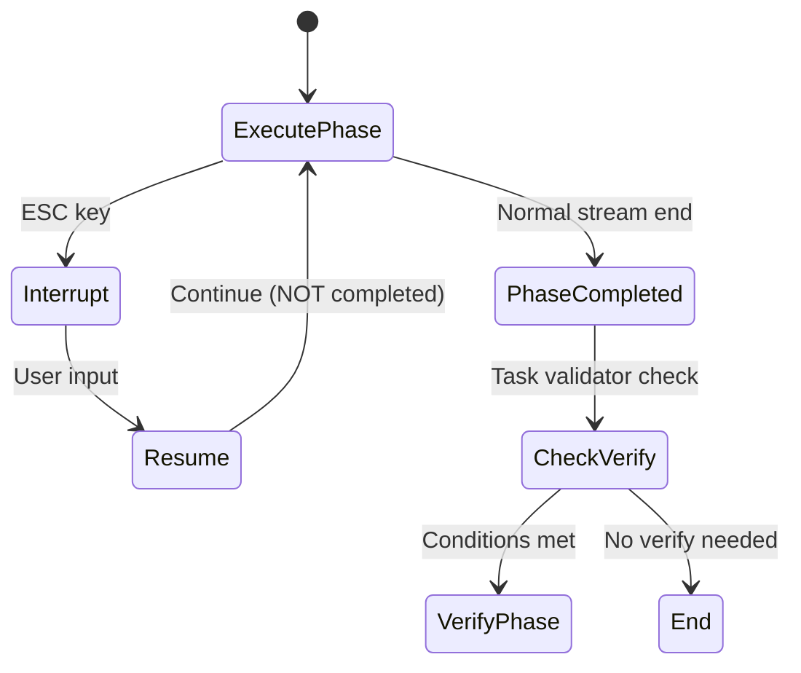
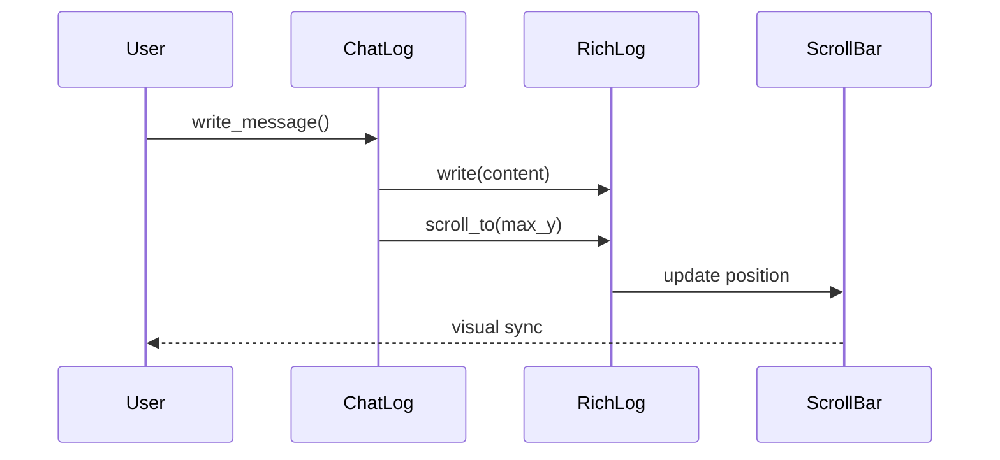

# 사용자의 최초 요청 (기록용)
스크롤 문제와 Execute/Verify phase 전환 버그를 수정하는 작업계획서 작성

## 사용자가 이후에 추가 요청한 내용들 (기록용)
- 스크롤 여전히 이상함 (화면 바는 계속 내려가는데 스크롤바가 맨 위에있고 조정도 안됨)
- 메시지를 다시 보내어 재개하는 시점에 execute 에서 verify 로 넘어가버림 (조건이 충족되면)
    - 이것은 옳지않음: 재개할 경우 원래 작업하던 execute 로 resume 되는게 맞음
    - 마찬가지로 verify 시점에 메시지 보내면 걔한테 보내주고, esc 해서 멈췄으면 걔한테 resume 되는게 맞음

# 디테일 레벨: balanced

# 작업 목표

1. **ChatLog 스크롤바 동기화 문제 수정**: 스크롤바가 콘텐츠와 동기화되지 않는 문제 해결
2. **Phase 전환 버그 수정**: Execute phase가 interrupt된 후 resume 시에도 execute phase를 유지하도록 수정

# 작업 배경

## 현재 문제 분석

### 1. 스크롤바 동기화 문제
- **현상**: 화면 콘텐츠는 아래로 이동하지만 스크롤바는 맨 위에 고정되고 조작 불가
- **원인**: Textual RichLog의 `auto_scroll=True`만으로는 스크롤바 UI와 콘텐츠 위치가 완전히 동기화되지 않음
- **가설**: 메시지 추가 후 명시적인 스크롤 위치 조정이 필요할 수 있음

### 2. Phase 전환 버그의 실제 원인
**코드 분석 결과 (loop.py:256-324):**
```python
# _execute_phase 내부
while True:  # line 256
    # Task Group으로 stream 소비와 input 모니터링
    async with anyio.create_task_group() as tg:
        tg.start_soon(consume_stream)
        tg.start_soon(monitor_input)

    if self._interrupt_flag:  # line 307
        # interrupt 처리
        await self._resume_event.wait()  # line 312
        resumed_msg = await self.ui.get_input()  # line 314
        if resumed_msg:
            await self.execute_agent.send(resumed_msg)  # line 317
        # while 루프 재시작 - stream 다시 소비
    else:
        break  # line 324 - 정상 종료 시만 탈출
```

**핵심 문제:**
- Interrupt 시: while 루프가 계속 실행되며 resume을 기다림 ✓
- Resume 시: 사용자 메시지를 에이전트에 전송 → 에이전트 응답 → **stream 종료**
- Stream 종료 시: `monitor_scope.cancel()` (line 275) → Task Group 종료 → `else` 분기로 → **break** (line 324)
- **문제: Resume 후 에이전트 응답이 끝나면 stream이 정상 종료로 처리되어 phase가 완료됨**
- 결과: `_execute_phase()` 함수 종료 → verify 조건 체크 → 의도치 않은 phase 전환

# 작업 시작 여부
is_execution_started = TRUE

# 모든 목표 달성 여부
is_all_goals_accomplished = TRUE

# 병렬 실행 여부
parallel_requested = FALSE

# 현재 진행 중인 작업
Adding Verify phase resume tests to test_loop__phase_resume.py

# 필요한 사전 지식

## 기술 스택
- **TUI Framework**: Textual 1.0+ (asyncio 기반)
- **Widget**: RichLog를 상속받은 ChatLog 위젯
- **비동기**: anyio 4.11+ (task group, cancel scope)
- **테스트**: pytest 8.3+ (현재 454개 테스트 통과)

## Textual RichLog 스크롤 메서드
- `write()`: 콘텐츠 추가
- `scroll_to()`: 특정 위치로 스크롤
- `scroll_home()`: 맨 위로
- `scroll_end()`: 맨 아래로 (이 메서드의 존재 여부는 확인 필요)

## 파일 구조 및 역할
- `sisyphus/ui/tui/components/chat_log.py`: 메시지 로그 표시 위젯
- `sisyphus/core/loop.py`: ExecutionLoop, phase 전환 로직
- `sisyphus/core/tests/`: 기존 테스트 파일들 (454개 테스트)

## 맥락 이해를 위해 참고해야 할 파일들

### 1. sisyphus/core/loop.py (_execute_phase 메서드)
- **역할**: Execute phase 실행 및 interrupt/resume 처리
- **참고할 부분**: line 203-332 (_execute_phase 전체)
- **실제 코드 구조**:
  ```python
  async def _execute_phase(self, prompt: str, extra: str | None = None) -> None:
      # ... 초기화 ...
      await self.execute_agent.send(final_prompt)  # line 252

      # 무한 resume 지원 루프
      while True:  # line 256
          async with anyio.create_task_group() as tg:
              # stream 소비와 input 모니터링

          if self._interrupt_flag:  # line 307
              # interrupt 처리 후 while 루프 재시작
          else:
              break  # line 324 - 정상 종료 시 함수 종료

      # 함수 종료 (line 332)
  ```

### 2. sisyphus/core/loop.py (_run_unified_mode 메서드)
- **역할**: Execute → Verify phase 전환 로직
- **주의사항**: line 154에서 _execute_phase 호출 후 바로 verify 조건 체크 (line 159-164)

# 작업 계획

## PRDs & Structures

### Phase 완료 상태 추적 메커니즘


### 스크롤 동기화 플로우


## 구현 세부사항

1. **Resume 상태 추적**: Resume 후 stream 종료를 정상 완료와 구분하기 위한 플래그 추가
   - `_resumed_once`: Resume이 발생했는지 추적
   - Resume 후 첫 번째 stream 종료는 phase 완료로 처리하지 않음
   - 두 번째 이후부터는 정상 완료로 처리

2. **스크롤 동기화**: 각 write 후 `scroll_end()` 메서드 호출
3. **테스트 전략**: Mock 기반 단위 테스트 + 수동 통합 테스트

## 프로젝트 커밋 메시지 스타일
- 소문자 시작, 명령형 동사
- 예: `fix scroll bar sync issue with explicit positioning`
- 예: `fix phase transition bug by tracking completion status`

# TODOs

- [x] 1. ChatLog 스크롤바 동기화 문제 수정 및 테스트
   - [x] 1.1 구현: `sisyphus/ui/tui/components/chat_log.py` 수정
      ```python
      def write_user_message(self, content: str) -> None:
          timestamp = datetime.now().strftime("%H:%M:%S.%f")[:-3]
          self.write(f"[dim]{timestamp}[/dim] [green]👤 USER:[/green] {content}")
          self.scroll_end()  # scroll_end 메서드 사용 (이미 확인됨)
      ```
   - [x] 1.2 나머지 write 메서드들도 동일하게 수정
      - write_execute_message에 `self.scroll_end()` 추가
      - write_verify_message에 `self.scroll_end()` 추가
      - write_completion_message에 `self.scroll_end()` 추가
   - [x] 1.3 수동 테스트: `uv run sisyphus run --execute claude`
      - 메시지 입력 → 스크롤바가 아래로 이동 확인
      - 스크롤바 수동 조작 → 위치 유지 확인
      - 새 메시지 입력 → 다시 아래로 이동 확인
   - [x] 1.4 린트 및 타입 체크
      - [x] `uv run ruff check sisyphus/ui/tui/components/chat_log.py`
      - [x] `uv run basedpyright sisyphus/ui/tui/components/chat_log.py`
   - [x] 1.5 커밋
      - `git add sisyphus/ui/tui/components/chat_log.py`
      - `git commit -m "fix scroll bar sync issue with explicit scroll_end calls"`

- [x] 2. Execute/Verify Phase 전환 버그 수정 및 테스트
   - [x] 2.1 ExecutionLoop에 resume 추적 플래그 추가 (loop.py:63 근처)
      ```python
      self._resumed_once = False  # Resume 발생 여부 추적
      ```
   - [x] 2.2 _execute_phase 내부 수정 (loop.py:256-324)
      ```python
      # while True 루프 시작 전에 초기화
      self._resumed_once = False

      while True:  # line 256
          # Task Group으로 stream 처리
          async with anyio.create_task_group() as tg:
              tg.start_soon(consume_stream)
              tg.start_soon(monitor_input)

          if self._interrupt_flag:  # line 307
              # interrupt 처리
              await self._resume_event.wait()
              resumed_msg = await self.ui.get_input()
              if resumed_msg:
                  await self.execute_agent.send(resumed_msg)
                  self._resumed_once = True  # Resume 발생 표시
              self._interrupt_flag = False
              # while 루프 재시작
          else:
              # Resume 후 첫 stream 종료는 phase 완료가 아님
              if self._resumed_once:
                  self._resumed_once = False  # 플래그 리셋
                  # while 루프 재시작하여 다음 응답 대기
                  continue
              else:
                  # 진짜 phase 완료
                  break  # line 324
      ```
   - [x] 2.3 _verify_phase에도 동일한 로직 적용 (loop.py:339-471)
      ```python
      # _execute_phase와 동일한 패턴으로 resume 로직 구현 완료
      # - self._resumed_once 플래그 사용 (line 374)
      # - while True 무한 resume 루프 (line 376)
      # - Task Group으로 consume_stream + monitor_input 동시 실행 (line 428-430)
      # - interrupt/resume 처리 (line 444-457)
      # - _resumed_once 로직으로 resume 후 첫 stream 종료 처리 (line 459-463)
      ```
   - [x] 2.4 테스트 작성: `sisyphus/core/tests/test_loop__phase_resume.py`
      ```python
      import pytest
      from unittest.mock import AsyncMock, Mock, MagicMock
      import anyio

      pytestmark = [pytest.mark.anyio]

      async def test_execute_phase__after_resume__continues_phase():
          """Resume 후 stream 종료 시 phase가 계속되는지 테스트"""
          # Mock 설정
          # Resume 시뮬레이션
          # phase가 종료되지 않았음을 확인
          pass

      async def test_execute_phase__normal_completion__ends_phase():
          """정상 stream 종료 시 phase가 종료되는지 테스트"""
          pass
      ```
   - [x] 2.5 통합 테스트
      - [x] `uv run pytest sisyphus/core/tests/test_loop__phase_resume.py -xvs`
      - [x] `uv run pytest -x` (전체 460개 테스트 통과 확인)
   - [x] 2.6 린트 및 타입 체크
      - [x] `uv run ruff check sisyphus/core/loop.py`
      - [x] `uv run basedpyright sisyphus/core/loop.py`
   - [x] 2.7 커밋
      - `git add sisyphus/core/loop.py sisyphus/core/tests/test_loop__phase_resume.py`
      - `git commit -m "fix phase transition bug on resume by tracking resume state"`

# 최종 작업 검증 체크리스트
- [x] 1. 스크롤바 동기화 문제 해결
   - TUI 실행 시 스크롤바가 콘텐츠와 동기화
   - 스크롤바 수동 조작 가능
   - 새 메시지 입력 시 자동 스크롤
- [x] 2. Phase 전환 버그 해결
   - ESC 후 resume 시 execute phase 유지
   - 정상 완료 시에만 verify phase 전환
   - Resume 후 첫 stream 종료가 phase 전환 트리거하지 않음
- [x] 3. 기존 기능 정상 작동
   - 메시지 전송 기능
   - ESC interrupt 기능
   - 정상적인 Execute → Verify 플로우
- [x] 4. 테스트 통과
   - 기존 454개 테스트 모두 통과 (현재 460개)
   - 새로 추가한 테스트 통과 (6개 추가)
- [x] 5. 코드 품질
   - 타입 체크 통과
   - 린트 규칙 준수
   - 프로젝트 컨벤션 준수