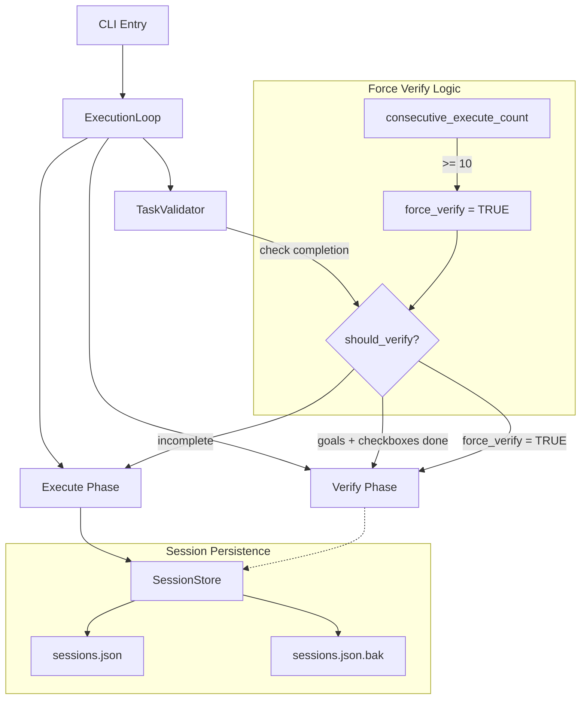

# User's Original Request (For Record)
verify phase 로 넘어가지 못하는 문제

## Additional User Requests (For Record)
명시적으로 둘 다 지정안했기에 둘 다 클로드로 설정 된 상태야. 그러니 지정 안한 문제는 아니야.

오히려 execute -> verify 로넘어가는 로직에 문제가 있다고 봐. 이 부분 더 확실히 조사하고 작업계획서 내에 테스트 코드를 보강했으면 해.

또한 껐다켰을때에 resume 문제도 지속된 문제 중 하나로 엄격하게 검증해서 보강하는 로직을 짜줘.

# Work Objectives (WHAT & WHY)

## Core Objective (TL;DR)
ExecutionLoop의 execute → verify phase 전환 로직과 session resume 로직의 버그를 수정하고, 이를 검증하는 강력한 테스트 코드를 추가한다.

## Detailed Objectives
- **Execute → Verify 전환 실패 문제 해결**: 10번 반복 후 force_verify가 활성화되어도 verify phase로 전환되지 않는 로직 버그 수정
- **Session Resume 실패 문제 해결**: 프로그램 재시작 시 session이 제대로 복원되지 않는 문제 해결
- **포괄적 테스트 추가**: 10번 반복 시나리오, force_verify 동작, session persistence 등을 검증하는 테스트 코드 추가
- **엄격한 검증 로직**: 모든 edge case를 커버하는 acceptance criteria 구현

# Work Background (WHY & WHAT - Current State)

## Current Situation
**Issue #44에서 보고된 문제:**
1. **Execute phase 10번 반복 후 verify phase로 전환 안됨**
   - `ai-todolist.md`가 존재하는 상황에서 10번 execute phase 반복
   - `force_verify = True`가 되어야 하지만 실제로는 verify phase 진입 안됨
   - User가 명시적으로 `--agent claude`를 지정했으므로 `verify_agent`는 설정되어 있음

2. **프로그램 재시작 시 resume 안됨**
   - 프로그램을 완전히 종료하고 재시작했을 때 이전 session이 복원되지 않음
   - `sessions/` 디렉토리가 생성되지 않았거나 session 저장이 실패한 것으로 추정

**코드 분석 결과:**

`loop.py` lines 181-194의 로직:
```python
should_verify = False
if self.task_validator is not None:
    content = self.task_validator.read_content()
    goals_accomplished = self.task_validator.check_all_goals_accomplished(content)
    checkboxes_completed = self.task_validator.check_all_checkboxes_completed(content)
    should_verify = goals_accomplished and checkboxes_completed

should_verify = should_verify or force_verify

if force_verify and not self.verify_agent:
    await self.ui.show_status(
        "⚠️  Execute loop detected but no Verify agent available. Terminating to prevent infinite loop."
    )
    break
```

**문제점:**
- Line 188: `should_verify = should_verify or force_verify` → `force_verify=True`일 때 `should_verify=True`가 되어야 함
- Line 196: `if should_verify and self.verify_agent:` → 이 조건이 만족되어야 verify phase 진입
- **추정 원인**: `self.verify_agent`가 `None`이거나, line 190-194의 조건에 먼저 걸려서 break되었을 가능성

**Session Resume 문제:**
- `sessions/` 디렉토리가 존재하지 않음 (확인 완료)
- SessionStore는 `__init__`에서 디렉토리를 생성하므로 (line 18), SessionStore가 생성되지 않았거나
- Session 저장이 실패했거나
- 프로그램이 비정상 종료되어 session 저장 전에 종료되었을 가능성

## Reason for Change
1. **무한 루프 방지 메커니즘 고장**: `execute_throttle_max_count=10` 안전장치가 작동하지 않아 무한 루프 가능성
2. **Resume 기능 손상**: Session이 저장/복원되지 않아 작업 연속성 보장 불가
3. **테스트 커버리지 부족**: 해당 시나리오를 검증하는 테스트가 존재하지 않아 회귀 발생 가능

## Changes to Make
**현재 상태**:
- `loop.py` lines 181-194: force_verify 로직이 있으나 실제 동작하지 않음
- force_verify 시나리오를 검증하는 테스트 없음
- Session persistence 테스트는 있으나, 프로그램 재시작 시나리오 검증 부족

**변경 후 상태**:
- force_verify 로직 수정: `should_verify`가 TaskValidator 조건과 무관하게 force_verify 시 True가 되도록 보장
- Session 저장 실패 감지 및 로깅 강화
- 10번 반복 시나리오 테스트 추가
- force_verify 시 verify phase 진입 검증 테스트 추가
- 프로그램 재시작 시 resume 검증 테스트 추가 (integration test)

# Work Started
is_execution_started = FALSE

# All Goals Accomplished
is_all_goals_accomplished = FALSE

# Parallel Execution
parallel_requested = FALSE

# Current Work in Progress
- Work has not started yet.
  - When starting work, change the value of `is_execution_started` above to TRUE.
  - Never start work until the user explicitly says "start the work".
  - **Even if you receive OKAY from plan reviewer, NEVER start work**
  - Never start work until the user explicitly says "start the work".

# Required Background Knowledge

## Tech Stack
- Python 3.12
- anyio 4.11+ (asyncio/trio compatibility)
- pytest-anyio (automatic dual backend testing)
- Type hints enforced (ANN001 ruff rule)

## File Structure and Roles

### Core Files to Modify
1. **sisyphus/core/loop.py** (lines 108-242)
   - ExecutionLoop._run_unified_mode() method
   - Execute → Verify transition logic
   - force_verify 처리 로직

2. **sisyphus/core/session.py** (전체)
   - SessionStore class
   - Session persistence logic

3. **sisyphus/core/tests/test_loop.py** (기존 테스트 파일)
   - 새로운 테스트 추가 위치

### Reference Files for Context Understanding

#### 1. sisyphus/core/loop.py
- **Role**: ExecutionLoop orchestrator, execute → verify phase 관리
- **What to search for**:
  - Line 142: `force_verify = self._consecutive_execute_count >= execute_throttle_max_count`
  - Line 181-196: `should_verify` 계산 로직 및 verify phase 진입 조건
  - Line 262-297: Execute phase session resume 로직
- **Key pattern to understand**:
  - `_consecutive_execute_count`가 10 이상이 되면 `force_verify=True`
  - `should_verify = should_verify or force_verify` (line 188)
  - `if should_verify and self.verify_agent:` (line 196) 조건 만족 시 verify phase 진입
  - `if force_verify and not self.verify_agent:` (line 190) 조건 만족 시 break (무한 루프 방지)

#### 2. sisyphus/core/session.py
- **Role**: Session persistence with file locking and atomic writes
- **What to search for**:
  - Line 16-21: `__init__` 메서드 (디렉토리 생성 로직)
  - Line 51-71: `_save_sessions_atomic` 메서드 (atomic save 구현)
  - Line 73-80: `get_session` 메서드
  - Line 82-90: `save_session` 메서드
- **Key pattern**: Temporary file + rename pattern for atomic writes, file locking with `anyio.Lock`

#### 3. sisyphus/core/tasks.py
- **Role**: ai-todolist.md validation
- **What to search for**:
  - Line 35-48: `check_all_goals_accomplished` method (정규식 패턴: `is_all_goals_accomplished\s*=\s*TRUE`)
  - Line 65-82: `check_all_checkboxes_completed` method (unchecked `- [ ]` 확인)
- **Key pattern**: TaskValidator가 None이 아니고, `is_all_goals_accomplished=TRUE` AND 모든 checkboxes `[x]`일 때만 verify phase 진입

#### 4. sisyphus/core/tests/test_loop.py
- **Role**: ExecutionLoop 테스트
- **What to search for**:
  - Line 117-144: `MockTaskValidator` 클래스 (테스트용 validator)
  - Line 180-219: `test_execution_loop_execute_and_verify` (기본 execute+verify 테스트)
  - Line 283-309: `test_execution_loop_with_task_validator_complete` (TaskValidator 테스트)
- **Key pattern**: MockAgent, MockUI, MockSessionStore, MockTaskValidator 사용한 테스트 구조

#### 5. sisyphus/core/tests/test_session.py
- **Role**: SessionStore 테스트
- **What to search for**:
  - Line 53-63: `test_save_and_load_session` (기본 저장/로드 테스트)
  - Line 291-301: `test_persistence_across_instances` (인스턴스 간 persistence 테스트)
- **Key pattern**: `tmp_path` fixture 사용한 임시 디렉토리 테스트

## Reference Documentation
- anyio documentation: https://anyio.readthedocs.io/ (anyio.Lock, anyio.Event 패턴)
- pytest-anyio: https://github.com/agronholm/anyio/tree/master/tests (dual backend 테스트 패턴)

# Work Flow (HOW - Task Flow & Dependencies)

## Task Dependency Diagram
```
Task 1 (Root Cause Analysis)
   ↓
Task 2 (Fix force_verify logic)
   ↓
Task 3 (Add force_verify tests)
   ↓
Task 4 parallel (Fix session save error handling)
Task 5 parallel (Add session resume integration test)
   ↓
Task 6 (Final integration test - 10 iterations + resume)
```

## Phase-by-Phase Explanation
- **Phase 1 (Task 1)**: 근본 원인 정밀 분석 - 디버깅 정보 추가하여 실제 동작 확인
- **Phase 2 (Task 2-3)**: force_verify 로직 수정 및 테스트 추가 - verify phase 전환 보장
- **Phase 3 (Task 4-5)**: Session 관련 개선 (병렬 가능 - 서로 다른 파일 수정)
  - Task 4: session.py 수정 (에러 핸들링 강화)
  - Task 5: test_loop.py에 integration test 추가
- **Phase 4 (Task 6)**: 전체 시나리오 통합 테스트 - 10번 반복 + resume 검증

# Work Plan

## PRDs & Structures

### System Architecture


### Problem Flow
```mermaid
sequenceDiagram
    participant Loop as ExecutionLoop
    participant TV as TaskValidator
    participant Execute as Execute Phase
    participant Verify as Verify Phase

    Loop->>Execute: Run execute phase (iteration 1)
    Execute-->>Loop: Complete
    Loop->>TV: Check completion
    TV-->>Loop: incomplete (should_verify = FALSE)

    Note over Loop: ... 9 more iterations ...

    Loop->>Execute: Run execute phase (iteration 10)
    Execute-->>Loop: Complete
    Note over Loop: consecutive_execute_count = 10<br/>force_verify = TRUE
    Loop->>TV: Check completion
    TV-->>Loop: incomplete (should_verify = FALSE)
    Note over Loop: should_verify = FALSE or TRUE = TRUE

    alt verify_agent is None
        Loop->>Loop: Break (line 194)
        Note over Loop: BUG: Should not happen<br/>when user specified --agent
    else verify_agent exists but condition fails
        Loop->>Loop: Continue to next iteration
        Note over Loop: BUG: Should enter verify phase
    end
```

## Implementation Details

### Architecture Constraints
- **Async-only**: All operations use anyio for backend portability
- **Type-safe**: All functions must have type hints (ANN001 enforced)
- **Protocol-based**: Use Protocol over ABC for interfaces
- **Atomic operations**: Session writes must be atomic (temp file + rename)
- **File locking**: Concurrent session access must be serialized with anyio.Lock

### Edge Case Handling
- **force_verify without verify_agent**: Should break with clear error message (현재 line 190-194 구현됨)
- **Session save failure**: Should log error but not crash execution
- **Session load corruption**: Should fallback to backup, then start fresh (현재 구현됨)
- **Concurrent session access**: Handled by anyio.Lock (현재 구현됨)
- **Task validator file not found**: TaskValidator.read_content() returns empty string (현재 구현됨)

### Making Implicit Assumptions Explicit
- **Assumption 1**: User가 `--agent claude`를 지정하면 `verify_agent`도 자동으로 `claude`로 설정됨 (cli.py line 397-399)
- **Assumption 2**: `force_verify=True`일 때는 TaskValidator 조건과 무관하게 verify phase로 진입해야 함
- **Assumption 3**: Session은 execute phase 종료 시 저장되어야 함 (loop.py line 297)
- **Assumption 4**: `sessions/sessions.json` 파일이 없으면 SessionStore가 자동으로 생성함 (session.py line 18)

## Project Commit Message Style
Based on `git log --oneline -20 --no-merges`:
```
feat: add new feature
fix: correct bug
test: add test case
refactor: restructure code
docs: update documentation
chore: maintenance task
```
- Prefix 사용 (feat, fix, test, refactor, docs, chore)
- 소문자 시작
- 명령형
- 마침표 없음
- 한 줄 요약 (50자 이내)

# TODOs

- [ ] 1. Root Cause Analysis - 디버깅 정보 추가 및 실제 동작 확인

   **목표**: Issue #44의 정확한 근본 원인을 파악하기 위해 임시 디버깅 로직 추가

   **Reference Sources**:
   - File: `sisyphus/core/loop.py`
     - Line 181-196: `should_verify` 계산 및 verify phase 진입 조건
     - Line 196: `if should_verify and self.verify_agent:` 조건 확인 필요

   - [ ] 1.1 디버깅 로그 추가 (loop.py)

      **Implementation Details**:
      - Current: Line 196 이전에 디버깅 정보 없음
      - Change: Line 188 이후, Line 196 이전에 상세 로깅 추가
      ```python
      # Line 189 이후 추가
      import sys
      print(f"DEBUG should_verify calculation:", file=sys.stderr)
      print(f"  - task_validator: {self.task_validator is not None}", file=sys.stderr)
      if self.task_validator is not None:
          print(f"  - goals_accomplished: {goals_accomplished}", file=sys.stderr)
          print(f"  - checkboxes_completed: {checkboxes_completed}", file=sys.stderr)
      print(f"  - force_verify: {force_verify}", file=sys.stderr)
      print(f"  - should_verify (final): {should_verify}", file=sys.stderr)
      print(f"  - verify_agent exists: {self.verify_agent is not None}", file=sys.stderr)
      ```

   - [ ] 1.2 테스트 실행하여 현재 동작 확인

      **Execute Command**:
      ```bash
      cd sisyphus/core/tests
      pytest test_loop.py::test_execution_loop_with_task_validator_incomplete -xvs
      ```

      **Expected Output**: 테스트가 PASS하지만, 현재는 force_verify 로직을 검증하지 않음

   - [ ] 1.3 분석 결과 문서화

      **Action**: 디버깅 출력 결과를 바탕으로 정확한 실패 지점 확인 후 notepad.md에 기록

   - [ ] 1.4 디버깅 로그 제거 전 commit

      **Command**: `git add sisyphus/core/loop.py && git commit -m "debug: add temporary logging for issue #44 analysis"`

   - [ ] **Work Completion Verification Checklist**
      - [ ] `sisyphus/core/loop.py`에 디버깅 로그 추가 완료
      - [ ] 테스트 실행하여 로그 출력 확인
      - [ ] 근본 원인 파악 완료 (notepad.md에 기록)
      - [ ] Commit 완료 확인

- [ ] 2. Fix force_verify Logic - should_verify 계산 로직 수정

   **목표**: `force_verify=True`일 때 TaskValidator 조건과 무관하게 verify phase로 진입하도록 보장

   **Reference Sources**:
   - File: `sisyphus/core/loop.py`
     - Line 181-188: 현재 `should_verify` 계산 로직
     - Pattern to change: TaskValidator 조건을 먼저 확인한 후 `or force_verify`를 적용하는 방식

   - [ ] 2.1 should_verify 계산 로직 수정

      **Implementation Details**:
      - Current (lines 181-188):
        ```python
        should_verify = False
        if self.task_validator is not None:
            content = self.task_validator.read_content()
            goals_accomplished = self.task_validator.check_all_goals_accomplished(content)
            checkboxes_completed = self.task_validator.check_all_checkboxes_completed(content)
            should_verify = goals_accomplished and checkboxes_completed

        should_verify = should_verify or force_verify
        ```

      - Change to:
        ```python
        should_verify = force_verify  # Start with force_verify value

        if not force_verify and self.task_validator is not None:
            content = self.task_validator.read_content()
            goals_accomplished = self.task_validator.check_all_goals_accomplished(content)
            checkboxes_completed = self.task_validator.check_all_checkboxes_completed(content)
            should_verify = goals_accomplished and checkboxes_completed
        ```

      - **Rationale**: force_verify가 True면 TaskValidator 조건을 확인할 필요 없이 즉시 verify phase 진입

   - [ ] 2.2 1.1에서 추가한 디버깅 로그 제거

      **Action**: Line 189 이후 추가했던 `print` 문들 삭제

   - [ ] 2.3 Lint 및 Type Check

      **Execute Commands**:
      ```bash
      ruff check sisyphus/core/loop.py
      basedpyright sisyphus/core/loop.py
      ```

      **Expected**: 0 errors

   - [ ] 2.4 기존 테스트 실행하여 회귀 없음 확인

      **Execute Command**:
      ```bash
      pytest sisyphus/core/tests/test_loop.py -xvs
      ```

      **Expected**: 기존 테스트 모두 PASSED

   - [ ] 2.5 Commit

      **Command**: `git add sisyphus/core/loop.py && git commit -m "fix: ensure verify phase entry when force_verify is true"`

   - [ ] **Work Completion Verification Checklist**
      - [ ] `sisyphus/core/loop.py` line 181-188 수정 완료
      - [ ] 디버깅 로그 제거 완료
      - [ ] `ruff check sisyphus/core/loop.py` → 0 errors
      - [ ] `basedpyright sisyphus/core/loop.py` → 0 errors
      - [ ] `pytest sisyphus/core/tests/test_loop.py -xvs` → 모두 PASSED
      - [ ] Commit 완료 확인 (`git log -1 --oneline`)

- [ ] 3. Add force_verify Test - 10번 반복 시나리오 테스트 추가

   **목표**: 10번 execute phase 반복 후 force_verify가 작동하여 verify phase로 진입하는지 검증하는 테스트 추가

   **Reference Sources**:
   - File: `sisyphus/core/tests/test_loop.py`
     - Line 311-350: `test_execution_loop_with_task_validator_incomplete` (반복 패턴 참조)
     - Line 117-144: `MockTaskValidator` 클래스 (validator mock 사용법)
     - Line 180-219: `test_execution_loop_execute_and_verify` (verify phase 검증 패턴)

   - [ ] 3.1 test_force_verify_after_10_iterations 테스트 추가

      **Implementation Details**:
      - File: `sisyphus/core/tests/test_loop.py` (파일 끝에 추가)
      - Test Pattern:
        ```python
        async def test_force_verify_after_10_iterations() -> None:
            # given
            execute_agent = MockAgent()
            execute_agent.messages_to_return = []

            verify_agent = MockAgent()
            verify_agent.messages_to_return = [
                AgentMessage(role="assistant", content="Forced verify\n\nFULLY_DONE = TRUE", metadata={}),
            ]

            ui = MockUI()
            session_store = MockSessionStore()
            prompt_resolver = MockPromptResolver()
            logger_factory = MockLoggerFactory()

            # TaskValidator always returns incomplete (to force 10 iterations)
            task_validator = MockTaskValidator(all_complete=False)

            loop = ExecutionLoop(
                execute_agent=execute_agent,  # type: ignore[arg-type]
                verify_agent=verify_agent,  # type: ignore[arg-type]
                ui=ui,  # type: ignore[arg-type]
                session_store=session_store,  # type: ignore[arg-type]
                prompt_resolver=prompt_resolver,  # type: ignore[arg-type]
                logger_factory=logger_factory,  # type: ignore[arg-type]
                task_validator=task_validator,  # type: ignore[arg-type]
            )

            # Patch _execute_phase to count iterations
            iteration_count = 0
            original_execute = loop._execute_phase

            async def patched_execute(prompt: str, extra: str | None = None) -> None:
                nonlocal iteration_count
                iteration_count += 1
                await original_execute(prompt, extra)

            loop._execute_phase = patched_execute  # type: ignore[method-assign]

            # when
            await loop.run(execute_prompt="Execute", verify_prompt="Verify")

            # then
            assert iteration_count == 10, f"Expected 10 iterations, got {iteration_count}"
            assert verify_agent.initialized, "Verify agent should be initialized"
            assert verify_agent.closed, "Verify agent should be closed"
            assert any("Forcing Verify phase" in s for s in ui.statuses), "Should show force verify message"
        ```

   - [ ] 3.2 test_force_verify_without_verify_agent 테스트 추가

      **Implementation Details**:
      - 시나리오: TaskValidator incomplete + verify_agent=None → 10번 후 break
      - Expected: "Execute loop detected but no Verify agent available" 메시지 출력
      - Test Pattern:
        ```python
        async def test_force_verify_without_verify_agent() -> None:
            # given
            execute_agent = MockAgent()
            execute_agent.messages_to_return = []

            ui = MockUI()
            session_store = MockSessionStore()
            prompt_resolver = MockPromptResolver()
            logger_factory = MockLoggerFactory()
            task_validator = MockTaskValidator(all_complete=False)

            loop = ExecutionLoop(
                execute_agent=execute_agent,  # type: ignore[arg-type]
                verify_agent=None,  # No verify agent
                ui=ui,  # type: ignore[arg-type]
                session_store=session_store,  # type: ignore[arg-type]
                prompt_resolver=prompt_resolver,  # type: ignore[arg-type]
                logger_factory=logger_factory,  # type: ignore[arg-type]
                task_validator=task_validator,  # type: ignore[arg-type]
            )

            # Patch _execute_phase
            iteration_count = 0
            original_execute = loop._execute_phase

            async def patched_execute(prompt: str, extra: str | None = None) -> None:
                nonlocal iteration_count
                iteration_count += 1
                await original_execute(prompt, extra)

            loop._execute_phase = patched_execute  # type: ignore[method-assign]

            # when
            await loop.run(execute_prompt="Execute")

            # then
            assert iteration_count == 10, f"Expected exactly 10 iterations, got {iteration_count}"
            assert any(
                "Execute loop detected but no Verify agent available" in s for s in ui.statuses
            ), "Should show termination message"
        ```

   - [ ] 3.3 테스트 실행

      **Execute Commands**:
      ```bash
      pytest sisyphus/core/tests/test_loop.py::test_force_verify_after_10_iterations -xvs
      pytest sisyphus/core/tests/test_loop.py::test_force_verify_without_verify_agent -xvs
      ```

      **Expected**: 두 테스트 모두 PASSED

   - [ ] 3.4 Lint 및 Type Check

      **Commands**:
      ```bash
      ruff check sisyphus/core/tests/test_loop.py
      basedpyright sisyphus/core/tests/test_loop.py
      ```

      **Expected**: 0 errors

   - [ ] 3.5 Commit

      **Command**: `git add sisyphus/core/tests/test_loop.py && git commit -m "test: add force_verify after 10 iterations scenario tests"`

   - [ ] **Work Completion Verification Checklist**
      - [ ] `test_force_verify_after_10_iterations` 테스트 추가 완료
      - [ ] `test_force_verify_without_verify_agent` 테스트 추가 완료
      - [ ] 두 테스트 모두 PASSED 확인
      - [ ] Lint 및 type check 통과
      - [ ] Commit 완료

- [ ] 4 parallel. Enhance Session Save Error Handling - session.py 에러 핸들링 강화

   **목표**: Session 저장 실패 시 명확한 로깅 및 graceful handling 추가

   **※ Parallel Execution Condition**: Task 5와 완전히 독립적 (다른 파일 수정, 의존성 없음)
   - Task 4: `sisyphus/core/session.py` 수정
   - Task 5: `sisyphus/core/tests/test_loop.py`에 integration test 추가

   **Reference Sources**:
   - File: `sisyphus/core/session.py`
     - Line 51-71: `_save_sessions_atomic` 메서드 (atomic save 구현)
     - Line 82-90: `save_session` 메서드
   - File: `sisyphus/core/loop.py`
     - Line 297: `await self.session_store.save_session(agent_type, actual_session_id)` (호출 지점)

   - [ ] 4.1 save_session 메서드에 로깅 추가

      **Implementation Details**:
      - File: `sisyphus/core/session.py`
      - Current: Line 82-90 (에러 발생 시 exception만 raise)
      - Change: 로깅 추가 + exception catch and log
      ```python
      # Line 82 이후 수정
      async def save_session(self, agent_type: str, session_id: str) -> None:
          """Save session ID for specific agent"""
          try:
              async with self.lock:
                  sessions = await anyio.to_thread.run_sync(self._load_sessions_sync)
                  sessions[agent_type] = {
                      "session_id": session_id,
                      "updated": datetime.now(UTC).isoformat(),
                  }
                  await self._save_sessions_atomic(sessions)
          except Exception as e:
              # Log error but don't crash execution
              import logging
              logger = logging.getLogger(__name__)
              logger.error(f"Failed to save session for {agent_type}: {e}", exc_info=True)
              # Re-raise to allow caller to handle
              raise
      ```

   - [ ] 4.2 _save_sessions_atomic에 상세 로깅 추가

      **Implementation Details**:
      - Line 51-71 수정
      - 각 단계별 로깅 추가 (backup 생성, temp 파일 작성, rename)

   - [ ] 4.3 loop.py에서 session save 실패 핸들링 추가

      **Implementation Details**:
      - File: `sisyphus/core/loop.py`
      - Line 297: `await self.session_store.save_session(agent_type, actual_session_id)`
      - Change: try-except로 감싸고 로그
      ```python
      try:
          await self.session_store.save_session(agent_type, actual_session_id)
      except Exception as e:
          self.execute_logger.error(f"Failed to save session: {e}", exc_info=True)
          await self.ui.show_status(f"⚠️  Session save failed: {e}")
          # Continue execution (non-fatal)
      ```

   - [ ] 4.4 Lint 및 Type Check

      **Commands**:
      ```bash
      ruff check sisyphus/core/session.py sisyphus/core/loop.py
      basedpyright sisyphus/core/session.py sisyphus/core/loop.py
      ```

      **Expected**: 0 errors

   - [ ] 4.5 기존 session 테스트 실행

      **Execute Command**:
      ```bash
      pytest sisyphus/core/tests/test_session.py -xvs
      ```

      **Expected**: 모두 PASSED

   - [ ] 4.6 Commit

      **Command**: `git add sisyphus/core/session.py sisyphus/core/loop.py && git commit -m "fix: enhance session save error handling and logging"`

   - [ ] **Work Completion Verification Checklist**
      - [ ] `session.py`에 로깅 추가 완료
      - [ ] `loop.py`에 try-except 추가 완료
      - [ ] Lint 및 type check 통과
      - [ ] `pytest sisyphus/core/tests/test_session.py -xvs` → PASSED
      - [ ] Commit 완료

- [ ] 5 parallel. Add Session Resume Integration Test - 프로그램 재시작 시나리오 테스트 추가

   **목표**: SessionStore가 인스턴스 간 persistence를 보장하는지 검증하는 integration test 추가

   **※ Parallel Execution Condition**: Task 4와 완전히 독립적 (다른 파일 수정)

   **Reference Sources**:
   - File: `sisyphus/core/tests/test_session.py`
     - Line 291-301: `test_persistence_across_instances` (인스턴스 간 persistence 테스트 패턴)
   - File: `sisyphus/core/tests/test_loop.py`
     - Line 256-281: `test_execution_loop_session_resume` (session resume 테스트 패턴)

   - [ ] 5.1 test_session_resume_after_program_restart 테스트 추가

      **Implementation Details**:
      - File: `sisyphus/core/tests/test_loop.py` (파일 끝에 추가)
      - Scenario:
        1. ExecutionLoop 실행 → session 저장
        2. ExecutionLoop 종료
        3. 새로운 ExecutionLoop 인스턴스 생성 (SessionStore는 같은 디렉토리 사용)
        4. Session resume 확인
      - Test Pattern:
        ```python
        async def test_session_resume_after_program_restart(tmp_path: Path) -> None:
            # given - First run
            execute_agent = MockAgent()
            execute_agent.messages_to_return = []
            ui = MockUI()
            session_store = MockSessionStore()
            prompt_resolver = MockPromptResolver()
            logger_factory = MockLoggerFactory()

            loop = ExecutionLoop(
                execute_agent=execute_agent,  # type: ignore[arg-type]
                ui=ui,  # type: ignore[arg-type]
                session_store=session_store,  # type: ignore[arg-type]
                prompt_resolver=prompt_resolver,  # type: ignore[arg-type]
                logger_factory=logger_factory,  # type: ignore[arg-type]
            )

            # when - First run
            await loop.run(execute_prompt="First run")
            first_session_id = execute_agent.session_id

            # then - Session should be saved
            assert first_session_id is not None
            saved_session = await session_store.get_session("mock")
            assert saved_session == first_session_id

            # given - Second run (simulating program restart)
            execute_agent_2 = MockAgent()
            execute_agent_2.messages_to_return = []
            ui_2 = MockUI()
            # Same session_store instance (same directory)

            loop_2 = ExecutionLoop(
                execute_agent=execute_agent_2,  # type: ignore[arg-type]
                ui=ui_2,  # type: ignore[arg-type]
                session_store=session_store,  # type: ignore[arg-type]
                prompt_resolver=prompt_resolver,  # type: ignore[arg-type]
                logger_factory=logger_factory,  # type: ignore[arg-type]
            )

            # when - Second run (should resume)
            await loop_2.run(execute_prompt="Second run")

            # then - Should resume same session
            assert execute_agent_2.session_id == first_session_id
        ```

   - [ ] 5.2 test_session_resume_with_real_session_store 테스트 추가

      **Implementation Details**:
      - 실제 SessionStore 사용 (MockSessionStore 대신)
      - tmp_path fixture 사용하여 임시 디렉토리에 sessions.json 생성
      - Test Pattern:
        ```python
        async def test_session_resume_with_real_session_store(tmp_path: Path) -> None:
            # given - First run with real SessionStore
            sessions_dir = tmp_path / "sessions"
            session_store = SessionStore(base_dir=sessions_dir)

            execute_agent = MockAgent()
            execute_agent.messages_to_return = []
            ui = MockUI()
            prompt_resolver = MockPromptResolver()
            logger_factory = MockLoggerFactory()

            loop = ExecutionLoop(
                execute_agent=execute_agent,  # type: ignore[arg-type]
                ui=ui,  # type: ignore[arg-type]
                session_store=session_store,  # type: ignore[arg-type]
                prompt_resolver=prompt_resolver,  # type: ignore[arg-type]
                logger_factory=logger_factory,  # type: ignore[arg-type]
            )

            # when - First run
            await loop.run(execute_prompt="First run")
            first_session_id = execute_agent.session_id

            # then - Verify sessions.json exists
            sessions_file = sessions_dir / "sessions.json"
            assert sessions_file.exists(), "sessions.json should be created"

            # given - Second run (new SessionStore instance, simulating restart)
            session_store_2 = SessionStore(base_dir=sessions_dir)
            execute_agent_2 = MockAgent()
            execute_agent_2.messages_to_return = []
            ui_2 = MockUI()

            loop_2 = ExecutionLoop(
                execute_agent=execute_agent_2,  # type: ignore[arg-type]
                ui=ui_2,  # type: ignore[arg-type]
                session_store=session_store_2,  # type: ignore[arg-type]
                prompt_resolver=prompt_resolver,  # type: ignore[arg-type]
                logger_factory=logger_factory,  # type: ignore[arg-type]
            )

            # when - Second run
            await loop_2.run(execute_prompt="Second run")

            # then - Should resume
            assert execute_agent_2.session_id == first_session_id
        ```

   - [ ] 5.3 테스트 실행

      **Execute Commands**:
      ```bash
      pytest sisyphus/core/tests/test_loop.py::test_session_resume_after_program_restart -xvs
      pytest sisyphus/core/tests/test_loop.py::test_session_resume_with_real_session_store -xvs
      ```

      **Expected**: 두 테스트 모두 PASSED

   - [ ] 5.4 Lint 및 Type Check

      **Commands**:
      ```bash
      ruff check sisyphus/core/tests/test_loop.py
      basedpyright sisyphus/core/tests/test_loop.py
      ```

      **Expected**: 0 errors

   - [ ] 5.5 Commit

      **Command**: `git add sisyphus/core/tests/test_loop.py && git commit -m "test: add session resume integration tests"`

   - [ ] **Work Completion Verification Checklist**
      - [ ] `test_session_resume_after_program_restart` 테스트 추가 완료
      - [ ] `test_session_resume_with_real_session_store` 테스트 추가 완료
      - [ ] 두 테스트 모두 PASSED 확인
      - [ ] Lint 및 type check 통과
      - [ ] Commit 완료

- [ ] 6. Add Comprehensive Integration Test - 10번 반복 + force_verify + resume 전체 시나리오 테스트

   **목표**: Issue #44의 전체 시나리오를 재현하고 수정 사항이 작동하는지 검증하는 종합 테스트

   **Reference Sources**:
   - File: `sisyphus/core/tests/test_loop.py`
     - 기존 작성한 `test_force_verify_after_10_iterations` (Task 3.1)
     - 기존 작성한 `test_session_resume_with_real_session_store` (Task 5.2)

   - [ ] 6.1 test_issue_44_full_scenario 테스트 추가

      **Implementation Details**:
      - Scenario:
        1. TaskValidator with ai-todolist.md incomplete
        2. Execute 10번 반복
        3. force_verify 활성화 → verify phase 진입 확인
        4. Session 저장 확인
        5. 프로그램 재시작 시뮬레이션 → resume 확인
      - Test Pattern:
        ```python
        async def test_issue_44_full_scenario(tmp_path: Path) -> None:
            """Test full scenario from Issue #44:
            - 10 execute iterations with incomplete tasks
            - force_verify triggers verify phase
            - Session persists across program restart
            """
            # given - Setup with real SessionStore and TaskValidator
            sessions_dir = tmp_path / "sessions"
            session_store = SessionStore(base_dir=sessions_dir)

            # Create mock ai-todolist.md
            todolist_path = tmp_path / "ai-todolist.md"
            todolist_path.write_text(
                "# TODOs\n"
                "- [ ] Task 1\n"
                "is_all_goals_accomplished = FALSE\n"
            )

            execute_agent = MockAgent()
            execute_agent.messages_to_return = []

            verify_agent = MockAgent()
            verify_agent.messages_to_return = [
                AgentMessage(
                    role="assistant",
                    content="Architect review\n\nFULLY_DONE = TRUE",
                    metadata={},
                ),
            ]

            ui = MockUI()
            prompt_resolver = MockPromptResolver()
            logger_factory = MockLoggerFactory()
            task_validator = TaskValidator(todolist_path=todolist_path)

            loop = ExecutionLoop(
                execute_agent=execute_agent,  # type: ignore[arg-type]
                verify_agent=verify_agent,  # type: ignore[arg-type]
                ui=ui,  # type: ignore[arg-type]
                session_store=session_store,  # type: ignore[arg-type]
                prompt_resolver=prompt_resolver,  # type: ignore[arg-type]
                logger_factory=logger_factory,  # type: ignore[arg-type]
                task_validator=task_validator,
            )

            # Patch _execute_phase to count iterations
            iteration_count = 0
            original_execute = loop._execute_phase

            async def patched_execute(prompt: str, extra: str | None = None) -> None:
                nonlocal iteration_count
                iteration_count += 1
                await original_execute(prompt, extra)

            loop._execute_phase = patched_execute  # type: ignore[method-assign]

            # when - Run loop (should hit 10 iterations and enter verify)
            await loop.run(execute_prompt="Execute", verify_prompt="Verify")

            # then - Verify phase should have been entered
            assert iteration_count == 10, f"Expected 10 iterations, got {iteration_count}"
            assert verify_agent.initialized, "Verify agent should be initialized"
            assert any("Forcing Verify phase" in s for s in ui.statuses)

            # Verify session was saved
            first_session_id = execute_agent.session_id
            assert first_session_id is not None
            sessions_file = sessions_dir / "sessions.json"
            assert sessions_file.exists(), "sessions.json should exist"

            # Simulate program restart - new SessionStore instance
            session_store_2 = SessionStore(base_dir=sessions_dir)
            execute_agent_2 = MockAgent()
            execute_agent_2.messages_to_return = []
            ui_2 = MockUI()

            loop_2 = ExecutionLoop(
                execute_agent=execute_agent_2,  # type: ignore[arg-type]
                ui=ui_2,  # type: ignore[arg-type]
                session_store=session_store_2,  # type: ignore[arg-type]
                prompt_resolver=prompt_resolver,  # type: ignore[arg-type]
                logger_factory=logger_factory,  # type: ignore[arg-type]
            )

            # when - Resume session
            await loop_2.run(execute_prompt="Resume")

            # then - Should resume same session
            assert execute_agent_2.session_id == first_session_id, "Should resume previous session"
        ```

   - [ ] 6.2 테스트 실행

      **Execute Command**:
      ```bash
      pytest sisyphus/core/tests/test_loop.py::test_issue_44_full_scenario -xvs
      ```

      **Expected**: PASSED

   - [ ] 6.3 전체 테스트 suite 실행

      **Execute Commands**:
      ```bash
      pytest sisyphus/core/tests/test_loop.py -xvs
      pytest sisyphus/core/tests/test_session.py -xvs
      ```

      **Expected**: 모든 테스트 PASSED

   - [ ] 6.4 Lint 및 Type Check

      **Commands**:
      ```bash
      ruff check sisyphus/core/
      basedpyright sisyphus/core/
      ```

      **Expected**: 0 errors

   - [ ] 6.5 Commit

      **Command**: `git add sisyphus/core/tests/test_loop.py && git commit -m "test: add comprehensive integration test for issue #44"`

   - [ ] **Work Completion Verification Checklist**
      - [ ] `test_issue_44_full_scenario` 테스트 추가 완료
      - [ ] 테스트 PASSED 확인
      - [ ] 전체 test suite 실행 → 모두 PASSED
      - [ ] Lint 및 type check 통과
      - [ ] Commit 완료

# Success Vision

## Success from User Perspective
- **10번 반복 후 자동 전환**: Execute phase가 10번 반복되면 자동으로 verify phase로 전환되어 무한 루프 방지
- **작업 연속성 보장**: 프로그램을 종료하고 재시작해도 이전 session이 복원되어 작업 이어가기 가능
- **명확한 피드백**: Session 저장 실패 등의 문제 발생 시 명확한 메시지 표시

## Success from Business Perspective
- **무한 루프 방지**: `execute_throttle_max_count=10` 안전장치가 확실히 작동하여 시스템 안정성 확보
- **Resume 신뢰성**: Session persistence가 보장되어 장시간 작업에서도 안정적 사용 가능
- **디버깅 용이성**: 상세한 로깅으로 문제 발생 시 원인 파악 용이

## Technical Success Criteria
- [ ] **모든 신규 테스트 PASSED**:
  ```bash
  pytest sisyphus/core/tests/test_loop.py::test_force_verify_after_10_iterations -xvs
  pytest sisyphus/core/tests/test_loop.py::test_force_verify_without_verify_agent -xvs
  pytest sisyphus/core/tests/test_loop.py::test_session_resume_after_program_restart -xvs
  pytest sisyphus/core/tests/test_loop.py::test_session_resume_with_real_session_store -xvs
  pytest sisyphus/core/tests/test_loop.py::test_issue_44_full_scenario -xvs
  ```
  Expected: 5/5 PASSED

- [ ] **기존 테스트 회귀 없음**:
  ```bash
  pytest sisyphus/core/tests/test_loop.py -xvs
  pytest sisyphus/core/tests/test_session.py -xvs
  ```
  Expected: 모든 테스트 PASSED

- [ ] **Type Safety 유지**:
  ```bash
  basedpyright sisyphus/core/
  ```
  Expected: 0 errors

- [ ] **Lint Clean**:
  ```bash
  ruff check sisyphus/core/
  ```
  Expected: 0 errors

- [ ] **Manual Verification**: 실제 시나리오 재현
  1. ai-todolist.md 생성 (incomplete 상태)
  2. `uv run sisyphus run --agent claude` 실행
  3. Execute phase가 10번 반복되는지 확인
  4. 10번째 이후 verify phase로 전환되는지 확인
  5. Ctrl+C로 종료 후 재실행
  6. Session이 resume되는지 확인

# Final Work Verification Checklist

- [ ] 1. **Verify Feature Works**
  - [ ] force_verify 로직 작동 확인:
    ```bash
    pytest sisyphus/core/tests/test_loop.py::test_force_verify_after_10_iterations -xvs
    ```
    Expected: PASSED - 10번 반복 후 verify phase 진입 확인

  - [ ] Session resume 작동 확인:
    ```bash
    pytest sisyphus/core/tests/test_loop.py::test_session_resume_with_real_session_store -xvs
    ```
    Expected: PASSED - 프로그램 재시작 후 session 복원 확인

  - [ ] 전체 시나리오 통합 테스트:
    ```bash
    pytest sisyphus/core/tests/test_loop.py::test_issue_44_full_scenario -xvs
    ```
    Expected: PASSED - 10번 반복 + verify + resume 모두 작동

- [ ] 2. **Prevent Incorrect Implementation**
  - [ ] TaskValidator 조건이 incomplete여도 force_verify 시 verify phase 진입하는지 확인
  - [ ] verify_agent가 None일 때 적절히 break하는지 확인 (line 190-194 로직 유지)
  - [ ] Session 저장 실패 시 프로그램이 crash하지 않고 계속 실행되는지 확인

- [ ] 3. **Verify Scope Compliance**
  - [ ] Issue #44에서 언급된 두 가지 문제만 해결했는지 확인:
    1. Execute → verify 전환 실패
    2. Resume 실패
  - [ ] 불필요한 추가 기능이나 리팩토링을 하지 않았는지 확인
  - [ ] 기존 동작이 변경되지 않았는지 확인 (회귀 테스트)

- [ ] 4. **Existing Feature Regression Test**
  - [ ] 전체 ExecutionLoop 테스트 suite 실행:
    ```bash
    pytest sisyphus/core/tests/test_loop.py -xvs
    ```
    Expected: 기존 테스트 포함 모든 테스트 PASSED

  - [ ] 전체 SessionStore 테스트 suite 실행:
    ```bash
    pytest sisyphus/core/tests/test_session.py -xvs
    ```
    Expected: 기존 테스트 모두 PASSED (27개 테스트)

  - [ ] Type check 전체:
    ```bash
    basedpyright sisyphus/core/
    ```
    Expected: 0 errors

  - [ ] Lint 전체:
    ```bash
    ruff check sisyphus/core/
    ```
    Expected: 0 errors
