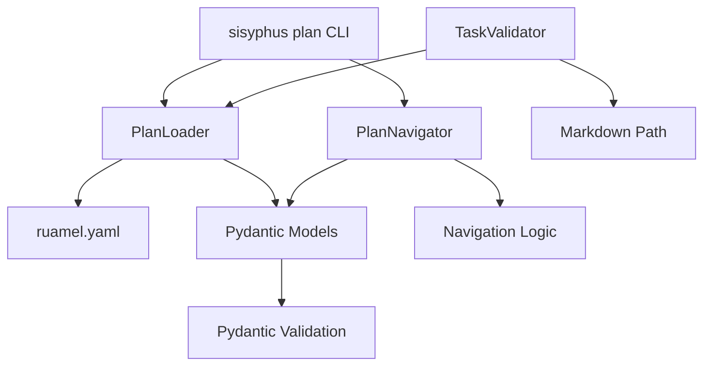
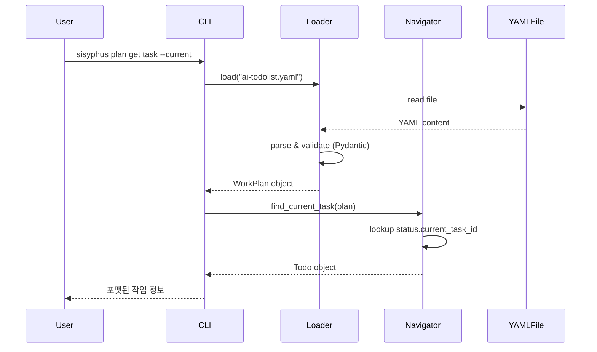
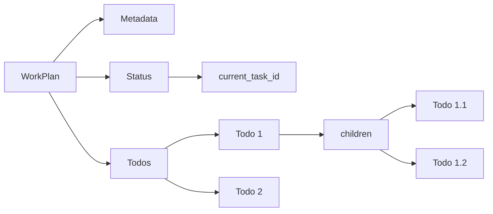

# 사용자의 최초 요청 (기록용)
be a skill creator, and python tool writer

@ai-todolist.yaml 읽고

pydantic 기반으로 엄밀히 타입힌팅해서 todolist file 자체에대한 스펙을 잘 정의하게 해주고

1. create-work-plan (objectives, background, required background)
2. add reference(s) | todo(s)
3. get reference / background / task (should support 'current task' and 'next task') / verification

그리고 일단 먼저 저기 status 안의 current work 가 optional 하면서도, todo 의 명확한 id 값을 가리킬 수 있도록 해야겟다 그래야 우리가 의도한대로 프로그래머틱하게 가능하겟다.

ultrathink to how to write this and then tell me

## 추가 사용자 요청 (기록용)
- 그러면 약간 바꿔서, 지금 ai-todolist.yaml 을 example-ai-todolist.yaml 로 하고
- sisyphus 의 기능으로써 저 내용들을 추가하게 해주고 테스트도 엄밀히 하게 해주라.
- 그 작업을 위한 작업계획서 작성
- YAML 작업계획서 기능을 Sisyphus CLI 서브커맨드로 통합 (`sisyphus plan ...`)
- 기존 md 포맷과 병행 지원하되, 점진적으로 YAML로 마이그레이션
- 현재 실행중인 작업, 다음 작업 조회, 레퍼런스 조회, 차일드 태스크 조회 등 프로그래머틱하게 도움받을 수 있는 스크립트

# 작업 목표 (WHAT & WHY)

## 핵심 목표 (TL;DR)
Sisyphus에 YAML 기반 작업계획서 관리 기능을 추가하여, 작업 진행 상황 조회, 레퍼런스 추출, 태스크 네비게이션 등을 프로그래머틱하게 수행할 수 있는 CLI 도구를 구현한다.

## 상세 목표
- **YAML 스키마 정의**: Pydantic 기반으로 ai-todolist.yaml 구조를 엄밀하게 타입 정의
  - 측정 기준: 모든 필드 타입 힌팅 완료, Pydantic validation 통과

- **CLI 서브커맨드 구현**: `sisyphus plan <action>` 형태로 작업계획서 CRUD 제공
  - 측정 기준: create, add, get, set 명령어 동작, --help 문서화 완료

- **프로그래머틱 조회 API**: 현재/다음 작업, 레퍼런스, 차일드 태스크 조회 기능
  - 측정 기준: `sisyphus plan get task --current/--next` 정확한 결과 반환

- **기존 포맷 호환성**: Markdown (ai-todolist.md) 검증 로직 유지
  - 측정 기준: 기존 TaskValidator 테스트 모두 통과

- **엄밀한 테스트**: given-when-then 패턴으로 모든 기능 테스트
  - 측정 기준: pytest coverage ≥ 90%, 모든 edge case 커버

# 작업 배경 (WHY & WHAT - 현재 상태)

## 현재 상황
Sisyphus는 현재 Markdown 형식의 작업계획서(ai-todolist.md)를 사용하고 있으며, TaskValidator가 정규식 기반으로 체크박스와 완료 플래그를 검증한다. 하지만:

- **구조화 부족**: Markdown은 자유 형식이라 파싱이 어렵고 프로그래머틱 접근 불가
- **현재 작업 추적 불가**: `status.current_task_id`가 없어서 "지금 뭐 하고 있는지" 자동 조회 불가능
- **레퍼런스 추출 어려움**: YAML의 `required_background.references` 같은 구조화 데이터 활용 불가
- **복잡한 검증**: 정규식으로 체크박스 찾기만 하고, nested todos, verification_spec 등 세밀한 구조 접근 불가

현재 `ai-todolist.yaml` 파일이 존재하지만, 코드에서 파싱하지 않고 예시로만 존재한다.

## 변경 이유
작업 진행 중 "다음 할 일이 뭐지?", "이 태스크의 레퍼런스가 뭐였지?" 같은 질문에 답하려면:
- Agent가 파일 전체를 읽고 해석해야 함 → 비효율적
- 구조화된 데이터 접근으로 즉시 답변 가능 → 효율적

YAML + Pydantic 조합으로:
- **타입 안전성**: 잘못된 구조 사전 차단
- **프로그래머틱 접근**: Python 코드로 직접 쿼리 가능
- **검증 자동화**: Pydantic validator로 복잡한 규칙 체크

## 변경할 내용
**현재 상태**:
- `ai-todolist.yaml`: 파일만 존재, 코드에서 미사용
- `TaskValidator`: Markdown 전용, 정규식 기반
- CLI: `sisyphus work` 명령만, 작업계획서 관리 기능 없음

**변경 후 상태**:
- `example-ai-todolist.yaml`: 예시 파일로 이름 변경
- `sisyphus/utils/plan_types.py`: Pydantic 모델 정의
- `sisyphus/core/plan_loader.py`: YAML ↔ Pydantic 변환
- `sisyphus/core/plan_navigator.py`: 태스크 네비게이션 로직
- `sisyphus/cli.py`: `sisyphus plan` 서브커맨드 추가
- `TaskValidator`: Markdown/YAML 둘 다 지원

# 작업 시작 여부
is_execution_started = TRUE

# 모든 목표 달성 여부
is_all_goals_accomplished = FALSE

# 병렬 실행 요청 여부
parallel_requested = FALSE

# 현재 진행 중인 작업
- Task 5: sisyphus plan 서브커맨드 구현

# 필요한 배경 지식

## 기술 스택
- **Python 3.12**: 프로젝트 기준 버전
- **Pydantic ≥2.0**: 데이터 검증 및 타입 힌팅
- **ruamel.yaml**: YAML 파싱 (주석 보존, 순서 유지)
- **Typer**: CLI 프레임워크 (기존 sisyphus 사용 중)
- **Rich**: 터미널 출력 포매팅
- **pytest + anyio**: 비동기 테스트

## 파일 구조 및 역할
```
sisyphus/
├── cli.py                          # Typer 앱 (서브커맨드 등록)
├── utils/
│   ├── types.py                    # 기존: dataclass 타입 정의
│   └── plan_types.py               # 신규: Pydantic 모델 (YAML 스키마)
├── core/
│   ├── tasks.py                    # 기존: TaskValidator (Markdown)
│   ├── plan_loader.py              # 신규: YAML 로더/세이버
│   └── plan_navigator.py           # 신규: 태스크 네비게이션
└── tests/
    ├── test_plan_types.py          # Pydantic 모델 테스트
    ├── test_plan_loader.py         # YAML 로딩 테스트
    ├── test_plan_navigator.py      # 네비게이션 로직 테스트
    └── test_cli_plan.py            # CLI 명령어 테스트

example-ai-todolist.yaml            # 예시 파일 (기존 ai-todolist.yaml 이름 변경)
```

## 컨텍스트 이해를 위한 레퍼런스 파일

### 1. `sisyphus/cli.py`
- **역할**: Typer 기반 CLI 진입점
- **찾을 내용**: 서브커맨드 등록 패턴 (`@app.command`)
- **주요 패턴**:
  ```python
  app = typer.Typer(name="sisyphus")

  @app.command(name="work")
  def run(...): ...
  ```
- **이해할 점**: Typer Option 사용법, 에러 처리 (`typer.BadParameter`, `typer.Exit`)

### 2. `sisyphus/core/tasks.py`
- **역할**: TaskValidator - 작업계획서 검증 로직
- **찾을 내용**: `check_all_goals_accomplished`, `check_all_checkboxes_completed` 메서드
- **주요 패턴**:
  ```python
  class TaskValidator:
      def __init__(self, todolist_path: Path = Path("./ai-todolist.md")):
          self.todolist_path = todolist_path

      def check_all_goals_accomplished(self, content: str | None = None) -> bool:
          pattern = r"is_all_goals_accomplished\s*=\s*TRUE"
          return bool(re.search(pattern, content, re.IGNORECASE))
  ```
- **이해할 점**: 정규식 기반 검증, Markdown 파싱 한계

### 3. `sisyphus/utils/types.py`
- **역할**: dataclass 기반 타입 정의
- **찾을 내용**: `AgentMessage`, `MessageRole` 등 타입 패턴
- **주요 패턴**:
  ```python
  from dataclasses import dataclass, field

  @dataclass
  class AgentMessage:
      role: str
      content: str
      metadata: dict[str, Any] = field(default_factory=dict)
  ```
- **이해할 점**: 기존 프로젝트는 Pydantic 없이 dataclass 사용 (신규 기능에서 Pydantic 도입)

### 4. `sisyphus/core/tests/test_tasks.py`
- **역할**: TaskValidator 테스트 예시
- **찾을 내용**: pytest 패턴, given-when-then 구조
- **주요 패턴**:
  ```python
  pytestmark = [pytest.mark.anyio]  # 파일 최상단

  async def test_read_content_success(tmp_path: Path) -> None:
      # given
      todolist = tmp_path / "ai-todolist.md"
      todolist.write_text("content", encoding="utf-8")

      # when
      result = TaskValidator(todolist).read_content()

      # then
      assert result == "content"
  ```
- **이해할 점**: anyio 테스트, fixture 사용 (파일 맨 아래 배치)

### 5. `ai-todolist.yaml` → `example-ai-todolist.yaml`
- **역할**: YAML 작업계획서 구조 예시
- **찾을 내용**: 전체 구조 (metadata, objectives, todos, status 등)
- **이해할 점**:
  - Recursive todos (children)
  - Discriminated unions (input.type, verify.type, reference.type)
  - ID 타입 통일 (모두 string: "1", "1.1", "1.1.1")

## 아키텍처 제약사항
- **기존 코드 영향 최소화**: TaskValidator는 Markdown 지원 유지 (하위 호환성)
- **anyio 사용**: 비동기 코드는 asyncio 직접 대신 anyio 사용
- **Typer 패턴 준수**: 서브커맨드, Option, Exit 패턴 따르기
- **타입 힌트 필수**: 모든 함수 파라미터 타입 명시 (ANN001 규칙)
- **Double quotes**: `"` 사용 (ruff 규칙)
- **Line length 119**: Black 88도 아니고 120도 아님

## Edge Cases 처리
- **파일 없음**: `ai-todolist.yaml` 없을 때 → 친절한 에러 메시지
- **잘못된 YAML**: 파싱 실패 시 → Pydantic validation error 표시
- **current_task_id null**: 작업 시작 전 → "작업이 시작되지 않음" 메시지
- **next task 없음**: 모든 작업 완료 → "모든 작업 완료!" 메시지
- **빈 children**: leaf task → children 리스트 비우기
- **ID 형식**: 모두 string으로 통일 ("1", "1.1", "1.1.1")

## 암묵적 가정 명시
- **YAML 파일 인코딩**: UTF-8 (한글 지원)
- **working directory**: 프로젝트 루트 (`./ai-todolist.yaml` 상대 경로)
- **Python 버전**: 3.12+ (type union `str | None` 문법 사용)
- **ruamel.yaml 설치됨**: pyproject.toml에 추가 필요
- **Pydantic 2.x**: v1과 호환 불가, v2 문법 사용

# 작업 흐름 (HOW - 태스크 흐름 & 의존성)

## 태스크 의존성 다이어그램
```
Phase 1: 기반 구조 (순차)
├─ Task 1: 파일 이름 변경 (ai-todolist.yaml → example-ai-todolist.yaml)
└─ Task 2: 의존성 추가 (ruamel.yaml, pydantic)

Phase 2: 타입 정의 (순차)
└─ Task 3: Pydantic 모델 정의 (plan_types.py)

Phase 3: 핵심 로직 (순차 - Task 3 의존)
├─ Task 4: YAML 로더/세이버 구현 (plan_loader.py)
└─ Task 5: 태스크 네비게이터 구현 (plan_navigator.py)

Phase 4: CLI 통합 (Task 4, 5 의존)
└─ Task 6: sisyphus plan 서브커맨드 구현

Phase 5: 기존 기능 호환 (Task 4 의존)
└─ Task 7: TaskValidator YAML 지원 추가

Phase 6: 테스트 & 검증 (모든 Task 의존)
├─ Task 8: 단위 테스트 작성
├─ Task 9: 통합 테스트 작성
└─ Task 10: 문서화 및 예시 업데이트
```

## 단계별 설명
- **Phase 1**: 파일 정리 및 의존성 준비 (빠른 설정)
- **Phase 2**: 타입 시스템 구축 (모든 것의 기반)
- **Phase 3**: 비즈니스 로직 (YAML 처리 + 네비게이션)
- **Phase 4**: 사용자 인터페이스 (CLI)
- **Phase 5**: 하위 호환성 (기존 Markdown 지원)
- **Phase 6**: 품질 보증 (테스트 + 문서)

# 작업 계획

## PRDs & Structures

### 시스템 아키텍처


### 데이터 흐름


### 주요 컴포넌트 상호작용


## Implementation Details

### 아키텍처 제약사항
- **동기 I/O**: YAML 파일 읽기는 동기 (작은 파일, anyio 불필요)
- **Immutable 모델**: Pydantic 모델은 읽기 전용, 수정 시 새 객체 생성
- **CLI 에러 처리**: Typer Exit(1) + error_console로 stderr 출력
- **타입 안전성**: mypy/basedpyright 통과 필수

### Edge Case 처리
- **파일 없음**: `FileNotFoundError` → "ai-todolist.yaml을 찾을 수 없습니다" 메시지
- **잘못된 YAML**: `yaml.YAMLError` → "YAML 파싱 실패: [에러 메시지]"
- **Pydantic validation 실패**: `ValidationError` → 필드별 에러 메시지 표시
- **current_task_id가 null**: "작업이 시작되지 않았습니다" 반환
- **current_task_id가 존재하지 않는 ID**: "작업 ID를 찾을 수 없습니다: [id]"
- **next task 없음**: "모든 작업이 완료되었습니다!" 메시지
- **빈 todos 리스트**: "작업이 정의되지 않았습니다" 경고

### 암묵적 가정 명시
- **파일 경로**: `./ai-todolist.yaml` (프로젝트 루트 기준)
- **인코딩**: UTF-8 (한글 지원)
- **TodoId 타입**: 모두 string ("1", "1.1", "1.1.1")
- **Status 업데이트**: CLI가 직접 YAML 수정 (원자적 write)
- **Navigation 순서**: DFS (Depth-First Search) - children 먼저, sibling 나중에

## 프로젝트 커밋 메시지 스타일
최근 커밋 분석 결과:
- **타입 접두사**: `feat:`, `fix:`, `test:`, `docs:` (Conventional Commits)
- **간결한 설명**: 한 줄로 변경 내용 요약
- **예시**:
  - `feat: add YAML-based work plan support`
  - `test: add tests for PlanNavigator`
  - `fix: handle missing current_task_id gracefully`

# TODOs

- [x] 1. 파일 이름 변경 및 의존성 추가

   **레퍼런스**:
   - `pyproject.toml` (dependencies 섹션 확인)
   - `ai-todolist.yaml` (이름 변경 대상)

   - [x] 1.1 ai-todolist.yaml을 example-ai-todolist.yaml로 이름 변경

      **실행 명령어**: `mv ai-todolist.yaml example-ai-todolist.yaml`

      **검증**: `ls -la example-ai-todolist.yaml` → 파일 존재 확인

   - [x] 1.2 pyproject.toml에 의존성 추가

      **현재 상태**: pydantic, ruamel.yaml 없음

      **변경 내용**:
      ```toml
      [project]
      dependencies = [
          # ... 기존 의존성
          "pydantic>=2.0",
          "ruamel.yaml>=0.18",
      ]
      ```

      **검증**: `uv sync` → 의존성 설치 성공

   - [x] 1.3 의존성 설치 및 확인

      **실행 명령어**: `uv sync`

      **검증**:
      ```bash
      uv run python -c "import pydantic; import ruamel.yaml; print('OK')"
      ```
      **예상 출력**: `OK`

   - [x] 1.4 변경사항 커밋

      **커밋 명령어**:
      ```bash
      git add example-ai-todolist.yaml pyproject.toml
      git commit -m "feat: add YAML plan dependencies and rename example file"
      ```

   - [x] **작업 완료 검증 체크리스트**
      - [x] `example-ai-todolist.yaml` 파일 존재
      - [x] `ai-todolist.yaml` 파일 삭제됨
      - [x] `pyproject.toml`에 pydantic, ruamel.yaml 추가됨
      - [x] `uv sync` 성공
      - [x] import 테스트 성공
      - [x] git commit 완료

- [x] 2. Pydantic 모델 정의 (plan_types.py)

   **레퍼런스**:
   - `example-ai-todolist.yaml` (구조 파악)
   - Pydantic 공식 문서: https://docs.pydantic.dev/latest/ (Discriminated Union 검색)
   - `sisyphus/utils/types.py` (파일 위치 패턴)

   - [x] 2.1 sisyphus/utils/plan_types.py 파일 생성

      **구현 내용**:
      - Enum 정의: `TodoStatus`, `ReferenceType`, `InputType`, `VerifyType`, `RetrievalType`
      - Base 모델: `Metadata`, `UserRequest`, `Objectives`, `Background`, `RequiredBackground`, `Status`, `Workflow`, `SuccessVision`, `FinalVerificationCategory`
      - Discriminated Union: `InputSpec`, `VerifySpec`, `ReferenceSpec`, `RetrievalSpec` (각 union의 모든 variant)
      - Recursive 모델: `Todo` (모든 필드 포함, children: list[Todo])
      - Root 모델: `WorkPlan` (모든 필드 명시)

      **완전한 스키마 (ai-todolist.yaml 기반 - 모든 필드 포함)**:
      ```python
      from __future__ import annotations
      from pydantic import BaseModel, Field, ConfigDict
      from typing import Literal, Annotated, Union, Any
      from enum import Enum

      # === Enums ===
      class TodoStatus(str, Enum):
          pending = "pending"
          in_progress = "in_progress"
          completed = "completed"

      class ReferenceType(str, Enum):
          file = "file"
          url = "url"
          code_snippet = "code_snippet"
          text = "text"

      class InputType(str, Enum):
          command = "command"
          prompt = "prompt"
          manual = "manual"
          multi_command = "multi_command"

      class VerifyType(str, Enum):
          programmatic = "programmatic"
          llm_judge = "llm_judge"
          none = "none"
          prompt = "prompt"

      class RetrievalType(str, Enum):
          keywords = "keywords"
          prompt = "prompt"

      # === Input Discriminated Union (모든 타입) ===
      class CommandInput(BaseModel):
          type: Literal["command"]
          command: str
          capture_output: bool = True

      class PromptInput(BaseModel):
          type: Literal["prompt"]
          prompt: str
          context: dict[str, Any] = {}

      class ManualInput(BaseModel):
          type: Literal["manual"]
          instructions: str

      class MultiCommandInput(BaseModel):
          type: Literal["multi_command"]
          commands: list[str]

      InputSpec = Annotated[
          Union[CommandInput, PromptInput, ManualInput, MultiCommandInput],
          Field(discriminator="type")
      ]

      # === Verify Discriminated Union (모든 타입) ===
      class ProgrammaticVerify(BaseModel):
          type: Literal["programmatic"]
          method: str  # "contains", "exact", "regex", "exit_code"
          expected: str | int

      class LLMJudgeVerify(BaseModel):
          type: Literal["llm_judge"]
          criteria: list[str] = []
          accept_if: str = "All criteria met"

      class NoneVerify(BaseModel):
          type: Literal["none"]

      class PromptVerify(BaseModel):
          type: Literal["prompt"]
          prompt: str

      VerifySpec = Annotated[
          Union[ProgrammaticVerify, LLMJudgeVerify, NoneVerify, PromptVerify],
          Field(discriminator="type")
      ]

      # === Verification ===
      class VerificationItem(BaseModel):
          id: str
          description: str
          input: InputSpec
          verify: VerifySpec
          note: str | None = None

      # === Reference Retrieval Discriminated Union ===
      class KeywordsRetrieval(BaseModel):
          type: Literal["keywords"]
          keywords: list[str]
          line_range: list[int] | None = None

      class PromptRetrieval(BaseModel):
          type: Literal["prompt"]
          prompt: str

      RetrievalSpec = Annotated[
          Union[KeywordsRetrieval, PromptRetrieval],
          Field(discriminator="type")
      ]

      # === Reference Discriminated Union (모든 타입) ===
      class FileReference(BaseModel):
          type: Literal["file"] = "file"
          path: str
          description: str
          retrieval: RetrievalSpec | None = None
          notes: str | None = None

      class URLReference(BaseModel):
          type: Literal["url"] = "url"
          url: str
          description: str
          retrieval: RetrievalSpec | None = None
          notes: str | None = None

      class CodeSnippetReference(BaseModel):
          type: Literal["code_snippet"] = "code_snippet"
          language: str
          description: str
          code: str

      class TextReference(BaseModel):
          type: Literal["text"] = "text"
          description: str
          content: str

      ReferenceSpec = Annotated[
          Union[FileReference, URLReference, CodeSnippetReference, TextReference],
          Field(discriminator="type")
      ]

      # === Simple Reference (todo에서 ref_id만 참조) ===
      class SimpleReference(BaseModel):
          ref_id: str
          note: str | None = None

      # === Todo (Recursive - 모든 필드) ===
      class Todo(BaseModel):
          id: str  # "1", "1.1", "1.1.1" (모두 string)
          title: str
          status: TodoStatus
          parallel_group: int | None = None
          created_at: str
          updated_at: str
          status_changed_at: str | None = None
          references: list[SimpleReference] = []
          details: dict[str, Any] = {}
          verification_spec: list[VerificationItem] = []
          children: list["Todo"] = []  # Recursive!

      # === Base Models ===
      class Metadata(BaseModel):
          created_at: str
          updated_at: str
          format_version: str = "2.0"

      class UserRequest(BaseModel):
          original: str
          timestamp: str
          additional: list[str] = []

      class DetailedObjective(BaseModel):
          goal: str
          measurable: str

      class Objectives(BaseModel):
          core: str
          detailed: list[DetailedObjective] = []

      class Background(BaseModel):
          current_situation: str
          reason_for_change: str
          changes_to_make: str

      class RequiredBackground(BaseModel):
          description: str
          file_structure: str | None = None
          references: list[ReferenceSpec] = []

      class ExecutionStatus(BaseModel):
          started: bool
          completed: bool
          started_at: str | None = None
          completed_at: str | None = None

      class WorkMode(BaseModel):
          parallel_requested: bool
          current_task_id: str | None = None

      class Progress(BaseModel):
          total_tasks: int
          completed: int
          in_progress: int
          pending: int

      class Status(BaseModel):
          execution: ExecutionStatus
          work_mode: WorkMode
          progress: Progress
          current_work: str

      class Workflow(BaseModel):
          dependency_diagram: str
          critical_path: list[str] = []

      class UserScenario(BaseModel):
          scenario: str
          experience: str

      class BusinessMetric(BaseModel):
          metric: str
          target: str

      class TechnicalCriterion(BaseModel):
          category: str
          criteria: str
          command: str | None = None
          expected: str

      class SuccessVision(BaseModel):
          user_perspective: list[UserScenario] = []
          business_perspective: list[BusinessMetric] = []
          technical_criteria: list[TechnicalCriterion] = []

      class FinalVerificationItem(BaseModel):
          id: str
          description: str
          input: InputSpec
          verify: VerifySpec
          note: str | None = None

      class FinalVerificationCategory(BaseModel):
          category: str
          items: list[FinalVerificationItem]

      # === Root Model (모든 필드) ===
      class WorkPlan(BaseModel):
          model_config = ConfigDict(extra="allow")

          metadata: Metadata
          user_request: UserRequest
          objectives: Objectives
          background: Background
          required_background: RequiredBackground
          status: Status
          workflow: Workflow
          todos: list[Todo]
          success_vision: SuccessVision
          final_verification: list[FinalVerificationCategory]
      ```

      **참고 사항**:
      - `from __future__ import annotations` 필수 (recursive type)
      - `ConfigDict(extra="allow")` - 확장 필드 허용
      - Optional 필드는 `= None` 또는 `= []` 기본값
      - **모든 Discriminated Union에 `type` 필드 명시** (Pydantic discriminator 필수)
      - **TodoId는 모두 string**: "1", "1.1", "1.1.1" 형식

   - [x] 2.2 기본 validation 테스트 작성

      **테스트 파일**: `sisyphus/utils/tests/test_plan_types.py`

      **테스트 패턴**:
      ```python
      pytestmark = [pytest.mark.anyio]

      async def test_todo_id_must_be_string() -> None:
          # given
          data = {"id": 1, "title": "Test", "status": "pending", "created_at": "2025-01-01", "updated_at": "2025-01-01"}

          # when & then
          with pytest.raises(ValidationError) as exc:
              Todo(**data)
          assert "id" in str(exc.value)

      async def test_workplan_loads_from_dict() -> None:
          # given
          data = {
              "metadata": {"created_at": "2025-01-01", "updated_at": "2025-01-01"},
              "user_request": {"original": "Test", "timestamp": "2025-01-01"},
              "objectives": {"core": "Test objective"},
              "background": {"current_situation": "A", "reason_for_change": "B", "changes_to_make": "C"},
              "required_background": {"description": "Test"},
              "status": {
                  "execution": {"started": False, "completed": False},
                  "work_mode": {"parallel_requested": False, "current_task_id": None},
                  "progress": {"total_tasks": 0, "completed": 0, "in_progress": 0, "pending": 0},
                  "current_work": "None"
              },
              "workflow": {"dependency_diagram": "Test"},
              "todos": [],
              "success_vision": {},
              "final_verification": []
          }

          # when
          plan = WorkPlan(**data)

          # then
          assert plan.metadata.format_version == "2.0"
          assert plan.objectives.core == "Test objective"

      async def test_discriminated_union_input() -> None:
          # given - CommandInput
          command_data = {"type": "command", "command": "ls"}

          # when
          input_spec = CommandInput(**command_data)

          # then
          assert input_spec.type == "command"
          assert input_spec.command == "ls"
          assert input_spec.capture_output is True

      async def test_discriminated_union_verify() -> None:
          # given - ProgrammaticVerify
          verify_data = {"type": "programmatic", "method": "contains", "expected": "OK"}

          # when
          verify_spec = ProgrammaticVerify(**verify_data)

          # then
          assert verify_spec.type == "programmatic"
          assert verify_spec.method == "contains"
          assert verify_spec.expected == "OK"

      async def test_todo_recursive_children() -> None:
          # given
          child_data = {
              "id": "1.1",
              "title": "Child",
              "status": "pending",
              "created_at": "2025-01-01",
              "updated_at": "2025-01-01",
              "children": []
          }
          parent_data = {
              "id": "1",
              "title": "Parent",
              "status": "pending",
              "created_at": "2025-01-01",
              "updated_at": "2025-01-01",
              "children": [child_data]
          }

          # when
          parent = Todo(**parent_data)

          # then
          assert len(parent.children) == 1
          assert parent.children[0].id == "1.1"
          assert parent.children[0].title == "Child"
      ```

   - [x] 2.3 Lint 및 타입 체크

      **검증 명령어**:
      ```bash
      uv run ruff check sisyphus/utils/plan_types.py
      uv run basedpyright sisyphus/utils/plan_types.py
      ```
      **예상 결과**: 0 errors

   - [x] 2.4 커밋

      **커밋 명령어**:
      ```bash
      git add sisyphus/utils/plan_types.py sisyphus/utils/tests/test_plan_types.py
      git commit -m "feat: add complete Pydantic models for YAML work plan"
      ```

   - [x] **작업 완료 검증 체크리스트**
      - [x] `plan_types.py` 파일 존재
      - [x] 모든 Enum, 모델 정의 완료 (Todo 모든 필드, WorkPlan 모든 필드)
      - [x] Discriminated Union 동작 (type 필드로 구분)
      - [x] InputSpec 4개 타입 (command, prompt, manual, multi_command)
      - [x] VerifySpec 4개 타입 (programmatic, llm_judge, none, prompt)
      - [x] ReferenceSpec 4개 타입 (file, url, code_snippet, text)
      - [x] RetrievalSpec 2개 타입 (keywords, prompt)
      - [x] Recursive Todo 정의 (children)
      - [x] 테스트 파일 작성 (validation, discriminated union, recursive children)
      - [x] `uv run pytest sisyphus/utils/tests/test_plan_types.py` → PASSED
      - [x] Ruff, basedpyright 통과
      - [x] git commit 완료

- [x] 3. YAML 로더/세이버 구현 (plan_loader.py)

   **레퍼런스**:
   - `sisyphus/utils/plan_types.py` (Pydantic 모델)
   - `sisyphus/core/tasks.py` (파일 경로 처리 패턴)
   - ruamel.yaml 문서: https://yaml.readthedocs.io/ ("YAML" 검색)

   - [x] 3.1 sisyphus/core/plan_loader.py 구현

      **구현 내용**:
      ```python
      from pathlib import Path
      from ruamel.yaml import YAML
      from sisyphus.utils.plan_types import WorkPlan

      class PlanLoader:
          def __init__(self, plan_path: Path = Path("./ai-todolist.yaml")) -> None:
              self.plan_path = plan_path
              self.yaml = YAML()
              self.yaml.preserve_quotes = True
              self.yaml.default_flow_style = False

          def load(self) -> WorkPlan:
              """Load and validate YAML work plan."""
              if not self.plan_path.exists():
                  raise FileNotFoundError(f"작업계획서를 찾을 수 없습니다: {self.plan_path}")

              with self.plan_path.open("r", encoding="utf-8") as f:
                  data = self.yaml.load(f)

              return WorkPlan(**data)  # Pydantic validation

          def save(self, plan: WorkPlan) -> None:
              """Save work plan to YAML."""
              data = plan.model_dump(mode="python")
              with self.plan_path.open("w", encoding="utf-8") as f:
                  self.yaml.dump(data, f)
      ```

      **에러 처리**:
      - `FileNotFoundError` → 파일 없음 메시지
      - `yaml.YAMLError` → YAML 파싱 에러
      - `pydantic.ValidationError` → 스키마 검증 실패

   - [x] 3.2 테스트 작성

      **테스트 파일**: `sisyphus/core/tests/test_plan_loader.py`

      **테스트 케이스**:
      ```python
      pytestmark = [pytest.mark.anyio]

      async def test_load_valid_yaml(tmp_path: Path) -> None:
          # given
          yaml_file = tmp_path / "test.yaml"
          yaml_content = """
metadata:
  created_at: "2025-10-28T14:32:15+09:00"
  updated_at: "2025-10-28T14:32:15+09:00"
user_request:
  original: "Test"
  timestamp: "2025-10-28"
objectives:
  core: "Test objective"
  detailed: []
background:
  current_situation: "A"
  reason_for_change: "B"
  changes_to_make: "C"
required_background:
  description: "Test background"
status:
  execution:
    started: false
    completed: false
  work_mode:
    parallel_requested: false
    current_task_id: null
  progress:
    total_tasks: 0
    completed: 0
    in_progress: 0
    pending: 0
  current_work: "None"
workflow:
  dependency_diagram: "Test"
todos: []
success_vision:
  user_perspective: []
  business_perspective: []
  technical_criteria: []
final_verification: []
          """
          yaml_file.write_text(yaml_content, encoding="utf-8")

          # when
          loader = PlanLoader(yaml_file)
          plan = loader.load()

          # then
          assert plan.objectives.core == "Test objective"
          assert plan.metadata.format_version == "2.0"

      async def test_load_nonexistent_file() -> None:
          # given
          loader = PlanLoader(Path("nonexistent.yaml"))

          # when & then
          with pytest.raises(FileNotFoundError) as exc:
              loader.load()
          assert "작업계획서를 찾을 수 없습니다" in str(exc.value)

      async def test_save_and_reload(tmp_path: Path) -> None:
          # given
          yaml_file = tmp_path / "test.yaml"
          loader = PlanLoader(yaml_file)

          # Create minimal valid plan
          from sisyphus.utils.plan_types import (
              WorkPlan, Metadata, UserRequest, Objectives, Background,
              RequiredBackground, Status, ExecutionStatus, WorkMode, Progress,
              Workflow, SuccessVision, FinalVerificationCategory
          )
          plan = WorkPlan(
              metadata=Metadata(created_at="2025-01-01", updated_at="2025-01-01"),
              user_request=UserRequest(original="Test", timestamp="2025-01-01"),
              objectives=Objectives(core="Test"),
              background=Background(current_situation="A", reason_for_change="B", changes_to_make="C"),
              required_background=RequiredBackground(description="Test"),
              status=Status(
                  execution=ExecutionStatus(started=False, completed=False),
                  work_mode=WorkMode(parallel_requested=False, current_task_id=None),
                  progress=Progress(total_tasks=0, completed=0, in_progress=0, pending=0),
                  current_work="None"
              ),
              workflow=Workflow(dependency_diagram="Test"),
              todos=[],
              success_vision=SuccessVision(),
              final_verification=[]
          )

          # when
          loader.save(plan)
          reloaded = loader.load()

          # then
          assert reloaded.objectives.core == "Test"
          assert reloaded.metadata.format_version == "2.0"
      ```

   - [x] 3.3 Lint 및 타입 체크

      **검증**: `uv run ruff check sisyphus/core/plan_loader.py && uv run basedpyright sisyphus/core/plan_loader.py`

   - [x] 3.4 커밋

      ```bash
      git add sisyphus/core/plan_loader.py sisyphus/core/tests/test_plan_loader.py
      git commit -m "feat: implement YAML plan loader with Pydantic validation"
      ```

   - [x] **작업 완료 검증 체크리스트**
      - [x] `PlanLoader.load()` 동작 (YAML → WorkPlan)
      - [x] `PlanLoader.save()` 동작 (WorkPlan → YAML)
      - [x] FileNotFoundError 적절히 처리
      - [x] Pydantic ValidationError 전달
      - [x] 테스트: `uv run pytest sisyphus/core/tests/test_plan_loader.py` → PASSED
      - [x] Lint/타입 체크 통과

- [x] 4. 태스크 네비게이터 구현 (plan_navigator.py)

   **레퍼런스**:
   - `sisyphus/utils/plan_types.py` (Todo, WorkPlan 구조)
   - DFS 알고리즘 (Depth-First Search)

   - [ ] 4.1 sisyphus/core/plan_navigator.py 구현

      **구현 내용**: PlanNavigator 클래스 with DFS-based navigation

      **핵심 메서드**:
      - `get_current_task()`: 현재 진행 중인 작업
      - `get_next_task()`: 다음 pending 작업 (DFS 순서)
      - `find_todo_by_id()`: ID로 작업 찾기 (recursive)
      - Helper methods: `_find_first_pending`, `_get_siblings`, `_find_parent`

      **DFS 알고리즘 (Pseudo-code)**:
      ```python
      def get_next_task(plan: WorkPlan, current_id: str | None = None) -> Todo | None:
          """다음 pending 작업 찾기 (DFS 순서)

          비즈니스 규칙:
          1. current_id가 None → 첫 번째 pending 작업 반환
          2. current task가 in_progress:
             - current.children 중 첫 pending child 반환
             - child 없으면 current의 next sibling 반환
          3. current task가 completed:
             - current의 next sibling 반환
             - sibling 없으면 parent의 next sibling 반환 (backtrack)
          4. 모든 작업 완료 → None 반환

          DFS 순서: children → sibling → parent's sibling

          parallel_group 처리:
          - parallel_group 내 모든 태스크는 "동시 실행 가능"을 의미
          - get_next_task()는 parallel_group 내 첫 pending 반환
          - 실제 병렬 실행 여부는 CLI --parallel 옵션으로 제어
          """

          # 1. current_id가 None → 첫 pending 찾기
          if current_id is None:
              return _find_first_pending(plan.todos)

          # 2. current task 찾기
          current = find_todo_by_id(plan.todos, current_id)
          if current is None:
              raise ValueError(f"작업 ID를 찾을 수 없습니다: {current_id}")

          # 3. current task 상태에 따라 분기
          if current.status == TodoStatus.in_progress:
              # 3a. children 중 첫 pending 찾기
              if current.children:
                  first_child_pending = _find_first_pending(current.children)
                  if first_child_pending:
                      return first_child_pending

              # 3b. next sibling 찾기
              siblings = _get_siblings(plan.todos, current_id)
              next_sibling = _find_next_sibling(siblings, current_id)
              if next_sibling and next_sibling.status == TodoStatus.pending:
                  return next_sibling

          elif current.status == TodoStatus.completed:
              # 4a. next sibling 찾기
              siblings = _get_siblings(plan.todos, current_id)
              next_sibling = _find_next_sibling(siblings, current_id)
              if next_sibling and next_sibling.status == TodoStatus.pending:
                  return next_sibling

              # 4b. parent의 next sibling 찾기 (backtrack)
              parent = _find_parent(plan.todos, current_id)
              if parent:
                  parent_siblings = _get_siblings(plan.todos, parent.id)
                  parent_next = _find_next_sibling(parent_siblings, parent.id)
                  if parent_next and parent_next.status == TodoStatus.pending:
                      return parent_next

          # 5. 모든 작업 완료
          return None

      def _find_first_pending(todos: list[Todo]) -> Todo | None:
          """DFS로 첫 pending 작업 찾기"""
          for todo in todos:
              if todo.status == TodoStatus.pending:
                  return todo
              # children도 탐색 (DFS)
              if todo.children:
                  child_pending = _find_first_pending(todo.children)
                  if child_pending:
                      return child_pending
          return None

      def find_todo_by_id(todos: list[Todo], target_id: str) -> Todo | None:
          """Recursive search by ID"""
          for todo in todos:
              if todo.id == target_id:
                  return todo
              if todo.children:
                  found = find_todo_by_id(todo.children, target_id)
                  if found:
                      return found
          return None

      def _get_siblings(todos: list[Todo], target_id: str) -> list[Todo]:
          """같은 depth의 sibling 리스트 반환"""
          # Recursive search for parent, return parent's children
          # Implementation details...
          pass

      def _find_next_sibling(siblings: list[Todo], current_id: str) -> Todo | None:
          """Sibling 리스트에서 current 다음 sibling 반환"""
          for i, sibling in enumerate(siblings):
              if sibling.id == current_id and i + 1 < len(siblings):
                  return siblings[i + 1]
          return None
      ```

      **실제 구현 예시**:
      ```python
      from sisyphus.utils.plan_types import WorkPlan, Todo, TodoStatus

      class PlanNavigator:
          def __init__(self, plan: WorkPlan) -> None:
              self.plan = plan

          def get_current_task(self) -> Todo | None:
              """현재 진행 중인 작업 반환"""
              current_id = self.plan.status.work_mode.current_task_id
              if current_id is None:
                  return None
              return self.find_todo_by_id(current_id)

          def get_next_task(self, current_id: str | None = None) -> Todo | None:
              """다음 pending 작업 반환 (DFS 순서)"""
              # Pseudo-code 기반 구현
              if current_id is None:
                  current_id = self.plan.status.work_mode.current_task_id

              if current_id is None:
                  return self._find_first_pending(self.plan.todos)

              current = self.find_todo_by_id(current_id)
              if current is None:
                  raise ValueError(f"작업 ID를 찾을 수 없습니다: {current_id}")

              # ... (위 pseudo-code 로직 구현)

          def find_todo_by_id(self, target_id: str) -> Todo | None:
              """ID로 작업 찾기 (recursive)"""
              return self._find_in_list(self.plan.todos, target_id)

          def _find_in_list(self, todos: list[Todo], target_id: str) -> Todo | None:
              for todo in todos:
                  if todo.id == target_id:
                      return todo
                  if todo.children:
                      found = self._find_in_list(todo.children, target_id)
                      if found:
                          return found
              return None

          def _find_first_pending(self, todos: list[Todo]) -> Todo | None:
              """DFS로 첫 pending 작업 찾기"""
              for todo in todos:
                  if todo.status == TodoStatus.pending:
                      return todo
                  if todo.children:
                      child = self._find_first_pending(todo.children)
                      if child:
                          return child
              return None
      ```

   - [ ] 4.2 테스트 작성

      **테스트 파일**: `sisyphus/core/tests/test_plan_navigator.py`

      **테스트 케이스**:
      ```python
      pytestmark = [pytest.mark.anyio]

      async def test_get_current_task_when_null() -> None:
          # given - current_task_id = None
          plan = create_test_plan(current_task_id=None)
          navigator = PlanNavigator(plan)

          # when
          current = navigator.get_current_task()

          # then
          assert current is None

      async def test_get_current_task_when_set() -> None:
          # given - current_task_id = "1.1"
          plan = create_test_plan(current_task_id="1.1")
          navigator = PlanNavigator(plan)

          # when
          current = navigator.get_current_task()

          # then
          assert current is not None
          assert current.id == "1.1"

      async def test_get_next_task_dfs_order() -> None:
          # given - Tree: 1 (in_progress) -> 1.1 (pending), 1.2 (pending), 2 (pending)
          plan = create_test_plan_tree()
          navigator = PlanNavigator(plan)

          # when - next after 1 (in_progress)
          next_task = navigator.get_next_task(current_id="1")

          # then - DFS: children first
          assert next_task.id == "1.1"

      async def test_get_next_task_backtrack() -> None:
          # given - 1.1 (completed), 1.2 (completed), 2 (pending)
          plan = create_test_plan_backtrack()
          navigator = PlanNavigator(plan)

          # when - next after 1.2 (no more siblings)
          next_task = navigator.get_next_task(current_id="1.2")

          # then - backtrack to parent's sibling
          assert next_task.id == "2"

      async def test_get_next_task_all_completed() -> None:
          # given - all tasks completed
          plan = create_test_plan_all_completed()
          navigator = PlanNavigator(plan)

          # when
          next_task = navigator.get_next_task(current_id="2")

          # then
          assert next_task is None

      async def test_find_todo_by_id_nested() -> None:
          # given
          plan = create_test_plan_nested()
          navigator = PlanNavigator(plan)

          # when
          found = navigator.find_todo_by_id("1.1.2")

          # then
          assert found is not None
          assert found.id == "1.1.2"
          assert found.title == "Nested task"
      ```

   - [ ] 4.3 Lint 및 타입 체크

      **검증**: `uv run ruff check sisyphus/core/plan_navigator.py && uv run basedpyright sisyphus/core/plan_navigator.py`

   - [ ] 4.4 커밋

      ```bash
      git add sisyphus/core/plan_navigator.py sisyphus/core/tests/test_plan_navigator.py
      git commit -m "feat: implement PlanNavigator with DFS-based task navigation"
      ```

   - [ ] **작업 완료 검증 체크리스트**
      - [ ] `get_current_task()` 동작 (current_task_id lookup)
      - [ ] `get_next_task()` 동작 (DFS 순서: children → sibling → backtrack)
      - [ ] `find_todo_by_id()` 동작 (recursive search)
      - [ ] Edge cases 처리:
        - [ ] current_task_id null → 첫 pending 반환
        - [ ] 모든 작업 완료 → None 반환
        - [ ] 존재하지 않는 ID → ValueError
      - [ ] 비즈니스 규칙 구현:
        - [ ] in_progress → children first
        - [ ] completed → next sibling
        - [ ] no sibling → parent's sibling (backtrack)
      - [ ] parallel_group 처리 (첫 pending 반환)
      - [ ] 테스트: `uv run pytest sisyphus/core/tests/test_plan_navigator.py` → PASSED
      - [ ] Lint/타입 체크 통과

- [x] 5. sisyphus plan 서브커맨드 구현

   **레퍼런스**:
   - `sisyphus/cli.py` (기존 서브커맨드 패턴)
   - Typer 문서

   - [x] 5.1 sisyphus/cli.py에 plan 서브커맨드 추가

      **명령어 구조**:
      - `sisyphus plan get task --current/--next/--id <id>`
      - `sisyphus plan get reference <ref_id>`
      - `sisyphus plan set current-task <id>`
      - `sisyphus plan set task-status <id> <status>`

      **구현 패턴**:
      ```python
      from sisyphus.core.plan_loader import PlanLoader
      from sisyphus.core.plan_navigator import PlanNavigator

      plan_app = typer.Typer(name="plan", help="Work plan management")
      app.add_typer(plan_app)

      @plan_app.command(name="get")
      def get_plan_info(
          what: str = typer.Argument(..., help="What to get: task, reference, background"),
          current: bool = typer.Option(False, "--current", help="Get current task"),
          next_task: bool = typer.Option(False, "--next", help="Get next pending task"),
          task_id: str | None = typer.Option(None, "--id", help="Specific task ID"),
      ) -> None:
          """Get information from work plan"""
          try:
              loader = PlanLoader()
              plan = loader.load()
              navigator = PlanNavigator(plan)

              if what == "task":
                  if current:
                      task = navigator.get_current_task()
                      if task is None:
                          console.print("[yellow]작업이 시작되지 않았습니다[/yellow]")
                          raise typer.Exit(0)
                      print_task(task)
                  elif next_task:
                      task = navigator.get_next_task()
                      if task is None:
                          console.print("[green]모든 작업이 완료되었습니다![/green]")
                          raise typer.Exit(0)
                      print_task(task)
                  elif task_id:
                      task = navigator.find_todo_by_id(task_id)
                      if task is None:
                          console.print(f"[red]작업 ID를 찾을 수 없습니다: {task_id}[/red]")
                          raise typer.Exit(1)
                      print_task(task)
                  else:
                      console.print("[red]--current, --next, --id 중 하나를 선택하세요[/red]")
                      raise typer.Exit(1)

              elif what == "reference":
                  # Reference lookup logic
                  pass

          except FileNotFoundError as e:
              console.print(f"[red]{e}[/red]")
              raise typer.Exit(1)
          except ValidationError as e:
              console.print(f"[red]YAML 검증 실패:[/red]\n{e}")
              raise typer.Exit(1)

      @plan_app.command(name="set")
      def set_plan_info(
          what: str = typer.Argument(..., help="What to set: current-task, task-status"),
          value: str = typer.Argument(..., help="Value to set"),
      ) -> None:
          """Update work plan information"""
          # Implementation...
          pass
      ```

   - [x] 5.2 Rich 포매팅 유틸리티 추가 (`sisyphus/utils/formatting.py`)

      **구현**:
      ```python
      from rich.console import Console
      from rich.table import Table
      from sisyphus.utils.plan_types import Todo

      console = Console()

      def print_task(task: Todo) -> None:
          """Print task with Rich formatting"""
          table = Table(title=f"Task: {task.id}")
          table.add_column("Field", style="cyan")
          table.add_column("Value", style="green")

          table.add_row("ID", task.id)
          table.add_row("Title", task.title)
          table.add_row("Status", task.status.value)
          table.add_row("Created", task.created_at)
          table.add_row("Updated", task.updated_at)

          if task.references:
              refs = ", ".join(ref.ref_id for ref in task.references)
              table.add_row("References", refs)

          if task.children:
              children_ids = ", ".join(child.id for child in task.children)
              table.add_row("Children", children_ids)

          console.print(table)
      ```

   - [x] 5.3 CLI 테스트 작성 (`sisyphus/tests/test_cli_plan.py`)

      **테스트 패턴**:
      ```python
      from typer.testing import CliRunner
      from sisyphus.cli import app

      runner = CliRunner()

      def test_plan_get_current_when_not_started():
          # given
          # (assume ai-todolist.yaml exists with current_task_id = null)

          # when
          result = runner.invoke(app, ["plan", "get", "task", "--current"])

          # then
          assert result.exit_code == 0
          assert "작업이 시작되지 않았습니다" in result.stdout

      def test_plan_get_next():
          # given
          # (assume ai-todolist.yaml exists with pending tasks)

          # when
          result = runner.invoke(app, ["plan", "get", "task", "--next"])

          # then
          assert result.exit_code == 0
          assert "Task: " in result.stdout
      ```

   - [x] 5.4 Lint 및 타입 체크

   - [ ] 5.5 커밋

      ```bash
      git add sisyphus/cli.py sisyphus/utils/formatting.py sisyphus/tests/test_cli_plan.py
      git commit -m "feat: add sisyphus plan CLI subcommands with Rich formatting"
      ```

   - [ ] **작업 완료 검증 체크리스트**
      - [ ] `sisyphus plan get task --current` 동작
      - [ ] `sisyphus plan get task --next` 동작
      - [ ] `sisyphus plan get task --id <id>` 동작
      - [ ] `sisyphus plan set current-task <id>` 동작
      - [ ] `sisyphus plan set task-status <id> <status>` 동작
      - [ ] Rich 포매팅 적용 (table, colors)
      - [ ] 에러 메시지 친절 (FileNotFoundError, ValidationError)
      - [ ] 테스트: `uv run pytest sisyphus/tests/test_cli_plan.py` → PASSED
      - [ ] `sisyphus plan --help` 문서화 확인

- [x] 6. TaskValidator YAML 지원 추가

   **레퍼런스**:
   - `sisyphus/core/tasks.py`
   - `sisyphus/core/plan_loader.py`

   - [ ] 6.1 tasks.py에 YAML 지원 로직 추가

      **구현**: `.yaml` suffix 감지 → `_check_yaml_accomplished()` 호출

      ```python
      def check_all_goals_accomplished(self, content: str | None = None) -> bool:
          """Check if all goals accomplished (Markdown or YAML)"""
          # YAML 파일 감지
          if self.todolist_path.suffix == ".yaml":
              return self._check_yaml_accomplished()

          # 기존 Markdown 로직
          if content is None:
              content = self.read_content()
          pattern = r"is_all_goals_accomplished\s*=\s*TRUE"
          return bool(re.search(pattern, content, re.IGNORECASE))

      def _check_yaml_accomplished(self) -> bool:
          """Check YAML work plan completion"""
          from sisyphus.core.plan_loader import PlanLoader

          loader = PlanLoader(self.todolist_path)
          plan = loader.load()
          return plan.status.execution.completed
      ```

   - [ ] 6.2 테스트 작성

      **테스트 파일**: `sisyphus/core/tests/test_tasks.py`에 추가

      ```python
      async def test_yaml_check_all_goals_accomplished(tmp_path: Path) -> None:
          # given - YAML file with completed=true
          yaml_file = tmp_path / "test.yaml"
          yaml_content = """
      metadata:
        created_at: "2025-01-01"
        updated_at: "2025-01-01"
      # ... (minimal plan with status.execution.completed = true)
      status:
        execution:
          started: true
          completed: true
      # ...
          """
          yaml_file.write_text(yaml_content, encoding="utf-8")

          # when
          validator = TaskValidator(yaml_file)
          result = validator.check_all_goals_accomplished()

          # then
          assert result is True
      ```

   - [ ] 6.3 기존 Markdown 테스트 모두 통과 확인

      **검증**: `uv run pytest sisyphus/core/tests/test_tasks.py -k test_check_all_goals`

   - [ ] 6.4 Lint 및 타입 체크

   - [ ] 6.5 커밋

      ```bash
      git add sisyphus/core/tasks.py sisyphus/core/tests/test_tasks.py
      git commit -m "feat: add YAML format support to TaskValidator"
      ```

   - [ ] **작업 완료 검증 체크리스트**
      - [ ] TaskValidator YAML 파일 감지 (suffix .yaml)
      - [ ] YAML 완료 검증 (status.execution.completed)
      - [ ] Markdown 호환성 유지 (기존 테스트 통과)
      - [ ] 새 테스트 추가 (YAML 형식)
      - [ ] 테스트: `uv run pytest sisyphus/core/tests/test_tasks.py` → PASSED

- [ ] 7. 단위 테스트 작성 (추가 커버리지)

   - [ ] 7.1 Edge case 테스트 추가
      - [ ] Pydantic validation 실패 (잘못된 필드 타입)
      - [ ] YAML 파싱 실패 (malformed YAML)
      - [ ] Navigator ID 없음 (존재하지 않는 ID)
      - [ ] Navigator 모든 완료 (next = None)

   - [ ] 7.2 전체 테스트 실행 및 커버리지 확인 (≥90%)

      **검증**: `uv run pytest --cov=sisyphus --cov-report=term-missing`

   - [ ] 7.3 커밋

      ```bash
      git add sisyphus/
      git commit -m "test: add comprehensive edge case tests (coverage ≥90%)"
      ```

- [ ] 8. 통합 테스트 작성

   - [ ] 8.1 End-to-end 시나리오 테스트

      **시나리오**:
      1. YAML 파일 로드
      2. 첫 pending task 조회
      3. current_task_id 업데이트
      4. next task 조회
      5. 작업 완료 표시
      6. YAML 파일 저장
      7. 재로드 후 검증

   - [ ] 8.2 example-ai-todolist.yaml로 테스트

      **검증**: 실제 example 파일이 정상 로드되고 validate되는지 확인

   - [ ] 8.3 커밋

      ```bash
      git add sisyphus/tests/
      git commit -m "test: add end-to-end integration tests"
      ```

- [ ] 9. 문서화 및 예시 업데이트

   - [ ] 9.1 README.md에 사용법 추가

      **추가 내용**:
      ```markdown
      ## YAML Work Plan Management

      Sisyphus supports YAML-based work plans for programmatic task management.

      ### Commands

      ```bash
      # Get current task
      sisyphus plan get task --current

      # Get next pending task
      sisyphus plan get task --next

      # Get specific task
      sisyphus plan get task --id 1.2

      # Update current task
      sisyphus plan set current-task 1.1
      ```

      ### YAML Format

      See `example-ai-todolist.yaml` for full schema.
      ```

   - [ ] 9.2 example-ai-todolist.yaml에 주석 추가

      **추가**: 각 섹션 상단에 설명 주석 (metadata, objectives, todos, status 등)

   - [ ] 9.3 커밋

      ```bash
      git add README.md example-ai-todolist.yaml
      git commit -m "docs: add YAML work plan usage documentation"
      ```

- [ ] 10. 최종 검증 및 정리

   - [ ] 10.1 전체 테스트 실행 (100% PASSED)

      **검증**: `uv run pytest`

   - [ ] 10.2 Lint 및 타입 체크 (0 errors)

      **검증**: `uv run ruff check sisyphus/ && uv run basedpyright sisyphus/`

   - [ ] 10.3 실제 CLI 수동 테스트

      **시나리오**: example-ai-todolist.yaml로 모든 CLI 명령어 실행

   - [ ] 10.4 기존 기능 회귀 테스트

      **검증**: `sisyphus work --help`, TaskValidator Markdown 테스트 통과

   - [ ] 10.5 최종 커밋

      ```bash
      git add .
      git commit -m "chore: finalize YAML work plan feature"
      ```

   - [ ] **작업 완료 검증 체크리스트**
      - [ ] 모든 테스트 통과 (`uv run pytest`)
      - [ ] Lint/타입 체크 0 errors
      - [ ] CLI 수동 테스트 성공
      - [ ] 기존 기능 영향 없음 (`sisyphus work` 동작)
      - [ ] TaskValidator Markdown 지원 유지
      - [ ] 문서화 완료 (README, example YAML)

# 성공 비전

## 사용자 관점의 성공
- **시나리오 1: 현재 작업 확인** → `sisyphus plan get task --current` 즉시 조회
- **시나리오 2: 다음 할 일 파악** → `sisyphus plan get task --next` 자동 추천
- **시나리오 3: 레퍼런스 빠른 접근** → 파일 경로 + 검색 키워드 즉시 표시
- **시나리오 4: 프로그래머틱 자동화** → JSON 출력으로 CI/CD 통합

## 비즈니스 관점의 성공
- **작업 조회 시간 단축**: < 1초
- **Agent 파싱 실패율 감소**: 런타임 에러 0건
- **개발자 생산성 향상**: "다음 뭐하지?" 질문 시간 제거

## 기술적 성공 기준
- 모든 테스트 통과 (100%)
- Coverage ≥ 90%
- 타입/Lint 0 errors
- CLI 응답 < 500ms
- YAML 파싱 100% 성공
- 하위 호환성 유지

# 최종 작업 검증 체크리스트

- [ ] 1. **기능 동작 확인**
  - [ ] `sisyphus plan get task --current/--next/--id`
  - [ ] `sisyphus plan set current-task`
  - [ ] `sisyphus plan get reference`

- [ ] 2. **잘못된 구현 방지**
  - [ ] TodoId 모두 string
  - [ ] Pydantic validation 동작
  - [ ] 명확한 에러 메시지

- [ ] 3. **범위 준수 확인**
  - [ ] 기존 CLI 수정 없음
  - [ ] TaskValidator Markdown 지원 유지

- [ ] 4. **기존 기능 회귀 테스트**
  - [ ] `sisyphus --help` 동작
  - [ ] `sisyphus work` 영향 없음
  - [ ] TaskValidator 기존 테스트 통과
