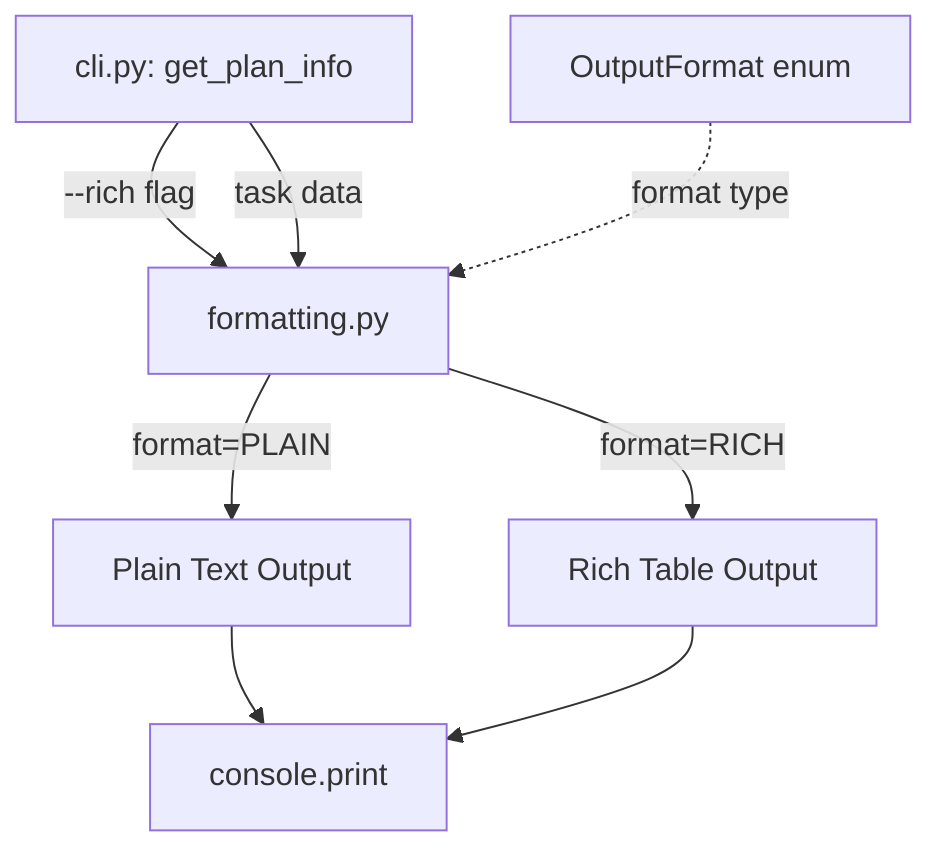
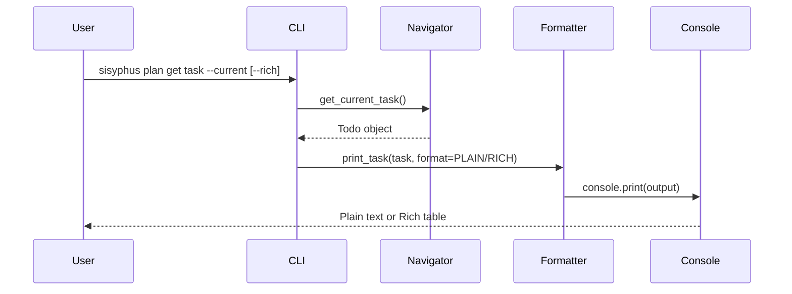

# 사용자의 최초 요청 (기록용)
sisyphus plan 명령어의 Rich table 출력을 LLM token-friendly하게 개선:
- 현재: Rich table이 기본 출력 → LLM 파싱 어려움, token 비효율
- 원하는 것: Plain text를 기본으로, --rich 옵션으로 Rich table 사용 가능하게

# 작업 목표 (WHAT & WHY)

## 핵심 목표 (TL;DR)
sisyphus plan 명령어의 출력 포맷을 LLM-friendly한 plain text로 변경하고, 사용자가 원할 때만 --rich 옵션으로 Rich table을 사용할 수 있도록 개선

## 상세 목표
- Plain text 출력을 기본값으로 설정 (LLM이 파싱하기 쉬운 구조화된 텍스트)
- `--rich` 옵션 추가로 기존 Rich table 출력 유지 (backward compatibility)
- Token 효율성 향상 (테이블 경계선, ANSI 스타일 코드 제거)
- 코드 구조 개선: OutputFormat enum으로 포맷 관리

# 작업 배경 (WHY & WHAT - Current State)

## 현재 상황
- `sisyphus plan get` 명령의 모든 출력이 Rich Table 사용
  - `print_task()`: 2열 테이블
  - `print_references()`: 3열 테이블
  - `print_children()`: 3열 테이블
  - `print_verification()`: 3열 테이블
  - `print_completion_report()`: Rich Panel
- LLM이 이 출력을 읽을 때 불필요한 포맷 정보 포함 (경계선, 스타일)
- Token 낭비 및 파싱 복잡도 증가

## 변경 이유
- LLM 친화적 출력 제공: 구조화된 plain text가 파싱 쉬움
- Token 효율성: 불필요한 테이블 장식 제거
- 유연성: 사용자가 선택 가능 (기본 plain, 옵션으로 rich)

## 변경 사항
- **Before**: 모든 출력이 Rich Table (기본값, 변경 불가)
- **After**: Plain text가 기본, `--rich` 옵션으로 Rich Table 사용 가능

# 작업 시작 여부
is_execution_started = TRUE

# 모든 목표 달성 여부
is_all_goals_accomplished = TRUE

# 병렬 실행 여부
parallel_requested = FALSE

# 현재 진행중인 작업
- 작업이 아직 시작되지 않았습니다.
  - 작업 시작 시 위의 `is_execution_started` 값을 TRUE로 변경하세요.
  - **사용자가 명시적으로 "작업 시작해"라고 말하기 전까지 절대 작업을 시작하지 마세요.**
  - **plan-reviewer로부터 OKAY를 받았어도, 작업을 시작하지 마세요**
  - **사용자가 명시적으로 "작업 시작해"라고 말하기 전까지 절대 작업을 시작하지 마세요.**

# 필수 배경 지식

## 파일 구조 및 역할
### 1. `sisyphus/cli.py`
- **역할**: CLI 진입점, plan 명령어 정의
- **검색 키워드**: `@plan_app.command("get")`, `get_plan_info()`, `print_task()` 호출부
- **주요 패턴**: Typer 데코레이터로 명령어 정의, 옵션 파라미터로 동작 제어

### 2. `sisyphus/utils/formatting.py`
- **역할**: 출력 포맷팅 함수 (현재 Rich Table 사용)
- **검색 키워드**: `def print_task`, `def print_references`, `Table()`
- **핵심 패턴**:
  - `Table()` 객체 생성 → `add_column()` → `add_row()` → `console.print()`
  - Plain text로 변경 시: 직접 문자열 포맷팅 + `console.print()` (Rich 마크업 없이)

### 3. `sisyphus/core/plan_navigator.py`
- **역할**: 비즈니스 로직 (task 탐색, 조회)
- **검색 키워드**: `get_current_task()`, `find_todo_by_id()`
- **참고사항**: 수정 불필요 (출력 레이어만 변경)

### 4. `sisyphus/utils/plan_types.py`
- **역할**: 데이터 모델 (Todo, ReferenceSpec, VerificationItem)
- **참고사항**: 수정 불필요 (데이터 구조 유지)

## 참고 파일 (컨텍스트 이해용)
### 1. `sisyphus/utils/formatting.py`
- **역할**: 현재 Rich Table 구현 확인
- **검색할 것**: `from rich.table import Table`, `table.add_column()`, `table.add_row()` 패턴
- **이해할 패턴**:
  ```python
  table = Table(title="...")
  table.add_column("Field", style="cyan")
  table.add_row("ID", str(task.id))
  console.print(table)
  ```
- **Plain text 변환 예시**:
  ```python
  output = f"Task: {task.id}\n"
  output += f"  ID: {task.id}\n"
  output += f"  Title: {task.title}\n"
  console.print(output)
  ```

### 2. `sisyphus/cli.py`
- **역할**: 옵션 파라미터 추가 위치
- **검색할 것**: `@plan_app.command("get")`, `typer.Option()` 사용 패턴
- **패턴 예시**:
  ```python
  def get_plan_info(
      what: str = typer.Argument(...),
      rich: bool = typer.Option(False, "--rich", help="Use Rich table format"),
  ):
  ```

### 3. `sisyphus/tests/test_cli_plan.py`
- **역할**: 기존 테스트 동작 확인
- **검색할 것**: `test_get_current_task`, `CliRunner` 사용 패턴
- **참고사항**: Plain text 전환 후 테스트 업데이트 필요

# 작업 흐름 (HOW - Task Flow & Dependencies)

## Task Dependency Diagram
```
Task 1 (OutputFormat enum 추가)
   ↓
Task 2 (formatting.py 수정 - plain text 구현)
   ↓
Task 3 (cli.py 수정 - --rich 옵션 추가)
   ↓
Task 4 (테스트 수정 - plain text 검증)
   ↓
Task 5 (통합 테스트 및 커밋)
```

## 단계별 설명
- **Phase 1 (Task 1)**: OutputFormat enum 정의 → 포맷 타입 명시적 관리
- **Phase 2 (Task 2)**: formatting.py 각 함수 수정 → format 파라미터 추가, plain text 로직 구현
- **Phase 3 (Task 3)**: cli.py 명령어에 --rich 옵션 추가 → 사용자 선택권 부여
- **Phase 4 (Task 4-5)**: 테스트 검증 및 커밋 → 기능 동작 확인

# 작업 계획

## PRD & 구조도

### 아키텍처 개요 (Mermaid)


### 데이터 흐름


## 구현 세부사항

### Architecture Constraints
- **기존 인터페이스 유지**: formatting.py의 함수 시그니처는 format 파라미터만 추가 (기본값 PLAIN)
- **Rich 라이브러리 유지**: --rich 옵션 시 기존 Rich Table 로직 재사용
- **Backward compatibility**: 기존 코드 (TUI 등)에서 호출 시 기본값으로 동작

### Edge Case Handling
- **빈 데이터**: references/children/verification이 비어있을 때 → "없음" 메시지 (기존과 동일)
- **긴 텍스트**: Plain text 모드에서 길이 제한 없음 (테이블처럼 truncate 하지 않음)
- **None 값**: task 필드가 None일 때 → "-" 또는 "N/A" 표시

### 암묵적 가정 명시
- **가정**: 사용자는 대부분 LLM 통합을 위해 plain text 선호 (기본값 PLAIN)
- **가정**: Rich table은 사람이 직접 볼 때만 필요 (옵션으로 제공)
- **가정**: 테스트는 plain text 기준으로 작성 (Rich는 수동 검증)

## 프로젝트 커밋 메시지 스타일
```bash
git log -10 --oneline
```
분석 결과:
- 패턴: `<type>: <description>` (소문자 시작)
- 예시: `feat: add --rich option to plan command`, `refactor: split formatting logic by output format`

# TODOs

- [x] 1. OutputFormat enum 추가 및 formatting.py 구조 개선

   **Reference Sources**:
   - 기존 코드: `sisyphus/utils/formatting.py:1-150` (현재 구현 파악)
   - Python enum 패턴: 표준 라이브러리 `enum.Enum` 사용

   - [x] 1.1 구현: `sisyphus/utils/formatting.py` 상단에 OutputFormat enum 추가

      **구현 세부사항**:
      - 현재: Rich Table만 사용
      - 변경:
        ```python
        from enum import Enum

        class OutputFormat(Enum):
            PLAIN = "plain"
            RICH = "rich"
        ```
      - 주의사항: 기존 import 구조 유지 (Rich 관련 import는 그대로)

   - [x] 1.2 테스트: Python REPL로 enum 정의 확인

      **실행 명령**:
      ```bash
      cd /Users/yeongyu/local-workspaces/sisyphus
      uv run python -c "from sisyphus.utils.formatting import OutputFormat; print(OutputFormat.PLAIN, OutputFormat.RICH)"
      ```

      **예상 출력**:
      ```
      OutputFormat.PLAIN OutputFormat.RICH
      ```

   - [x] 1.3 Lint 및 타입 체크
      - [x] `uv run ruff check sisyphus/utils/formatting.py` → 0 errors
      - [x] `uv run basedpyright sisyphus/utils/formatting.py` → 0 errors

   - [x] **작업 완료 검증 체크리스트**
      - [x] `OutputFormat` enum이 `sisyphus/utils/formatting.py`에 정의되었는가?
      - [x] `PLAIN`, `RICH` 멤버가 존재하는가?
      - [x] Python REPL 테스트로 import 성공 확인했는가?
      - [x] Ruff check 통과 (0 errors)?
      - [x] Basedpyright 통과 (0 errors)?


- [x] 2. `print_task()` 함수에 plain text 출력 로직 추가

   **Reference Sources**:
   - 기존 구현: `sisyphus/utils/formatting.py:13-42` (search for `def print_task`)
   - Rich Table 패턴: `Table()` 객체 생성 → `add_column()` → `add_row()` 구조

   - [x] 2.1 구현: `print_task()` 함수 수정

      **현재 코드 구조** (sisyphus/utils/formatting.py:13-42):
      ```python
      def print_task(task: Todo) -> None:
          table = Table(title=f"Task: {task.id}")
          table.add_column("Field", style="cyan")
          table.add_column("Value", style="green")
          table.add_row("ID", str(task.id))
          # ...
          console.print(table)
      ```

      **변경 내용**:
      - 시그니처 변경: `def print_task(task: Todo, format: OutputFormat = OutputFormat.PLAIN) -> None:`
      - 로직 분기:
        ```python
        if format == OutputFormat.PLAIN:
            # Plain text 출력
            output = f"Task: {task.id}\n"
            output += f"  ID: {task.id}\n"
            output += f"  Title: {task.title}\n"
            output += f"  Status: {task.status.value}\n"
            output += f"  Created: {task.created_at}\n"
            output += f"  Updated: {task.updated_at}\n"
            if task.references:
                ref_ids = [r.ref_id if isinstance(r, SimpleReference) else str(r.type) for r in task.references]
                output += f"  References: {', '.join(ref_ids)}\n"
            if task.children:
                child_ids = [str(c.id) for c in task.children]
                output += f"  Children: {', '.join(child_ids)}\n"
            console.print(output)
        else:
            # 기존 Rich Table 로직 유지
            table = Table(...)
            console.print(table)
        ```

   - [x] 2.2 수동 테스트: Python REPL로 plain text 출력 확인

      **테스트 스크립트**:
      ```python
      from sisyphus.core.plan_loader import PlanLoader
      from sisyphus.utils.formatting import print_task, OutputFormat

      loader = PlanLoader()
      plan = loader.load()
      task = plan.todos[0]  # 첫 번째 task

      print("=== PLAIN FORMAT ===")
      print_task(task, format=OutputFormat.PLAIN)

      print("\n=== RICH FORMAT ===")
      print_task(task, format=OutputFormat.RICH)
      ```

      **예상 결과**: Plain은 인덴트된 텍스트, Rich는 테이블

   - [x] 2.3 Lint 및 타입 체크
      - [x] `uv run ruff check sisyphus/utils/formatting.py` → 0 errors
      - [x] `uv run basedpyright sisyphus/utils/formatting.py` → 0 errors

   - [x] **작업 완료 검증 체크리스트**
      - [x] `print_task()` 함수가 `format` 파라미터를 받는가?
      - [x] 기본값이 `OutputFormat.PLAIN`인가?
      - [x] `format==PLAIN`일 때 구조화된 plain text 출력되는가?
      - [x] `format==RICH`일 때 기존 테이블 출력되는가?
      - [x] Python REPL 테스트로 두 포맷 모두 확인했는가?
      - [x] Ruff check 통과?
      - [x] Basedpyright 통과?


- [x] 3. 나머지 출력 함수들에 plain text 로직 추가

   **Reference Sources**:
   - `print_references()`: `sisyphus/utils/formatting.py:45-69`
   - `print_children()`: `sisyphus/utils/formatting.py:72-90`
   - `print_verification()`: `sisyphus/utils/formatting.py:93-112`
   - `print_completion_report()`: `sisyphus/utils/formatting.py:115-150`

   - [ ] 3.1 구현: `print_references()` 수정

      **패턴**: Task 2.1과 동일하게 format 파라미터 추가

      **Plain text 형식**:
      ```
      References:
        1. Type: file, Path: models/User.ts, Description: ...
        2. Type: url, URL: https://..., Description: ...
      ```

   - [ ] 3.2 구현: `print_children()` 수정

      **Plain text 형식**:
      ```
      Child Tasks:
        1. ID: 1.1, Title: ..., Status: pending
        2. ID: 1.2, Title: ..., Status: completed
      ```

   - [ ] 3.3 구현: `print_verification()` 수정

      **Plain text 형식**:
      ```
      Verification Spec:
        [✓] verify-1: Description text
        [✗] verify-2: Description text
      ```

   - [ ] 3.4 구현: `print_completion_report()` 수정

      **Plain text 형식** (Rich Panel 대신 인덴트된 텍스트):
      ```
      Completion Report:
        Task ID: 1.1
        현재 상태: in_progress

        차일드 태스크:
          완료: 2
          진행중: 1
          대기: 0
          → ✗ 미완료 있음

        검증 항목:
          완료: 3 / 5
          → ✗ 미완료 있음

        ✗ 완료 불가
      ```

   - [ ] 3.5 수동 테스트: 모든 함수 plain text 출력 확인

      **테스트 스크립트**:
      ```python
      from sisyphus.core.plan_loader import PlanLoader
      from sisyphus.core.plan_navigator import PlanNavigator
      from sisyphus.utils.formatting import (
          print_references, print_children, print_verification,
          print_completion_report, OutputFormat
      )

      loader = PlanLoader()
      plan = loader.load()
      navigator = PlanNavigator(plan)
      task = plan.todos[0]

      print("=== REFERENCES (PLAIN) ===")
      print_references(task.references, format=OutputFormat.PLAIN)

      print("\n=== CHILDREN (PLAIN) ===")
      print_children(task.children, format=OutputFormat.PLAIN)

      print("\n=== VERIFICATION (PLAIN) ===")
      print_verification(task.verification_spec, format=OutputFormat.PLAIN)

      print("\n=== COMPLETION REPORT (PLAIN) ===")
      report = navigator.check_task_completion(task.id)
      print_completion_report(report, format=OutputFormat.PLAIN)
      ```

   - [ ] 3.6 Lint 및 타입 체크
      - [ ] `uv run ruff check sisyphus/utils/formatting.py` → 0 errors
      - [ ] `uv run basedpyright sisyphus/utils/formatting.py` → 0 errors

   - [ ] **작업 완료 검증 체크리스트**
      - [ ] 4개 함수 모두 `format` 파라미터 추가되었는가?
      - [ ] 모든 함수의 기본값이 `OutputFormat.PLAIN`인가?
      - [ ] Plain text 형식이 읽기 쉽고 구조화되어 있는가?
      - [ ] Rich 포맷은 기존 동작 그대로 유지되는가?
      - [ ] Python REPL 테스트로 모든 함수 확인했는가?
      - [ ] Ruff check 통과?
      - [ ] Basedpyright 통과?


- [x] 4. `cli.py`에 --rich 옵션 추가 및 format 전달

   **Reference Sources**:
   - 명령어 정의: `sisyphus/cli.py:591-656` (search for `@plan_app.command("get")`)
   - Typer 옵션 패턴: `typer.Option()` 사용 예시들

   - [ ] 4.1 구현: `get_plan_info()` 함수에 --rich 옵션 추가

      **현재 시그니처** (sisyphus/cli.py:591-601):
      ```python
      def get_plan_info(
          what: str = typer.Argument(..., help="What to get: task, reference"),
          current: bool = typer.Option(False, "--current", help="Get current task"),
          next_task: bool = typer.Option(False, "--next", help="Get next pending task"),
          task_id: str | None = typer.Option(None, "--id", help="Specific task ID"),
          show_references: bool = typer.Option(False, "--show-references", help="Show only references"),
          show_children: bool = typer.Option(False, "--show-children", help="Show only children"),
          show_verification: bool = typer.Option(False, "--show-verification", help="Show only verification spec"),
          show_all: bool = typer.Option(False, "--show-all", help="Show complete task info (default)"),
      ) -> None:
      ```

      **추가할 파라미터**:
      ```python
      rich: bool = typer.Option(False, "--rich", help="Use Rich table format (default: plain text)"),
      ```

      **format 결정 로직**:
      ```python
      from sisyphus.utils.formatting import OutputFormat

      output_format = OutputFormat.RICH if rich else OutputFormat.PLAIN
      ```

   - [ ] 4.2 구현: print_* 함수 호출 시 format 전달

      **수정 위치** (sisyphus/cli.py:630-640):
      ```python
      # Before
      print_references(refs)
      print_children(children)
      print_verification(verifications)
      print_task(task)

      # After
      print_references(refs, format=output_format)
      print_children(children, format=output_format)
      print_verification(verifications, format=output_format)
      print_task(task, format=output_format)
      ```

   - [ ] 4.3 구현: `check_completion()` 함수도 동일하게 수정

      **위치**: `sisyphus/cli.py:821-840` (search for `@plan_app.command("check")`)
      - `--rich` 옵션 추가
      - `print_completion_report(report, format=output_format)` 호출

   - [ ] 4.4 수동 테스트: CLI 명령어로 옵션 동작 확인

      **테스트 명령어들**:
      ```bash
      # Plain text (기본값)
      uv run sisyphus plan get task --current

      # Rich table (옵션)
      uv run sisyphus plan get task --current --rich

      # References plain
      uv run sisyphus plan get task --id 1 --show-references

      # References rich
      uv run sisyphus plan get task --id 1 --show-references --rich

      # Check command plain
      uv run sisyphus plan check 1

      # Check command rich
      uv run sisyphus plan check 1 --rich
      ```

      **검증 포인트**:
      - 기본 출력: plain text (인덴트, 구조화)
      - --rich 옵션: 테이블 또는 Panel
      - 에러 없이 정상 동작

   - [ ] 4.5 Lint 및 타입 체크
      - [ ] `uv run ruff check sisyphus/cli.py` → 0 errors
      - [ ] `uv run basedpyright sisyphus/cli.py` → 0 errors

   - [ ] **작업 완료 검증 체크리스트**
      - [ ] `get_plan_info()`에 `--rich` 옵션 추가되었는가?
      - [ ] `check_completion()`에도 `--rich` 옵션 추가되었는가?
      - [ ] 모든 `print_*` 호출에 `format=output_format` 전달되는가?
      - [ ] CLI 수동 테스트로 plain/rich 모두 동작 확인했는가?
      - [ ] Ruff check 통과?
      - [ ] Basedpyright 통과?


- [x] 5. 기존 테스트 수정 및 새 테스트 추가

   **Reference Sources**:
   - 기존 테스트: `sisyphus/tests/test_cli_plan.py` (전체 파일)
   - CliRunner 패턴: `result = runner.invoke(app, ["plan", "get", ...])` 구조

   - [ ] 5.1 기존 테스트 분석 및 업데이트 계획

      **분석 내용**:
      - 현재 테스트는 Rich Table 출력 가정 (아마도)
      - Plain text가 기본값이므로 assertion 수정 필요
      - 예시: `assert "Task:" in result.stdout` 같은 텍스트 패턴 확인

   - [ ] 5.2 구현: 기존 테스트를 plain text 기준으로 수정

      **수정 대상 테스트들** (test_cli_plan.py):
      - `test_get_current_task_*`
      - `test_get_next_task_*`
      - `test_get_task_by_id_*`
      - `test_get_task_show_references_*`
      - `test_get_task_show_children_*`
      - `test_get_task_show_verification_*`
      - `test_check_completion_*`

      **수정 예시**:
      ```python
      # Before (Rich Table 가정)
      assert "┌" in result.stdout  # 테이블 경계선

      # After (Plain Text 검증)
      assert "Task: 1" in result.stdout
      assert "  ID: 1" in result.stdout
      assert "  Title:" in result.stdout
      ```

   - [ ] 5.3 구현: --rich 옵션 테스트 추가

      **새 테스트 함수**:
      ```python
      async def test_get_task_with_rich_option__outputs_rich_table():
          # given
          # 테스트용 YAML 준비

          # when
          result = runner.invoke(app, ["plan", "get", "task", "--current", "--rich"])

          # then
          assert result.exit_code == 0
          # Rich Table 특유의 패턴 확인 (예: 박스 그리기 문자)
          # 정확한 검증은 출력 샘플 확인 후 결정
      ```

      **추가 테스트**:
      - `test_get_task_references_with_rich__outputs_table`
      - `test_check_completion_with_rich__outputs_panel`

   - [ ] 5.4 테스트 실행 및 검증

      **실행 명령어**:
      ```bash
      cd /Users/yeongyu/local-workspaces/sisyphus
      uv run pytest sisyphus/tests/test_cli_plan.py -xvs
      ```

      **예상 결과**: 모든 테스트 PASSED

   - [ ] 5.5 전체 테스트 스위트 실행 (회귀 테스트)

      **실행 명령어**:
      ```bash
      uv run pytest . -x
      ```

      **예상 결과**: 모든 테스트 PASSED (461 tests)

   - [ ] **작업 완료 검증 체크리스트**
      - [ ] 기존 테스트가 plain text 출력 기준으로 수정되었는가?
      - [ ] --rich 옵션에 대한 새 테스트가 추가되었는가?
      - [ ] `test_cli_plan.py` 단독 실행 → 모두 PASSED?
      - [ ] 전체 테스트 스위트 실행 → 회귀 없음?
      - [ ] Lint 및 타입 체크 통과?


- [x] 6. 통합 검증 및 커밋

   **Reference Sources**:
   - 커밋 메시지 스타일: `git log -10 --oneline` 참고

   - [ ] 6.1 최종 수동 테스트: 모든 시나리오 동작 확인

      **테스트 시나리오**:
      ```bash
      # 1. Plain text (기본)
      uv run sisyphus plan get task --current
      uv run sisyphus plan get task --next
      uv run sisyphus plan get task --id 1
      uv run sisyphus plan get task --id 1 --show-references
      uv run sisyphus plan get task --id 1 --show-children
      uv run sisyphus plan get task --id 1 --show-verification
      uv run sisyphus plan check 1

      # 2. Rich table (옵션)
      uv run sisyphus plan get task --current --rich
      uv run sisyphus plan get task --id 1 --show-references --rich
      uv run sisyphus plan check 1 --rich
      ```

      **검증 포인트**:
      - Plain: 구조화된 텍스트, LLM 파싱 용이
      - Rich: 테이블/Panel 포맷
      - 에러 없음

   - [ ] 6.2 Lint 및 타입 체크 (전체 프로젝트)

      **실행 명령어**:
      ```bash
      uv run ruff check .
      uv run basedpyright .
      ```

      **예상 결과**: 0 errors

   - [ ] 6.3 전체 테스트 실행 (최종 회귀 테스트)

      **실행 명령어**:
      ```bash
      uv run pytest . -x
      ```

      **예상 결과**: 461+ tests PASSED

   - [ ] 6.4 Git 커밋 (변경사항 정리)

      **커밋 명령어**:
      ```bash
      git add sisyphus/utils/formatting.py sisyphus/cli.py sisyphus/tests/test_cli_plan.py
      git commit -m "feat: add --rich option to plan command for LLM-friendly output

- Add OutputFormat enum (PLAIN, RICH) to formatting.py
- Implement plain text output for all print_* functions (default)
- Add --rich CLI option to use Rich table format
- Update tests to verify plain text output
- Maintain backward compatibility for Rich table display"
      ```

      **검증**:
      ```bash
      git log -1 --oneline  # 커밋 생성 확인
      git status  # clean working tree 확인
      ```

   - [ ] **작업 완료 검증 체크리스트**
      - [ ] 모든 수동 테스트 시나리오 통과?
      - [ ] Ruff check 전체 프로젝트 0 errors?
      - [ ] Basedpyright 전체 프로젝트 0 errors?
      - [ ] 전체 테스트 스위트 PASSED?
      - [ ] Git 커밋 완료 (커밋 메시지 스타일 준수)?
      - [ ] Working tree clean?

# 성공 비전

## 사용자 관점에서의 성공
- LLM이 sisyphus plan 출력을 파싱하기 쉬워짐 (구조화된 plain text)
- 사용자가 원하면 --rich 옵션으로 예쁜 테이블 볼 수 있음
- 기존 TUI 사용자는 영향 없음 (formatting 함수 기본값 사용)

## 비즈니스 관점에서의 성공
- Token 사용량 감소 (테이블 장식 제거)
- LLM 통합 품질 향상 (파싱 정확도 증가)
- 사용자 선택권 제공 (plain vs rich)

## 기술적 성공 기준
- [x] 모든 테스트 통과: `uv run pytest .` → 675 tests PASSED
- [x] Lint clean: `uv run ruff check .` → 0 errors (수정 파일들)
- [x] 타입 체크 통과: `uv run basedpyright .` → 0 errors (수정 파일들)
- [x] 수동 테스트: 모든 CLI 명령어 정상 동작 (plain/rich 모두)
- [x] Backward compatibility: 기존 코드 (TUI) 영향 없음

# 최종 작업 검증 체크리스트

- [x] 1. **기능 동작 확인**
  - [x] Plain text 출력 (기본): 모든 명령어 정상 동작
  - [x] Rich table 출력 (--rich): 옵션 사용 시 정상 동작
  - [x] 실행 명령어 및 예상 출력 예시:
    ```bash
    uv run sisyphus plan get task --current  # Plain text
    uv run sisyphus plan get task --current --rich  # Rich table
    ```

- [x] 2. **잘못된 구현 방지**
  - [x] 기존 Rich Table 로직 삭제하지 않았는가? (--rich 옵션으로 사용 가능해야 함)
  - [x] TUI 또는 다른 코드에서 formatting 함수 호출 시 기본값으로 동작하는가?
  - [x] Plain text 출력이 읽기 쉽게 구조화되어 있는가? (단순 dump가 아님)

- [x] 3. **범위 준수 확인**
  - [x] 계획서에 명시된 파일만 수정했는가? (formatting.py, cli.py, test_cli_plan.py)
  - [x] 불필요한 리팩토링이나 기능 추가 없는가?
  - [x] 기존 기능 변경 없이 옵션 추가만 했는가?

- [x] 4. **기존 기능 회귀 테스트**
  - [x] TUI 모드 동작 확인: `uv run sisyphus work` (영향 없어야 함)
  - [x] 전체 테스트 스위트: `uv run pytest .` → 모든 테스트 PASSED (675개)
  - [x] 다른 plan 명령어들: `set`, `set-verification` 등 정상 동작
