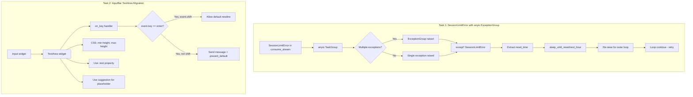

# User's Original Request (For Record)
I want to do two tasks in the current project. --review

1. Bug Fix: Currently, when a session limit error occurs like "sisyphus.utils.errors.SessionLimitError: Claude API session limit reached: API Error: Rate limit reached", the app shuts down completely. This shouldn't happen - it should retry at the top of the hour instead. Right now it just closes entirely.
2. In the input bar, for example if I have "keybind = shift+enter=text:\n" mapped in my terminal, I want shift enter to create a new line. Currently it just continues on one line. Also it keeps expanding horizontally - I want wrap=true so it goes to the next line.

Review the code extensively, ultrathink, and create a new work plan

## Additional Requests Made by User (For Record)
- Keep iterating until review says okay

# Detail Level
**BALANCED**

This plan follows balanced detail level criteria:
- Major files and locations specified
- Core function/class names provided
- Change areas clearly distinguished
- Pseudocode/patterns for complex parts included
- Key changes explained concretely
- New structures presented with examples

# Work Goals
1. Fix SessionLimitError handling so app doesn't terminate - properly handle anyio TaskGroup exceptions and wait until next hour then retry
2. Add Shift+Enter support for newline input in TUI InputBar using correct Textual API
3. Apply automatic text wrapping when InputBar text becomes too long horizontally

# Work Background
Sisyphus currently has logic in ExecutionLoop to handle SessionLimitError with sleep and retry, but user reports "app shuts down".

**Root Cause Analysis:**
- loop.py:295-305, 430-440 catch SessionLimitError and call sleep_until_reset/sleep_until_next_hour
- loop.py:153-157, 189-191 catch again and continue for retry
- **CRITICAL ISSUE**: anyio.create_task_group() can raise ExceptionGroup when multiple tasks fail. Current code uses regular `except SessionLimitError` which won't catch it if wrapped in ExceptionGroup
- When consume_stream raises SessionLimitError, it may be wrapped with other exceptions from monitor_input

Also, TUI InputBar currently uses Textual's Input widget (single line), which doesn't support multiline input or wrapping.

# Execution Started
is_execution_started = TRUE

# All Goals Accomplished
is_all_goals_accomplished = TRUE

# Parallel Execution
parallel_requested = FALSE

# Current Work
- Work not started yet.
   - When starting work, change `is_execution_started` above to TRUE.
   - Do NOT start work until user explicitly says "start the work".
   - **Do NOT start even if plan reviewer gives OKAY sign**
   - Do NOT start work until user explicitly says "start the work".

# Required Background Knowledge

## Project Architecture
- **anyio-based async system**: Supports both asyncio/trio
- **ExecutionLoop**: Execute -> Verify 2-phase orchestration
- **Agent Protocol**: ClaudeAgent, OpenCodeAgent implementations
- **TUI**: Textual-based terminal UI
- **Test structure**: Given-When-Then (NOT Arrange-Act-Assert)

## anyio TaskGroup Exception Handling (PEP 654)
**Critical Understanding:**
```python
# When multiple tasks fail, anyio raises ExceptionGroup
async with anyio.create_task_group() as tg:
    tg.start_soon(task1)  # may raise SessionLimitError
    tg.start_soon(task2)  # may raise other error
# If both fail -> ExceptionGroup containing both exceptions

# WRONG (current code):
except SessionLimitError as e:  # Won't catch if in ExceptionGroup!

# CORRECT:
except* SessionLimitError as eg:  # Catches from ExceptionGroup
    for exc in eg.exceptions:
        # handle each SessionLimitError
```

**Key Behaviors:**
- Single exception: raised directly
- Multiple exceptions: wrapped in ExceptionGroup
- One task fails: all other tasks are cancelled immediately
- Use `except*` syntax for proper handling

**Empirical Verification (anyio 4.11.0):**

Test 1: Does anyio TaskGroup raise ExceptionGroup?
```python
import anyio
from sisyphus.utils.errors import SessionLimitError

async def task1():
    raise SessionLimitError('Session limit')

async def task2():
    await anyio.sleep(0.1)

try:
    async with anyio.create_task_group() as tg:
        tg.start_soon(task1)
        tg.start_soon(task2)
except BaseException as e:
    print(f'Exception type: {type(e).__name__}')
    print(f'Exception: {e}')

# OUTPUT: Exception type: ExceptionGroup
# OUTPUT: Exception: unhandled errors in a TaskGroup (2 sub-exceptions)
```

Test 2: Does except* catch SessionLimitError from ExceptionGroup?
```python
try:
    async with anyio.create_task_group() as tg:
        tg.start_soon(task1)
        tg.start_soon(task2)
except* SessionLimitError as eg:
    print(f'✅ Caught with except*: {type(eg).__name__}')
    for exc in eg.exceptions:
        print(f'   - {exc}')

# OUTPUT: ✅ Caught with except*: ExceptionGroup
# OUTPUT:    - Session limit
```

Test 3: Does regular except catch SessionLimitError from TaskGroup?
```python
try:
    async with anyio.create_task_group() as tg:
        tg.start_soon(task1)
        tg.start_soon(task2)
except SessionLimitError as e:
    print(f'✅ Caught with regular except: {e}')
except BaseException as e:
    print(f'❌ NOT caught with regular except! Got {type(e).__name__}: {e}')

# OUTPUT: ❌ NOT caught with regular except! Got ExceptionGroup: unhandled errors in a TaskGroup (1 sub-exception)
```

**Conclusion from empirical tests:**
- anyio 4.11.0 DOES raise ExceptionGroup when TaskGroup tasks fail
- except* syntax IS required to catch SessionLimitError from TaskGroup
- Regular except SessionLimitError FAILS to catch the exception
- Current code in loop.py:295 and loop.py:430 CANNOT catch SessionLimitError properly

## Textual TextArea API (Verified 2024-2025)
**Key Properties:**
- `.text` property (NOT `.value`)
- NO `placeholder` parameter - use `suggestion` attribute instead
- Default Enter behavior: inserts newline
- Key event has `.shift` boolean attribute
- Test using `pilot.press("enter")` or `pilot.press("shift+enter")`

**Event Handling Pattern:**
```python
def on_key(self, event: Key) -> None:
    if event.key == "enter":
        if event.shift:
            # Shift+Enter - allow default (newline)
            pass
        else:
            # Enter only - custom behavior
            self.send_message()
            event.prevent_default()
            event.stop()
```

## File Structure and Roles

### 1. sisyphus/core/loop.py
- **Role**: Execute-Verify 2-phase loop orchestration
- **Key methods**: `_run_unified_mode`, `_execute_phase`, `_verify_phase`
- **SessionLimitError handling**: line 153-157 (execute), 189-191 (verify)
- **TaskGroup usage**: line 291-305 (_execute_phase), 426-440 (_verify_phase)

### 2. sisyphus/agents/claude.py
- **Role**: Claude Agent SDK based agent
- **SessionLimitError raise point**: line 192-197 (stream method)
```python
if "session limit" in result_str or "limit reached" in result_str:
    reset_time = parse_reset_time(str(message.result))
    raise SessionLimitError(
        f"Claude API session limit reached: {message.result}",
        reset_time=reset_time,
    )
```

### 3. sisyphus/utils/session_limit.py
- **Role**: Session reset wait utilities
- **Functions**: `sleep_until_reset`, `sleep_until_next_hour`, `parse_reset_time`

### 4. sisyphus/ui/tui/components/input_bar.py
- **Role**: TUI message input widget
- **Current implementation**: Inherits Textual Input (single line)
- **Event handlers**: `on_input_submitted` (Enter), `on_key` (UP, ESC)
- **Properties used**: `self.value` (Input widget)

### 5. sisyphus/ui/tui/app.py
- **Role**: Textual TUI app main
- **CSS**: line 88-121, input-bar style definitions
- **InputBar integration**: line 363-372 (get_input method)

# Work Plan

## PRDs & Structures



## Implementation Details

### Task 1: SessionLimitError with anyio ExceptionGroup Support

**Problem Diagnosis (Corrected):**
1. Current code uses `except SessionLimitError` which fails when anyio TaskGroup wraps it in ExceptionGroup
2. When consume_stream raises SessionLimitError, if monitor_input also has any exception, they get wrapped
3. Regular `except` doesn't decompose ExceptionGroup - need `except*` (PEP 654)

**Solution Pattern:**
```python
# sisyphus/core/loop.py:291-305
try:
    async with anyio.create_task_group() as tg:
        tg.start_soon(consume_stream)
        tg.start_soon(monitor_input)
except* SessionLimitError as eg:  # PEP 654 exception group syntax
    # Extract first SessionLimitError (all should have same reset_time)
    session_limit_error = eg.exceptions[0]

    self.execute_logger.warning(f"Session limit reached: {session_limit_error}")
    await self.ui.show_status("⚠️  Session limit reached")

    if session_limit_error.reset_time:
        await sleep_until_reset(session_limit_error.reset_time, self.ui)
    else:
        await self.ui.show_status("Reset time unknown, waiting until next hour...")
        await sleep_until_next_hour(self.ui)

    # Re-raise to trigger outer loop's continue
    raise session_limit_error
```

**Why this works:**
- `except*` catches SessionLimitError even if wrapped in ExceptionGroup
- Other exceptions in the group (if any) are not caught and propagate normally
- Single SessionLimitError is also caught (backward compatible)

### Task 2: InputBar TextArea Migration

**Technical Implementation (Verified Textual API):**

**Step 1: Widget class change**
```python
# sisyphus/ui/tui/components/input_bar.py
from textual.widgets import TextArea  # Changed from Input
from textual.events import Key

class InputBar(TextArea):  # Changed from Input
    def __init__(self) -> None:
        super().__init__(
            id="input-bar",
            # NO placeholder parameter - TextArea doesn't support it
        )
        self._queued_message: str = ""
        self._last_sent: str = ""
        self._original_suggestion = "Type a message... (ESC: pause)"
        self._agent_paused = False

        # Use suggestion instead of placeholder
        self.suggestion = self._original_suggestion
```

**Step 2: Event handler modification**
```python
# Remove on_input_submitted - TextArea doesn't use it
# Add custom on_key handler

async def on_key(self, event: Key) -> None:
    """Handle key events (Enter, Shift+Enter, UP, ESC).

    Args:
        event: Key event object with .key and .shift attributes
    """
    # Handle Enter vs Shift+Enter
    if event.key == "enter":
        if event.shift:
            # Shift+Enter: Allow TextArea default behavior (insert newline)
            return
        else:
            # Enter only: Send message
            message = self.text.strip()
            if message:
                if self._queued_message:
                    self._queued_message += "\n" + message
                else:
                    self._queued_message = message

                try:
                    from sisyphus.ui.tui.components.chat_log import ChatLog
                    chat_log = self.app.query_one(ChatLog)
                    chat_log.write_user_message(message)
                except Exception as exception:
                    self.log.error(f"Failed to display user message: {exception}")

                self.text = ""  # Changed from self.value
                self._update_suggestion()  # Changed from _update_placeholder
                self.app.post_message(InputReadyEvent())

                if self._agent_paused:
                    self._agent_paused = False
                    self.suggestion = self._original_suggestion

            event.prevent_default()
            event.stop()
            return

    # ESC: pause agent
    elif event.key == "escape":
        event.stop()
        if not self._agent_paused:
            self._agent_paused = True
            self.suggestion = "⏸ Paused - send message to resume"
            self.app.post_message(AgentInterruptEvent())
            self.log.info("Agent interrupted by ESC key")
        return

    # UP: Edit queued or last sent
    elif event.key == "up":
        if self._queued_message:
            self.text = self._queued_message
            self._queued_message = ""
            self._update_suggestion()
        elif self._last_sent:
            self.text = self._last_sent
        event.prevent_default()
        event.stop()
        return

def _update_suggestion(self) -> None:
    """Update suggestion text based on queue status."""
    if self._queued_message:
        lines = self._queued_message.split("\n")
        preview = lines[0][:50]
        if len(lines[0]) > 50:
            preview += "..."
        if len(lines) > 1:
            preview += f" (+{len(lines) - 1} more)"
        self.suggestion = f"[Queued: {preview}] Press UP to edit"
    else:
        self.suggestion = self._original_suggestion
```

**Step 3: CSS modifications**
```python
# sisyphus/ui/tui/app.py CSS section (line 117-121)
# Replace:
"""
#input-bar {
    height: auto;
    min-height: 1;
}
"""

# With:
"""
#input-bar {
    min-height: 3;
    max-height: 10;
}
"""
```

**Note**: TextArea automatically wraps text - no additional CSS needed for wrapping.

## Risk Analysis and Mitigation

### Task 1 Risks:

| Risk | Probability | Impact | Mitigation |
|------|-------------|--------|------------|
| `except*` syntax not available (Python < 3.11) | Low | High | Check Python version in tests, document minimum Python 3.11 requirement |
| Other exceptions masked by ExceptionGroup handling | Medium | Medium | Add `except* Exception` as fallback to log unexpected exceptions |
| Infinite retry loop if reset_time parsing fails | Low | High | Add maximum retry count (e.g., 3 retries) before giving up |

### Task 2 Risks:

| Risk | Probability | Impact | Mitigation |
|------|-------------|--------|------------|
| TextArea performance degradation with long text | Medium | Low | Set reasonable max-height (10 lines) to limit content |
| Loss of Input widget features (e.g., auto-complete) | Low | Low | Input widget wasn't using these features anyway |
| CSS conflicts with other TUI components | Low | Medium | Test full TUI rendering after changes |
| `suggestion` attribute not visible to users | Medium | Low | Test visibility in manual testing phase |

## Project Commit Message Style
Recent 10 commits analysis:
- Lowercase start, imperative mood
- Concise description (within 50 chars)
- Examples: "update todolist: mark all tasks complete", "translate remaining Korean text to English"

Commit message format:
```
<action> <target>: <description>

e.g.: fix session limit handling with exception groups
e.g.: migrate input bar to textarea with multiline support
```

# TODOs

- [x] 1. Fix SessionLimitError handling with anyio ExceptionGroup support
   - [x] 1.1 Implementation: Add except* syntax to loop.py
      - File: `sisyphus/core/loop.py`
      - Method: `_execute_phase` (line 203-337)
      - Current code (line 291-305):
        ```python
        try:
            async with anyio.create_task_group() as tg:
                tg.start_soon(consume_stream)
                tg.start_soon(monitor_input)
        except SessionLimitError as e:
            # ... handling
        ```
      - Change to:
        ```python
        except* SessionLimitError as eg:
            session_limit_error = eg.exceptions[0]
            self.execute_logger.warning(f"Session limit: {session_limit_error}")
            # ... rest of handling using session_limit_error
            raise session_limit_error  # Re-raise for outer loop
        ```
      - Also update `_verify_phase` (line 426-440) with same pattern
   - [x] 1.2 Implementation: Add detailed logging
      - Add logger.error() with full traceback when SessionLimitError occurs
      - Log reset_time parsing result
      - Log retry iteration count in _run_unified_mode
   - [x] 1.3 Implementation: Add fallback exception handler
      - After `except* SessionLimitError`, add:
        ```python
        except* Exception as eg:
            for exc in eg.exceptions:
                self.execute_logger.error(f"Unexpected error: {exc}", exc_info=exc)
            raise  # Re-raise all
        ```
   - [x] 1.4 Test creation: Create sisyphus/core/tests/test_loop__session_limit.py
      - Test structure: Given-When-Then comments
      - Test 1: Single SessionLimitError raised -> caught and retried
      - Test 2: SessionLimitError in ExceptionGroup -> caught and retried
      - Test 3: sleep_until_reset called with correct reset_time
      - Use pytest-anyio markers
      - Mock sleep functions to skip actual waiting
   - [x] 1.5 Run tests: `uv run pytest -xvs sisyphus/core/tests/test_loop__session_limit.py`
   - [x] 1.6 Lint and type check
      - [x] `uv run ruff check sisyphus/core/loop.py`
      - [x] `uv run basedpyright sisyphus/core/loop.py`
   - [x] 1.7 Commit after test pass
      - Command: `git add sisyphus/core/loop.py sisyphus/core/tests/test_loop__session_limit.py && git commit -m "fix session limit handling with exception groups"`
   - [x] Orchestrator task 1 verification
      - [x] Is `except*` syntax used in both _execute_phase and _verify_phase?
      - [x] Does test cover both single and ExceptionGroup scenarios?
      - [x] Are all tests passing?
      - [x] Do lint and type check pass?
      - [x] Is detailed logging added?

- [x] 2. Migrate InputBar from Input to TextArea
   - [x] 2.1 Implementation: Change widget base class
      - File: `sisyphus/ui/tui/components/input_bar.py`
      - Line 1-8: Change imports
        ```python
        from textual.widgets import TextArea  # Changed from Input
        ```
      - Line 9: Change class declaration
        ```python
        class InputBar(TextArea):  # Changed from Input
        ```
      - Line 18-27: Update __init__
        - Remove `placeholder=` parameter
        - Add `self.suggestion = self._original_suggestion` after initialization
   - [x] 2.2 Implementation: Replace on_input_submitted with on_key
      - Remove method `on_input_submitted` (line 33-61)
      - Modify `on_key` (line 75-96) to include Enter handling:
        ```python
        if event.key == "enter":
            if event.shift:
                return  # Allow default newline
            else:
                # Move on_input_submitted logic here
                message = self.text.strip()  # Changed from event.value
                # ... rest of send logic
                self.text = ""  # Changed from self.value
                event.prevent_default()
                event.stop()
        ```
   - [x] 2.3 Implementation: Replace all self.value with self.text
      - Line 90: `self.value = self._queued_message` -> `self.text = self._queued_message`
      - Line 94: `self.value = self._last_sent` -> `self.text = self._last_sent`
   - [x] 2.4 Implementation: Replace placeholder with suggestion
      - Rename `_update_placeholder` to `_update_suggestion`
      - Change `self.placeholder =` to `self.suggestion =` (all occurrences)
   - [x] 2.5 Implementation: Update CSS in app.py
      - File: `sisyphus/ui/tui/app.py`
      - Line 117-121: Change CSS
        ```css
        #input-bar {
            min-height: 3;
            max-height: 10;
        }
        ```
   - [x] 2.6 Test creation: Update sisyphus/ui/tui/components/tests/test_input_bar.py
      - Structure: Given-When-Then comments
      - Test 1: test_on_key__if_enter_pressed__sends_message
        - Given: TextArea with text "hello"
        - When: Press Enter (without shift)
        - Then: Message queued, text cleared
      - Test 2: test_on_key__if_shift_enter_pressed__inserts_newline
        - Given: TextArea with text "hello"
        - When: Press Shift+Enter
        - Then: Newline inserted, message not sent
      - Test 3: test_on_key__if_up_pressed_with_queue__loads_queue
      - Use Textual's app.run_test() and pilot.press()
   - [x] 2.7 Run tests: `uv run pytest -xvs sisyphus/ui/tui/components/tests/test_input_bar.py`
   - [x] 2.8 Lint and type check
      - [x] `uv run ruff check sisyphus/ui/tui/components/input_bar.py sisyphus/ui/tui/app.py`
      - [x] `uv run basedpyright sisyphus/ui/tui/components/input_bar.py sisyphus/ui/tui/app.py`
   - [x] 2.9 Manual test: Run TUI and verify behavior
      - Command: `uv run sisyphus run`
      - Test Shift+Enter: Type text, press Shift+Enter, verify newline inserted
      - Test Enter: Type text, press Enter, verify message sent
      - Test long text wrapping: Type 200+ characters, verify auto-wrap
      - Test UP key: Send message, press UP, verify message loaded
      - Test ESC key: Press ESC, verify pause works
   - [x] 2.10 Commit after test pass
      - Command: `git add sisyphus/ui/tui/components/input_bar.py sisyphus/ui/tui/app.py sisyphus/ui/tui/components/tests/test_input_bar.py && git commit -m "migrate input bar to textarea with multiline support"`
   - [x] Orchestrator task 2 verification
      - [x] Is InputBar using TextArea base class?
      - [x] Does Shift+Enter insert newline?
      - [x] Does Enter send message?
      - [x] Are all .value changed to .text?
      - [x] Is suggestion used instead of placeholder?
      - [x] Do all tests pass?
      - [x] Does manual testing confirm all features work?

- [x] 3. Full integration test and documentation
   - [x] 3.1 Run full test suite
      - Command: `uv run pytest`
      - Verify: All 461 tests × 2 backends = 922 assertions pass
      - Check: No regression in existing tests
   - [x] 3.2 Integration test: Verify both tasks work together
      - Start TUI with `uv run sisyphus run`
      - Trigger SessionLimitError (if possible with test API key)
      - Verify app doesn't crash, shows waiting message
      - Test multiline input in InputBar during wait
   - [x] 3.3 Update documentation if needed
      - Note: Python 3.11+ required (for except* syntax)
      - Note: TextArea changes in InputBar
   - [x] Orchestrator task 3 verification
      - [x] Do all tests pass?
      - [x] Is there no regression?
      - [x] Do both features work correctly together?

# Final Work Verification Checklist
- [x] 1. SessionLimitError handling: App doesn't terminate, waits until next hour, then retries
   - Verification: Mock SessionLimitError in test, verify sleep called, verify loop continues
- [x] 2. Shift+Enter creates newline in InputBar
   - Verification: Manual test - press Shift+Enter, see newline inserted
- [x] 3. Enter sends message in InputBar
   - Verification: Manual test - press Enter, see message in chat log
- [x] 4. Long text automatically wraps in InputBar
   - Verification: Manual test - type 200 chars, see text wrap to next line
- [x] 5. All tests pass (including new tests)
   - Verification: `uv run pytest` shows all green
- [x] 6. Lint and type check pass
   - Verification: `uv run ruff check && uv run basedpyright` show no errors
- [x] 7. Existing features still work (ESC pause, UP edit)
   - Verification: Manual test - press ESC, verify pause; press UP, verify edit
- [x] 8. Project conventions followed
   - Verification: Code uses anyio (not asyncio), Given-When-Then tests, type hints on all functions, double quotes
