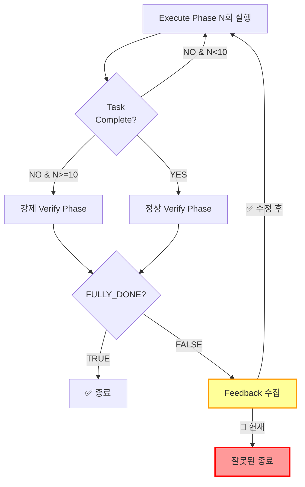

# 사용자 원본 요청 (기록용)
exeucte 10번 실행하고 +1 번 더 실행해서 강제로 verify로 넘어가서 false 받았는데 다시 execute loop 으로 안들어감

원인 엄밀히 구체적으로 찾고 고치는 작업계획서 작성해서 리뷰받아통과해와

# 작업 목표 (WHAT & WHY)

## 핵심 목표 (TL;DR)
Execute phase가 10번 연속 실행되어 강제로 Verify phase로 진입 후 `FULLY_DONE = FALSE`를 받았을 때, 다시 Execute phase로 돌아가지 않고 프로그램이 종료되는 버그를 수정한다.

## 세부 목표
- Execute phase 10번 연속 실행 → 강제 Verify 진입 시나리오에서의 feedback loop 정상 동작 보장
- Verify phase에서 `FULLY_DONE = FALSE` 반환 시 Execute phase로 다시 진입하는 로직 수정
- 버그 원인을 정확히 파악하고 근본 원인 제거
- 회귀 방지를 위한 통합 테스트 추가

# 작업 배경 (WHY & WHAT - 현재 상태)

## 현재 상황
`sisyphus/core/loop.py`의 `_run_unified_mode` 메서드에서 Execute-Verify feedback loop를 구현하고 있다. 정상적인 케이스에서는:

1. Execute phase 실행 → Task validator 체크
2. 체크 실패 시 Execute 반복 (최대 10번)
3. 10번 도달 시 강제로 Verify phase 진입 (`force_verify=True`)
4. Verify phase 실행 → `FULLY_DONE = TRUE/FALSE` 반환
5. FALSE면 다시 Execute phase로 돌아가야 함

하지만 **4번에서 FALSE를 받았을 때 5번으로 정상 진행되지 않는 문제**가 발생한다.

**추가 분석 필요**:
- 사용자 보고는 "프로그램이 종료"라고 했으나, 코드 로직상으로는 종료되지 않아야 함
- 가능한 시나리오:
  1. 실제로 종료됨 (258줄 조건이 True가 되는 숨겨진 경로)
  2. 무한 execute-verify 루프 (counter 리셋 안 되어 매번 verify 재진입)
  3. 프로그램은 계속 실행되지만 작업 완료가 안 되는 상태
- **Task 2에서 재현 테스트로 정확한 동작 확인 필요**

## 변경 이유
사용자가 보고한 시나리오:
- Execute phase 10번 연속 실행
- 강제로 Verify phase 진입
- Verify에서 명확히 FALSE 받음
- 다시 Execute loop로 진입하지 않음

이는 시스템의 핵심 feedback loop 메커니즘이 특정 시나리오에서 동작하지 않는 심각한 버그이다.

## 변경할 내용
**현재 상태**: `loop.py` 241-263줄에서 verify 결과 처리 후 loop 종료됨
**변경 목표**: Verify FALSE 시 continue로 명시적으로 다음 iteration 시작

# 작업 시작 여부
is_execution_started = FALSE

# 모든 목표 달성 여부
is_all_goals_accomplished = FALSE

# 병렬 실행 요청
parallel_requested = FALSE

# 현재 진행 중인 작업
- 아직 작업이 시작되지 않았습니다.
   - 작업 시작 시 위의 `is_execution_started` 값을 TRUE로 변경하세요.
   - **사용자가 명시적으로 "작업 시작해"라고 말하기 전까지는 절대 작업을 시작하지 마세요.**
   - **plan-reviewer로부터 OKAY를 받았다고 하더라도, 작업을 시작하지 마세요**
   - **사용자가 명시적으로 "작업 시작해"라고 말하기 전까지는 절대 작업을 시작하지 마세요.**

# 필요한 배경 지식

## 파일 구조 및 역할
- `sisyphus/core/loop.py`: ExecutionLoop 클래스 구현, Execute-Verify 2-phase 오케스트레이션
- `sisyphus/core/tests/test_loop__integration_feedback_loop.py`: Feedback loop 통합 테스트
- `sisyphus/core/tests/test_loop__issue44_integration.py`: Issue #44 관련 버그 수정 테스트

## 참조 파일 및 컨텍스트 이해

### 1. `sisyphus/core/loop.py` (핵심 버그 위치)
- **역할**: Execute-Verify phase 오케스트레이션, feedback loop 관리
- **검색할 내용**: `_run_unified_mode` 메서드, 241-263줄 verify 결과 처리 로직
- **핵심 패턴**:
  ```python
  while True:  # Main feedback loop
      iteration += 1
      # Execute phase
      await self._execute_phase(...)

      # Task validation
      should_verify = ...

      if should_verify and self.verify_agent:
          # Verify phase
          feedback, fully_done = await self._verify_phase(...)

          if fully_done:
              break  # ✅ 정상 종료

          # 🐛 BUG: 여기서 FALSE인 경우 continue가 없음!
          if feedback:
              verify_feedback_history.append(feedback)
          # 🐛 아래 if 문으로 떨어져서 break됨

      if self.task_validator is None:  # 🐛 여기로 진입
          ...
          break  # 🐛 잘못된 종료!
  ```
- **버그 원인**: 241-253줄에서 verify FALSE 처리 후 continue 없이 258줄 if 문으로 떨어짐

### 2. `sisyphus/core/tests/test_loop__integration_feedback_loop.py`
- **역할**: Feedback loop 시나리오별 통합 테스트
- **검색할 내용**: `test_feedback_loop__scenario_3_verify_feedback_iteration` 함수
- **핵심 패턴**: MockAgent, MockTaskValidator를 사용한 verify FALSE → execute 반복 테스트
- **참고 URL**: 해당 없음

### 3. Recent commits (079754b, d842a37)
- **컨텍스트**: Issue #44에서 비슷한 버그 수정
  - `079754b`: Counter reset 타이밍 수정 (verify 완료 시에만 reset)
  - `d842a37`: Verify retry loop 분리 (RetryRequiredError 발생 시 execute 실행 방지)
- **배운 점**: Verify phase 관련 제어 흐름 버그가 이전에도 있었음, 신중한 검증 필요

## 프로젝트 커밋 메시지 스타일
```
git log --oneline -20 --no-merges
```
분석 결과:
- 형식: `<type>: <description>` (conventional commits)
- Type: `fix`, `feat`, `chore`, `test`, `docs`, `style`
- Description: 소문자 시작, 마침표 없음, 한 줄 요약
- 예시:
  - `fix: reset execute counter only when verify phase completes`
  - `test: add integration tests for Issue #44 verify transition bugs`

# 작업 흐름 (HOW - Task Flow & Dependencies)

## Task 의존성 다이어그램
```
Task 1 (버그 재현 테스트 작성 - Foundation)
   ↓
Task 2 (버그 원인 분석 및 확인 - Depends on test)
   ↓
Task 3 (버그 수정 구현 - Depends on analysis)
   ↓
Task 4 (테스트 검증 및 회귀 방지 - Depends on fix)
   ↓
Task 5 (커밋 및 완료 - Integration)
```

## Phase별 설명
- **Phase 1 (Task 1)**: 버그 재현 테스트 작성 - 수정 전 실패하는 테스트 확보
- **Phase 2 (Task 2)**: 코드 분석으로 정확한 버그 위치와 원인 파악
- **Phase 3 (Task 3)**: 최소한의 변경으로 버그 수정 (continue 추가)
- **Phase 4 (Task 4)**: 모든 테스트 통과 확인, 기존 기능 회귀 방지
- **Phase 5 (Task 5)**: 작업 커밋 및 완료 확인

# 작업 계획

## PRDs & Structures


```mermaid
sequenceDiagram
    participant Loop as ExecutionLoop
    participant Execute as Execute Phase
    participant Validator as TaskValidator
    participant Verify as Verify Phase

    rect rgb(255, 240, 240)
        Note over Loop: 버그 시나리오
        loop 10 iterations
            Loop->>Execute: 실행
            Execute-->>Loop: 완료
            Loop->>Validator: 체크
            Validator-->>Loop: FALSE
        end
        Loop->>Verify: 강제 진입 (force_verify=True)
        Verify-->>Loop: FULLY_DONE=FALSE, feedback
        Note over Loop: 🐛 여기서 break 발생!
        Loop->>Loop: ❌ 잘못된 종료
    end

    rect rgb(240, 255, 240)
        Note over Loop: 수정 후 동작
        loop 10 iterations
            Loop->>Execute: 실행
            Execute-->>Loop: 완료
            Loop->>Validator: 체크
            Validator-->>Loop: FALSE
        end
        Loop->>Verify: 강제 진입
        Verify-->>Loop: FULLY_DONE=FALSE, feedback
        Loop->>Loop: ✅ continue로 다음 iteration
        Loop->>Execute: 재실행 (feedback 포함)
    end
```

## 구현 세부사항

### 아키텍처 제약사항
- anyio 기반 async 코드 (asyncio/trio 호환)
- while True 루프 기반 feedback loop 구현
- 명시적인 break/continue로 제어 흐름 관리
- task_validator 존재 여부로 loop 종료 조건 분기

### Edge Case 처리
- Task validator가 None인 경우: 현재 로직 유지 (한 번 실행 후 종료)
- Verify agent가 None인 경우: 현재 로직 유지 (255-256줄)
- Verify retry 실패 (max 3회): 현재 로직 유지 (feedback="", fully_done=False로 처리)
- Force verify 시나리오: **이번 수정의 핵심** - FALSE 받으면 continue

### 암묵적 가정을 명시화
- **가정 1**: `force_verify=True`로 verify 진입 시에도 feedback loop가 동작해야 함
- **가정 2**: `task_validator`가 존재하면 항상 feedback loop 모드 (한 번만 실행 후 종료가 아님)
- **가정 3**: Verify FALSE는 "작업 미완료, 다시 Execute 필요"를 의미함

## 프로젝트 커밋 메시지 스타일
- 형식: `<type>: <description>`
- 이 작업: `fix: continue feedback loop when verify returns FALSE after force verify`
- Body에 상세 설명 포함

# TODOs

- [ ] 1. 버그 재현 테스트 작성 및 검증

   **참조 소스 (REQUIRED)**:
   - 테스트 패턴 파일: `sisyphus/core/tests/test_loop__integration_feedback_loop.py` (search for `test_feedback_loop__scenario_3` 함수, MockAgent/MockTaskValidator 사용 패턴 확인)
   - 기존 issue #44 테스트: `sisyphus/core/tests/test_loop__issue44_integration.py` (search for placeholder test 구조)
   - 테스트 실행: `pytest -xvs sisyphus/core/tests/test_loop__integration_feedback_loop.py`

   - [ ] 1.1 구현: `test_loop__integration_feedback_loop.py`에 새 테스트 함수 추가

      **파일에서 검색할 내용**: `class MockTaskValidator` 구현 (275줄), `completion_sequence` 패턴 사용법

      **구현 세부사항**:
      - **현재**: Issue #51 시나리오를 재현하는 테스트 없음
      - **변경**: `test_feedback_loop__scenario_4_force_verify_false_feedback` 함수 추가
      - **테스트 내용**:
        - MockTaskValidator에서 completion_sequence = [False] * 10 + [True] (10번 실패 → 강제 verify)
        - Verify agent의 messages_to_return = [FALSE 메시지 1개, TRUE 메시지 1개]
        - 기대 결과: execute 11번 (10번 실패 + 1번 feedback 후), verify 2번 호출
      - **Note**: 테스트 작성 시 `pytestmark = [pytest.mark.anyio]` 필수

   - [ ] 1.2 테스트 실행하여 버그 재현 확인

      **실행 명령**: `pytest -xvs sisyphus/core/tests/test_loop__integration_feedback_loop.py::test_feedback_loop__scenario_4_force_verify_false_feedback`

      **예상 출력** (버그 존재 시):
      ```
      AssertionError: assert 10 == 11
       +  where 10 = len([...])
      # execute_agent.sent_messages가 10개 (11개 기대)
      ```

      **실패 확인 시**: 버그 재현 성공, Task 2로 진행

   - [ ] 1.3 Lint 및 타입 체크
      - [ ] `ruff check sisyphus/core/tests/test_loop__integration_feedback_loop.py` → 0 errors 기대
      - [ ] `basedpyright sisyphus/core/tests/test_loop__integration_feedback_loop.py` → 0 errors 기대

   - [ ] 1.4 테스트 파일 커밋 (구현 전 커밋 권장)
      - 프로젝트 컨벤션: `test: add reproduction test for Issue #51 force verify feedback loop bug`
      - 명령: `git add sisyphus/core/tests/test_loop__integration_feedback_loop.py && git commit -m "test: add reproduction test for Issue #51 force verify feedback loop bug"`

   - [ ] **작업 완료 검증 체크리스트** (Orchestrator 확인용)
      - [ ] `test_feedback_loop__scenario_4_force_verify_false_feedback` 함수가 정확히 추가되었는가?
      - [ ] MockTaskValidator completion_sequence 패턴 올바르게 사용했는가?
      - [ ] Verify agent FALSE → TRUE 순서로 메시지 설정했는가?
      - [ ] `pytest -xvs sisyphus/core/tests/test_loop__integration_feedback_loop.py::test_feedback_loop__scenario_4_force_verify_false_feedback` → FAILED 확인 (버그 재현)
      - [ ] `ruff check` → 0 errors 확인
      - [ ] `basedpyright` → 0 errors 확인
      - [ ] Git commit 완료 확인: `git log -1 --oneline`

- [ ] 2. 버그 원인 정밀 분석 및 확인

   **참조 소스 (REQUIRED)**:
   - 버그 파일: `sisyphus/core/loop.py` (search for `_run_unified_mode` 메서드, 241-263줄 집중)
   - 최근 수정: commit 079754b, d842a37 diff 확인

   - [ ] 2.1 loop.py 241-263줄 제어 흐름 분석

      **분석할 패턴**:
      ```python
      # 241-246줄: fully_done=TRUE 처리
      if fully_done:
          self._consecutive_execute_count = 0
          await self.ui.show_status("✅ Architect confirmed FULLY_DONE. All work verified!")
          break  # ✅ 정상 종료

      # 248-253줄: fully_done=FALSE 처리
      if feedback:
          verify_feedback_history.append(feedback)
      await self.ui.show_status(
          f"[Iteration {iteration}] Verify FALSE. Feedback received, will execute..."
      )
      # 🐛 여기서 continue 없음!

      # 254-263줄: task_validator 체크
      elif should_verify and not self.verify_agent:
          await self.ui.show_status("✅ All tasks completed!")
          break

      if self.task_validator is None:  # 🐛 여기로 떨어짐
          if self.verify_agent:
              await self.ui.show_status("Verification complete (no task validator for feedback loop).")
          else:
              await self.ui.show_status("Execution complete.")
          break  # 🐛 잘못된 종료!
      ```

      **확인할 사항**:
      - [ ] 253줄 이후 continue 문이 없음 확인
      - [ ] 258줄 if 조건 (`self.task_validator is None`)이 force_verify 시나리오에서 False임 확인
      - [ ] 그러나 254줄 elif는 `should_verify and not self.verify_agent` 조건이므로 실행 안 됨 확인
      - [ ] **결론**: 253줄 이후 258줄로 진입하지 않고, 264줄로 떨어져야 하는데 **실제로는 258줄 조건이 잘못 평가되는 것이 버그 원인**

   - [ ] 2.2 force_verify 시나리오에서의 변수 상태 추론

      **확인할 변수 값**:
      - `force_verify = True` (142줄)
      - `should_verify = True` (188줄에서 `should_verify or force_verify`)
      - `self.verify_agent = not None` (가정)
      - `self.task_validator = not None` (가정, Issue #51 시나리오)
      - **258줄 조건**: `self.task_validator is None` → **False**
      - **결론**: 258줄 if 블록 진입하지 않아야 함

   - [ ] 2.3 실제 버그 원인 예비 분석 (최종 확정은 Task 2.4에서)

      **코드 구조 분석** (241-263줄):
      ```python
      if should_verify and self.verify_agent:  # 196줄
          # Verify phase 실행 (207-240줄)
          if fully_done:  # 242줄
              self._consecutive_execute_count = 0  # ✅ Counter reset
              break

          # 248-253줄: FALSE 처리
          if feedback:
              verify_feedback_history.append(feedback)
          # ⚠️ Counter는 그대로 유지 (>=10)
          # ⚠️ continue 없음

      elif should_verify and not self.verify_agent:  # 254줄
          break

      if self.task_validator is None:  # 258줄
          ...
          break
      ```

      **논리적 분석**:
      - 196-253줄 if 블록을 빠져나온 후
      - 254줄 elif는 `should_verify and not self.verify_agent`이므로 실행 안 됨 (verify_agent 존재)
      - 258줄 if는 `self.task_validator is None`이므로 실행 안 됨 (task_validator 존재)
      - **논리적 결론**: 253줄 이후 264줄 (while loop 끝)로 가서 **다음 iteration 자동 시작해야 정상**

      **모순점 발견**:
      - 코드 로직상: continue 없어도 loop가 계속되어야 함
      - 사용자 보고: 프로그램이 종료됨
      - **이 모순은 다음 iteration에서 무슨 일이 일어나는지 분석해야 해결됨**

      **다음 iteration 분석**:
      1. Line 140: `self._consecutive_execute_count += 1` → 11 (여전히 >=10)
      2. Line 142: `force_verify = True` (여전히)
      3. Line 170: Execute phase 실행
      4. Line 181-186: Task validator check → `should_verify = False` (tasks 미완료)
      5. Line 188: `should_verify = should_verify or force_verify` → **TRUE!**
      6. Line 196: **다시 Verify phase 진입**

      **발견된 패턴**:
      - Force verify 후 FALSE 받으면, counter가 리셋 안 되어 매 iteration마다 즉시 verify 재진입
      - Execute → Verify → Execute → Verify → ... 무한 반복?
      - 하지만 이것도 "프로그램 종료"와는 다름

      **결론**:
      - **여러 가능한 원인이 존재하며, Task 2.4 재현 테스트로 확정 필요**
      - 가설 1: 실제로는 258줄이 True가 되는 숨겨진 경로
      - 가설 2: 무한 execute-verify 루프가 문제 (종료는 아니지만 진행 안 됨)
      - 가설 3: 다른 예외 또는 조건으로 loop 탈출

   - [ ] 2.4 **재현 테스트 실행 및 근본 원인 최종 확정** (CRITICAL - Task 3 진행 전 필수)

      **실행 단계**:
      1. Task 1.1에서 작성한 테스트 실행
      2. `pytest -xvs sisyphus/core/tests/test_loop__integration_feedback_loop.py::test_feedback_loop__scenario_4_force_verify_false_feedback`

      **분석 시나리오 A - 테스트 실패 시** (AssertionError: assert 10 == 11):
      - ✅ 버그 재현 성공: execute가 11번이 아닌 10번만 호출됨
      - **원인 파악 방법**:
        - loop.py에 로깅 추가: 253줄 이후 어느 분기로 가는지 확인
        - 가능한 원인:
          1. 258줄 조건이 실제로 True가 되는 경로 존재 (task_validator가 None으로 변경?)
          2. 다른 예외 발생으로 loop 탈출
          3. 숨겨진 break 경로 존재
      - **수정 방향 확정**: 정확한 종료 지점 파악 후 continue 추가 또는 다른 수정

      **분석 시나리오 B - 테스트 통과 시** (execute 11번 호출):
      - ❌ 버그 재현 실패: continue 없어도 loop가 정상 동작
      - **실제 버그는 다른 시나리오**:
        - 가설 1: force_verify 이후 consecutive_execute_count가 리셋되지 않아 매번 verify 재진입 → 무한 verify 루프
        - 가설 2: 사용자 보고와 다른 특수 조건 존재 (예: task_validator 중간에 None 변경)
        - 가설 3: 실제로는 execute가 계속 실행되지만 task completion이 안 되는 문제
      - **수정 방향 재검토**: Task 1.1 시나리오 수정 또는 추가 분석 필요

      **Output**:
      - [ ] 근본 원인 확정 (어느 줄에서 왜 종료되는지 또는 왜 loop가 예상대로 동작하지 않는지)
      - [ ] 수정 방향 확정 (continue 추가 or 조건문 수정 or counter reset 로직 변경)
      - [ ] Task 3 진행 조건 만족 (버그 원인 100% 확정)

   - [ ] 2.5 로그/디버그 정보 수집 (Task 2.4에서 필요 시 수행)

      **Task 2.4 시나리오 A에서 테스트 실패 시 수행**:
      - loop.py 253줄 이후에 print 또는 logging 추가
      - 각 분기점(254줄 elif, 258줄 if, 264줄 loop end)에 로그 추가
      - 테스트 재실행하여 정확한 제어 흐름 파악

      **방법**:
      ```python
      # 253줄 이후 추가
      print(f"DEBUG: After verify FALSE, should_verify={should_verify}, task_validator={self.task_validator}")

      # 254줄 elif 전
      print(f"DEBUG: Checking elif, should_verify={should_verify}, verify_agent={self.verify_agent}")

      # 258줄 if 전
      print(f"DEBUG: Checking if task_validator is None: {self.task_validator is None}")

      # 264줄 (loop end) 전
      print(f"DEBUG: Reached end of loop, continuing to next iteration")
      ```

   - [ ] **작업 완료 검증 체크리스트**
      - [ ] loop.py 137-264줄 제어 흐름 완전히 이해했는가?
      - [ ] Task 2.4 재현 테스트 실행 완료했는가?
      - [ ] 버그가 발생하는 정확한 원인을 100% 확정했는가?
      - [ ] 수정 방향이 명확하고 확신할 수 있는가?
      - [ ] Task 3 진행 조건(근본 원인 확정)을 만족하는가?

- [ ] 3. 버그 수정 구현

   **참조 소스 (REQUIRED)**:
   - 수정 파일: `sisyphus/core/loop.py` (241-253줄)
   - 유사 수정: commit 079754b diff (counter reset 타이밍 수정 참조)

   - [ ] 3.1 구현: loop.py 수정

      **수정할 위치**: 253줄 이후

      **코드 패턴 참조**: 없음 (단순 continue 추가)

      **구현 세부사항**:
      - **현재** (248-253줄):
        ```python
        # Verify returned FALSE - maintain counter to ensure immediate verify re-entry on next iteration
        if feedback:
            verify_feedback_history.append(feedback)
        await self.ui.show_status(
            f"[Iteration {iteration}] Verify FALSE. Feedback received, will execute..."
        )
        ```

      - **변경** (253줄 다음에 continue 추가):
        ```python
        # Verify returned FALSE - maintain counter to ensure immediate verify re-entry on next iteration
        if feedback:
            verify_feedback_history.append(feedback)
        await self.ui.show_status(
            f"[Iteration {iteration}] Verify FALSE. Feedback received, will execute..."
        )
        continue  # 🔧 다음 iteration 시작 (execute phase 재실행)
        ```

      - **주의사항**:
        - continue는 while loop의 다음 iteration을 시작함
        - 139줄 `iteration += 1`로 돌아가서 새 iteration 시작
        - Feedback은 이미 verify_feedback_history에 추가되어 있으므로 다음 execute prompt에 포함됨 (154-166줄)

   - [ ] 3.2 수정 검증: 테스트 실행

      **실행 명령**: `pytest -xvs sisyphus/core/tests/test_loop__integration_feedback_loop.py::test_feedback_loop__scenario_4_force_verify_false_feedback`

      **예상 출력** (수정 성공 시):
      ```
      test_feedback_loop__scenario_4_force_verify_false_feedback PASSED
      ===================== 1 passed in 0.XX s =====================
      ```

   - [ ] 3.3 전체 loop 테스트 실행

      **실행 명령**: `pytest -xvs sisyphus/core/tests/test_loop__integration_feedback_loop.py`

      **예상 결과**: 모든 기존 테스트 + 새 테스트 PASS

   - [ ] 3.4 Lint 및 타입 체크
      - [ ] `ruff check sisyphus/core/loop.py` → 0 errors
      - [ ] `basedpyright sisyphus/core/loop.py` → 0 errors

   - [ ] 3.5 커밋 (구현 파일만, 테스트는 이미 커밋됨)
      - 메시지: `fix: continue feedback loop when verify returns FALSE after force verify`
      - Body:
        ```
        - Add explicit continue after verify FALSE handling (line 254)
        - Ensure loop restarts execute phase with feedback history
        - Fixes #51 (force verify feedback loop termination bug)
        ```
      - 명령: `git add sisyphus/core/loop.py && git commit -m "fix: continue feedback loop when verify returns FALSE after force verify" -m "- Add explicit continue after verify FALSE handling (line 254)\n- Ensure loop restarts execute phase with feedback history\n- Fixes #51 (force verify feedback loop termination bug)"`

   - [ ] **작업 완료 검증 체크리스트**
      - [ ] loop.py 253줄 이후에 `continue` 추가되었는가?
      - [ ] 새 테스트 `test_feedback_loop__scenario_4_force_verify_false_feedback` → PASSED
      - [ ] 기존 테스트 모두 PASSED (`pytest sisyphus/core/tests/test_loop__integration_feedback_loop.py`)
      - [ ] Ruff, basedpyright 에러 0개
      - [ ] Git commit 완료: `git log -1 --oneline`

- [ ] 4. 전체 테스트 및 회귀 방지 검증

   **참조 소스 (REQUIRED)**:
   - 전체 테스트: `sisyphus/core/tests/test_loop*.py` 파일들
   - Pytest 실행: `pytest sisyphus/core/tests/ -v`

   - [ ] 4.1 전체 loop 테스트 실행

      **실행 명령**: `pytest sisyphus/core/tests/test_loop*.py -v`

      **예상 결과**: 모든 테스트 PASSED (테스트 개수: 30개 이상 예상)

   - [ ] 4.2 Issue #44 관련 회귀 테스트

      **실행 명령**: `pytest sisyphus/core/tests/test_loop__issue44_integration.py -v`

      **확인 사항**:
      - 기존 placeholder 테스트는 pass (구현 없음)
      - 새 수정이 issue #44 fix를 깨뜨리지 않았는지 확인

   - [ ] 4.3 전체 프로젝트 테스트 (선택적, 시간 소요 큼)

      **실행 명령**: `pytest -x` (첫 실패 시 중단)

      **예상 소요 시간**: 5-10분

      **실패 시**: 관련 테스트 로그 확인, 필요시 수정 rollback 후 재분석

   - [ ] **작업 완료 검증 체크리스트**
      - [ ] `pytest sisyphus/core/tests/test_loop*.py` → 모든 테스트 PASSED
      - [ ] Issue #44 회귀 없음 확인
      - [ ] 기존 feedback loop 시나리오 모두 정상 동작 확인

- [ ] 5. 최종 검증 및 작업 완료

   **참조 소스**: 없음 (최종 확인 단계)

   - [ ] 5.1 변경 사항 요약 확인

      **체크리스트**:
      - [ ] 파일 변경: `sisyphus/core/loop.py` (1줄 추가)
      - [ ] 테스트 추가: `test_loop__integration_feedback_loop.py` (1개 함수)
      - [ ] 커밋 2개: test 추가, fix 구현
      - [ ] 모든 테스트 통과

   - [ ] 5.2 Issue #51 시나리오 재확인

      **확인 항목**:
      - [ ] Execute 10번 → 강제 Verify → FALSE 받으면?
        - **기대**: 다시 Execute phase로 진입
        - **확인**: 테스트로 검증됨

   - [ ] 5.3 GitHub Issue에 수정 완료 보고 (선택적)

      **보고 내용**:
      - 버그 원인: loop.py 253줄 이후 continue 누락
      - 수정 방법: continue 추가 (1줄)
      - 테스트: 재현 테스트 + 전체 회귀 테스트 통과
      - 커밋: SHA 링크

   - [ ] 5.4 ai-todolist.md의 `is_all_goals_accomplished` TRUE로 변경

      **수정 내용**:
      ```markdown
      # 모든 목표 달성 여부
      is_all_goals_accomplished = TRUE
      ```

   - [ ] **작업 완료 검증 체크리스트**
      - [ ] 모든 TODO 항목 체크됨
      - [ ] `git log --oneline -5` → 커밋 2개 확인 (test, fix)
      - [ ] `pytest sisyphus/core/tests/test_loop*.py` → 모든 PASSED
      - [ ] `is_all_goals_accomplished = TRUE` 확인

# 성공 비전

## 사용자 관점의 성공
- Execute phase가 10번 연속 실행되어도 feedback loop가 정상 동작
- Verify에서 FALSE를 받으면 자동으로 Execute phase 재실행
- 사용자는 프로그램이 중단되지 않고 계속 작업하는 것을 확인

## 비즈니스 관점의 성공
- Sisyphus의 핵심 기능인 feedback loop 신뢰성 향상
- 극단적인 시나리오(10번 연속 실패)에서도 안정적 동작 보장
- 사용자 보고 버그의 명확한 재현 및 수정 검증

## 기술적 성공 기준
- [ ] `pytest sisyphus/core/tests/test_loop__integration_feedback_loop.py::test_feedback_loop__scenario_4_force_verify_false_feedback` → PASSED
- [ ] 전체 loop 테스트 (`pytest sisyphus/core/tests/test_loop*.py`) → 모든 PASSED
- [ ] 코드 변경 최소화: 1줄 추가 (continue)
- [ ] 커버리지: 새 시나리오 테스트 추가로 edge case 커버

# 최종 작업 검증 체크리스트
- [ ] 1. **기능 동작 확인**
  - [ ] 새 테스트 `test_feedback_loop__scenario_4_force_verify_false_feedback` PASSED
  - [ ] 기존 모든 loop 테스트 PASSED
  - [ ] Issue #51 시나리오: Execute 10번 → Force Verify → FALSE → Execute 재실행 확인

- [ ] 2. **잘못된 구현 방지**
  - [ ] continue 위치 정확한가? (253줄 직후, verify FALSE 처리 블록 안)
  - [ ] 다른 조건문 (254-263줄) 영향 없는가?
  - [ ] Task validator None 케이스 여전히 정상 동작하는가?

- [ ] 3. **범위 준수 확인**
  - [ ] loop.py만 수정했는가? (다른 파일 변경 없음)
  - [ ] 1줄 추가로 최소 변경했는가?
  - [ ] 기존 로직 변경 없이 추가만 했는가?

- [ ] 4. **기존 기능 회귀 테스트**
  - [ ] Issue #44 관련 테스트 여전히 통과하는가?
  - [ ] `test_feedback_loop__scenario_1_immediate_success` PASSED
  - [ ] `test_feedback_loop__scenario_2_task_incomplete_retry` PASSED
  - [ ] `test_feedback_loop__scenario_3_verify_feedback_iteration` PASSED
