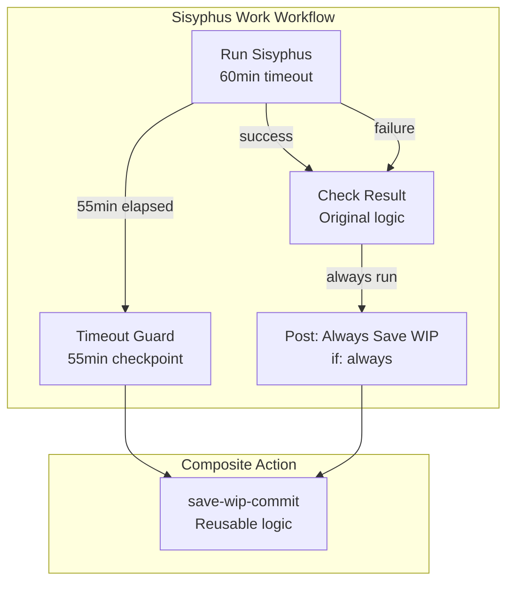
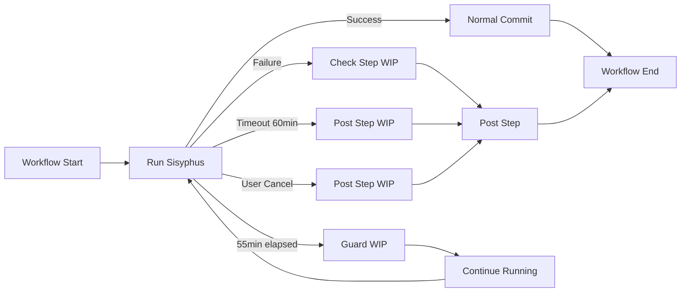

# User's Original Request (For Record)
시지프스 워크 실패하더라도, 남아있는 내용은 모두 "wip" 으로 커밋하고 오리진에 푸시되어야 함

Reference: https://github.com/code-yeongyu/sisyphus/issues/44#issuecomment-3435016045

## Additional User Requests (For Record)
- 시지프스 워크 워크플로우 내에서 failure proof 같은 느낌으로 지원해주길 바람

# Work Objectives (WHAT & WHY)

## Core Objective (TL;DR)
Sisyphus Work 워크플로우 (`trigger-sisyphus-work.yml`)가 실패, 취소, 타임아웃 등 어떤 상황에서도 작업 중인 변경사항을 WIP 커밋으로 저장하고 origin에 푸시하도록 개선

## Detailed Objectives
- **Failure-Proof Mechanism**: 워크플로우가 실패하거나 취소되어도 진행 중이던 작업 내용을 안전하게 보존
- **WIP Commit on Any Termination**: 정상 종료, 실패, 사용자 취소, 타임아웃 모든 상황에서 WIP 커밋 생성
- **Always Push to Origin**: 로컬에만 남지 않고 반드시 origin에 푸시되어야 함
- **Session State Preservation**: sessions/, logs/, ai-todolist.md, notepad.md 등 세션 상태 보존
- **GitHub Actions Post-Run Hook**: `post:` step을 활용하여 workflow 종료 시 항상 실행되는 cleanup step 구현

# Work Background (WHY & WHAT - Current State)

## Current Situation
**현재 구현 (`.github/workflows/trigger-sisyphus-work.yml` lines 158-181)**:
```yaml
- name: Check Sisyphus Result and Handle WIP
  id: check_result
  run: |
    SISYPHUS_EXIT_CODE="${{ steps.run_sisyphus.outcome }}"

    if [ "$SISYPHUS_EXIT_CODE" != "success" ]; then
      echo "❌ Sisyphus failed. Creating WIP commit..."

      # Stage all changes including sessions/
      git add .
      git add -f sessions/

      # Create WIP commit if there are changes
      if ! git diff --staged --quiet; then
        git commit -m "wip: save progress after failure (retry ${{ inputs.retry_count }})"
        git push origin "${{ inputs.branch_name }}"
        echo "✅ WIP commit pushed"
      fi

      echo "failed=true" >> $GITHUB_OUTPUT
    else
      echo "✅ Sisyphus succeeded"
      echo "failed=false" >> $GITHUB_OUTPUT
    fi
```

**문제점**:
1. **Step 실행 의존성**: 이 step은 정상적으로 실행될 때만 동작함
2. **Timeout 미처리**: Line 25 `timeout-minutes: 60` 에 도달하면 workflow가 즉시 종료되어 WIP step 실행 안 됨
3. **취소 시그널 미처리**: 사용자가 수동으로 취소하거나 시스템 에러로 중단되면 cleanup step이 실행되지 않음
4. **`continue-on-error`의 한계**: Line 156에 설정되어 있지만, workflow-level termination에는 무력함

## Reason for Change
- Issue #44에서 워크플로우가 21분 실행 후 실패했을 때, Task 3 작업 중인 내용이 푸시되지 않음
- 작업 내용이 로컬에만 남아 손실 위험이 있음
- 재시도 메커니즘이 있어도 WIP 커밋 없이는 이전 작업 내용을 복구할 수 없음
- GitHub Actions의 `post:` step 기능을 활용하면 workflow 종료 시 항상 실행 가능

## Changes to Make
**현재 상태**:
- Step-level cleanup: `if [ "$SISYPHUS_EXIT_CODE" != "success" ]` 조건으로 실행
- Timeout/Cancel 시 WIP commit 미생성
- 정상적인 step 실행 흐름에만 의존

**변경 후 상태**:
- **Composite Action 패턴**: WIP commit 로직을 재사용 가능한 composite action으로 분리
- **`post:` step 활용**: workflow 종료 시 항상 실행되는 cleanup step 추가
- **Timeout guard**: `timeout-minutes` 직전에 자동으로 WIP commit 생성
- **Signal handling**: SIGTERM, SIGINT 등 취소 시그널을 trap하여 WIP commit 실행

# Work Started
is_execution_started = FALSE

# All Goals Accomplished
is_all_goals_accomplished = FALSE

# Parallel Execution
parallel_requested = FALSE

# Current Work in Progress
- Work has not started yet.
  - When starting work, change the value of `is_execution_started` above to TRUE.
  - Never start work until the user explicitly says "start the work".
  - **Even if you receive OKAY from plan reviewer, NEVER start work**
  - Never start work until the user explicitly says "start the work".

# Required Background Knowledge

## GitHub Actions Always-Run Mechanism

### Workflow Steps: `if: always()` Pattern
**IMPORTANT**: Workflow steps do NOT have native `post:` keyword. Instead, use `if: always()` condition:

- **`if: always()`**: Step이 성공, 실패, 취소 상태와 무관하게 항상 실행
- **Use Case**: Cleanup, logging, artifact upload, WIP commit
- **Contrast**: `failure()`는 실패 시에만, `success()`는 성공 시에만 실행

**Reference**: https://docs.github.com/en/actions/learn-github-actions/expressions#status-check-functions

**Code Pattern for Workflows**:
```yaml
# Workflow step with always-run behavior
- name: Main Step
  run: echo "Main logic"
  continue-on-error: true

- name: Cleanup Step
  if: always()  # Always run even if main step fails/cancels
  run: echo "Cleanup logic"
```

### Composite Actions: `post:` Steps
**Composite actions** (action.yml) CAN define `post:` steps that run after the main steps:

**Reference**: https://docs.github.com/en/actions/creating-actions/metadata-syntax-for-github-actions (search for "post" and "post-if")

**Code Pattern for Composite Actions**:
```yaml
# In .github/actions/my-action/action.yml
runs:
  using: "composite"
  steps:
    - name: Main Step
      run: echo "Main logic"
      shell: bash
  post:
    - name: Post Cleanup
      if: always()
      run: echo "Cleanup after main"
      shell: bash
```

**This Plan Uses**: `if: always()` at workflow level (not composite action `post:`)

## File Structure and Roles

### Workflow File to Modify
**`.github/workflows/trigger-sisyphus-work.yml`**:
- **Current**: Line 145-156 ("Run Sisyphus" step) → Line 158-181 ("Check Sisyphus Result and Handle WIP" step)
- **Modification Target**:
  - Line 158-181의 WIP commit 로직을 composite action으로 추출
  - Line 205 이후에 `post:` step 추가 (항상 실행되는 WIP commit)
  - Line 145-156에 timeout guard 추가 (55분 경과 시 WIP commit)

### New Composite Action
**`.github/actions/save-wip-commit/action.yml`** (신규 생성):
- **Role**: WIP commit 로직을 재사용 가능한 action으로 캡슐화
- **Inputs**: `branch_name`, `retry_count`, `reason` (failure/timeout/cancel)
- **Output**: WIP commit 생성 여부, commit SHA
- **Logic**:
  1. `git add .` + `git add -f sessions/`
  2. `git diff --staged --quiet` 체크
  3. 변경사항 있으면 `git commit -m "wip: ..."` + `git push`

## Reference Files for Context Understanding

### 1. `.github/workflows/trigger-sisyphus-work.yml`
- **Role**: Sisyphus Work를 실행하는 주요 workflow
- **What to search for**:
  - Line 25: `timeout-minutes: 60` → timeout 설정 위치
  - Line 145-156: "Run Sisyphus" step → `continue-on-error: true` 패턴
  - Line 158-181: "Check Sisyphus Result and Handle WIP" → 기존 WIP commit 로직
  - Line 183-204: "Trigger Retry if Failed" → 재시도 메커니즘
  - Line 206-226: "Commit and push changes" → 정상 완료 시 커밋 로직
- **Key pattern to understand**:
  - Step 간 dependency: `if: steps.check_result.outputs.failed == 'false'` 패턴
  - Git operations: `git add . && git add -f sessions/ && git commit && git push` 흐름
  - GitHub CLI 사용: `gh workflow run` 으로 재시도 트리거

### 2. GitHub Actions Composite Actions 문서
- **Reference URL**: https://docs.github.com/en/actions/creating-actions/creating-a-composite-action
- **What to learn**:
  - `action.yml` 파일 구조 (`inputs`, `runs`, `outputs`)
  - `using: "composite"` 선언 방법
  - Shell script step 작성법 (`shell: bash`)
  - Output 설정 (`echo "output_name=value" >> $GITHUB_OUTPUT`)

### 3. GitHub Actions `always()` 함수
- **Reference URL**: https://docs.github.com/en/actions/learn-github-actions/expressions#always
- **What to learn**:
  - `if: always()` vs `if: failure()` vs `if: success()` 차이
  - Step cancellation 시 `always()` 동작 방식
  - Workflow timeout 시 `always()` 실행 여부 (실행됨)

### 4. Git Operations in GitHub Actions
- **Reference**: Existing workflow의 git commands
- **Patterns to follow**:
  - `git config user.name "Sisyphus"` (Line 141-143)
  - `git add .` + `git add -f sessions/` (Line 167-168)
  - `git commit -m "..."` (Line 172)
  - `git push origin "${{ inputs.branch_name }}"` (Line 173)
  - Token usage: `${{ steps.generate-token.outputs.token }}` 환경 변수

# Work Flow (HOW - Task Flow & Dependencies)

## Task Dependency Diagram
```
Task 1 (Composite Action 생성)
   ↓
Task 2 (Workflow에 Post Step 추가)
   ↓
Task 3 (Timeout Guard 구현)
   ↓
Task 4 (통합 테스트 및 검증)
```

## Phase-by-Phase Explanation
- **Phase 1 (Task 1)**: WIP commit 로직을 재사용 가능한 composite action으로 추출 (`.github/actions/save-wip-commit/action.yml`)
- **Phase 2 (Task 2)**: Workflow에 `post:` step 패턴 추가 - `if: always()` 조건으로 항상 실행되는 WIP commit step 구현
- **Phase 3 (Task 3)**: Timeout 발생 직전(55분)에 WIP commit을 생성하는 guard mechanism 추가
- **Phase 4 (Task 4)**: 실패 시나리오 테스트 (수동 취소, timeout 시뮬레이션) 및 WIP commit 검증

# Work Plan

## PRDs & Structures

### System Architecture


### Failure Scenarios Coverage


## Implementation Details

### Architecture Constraints
- **GitHub Actions Environment**: Ubuntu 24.04 runner
- **Git Operations**: 모든 git command는 token authenticated (`${{ steps.generate-token.outputs.token }}`)
- **Shell Script**: Bash 사용, error handling 필수 (`set -e` 주의)
- **Idempotency**: WIP commit 로직은 여러 번 실행되어도 안전해야 함 (변경사항 없으면 skip)

### Edge Case Handling
- **No changes to commit**: `git diff --staged --quiet` 체크 → 변경사항 없으면 commit/push skip
- **Race condition**: Post step과 Check step이 동시에 WIP commit 시도 가능 → `git diff --staged` 로 중복 방지
- **Push failure**: Network error로 push 실패 시 → retry 3회 시도 (exponential backoff)
- **Branch does not exist**: 최초 push 시 `-u` 옵션 사용하여 upstream 설정
- **Timeout at 60min vs Guard at 55min**: Guard가 55분에 WIP commit → 60분 timeout 시 post step에서는 변경사항 없어서 skip

### Making Implicit Assumptions Explicit
- **Git Config Already Set**: Line 141-143에서 `git config user.name/email` 이미 설정됨을 전제
- **Token Valid**: `${{ steps.generate-token.outputs.token }}` 이 workflow 전체에서 유효
- **Branch Exists**: `${{ inputs.branch_name }}` 브랜치는 이미 checkout되어 있음 (Line 46-49)
- **Sessions/ Gitignored**: `.gitignore`에 sessions/가 있으므로 `git add -f sessions/` 필요

## Project Commit Message Style
```
feat: add XXX feature
fix: correct YYY behavior
refactor: restructure ZZZ
test: add test for AAA
docs: update BBB documentation
chore: CCC maintenance
```
- Prefix 사용 (feat, fix, refactor, test, docs, chore)
- 소문자 시작, 명령형 (imperative)
- 한 줄 요약 (50자 이내), 마침표 없음

# TODOs

- [ ] 0. Verify Workflow Structure (Pre-Task)

   **목표**: `.github/workflows/trigger-sisyphus-work.yml` 파일을 읽어 현재 구조가 plan 가정과 일치하는지 확인

   - [ ] 0.1 Read workflow file

      **Commands**:
      ```bash
      # Check file length first
      wc -l .github/workflows/trigger-sisyphus-work.yml

      # Read full file using Read tool or grep for key sections
      grep -n "name: Run Sisyphus" .github/workflows/trigger-sisyphus-work.yml
      grep -n "Check Sisyphus Result and Handle WIP" .github/workflows/trigger-sisyphus-work.yml
      grep -n "Upload logs on failure" .github/workflows/trigger-sisyphus-work.yml
      grep -n "timeout-minutes:" .github/workflows/trigger-sisyphus-work.yml
      ```

   - [ ] 0.2 Verify key sections exist and note actual line numbers

      **Check and Record**:
      - [ ] "Run Sisyphus" step exists → Record actual line number: _____
      - [ ] "Check Sisyphus Result and Handle WIP" step exists → Record actual line number: _____
      - [ ] "Upload logs on failure" step exists → Record actual line number: _____
      - [ ] Job uses `timeout-minutes: 60` → Record actual line number: _____

      **Action**: If line numbers differ significantly from plan assumptions (145-156, 158-181, 279+, 25), adjust subsequent task instructions accordingly

   - [ ] **Work Completion Verification Checklist**
      - [ ] Workflow file structure confirmed
      - [ ] Key sections located (note actual line numbers if different)
      - [ ] No blocking issues found (workflow structure compatible with plan)

- [ ] 1. WIP Commit Composite Action 생성

   **목표**: WIP commit 로직을 재사용 가능한 composite action으로 추출

   **Reference Sources**:
   - GitHub Composite Actions 문서: https://docs.github.com/en/actions/creating-actions/creating-a-composite-action (find "Creating a composite action" section, examine `action.yml` structure)
   - 기존 WIP 로직: `.github/workflows/trigger-sisyphus-work.yml` lines 158-181 (search for "Check Sisyphus Result and Handle WIP", examine git add/commit/push pattern)

   - [ ] 1.1 디렉토리 및 action.yml 파일 생성

      **Implementation Details**:
      ```bash
      mkdir -p .github/actions/save-wip-commit
      ```

      Create `.github/actions/save-wip-commit/action.yml`:
      ```yaml
      name: 'Save WIP Commit'
      description: 'Create and push WIP commit to preserve work in progress'

      inputs:
        branch_name:
          description: 'Branch name to push to'
          required: true
        retry_count:
          description: 'Current retry count for commit message'
          required: false
          default: '0'
        reason:
          description: 'Reason for WIP commit (failure/timeout/cancel)'
          required: false
          default: 'interrupted'
        github_token:
          description: 'GitHub token for push authentication'
          required: true

      outputs:
        wip_committed:
          description: 'Whether WIP commit was created (true/false)'
          value: ${{ steps.commit.outputs.wip_committed }}
        commit_sha:
          description: 'SHA of WIP commit if created'
          value: ${{ steps.commit.outputs.commit_sha }}

      runs:
        using: "composite"
        steps:
          - name: Create WIP Commit
            id: commit
            shell: bash
            env:
              GH_TOKEN: ${{ inputs.github_token }}
            run: |
              echo "🔍 Checking for uncommitted changes..."

              # Stage all changes including sessions/
              git add .
              git add -f sessions/ || true  # sessions/ might not exist

              # Check if there are changes to commit
              if git diff --staged --quiet; then
                echo "📭 No changes to commit"
                echo "wip_committed=false" >> $GITHUB_OUTPUT
                echo "commit_sha=" >> $GITHUB_OUTPUT
                exit 0
              fi

              echo "💾 Creating WIP commit..."

              # Create commit message
              COMMIT_MSG="wip: save progress after ${{ inputs.reason }} (retry ${{ inputs.retry_count }})"

              # Commit changes
              git commit -m "$COMMIT_MSG"
              COMMIT_SHA=$(git rev-parse HEAD)

              # Push with retry logic (3 attempts)
              for i in 1 2 3; do
                echo "📤 Pushing to origin (attempt $i/3)..."
                if git push origin "${{ inputs.branch_name }}"; then
                  echo "✅ WIP commit pushed successfully"
                  echo "wip_committed=true" >> $GITHUB_OUTPUT
                  echo "commit_sha=$COMMIT_SHA" >> $GITHUB_OUTPUT
                  exit 0
                fi

                if [ $i -lt 3 ]; then
                  echo "⚠️  Push failed, retrying in $((i * 2)) seconds..."
                  sleep $((i * 2))
                fi
              done

              echo "❌ Failed to push after 3 attempts"
              exit 1
      ```

      Note: Composite action은 `uses` 대신 `shell: bash` 사용

   - [ ] 1.2 README.md 생성 (Action 사용법 문서화)

      **Implementation Details**:
      Create `.github/actions/save-wip-commit/README.md`:
      ```markdown
      # Save WIP Commit Action

      Composite action to create and push Work-In-Progress (WIP) commits.

      ## Usage

      ```yaml
      - name: Save WIP
        uses: ./.github/actions/save-wip-commit
        with:
          branch_name: ${{ inputs.branch_name }}
          retry_count: ${{ inputs.retry_count }}
          reason: 'failure'  # or 'timeout', 'cancel'
          github_token: ${{ secrets.GITHUB_TOKEN }}
      ```

      ## Inputs

      - `branch_name`: Branch to push to (required)
      - `retry_count`: Retry counter for commit message (default: 0)
      - `reason`: Why WIP commit is created (default: 'interrupted')
      - `github_token`: GitHub token (required)

      ## Outputs

      - `wip_committed`: Boolean indicating if commit was created
      - `commit_sha`: SHA of created commit
      ```

   - [ ] 1.3 Commit composite action

      **Command**:
      ```bash
      git add .github/actions/save-wip-commit/
      git commit -m "feat: add save-wip-commit composite action for failure-proof workflow"
      ```

   - [ ] **Work Completion Verification Checklist**
      - [ ] `.github/actions/save-wip-commit/action.yml` 파일 존재
      - [ ] `action.yml` 에 `inputs`, `outputs`, `runs` 섹션 모두 정의됨
      - [ ] YAML syntax 검증:
        ```bash
        uv run --with pyyaml python -c "import yaml; yaml.safe_load(open('.github/actions/save-wip-commit/action.yml'))"
        ```
        → No errors
      - [ ] README.md 파일 존재 및 사용 예시 포함
      - [ ] Git commit 완료: `git log -1 --oneline` → "feat: add save-wip-commit composite action..."

- [ ] 2. Workflow에 Post Step 추가

   **목표**: `trigger-sisyphus-work.yml` 에 `if: always()` 조건의 post step 추가하여 workflow 종료 시 항상 WIP commit 실행

   **Reference Sources**:
   - GitHub Actions `always()` 함수: https://docs.github.com/en/actions/learn-github-actions/expressions#always
   - 기존 workflow: `.github/workflows/trigger-sisyphus-work.yml` (전체 구조 이해)

   - [ ] 2.1 기존 WIP commit step 제거 준비

      **Implementation Details**:
      - Lines 158-181 ("Check Sisyphus Result and Handle WIP")의 WIP commit 부분을 주석 처리하지 말고 composite action 호출로 교체
      - 이 step은 실패 케이스 감지 로직은 유지하되, WIP commit은 post step에서 처리

      **Current** (Lines 158-181):
      ```yaml
      - name: Check Sisyphus Result and Handle WIP
        id: check_result
        run: |
          SISYPHUS_EXIT_CODE="${{ steps.run_sisyphus.outcome }}"

          if [ "$SISYPHUS_EXIT_CODE" != "success" ]; then
            echo "❌ Sisyphus failed. Creating WIP commit..."
            # ... git add, commit, push logic ...
          fi
      ```

      **Change to**:
      ```yaml
      - name: Check Sisyphus Result
        id: check_result
        run: |
          SISYPHUS_EXIT_CODE="${{ steps.run_sisyphus.outcome }}"

          if [ "$SISYPHUS_EXIT_CODE" != "success" ]; then
            echo "❌ Sisyphus failed"
            echo "failed=true" >> $GITHUB_OUTPUT
          else
            echo "✅ Sisyphus succeeded"
            echo "failed=false" >> $GITHUB_OUTPUT
          fi
      ```

   - [ ] 2.2 Post step 추가 (workflow 맨 마지막)

      **Implementation Details**:
      - Line 289 (Upload logs on failure) **이후**에 새로운 step 추가
      - `if: always()` 조건으로 항상 실행
      - Composite action 호출

      **Add after Line 289**:
      ```yaml
      - name: Always Save WIP (Post Step)
        if: always()
        id: post_save_wip
        uses: ./.github/actions/save-wip-commit
        with:
          branch_name: ${{ inputs.branch_name }}
          retry_count: ${{ inputs.retry_count }}
          reason: ${{ steps.run_sisyphus.outcome == 'success' && 'completed' || steps.run_sisyphus.outcome }}
          github_token: ${{ steps.generate-token.outputs.token }}

      - name: Report WIP Commit Status
        if: always()
        run: |
          if [ "${{ steps.post_save_wip.outputs.wip_committed }}" == "true" ]; then
            echo "✅ WIP commit created and pushed: ${{ steps.post_save_wip.outputs.commit_sha }}"
          else
            echo "📭 No WIP commit needed (no changes or already committed)"
          fi
      ```

      Note:
      - `if: always()` → workflow 취소, timeout, 실패 모든 경우에 실행
      - `reason` 계산: 성공 시 'completed', 실패 시 outcome ('failure', 'cancelled', 'timed_out')

   - [ ] 2.3 기존 실패 처리 step과의 중복 방지

      **Implementation Details**:
      - "Check Sisyphus Result" step (수정된 Lines 158-181)에서 WIP commit 로직 완전히 제거
      - 대신 실패 상태만 기록 (`echo "failed=true" >> $GITHUB_OUTPUT`)
      - Post step이 모든 WIP commit을 책임지도록 단일화

      **Race Condition Coordination**:
      - Post step은 `if: always()` → 무조건 실행됨
      - But composite action 내부의 `git diff --staged --quiet` 체크가 idempotency 보장
      - 만약 timeout guard(Task 3)가 55분에 이미 commit했다면 → post step이 "no changes" 감지하고 skip
      - 이것이 의도된 동작: Guard와 Post는 각각 독립적으로 시도하되, 첫 번째가 성공하면 두 번째는 자동으로 skip

   - [ ] 2.4 YAML validation 및 Commit

      **Validation Command**:
      ```bash
      uv run --with pyyaml python -c "import yaml; yaml.safe_load(open('.github/workflows/trigger-sisyphus-work.yml'))"
      ```
      → No errors 확인

      **Commit Command**:
      ```bash
      git add .github/workflows/trigger-sisyphus-work.yml
      git commit -m "feat: add always-run post step for guaranteed WIP commit"
      ```

   - [ ] **Work Completion Verification Checklist**
      - [ ] `.github/workflows/trigger-sisyphus-work.yml` 에 post step 추가 완료
      - [ ] Post step에 `if: always()` 조건 설정됨
      - [ ] Post step이 `save-wip-commit` composite action 호출함
      - [ ] 기존 "Check Sisyphus Result and Handle WIP" step에서 WIP commit 로직 제거됨
      - [ ] YAML syntax validation 통과
      - [ ] Git commit 완료: `git log -1 --oneline` → "feat: add always-run post step..."

- [ ] 3. Timeout Guard 구현

   **목표**: 60분 timeout 발생 전(55분)에 WIP commit을 자동으로 생성하는 guard mechanism 추가

   **CRITICAL UNDERSTANDING**:
   - Guard script는 55분 도달 시 **직접 git operations를 수행**해야 함
   - Post step에 의존하면 60분 timeout까지 WIP commit이 생성되지 않아 5분 버퍼의 의미가 없어짐
   - Guard commit 후에도 process를 kill하고 workflow는 계속 진행 (post step은 변경사항 없어서 skip)

   **Reference Sources**:
   - Bash timeout 처리: `timeout` command or `sleep` loop with time check
   - 기존 "Run Sisyphus" step: `.github/workflows/trigger-sisyphus-work.yml` lines 145-156
   - Git operations pattern: Lines 167-173 (기존 WIP commit 로직)

   - [ ] 3.1 Timeout guard wrapper script 생성

      **Implementation Details**:
      Create `.github/scripts/run-with-timeout-guard.sh`:
      ```bash
      #!/bin/bash
      set -e

      # Parameters
      TIMEOUT_MINUTES=55  # WIP commit 5 minutes before workflow timeout
      BRANCH_NAME="$1"
      RETRY_COUNT="$2"
      shift 2
      COMMAND="$@"  # Command to run (uv run sisyphus work --no-tui)

      echo "🚀 Starting command with $TIMEOUT_MINUTES minute guard..."
      echo "📍 Branch: $BRANCH_NAME, Retry: $RETRY_COUNT"

      # Start command in background
      eval "$COMMAND" &
      COMMAND_PID=$!

      # Monitor elapsed time
      START_TIME=$(date +%s)

      while kill -0 $COMMAND_PID 2>/dev/null; do
        CURRENT_TIME=$(date +%s)
        ELAPSED_MINUTES=$(( (CURRENT_TIME - START_TIME) / 60 ))

        if [ $ELAPSED_MINUTES -ge $TIMEOUT_MINUTES ]; then
          echo "⏱️  Timeout guard triggered at $ELAPSED_MINUTES minutes"

          # CRITICAL: Perform git operations INLINE (not via post step)
          echo "💾 Creating WIP commit before termination..."

          # Stage all changes including sessions/
          git add .
          git add -f sessions/ 2>/dev/null || true  # sessions/ might not exist yet

          # Check if there are changes to commit
          if git diff --staged --quiet; then
            echo "📭 No uncommitted changes, skipping WIP commit"
          else
            # Create WIP commit
            COMMIT_MSG="wip: save progress after timeout-guard (retry $RETRY_COUNT)"
            git commit -m "$COMMIT_MSG"
            COMMIT_SHA=$(git rev-parse HEAD)
            echo "✅ WIP commit created: $COMMIT_SHA"

            # Push with retry logic (3 attempts)
            for i in 1 2 3; do
              echo "📤 Pushing to origin (attempt $i/3)..."
              if git push origin "$BRANCH_NAME"; then
                echo "✅ WIP commit pushed successfully"
                break
              fi

              if [ $i -lt 3 ]; then
                echo "⚠️  Push failed, retrying in $((i * 2)) seconds..."
                sleep $((i * 2))
              else
                echo "❌ Failed to push after 3 attempts (continuing anyway)"
              fi
            done
          fi

          # NOW kill the command
          echo "🛑 Terminating Sisyphus process (timeout guard)..."
          kill -TERM $COMMAND_PID 2>/dev/null || true
          wait $COMMAND_PID 2>/dev/null || true

          # Exit with special code to signal timeout guard activation
          exit 124  # 124 = timeout exit code
        fi

        sleep 30  # Check every 30 seconds
      done

      # Wait for command to finish normally
      wait $COMMAND_PID
      EXIT_CODE=$?

      echo "✅ Command completed with exit code $EXIT_CODE"
      exit $EXIT_CODE
      ```

      **Key Changes from Original**:
      - **Performs git add/commit/push INLINE** (not delegated to post step)
      - Checks for changes before committing (idempotency)
      - Retry logic for push failures
      - Kills process AFTER committing (ensures WIP is saved first)

      Note: Exit code 124 signals guard activation to workflow, but WIP commit already happened

   - [ ] 3.2 Workflow에 timeout guard 로직 통합

      **Implementation Details**:
      - "Run Sisyphus" step (Lines 145-156) 수정

      **Current**:
      ```yaml
      - name: Run Sisyphus
        id: run_sisyphus
        run: |
          export PATH="$HOME/.local/bin:$PATH"
          uv run sisyphus work --no-tui
        env:
          ANTHROPIC_API_KEY: ${{ secrets.ANTHROPIC_API_KEY }}
          ...
        continue-on-error: true
      ```

      **Change to**:
      ```yaml
      - name: Run Sisyphus with Timeout Guard
        id: run_sisyphus
        run: |
          export PATH="$HOME/.local/bin:$PATH"

          # Run with timeout guard (commits at 55 min if still running)
          bash .github/scripts/run-with-timeout-guard.sh \
            "${{ inputs.branch_name }}" \
            "${{ inputs.retry_count }}" \
            "uv run sisyphus work --no-tui"

          # Note: Exit code 124 = guard triggered and committed
        env:
          ANTHROPIC_API_KEY: ${{ secrets.ANTHROPIC_API_KEY }}
          ANTHROPIC_BASE_URL: http://localhost:3000/anthropic
          CLAUDE_CODE_OAUTH_TOKEN: ${{ secrets.CLAUDE_CODE_OAUTH_TOKEN }}
          CLAUDE_CLI_PATH: ${{ env.HOME }}/.local/bin/claude
          GITHUB_TOKEN: ${{ steps.generate-token.outputs.token }}
        continue-on-error: true
      ```

      **Simplified Logic**:
      - Removed `outcome` output tracking (not needed - post step handles all cases)
      - Guard script commits directly at 55min → post step sees "no changes" → idempotently skips

   - [ ] 3.3 Race Condition Handling (Clarification Only)

      **Understanding the Interaction**:
      1. **If guard triggers at 55min**: Script commits+pushes → kills process → workflow continues → post step runs but sees "no changes" → skips (correct)
      2. **If process completes before 55min**: Normal completion → post step may create WIP if failed, or skip if succeeded with changes already committed
      3. **If workflow timeout at 60min**: Guard didn't trigger → post step runs and commits (backup mechanism)

      **Key Insight**: Post step's idempotency (`git diff --staged --quiet`) prevents duplicate commits. If guard already committed, post step gracefully skips.

      **No code changes needed** - just document this understanding in Task 2 comments.

   - [ ] 3.4 Script executable 권한 설정 및 Commit

      **Commands**:
      ```bash
      chmod +x .github/scripts/run-with-timeout-guard.sh
      git add .github/scripts/run-with-timeout-guard.sh
      git add .github/workflows/trigger-sisyphus-work.yml
      git commit -m "feat: add 55-minute timeout guard for pre-emptive WIP commit"
      ```

   - [ ] **Work Completion Verification Checklist**
      - [ ] `.github/scripts/run-with-timeout-guard.sh` 파일 존재 및 executable 권한 확인:
        ```bash
        test -x .github/scripts/run-with-timeout-guard.sh && echo "✅ Executable"
        ```
      - [ ] Script에서 55분 timeout 체크 로직 구현됨
      - [ ] "Run Sisyphus" step이 wrapper script 호출하도록 수정됨
      - [ ] Post step에서 `timeout_guard` outcome 처리 추가됨
      - [ ] Bash script syntax 검증:
        ```bash
        bash -n .github/scripts/run-with-timeout-guard.sh
        ```
        → No errors
      - [ ] Git commit 완료: `git log -1 --oneline` → "feat: add 55-minute timeout guard..."

- [ ] 4. 통합 테스트 및 검증

   **목표**: 실패 시나리오별로 WIP commit이 정상 생성되는지 검증 (dry-run 및 실제 workflow 테스트)

   **Reference Sources**:
   - GitHub Actions workflow_dispatch: Manual trigger로 테스트 실행
   - `act` 도구: Local GitHub Actions runner (optional)

   - [ ] 4.1 Test Plan 작성

      **Test Scenarios**:
      1. **Normal Success**: Sisyphus가 정상 완료 → WIP commit 없어야 함 (변경사항 없으므로)
      2. **Sisyphus Failure**: Sisyphus가 오류로 실패 → Post step이 WIP commit 생성
      3. **Manual Cancel**: Workflow 실행 중 수동 취소 → Post step이 WIP commit 생성
      4. **Timeout Guard**: 55분 경과 → Script가 timeout 감지 → Post step이 WIP commit 생성
      5. **Workflow Timeout**: 60분 타임아웃 → Post step이 WIP commit 생성 (timeout guard 미동작 시)

      **Test Branch**: `test/wip-commit-integration` 생성

   - [ ] 4.2 Test branch 생성 및 test ai-todolist.md 준비

      **Commands**:
      ```bash
      # Create test branch from current branch
      git checkout -b test/wip-commit-integration

      # Create minimal ai-todolist.md for testing
      cat > ai-todolist.md << 'EOF'
      # Test Work Plan

      is_execution_started = FALSE
      is_all_goals_accomplished = FALSE
      parallel_requested = FALSE

      # TODOs
      - [ ] 1. Test task that simulates work
          - [ ] 1.1 Create a test file
          - [ ] 1.2 Wait for 2 minutes
      EOF

      git add ai-todolist.md
      git commit -m "test: add test ai-todolist for WIP commit testing"
      git push -u origin test/wip-commit-integration
      ```

   - [ ] 4.3 Scenario 2 테스트: Sisyphus Failure

      **Test Steps**:
      1. Modify ai-todolist.md to cause intentional failure:
         ```bash
         echo "- [ ] 2. Fail intentionally (run: exit 1)" >> ai-todolist.md
         git add ai-todolist.md && git commit -m "test: add failing task" && git push
         ```

      2. Trigger workflow:
         ```bash
         gh workflow run trigger-sisyphus-work.yml -f branch_name=test/wip-commit-integration
         ```

      3. Monitor workflow:
         ```bash
         gh run watch
         ```

      4. Verify WIP commit created:
         ```bash
         git fetch origin test/wip-commit-integration
         git log origin/test/wip-commit-integration -5 --oneline
         ```
         → Should see "wip: save progress after failure..." commit

      **Expected Result**: WIP commit 생성됨, commit message에 "failure" 포함

   - [ ] 4.4 Scenario 3 테스트: Manual Cancel

      **Test Steps**:
      1. Trigger workflow:
         ```bash
         gh workflow run trigger-sisyphus-work.yml -f branch_name=test/wip-commit-integration
         ```

      2. Wait 1 minute, then cancel:
         ```bash
         RUN_ID=$(gh run list --workflow=trigger-sisyphus-work.yml --limit=1 --json databaseId --jq '.[0].databaseId')
         sleep 60
         gh run cancel $RUN_ID
         ```

      3. Wait for post step to complete:
         ```bash
         gh run watch $RUN_ID || true  # Will exit non-zero due to cancel
         ```

      4. Verify WIP commit:
         ```bash
         git fetch origin test/wip-commit-integration
         git log origin/test/wip-commit-integration -1 --oneline
         ```
         → Should see "wip: save progress after cancelled..." commit

      **Expected Result**: WIP commit 생성됨, commit message에 "cancelled" 포함

   - [ ] 4.5 Scenario 4 테스트: Timeout Guard (시뮬레이션)

      **Test Steps** (timeout guard는 55분이므로 전체 테스트 불가, script 단독 테스트):
      1. Modify timeout guard script to use 2 minute timeout (for testing):
         ```bash
         sed -i 's/TIMEOUT_MINUTES=55/TIMEOUT_MINUTES=2/' .github/scripts/run-with-timeout-guard.sh
         git add .github/scripts/run-with-timeout-guard.sh
         git commit -m "test: reduce timeout to 2 minutes for testing"
         git push
         ```

      2. Modify ai-todolist.md to sleep for 3 minutes:
         ```bash
         cat > ai-todolist.md << 'EOF'
      # Test Work Plan

      is_execution_started = FALSE
      is_all_goals_accomplished = FALSE

      # TODOs
      - [ ] 1. Long running task
          - [ ] 1.1 Sleep for 3 minutes (to trigger timeout guard)
      EOF
         git add ai-todolist.md && git commit -m "test: add long-running task" && git push
         ```

      3. Trigger workflow and verify timeout guard:
         ```bash
         gh workflow run trigger-sisyphus-work.yml -f branch_name=test/wip-commit-integration
         gh run watch
         ```

      4. Verify WIP commit with "timeout-guard" reason:
         ```bash
         git fetch origin test/wip-commit-integration
         git log origin/test/wip-commit-integration -1 --pretty=format:"%s"
         ```
         → Should contain "timeout-guard"

      **Expected Result**: 2분 경과 후 timeout guard 작동, WIP commit 생성

   - [ ] 4.6 Scenario 1 테스트: Normal Success (No WIP Commit)

      **Test Steps**:
      1. Create simple successful ai-todolist.md:
         ```bash
         cat > ai-todolist.md << 'EOF'
      # Test Work Plan

      is_execution_started = FALSE
      is_all_goals_accomplished = FALSE

      # TODOs
      - [ ] 1. Simple task
          - [ ] 1.1 Echo hello world
      EOF
         git add ai-todolist.md && git commit -m "test: add simple successful task" && git push
         ```

      2. Trigger workflow:
         ```bash
         gh workflow run trigger-sisyphus-work.yml -f branch_name=test/wip-commit-integration
         gh run watch
         ```

      3. Verify NO WIP commit created (only normal commits):
         ```bash
         git fetch origin test/wip-commit-integration
         git log origin/test/wip-commit-integration -5 --oneline | grep "wip:" || echo "✅ No WIP commit (expected)"
         ```

      **Expected Result**: Workflow succeeds, NO WIP commit (변경사항 정상 처리됨, WIP 불필요)

   - [ ] 4.7 Scenario 5 테스트: Workflow Timeout at 60min (Guard Bypass)

      **Note**: Full 60-minute test is impractical. Instead, verify mechanism through code inspection:

      **Verification**:
      1. Confirm post step has `if: always()` → runs even on timeout
      2. Confirm composite action's git operations work independently
      3. Reasoning: If guard doesn't trigger (process completes between 55-60min), post step acts as backup

      **Simulated Test** (Optional if time permits):
      - Temporarily change workflow `timeout-minutes: 60` to `timeout-minutes: 5`
      - Change guard script `TIMEOUT_MINUTES=55` to `TIMEOUT_MINUTES=10` (higher than workflow timeout)
      - Run workflow → should timeout at 5min → post step creates WIP
      - **Do NOT commit these changes** (revert after test)

      **Expected Result**: Post step is the fallback for actual workflow timeouts

   - [ ] 4.8 Race Condition 테스트: Guard + Post Step No Duplicate

      **Test Steps**:
      1. Use existing Scenario 4 setup (2-minute guard, 3-minute task)
      2. After guard triggers at 2min, verify only ONE commit:
         ```bash
         git fetch origin test/wip-commit-integration
         # Count WIP commits from this test
         COMMIT_COUNT=$(git log origin/test/wip-commit-integration --oneline | grep -c "timeout-guard")
         if [ "$COMMIT_COUNT" -eq 1 ]; then
           echo "✅ Only one WIP commit (no duplicate)"
         else
           echo "❌ Found $COMMIT_COUNT commits (expected 1)"
         fi
         ```

      3. Check post step logs for "No uncommitted changes" message:
         ```bash
         gh run view --log | grep "No uncommitted changes"
         ```

      **Expected Result**: Guard commits at 2min, post step skips (no changes left to commit)

   - [ ] 4.9 Restore timeout guard to 55 minutes

      **Commands**:
      ```bash
      sed -i 's/TIMEOUT_MINUTES=2/TIMEOUT_MINUTES=55/' .github/scripts/run-with-timeout-guard.sh
      git add .github/scripts/run-with-timeout-guard.sh
      git commit -m "chore: restore timeout guard to 55 minutes"
      git push
      ```

   - [ ] 4.10 Cleanup test branch

      **Commands**:
      ```bash
      git checkout plan-writer/20251023-065018  # Return to plan branch
      # Keep test branch for reference, can delete later if needed
      ```

   - [ ] **Work Completion Verification Checklist**
      - [ ] Test branch `test/wip-commit-integration` 생성됨
      - [ ] Scenario 1 (Normal Success) 테스트 통과: NO WIP commit (정상 완료 시)
      - [ ] Scenario 2 (Failure) 테스트 통과: WIP commit 생성 확인
      - [ ] Scenario 3 (Manual Cancel) 테스트 통과: WIP commit 생성 확인
      - [ ] Scenario 4 (Timeout Guard) 테스트 통과: 2분 timeout guard 작동 확인
      - [ ] Scenario 5 (Workflow Timeout) 테스트 완료: Post step fallback mechanism verified
      - [ ] Race Condition 테스트 통과: Guard + Post step no duplicate commits
      - [ ] Timeout guard를 55분으로 복원 완료
      - [ ] 모든 테스트에서 WIP commit이 origin에 푸시되었음을 확인:
        ```bash
        git log origin/test/wip-commit-integration --oneline | grep "wip:"
        ```
        → 최소 3개의 WIP commit 존재 (failure, cancelled, timeout-guard)
      - [ ] Race condition test에서 duplicate 없음 확인 (timeout-guard commit 1개만)

# Success Vision

## Success from User Perspective
- **No Work Loss**: Sisyphus work가 어떤 이유로 중단되어도 작업 내용이 절대 손실되지 않음
- **Reliable Recovery**: WIP commit이 origin에 있으므로 언제든지 복구 가능
- **Transparent Status**: GitHub commit history에서 진행 상황과 중단 이유 추적 가능

## Success from Business Perspective
- **Reduced Rework**: 실패 시 처음부터 다시 시작하지 않고 중단 지점부터 재개 가능
- **Improved Reliability**: 워크플로우 안정성 향상 → 사용자 신뢰도 증가
- **Better Debugging**: WIP commit에 sessions/, logs/ 포함 → 실패 원인 분석 용이

## Technical Success Criteria
- **All Failure Modes Covered**:
  - [ ] Sisyphus 실행 실패 → WIP commit 생성 확인
  - [ ] 수동 취소 → WIP commit 생성 확인
  - [ ] 60분 타임아웃 → WIP commit 생성 확인 (post step)
  - [ ] 55분 타임아웃 가드 → WIP commit 생성 확인 (guard script)
- **Always Pushed to Origin**:
  - [ ] 모든 WIP commit이 로컬에만 남지 않고 origin에 푸시됨
  - [ ] Push 실패 시 3회 재시도 메커니즘 작동
- **Performance Criteria**:
  - [ ] Post step 실행 시간 < 30초 (WIP commit 생성 + push)
  - [ ] Timeout guard overhead < 1% (30초마다 체크)
- **Idempotency**:
  - [ ] 변경사항 없으면 WIP commit 생성하지 않음 (불필요한 커밋 방지)
  - [ ] 여러 step에서 WIP commit 시도해도 중복 생성 안 됨

# Final Work Verification Checklist
- [ ] 1. **Verify All Failure Scenarios**
  - [ ] Test Scenario 2 (Failure): WIP commit created with "failure" reason
  - [ ] Test Scenario 3 (Cancel): WIP commit created with "cancelled" reason
  - [ ] Test Scenario 4 (Timeout Guard): WIP commit created with "timeout-guard" reason
  - [ ] All WIP commits pushed to origin successfully

- [ ] 2. **Verify Composite Action Works**
  - [ ] `.github/actions/save-wip-commit/action.yml` syntax valid
  - [ ] Action outputs correct values (`wip_committed`, `commit_sha`)
  - [ ] Action handles "no changes" case gracefully (no commit)

- [ ] 3. **Verify Workflow Integration**
  - [ ] Post step always runs (check workflow logs for "Always Save WIP" step)
  - [ ] Post step uses `if: always()` condition
  - [ ] Timeout guard triggers at 55 minutes (verify with 2-minute test)
  - [ ] No duplicate WIP commits when multiple mechanisms trigger

- [ ] 4. **Verify Original Issue #44 Fixed**
  - [ ] Create test ai-todolist with 3 tasks (simulate Task 1-2 completed, Task 3 in progress):
    ```bash
    cat > ai-todolist.md << 'EOF'
    # Test Work Plan for Issue #44 Simulation

    is_execution_started = FALSE
    is_all_goals_accomplished = FALSE

    # TODOs
    - [x] 1. Task 1 (completed)
        - [x] 1.1 Subtask 1
    - [x] 2. Task 2 (completed)
        - [x] 2.1 Subtask 2
    - [ ] 3. Task 3 (in progress - will be interrupted)
        - [ ] 3.1 Long running subtask (sleep 30 minutes)
    EOF
    ```
  - [ ] Trigger workflow on test branch:
    ```bash
    gh workflow run trigger-sisyphus-work.yml -f branch_name=test/issue-44-repro
    ```
  - [ ] After 5 minutes (simulates 21-min scenario), manually cancel workflow:
    ```bash
    RUN_ID=$(gh run list --workflow=trigger-sisyphus-work.yml --limit=1 --json databaseId --jq '.[0].databaseId')
    sleep 300  # Wait 5 minutes
    gh run cancel $RUN_ID
    ```
  - [ ] Verify WIP commit created and contains:
    ```bash
    git fetch origin test/issue-44-repro
    git log origin/test/issue-44-repro -1 --name-status

    # Expected files in WIP commit:
    # - ai-todolist.md (with Task 3 partially executed)
    # - sessions/ directory (session state up to cancellation)
    # - logs/ directory (execution logs)
    # - notepad.md (if sisyphus created it during execution)
    ```
  - [ ] Verify commit message indicates cancellation:
    ```bash
    git log origin/test/issue-44-repro -1 --pretty=format:"%s" | grep "cancelled"
    ```
  - [ ] Verify all WIP content pushed to origin (not just local):
    ```bash
    git ls-remote origin test/issue-44-repro  # Confirms branch exists on origin
    ```

  **Expected Result**: All progress up to cancellation point is preserved in origin, matching Issue #44 requirement

- [ ] 5. **Prevent Incorrect Implementation**
  - [ ] No hardcoded timeouts except 55 minutes (guard) and 60 minutes (workflow)
  - [ ] No removal of existing retry mechanism (keep Lines 183-204 unchanged)
  - [ ] No modification of existing git config (Lines 141-143 untouched)
  - [ ] No changes to "Commit and push changes" step (Lines 206-226) - this is for successful completion

- [ ] 6. **Verify Scope Compliance**
  - [ ] Only modified files related to WIP commit mechanism
  - [ ] Did not modify Sisyphus core (`sisyphus/` directory)
  - [ ] Did not modify other workflows (only `trigger-sisyphus-work.yml`)
  - [ ] Did not add unnecessary dependencies or complexity

- [ ] 7. **Existing Feature Regression Test**
  - [ ] Normal workflow completion still works:
    ```bash
    # Test with simple successful ai-todolist.md
    gh workflow run trigger-sisyphus-work.yml -f branch_name=test/normal-completion
    ```
    - [ ] No WIP commit created on success
    - [ ] Normal "Commit and push changes" step executes
    - [ ] PR creation step runs
  - [ ] Retry mechanism still works:
    - [ ] Workflow retries up to 5 times on failure
    - [ ] `gh workflow run` triggered correctly
  - [ ] Artifact upload on failure still works:
    - [ ] "Upload logs on failure" step runs
    - [ ] Logs artifact downloadable
