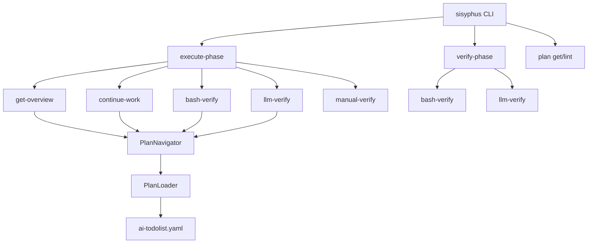
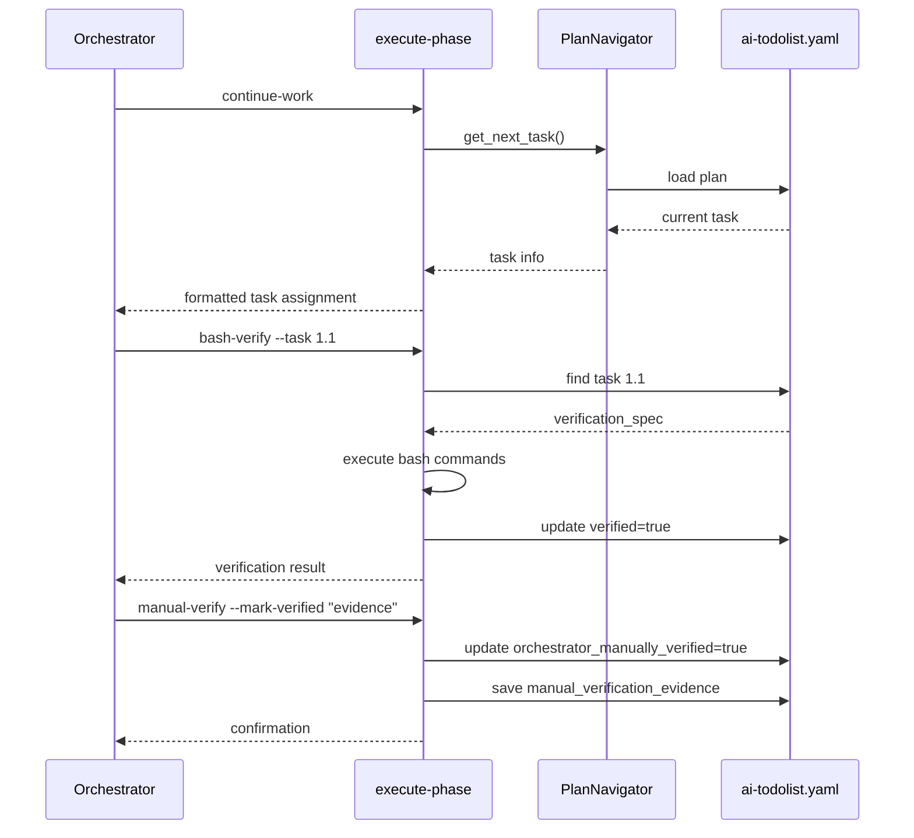

# 사용자의 최초 요청 (기록용)

ai todolist yaml 다루는 새 도구를 만들고, 내가 사용하지 않는 것들은 지울 수있었으면 함.

@sisyphus/core/loop.py 통해서 execute phase 가 실행된다면 @sisyphus/core/prompts.py 이게 들어가고 얘가 메인 오케스트레이터 에이전트로써 @claude-code-plugins/sisyphus/agents/executor.md 를 호출하고, executor agent 의 작업이 끝나고나면 hook 으로 @.github/workflows/.claude.agent/hooks/post-tool-use/orchestrator_reminder.py 이게 orchestrator 한테 보고되는데, 이걸 yaml based 로 바꾸려고 함.

## 추가 사용자 요청 (기록용)

(없음)

# 작업 목표 (WHAT & WHY)

## 핵심 목표 (TL;DR)

sisyphus의 작업 계획 시스템을 ai-todolist.yaml 기반으로 재구성하고, `sisyphus execute-phase`와 `sisyphus verify-phase` CLI 명령어를 구현하여 YAML 기반 작업 워크플로우를 완성합니다.

## 세부 목표

- YAML 기반 작업 계획 시스템을 위한 새 CLI 명령어 구현 (`sisyphus execute-phase`, `sisyphus verify-phase`)
- 기존 `sisyphus plan` 명령어 중 불필요한 업데이트성 명령어 제거
- orchestrator-executor-hook 플로우를 YAML 스키마 기반으로 전환

# 작업 배경 (WHY & WHAT - 현재 상태)

## 현재 상황

- 현재 ai-todolist.md 마크다운 기반 작업 계획 시스템이 운영 중
- orchestrator agent가 executor agent를 호출하고, hook으로 작업 상태를 보고받는 구조
- `sisyphus plan` 명령어에 get/set/set-verification/check/lint 5개 서브커맨드 존재
- ai-todolist-draft.yaml에 v2.1 스키마가 정의되어 있음

## 변경 필요 이유

- YAML 기반 스키마(v2.1)가 구조화된 검증(bash, llm_judge)을 지원
- 마크다운 기반보다 프로그래매틱한 접근이 용이
- 작업 진행 상태, 검증 상태를 명확하게 관리 가능

## 변경 내용

**Before**:
- ai-todolist.md (마크다운)
- orchestrator → executor → hook 플로우
- `sisyphus plan get/set/set-verification/check/lint`

**After**:
- ai-todolist.yaml (YAML v2.1)
- `sisyphus execute-phase continue-work/bash-verify/llm-verify/manual-verify`
- `sisyphus verify-phase bash-verify/llm-verify`
- `sisyphus plan get/lint` (업데이트성 명령어 제거)

# 작업 시작 여부

is_execution_started = TRUE

# 모든 목표 달성 여부

is_all_goals_accomplished = FALSE

# 병렬 실행

parallel_requested = FALSE

# 현재 진행 중인 작업

Task 2: sisyphus verify-phase CLI 구조 구현

# 필요 배경 지식

## 파일 구조 및 역할

### 1. sisyphus/cli.py
- **역할**: Typer 기반 CLI 진입점
- **검색 키워드**: `@app.command`, `@plan_app.command`
- **주요 패턴**: Typer command 데코레이터 사용, agent 팩토리 패턴
- **참고 URL**: https://typer.tiangolo.com/ (find "Commands and Groups" section)

### 2. sisyphus/core/loop.py
- **역할**: ExecutionLoop - Execute/Verify phase 오케스트레이션
- **검색 키워드**: `_execute_phase`, `_verify_phase`, `_run_unified_mode`
- **주요 패턴**: anyio 기반 async 루프, ExceptionGroup 처리
- **코드 스니펫**:
```python
# ExecutionLoop의 핵심 루프 구조
async def _run_unified_mode(self, ...):
    while True:
        await self._execute_phase(...)
        if should_verify:
            feedback, fully_done = await self._verify_phase(...)
            if fully_done:
                break
```

### 3. sisyphus/core/prompts.py
- **역할**: DEFAULT_EXECUTE_PROMPT, DEFAULT_VERIFY_PROMPT 정의
- **검색 키워드**: `DEFAULT_EXECUTE_PROMPT = `
- **주요 패턴**: /execute, /architect 슬래시 커맨드 프롬프트

### 4. sisyphus/utils/plan_types.py
- **역할**: v2.1 YAML 스키마 Pydantic 모델
- **검색 키워드**: `class Todo`, `class VerificationItem`, `BashVerification`, `LLMJudgeVerification`
- **주요 패턴**: Pydantic BaseModel, discriminated union (Field(discriminator="type"))

### 5. sisyphus/core/plan_navigator.py
- **역할**: YAML plan 탐색 (DFS 알고리즘)
- **검색 키워드**: `get_next_task`, `find_todo_by_id`, `check_task_completion`
- **주요 패턴**: 재귀적 트리 탐색, CompletionReport 생성

### 6. sisyphus/core/plan_loader.py
- **역할**: YAML 파일 읽기/쓰기, Pydantic 변환
- **검색 키워드**: `def load()`, `def save()`
- **주요 패턴**: ruamel.yaml 사용, Pydantic model_validate

### 7. v2.1 YAML 스키마 정의 및 예제

**v2.1 스키마 정의**:
- **소스**: `sisyphus/utils/plan_types.py` (lines 22-76)
- **핵심 변경사항**: BashVerification, LLMJudgeVerification을 VerificationItem에 직접 포함
- **주의**: `plan_types.py:142`의 `format_version: "2.0"`은 역사적 이유로 유지되지만, BashVerification/LLMJudgeVerification 구조가 v2.1의 실질적 변경사항
- **ai-todolist-draft.yaml 사용 금지**: 구버전 v2.0 스키마 (input.type, verify.type 구조)

**VerificationItem v2.1 필드**:
- `verified: bool` (검증 완료 여부) ← **올바른 필드명**
- `completed` 필드는 **존재하지 않음** (cli.py:811의 `{"completed": completed}`는 **버그**)

**v2.1 호환 YAML 예제**:

**1) VerificationItem 단독 예제** (BashVerification):
```yaml
verification_spec:
  - id: "verify_bash_example"
    title: "Bash 검증 예제"
    description: "디렉토리 존재 확인"
    verified: false
    verified_at: null
    verification_evidence: null
    orchestrator_manually_verified: false
    manual_verification_evidence: ""
    bash:
      - execute: "ls -la todo-cli/"
        expected_stdout: null
        expected_stderr: null
        expected_exit_code: 0
        notes: "디렉토리 존재 확인"
    llm_judge: []
```

**2) VerificationItem 단독 예제** (LLMJudgeVerification):
```yaml
verification_spec:
  - id: "verify_llm_example"
    title: "LLM 검증 예제"
    description: "코드 품질 검증"
    verified: false
    verified_at: null
    verification_evidence: null
    orchestrator_manually_verified: false
    manual_verification_evidence: ""
    bash: []
    llm_judge:
      - by: "orchestrator-agent"
        context_commands:
          - "cat database.py"
        instruction: |
          Verify:
          1. Connection pooling pattern
          2. Error handling exists
          3. Type hints present
```

**3) 전체 WorkPlan 구조 예제** (v2.1 호환):
```yaml
metadata:
  created_at: "2025-01-15T10:00:00Z"
  updated_at: "2025-01-15T10:00:00Z"
  format_version: "2.0"  # 역사적 이유로 "2.0" 유지

user_request:
  original: "implement todo CLI tool"
  created_at: "2025-01-15T10:00:00Z"
  additional: []

objectives:
  core: "Create command-line todo management tool"
  detailed: []

background:
  current_situation: "No todo tool exists"
  reason_for_change: "Need task tracking"
  changes_to_make: "Implement CLI with database"

required_background:
  description: "Python 3.12, Typer, SQLAlchemy knowledge"
  file_structure: null
  references: []

status:
  execution:
    started: false
    completed: false
    started_at: null
    completed_at: null
  work_mode:
    parallel_requested: false
    current_task_id: null
  progress:
    total_tasks: 2
    completed: 0
    in_progress: 0
    pending: 2
  current_work: "작업이 시작되지 않았습니다."

workflow:
  dependency_diagram: |
    Task 1 → Task 2
  critical_path: ["1", "2"]

todos:
  - id: "1"
    title: "프로젝트 구조 생성"
    status: "pending"
    parallel_group: null
    created_at: "2025-01-15T10:00:00Z"
    updated_at: "2025-01-15T10:00:00Z"
    status_changed_at: null
    references: []
    details: {}
    verification_spec:
      - id: "verify_1_dirs"
        title: "디렉토리 구조 확인"
        description: "todo-cli/ 디렉토리 존재 확인"
        verified: false
        verified_at: null
        verification_evidence: null
        orchestrator_manually_verified: false
        manual_verification_evidence: ""
        bash:
          - execute: "ls -la todo-cli/"
            expected_exit_code: 0
            notes: "프로젝트 디렉토리 확인"
        llm_judge: []
    children: []
    parallel_note: null

  - id: "2"
    title: "데이터베이스 모델 구현"
    status: "pending"
    parallel_group: null
    created_at: "2025-01-15T10:00:00Z"
    updated_at: "2025-01-15T10:00:00Z"
    status_changed_at: null
    references: []
    details: {}
    verification_spec:
      - id: "verify_2_impl"
        title: "코드 품질 검증"
        description: "database.py 구현 검증"
        verified: false
        verified_at: null
        verification_evidence: null
        orchestrator_manually_verified: false
        manual_verification_evidence: ""
        bash: []
        llm_judge:
          - by: "orchestrator-agent"
            context_commands:
              - "cat todo-cli/database.py"
            instruction: |
              Verify database.py implementation:
              1. Connection pooling pattern exists
              2. Error handling present
              3. Type hints complete
    children: []
    parallel_note: null

success_vision:
  user_perspective: []
  business_perspective: []
  technical_criteria: []

final_verification: []
```

## 참고 파일

### 현재 구현 패턴
- `sisyphus/cli.py:594-890` (plan 서브커맨드 구현)
- `sisyphus/core/plan_navigator.py:180-230` (check_task_completion)
- `sisyphus/utils/formatting.py` (출력 포맷팅)

### 제거 대상
- `sisyphus plan set` (cli.py:664-717)
- `sisyphus plan set-verification` (cli.py:754-825)
- `sisyphus plan check` (cli.py:828-849)

## VerificationItem 필드 명세

### plan_types.py:60-76 필드 상세
- `id`: 필수, 검증 ID
- `title`: 필수, 검증 제목
- `description`: 필수, 검증 설명
- `verified`: Optional (기본값: false)
- `verified_at`: Optional (기본값: null)
- `verification_evidence`: Optional (기본값: null)
- `orchestrator_manually_verified`: **필수**, orchestrator 수동 검증 여부 (기본값: false)
- `manual_verification_evidence`: **필수**, 수동 검증 증거 (기본값: "")
- `bash`: Optional (기본값: [])
- `llm_judge`: Optional (기본값: [])

**주의**: `orchestrator_manually_verified`, `manual_verification_evidence`는 필수이지만, YAML 작성 시 빈 문자열 (`""`) 또는 false로 초기화 필요

# 작업 흐름 (HOW - 태스크 흐름 및 의존성)

## 태스크 의존성 다이어그램

```
Phase 1: CLI 명령어 구조 설계 및 기본 구현
└─ Task 1: sisyphus execute-phase 서브커맨드 구조 구현
   └─ Task 2: sisyphus verify-phase 서브커맨드 구조 구현

Phase 2: execute-phase 기능 구현
├─ Task 3: execute-phase get-overview 구현
├─ Task 4: execute-phase continue-work 구현
├─ Task 5: execute-phase bash-verify 구현
├─ Task 6: execute-phase llm-verify 구현
└─ Task 7: execute-phase manual-verify 구현

Phase 3: verify-phase 기능 구현
├─ Task 8: verify-phase bash-verify 구현
└─ Task 9: verify-phase llm-verify 구현

Phase 4: plan 명령어 정리
└─ Task 10: 불필요한 plan 서브커맨드 제거
```

## 단계별 설명

- **Phase 1 (Task 1-2)**: CLI 명령어 골격 구현, 기존 패턴(plan_app) 참고
- **Phase 2 (Task 3-7)**: execute-phase 핵심 기능 구현, YAML 읽기/쓰기 활용
- **Phase 3 (Task 8-9)**: verify-phase 구현, execute-phase와 로직 공유
- **Phase 4 (Task 10)**: 정리 작업, set/set-verification/check 제거

# 작업 계획

## PRD 및 구조

### 시스템 아키텍처



### execute-phase 흐름



## 구현 세부사항

### 아키텍처 제약
- PlanLoader/PlanNavigator 기존 API 활용
- Typer 기반 CLI 구조 유지
- YAML 스키마 v2.1 준수

### Edge Case 처리
- task_id 없을 때 → ValueError 발생
- bash 검증 실패 → verified=false 유지, 에러 출력
- llm_judge by:external-agent → claude-agent-sdk 호출 필요

### 암묵적 가정 명시
- ai-todolist.yaml 파일이 존재한다고 가정
- verification_spec이 비어있으면 자동 통과
- orchestrator가 manual-verify 호출 책임

## 프로젝트 커밋 메시지 스타일

최근 커밋 로그 분석 결과:
- `feat:` - 새 기능 추가
- `fix:` - 버그 수정
- `docs:` - 문서 업데이트
- `chore:` - 유지보수성 작업
- `test:` - 테스트 추가

# TODOs

- [x] 1. sisyphus execute-phase CLI 구조 구현

   **참고 소스**:
   - Pattern file: `sisyphus/cli.py` (search for `@plan_app.command`, examine argumen parsing and Typer structure around line 590-890)
   - Pattern file: `sisyphus/core/plan_navigator.py` (search for `PlanNavigator` class, examine get_next_task method)

   - [x] 1.1 execute_phase_app = typer.Typer() 생성

      **구현 세부사항**:
      - 현재 코드: `plan_app = typer.Typer(name="plan", help="Work plan management")`
      - 변경 내용: `execute_phase_app = typer.Typer(name="execute-phase", help="Execute phase commands")`
      - 위치: `sisyphus/cli.py` 하단 plan_app 아래

   - [x] 1.2 app.add_typer(execute_phase_app) 등록

      **실행 명령**: `sisyphus execute-phase --help` 실행 시 서브커맨드 목록 출력 확인

   - [x] 1.3 테스트 작성 및 실행

      **테스트 패턴 참고**: `sisyphus/tests/test_cli_plan.py` (search for `test_plan_get_current_task`, examine Typer testing pattern)
      **실행 명령**: `uv run pytest sisyphus/tests/test_cli.py -v -k execute_phase`

   - [x] 1.4 Lint 및 타입 체크
      - [x] `ruff check sisyphus/cli.py` → 0 errors expected
      - [x] `basedpyright sisyphus/cli.py` → 0 errors expected

   - [x] 1.5 커밋
      - 프로젝트 규칙에 따라: `feat: add execute-phase CLI subcommand structure`
      - `git add sisyphus/cli.py sisyphus/tests/test_cli.py && git commit -m "..."`

   - [x] **작업 완료 검증 체크리스트**
      - [x] `sisyphus/cli.py`에 `execute_phase_app = typer.Typer()` 추가 확인
      - [x] `app.add_typer(execute_phase_app)` 호출 확인
      - [x] `sisyphus execute-phase --help` 실행 → 도움말 출력
      - [x] 테스트 실행: `uv run pytest sisyphus/tests/test_cli.py -v -k execute_phase` → PASSED
      - [x] `ruff check sisyphus/cli.py` → 0 errors
      - [x] `basedpyright sisyphus/cli.py` → 0 errors
      - [x] git commit 완료 확인: `git log -1 --oneline`

- [ ] 2. sisyphus verify-phase CLI 구조 구현

   **참고 소스**:
   - Pattern file: `sisyphus/cli.py:590-590` (plan_app 선언 패턴 참고)

   - [ ] 2.1 verify_phase_app = typer.Typer() 생성 및 등록
   - [ ] 2.2 테스트 작성 (`test_verify_phase_help`)
   - [ ] 2.3 테스트 실행 및 lint
   - [ ] 2.4 커밋: `feat: add verify-phase CLI subcommand structure`

   - [ ] **작업 완료 검증 체크리스트**
      - [ ] `sisyphus verify-phase --help` → 도움말 출력
      - [ ] 테스트 통과
      - [ ] lint/typecheck 0 errors

- [ ] 3. execute-phase get-overview 구현

   **참고 소스**:
   - `sisyphus/core/plan_navigator.py:33-38` (get_current_task 메서드)
   - `sisyphus/utils/formatting.py:23-76` (print_task 함수)
   - `ai-todolist-draft.yaml:1-100` (user_request, background, required_background 구조)

   **구현 세부사항**:
   - 현재: plan get 명령어가 task만 출력
   - 변경: get-overview는 user_request + background + required_background + status + workflow + todos(depth 1 only) 출력
   - 출력 형식: PLAIN (기본), RICH (--rich 옵션)

   - [ ] 3.1 `@execute_phase_app.command(name="get-overview")` 함수 구현

      **코드 패턴**:
      ```python
      @execute_phase_app.command(name="get-overview")
      def get_overview(
          rich: bool = typer.Option(False, "--rich", help="Use Rich table format")
      ) -> None:
          """Get execution overview (user_request, background, status, workflow, todos depth-1)."""
          try:
              loader = PlanLoader()
              plan = loader.load()

              # user_request, background, required_background, status, workflow, todos (depth 1만)
              print_overview(plan, format=OutputFormat.RICH if rich else OutputFormat.PLAIN)
          except FileNotFoundError as e:
              console.print(f"[red]{e}[/red]")
              raise typer.Exit(1)
      ```

   - [ ] 3.2 `sisyphus/utils/formatting.py`에 `print_overview()` 함수 추가

      **출력 형식 명세**:
      ```
      # PLAIN 모드
      User Request: {user_request.original}
      Additional: {', '.join(user_request.additional)}

      Background:
        Current: {background.current_situation}
        Reason: {background.reason_for_change}

      Required Background:
        {required_background.description}

      Status:
        Execution: started={execution.started}, completed={execution.completed}
        Current Task: {work_mode.current_task_id or "None"}
        Progress: {progress.completed}/{progress.total_tasks} completed

      Workflow:
      {workflow.dependency_diagram}

      Todos (depth 1):
        1. [{status}] {title} ({len(children)} children)
        2. [{status}] {title} ({len(children)} children)
      ```

      **RICH 모드**: Rich Panel 사용, 섹션별 Table 생성

      **코드 스켈레톤**:
      ```python
      def print_overview(plan: WorkPlan, format: OutputFormat = OutputFormat.PLAIN) -> None:
          if format == OutputFormat.PLAIN:
              # 위 PLAIN 형식 출력
              output = f"User Request: {plan.user_request.original}\n"
              if plan.user_request.additional:
                  output += f"Additional: {', '.join(plan.user_request.additional)}\n"
              # ... (나머지 섹션)
              console.print(output)
          else:
              # Rich Panel/Table 사용
              from rich.panel import Panel
              lines = [
                  f"[bold]User Request:[/bold] {plan.user_request.original}",
                  # ... (나머지 섹션)
              ]
              panel = Panel("\n".join(lines), title="Work Plan Overview")
              console.print(panel)
      ```

   - [ ] 3.3 테스트 작성 및 실행

      **실행 명령**: `sisyphus execute-phase get-overview`
      **예상 출력**:
      ```
      User Request: ...
      Background: ...
      Status: execution.started=false, current_task_id=null
      Todos (depth 1):
        1. [pending] 프로젝트 구조 생성 (2 children)
        2. [pending] 데이터베이스 모델 구현 (2 children)
      ```

   - [ ] 3.4 커밋: `feat: implement execute-phase get-overview command`

   - [ ] **작업 완료 검증 체크리스트**
      - [ ] `sisyphus execute-phase get-overview` 실행 → overview 출력
      - [ ] `sisyphus execute-phase get-overview --rich` → Rich 포맷 출력
      - [ ] 테스트 통과: `uv run pytest sisyphus/tests/test_cli.py -k overview`
      - [ ] lint/typecheck 0 errors

- [ ] 4. execute-phase continue-work 구현

   **참고 소스**:
   - `sisyphus/core/plan_navigator.py:40-80` (get_next_task 메서드 - DFS 알고리즘)
   - `ai-todolist-draft.yaml:183-252` (todo 구조, children, verification_spec)

   **구현 세부사항**:
   - current_task_id가 null이면 첫 pending task 할당
   - current_task가 완료되면 다음 task로 이동
   - parallel_group이 같은 task들은 동시 할당 가이드 출력

   - [ ] 4.1 `@execute_phase_app.command(name="continue-work")` 구현

      **로직**:
      1. PlanNavigator.get_next_task() 호출
      2. task가 없으면 "모든 작업 완료" 출력
      3. task가 있으면:
         - status를 in_progress로 변경
         - current_task_id 업데이트
         - task 정보 출력 (id, title, references, children, details)
         - parallel_group 확인 → N개의 executor 할당 가이드 출력

   - [ ] 4.2 parallel_group 처리 로직 추가

      **조건**: `task.parallel_group is not None`

      **구현 알고리즘**:
      1. PlanNavigator에 헬퍼 메서드 추가:
         ```python
         def get_parallel_group_tasks(self, group_id: int) -> list[Todo]:
             """Get all tasks with same parallel_group."""
             result = []
             def collect(todos: list[Todo]) -> None:
                 for todo in todos:
                     if todo.parallel_group == group_id:
                         result.append(todo)
                     if todo.children:
                         collect(todo.children)
             collect(self.plan.todos)
             return result
         ```

      2. continue-work에서 사용:
         ```python
         if task.parallel_group is not None:
             parallel_tasks = navigator.get_parallel_group_tasks(task.parallel_group)
             console.print(f"⚠️  Parallel Execution Required")
             console.print(f"Tasks in parallel_group={task.parallel_group}:")
             for t in parallel_tasks:
                 console.print(f"  - Task {t.id}: {t.title}")
             console.print(f"→ Launch {len(parallel_tasks)} executor agents in parallel")
         ```

      **출력 예시**:
      ```
      ⚠️  Parallel Execution Required
      Tasks in parallel_group=10:
        - Task 4: 테스트 작성
        - Task 5: 문서화

      → Launch 2 executor agents in parallel
      ```

   - [ ] 4.3 테스트 작성
      - test_continue_work_first_task
      - test_continue_work_parallel_group
      - test_continue_work_all_completed

   - [ ] 4.4 커밋: `feat: implement execute-phase continue-work with parallel support`

   - [ ] **작업 완료 검증 체크리스트**
      - [ ] 첫 실행 시 첫 pending task 할당
      - [ ] parallel_group 감지 시 가이드 출력
      - [ ] status/current_task_id YAML 업데이트 확인
      - [ ] 테스트 통과

- [ ] 5. execute-phase bash-verify 구현

   **참고 소스**:
   - `sisyphus/utils/plan_types.py:22-27` (BashVerification 모델)
   - `ai-todolist-draft.yaml:213-226` (bash verification 예제)

   **구현 세부사항**:
   - VerificationItem.bash 리스트 순회
   - subprocess로 bash command 실행
   - stdout/stderr/exit_code 검증
   - 성공 시 verified=true, verified_at 기록

   - [ ] 5.1 `@execute_phase_app.command(name="bash-verify")` 구현

      **코드 패턴**:
      ```python
      @execute_phase_app.command(name="bash-verify")
      def bash_verify(
          task_id: str = typer.Argument(..., help="Task ID to verify"),
      ) -> None:
          """Run bash verification for a task."""
          try:
              loader = PlanLoader()
              plan = loader.load()
              navigator = PlanNavigator(plan)

              task = navigator.find_todo_by_id(task_id)
              if task is None:
                  console.print(f"[red]Task not found: {task_id}[/red]")
                  raise typer.Exit(1)

              # VerificationItem.bash 순회
              for verify_item in task.verification_spec:
                  for bash_spec in verify_item.bash:
                      result = subprocess.run(
                          bash_spec.execute,
                          shell=True,
                          capture_output=True,
                          text=True
                      )

                      # 검증 로직
                      if result.returncode == bash_spec.expected_exit_code:
                          # verified=true, verified_at 업데이트
                          ...
          except Exception as e:
              console.print(f"[red]Error: {e}[/red]")
              raise typer.Exit(1)
      ```

   - [ ] 5.2 검증 실패 시 에러 처리

      **출력**:
      ```
      ✗ Verification failed: verify_1_1_dirs
        Command: ls -la todo-cli/
        Expected exit code: 0
        Actual exit code: 2
        Stderr: ls: todo-cli/: No such file or directory
      ```

   - [ ] 5.3 YAML 업데이트 로직 (immutable pattern)

      **참고 코드**: `sisyphus/cli.py:794-825` (_update_verification_status 전체)
      **⚠️ 주의**: cli.py:811의 `{"completed": completed}` 사용은 **버그**입니다. VerificationItem에는 `completed` 필드가 없고 `verified` 필드만 존재합니다.

      **헬퍼 함수 구현** (cli.py 버그 수정):
      ```python
      def _update_verification_status(
          todos: list[Todo], task_id: str, verify_id: str, verified: bool,
          verified_at: str, evidence: str
      ) -> list[Todo]:
          """Recursively update verification item (immutable).

          Args:
              todos: List of todos to search
              task_id: Target task ID
              verify_id: Verification item ID to update
              verified: Verification status (올바른 필드명: 'verified', not 'completed')
              verified_at: Timestamp (ISO format)
              evidence: Verification evidence

          Returns:
              Updated list of todos
          """
          result = []
          for todo in todos:
              if todo.id == task_id:
                  # 해당 task의 verification_spec 업데이트
                  updated_specs = [
                      v.model_copy(update={
                          "verified": verified,  # ← cli.py:811 버그 수정: 'completed' → 'verified'
                          "verified_at": verified_at,
                          "verification_evidence": evidence
                      }) if v.id == verify_id else v
                      for v in todo.verification_spec
                  ]
                  updated = todo.model_copy(update={"verification_spec": updated_specs})
                  result.append(updated)
              else:
                  # children 재귀 확인
                  if todo.children:
                      updated = todo.model_copy(
                          update={"children": _update_verification_status(
                              todo.children, task_id, verify_id, verified, verified_at, evidence
                          )}
                      )
                      result.append(updated)
                  else:
                      result.append(todo)
          return result
      ```

      **사용법**:
      ```python
      from datetime import datetime, timezone

      verified_at = datetime.now(timezone.utc).isoformat()
      updated_todos = _update_verification_status(
          plan.todos, task_id, verify_id, True, verified_at, "bash command succeeded"
      )
      plan = plan.model_copy(update={"todos": updated_todos})
      loader.save(plan)
      ```

   - [ ] 5.4 테스트 작성 및 커밋

   - [ ] **작업 완료 검증 체크리스트**
      - [ ] bash command 실행 및 결과 검증
      - [ ] verified=true 업데이트 확인
      - [ ] 실패 시 verified=false 유지 확인
      - [ ] 테스트 통과

- [ ] 6. execute-phase llm-verify 구현

   **참고 소스**:
   - `sisyphus/utils/plan_types.py:30-38` (LLMJudgeVerification, LLMJudgeBy enum)
   - `ai-todolist-draft.yaml:324-346` (llm_judge 예제)

   **구현 세부사항**:
   - by: orchestrator-agent → instruction 출력, 수동 검증 요구
   - by: external-agent → claude-agent-sdk 호출, VERIFIED=TRUE 파싱

   - [ ] 6.1 orchestrator-agent 모드 구현

      **출력**:
      ```
      LLM Verification Required (by: orchestrator-agent)

      Task: 2.2 - database.py 구현
      Instruction:
        Verify database.py implementation:
        1. Connection pooling pattern
        2. Error handling
        3. Type hints

      Context Commands:
        - cat todo-cli/database.py

      After verification, run:
        sisyphus execute-phase llm-verify mark-verified --task 2.2 --verify-id verify_2_2_impl --evidence "..."

      ℹ️  1 more LLM verification remaining
      ```

   - [ ] 6.2 mark-verified 서브커맨드 구현

      **코드 패턴**:
      ```python
      @execute_phase_app.command(name="llm-verify-mark")
      def llm_verify_mark(
          task_id: str = typer.Option(..., "--task"),
          verify_id: str = typer.Option(..., "--verify-id"),
          evidence: str = typer.Option(..., "--evidence"),
      ) -> None:
          """Mark LLM verification as completed."""
          # verified=true, verification_evidence 업데이트
      ```

   - [ ] 6.3 external-agent 모드 구현 (optional - 추후 확장)

      **참고**: `sisyphus/agents/claude.py` (ClaudeAgent 사용 패턴)
      **로직**:
      - ClaudeAgent 초기화
      - instruction + context_commands 결과를 프롬프트로 전송
      - 응답에서 `{NAME}_VERIFIED = TRUE` 파싱
      - verification_evidence 추출

   - [ ] 6.4 테스트 및 커밋

   - [ ] **작업 완료 검증 체크리스트**
      - [ ] orchestrator 모드 instruction 출력
      - [ ] mark-verified 명령어로 검증 완료 처리
      - [ ] 남은 검증 개수 출력
      - [ ] 테스트 통과

- [ ] 7. execute-phase manual-verify 구현

   **참고 소스**:
   - `sisyphus/utils/plan_types.py:67-68` (orchestrator_manually_verified, manual_verification_evidence)

   **구현 세부사항**:
   - orchestrator가 코드 리뷰, 테스트 확인 후 수동 검증
   - --mark-verified 옵션으로 evidence 기록

   - [ ] 7.1 `@execute_phase_app.command(name="manual-verify")` 구현

      **코드 패턴**:
      ```python
      @execute_phase_app.command(name="manual-verify")
      def manual_verify(
          task_id: str = typer.Argument(...),
          evidence: str = typer.Option(..., "--evidence"),
      ) -> None:
          """Manually verify task by orchestrator."""
          # orchestrator_manually_verified=true
          # manual_verification_evidence=evidence
      ```

   - [ ] 7.2 테스트 및 커밋: `feat: implement execute-phase manual-verify`

   - [ ] **작업 완료 검증 체크리스트**
      - [ ] manual-verify 실행 시 YAML 업데이트
      - [ ] evidence 기록 확인
      - [ ] 테스트 통과

- [ ] 8. verify-phase bash-verify 구현

   **참고 소스**:
   - Task 5 (execute-phase bash-verify) 로직 재사용

   **구현 세부사항**:
   - execute-phase bash-verify와 동일한 로직
   - 단, sisyphus work 내에서 자동 실행되는 용도

   - [ ] 8.1 `@verify_phase_app.command(name="bash-verify")` 구현
      - execute-phase bash-verify 로직 공통 함수로 추출
      - 재사용

   - [ ] 8.2 테스트 및 커밋

   - [ ] **작업 완료 검증 체크리스트**
      - [ ] verify-phase bash-verify 실행 확인
      - [ ] execute-phase와 동일한 동작 확인

- [ ] 9. verify-phase llm-verify 구현

   **참고 소스**:
   - Task 6 (execute-phase llm-verify) 로직 재사용

   **구현 세부사항**:
   - get-overview 대신 ai-todolist.yaml 전체 내용 직접 포함
   - Verify phase agent가 호출

   - [ ] 9.1 `@verify_phase_app.command(name="llm-verify")` 구현
      - ai-todolist.yaml 전체 읽기
      - LLMJudgeVerification instruction + full YAML content
      - orchestrator mode만 지원 (external-agent는 추후)

   - [ ] 9.2 테스트 및 커밋

   - [ ] **작업 완료 검증 체크리스트**
      - [ ] verify-phase llm-verify 실행 확인
      - [ ] full YAML 포함 확인

- [ ] 10. 불필요한 plan 서브커맨드 제거 및 버그 수정

   **참고 소스**:
   - `sisyphus/cli.py:664-717` (plan set)
   - `sisyphus/cli.py:754-825` (plan set-verification)
   - `sisyphus/cli.py:828-849` (plan check)

   **제거 대상**:
   - `@plan_app.command(name="set")` 전체
   - `@plan_app.command(name="set-verification")` 전체
   - `@plan_app.command(name="check")` 전체
   - 관련 헬퍼 함수: `_update_task_statuses`, `_update_verification_status`

   **유지 대상**:
   - `@plan_app.command(name="get")` (조회성)
   - `@plan_app.command(name="lint")` (검증성)

   **⚠️ 중요: 제거 전 버그 수정 필요**:
   - `_update_verification_status` 함수 (cli.py:794-825)는 제거 대상이지만, cli.py:811의 `{"completed": completed}` 버그를 execute-phase/verify-phase 구현 시 반복하지 않도록 주의
   - VerificationItem에는 `completed` 필드가 없고 `verified` 필드만 존재 (plan_types.py:64)

   - [ ] 10.1 plan set/set-verification/check 제거

   - [ ] 10.2 관련 테스트 제거 또는 수정

      **테스트 파일**: `sisyphus/tests/test_cli_plan.py`

   - [ ] 10.3 테스트 실행 및 커밋: `refactor: remove unused plan subcommands (set, set-verification, check)`

   - [ ] **작업 완료 검증 체크리스트**
      - [ ] `sisyphus plan --help` → set/set-verification/check 없음
      - [ ] `sisyphus plan get --help` → 여전히 동작
      - [ ] `sisyphus plan lint --help` → 여전히 동작
      - [ ] 관련 테스트 통과 또는 제거 확인

# 성공 비전

## 사용자 관점에서의 성공

- orchestrator가 `sisyphus execute-phase continue-work` 실행 → 다음 작업 할당받음
- executor 작업 완료 후 `sisyphus execute-phase bash-verify --task 1.1` → 자동 검증
- 수동 검증 필요 시 `sisyphus execute-phase manual-verify --evidence "..."` → 검증 기록

## 비즈니스 관점에서의 성공

- YAML 기반 작업 관리로 구조화된 워크플로우 확립
- 검증 프로세스 명확화 (bash, llm_judge, manual)

## 기술적 성공 기준

- [ ] 모든 테스트 통과: `uv run pytest sisyphus/tests/ -v`
- [ ] Lint 에러 0개: `uv run ruff check sisyphus/`
- [ ] Type check 통과: `uv run basedpyright sisyphus/`
- [ ] 명령어 실행 확인:
  ```bash
  sisyphus execute-phase --help
  sisyphus execute-phase get-overview
  sisyphus execute-phase continue-work
  sisyphus execute-phase bash-verify --task 1
  sisyphus verify-phase --help
  ```

# 최종 작업 검증 체크리스트

- [ ] 1. **기능 동작 확인**
  - [ ] `sisyphus execute-phase get-overview` → overview 출력
  - [ ] `sisyphus execute-phase continue-work` → next task 할당
  - [ ] `sisyphus execute-phase bash-verify --task 1` → 검증 실행
  - [ ] `sisyphus verify-phase bash-verify` → 검증 실행
  - [ ] `sisyphus plan get --current` → 현재 task 조회 (여전히 동작)
  - [ ] `sisyphus plan lint` → YAML 검증 (여전히 동작)

- [ ] 2. **잘못된 구현 방지**
  - [ ] plan set/set-verification/check 명령어 제거 확인
  - [ ] YAML 스키마 v2.1 준수 확인

- [ ] 3. **범위 준수**
  - [ ] 요청된 기능만 구현 (추가 기능 없음)
  - [ ] 기존 get/lint 명령어 유지 확인

- [ ] 4. **기존 기능 회귀 테스트**
  - [ ] 전체 테스트 스위트: `uv run pytest sisyphus/ -v` → 모든 테스트 통과
  - [ ] sisyphus work 명령어 → 여전히 동작 (ExecutionLoop 영향 없음)
