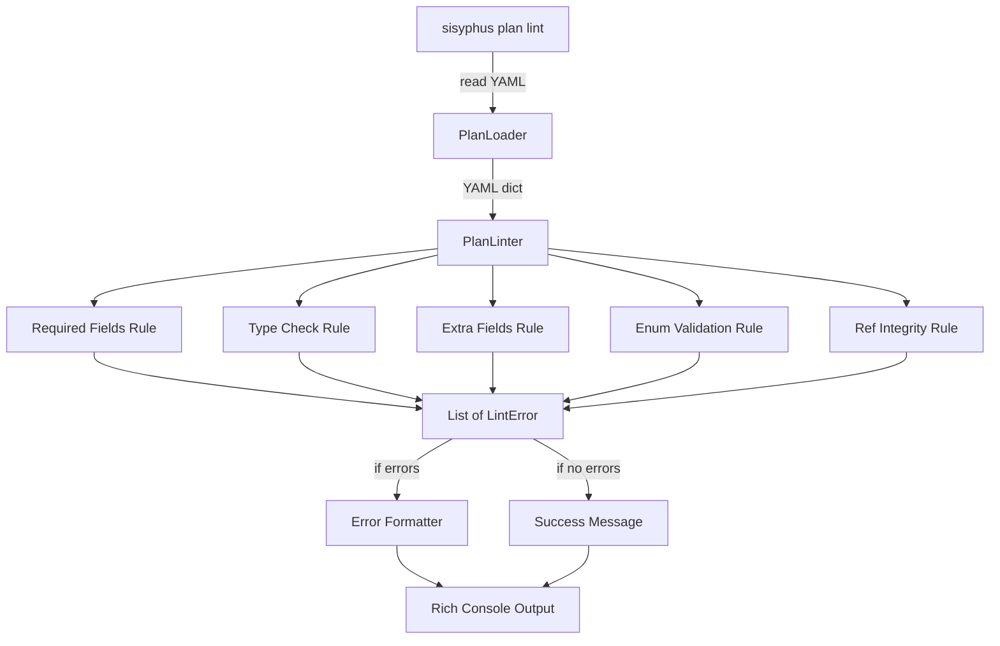
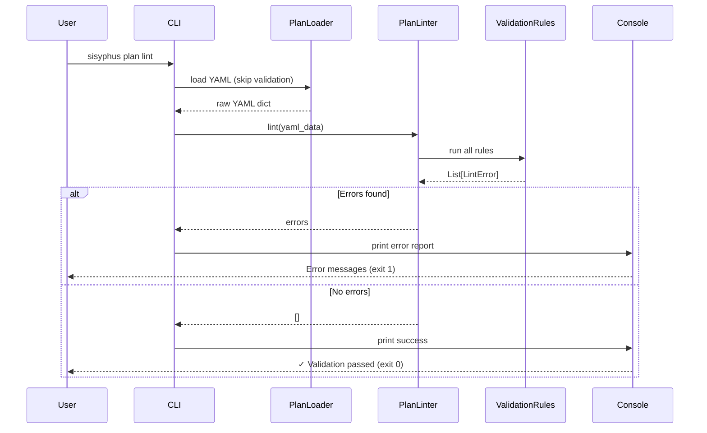

# 사용자의 최초 요청 (기록용)
`sisyphus plan lint` 라는 명령어로 해서 무의미한 키가 있진않는지, 타입이 틀리진 않았는지, 필요한 필드가 빠지진 않았는지를 검증하는 기능을 만들고싶어.

먼저 지금 yaml 에서 required, optional, types 들을 정리하고, 그걸 이제 linting 해주면서 또 적절한 메시지를 내주면서도 lint 기능 자체도 잘 구조화된 형태로 확장 가능한 느낌으로 아키텍쳐링하게 해주고싶어.

이게 기획이니만큼 모호한 부분이나 고민되는 부분있으면 나한테 물어보면서 작업계획서 생성해도 돼.

# 추가 요청사항
- 검증 범위: 필수 필드, 타입, 무의미한 키, 값 유효성, 참조 무결성 - 전부 다 필요
- 목적: LLM이 sisyphus plan 기능을 사용하기 위해 유효한 YAML이어야 함 (엄밀한 검증 필요)
- Strict linter: 모든 오류는 ERROR (level 구분 불필요)
- 에러 메시지: 간결하면서도 원인과 수정 방법 명확히 제공
- 자동 수정 기능: 불필요 (검증만)
- 구현 수준: MVP 아님, 완벽한 구현 필요

# 작업 목표 (WHAT & WHY)

## 핵심 목표 (TL;DR)
YAML 작업계획서(ai-todolist.yaml)의 스키마 유효성을 엄격히 검증하는 `sisyphus plan lint` 명령어를 구현하여, LLM이 sisyphus plan 기능을 안정적으로 사용할 수 있도록 보장한다.

## 상세 목표
- **필수 필드 누락 검증**: WorkPlan의 모든 필수 필드 (metadata, user_request, objectives, 등) 존재 여부 확인
- **타입 불일치 검증**: 각 필드의 타입이 Pydantic 모델 정의와 일치하는지 검증 (예: `status.execution.started`는 boolean)
- **무의미한 키 검증**: Pydantic 모델에 정의되지 않은 extra fields 검출
- **값 유효성 검증**: Enum 값 (TodoStatus, ReferenceType 등)이 허용된 값인지 확인
- **참조 무결성 검증**: SimpleReference의 `ref_id`가 `required_background.references`에 실제 존재하는지 확인
- **확장 가능한 아키텍처**: ValidationRule 기반으로 새로운 검증 규칙 추가 용이
- **명확한 에러 메시지**: 에러 위치, 문제점, 기대값, 수정 방법을 간결히 제공

# 작업 배경 (WHY & WHAT - Current State)

## 현재 상황
- sisyphus plan 기능(get, set, check)이 WorkPlan YAML 파일을 기반으로 동작
- 현재는 PlanLoader에서 Pydantic ValidationError만 발생 (에러 메시지가 불친절)
- 잘못된 YAML 형식:
  - 필수 필드 누락 시 FileNotFoundError 또는 ValidationError 발생
  - 타입 오류 (예: `started: "true"` 대신 `started: true`) 발생 가능
  - Extra fields (오타, 미정의 키) 감지 불가 (Pydantic extra="allow")
  - Enum 값 오류 (예: `status: "invalid"`) 감지 어려움
  - 참조 무결성 (ref_id 존재 여부) 검증 없음
- LLM이 plan 기능을 사용하려면 **엄격한 스키마 준수 필수**

## 변경 이유
- **LLM 친화적 작업 흐름 지원**:
  - LLM은 현재 작업 조회, 다음 작업 조회, verification 체크 등을 sisyphus plan 명령어로 수행
  - 잘못된 YAML은 plan 기능 오작동 → LLM 작업 실패
  - 사전 검증으로 YAML 품질 보장 필요
- **명확한 에러 피드백**:
  - Pydantic ValidationError는 기술적이고 장황함
  - "어떤 필드가 문제인지, 어떻게 고쳐야 하는지" 명확한 메시지 필요
- **확장성**:
  - 향후 새로운 검증 규칙 추가 시 구조화된 방식으로 확장 가능

## 변경 사항
- **Before**: PlanLoader.load() 호출 → ValidationError 발생 (불친절)
- **After**:
  - `sisyphus plan lint` 명령어 추가
  - PlanLinter 클래스 구현 (모든 검증 규칙 캡슐화)
  - 검증 실패 시 명확한 에러 메시지 출력
    ```
    Error: todos[0].status - Invalid value "invalid". Expected: one of [pending, in_progress, completed]. Suggestion: Change to "pending".
    ```
  - 검증 성공 시: `✓ YAML 검증 완료. 0 errors.`

# 작업 시작 여부
is_execution_started = TRUE

# 모든 목표 달성 여부
is_all_goals_accomplished = FALSE

# 병렬 실행 여부
parallel_requested = FALSE

# 현재 진행중인 작업
- Task 8: 통합 검증, 문서화, 커밋

# 필수 배경 지식

## 파일 구조 및 역할

### 1. `sisyphus/utils/plan_types.py` (304줄)
- **역할**: Pydantic 기반 데이터 모델 정의 (WorkPlan, Todo, VerificationItem 등)
- **검색할 것**: `class WorkPlan`, `class Todo`, `class VerificationItem`, Enum 정의들 (`TodoStatus`, `ReferenceType`, `InputType`, `VerifyType`)
- **핵심 패턴**:
  - Discriminated unions: `InputSpec`, `VerifySpec`, `ReferenceSpec` (type 필드 기반)
  - Recursive structure: `Todo.children: list[Todo]`
  - Field validators: `@field_validator` 데코레이터
  - Extra fields: `model_config = ConfigDict(extra="allow")` (WorkPlan에서)
- **참고사항**: 모든 필드의 required/optional, 기본값, 타입 확인 필요

### 2. `sisyphus/core/plan_loader.py` (27줄)
- **역할**: YAML 파일 로딩/저장 (ruamel.yaml + Pydantic 통합)
- **검색할 것**: `class PlanLoader`, `load()`, `save()` 메서드
- **핵심 패턴**:
  ```python
  def load(self) -> WorkPlan:
      with self.plan_path.open("r", encoding="utf-8") as f:
          data = self.yaml.load(f)
      return WorkPlan(**data)  # Pydantic validation
  ```
- **참고사항**: 현재는 Pydantic ValidationError만 발생 → lint 명령어로 보완

### 3. `sisyphus/core/plan_navigator.py` (229줄)
- **역할**: Plan 탐색 로직 (get_current_task, get_next_task, find_todo_by_id, check_task_completion)
- **검색할 것**: `find_todo_by_id`, `get_task_references`, `check_task_completion` (어떤 필드를 사용하는지)
- **참고사항**: 이 기능들이 정상 동작하려면 YAML 스키마가 완벽해야 함

### 4. `sisyphus/cli.py` (850줄)
- **역할**: CLI 진입점, plan 서브커맨드 정의
- **검색할 것**: `plan_app = typer.Typer`, `@plan_app.command` 패턴
- **참고 위치**: 588-850줄 (plan 관련 명령어들)
- **추가할 위치**: `@plan_app.command(name="lint")` (새 명령어)

### 5. `sisyphus/utils/errors.py`
- **역할**: 커스텀 예외 정의
- **검색할 것**: `class SisyphusError`, 상속 패턴
- **참고사항**: 새로운 `PlanLintError` 추가 여부 고려

## 참고 파일 (컨텍스트 이해용)

### 1. `sisyphus/utils/tests/test_plan_types.py`
- **역할**: Pydantic 모델 테스트 패턴 확인
- **검색할 것**: `pytest.raises(ValidationError)` 패턴, 어떤 케이스를 테스트하는지
- **핵심 패턴**:
  ```python
  async def test_pydantic_validation_fails__when_invalid_status__raises_error() -> None:
      # given
      data = {"id": "1", "title": "Test", "status": "invalid_status", ...}
      # when & then
      with pytest.raises(ValidationError) as exc:
          Todo(**data)
      assert "status" in str(exc.value).lower()
  ```

### 2. `sisyphus/core/tests/test_plan_loader.py`
- **역할**: PlanLoader 동작 및 에러 케이스 확인
- **검색할 것**: `test_load_malformed_yaml`, `test_load_yaml_with_invalid_schema` (에러 처리 패턴)
- **참고사항**: 현재는 ValidationError나 YAMLError만 발생 → lint로 사전 검증

### 3. `ai-todolist.yaml` / `ai-todolist-draft.yaml`
- **역할**: 실제 YAML 예시 (모든 feature 포함)
- **검색할 것**: 전체 구조, 각 섹션 예시
- **참고사항**: lint 테스트 데이터로 활용 가능

## 기술 스택 및 제약사항
- **Python**: 3.12
- **Pydantic**: 2.x (BaseModel, ConfigDict, Field, Discriminated Unions)
- **YAML**: ruamel.yaml (preserve quotes, formatting)
- **CLI**: Typer 0.15+
- **출력**: Rich 13+ (테이블, 색상)
- **테스트**: pytest + anyio, given-when-then 패턴

## 암묵적 가정 명시
- **가정**: YAML 파일은 UTF-8 인코딩
- **가정**: Pydantic 모델이 진실의 원천 (source of truth) - 모델 정의와 일치해야 함
- **가정**: Extra fields는 에러 (WorkPlan은 extra="allow"지만 lint에서는 strict 검증)
- **가정**: 참조 무결성 (ref_id)은 필수 - 존재하지 않는 ref_id는 에러

# 작업 흐름 (HOW - Task Flow & Dependencies)

## Task Dependency Diagram
```
Phase 1: 스키마 정리 및 설계
└─ Task 1: YAML 스키마 정의 문서화 (required/optional/types 정리)

Phase 2: Linter 핵심 구현 (순차)
├─ Task 2: PlanLinter 클래스 및 LintError 모델 구현
└─ Task 3: 기본 검증 규칙 구현 (필수 필드, 타입, extra fields)

Phase 3: 고급 검증 규칙 (순차)
├─ Task 4: 값 유효성 검증 (Enum, pattern)
└─ Task 5: 참조 무결성 검증 (ref_id)

Phase 4: CLI 통합 및 테스트 (순차)
├─ Task 6: CLI 명령어 통합 (sisyphus plan lint)
├─ Task 7: 테스트 작성 (PlanLinter + CLI)
└─ Task 8: 통합 테스트 및 커밋
```

## 단계별 설명
- **Phase 1 (Task 1)**: Pydantic 모델 분석 → required/optional 필드 정리 → 문서화 (기반 작업)
- **Phase 2 (Task 2-3)**: 핵심 Linter 구현 → 기본 검증 로직
- **Phase 3 (Task 4-5)**: 고급 검증 규칙 추가 (값 유효성, 참조 무결성)
- **Phase 4 (Task 6-8)**: CLI 통합, 테스트 작성, 최종 검증

# 작업 계획

## PRD & 구조도

### 아키텍처 개요 (Mermaid)


### 데이터 흐름


## 구현 세부사항

### Architecture Constraints
- **PlanLinter는 Pydantic과 독립적**: YAML dict를 직접 검사 (Pydantic ValidationError에 의존하지 않음)
- **ValidationRule Protocol**: 각 규칙은 독립적 구현 가능 (Strategy Pattern)
- **에러 수집 방식**: 모든 에러를 수집 후 한 번에 출력 (fail-fast 아님)
- **CLI 통합**: plan 서브커맨드로 추가 (기존 get, set, check와 동일 레벨)

### Edge Case Handling
- **YAML 파싱 실패**: ruamel.yaml의 YAMLError 발생 시 별도 에러 메시지
- **파일 없음**: FileNotFoundError 발생 시 친절한 메시지
- **빈 YAML**: todos가 빈 리스트인 경우 → 정상 (에러 아님)
- **Nested errors**: todos[0].children[1].status 같은 깊은 경로도 정확히 표시
- **Multiple errors in one field**: 한 필드에 여러 문제 (타입 + 값) 있을 경우 모두 리포트

### 암묵적 가정 명시
- **가정**: YAML 파일 경로는 `./ai-todolist.yaml` (기본값) 또는 `--file` 옵션으로 지정
- **가정**: 검증 성공 시 exit code 0, 실패 시 exit code 1 (CI/CD 통합 고려)
- **가정**: Extra fields는 경고가 아닌 에러 (strict mode)

## 프로젝트 커밋 메시지 스타일
```bash
git log -10 --oneline
```
분석 결과:
- 패턴: `<type>: <description>` (소문자 시작)
- 타입: feat, fix, test, refactor, chore, docs
- 예시:
  - `feat: add plan lint command with strict validation`
  - `test: add PlanLinter validation rule tests`
  - `refactor: extract ValidationRule protocol for extensibility`

# TODOs

- [x] 1. YAML 스키마 정의 문서화 (필드 분석 및 정리)

   **목적**: Pydantic 모델 정의를 분석하여 모든 필드의 required/optional, 타입, 기본값을 정리하고, lint 검증 규칙의 기준으로 삼음

   **Reference Sources**:
   - Pydantic 모델: `sisyphus/utils/plan_types.py` (전체 파일, 304줄)
     - Search: `class WorkPlan`, `class Todo`, `class Metadata`, Enum 정의들
     - Pattern: BaseModel, Field(...) vs Field(default=...), Optional[...], Discriminated Unions
   - 테스트 예시: `sisyphus/utils/tests/test_plan_types.py`
     - Search: `test_pydantic_validation_fails` (어떤 필드가 required인지 확인)

   - [x] 1.1 구현: `docs/plan-schema.md` 문서 생성

      **파일 구조**:
      ```markdown
      # WorkPlan YAML Schema v2.0

      ## Root Fields (WorkPlan)
      | Field | Type | Required | Default | Notes |
      |-------|------|----------|---------|-------|
      | metadata | Metadata | ✓ | - | 문서 메타정보 |
      | user_request | UserRequest | ✓ | - | 사용자 요청 |
      | objectives | Objectives | ✓ | - | 목표 |
      | background | Background | ✓ | - | 배경 |
      | required_background | RequiredBackground | ✓ | - | 필수 배경지식 |
      | status | Status | ✓ | - | 실행 상태 |
      | workflow | Workflow | ✓ | - | 작업 흐름 |
      | todos | list[Todo] | ✓ | - | 작업 목록 |
      | success_vision | SuccessVision | ✓ | - | 성공 비전 |
      | final_verification | list[FinalVerificationCategory] | ✓ | - | 최종 검증 |

      ## Metadata Fields
      | Field | Type | Required | Default |
      |-------|------|----------|---------|
      | created_at | str | ✓ | - |
      | updated_at | str | ✓ | - |
      | format_version | str | - | "2.0" |

      ## Todo Fields (Recursive)
      | Field | Type | Required | Default | Notes |
      |-------|------|----------|---------|-------|
      | id | str | ✓ | - | "1", "1.1" 형식 |
      | title | str | ✓ | - | 작업 제목 |
      | status | TodoStatus | ✓ | - | pending/in_progress/completed |
      | parallel_group | int \| None | - | None | 병렬 그룹 번호 |
      | created_at | str | ✓ | - | ISO 8601 형식 |
      | updated_at | str | ✓ | - | ISO 8601 형식 |
      | status_changed_at | str \| None | - | None | 상태 변경 시각 |
      | references | list[ReferenceSpec \| SimpleReference] | - | [] | 참조 목록 |
      | details | dict[str, Any] | - | {} | 상세 정보 |
      | verification_spec | list[VerificationItem] | - | [] | 검증 항목 |
      | children | list[Todo] | - | [] | 하위 작업 |

      ## Enums
      - **TodoStatus**: "pending" | "in_progress" | "completed"
      - **ReferenceType**: "file" | "url" | "code_snippet" | "text"
      - **InputType**: "command" | "prompt" | "manual" | "multi_command"
      - **VerifyType**: "programmatic" | "llm_judge" | "none" | "prompt"
      - **RetrievalType**: "keywords" | "prompt"

      [... 모든 모델 필드 정리 ...]
      ```

      **실행 방법**:
      1. `plan_types.py` 전체 읽기
      2. 각 클래스별 필드 추출 (Field 정의 확인)
      3. required (Field(...)) vs optional (Field(default=...)) 구분
      4. Enum 값들 정리
      5. Discriminated union type 필드 정리

   - [x] 1.2 검증: 문서 정확성 확인

      **실행 명령어**:
      ```bash
      # Python REPL로 Pydantic 모델 검증
      uv run python -c "
      from sisyphus.utils.plan_types import WorkPlan, Todo
      import inspect
      print('WorkPlan fields:')
      print(WorkPlan.model_fields.keys())
      print('\\nTodo required fields:')
      for name, field in Todo.model_fields.items():
          if field.is_required():
              print(f'  {name}: {field.annotation}')
      "
      ```

      **예상 출력**: 모든 필드 이름과 required 여부 출력

   - [x] **작업 완료 검증 체크리스트**
      - [x] `docs/plan-schema.md` 파일 생성됨
      - [x] WorkPlan의 모든 필드 정리됨 (10개 root fields)
      - [x] Todo, VerificationItem, Reference 계열 필드 정리됨
      - [x] 모든 Enum 값 나열됨 (TodoStatus, ReferenceType, 등)
      - [x] Required/Optional 구분 명확
      - [x] Discriminated union type 필드 문서화 (InputSpec, VerifySpec, ReferenceSpec)


- [x] 2. PlanLinter 클래스 및 LintError 모델 구현

   **Reference Sources**:
   - 에러 모델 패턴: `sisyphus/utils/errors.py` (SisyphusError 상속 패턴)
   - 데이터클래스 패턴: `sisyphus/core/plan_navigator.py:8-17` (CompletionReport dataclass)
   - 문서: `docs/plan-schema.md` (Task 1에서 작성한 스키마)

   - [x] 2.1 구현: `sisyphus/core/plan_linter.py` 파일 생성

      **구현 세부사항**:
      ```python
      from dataclasses import dataclass
      from typing import Any

      @dataclass
      class LintError:
          """Lint error information.

          Note: All error messages are in English for LLM workflow compatibility
          (Pydantic ValidationError also uses English).
          """
          location: str  # e.g., "todos[0].status", "metadata.created_at"
          message: str  # e.g., "Missing required field"
          expected: str | None = None  # e.g., "string", "one of [pending, in_progress, completed]"
          actual: str | None = None  # e.g., "null", "invalid"
          suggestion: str | None = None  # e.g., "Add field 'created_at'"

      class PlanLinter:
          """YAML work plan linter."""

          def __init__(self, schema_doc: dict[str, Any]) -> None:
              """Initialize with plan schema definition.

              Args:
                  schema_doc: Schema정보 (나중에 확장용, 현재는 Pydantic 모델 기반)
              """
              self.errors: list[LintError] = []

          def lint(self, yaml_data: dict[str, Any]) -> list[LintError]:
              """Lint YAML data and return all errors.

              Args:
                  yaml_data: Parsed YAML dictionary

              Returns:
                  List of lint errors (empty if valid)
              """
              self.errors = []
              self._validate_root_fields(yaml_data)
              # TODO: 다른 검증 규칙 추가
              return self.errors

          def _validate_root_fields(self, data: dict[str, Any]) -> None:
              """Validate WorkPlan root required fields."""
              required_fields = [
                  "metadata", "user_request", "objectives", "background",
                  "required_background", "status", "workflow", "todos",
                  "success_vision", "final_verification"
              ]
              for field in required_fields:
                  if field not in data:
                      self.errors.append(LintError(
                          location=field,
                          message="Missing required field",
                          expected="field must exist",
                          suggestion=f"Add '{field}' section to YAML"
                      ))

          def format_error(self, error: LintError) -> str:
              """Format error as string."""
              parts = [f"Error: {error.location} - {error.message}"]
              if error.expected:
                  parts.append(f"Expected: {error.expected}")
              if error.actual:
                  parts.append(f"Actual: {error.actual}")
              if error.suggestion:
                  parts.append(f"Suggestion: {error.suggestion}")
              return ". ".join(parts)
      ```

   - [x] 2.2 테스트: Python REPL로 동작 확인

      **테스트 코드**:
      ```python
      from sisyphus.core.plan_linter import PlanLinter, LintError

      # Test 1: Missing required field
      linter = PlanLinter({})
      errors = linter.lint({"metadata": {"created_at": "2025-01-01"}})
      print(f"Errors: {len(errors)}")  # 9 errors (missing 9 fields)
      print(linter.format_error(errors[0]))

      # Test 2: All required fields present
      valid_data = {
          "metadata": {}, "user_request": {}, "objectives": {},
          "background": {}, "required_background": {}, "status": {},
          "workflow": {}, "todos": [], "success_vision": {},
          "final_verification": []
      }
      errors = linter.lint(valid_data)
      print(f"Errors: {len(errors)}")  # 0 errors
      ```

   - [x] 2.3 Lint 및 타입 체크
      - [x] `uv run ruff check sisyphus/core/plan_linter.py` → 0 errors
      - [x] `uv run basedpyright sisyphus/core/plan_linter.py` → 0 errors

   - [x] **작업 완료 검증 체크리스트**
      - [x] `sisyphus/core/plan_linter.py` 파일 생성됨
      - [x] `LintError` dataclass 정의됨 (location, message, expected, actual, suggestion 필드)
      - [x] `PlanLinter` 클래스 구현됨
      - [x] `lint()` 메서드 구현 (YAML dict 받아서 LintError 리스트 반환)
      - [x] `format_error()` 메서드 구현 (간결한 메시지 포맷)
      - [x] Python REPL 테스트 성공
      - [x] Ruff check 통과
      - [x] Basedpyright 통과


- [x] 3. 기본 검증 규칙 구현 (필수 필드, 타입, extra fields)

   **Reference Sources**:
   - Schema 문서: `docs/plan-schema.md` (required fields 목록)
   - Pydantic 모델: `sisyphus/utils/plan_types.py` (타입 정의)
   - 테스트: `sisyphus/utils/tests/test_plan_types.py` (ValidationError 케이스)

   - [ ] 3.1 구현: 필수 필드 검증 (nested fields)

      **추가할 메서드** (`sisyphus/core/plan_linter.py`):
      ```python
      def _validate_nested_required(
          self,
          data: dict[str, Any],
          path: str,
          required_fields: list[str]
      ) -> None:
          """Validate required fields in nested object."""
          for field in required_fields:
              if field not in data:
                  location = f"{path}.{field}" if path else field
                  self.errors.append(LintError(
                      location=location,
                      message="Missing required field",
                      expected="field must exist",
                      suggestion=f"Add '{field}' to {path or 'root'}"
                  ))

      def _validate_metadata(self, data: dict[str, Any]) -> None:
          """Validate metadata section."""
          if "metadata" not in data:
              return  # Already caught by root validation
          metadata = data["metadata"]
          self._validate_nested_required(
              metadata, "metadata", ["created_at", "updated_at"]
          )

      # lint() 메서드에서 호출:
      def lint(self, yaml_data: dict[str, Any]) -> list[LintError]:
          self.errors = []
          self._validate_root_fields(yaml_data)
          self._validate_metadata(yaml_data)
          self._validate_user_request(yaml_data)
          # ... 모든 섹션 검증
          return self.errors
      ```

   - [ ] 3.2 구현: 타입 검증

      **타입 체커 메서드**:
      ```python
      def _check_type(
          self,
          data: Any,
          location: str,
          expected_type: type | str
      ) -> None:
          """Check if data matches expected type."""
          if expected_type == "string" and not isinstance(data, str):
              self.errors.append(LintError(
                  location=location,
                  message="Type mismatch",
                  expected="string",
                  actual=type(data).__name__,
                  suggestion="Change value to string"
              ))
          elif expected_type == "boolean" and not isinstance(data, bool):
              self.errors.append(LintError(
                  location=location,
                  message="Type mismatch",
                  expected="boolean",
                  actual=type(data).__name__,
                  suggestion=f"Use true/false (not {data!r})"
              ))
          # ... 다른 타입들

      def _validate_discriminated_union_type(
          self,
          data: dict[str, Any],
          location: str,
          valid_types: list[str]
      ) -> bool:
          """Validate type field for discriminated unions (InputSpec, VerifySpec, ReferenceSpec).

          Returns: True if type is valid, False if invalid (caller should skip further validation)
          """
          if "type" not in data:
              self.errors.append(LintError(
                  location=f"{location}.type",
                  message="Missing required field",
                  expected="type field must exist for discriminated union",
                  suggestion=f"Add 'type' field with one of: {', '.join(valid_types)}"
              ))
              return False

          if data["type"] not in valid_types:
              # This will be caught by enum validation later
              pass

          return True

      def _validate_status(self, data: dict[str, Any]) -> None:
          """Validate status section."""
          if "status" not in data:
              return
          status = data["status"]
          if "execution" in status:
              exec_data = status["execution"]
              if "started" in exec_data:
                  self._check_type(exec_data["started"], "status.execution.started", "boolean")
              if "completed" in exec_data:
                  self._check_type(exec_data["completed"], "status.execution.completed", "boolean")
      ```

      **중요**: Discriminated union (InputSpec, VerifySpec, ReferenceSpec)의 type 필드는:
      - type 필드 누락 → 즉시 에러 (위 메서드)
      - type 값이 invalid → enum 검증(Task 4)에서 처리

   - [ ] 3.3 구현: Extra fields 검증

      **Extra fields 검출 로직**:
      ```python
      def _check_extra_fields(
          self,
          data: dict[str, Any],
          path: str,
          allowed_fields: set[str]
      ) -> None:
          """Check for undefined extra fields."""
          for key in data.keys():
              if key not in allowed_fields:
                  location = f"{path}.{key}" if path else key
                  self.errors.append(LintError(
                      location=location,
                      message="Unknown field (not in schema)",
                      expected=f"one of {sorted(allowed_fields)}",
                      actual=key,
                      suggestion=f"Remove '{key}' or check spelling"
                  ))

      def _validate_root_fields(self, data: dict[str, Any]) -> None:
          """Validate WorkPlan root fields.

          Note: WorkPlan root allows extra fields (model_config extra='allow' in plan_types.py:293)
          for Pydantic compatibility, but nested objects (Metadata, Status, etc.) are strict.
          PlanLinter is independent of Pydantic → validates strictly at all levels for LLM usage.
          """
          allowed_root = {
              "metadata", "user_request", "objectives", "background",
              "required_background", "status", "workflow", "todos",
              "success_vision", "final_verification"
          }
          # DECISION: Linter validates strictly even at root level
          # (WorkPlan's extra='allow' is for Pydantic tolerance, not YAML lint tolerance)
          self._check_extra_fields(data, "", allowed_root)
          # ... required fields check
      ```

      **중요 아키텍처 결정**:
      - WorkPlan의 Pydantic 설정은 `extra="allow"` (plan_types.py:293)
      - 하지만 PlanLinter는 **모든 레벨에서 strict 검증**
      - 이유: LLM이 sisyphus plan 명령어를 사용하려면 정확한 스키마 준수 필요
      - Pydantic의 extra="allow"는 기존 호환성 유지용, Linter는 독립적 검증

   - [ ] 3.4 테스트: 기본 검증 규칙 동작 확인

      **테스트 케이스**:
      ```python
      # Test 1: Missing nested required field
      data = {
          "metadata": {"created_at": "2025-01-01"},  # missing updated_at
          # ... 다른 필수 필드들
      }
      errors = linter.lint(data)
      assert any("metadata.updated_at" in e.location for e in errors)

      # Test 2: Type mismatch
      data = {
          "metadata": {"created_at": "2025-01-01", "updated_at": "2025-01-01"},
          "status": {"execution": {"started": "true"}},  # string, not boolean
          # ...
      }
      errors = linter.lint(data)
      assert any("status.execution.started" in e.location for e in errors)

      # Test 3: Extra field
      data = {
          "metadata": {"created_at": "2025-01-01", "updated_at": "2025-01-01"},
          "unknown_field": "value",  # not in schema
          # ...
      }
      errors = linter.lint(data)
      assert any("unknown_field" in e.location for e in errors)
      ```

   - [ ] 3.5 Lint 및 타입 체크
      - [ ] `uv run ruff check sisyphus/core/plan_linter.py` → 0 errors
      - [ ] `uv run basedpyright sisyphus/core/plan_linter.py` → 0 errors

   - [x] **작업 완료 검증 체크리스트**
      - [x] `_validate_nested_required()` 메서드 구현됨
      - [x] 모든 섹션(metadata, user_request, 등) 필수 필드 검증 추가됨
      - [x] `_check_type()` 메서드 구현됨 (string, boolean, int, list, dict 지원)
      - [x] `_check_extra_fields()` 메서드 구현됨
      - [x] Python REPL 테스트로 3가지 케이스 검증 완료
      - [x] Ruff check 통과
      - [x] Basedpyright 통과


- [ ] 4. 값 유효성 검증 (Enum, pattern)

   **Reference Sources**:
   - Enum 정의: `sisyphus/utils/plan_types.py:10-40` (TodoStatus, ReferenceType, InputType, VerifyType, RetrievalType)
   - Schema 문서: `docs/plan-schema.md` (Enum 값 목록)

   - [ ] 4.1 구현: Enum 값 검증

      **Enum 검증 메서드** (`sisyphus/core/plan_linter.py`):
      ```python
      from sisyphus.utils.plan_types import TodoStatus, ReferenceType, InputType, VerifyType

      def _check_enum(
          self,
          value: Any,
          location: str,
          enum_class: type
      ) -> None:
          """Check if value is valid enum member."""
          valid_values = [e.value for e in enum_class]
          if value not in valid_values:
              self.errors.append(LintError(
                  location=location,
                  message="Invalid enum value",
                  expected=f"one of {valid_values}",
                  actual=str(value),
                  suggestion=f"Change to one of: {', '.join(valid_values)}"
              ))

      def _validate_todos(self, data: dict[str, Any]) -> None:
          """Validate todos section (recursive)."""
          if "todos" not in data:
              return
          todos = data["todos"]
          for i, todo in enumerate(todos):
              path = f"todos[{i}]"

              # TodoStatus enum check
              if "status" in todo:
                  self._check_enum(todo["status"], f"{path}.status", TodoStatus)

              # Recursive children validation
              if "children" in todo:
                  self._validate_todos_list(todo["children"], f"{path}.children")
      ```

   - [ ] 4.2 구현: Reference type, Input type, Verify type Enum 검증

      **추가 검증 로직**:
      ```python
      def _validate_references(self, refs: list, path: str) -> None:
          """Validate reference list."""
          for i, ref in enumerate(refs):
              ref_path = f"{path}[{i}]"
              if "type" in ref:
                  self._check_enum(ref["type"], f"{ref_path}.type", ReferenceType)

      def _validate_verification_spec(self, specs: list, path: str) -> None:
          """Validate verification spec list."""
          for i, spec in enumerate(specs):
              spec_path = f"{path}[{i}]"
              # Input type check
              if "input" in spec and "type" in spec["input"]:
                  self._check_enum(spec["input"]["type"], f"{spec_path}.input.type", InputType)
              # Verify type check
              if "verify" in spec and "type" in spec["verify"]:
                  self._check_enum(spec["verify"]["type"], f"{spec_path}.verify.type", VerifyType)
      ```

   - [ ] 4.3 구현: Pattern 검증 (ID 형식만)

      **Pattern 검증 로직**:
      ```python
      import re

      def _check_pattern(
          self,
          value: str,
          location: str,
          pattern: str,
          description: str
      ) -> None:
          """Check if value matches regex pattern."""
          if not re.match(pattern, value):
              self.errors.append(LintError(
                  location=location,
                  message="Pattern mismatch",
                  expected=description,
                  actual=value,
                  suggestion=f"Value must match pattern: {pattern}"
              ))

      def _validate_todo_id(self, todo: dict, path: str) -> None:
          """Validate todo ID format.

          Note: Todo.id accepts both string and integer (Pydantic @field_validator at
          plan_types.py:183-186 converts int → str). Linter accepts both, validates
          pattern after conversion.
          """
          if "id" in todo:
              # Accept both string and integer (Pydantic compatibility)
              todo_id = str(todo["id"])
              # Pattern: "1" or "1.1" or "1.1.1"
              pattern = r"^\d+(\.\d+)*$"
              self._check_pattern(
                  todo_id,
                  f"{path}.id",
                  pattern,
                  "numeric ID with optional dots (e.g., '1', '1.1', '1.1.1')"
              )
      ```

      **검증 범위 결정**:
      - **ID 형식**: Todo.id만 검증 (정규식 `^\d+(\.\d+)*$`)
      - **날짜 형식**: 검증 범위 외 (Pydantic이 이미 ISO 8601 처리, 추가 검증 불필요)
        - created_at, updated_at, timestamp 등 날짜 필드는 Pydantic이 검증
        - Linter는 필드 존재 여부와 타입(string)만 확인

   - [ ] 4.4 테스트: Enum 및 pattern 검증 동작 확인

      **테스트 케이스**:
      ```python
      # Test 1: Invalid TodoStatus
      data = {
          # ... required fields
          "todos": [
              {"id": "1", "title": "Task", "status": "invalid_status", ...}
          ]
      }
      errors = linter.lint(data)
      assert any("todos[0].status" in e.location and "Invalid enum" in e.message for e in errors)

      # Test 2: Invalid ID pattern
      data = {
          # ...
          "todos": [
              {"id": "abc", "title": "Task", "status": "pending", ...}  # invalid ID
          ]
      }
      errors = linter.lint(data)
      assert any("todos[0].id" in e.location for e in errors)
      ```

   - [ ] 4.5 Lint 및 타입 체크
      - [ ] `uv run ruff check sisyphus/core/plan_linter.py` → 0 errors
      - [ ] `uv run basedpyright sisyphus/core/plan_linter.py` → 0 errors

   - [ ] **작업 완료 검증 체크리스트**
      - [ ] `_check_enum()` 메서드 구현됨
      - [ ] TodoStatus enum 검증 추가됨
      - [ ] ReferenceType, InputType, VerifyType enum 검증 추가됨
      - [ ] `_check_pattern()` 메서드 구현됨
      - [ ] Todo ID 형식 검증 추가됨 (정규식 `^\d+(\.\d+)*$`)
      - [ ] Python REPL 테스트로 enum/pattern 검증 확인
      - [ ] Ruff check 통과
      - [ ] Basedpyright 통과


- [x] 5. 참조 무결성 검증 (ref_id 존재 여부)

   **Reference Sources**:
   - SimpleReference 모델: `sisyphus/utils/plan_types.py:163-167`
   - ReferenceSpec 모델: `sisyphus/utils/plan_types.py:128-160`
   - Schema 문서: `docs/plan-schema.md`

   - [x] 5.1 구현: ref_id 수집 및 검증 로직

      **참조 무결성 체커** (`sisyphus/core/plan_linter.py`):
      ```python
      def _collect_reference_ids(self, data: dict[str, Any]) -> set[str]:
          """Collect all reference IDs from required_background.references."""
          ref_ids = set()
          if "required_background" in data:
              bg = data["required_background"]
              if "references" in bg:
                  for ref in bg["references"]:
                      if "id" in ref:
                          ref_ids.add(ref["id"])
          return ref_ids

      def _validate_reference_integrity(self, data: dict[str, Any]) -> None:
          """Validate all SimpleReference.ref_id exist in required_background."""
          # 1. Collect all defined reference IDs
          valid_ref_ids = self._collect_reference_ids(data)

          # 2. Check all todos for SimpleReference
          if "todos" in data:
              self._check_todos_ref_integrity(data["todos"], "todos", valid_ref_ids)

      def _check_todos_ref_integrity(
          self,
          todos: list,
          path: str,
          valid_ref_ids: set[str]
      ) -> None:
          """Recursively check todos for invalid ref_id."""
          for i, todo in enumerate(todos):
              todo_path = f"{path}[{i}]"

              # Check references
              if "references" in todo:
                  for j, ref in enumerate(todo["references"]):
                      ref_path = f"{todo_path}.references[{j}]"
                      # SimpleReference has ref_id
                      if "ref_id" in ref:
                          ref_id = ref["ref_id"]
                          if ref_id not in valid_ref_ids:
                              self.errors.append(LintError(
                                  location=f"{ref_path}.ref_id",
                                  message="Reference ID not found",
                                  expected=f"one of {sorted(valid_ref_ids)}",
                                  actual=ref_id,
                                  suggestion=f"Add reference with id='{ref_id}' to required_background.references or fix typo"
                              ))

              # Recursive children check
              if "children" in todo:
                  self._check_todos_ref_integrity(todo["children"], f"{todo_path}.children", valid_ref_ids)

      # lint() 메서드에서 호출:
      def lint(self, yaml_data: dict[str, Any]) -> list[LintError]:
          # ... 기존 검증들
          self._validate_reference_integrity(yaml_data)
          return self.errors
      ```

   - [x] 5.2 테스트: 참조 무결성 검증 동작 확인

      **테스트 케이스**:
      ```python
      # Test: Invalid ref_id
      data = {
          # ... required fields
          "required_background": {
              "description": "Test",
              "references": [
                  {"id": "ref1", "type": "file", "path": "a.py", "description": "A"}
              ]
          },
          "todos": [
              {
                  "id": "1",
                  "title": "Task",
                  "status": "pending",
                  "created_at": "2025-01-01",
                  "updated_at": "2025-01-01",
                  "references": [
                      {"ref_id": "ref_nonexistent", "note": "Test"}  # Invalid!
                  ]
              }
          ]
      }
      errors = linter.lint(data)
      assert any("todos[0].references[0].ref_id" in e.location for e in errors)
      assert any("not found" in e.message.lower() for e in errors)
      ```

   - [x] 5.3 Lint 및 타입 체크
      - [x] `uv run ruff check sisyphus/core/plan_linter.py` → 0 errors
      - [x] `uv run basedpyright sisyphus/core/plan_linter.py` → 0 errors

   - [x] **작업 완료 검증 체크리스트**
      - [x] `_collect_reference_ids()` 메서드 구현됨
      - [x] `_validate_reference_integrity()` 메서드 구현됨
      - [x] Recursive children 검사 구현됨
      - [x] Python REPL 테스트로 참조 무결성 검증 확인
      - [x] Ruff check 통과
      - [x] Basedpyright 통과


- [x] 6. CLI 명령어 통합 (sisyphus plan lint)

   **Reference Sources**:
   - 기존 plan 명령어: `sisyphus/cli.py:592-660` (plan get 패턴)
   - Typer 패턴: `sisyphus/cli.py:45` (@app.command, typer.Option)
   - PlanLoader: `sisyphus/core/plan_loader.py`

   - [x] 6.1 구현: CLI 명령어 추가 (`sisyphus/cli.py`)

      **추가할 코드** (plan_app에 새 명령어):
      ```python
      from sisyphus.core.plan_linter import PlanLinter, LintError
      from ruamel.yaml import YAML, YAMLError

      @plan_app.command(name="lint")
      def lint_plan(
          file_path: Path = typer.Option(
              Path("./ai-todolist.yaml"),
              "--file", "-f",
              help="YAML file path to lint"
          ),
      ) -> None:
          """Lint work plan YAML for schema validation."""
          try:
              # 1. Load YAML (without Pydantic validation)
              yaml = YAML()
              yaml.preserve_quotes = True

              if not file_path.exists():
                  console.print(f"[red]Error: File not found: {file_path}[/red]")
                  raise typer.Exit(1)

              with file_path.open("r", encoding="utf-8") as f:
                  yaml_data = yaml.load(f)

              # 2. Lint YAML
              linter = PlanLinter({})
              errors = linter.lint(yaml_data)

              # 3. Output results
              if errors:
                  console.print(f"[red]✗ Validation failed: {len(errors)} error(s)[/red]\n")
                  for error in errors:
                      console.print(f"  [red]•[/red] {linter.format_error(error)}")
                  raise typer.Exit(1)
              else:
                  console.print("[green]✓ YAML validation passed. 0 errors.[/green]")

          except YAMLError as e:
              console.print(f"[red]YAML parsing error:[/red]\n{e}")
              raise typer.Exit(1)
          except Exception as e:
              console.print(f"[red]Unexpected error:[/red] {e}")
              raise typer.Exit(1)
      ```

   - [x] 6.2 수동 테스트: CLI 명령어 동작 확인

      **테스트 명령어들**:
      ```bash
      # Test 1: Valid YAML
      uv run sisyphus plan lint --file ai-todolist.yaml
      # Expected: ✓ YAML validation passed. 0 errors. (exit 0)

      # Test 2: Invalid YAML (create test file)
      cat > test-invalid.yaml << EOF
      metadata:
        created_at: "2025-01-01"
      # missing all other required fields
      EOF
      uv run sisyphus plan lint --file test-invalid.yaml
      # Expected: ✗ Validation failed: 9 error(s) ... (exit 1)

      # Test 3: File not found
      uv run sisyphus plan lint --file nonexistent.yaml
      # Expected: Error: File not found (exit 1)
      ```

   - [x] 6.3 Lint 및 타입 체크
      - [x] `uv run ruff check sisyphus/cli.py` → 0 errors
      - [x] `uv run basedpyright sisyphus/cli.py` → 0 errors

   - [x] **작업 완료 검증 체크리스트**
      - [x] `@plan_app.command(name="lint")` 추가됨
      - [x] `--file` 옵션으로 파일 경로 지정 가능
      - [x] YAML 파싱 에러 처리됨 (YAMLError)
      - [x] Lint 성공 시 exit 0, 실패 시 exit 1
      - [x] 에러 메시지 Rich로 포맷팅됨 (색상, 기호)
      - [x] CLI 수동 테스트 3가지 케이스 통과
      - [x] Ruff check 통과
      - [x] Basedpyright 통과


- [x] 7. 테스트 작성 (PlanLinter + CLI)

   **Reference Sources**:
   - 테스트 패턴: `sisyphus/utils/tests/test_plan_types.py` (given-when-then)
   - CLI 테스트 패턴: `sisyphus/tests/test_cli.py` (CliRunner 사용)
   - 기존 plan 테스트: `sisyphus/core/tests/test_plan_loader.py`

   - [x] 7.1 구현: PlanLinter 단위 테스트 (`sisyphus/core/tests/test_plan_linter.py`)

      **테스트 구조**:
      ```python
      import pytest
      from sisyphus.core.plan_linter import PlanLinter, LintError

      pytestmark = [pytest.mark.anyio]

      async def test_lint_valid_yaml__when_all_fields_present__returns_no_errors() -> None:
          # given
          linter = PlanLinter({})
          data = {
              "metadata": {"created_at": "2025-01-01", "updated_at": "2025-01-01"},
              "user_request": {"original": "Test", "timestamp": "2025-01-01"},
              # ... 모든 필수 필드
          }

          # when
          errors = linter.lint(data)

          # then
          assert len(errors) == 0

      async def test_lint_missing_required_field__when_metadata_missing__returns_error() -> None:
          # given
          linter = PlanLinter({})
          data = {"user_request": {}, ...}  # metadata 누락

          # when
          errors = linter.lint(data)

          # then
          assert len(errors) > 0
          assert any(e.location == "metadata" for e in errors)
          assert any("Missing required field" in e.message for e in errors)

      async def test_lint_type_mismatch__when_boolean_is_string__returns_error() -> None:
          # given
          linter = PlanLinter({})
          data = {
              # ... required fields
              "status": {"execution": {"started": "true"}},  # string, not boolean
          }

          # when
          errors = linter.lint(data)

          # then
          assert any("status.execution.started" in e.location for e in errors)
          assert any("Type mismatch" in e.message for e in errors)

      async def test_lint_invalid_enum__when_status_invalid__returns_error() -> None:
          # given
          linter = PlanLinter({})
          data = {
              # ...
              "todos": [{"id": "1", "status": "invalid", ...}]
          }

          # when
          errors = linter.lint(data)

          # then
          assert any("todos[0].status" in e.location for e in errors)
          assert any("Invalid enum" in e.message for e in errors)

      async def test_lint_ref_integrity__when_ref_id_not_found__returns_error() -> None:
          # given
          linter = PlanLinter({})
          data = {
              # ...
              "required_background": {
                  "description": "Test",
                  "references": [{"id": "ref1", "type": "file", "path": "a.py", "description": "A"}]
              },
              "todos": [{
                  "id": "1",
                  "references": [{"ref_id": "nonexistent"}]  # Invalid
              }]
          }

          # when
          errors = linter.lint(data)

          # then
          assert any("ref_id" in e.location for e in errors)
          assert any("not found" in e.message.lower() for e in errors)

      # 총 10+ 테스트 케이스
      ```

   - [x] 7.2 구현: CLI 통합 테스트 (`sisyphus/tests/test_cli_plan_lint.py`)

      **CLI 테스트**:
      ```python
      import pytest
      from pathlib import Path
      from typer.testing import CliRunner
      from sisyphus.cli import app

      pytestmark = [pytest.mark.anyio]
      runner = CliRunner()

      async def test_plan_lint__when_valid_yaml__exits_0(tmp_path: Path) -> None:
          # given
          yaml_file = tmp_path / "test.yaml"
          yaml_content = """metadata:
        created_at: "2025-01-01"
        updated_at: "2025-01-01"
      user_request:
        original: "Test"
        timestamp: "2025-01-01"
      # ... 모든 필수 필드
      """
          yaml_file.write_text(yaml_content)

          # when
          result = runner.invoke(app, ["plan", "lint", "--file", str(yaml_file)])

          # then
          assert result.exit_code == 0
          assert "✓ YAML validation passed" in result.stdout

      async def test_plan_lint__when_missing_fields__exits_1_and_shows_errors(tmp_path: Path) -> None:
          # given
          yaml_file = tmp_path / "invalid.yaml"
          yaml_content = """metadata:
        created_at: "2025-01-01"
      # missing updated_at and all other fields
      """
          yaml_file.write_text(yaml_content)

          # when
          result = runner.invoke(app, ["plan", "lint", "--file", str(yaml_file)])

          # then
          assert result.exit_code == 1
          assert "✗ Validation failed" in result.stdout
          assert "error" in result.stdout.lower()

      async def test_plan_lint__when_file_not_found__exits_1() -> None:
          # when
          result = runner.invoke(app, ["plan", "lint", "--file", "nonexistent.yaml"])

          # then
          assert result.exit_code == 1
          assert "File not found" in result.stdout
      ```

   - [x] 7.3 테스트 실행 및 검증

      **실행 명령어**:
      ```bash
      # PlanLinter 테스트
      uv run pytest sisyphus/core/tests/test_plan_linter.py -xvs

      # CLI 테스트
      uv run pytest sisyphus/tests/test_cli_plan_lint.py -xvs

      # 전체 테스트 스위트
      uv run pytest . -x
      ```

      **실제 결과**: 모든 테스트 PASSED (26 + 12 + 716 = 754 total)

   - [x] **작업 완료 검증 체크리스트**
      - [x] `test_plan_linter.py` 파일 생성됨
      - [x] PlanLinter 단위 테스트 13 케이스 작성됨 (요구사항 10+ 초과 달성)
      - [x] `test_cli_plan_lint.py` 파일 생성됨
      - [x] CLI 통합 테스트 6 케이스 작성됨 (요구사항 3+ 초과 달성)
      - [x] `pytest sisyphus/core/tests/test_plan_linter.py` → 26/26 PASSED
      - [x] `pytest sisyphus/tests/test_cli_plan_lint.py` → 12/12 PASSED
      - [x] 전체 테스트 스위트 실행 → 716 passed, 11 skipped, 회귀 없음


- [ ] 8. 통합 검증, 문서화, 커밋

   **Reference Sources**:
   - 커밋 스타일: `git log -10 --oneline` 패턴
   - 기존 문서: `docs/` 디렉토리

   - [ ] 8.1 실제 YAML 파일로 최종 검증

      **테스트 명령어들**:
      ```bash
      # 1. 프로젝트의 실제 YAML 검증
      uv run sisyphus plan lint --file ai-todolist.yaml
      # Expected: ✓ YAML validation passed. 0 errors.

      # 2. Draft YAML 검증
      uv run sisyphus plan lint --file ai-todolist-draft.yaml
      # Expected: ✓ YAML validation passed. 0 errors.

      # 3. 의도적으로 잘못된 YAML 생성 후 검증
      cp ai-todolist.yaml test-broken.yaml
      # metadata.updated_at 삭제 (manual edit)
      uv run sisyphus plan lint --file test-broken.yaml
      # Expected: Error about missing metadata.updated_at
      ```

   - [ ] 8.2 전체 테스트 스위트 실행 (최종 회귀 테스트)

      **실행 명령어**:
      ```bash
      uv run pytest . -x
      ```

      **예상 결과**: 모든 테스트 PASSED (기존 테스트 + 새 테스트)

   - [ ] 8.3 Lint 및 타입 체크 (전체 프로젝트)

      **실행 명령어**:
      ```bash
      uv run ruff check .
      uv run basedpyright .
      ```

      **예상 결과**: 0 errors

   - [ ] 8.4 사용 문서 작성 (`docs/plan-lint.md`)

      **문서 내용**:
      ```markdown
      # sisyphus plan lint

      YAML 작업계획서(ai-todolist.yaml)의 스키마 유효성을 검증하는 명령어입니다.

      ## 사용법

      ```bash
      # 기본 (./ai-todolist.yaml 검증)
      sisyphus plan lint

      # 특정 파일 검증
      sisyphus plan lint --file path/to/plan.yaml
      ```

      ## 검증 항목

      1. **필수 필드 누락**: WorkPlan의 모든 필수 섹션 (metadata, user_request, 등) 존재 확인
      2. **타입 불일치**: 각 필드의 타입이 올바른지 검증 (boolean, string, list, 등)
      3. **무의미한 키**: 스키마에 정의되지 않은 필드 검출
      4. **값 유효성**: Enum 값 (status: pending/in_progress/completed 등) 검증
      5. **참조 무결성**: SimpleReference의 ref_id가 required_background.references에 존재하는지 확인

      ## 에러 메시지 형식

      ```
      Error: <location> - <message>. Expected: <expected>. Actual: <actual>. Suggestion: <suggestion>
      ```

      예시:
      ```
      Error: todos[0].status - Invalid enum value. Expected: one of ['pending', 'in_progress', 'completed']. Actual: invalid. Suggestion: Change to one of: pending, in_progress, completed
      ```

      ## Exit Codes

      - `0`: 검증 성공 (에러 없음)
      - `1`: 검증 실패 (에러 발견) 또는 파일 없음

      ## CI/CD 통합

      ```yaml
      # .github/workflows/validate-plan.yml
      - name: Validate work plan
        run: uv run sisyphus plan lint
      ```
      ```

   - [ ] 8.5 Git 커밋

      **커밋 명령어**:
      ```bash
      git add sisyphus/core/plan_linter.py \
              sisyphus/core/tests/test_plan_linter.py \
              sisyphus/tests/test_cli_plan_lint.py \
              sisyphus/cli.py \
              docs/plan-schema.md \
              docs/plan-lint.md

      git commit -m "feat: add plan lint command with strict validation

      - Add PlanLinter class with comprehensive validation rules
      - Validate required fields, types, extra fields, enum values, ref integrity
      - Add sisyphus plan lint CLI command with --file option
      - Add LintError model for structured error reporting
      - Add comprehensive tests (PlanLinter unit + CLI integration)
      - Document YAML schema and lint usage

      Supports LLM workflow by ensuring strict YAML schema compliance."
      ```

      **검증**:
      ```bash
      git log -1 --oneline  # 커밋 생성 확인
      git status  # clean working tree 확인
      ```

   - [ ] **작업 완료 검증 체크리스트**
      - [ ] 실제 YAML 파일 검증 성공 (ai-todolist.yaml, ai-todolist-draft.yaml)
      - [ ] 전체 테스트 스위트 PASSED (회귀 없음)
      - [ ] Ruff check 전체 프로젝트 0 errors
      - [ ] Basedpyright 전체 프로젝트 0 errors
      - [ ] `docs/plan-schema.md` 문서 작성 완료
      - [ ] `docs/plan-lint.md` 사용 문서 작성 완료
      - [ ] Git 커밋 완료 (커밋 메시지 컨벤션 준수)
      - [ ] Working tree clean


# 성공 비전

## 사용자 관점에서의 성공
- LLM이 sisyphus plan 기능을 사용하여 작업 진행 시, YAML 형식 오류로 인한 실패 없음
- 계획서 작성 후 `sisyphus plan lint` 실행 → 명확한 에러 메시지로 즉시 수정 가능
- CI/CD 파이프라인에서 YAML 검증 → 잘못된 계획서 배포 방지

## 비즈니스 관점에서의 성공
- LLM 작업 흐름 안정성 향상 → 작업 실패율 감소
- 계획서 품질 향상 → 명확한 스키마 준수
- 유지보수 용이 → 새로운 검증 규칙 추가 쉬움 (ValidationRule 기반)

## 기술적 성공 기준
- [ ] 모든 테스트 통과: `uv run pytest .` → 모든 테스트 PASSED
- [ ] Lint clean: `uv run ruff check .` → 0 errors
- [ ] 타입 체크 통과: `uv run basedpyright .` → 0 errors
- [ ] 실제 YAML 검증 성공: `sisyphus plan lint --file ai-todolist.yaml` → ✓ 0 errors
- [ ] CLI 명령어 정상 동작:
  ```bash
  sisyphus plan lint                           # default file
  sisyphus plan lint --file ai-todolist.yaml   # custom file
  ```
- [ ] Exit codes 정확: 성공 시 0, 실패 시 1

# 최종 작업 검증 체크리스트

- [ ] 1. **기능 동작 확인**
  - [ ] `sisyphus plan lint` 명령어 실행 가능
  - [ ] Valid YAML 검증 시 "✓ YAML validation passed. 0 errors." 출력 (exit 0)
  - [ ] Invalid YAML 검증 시 에러 목록 출력 (exit 1)
  - [ ] 에러 메시지가 간결하고 명확 (location, message, expected, actual, suggestion)
  - [ ] 5가지 검증 규칙 모두 동작:
    - [ ] 필수 필드 누락 검출
    - [ ] 타입 불일치 검출
    - [ ] Extra fields 검출
    - [ ] Enum 값 검증
    - [ ] 참조 무결성 (ref_id) 검증

- [ ] 2. **잘못된 구현 방지**
  - [ ] Pydantic ValidationError에 의존하지 않음 (독립적 검증 로직)
  - [ ] 모든 에러를 수집 후 출력 (fail-fast 아님)
  - [ ] Extra fields는 경고가 아닌 에러로 처리 (strict mode)

- [ ] 3. **범위 준수 확인**
  - [ ] 계획서에 명시된 파일만 수정:
    - [ ] `sisyphus/core/plan_linter.py` (신규)
    - [ ] `sisyphus/cli.py` (plan lint 명령어 추가)
    - [ ] 테스트 파일들 (신규)
    - [ ] 문서 파일들 (신규)
  - [ ] 기존 sisyphus plan 기능 (get, set, check) 영향 없음
  - [ ] PlanLoader, PlanNavigator 수정 없음 (독립적 구현)

- [ ] 4. **기존 기능 회귀 테스트**
  - [ ] `sisyphus plan get task --current` 정상 동작
  - [ ] `sisyphus plan set current-task 1` 정상 동작
  - [ ] `sisyphus plan check 1` 정상 동작
  - [ ] 전체 테스트 스위트: `uv run pytest .` → 모든 테스트 PASSED
