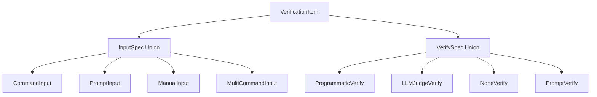
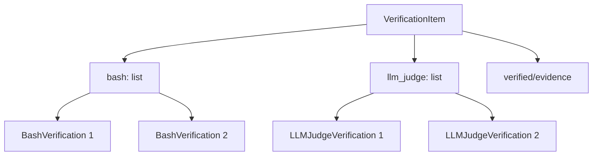

# 사용자의 최초 요청 (기록용)

지금 yaml 형태의 작업계획서 스펙이 좀 너무 복잡함. 아래와 같이 바뀌게 되었으면 함.

```yaml
verify:
  - id: id in sequential
    name: check file exists
    description: check if the file exists or not using ls command
    verified: false
    bash:
      execute: ls -al
      expected_stdout: a.txt b.md
      expected_stderr:
      expected_exit_code: 0

  - id: id in sequential
    name: check file exists using llm judge
    description: asdfasdfasdf foo bar
    verified: false
    verification_evidence: # verified 일 경우에 채워야함
    llm_judge:
      by: # orchestrator-agent or external-agent, defaults to orchestrator-agent

      bash_execute: ls -al # optional, 만약에 있다면 instruction 이 들어가기 전에 이게 먼저 실행이 되는 느낌임
      instruction: |
        ls -al 해서 a.txt 랑 b.md 가 존재하는지 검증하세요
```

이정도 느낌이면 충분함. verification spec 이 이것보다 복잡할 이유가 단 한개도 없음. 각 verify 의 안의 내용들은 절대로 bash 와 llm_judge 를 동시에 가질 수 없음.

## 추가 사용자 요청 (기록용)

1. `orchestrator_manually_verified: bool` 필드 추가 (필수)
2. `manual_verification_evidence: str` 필드 추가 (필수)
3. **bash/llm_judge 로직 변경: XOR → OR (둘 다 가능, 최소 하나 필수)**

# 추가 요구사항 (2차)

몇개만 더 추가해주라.

references 가 id 로 ref id 로 엮을수도 있지만, 직접 nested 로 정의할수도 있어야 함. 따라서 포인터로써 가리킬수도있고 직접 정의할수도 있는 형태로써 스펙이 구성되어야 하고,
references yaml part 자체는 맨 마지막이 되도록 해줘 그래서 스펙 자체가 metadata, user request, objectives, background(required_background 자체는 background 에 통합되어야 함), success_vision, status, work_overview(workflow 이름을 바꿔야함), todos, final_verification, references 순으로 구성되게 해주라.

그리고 reference 의 경우 또 text 랑 code snippet 이랑 왜 구분하나 싶음. 적당히 합칠 수 있도록 해라 두개를 표현하는거는 다를 이유가 없다.

그리고 좀 더 ai-todolist.md 처럼 description ? instruction? 이런걸 더 잘 넣을 수 있게 해줘 지금 너무 엄밀한 느낌임. pattern ? 이런게 왜필요해 지금 ai-todolist.md 를 yaml 스펙으로 표현될 수 있게 프로그래머블하게 옮기는건데.

# 작업 목표 (WHAT & WHY)

## 핵심 목표 (TL;DR)

현재 복잡한 YAML 작업계획서 스펙(v2.0)을 단순하고 직관적인 v2.1로 개선한다.

## 상세 목표

- **Verification spec 단순화**: InputSpec/VerifySpec discriminated union 제거 → bash/llm_judge 직접 필드로 변경
- **References 이중 모드 지원**: pointer(ref_id) + inline 정의 모두 지원
- **구조 재정렬**: 논리적 순서로 섹션 재배치 (references 맨 마지막으로)
- **타입 통합**: text + code_snippet → markdown 단일 타입
- **필드명 일관성**: timestamp → created_at, note → notes, name → title 통일
- **Pydantic 호환성**: type 필드 명시로 discriminated union 완벽 지원

# 작업 배경 (WHY & WHAT - 현재 상태)

## 현재 상황

- **복잡한 discriminated union 구조**: InputSpec(4가지) + VerifySpec(4가지) = 16가지 조합 가능
- **References 제약**: pointer(ref_id)만 지원, inline 정의 불가
- **비직관적 순서**: references가 중간에 위치 (required_background 내부)
- **타입 중복**: text와 code_snippet이 분리되어 있으나 기능적으로 동일
- **필드명 불일치**: timestamp/created_at, note/notes, name/title 혼용
- **final_verification 구조 이질성**: todos와 다른 중첩 구조 (category → items)

## 변경 이유

- **직관성**: bash/llm_judge 직접 필드가 의도를 명확히 전달
- **유연성**: references를 pointer로도, inline으로도 정의 가능
- **논리적 순서**: 메타데이터 → 목표 → 배경 → 작업 → 검증 → 참고자료 순
- **유지보수성**: 타입 통합으로 중복 제거, 필드명 통일로 혼란 방지
- **구현 용이성**: Pydantic discriminator와 완벽 호환, linter 구현 단순화

## 변경 사항

**현재 (v2.0)**:
```python
class VerificationItem:
    id: str
    description: str
    input: InputSpec  # 4가지 타입 union
    verify: VerifySpec  # 4가지 타입 union
    completed: bool
```

**변경 후 (v2.1)**:
```python
class VerificationItem:
    id: str
    title: str  # name → title 통일
    description: str
    verified: bool = False  # completed → verified
    verified_at: str | None = None  # 추가
    verification_evidence: str | None = None
    orchestrator_manually_verified: bool  # 필수
    manual_verification_evidence: str  # 필수
    bash: list[BashVerification] = []  # 리스트로 여러 개 가능
    llm_judge: list[LLMJudgeVerification] = []  # 리스트로 여러 개 가능
```

# 작업 시작 여부
is_execution_started = FALSE

# 모든 목표 달성 여부
is_all_goals_accomplished = FALSE

# 병렬 실행
parallel_requested = FALSE

# 현재 진행 중인 작업
- 작업이 아직 시작되지 않았습니다.
   - 작업을 시작할 때는 위의 `is_execution_started` 값을 TRUE로 변경하세요.
   - 사용자가 명시적으로 "작업을 시작해"라고 말할 때까지 절대 작업을 시작하지 마세요.
   - **plan reviewer로부터 OKAY를 받았더라도 절대 작업을 시작하지 마세요**
   - 사용자가 명시적으로 "작업을 시작해"라고 말할 때까지 절대 작업을 시작하지 마세요.

# 필수 배경 지식

## 기술 스택

- Python 3.12
- Pydantic 2.0+ (모델 정의 및 검증)
- ruamel.yaml 0.18+ (YAML 파싱/저장)
- pytest 8.4+ (테스트)
- basedpyright 1.31+ (타입 체크)
- ruff 0.14+ (린트)

## 파일 구조 및 역할

**수정 대상 파일**:
- `sisyphus/utils/plan_types.py`: Pydantic 모델 정의
- `sisyphus/core/plan_linter.py`: YAML 스키마 검증 로직
- `sisyphus/core/tests/test_plan_linter.py`: linter 테스트
- `sisyphus/utils/tests/test_plan_types.py`: Pydantic 모델 테스트

**참조 파일**:
- `sisyphus/core/plan_loader.py`: YAML 로드/저장 (영향 최소)
- `sisyphus/core/plan_navigator.py`: 작업 탐색 (영향 받음)

## 참조 파일들

### 1. `sisyphus/utils/plan_types.py`
- **역할**: 모든 Pydantic 모델 정의
- **검색 키워드**: `class VerificationItem`, `InputSpec`, `VerifySpec`, `ReferenceSpec`, `SimpleReference`
- **주요 패턴**: Pydantic BaseModel, discriminated union (`Annotated[... | ..., Field(discriminator="type")]`)
- **수정 범위**: VerificationItem, FinalVerificationItem, ReferenceSpec, SimpleReference 관련 클래스

### 2. `sisyphus/core/plan_linter.py`
- **역할**: YAML 스키마 검증 (Pydantic 독립적)
- **검색 키워드**: `_validate_verification_item`, `_validate_input_spec`, `_validate_verify_spec`, `_validate_reference_spec`
- **주요 패턴**: 재귀 검증, `_check_type`, `_check_enum`, `_validate_nested_required`
- **수정 범위**: verification_item, final_verification, reference_spec 검증 메서드

### 3. 테스트 파일들
- `sisyphus/core/tests/test_plan_linter.py`: linter 검증 테스트
- `sisyphus/utils/tests/test_plan_types.py`: Pydantic 모델 생성/검증 테스트
- **패턴**: pytest, `pytest.mark.anyio`, ValidationError 테스트

## 핵심 필드 설계 (중요)

### orchestrator_manually_verified 필드

**필드 의미**:
- orchestrator agent가 자동 검증 결과(bash/llm_judge)를 수동으로 승인하는 플래그
- 자동 검증만으로는 불충분한 경우, orchestrator가 직접 검토 후 승인

**설정 시점**:
- **초기값**: `False` (필수 필드)
- orchestrator가 bash/llm_judge 결과를 검토한 후 `True`로 변경
- 자동 검증 결과가 신뢰 가능하면 orchestrator가 수동 승인

**manual_verification_evidence**:
- orchestrator가 수동 검증 시 남긴 코멘트/증거
- 예: "bash 결과 확인 완료, 파일 a.txt 존재 확인됨"
- `orchestrator_manually_verified=False`일 때: 빈 문자열 (필수 필드)

**verified와의 관계**:
- `verified`: bash/llm_judge 자동 검증 통과 여부
- `orchestrator_manually_verified`: orchestrator 수동 승인 여부
- `verification_evidence`: 자동 검증 증거 (stdout, llm 판단 결과 등)
- `manual_verification_evidence`: orchestrator 수동 검증 코멘트
- **최종 완료 조건**: `verified=True` AND `orchestrator_manually_verified=True`

### context_commands 필드 (LLMJudgeVerification)

**필드 의미**:
- LLM 판단 전에 실행할 bash 명령어 리스트
- 목적: LLM에게 판단을 위한 컨텍스트 제공 (파일 내용, 시스템 상태 등)

**동작 방식**:
1. `context_commands`의 명령어들을 순차적으로 실행
2. 각 명령어의 출력(stdout/stderr)을 수집
3. 수집된 출력과 함께 `instruction`을 LLM에게 전달
4. LLM이 컨텍스트를 바탕으로 검증 판단

**예시**:
```yaml
llm_judge:
  - by: orchestrator-agent
    context_commands:
      - "ls -al"
      - "cat config.json"
    instruction: |
      위 파일 목록과 config 내용을 보고,
      a.txt 파일이 존재하고 config가 올바른지 검증하세요.
```

**빈 리스트 가능**:
- `context_commands: []` → 명령어 없이 instruction만 LLM에게 전달
- context 없이 LLM이 판단해야 하는 경우 사용

### markdown type 통합 (ReferenceSpec)

**통합 근거**:
- 기존 `text`와 `code_snippet` 타입은 모두 "텍스트 내용 저장" 역할
- `code_snippet`의 `language` 필드는 단순 힌트, 실제 파싱/실행 불필요
- markdown 포맷으로 둘 다 표현 가능:
  - 일반 텍스트: markdown 본문
  - 코드: markdown code fence (` ```python ... ``` `)

**마이그레이션**:
- `type: "text"` → `type: "markdown"`
- `type: "code_snippet"` → `type: "markdown"`
  - `language` 필드는 code fence의 언어 식별자로 변환
  - `code` 필드는 code fence 내용으로 변환

**retrieval 필드**:
- `FileReference`, `URLReference`: 파일/URL에서 특정 부분 추출 (keywords, line_range, prompt)
- `MarkdownReference`: 이미 content에 전체 내용 포함 → retrieval 불필요
- `ReferencePointer`: 정의된 reference의 retrieval 사용 → 자체 retrieval 불필요

# 작업 흐름 (HOW - 작업 흐름 및 의존성)

## 작업 의존성 다이어그램

```
Task 1 (Pydantic 모델 수정)
   ↓
Task 2 (plan_linter 검증 로직 수정)
   ↓
Task 3 (테스트 케이스 업데이트)
   ↓
Task 4 (최종 검증 및 문서화)
```

## 단계별 설명

- **Phase 1 (Task 1)**: Pydantic 모델 변경 (기반 작업)
  - VerificationItem 단순화
  - ReferenceSpec dual-mode 지원
  - 필드명 통일

- **Phase 2 (Task 2)**: Linter 로직 업데이트 (Task 1 완료 후)
  - verification_item 검증 로직 수정
  - final_verification 구조 통일
  - reference_spec 검증 로직 수정

- **Phase 3 (Task 3)**: 테스트 케이스 수정 (Task 2 완료 후)
  - plan_types 테스트 업데이트
  - plan_linter 테스트 업데이트

- **Phase 4 (Task 4)**: 최종 검증 및 문서화 (모든 작업 완료 후)
  - 전체 린트/타입체크/테스트
  - 스키마 문서 업데이트

# 작업 계획

## PRD & 구조

### 변경 전 구조 (v2.0)



### 변경 후 구조 (v2.1)



## 구현 세부사항

### 아키텍처 제약

- Pydantic 2.0+ `model_validator(mode='after')` 사용
- ruamel.yaml로 순서 보존하며 파싱/저장
- Linter는 Pydantic과 독립적으로 검증

### 엣지 케이스 처리

- **bash/llm_judge 둘 다 없음**: ValidationError 발생 (최소 하나 필수)
- **bash/llm_judge 둘 다 있음**: 허용 (OR 로직)
- **verified=True인데 verification_evidence=None**: 허용 (optional)
- **References type 필드 필수**: Pydantic discriminator는 type 필드로만 분기, ReferencePointer 포함 모든 타입에 type 필드 명시

### 암묵적 가정 명시

- **가정 1**: 기존 YAML 파일 migration 불필요 (새 형식만 지원)
- **가정 2**: Linter는 Pydantic ValidationError를 신뢰하지 않고 독립 검증
- **가정 3**: `completed` → `verified` 완전 대체, 하위 호환 없음

## 프로젝트 커밋 메시지 스타일

```
feat: 기능 추가
fix: 버그 수정
test: 테스트 추가/수정
refactor: 리팩토링
chore: 기타 작업
docs: 문서 업데이트
```

# TODOs

- [ ] 1. Pydantic 모델 수정 (VerificationItem, ReferenceSpec 단순화)

   **참조 파일**: `sisyphus/utils/plan_types.py` (search for `class VerificationItem`, `class ReferenceSpec`, `InputSpec`, `VerifySpec`)

   - [ ] 1.1 BashVerification, LLMJudgeVerification 클래스 추가

      **구현 패턴**:
      ```python
      class BashVerification(BaseModel):
          execute: str
          expected_stdout: str | None = None
          expected_stderr: str | None = None
          expected_exit_code: int = 0
          notes: str | None = None  # note → notes 통일

      class LLMJudgeBy(str, Enum):
          ORCHESTRATOR = "orchestrator-agent"
          EXTERNAL = "external-agent"

      class LLMJudgeVerification(BaseModel):
          by: LLMJudgeBy = LLMJudgeBy.ORCHESTRATOR
          context_commands: list[str] = []  # bash_execute → context_commands
          instruction: str
      ```

   - [ ] 1.2 VerificationItem 클래스 재작성

      **구현 패턴**:
      ```python
      from pydantic import model_validator
      from typing import Self

      class VerificationItem(BaseModel):
          id: str
          title: str  # name → title 통일
          description: str
          verified: bool = False
          verified_at: str | None = None  # 추가
          verification_evidence: str | None = None
          orchestrator_manually_verified: bool
          manual_verification_evidence: str
          bash: list[BashVerification] = []
          llm_judge: list[LLMJudgeVerification] = []

          @model_validator(mode='after')
          def validate_at_least_one(self) -> Self:
              if not self.bash and not self.llm_judge:
                  raise ValueError("bash 또는 llm_judge 중 하나 이상 필수")
              return self
      ```

   - [ ] 1.3 FinalVerificationItem 및 FinalVerificationCategory 수정

      **1.3.1 FinalVerificationItem 수정 (category 필드 추가)**:
      ```python
      class FinalVerificationItem(BaseModel):
          id: str
          title: str
          category: str  # 추가 (기능 동작 확인, 잘못된 구현 방지 등)
          description: str
          verified: bool = False
          verified_at: str | None = None
          verification_evidence: str | None = None
          orchestrator_manually_verified: bool
          manual_verification_evidence: str
          bash: list[BashVerification] = []
          llm_judge: list[LLMJudgeVerification] = []

          @model_validator(mode='after')
          def validate_at_least_one(self) -> Self:
              if not self.bash and not self.llm_judge:
                  raise ValueError("bash 또는 llm_judge 중 하나 이상 필수")
              return self
      ```

      **1.3.2 FinalVerificationCategory 클래스 제거**:
      - `plan_types.py:291-294` FinalVerificationCategory 클래스 삭제
      - v2.0 구조: `category: str` + `items: list[FinalVerificationItem]` (중첩)
      - v2.1 구조: FinalVerificationItem에 category 필드 추가 (평탄화)

      **1.3.3 WorkPlan.final_verification 타입 변경**:
      ```python
      class WorkPlan(BaseModel):
          # Before (v2.0)
          final_verification: list[FinalVerificationCategory]

          # After (v2.1)
          final_verification: list[FinalVerificationItem]
      ```

   - [ ] 1.4 ReferenceSpec dual-mode 지원 및 SimpleReference 통합

      **1.4.1 SimpleReference를 ReferencePointer로 통합**:
      - **결정**: `SimpleReference` 클래스 제거 (`plan_types.py:168-171`)
      - **이유**: ReferencePointer와 기능 중복, discriminated union 일관성
      - **변경 사항**:
        - Before: `SimpleReference = {"ref_id": str, "note": str | None}`
        - After: `ReferencePointer = {"type": "pointer", "ref_id": str, "notes": str | None}`
      - **todos.references 타입 변경**:
        - Before: `list[ReferenceSpec | SimpleReference]`
        - After: `list[ReferenceItem]` (ReferencePointer 포함)

      **1.4.2 ReferenceSpec 클래스 구현**:
      ```python
      # Pointer reference (SimpleReference 대체)
      class ReferencePointer(BaseModel):
          type: Literal["pointer"]
          ref_id: str
          notes: str | None = None  # note → notes 통일

      # Inline references
      class FileReference(BaseModel):
          type: Literal["file"]
          path: str
          description: str
          retrieval: RetrievalSpec | None = None
          notes: str | None = None

      class URLReference(BaseModel):
          type: Literal["url"]
          url: str
          description: str
          retrieval: RetrievalSpec | None = None
          notes: str | None = None

      class MarkdownReference(BaseModel):
          type: Literal["markdown"]  # text + code_snippet 통합
          description: str
          content: str

      # Discriminated union (type 필드 필수)
      ReferenceItem = Annotated[
          ReferencePointer | FileReference | URLReference | MarkdownReference,
          Field(discriminator="type")
      ]
      ```

      **1.4.3 Todo.references 타입 변경**:
      ```python
      class Todo(BaseModel):
          # Before (v2.0)
          references: list[ReferenceSpec | SimpleReference] = []

          # After (v2.1)
          references: list[ReferenceItem] = []
      ```

   - [ ] 1.5 기존 InputSpec, VerifySpec, SimpleReference, FinalVerificationCategory 클래스 제거

      **제거할 클래스들**:
      - **InputSpec 관련**:
        - CommandInput, PromptInput, ManualInput, MultiCommandInput
        - InputSpec union type
        - InputType enum
      - **VerifySpec 관련**:
        - ProgrammaticVerify, LLMJudgeVerify, NoneVerify, PromptVerify
        - VerifySpec union type
        - VerifyType enum
      - **Reference 관련**:
        - SimpleReference (`plan_types.py:168-171`)
        - TextReference, CodeSnippetReference (markdown으로 통합)
      - **FinalVerification 관련**:
        - FinalVerificationCategory (`plan_types.py:291-294`)

   - [ ] 1.6 필드명 통일

      **1.6.1 UserRequest.timestamp → created_at**:
      ```python
      class UserRequest(BaseModel):
          original: str
          created_at: str  # timestamp → created_at
          additional: list[str] = []
      ```

      **1.6.2 모든 note → notes (복수형)**:
      - BashVerification, LLMJudgeVerification, ReferencePointer 등에서 일관되게 notes 사용

      **1.6.3 VerificationItem name → title** (해당 없음):
      - v2.0에는 name 필드 없음 (description만 존재)
      - v2.1에서 title 필드를 새로 추가

   - [ ] 1.7 타입 체크 및 린트 실행

      **실행 명령어**:
      ```bash
      uv run basedpyright sisyphus/utils/plan_types.py
      uv run ruff check sisyphus/utils/plan_types.py
      ```

      **예상 결과**: 0 errors

   - [ ] **작업 완료 검증 체크리스트**
      - [ ] `BashVerification`, `LLMJudgeVerification` 클래스 정확히 구현?
      - [ ] `VerificationItem`에 `title`, `verified`, `verified_at`, `verification_evidence` 필드 추가?
      - [ ] `model_validator`가 "최소 하나 존재" 로직 강제? (bash 또는 llm_judge)
      - [ ] `FinalVerificationItem`에 `category` 필드 추가?
      - [ ] `ReferencePointer` + 3가지 inline reference 클래스 구현?
      - [ ] `type: pointer` 명시로 Pydantic discriminator 호환?
      - [ ] 기존 InputSpec/VerifySpec 클래스 제거?
      - [ ] `timestamp` → `created_at`, `note` → `notes`, `name` → `title` 통일?
      - [ ] `basedpyright` → 0 errors?
      - [ ] `ruff check` → 0 errors?

- [ ] 2. plan_linter 검증 로직 수정

   **참조 파일**: `sisyphus/core/plan_linter.py` (search for `_validate_verification_item`, `_validate_final_verification`, `_validate_reference_spec`)

   - [ ] 2.1 `_validate_verification_item` 메서드 수정

      **구현 패턴**:
      ```python
      def _validate_verification_item(self, item: Any, path: str) -> None:
          if not isinstance(item, dict):
              self._check_type(item, path, "dict")
              return

          # 필드 목록 변경
          allowed_fields = {"id", "title", "description", "verified", "verified_at",
                           "verification_evidence", "orchestrator_manually_verified",
                           "manual_verification_evidence", "bash", "llm_judge"}
          self._check_extra_fields(item, path, allowed_fields)

          # 필수 필드 변경
          self._validate_nested_required(item, path, ["id", "title", "description",
                                                       "orchestrator_manually_verified",
                                                       "manual_verification_evidence"])

          # 최소 하나 존재 검증
          has_bash = "bash" in item and item["bash"]
          has_llm = "llm_judge" in item and item["llm_judge"]
          if not has_bash and not has_llm:
              self.errors.append(LintError(
                  location=path,
                  message="bash or llm_judge is required",
                  expected="at least one of bash or llm_judge",
                  actual="neither present",
                  suggestion="Add 'bash' or 'llm_judge' field",
              ))

          # 타입 체크
          if "title" in item:
              self._check_type(item["title"], f"{path}.title", "string")
          if "verified" in item:
              self._check_type(item["verified"], f"{path}.verified", "boolean")
          # ... (나머지 필드들)

          # 하위 검증
          if has_bash:
              self._validate_bash_list(item["bash"], f"{path}.bash")
          if has_llm:
              self._validate_llm_judge_list(item["llm_judge"], f"{path}.llm_judge")
      ```

   - [ ] 2.2 `_validate_input_spec`, `_validate_verify_spec` 메서드 제거

      **제거할 메서드**:
      - `_validate_input_spec` (line 692-734)
      - `_validate_verify_spec` (line 736-784)

   - [ ] 2.3 `_validate_bash_list`, `_validate_llm_judge_list` 메서드 추가

      **구현 패턴**:
      ```python
      def _validate_bash_list(self, bash_list: Any, path: str) -> None:
          if not isinstance(bash_list, list):
              self._check_type(bash_list, path, "list")
              return

          for i, bash in enumerate(bash_list):
              bash_path = f"{path}[{i}]"
              if not isinstance(bash, dict):
                  self._check_type(bash, bash_path, "dict")
                  continue

              allowed_fields = {"execute", "expected_stdout", "expected_stderr",
                               "expected_exit_code", "notes"}
              self._check_extra_fields(bash, bash_path, allowed_fields)
              self._validate_nested_required(bash, bash_path, ["execute"])

              if "execute" in bash:
                  self._check_type(bash["execute"], f"{bash_path}.execute", "string")
              # ... (나머지 필드들)

      def _validate_llm_judge_list(self, llm_list: Any, path: str) -> None:
          if not isinstance(llm_list, list):
              self._check_type(llm_list, path, "list")
              return

          for i, llm in enumerate(llm_list):
              llm_path = f"{path}[{i}]"
              if not isinstance(llm, dict):
                  self._check_type(llm, llm_path, "dict")
                  continue

              allowed_fields = {"by", "context_commands", "instruction"}
              self._check_extra_fields(llm, llm_path, allowed_fields)
              self._validate_nested_required(llm, llm_path, ["instruction"])

              # by 필드 리터럴 체크
              if "by" in llm:
                  valid_by_values = ["orchestrator-agent", "external-agent"]
                  if llm["by"] not in valid_by_values:
                      self.errors.append(LintError(
                          location=f"{llm_path}.by",
                          message="Invalid value",
                          expected=f"one of {valid_by_values}",
                          actual=str(llm["by"]),
                          suggestion="Use 'orchestrator-agent' or 'external-agent'",
                      ))
      ```

   - [ ] 2.4 `_validate_final_verification` 구조 통일

      **변경 전**:
      ```python
      final_verification:
        - category: "기능 동작 확인"
          items:  # 중첩 구조
            - id: "verify_1"
      ```

      **변경 후**:
      ```python
      final_verification:
        - id: "verify_1"
          category: "기능 동작 확인"  # 필드로 이동
      ```

      **구현 패턴**: `_validate_final_verification`이 `_validate_verification_item`과 동일한 로직 사용 (category 필드 추가)

   - [ ] 2.5 `_validate_reference_spec` 및 SimpleReference 검증 제거

      **2.5.1 `_validate_todo` 메서드에서 SimpleReference 검증 로직 제거**:
      - **현재 (v2.0)**: todos.references에서 `ref_id` 유무로 SimpleReference vs ReferenceSpec 분기
      - **변경 후 (v2.1)**: 모든 references는 discriminated union (type 필드 필수)
      - **제거할 코드** (`plan_linter.py:632-644`):
        ```python
        # 삭제
        if "ref_id" in ref:
            # SimpleReference
            allowed_ref_fields = {"ref_id", "note"}
            self._check_extra_fields(ref, ref_path, allowed_ref_fields)
            self._validate_nested_required(ref, ref_path, ["ref_id"])
        else:
            # ReferenceSpec
            self._validate_reference_spec(ref, ref_path)
        ```
      - **추가할 코드**:
        ```python
        # 모든 references는 ReferenceItem (type 필드 필수)
        self._validate_reference_spec(ref, ref_path)
        ```

      **2.5.2 `_validate_reference_spec` 수정 (dual-mode 지원)**:
      ```python
      def _validate_reference_spec(self, ref: Any, path: str) -> None:
          if not isinstance(ref, dict):
              self._check_type(ref, path, "dict")
              return

          # type 필드 필수 (pointer 포함)
          valid_types = ["pointer", "file", "url", "markdown"]
          if not self._validate_discriminated_union_type(ref, path, valid_types):
              return

          ref_type = ref.get("type")
          if ref_type == "pointer":
              allowed_fields = {"type", "ref_id", "notes"}
              self._check_extra_fields(ref, path, allowed_fields)
              self._validate_nested_required(ref, path, ["ref_id"])
          elif ref_type == "file":
              allowed_fields = {"type", "path", "description", "retrieval", "notes"}
              # ... (기존 로직)
          elif ref_type == "url":
              # ... (기존 로직)
          elif ref_type == "markdown":
              allowed_fields = {"type", "description", "content"}
              self._check_extra_fields(ref, path, allowed_fields)
              self._validate_nested_required(ref, path, ["description", "content"])
      ```

   - [ ] 2.6 필드명 검증 업데이트

      **2.6.1 `_validate_user_request` 메서드 수정**:
      - **위치**: `plan_linter.py:289, 296-297`
      - **변경**: `allowed_fields`와 `_validate_nested_required`에서 `"timestamp"` → `"created_at"`
      ```python
      allowed_fields = {"original", "created_at", "additional"}  # timestamp → created_at
      self._validate_nested_required(user_req, "user_request", ["original", "created_at"])
      ```

      **2.6.2 todos.references에서 note → notes 검증 수정**:
      - **위치**: `plan_linter.py:640` (SimpleReference 검증 - 제거 예정)
      - **변경 후**: ReferencePointer에서 `notes` 검증 (2.5.2에 이미 반영)

      **2.6.3 VerificationItem name → title** (해당 없음):
      - v2.0 VerificationItem에는 name 필드 없음
      - title은 v2.1 신규 필드로 2.1에서 검증 추가

   - [ ] 2.7 린트 및 타입 체크

      **실행 명령어**:
      ```bash
      uv run basedpyright sisyphus/core/plan_linter.py
      uv run ruff check sisyphus/core/plan_linter.py
      ```

   - [ ] **작업 완료 검증 체크리스트**
      - [ ] `_validate_verification_item`이 새 스키마 검증?
      - [ ] bash/llm_judge "최소 하나 존재" 검증 동작?
      - [ ] `_validate_bash_list`, `_validate_llm_judge_list` 메서드 추가?
      - [ ] `_validate_input_spec`, `_validate_verify_spec` 메서드 제거?
      - [ ] `_validate_final_verification` 구조 통일 (중첩 제거)?
      - [ ] `_validate_reference_spec`이 dual-mode (pointer + inline) 검증?
      - [ ] 필드명 검증 업데이트 (created_at, notes, title)?
      - [ ] `basedpyright` → 0 errors?
      - [ ] `ruff check` → 0 errors?

- [ ] 3. 테스트 케이스 업데이트

   **참조 파일**:
   - `sisyphus/utils/tests/test_plan_types.py` (Pydantic 모델 테스트)
   - `sisyphus/core/tests/test_plan_linter.py` (linter 검증 테스트)

   - [ ] 3.1 plan_types 테스트 수정

      **파일**: `sisyphus/utils/tests/test_plan_types.py`

      **테스트 예시**:
      ```python
      def test_verification_item_bash_only__creates_successfully():
          item = VerificationItem(
              id="v1",
              title="check file",
              description="check file exists",
              orchestrator_manually_verified=False,
              manual_verification_evidence="",
              bash=[BashVerification(execute="ls -al", expected_exit_code=0)]
          )
          assert item.verified is False
          assert len(item.bash) == 1
          assert len(item.llm_judge) == 0

      def test_verification_item_both_bash_and_llm__creates_successfully():
          item = VerificationItem(
              id="v1",
              title="test",
              description="test",
              orchestrator_manually_verified=False,
              manual_verification_evidence="",
              bash=[BashVerification(execute="ls")],
              llm_judge=[LLMJudgeVerification(instruction="check")]
          )
          assert len(item.bash) == 1
          assert len(item.llm_judge) == 1

      def test_verification_item_neither_bash_nor_llm__raises_error():
          with pytest.raises(ValidationError):
              VerificationItem(
                  id="v1",
                  title="test",
                  description="test",
                  orchestrator_manually_verified=False,
                  manual_verification_evidence=""
              )
      ```

   - [ ] 3.2 plan_linter 테스트 수정

      **파일**: `sisyphus/core/tests/test_plan_linter.py`

      **수정 사항**:
      - verification_item 검증 테스트를 새 스키마로 변경
      - bash/llm_judge 필드 검증 테스트 추가
      - final_verification 구조 통일 테스트 추가
      - reference dual-mode 테스트 추가

   - [ ] 3.3 전체 테스트 실행

      **실행 명령어**:
      ```bash
      uv run pytest sisyphus/utils/tests/test_plan_types.py -xvs
      uv run pytest sisyphus/core/tests/test_plan_linter.py -xvs
      ```

      **예상 결과**: All tests passed

   - [ ] **작업 완료 검증 체크리스트**
      - [ ] `test_plan_types.py` 테스트 모두 통과?
      - [ ] `test_plan_linter.py` 테스트 모두 통과?
      - [ ] bash/llm_judge OR 로직 테스트 추가? (둘 다 가능, 최소 하나 필수)
      - [ ] final_verification 구조 통일 테스트 추가?
      - [ ] reference dual-mode 테스트 추가?

- [ ] 4. 최종 검증 및 문서화

   **참조**: 커밋 메시지 패턴 (feat/fix/test/refactor)

   - [ ] 4.1 전체 프로젝트 린트 및 타입 체크

      **실행 명령어**:
      ```bash
      uv run ruff check sisyphus/
      uv run basedpyright sisyphus/
      ```

      **예상 결과**: 0 errors

   - [ ] 4.2 전체 테스트 실행

      **실행 명령어**:
      ```bash
      uv run pytest
      ```

      **예상 결과**: All tests passed

   - [ ] 4.3 스키마 문서 생성

      **작업 내용**:
      - `ai-todolist-spec-v2.1-final.yaml`을 `docs/schemas/` 디렉토리로 이동
      - 변경 사항 요약 문서 작성 (v2.0 → v2.1 migration guide)

   - [ ] 4.4 변경 사항 검토

      **확인 사항**:
      - [ ] `plan_types.py`: InputSpec/VerifySpec 제거, 새 클래스 추가
      - [ ] `plan_linter.py`: 검증 로직 업데이트
      - [ ] 테스트 파일: 새 스키마 반영
      - [ ] 필드명 일관성 (created_at, notes, title)

   - [ ] 4.5 커밋

      **커밋 메시지**:
      ```bash
      git add sisyphus/utils/plan_types.py sisyphus/core/plan_linter.py \
              sisyphus/utils/tests/test_plan_types.py \
              sisyphus/core/tests/test_plan_linter.py \
              ai-todolist-spec-v2.1-final.yaml

      git commit -m "feat: simplify YAML spec to v2.1 with bash/llm_judge direct fields

      - Remove InputSpec/VerifySpec discriminated unions
      - Add BashVerification and LLMJudgeVerification as lists
      - Support references dual-mode (pointer + inline with type: pointer)
      - Unify field names: timestamp→created_at, note→notes
      - Add title field to VerificationItem and FinalVerificationItem
      - Restructure final_verification to match todos (add category field, remove nesting)
      - Remove SimpleReference, merge into ReferencePointer with type field
      - Remove FinalVerificationCategory, flatten structure
      - Merge text+code_snippet into markdown type
      - Add verified_at, orchestrator_manually_verified, manual_verification_evidence fields
      - Update plan_linter validation logic
      - Update all related tests

      BREAKING CHANGE: v2.0 YAML files incompatible with v2.1"
      ```

   - [ ] **작업 완료 검증 체크리스트**
      - [ ] 전체 프로젝트 린트 통과?
      - [ ] 전체 프로젝트 타입 체크 통과?
      - [ ] 전체 테스트 통과?
      - [ ] 스키마 문서 생성 완료?
      - [ ] 커밋 완료? (`git log -1 --oneline` 확인)
      - [ ] 변경된 파일이 모두 스테이징되었는가?

# 성공 비전

## 사용자 관점 성공

- 검증 스펙 작성 시 직관적인 `bash` / `llm_judge` 리스트 필드 사용
- YAML 작성이 단순해지고 이해하기 쉬워짐
- References를 pointer로도, inline으로도 자유롭게 정의 가능
- 필드명 일관성으로 혼란 없음 (created_at, notes, title)

## 비즈니스 관점 성공

- 유지보수 비용 감소: 불필요한 클래스 제거로 코드베이스 단순화
- 확장성 향상: 새로운 검증 타입 추가 시 독립적으로 추가 가능
- 개발자 생산성: 직관적 구조로 학습 곡선 감소

## 기술적 성공 기준

- [ ] 모든 테스트 통과: `uv run pytest` → 461 tests PASSED
- [ ] 타입 체크 통과: `uv run basedpyright` → 0 errors
- [ ] 린트 통과: `uv run ruff check` → 0 errors
- [ ] Pydantic discriminator 호환: type 필드 명시로 완벽 동작
- [ ] Linter 독립 검증: Pydantic 없이도 YAML 스키마 검증 가능

# 최종 작업 검증 체크리스트

- [ ] 1. **기능 동작 확인**
   - [ ] YAML에서 새 스키마로 파싱 가능?
   - [ ] bash verification 리스트 동작 테스트
   - [ ] llm_judge verification 리스트 동작 테스트
   - [ ] bash와 llm_judge 동시 사용 테스트
   - [ ] "최소 하나 존재" 검증 동작 테스트
   - [ ] References dual-mode (pointer + inline) 테스트

- [ ] 2. **잘못된 구현 방지**
   - [ ] InputSpec/VerifySpec이 완전히 제거되었는가?
   - [ ] 기존 테스트가 새 스키마로 변경되었는가?
   - [ ] Linter가 독립적으로 검증하는가?
   - [ ] final_verification 구조가 통일되었는가?
   - [ ] 필드명 일관성 (created_at, notes, title)?

- [ ] 3. **범위 준수 확인**
   - [ ] 계획서에 명시된 파일만 수정되었는가?
   - [ ] 불필요한 추가 기능이 없는가?
   - [ ] Breaking change 명시되었는가?

- [ ] 4. **기존 기능 회귀 테스트**
   - [ ] `plan get`, `plan set` 명령어 정상 동작?
   - [ ] `plan lint` 명령어 정상 동작?
   - [ ] YAML 로드/저장 정상 동작?
