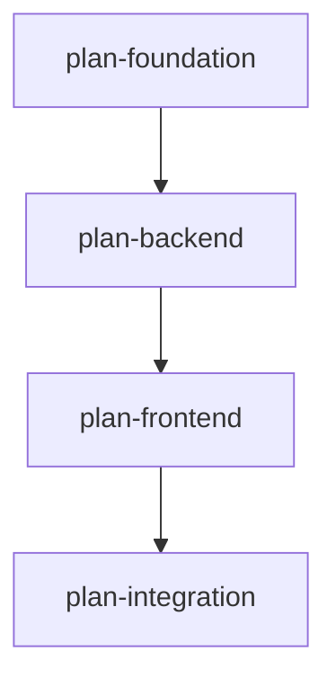

# Sisyphus CLI 완전 레퍼런스

**Version:** 3.0
**Updated:** 2025-11-10

Sisyphus는 YAML 기반 작업 계획을 LLM 에이전트가 실행하여 프로덕션 코드로 컴파일하는 멀티 에이전트 오케스트레이션 CLI입니다.

---

## 목차

1. [메인 커맨드](#메인-커맨드)
2. [Plan 관리](#plan-관리)
3. [Task 탐색 및 실행](#task-탐색-및-실행)
4. [Verification 관리](#verification-관리)
5. [Git 통합](#git-통합)
6. [상태 초기화](#상태-초기화)
7. [워크플로우 예시](#워크플로우-예시)

---

## 메인 커맨드

### `sisyphus --help`

```
Usage: sisyphus [OPTIONS] COMMAND [ARGS]...

 Sisyphus Multi-Agent System

Options:
  --install-completion          Install completion for the current shell.
  --show-completion             Show completion for the current shell.
  --help                        Show this message and exit.

Commands:
  work            Work with Sisyphus multi-agent system.
  ignore          Add Sisyphus-generated files to git ignore.
  clean-history   Remove Sisyphus-generated files from git history.
  plan            Plan management commands
  task            Task navigation and verification commands
  reset           Reset Sisyphus state
```

---

## Plan 관리

### `sisyphus-speckit plan`

Plan 관리를 위한 하위 커맨드 그룹입니다.

```
Usage: sisyphus-speckit plan [OPTIONS] COMMAND [ARGS]...

 Plan management commands

Commands:
  lint                        Validate YAML plan structure
  init                        Initialize new plan YAML template
  graph                       Display plan dependency graph
  export                      Export WorkPlan YAML to Markdown format
  accept-as-verification-agent Mark verification agent checklist as verified
```

---

### `sisyphus-speckit plan init`

새 YAML plan 템플릿을 생성합니다.

#### 사용법

```bash
sisyphus-speckit plan init [OPTIONS]
```

#### 옵션

- `-p, --path PATH`: 생성할 plan YAML 경로 (기본값: `.sisyphus/tasks/ai-todolist.yaml`)
- `--cwd TEXT`: 작업 디렉터리

#### 출력 예시

```
✓ Plan template created: .sisyphus/tasks/ai-todolist.yaml
```

#### 생성되는 템플릿 구조

```yaml
version: "3.0"
metadata:
  created_at: "2025-11-10T09:30:00Z"
  updated_at: null
work_plans:
  - id: "new-plan"
    name: "New Plan"
    depends_on: []
    user_request:
      original: "TODO: Describe your work request here"
      created_at: "2025-11-10T09:30:00Z"
      additional: []
    objectives:
      core: "TODO: Write core objective here"
      detailed: []
    background:
      current_situation: "TODO: Describe current state"
      reason_for_change: "TODO: Why this work is needed"
      changes_to_make: "TODO: What will change"
    todos: []
    execution:
      started: false
      completed: false
```

---

### `sisyphus-speckit plan lint`

YAML plan의 구조를 검증합니다 (순환 의존성, 누락된 참조 등).

#### 사용법

```bash
sisyphus-speckit plan lint [OPTIONS]
```

#### 옵션

- `-f, --file PATH`: 검증할 YAML 파일 경로 (기본값: `.sisyphus/tasks/plan.yaml`)
- `--cwd TEXT`: 작업 디렉터리

#### 출력 예시

**성공 시:**
```
✓ YAML validation passed. 0 errors.
```

**실패 시:**
```
✗ Validation failed: 3 error(s)

DEPENDENCY ERRORS:
  • Circular dependency detected: plan-a → plan-b → plan-a
  • Missing plan file: plan-foundation (referenced in depends_on)

REFERENCE ERRORS:
  • Invalid reference ID: ref-123 (not found in references section)
```

---

### `sisyphus-speckit plan graph`

Plan 간 의존성 그래프를 시각화합니다.

#### 사용법

```bash
sisyphus-speckit plan graph [OPTIONS]
```

#### 옵션

- `-f, --format [ascii|mermaid]`: 출력 포맷 (기본값: `ascii`)
- `--cwd TEXT`: 작업 디렉터리

#### 출력 예시

**ASCII 포맷:**
```
Plan Dependency Graph
=====================

plan-foundation
  ↓
plan-backend
  ↓
plan-frontend
  ↓
plan-integration

Total plans: 4
```

**Mermaid 포맷:**


**순환 의존성 감지 시:**
```
✗ Circular dependency detected!

Cycle 1:
  plan-a               (in .sisyphus/tasks/plan-a.yaml) →
  plan-b               (in .sisyphus/tasks/plan-b.yaml) →
  plan-c               (in .sisyphus/tasks/plan-c.yaml) → (loops back to start)

How to fix:
  1. Open the file(s) listed above
  2. Find the 'depends_on' field for each plan
  3. Remove one dependency to break the cycle
  4. Run 'sisyphus-speckit plan graph' again to verify
```

---

### `sisyphus-speckit plan export`

YAML plan을 Markdown 포맷으로 변환합니다.

#### 사용법

```bash
sisyphus-speckit plan export YAML_PATH [OPTIONS]
```

#### 인자

- `YAML_PATH`: 변환할 YAML plan 파일 경로 (필수)

#### 옵션

- `-o, --output PATH`: 출력 Markdown 파일 경로 (기본값: stdout)
- `--cwd TEXT`: 작업 디렉터리

#### 출력 예시

```bash
sisyphus-speckit plan export .sisyphus/tasks/feature.yaml -o feature.md
```

```
✓ Markdown exported: feature.md
```

**stdout 출력 (옵션 없을 시):**
```markdown
# Plan: Authentication Feature

## Objectives
- Implement user authentication system
- Add JWT token management
- Create login/logout endpoints

## Tasks

### [auth-001] Setup authentication models
**Status:** completed
**Description:** Create User model with password hashing

### [auth-002] Implement JWT service
**Status:** in_progress
**Description:** JWT token generation and validation
```

---

### `sisyphus-speckit plan accept-as-verification-agent`

Verification agent의 acceptance criteria 체크리스트 항목을 검증 완료로 표시합니다.

#### 사용법

```bash
sisyphus-speckit plan accept-as-verification-agent [OPTIONS]
```

#### 옵션

- `--id TEXT`: 체크리스트 ID (필수)
- `--evidence TEXT`: 검증 증거 (필수)
- `--cwd TEXT`: 작업 디렉터리

#### 설명

YAML plan의 `acceptance_criteria_for_verification_agent` 섹션에 정의된 체크리스트를 검증합니다.
이는 verify agent가 전체 작업을 검증한 후 체크해야 하는 최종 acceptance criteria입니다.

#### 출력 예시

**성공 시:**
```bash
sisyphus-speckit plan accept-as-verification-agent \
  --id checklist-type-safety \
  --evidence "Ran basedpyright, 0 errors reported. All 47 functions have complete type annotations."
```

```
✓ 검증 완료: checklist-type-safety
증거: Ran basedpyright, 0 errors reported. All 47 functions have complete type annotations.
```

**체크리스트 ID를 찾을 수 없을 때:**
```
✗ 오류: 체크리스트 ID 'checklist-invalid'를 찾을 수 없습니다.
```

**현재 plan이 없을 때:**
```
✗ 오류: 현재 활성화된 작업 계획이 없습니다.
```

**acceptance_criteria_for_verification_agent가 없을 때:**
```
✗ 오류: 이 계획에는 verification agent acceptance criteria가 없습니다.
```

---

### `sisyphus-speckit plan mark fully-done`

Work plan을 fully done 상태로 마킹하고 완료 증거를 기록합니다.

#### 사용법

```bash
sisyphus-speckit plan mark fully-done [OPTIONS]
```

#### 옵션

- `--evidence TEXT`: 완료 증거 (필수)
- `--cwd TEXT`: 작업 디렉터리

#### 설명

작업 계획의 모든 작업이 완료되고 최종 검증까지 끝났을 때, `execution.fully_done_at` 타임스탬프와 `fully_done_evidence`를 설정합니다.
이는 단순히 `execution.completed`와는 다르게, 모든 후속 검증과 정리 작업까지 완전히 끝났음을 의미합니다.

#### 출력 예시

**성공 시:**
```bash
sisyphus-speckit plan mark fully-done \
  --evidence "All tasks completed, all tests pass, documentation updated, PR reviewed and merged"
```

```
✓ WorkPlan 'test-plan' fully done 마킹 완료
증거: All tasks completed, all tests pass, documentation updated, PR reviewed and merged
완료 시각: 2025-11-17T10:51:36.123456+00:00
```

**현재 plan이 없을 때:**
```
✗ 오류: 현재 활성화된 작업 계획이 없습니다.
```

**work_plans가 없을 때:**
```
✗ 오류: 작업 계획에 work_plans가 없습니다.
```

---

## Task 탐색 및 실행

### `sisyphus-speckit task`

Task 탐색 및 검증 명령 그룹입니다.

```
Usage: sisyphus-speckit task [OPTIONS] COMMAND [ARGS]...

 Task navigation and verification commands

Commands:
  show       Display specific task by ID
  current    Display currently in-progress task
  next       Display next pending task
  previous   Display previous task in DFS order
  continue   Continue work: complete current task and move to next
  accept     Mark current task's acceptance criterion as verified
  verify     Verification management commands
```

---

### `sisyphus-speckit task show`

특정 task ID로 task 정보를 표시합니다.

#### 사용법

```bash
sisyphus-speckit task show TASK_ID [OPTIONS]
```

#### 인자

- `TASK_ID`: 조회할 task ID (필수)

#### 옵션

- `--rich`: Rich 포맷팅 (레거시 옵션, 항상 활성화)
- `--cwd TEXT`: 작업 디렉터리

#### 출력 예시

```
╭─────────────────── 작업 auth-001 ───────────────────╮
│ 작업 ID: auth-001                                    │
│ 제목: Setup authentication models                    │
│ 상태: in_progress                                    │
│ 설명: Create User model with password hashing        │
│                                                      │
│ 참조:                                                │
│   - ref_id: user-model-spec                         │
│   - uri: https://docs.djangoproject.com/auth        │
│                                                      │
│ 하위 작업: 2개                                       │
│   - [pending] auth-001-1: Create User model         │
│   - [pending] auth-001-2: Add password hashing      │
│                                                      │
│ 검증: 0/2 완료                                       │
╰──────────────────────────────────────────────────────╯
```

---

### `sisyphus-speckit task current`

현재 진행 중인 task를 표시합니다.

#### 사용법

```bash
sisyphus-speckit task current [OPTIONS]
```

#### 옵션

- `--rich`: Rich 포맷팅 (레거시 옵션, 항상 활성화)
- `--cwd TEXT`: 작업 디렉터리

#### 출력 예시

**작업 진행 중일 때:**
```
╭───────────────────── 현재 작업 ─────────────────────╮
│ 작업 ID: auth-002                                    │
│ 제목: Implement JWT service                          │
│ 상태: in_progress                                    │
│ 설명: JWT token generation and validation            │
│                                                      │
│ 검증: 1/3 완료                                       │
╰──────────────────────────────────────────────────────╯
```

**작업 시작 전:**
```
작업이 시작되지 않았습니다.
다음 명령으로 작업을 시작하세요: sisyphus-speckit task continue
```

---

### `sisyphus-speckit task next`

다음 pending task를 표시합니다.

#### 사용법

```bash
sisyphus-speckit task next [OPTIONS]
```

#### 옵션

- `--rich`: Rich 포맷팅 (레거시 옵션, 항상 활성화)
- `--cwd TEXT`: 작업 디렉터리

#### 출력 예시

**다음 작업이 있을 때:**
```
╭───────────────────── 다음 작업 ─────────────────────╮
│ 작업 ID: auth-003                                    │
│ 제목: Create login endpoint                          │
│ 상태: pending                                        │
│ 설명: POST /api/auth/login with JWT response         │
╰──────────────────────────────────────────────────────╯
```

**모든 작업 완료 시:**
```
모든 작업이 완료되었습니다! 🎉
```

---

### `sisyphus-speckit task previous`

DFS 순서로 이전 task를 표시합니다.

#### 사용법

```bash
sisyphus-speckit task previous [OPTIONS]
```

#### 옵션

- `--rich`: Rich 포맷팅 (레거시 옵션, 항상 활성화)
- `--cwd TEXT`: 작업 디렉터리

#### 출력 예시

```
╭───────────────────── 이전 작업 ─────────────────────╮
│ 작업 ID: auth-001                                    │
│ 제목: Setup authentication models                    │
│ 상태: completed                                      │
╰──────────────────────────────────────────────────────╯
```

**첫 작업일 때:**
```
첫 작업입니다.
```

---

### `sisyphus-speckit task accept`

현재 task의 acceptance criteria를 증거와 함께 검증 완료로 표시합니다.

#### 사용법

```bash
sisyphus-speckit task accept [OPTIONS]
```

#### 옵션

- `--id TEXT`: Acceptance criterion ID (필수)
- `--evidence TEXT`: 검증 증거 (필수)
- `--cwd TEXT`: 작업 디렉터리

#### 설명

현재 진행 중인 task의 `acceptance_criteria` 항목을 검증합니다.
각 task는 완료 조건으로 acceptance criteria를 가질 수 있으며, 이를 모두 검증해야 `task continue`로 다음 작업으로 넘어갈 수 있습니다.

#### 출력 예시

**성공 시:**
```bash
sisyphus-speckit task accept \
  --id criterion-type-safety \
  --evidence "All functions have type hints. Ran basedpyright with 0 errors."
```

```
✓ 검증 완료: criterion-type-safety
증거: All functions have type hints. Ran basedpyright with 0 errors.
```

**현재 task가 없을 때:**
```
✗ 오류: 현재 진행 중인 작업이 없습니다.
sisyphus-speckit task continue를 실행하여 작업을 시작하세요.
```

**Criterion ID를 찾을 수 없을 때:**
```
✗ 오류: Acceptance criterion 'invalid-id'를 현재 작업에서 찾을 수 없습니다.
```

---

### `sisyphus-speckit task continue`

현재 task를 완료하고 다음 task로 이동하거나, 첫 task를 시작합니다.

#### 사용법

```bash
sisyphus-speckit task continue [OPTIONS]
```

#### 옵션

- `--cwd TEXT`: 작업 디렉터리

#### 동작 흐름

1. **첫 실행 시**: 첫 pending task를 `in_progress`로 변경
2. **진행 중**: 현재 task 완료 조건 검증 → 통과 시 `completed`로 변경하고 다음 task를 `in_progress`로 변경
3. **마지막 task 완료 시**: 전체 plan을 `completed`로 표시

#### 출력 예시

**첫 작업 시작:**
```
작업을 시작합니다.
╭──────────────────── 시작된 작업 ────────────────────╮
│ 작업 ID: auth-001                                    │
│ 제목: Setup authentication models                    │
│ 상태: in_progress                                    │
╰──────────────────────────────────────────────────────╯
```

**작업 완료 및 다음으로 이동:**
```
작업 'Setup authentication models'을(를) 완료했습니다.
다음 작업으로 이동합니다.
╭───────────────────── 다음 작업 ─────────────────────╮
│ 작업 ID: auth-002                                    │
│ 제목: Implement JWT service                          │
│ 상태: in_progress                                    │
╰──────────────────────────────────────────────────────╯
```

**검증 미완료 시 (에러):**
```
✗ 작업 완료 불가능 - 다음 검증이 누락되었습니다:

Deterministic Bash 검증 미완료:
  • [verify-001] '유닛 테스트 통과'

명령어: sisyphus-speckit task verify bash

수동 검증 미완료:
  • [verify-002] '코드 품질 검증'

명령어: sisyphus-speckit task verify manual --evidence <증거>

Acceptance Criteria 검증 미완료:
  • criterion-type-safety

명령어: sisyphus-speckit task accept --id <criterion-id> --evidence <증거>

LLM Judge 검증 미완료:
  • [verify-003] 'Integration 테스트'

명령어: sisyphus-speckit task verify llm
```

**모든 작업 완료:**
```
모든 작업이 완료되었습니다! 🎉
```

**Plan 자동 선택 (status.json 없을 때):**
```
작업 계획 자동 선택: .sisyphus/tasks/feature.yaml
```

**여러 plan 존재 시 (선택 필요):**
```
현재 활성화된 작업 계획이 없습니다.
여러 작업 계획이 있습니다. 다음 명령으로 하나를 선택하세요:
  - .sisyphus/tasks/plan-a.yaml
  - .sisyphus/tasks/plan-b.yaml

  sisyphus-speckit plan init <plan-file>
```

---

## Verification 관리

### `sisyphus-speckit task verify`

Task 검증 명령 그룹입니다.

```
Usage: sisyphus-speckit task verify [OPTIONS] COMMAND [ARGS]...

 Verification management commands

Commands:
  bash          Execute next bash verification test
  llm           Display next LLM verification item for manual review
  llm-mark      Mark LLM verification as completed with evidence
  manual        Display next manual verification item
  manual-mark   Mark manual verification as completed with evidence
  status        Display verification status for all tasks
```

---

### `sisyphus-speckit task verify bash`

자동화된 bash 검증을 실행합니다.

#### 사용법

```bash
sisyphus-speckit task verify bash [OPTIONS]
```

#### 옵션

- `--cwd TEXT`: 작업 디렉터리
- `--evidence TEXT`: 증거 설명 (레거시 옵션)

#### 출력 예시

**검증 실행 및 성공:**
```
검증 1/3
유닛 테스트 통과 확인
모든 pytest 테스트가 통과해야 함

실행: pytest tests/test_jwt.py
✓ 성공 (exit code: 0)
출력:
============================= test session starts ==============================
collected 5 items

tests/test_jwt.py::test_generate_token PASSED                            [ 20%]
tests/test_jwt.py::test_validate_token PASSED                            [ 40%]
tests/test_jwt.py::test_expired_token PASSED                             [ 60%]
tests/test_jwt.py::test_invalid_token PASSED                             [ 80%]
tests/test_jwt.py::test_token_refresh PASSED                             [100%]

============================== 5 passed in 0.34s ===============================

검증 완료! ✓

검증 진행 상황: 1/3 완료
남은 검증: 2개

미완료 검증 항목:
  [1] 코드 품질 검증
      타입 힌트와 에러 핸들링 확인
  [2] Integration 테스트
      전체 인증 플로우 E2E 테스트
```

**검증 실패:**
```
검증 1/3
유닛 테스트 통과 확인
모든 pytest 테스트가 통과해야 함

실행: pytest tests/test_jwt.py
✗ 실패 (expected: 0, got: 1)
오류:
============================= FAILURES ==============================
___________________________ test_validate_token ___________________________

    def test_validate_token():
        token = "invalid"
>       assert validate_token(token) == False
E       AssertionError: assert None == False

tests/test_jwt.py:25: AssertionError
========================== 1 failed in 0.12s ==========================

검증 실패. 문제를 해결한 후 다시 시도하세요.

검증 진행 상황: 0/3 완료
남은 검증: 3개
```

**모든 검증 완료 시:**
```
모든 검증이 완료되었습니다! ✓
```

---

### `sisyphus-speckit task verify llm`

LLM 검증 항목을 표시합니다 (수동 리뷰용).

#### 사용법

```bash
sisyphus-speckit task verify llm [OPTIONS]
```

#### 옵션

- `--cwd TEXT`: 작업 디렉터리

#### 출력 예시

```
검증 2/3
코드 품질 검증
코드가 프로젝트 컨벤션을 따르는지 확인

검증자: orchestrator-agent
지시사항: 다음 기준으로 코드를 검토하세요:
1. 타입 힌트가 모든 함수에 있는지
2. 에러 핸들링이 적절한지 (try-except)
3. 테스트 커버리지가 80% 이상인지
4. Docstring이 모든 public 함수에 있는지

컨텍스트 명령:
  - cat src/auth/jwt_service.py
  - pytest --cov=src/auth tests/
  - ruff check src/auth/

검증을 완료하려면: sisyphus-speckit task verify llm-mark verify-code-quality-001 --evidence '<증거 설명>'

검증 진행 상황: 1/3 완료
남은 검증: 2개
```

---

### `sisyphus-speckit task verify llm-mark`

LLM 검증을 증거와 함께 완료 표시합니다.

#### 사용법

```bash
sisyphus-speckit task verify llm-mark VERIFY_ID [OPTIONS]
```

#### 인자

- `VERIFY_ID`: 검증 항목 ID (필수)

#### 옵션

- `--evidence TEXT`: 증거 설명 (필수)
- `--cwd TEXT`: 작업 디렉터리

#### 출력 예시

```bash
sisyphus-speckit task verify llm-mark verify-code-quality-001 --evidence "모든 함수에 타입 힌트 존재, try-except 블록 적절히 사용, 커버리지 85% (pytest-cov 확인), docstring 완성"
```

```
LLM 검증이 완료 표시되었습니다.
증거: 모든 함수에 타입 힌트 존재, try-except 블록 적절히 사용, 커버리지 85% (pytest-cov 확인), docstring 완성

검증 진행 상황: 2/3 완료
남은 검증: 1개

미완료 검증 항목:
  [1] Integration 테스트
      전체 인증 플로우 E2E 테스트
```

---

### `sisyphus-speckit task verify manual`

수동 검증 항목을 표시합니다.

#### 사용법

```bash
sisyphus-speckit task verify manual [OPTIONS]
```

#### 옵션

- `--cwd TEXT`: 작업 디렉터리

#### 출력 예시

```
검증 3/3
UI 동작 확인
브라우저에서 로그인 페이지가 정상적으로 렌더링되는지 확인

수동 검증을 완료하려면: sisyphus-speckit task verify manual-mark verify-ui-manual-001 --evidence '<증거 설명>'

검증 진행 상황: 2/3 완료
남은 검증: 1개
```

---

### `sisyphus-speckit task verify manual-mark`

수동 검증을 증거와 함께 완료 표시합니다.

#### 사용법

```bash
sisyphus-speckit task verify manual-mark VERIFY_ID [OPTIONS]
```

#### 인자

- `VERIFY_ID`: 검증 항목 ID (필수)

#### 옵션

- `--evidence TEXT`: 증거 설명 (필수)
- `--cwd TEXT`: 작업 디렉터리

#### 출력 예시

```bash
sisyphus-speckit task verify manual-mark verify-ui-manual-001 --evidence "Chrome 브라우저 테스트 완료: 로그인 폼 렌더링 정상, submit 동작 확인, 에러 메시지 표시 정상, JWT 토큰 LocalStorage 저장 확인"
```

```
수동 검증이 완료 표시되었습니다.
증거: Chrome 브라우저 테스트 완료: 로그인 폼 렌더링 정상, submit 동작 확인, 에러 메시지 표시 정상, JWT 토큰 LocalStorage 저장 확인

검증 진행 상황: 3/3 완료
✓ 모든 검증이 완료되었습니다!

다음 명령으로 작업을 계속하세요:
  sisyphus-speckit task continue
```

---

### `sisyphus-speckit task verify status`

모든 task의 검증 상태를 표시합니다.

#### 사용법

```bash
sisyphus-speckit task verify status [OPTIONS]
```

#### 옵션

- `--cwd TEXT`: 작업 디렉터리

#### 출력 예시

```
검증 상태: 5/8 완료

                        검증 목록
┏━━━━━━━━━━━━━━━━━━━━━━┳━━━━━━━━━━━━━━━━━━━━┳━━━━━━━━┓
┃ 작업                 ┃ 검증 항목          ┃ 상태   ┃
┡━━━━━━━━━━━━━━━━━━━━━━╇━━━━━━━━━━━━━━━━━━━━╇━━━━━━━━┩
│ Setup auth models    │ 유닛 테스트 통과    │ ✓      │
│ Setup auth models    │ 코드 품질 검증      │ ✓      │
│ Implement JWT        │ 유닛 테스트 통과    │ ✓      │
│ Implement JWT        │ 코드 품질 검증      │ ✓      │
│ Implement JWT        │ Integration 테스트  │ ✓      │
│ Create login API     │ API 응답 테스트     │ ○      │
│ Create login API     │ 보안 체크           │ ○      │
│ Create logout API    │ API 응답 테스트     │ ○      │
└──────────────────────┴─────────────────────┴────────┘

남은 검증: 3개
```

**모든 검증 완료 시:**
```
검증 상태: 8/8 완료

                        검증 목록
┏━━━━━━━━━━━━━━━━━━━━━━┳━━━━━━━━━━━━━━━━━━━━┳━━━━━━━━┓
┃ 작업                 ┃ 검증 항목          ┃ 상태   ┃
┡━━━━━━━━━━━━━━━━━━━━━━╇━━━━━━━━━━━━━━━━━━━━╇━━━━━━━━┩
│ Setup auth models    │ 유닛 테스트 통과    │ ✓      │
│ Setup auth models    │ 코드 품질 검증      │ ✓      │
│ Implement JWT        │ 유닛 테스트 통과    │ ✓      │
│ Implement JWT        │ 코드 품질 검증      │ ✓      │
│ Implement JWT        │ Integration 테스트  │ ✓      │
│ Create login API     │ API 응답 테스트     │ ✓      │
│ Create login API     │ 보안 체크           │ ✓      │
│ Create logout API    │ API 응답 테스트     │ ✓      │
└──────────────────────┴─────────────────────┴────────┘

모든 검증이 완료되었습니다! ✓
```

---

## Git 통합

### `sisyphus ignore`

Sisyphus 생성 파일을 git ignore 설정에 추가합니다.

#### 사용법

```bash
sisyphus ignore [OPTIONS]
```

#### 옵션

- `--exclude-only`: `.git/info/exclude`에만 추가 (로컬)
- `--both`: `.gitignore`와 `.git/info/exclude` 모두에 추가

#### 기본 동작

옵션 없이 실행 시 `.gitignore`에만 추가합니다.

#### 추가되는 파일 패턴

```
.sisyphus/
```

#### 출력 예시

```bash
sisyphus ignore
```

```
✓ Added .sisyphus/ to .gitignore
```

```bash
sisyphus ignore --exclude-only
```

```
✓ Added .sisyphus/ to .git/info/exclude (local only)
```

```bash
sisyphus ignore --both
```

```
✓ Added .sisyphus/ to .gitignore
✓ Added .sisyphus/ to .git/info/exclude
```

---

### `sisyphus clean-history`

git 히스토리에서 Sisyphus 생성 파일을 제거합니다 (현재 브랜치만).

#### 사용법

```bash
sisyphus clean-history [OPTIONS]
```

#### 옵션

- `--base-branch TEXT`: 베이스 브랜치 (자동 감지 가능)
- `--dry-run`: 실제 변경 없이 미리보기

#### 출력 예시

**dry-run 모드:**
```bash
sisyphus clean-history --dry-run
```

```
[DRY RUN] The following files would be removed from git history:

Current branch: feature-auth
Base branch: main (auto-detected)
Commits to rewrite: 5

Files to remove:
  - .sisyphus/tasks/auth-plan.yaml
  - .sisyphus/status.json
  - .sisyphus/notepads/auth-plan.md

Commands that would run:
  1. git rebase -i main
  2. Filter commits to remove .sisyphus/ files
  3. Force push to remote (WARNING: destructive!)

To proceed, run without --dry-run flag.
```

**실제 실행:**
```bash
sisyphus clean-history
```

```
⚠️  WARNING: This operation will rewrite git history!
This will:
  - Remove .sisyphus/ files from all commits on current branch
  - Require force push to remote
  - Cannot be undone easily

Continue? [y/N]: y

Detecting base branch... main
Removing .sisyphus/ files from 5 commits...
✓ History cleaned
✓ Branch updated

Next steps:
  1. Review changes: git log --oneline
  2. Force push: git push --force-with-lease origin feature-auth
```

---

## 상태 초기화

### `sisyphus reset`

Sisyphus 상태를 초기화합니다.

#### 사용법

```bash
sisyphus reset [OPTIONS]
```

#### 옵션

- `--include-task-specs`: `.sisyphus/tasks/`와 `status.json`도 삭제
- `--dry-run`: 삭제 미리보기
- `-y, --yes`: 확인 프롬프트 스킵
- `--cwd TEXT`: 작업 디렉터리

#### 출력 예시

**기본 동작 (notepad만 삭제):**
```bash
sisyphus reset
```

```
⚠️  This will delete the following:
  - .sisyphus/notepads/

Continue? [y/N]: y

✓ Deleted .sisyphus/notepads/
✓ Reset complete
```

**task specs 포함 삭제:**
```bash
sisyphus reset --include-task-specs
```

```
⚠️  WARNING: This will delete ALL Sisyphus data!
  - .sisyphus/notepads/
  - .sisyphus/tasks/
  - .sisyphus/status.json

Continue? [y/N]: y

✓ Deleted .sisyphus/notepads/
✓ Deleted .sisyphus/tasks/
✓ Deleted .sisyphus/status.json
✓ Reset complete
```

**dry-run 모드:**
```bash
sisyphus reset --include-task-specs --dry-run
```

```
[DRY RUN] Would delete:
  - .sisyphus/notepads/ (3 files, 125 KB)
  - .sisyphus/tasks/ (2 files, 45 KB)
  - .sisyphus/status.json (1 KB)

Total: 6 files, 171 KB

Run without --dry-run to proceed.
```

**확인 스킵:**
```bash
sisyphus reset -y
```

```
✓ Deleted .sisyphus/notepads/
✓ Reset complete
```

---

## Work 커맨드 (레거시)

### `sisyphus work`

멀티 에이전트 시스템으로 작업을 실행합니다 (v2.x 레거시 커맨드).

#### 사용법

```bash
sisyphus work [OPTIONS]
```

#### 옵션

**에이전트 설정:**
- `-a, --agent TEXT`: 에이전트 타입 (`claude` | `opencode`)
- `--execute TEXT`: Execute 에이전트 (`AGENT[:MODEL]`)
- `--verify TEXT`: Verify 에이전트 (`AGENT[:MODEL]`)
- `--execute-extra-prompt TEXT`: Execute 추가 프롬프트
- `--verify-extra-prompt TEXT`: Verify 추가 프롬프트

**바이너리 경로:**
- `--binary PATH`: 공통 바이너리 경로
- `--execute-binary PATH`: Execute 바이너리 (--binary 오버라이드)
- `--verify-binary PATH`: Verify 바이너리 (--binary 오버라이드)

**SDK 옵션:**
- `--execute-sdk-options TEXT`: Execute SDK 옵션 (JSON)
- `--verify-sdk-options TEXT`: Verify SDK 옵션 (JSON)

**OpenCode 설정:**
- `--opencode-server-url TEXT`: OpenCode 서버 URL

**UI 설정:**
- `--no-tui`: TUI 비활성화, CLI 모드 사용
- `--theme [system|mocha|latte]`: TUI 테마 (기본값: `system`)
  - `system`: 시스템 테마 자동 감지
  - `mocha`: Catppuccin Mocha (다크)
  - `latte`: Catppuccin Latte (라이트)

**로깅:**
- `--log PATH`: 로그 파일 경로

#### 출력 예시

**TUI 모드 (기본):**
```bash
sisyphus work
```

Textual 기반 인터랙티브 TUI가 실행됩니다:

```
╭────────────────────── Sisyphus Multi-Agent System ──────────────────────╮
│                                                                          │
│  Status: Executing plan-auth                                            │
│  Current Task: [auth-002] Implement JWT service                         │
│  Progress: 2/5 tasks completed                                          │
│                                                                          │
│  Agent: Claude (claude-sonnet-4.5)                                      │
│  Mode: Execute                                                           │
│                                                                          │
├──────────────────────────── Chat Log ─────────────────────────────────┤
│                                                                          │
│  [Agent] Reading task requirements...                                   │
│  [Agent] Creating JWT service class...                                  │
│  [Agent] Writing tests...                                               │
│  [User] Make sure to use HS256 algorithm                                │
│  [Agent] Updated to use HS256. Running tests...                         │
│  [Agent] All tests passing. Task complete.                              │
│                                                                          │
├───────────────────────────── Input ────────────────────────────────────┤
│ > _                                                                      │
╰──────────────────────────────────────────────────────────────────────────╯
```

**CLI 모드:**
```bash
sisyphus work --no-tui
```

```
Starting Sisyphus work session...
Plan: .sisyphus/tasks/plan-auth.yaml
Agent: Claude (claude-sonnet-4.5)

[Execute] Task: Implement JWT service
[Execute] Reading requirements...
[Execute] Creating JWT service class...
[Execute] Running tests...
[Execute] ✓ All tests passed
[Execute] Task completed

Moving to next task...
```

#### 주의사항

- v3.0에서는 `sisyphus-speckit task continue` 사용을 권장합니다
- `work` 커맨드는 v2.x 호환성을 위해 유지되고 있습니다

---

## 워크플로우 예시

### 1. 새 프로젝트 시작

```bash
# 1. Plan 템플릿 생성
sisyphus-speckit plan init

# 2. YAML 파일 편집 (todos 추가)
vim .sisyphus/tasks/ai-todolist.yaml

# 3. Plan 검증
sisyphus-speckit plan lint

# 4. 의존성 그래프 확인
sisyphus-speckit plan graph

# 5. 첫 작업 시작
sisyphus-speckit task continue
```

### 2. Task 실행 및 검증

```bash
# 현재 작업 확인
sisyphus-speckit task current

# Bash 검증 실행
sisyphus-speckit task verify bash

# LLM 검증 확인
sisyphus-speckit task verify llm

# LLM 검증 완료 표시
sisyphus-speckit task verify llm-mark verify-id-123 --evidence "타입 힌트 완성, 커버리지 85%"

# 전체 검증 상태 확인
sisyphus-speckit task verify status

# 모든 검증 완료 후 다음 작업으로 이동
sisyphus-speckit task continue
```

### 3. Multi-Plan 프로젝트

```bash
# Plan 의존성 구조
# plan-foundation (기반 모델)
#   ↓
# plan-backend (API 구현)
#   ↓
# plan-frontend (UI 구현)

# 각 plan 생성
sisyphus-speckit plan init -p .sisyphus/tasks/foundation.yaml
sisyphus-speckit plan init -p .sisyphus/tasks/backend.yaml
sisyphus-speckit plan init -p .sisyphus/tasks/frontend.yaml

# backend.yaml에 의존성 설정
# depends_on: ["plan-foundation"]

# frontend.yaml에 의존성 설정
# depends_on: ["plan-backend"]

# 순환 의존성 체크
sisyphus-speckit plan graph

# 그래프 시각화 (Mermaid)
sisyphus-speckit plan graph --format mermaid > dependency-graph.md
```

### 4. Git 통합

```bash
# Sisyphus 파일 ignore
sisyphus ignore

# 히스토리 정리 (PR 전)
sisyphus clean-history --dry-run  # 미리보기
sisyphus clean-history             # 실행

# Force push
git push --force-with-lease origin feature-branch
```

### 5. 상태 초기화 및 재시작

```bash
# Notepad만 삭제 (작업 기록 초기화)
sisyphus reset

# 전체 삭제 (새로 시작)
sisyphus reset --include-task-specs

# 새 plan으로 재시작
sisyphus-speckit plan init -p .sisyphus/tasks/new-plan.yaml
```

---

## 파일 구조

Sisyphus가 생성하는 파일 구조:

```
프로젝트/
├── .sisyphus/
│   ├── tasks/                  # YAML work plans (v3.0)
│   │   ├── plan-auth.yaml
│   │   ├── plan-api.yaml
│   │   └── plan-frontend.yaml
│   │
│   ├── notepads/               # 작업 기록
│   │   ├── plan-auth.md
│   │   ├── plan-api.md
│   │   └── plan-frontend.md
│   │
│   ├── status.json             # 현재 plan 추적
│   │
│   └── registry.yaml           # Plan 레지스트리 (선택)
│
└── .gitignore                  # sisyphus ignore로 추가
```

### `.sisyphus/status.json` 구조

```json
{
  "current_plan": {
    "plan_path": ".sisyphus/tasks/plan-auth.yaml",
    "plan_root": ".sisyphus/tasks",
    "plan_id": "plan-auth",
    "updated_at": "2025-11-10T09:45:30Z"
  }
}
```

### `.sisyphus/notepads/{plan-name}.md` 구조

```markdown
# Task Started
All tasks execution STARTED: 2025-11-10 09:30:00

YAML Plan: .sisyphus/tasks/plan-auth.yaml
Plan ID: plan-auth

[2025-11-10 09:32] - Setup authentication models

### WORK CONTEXT & HISTORY
Created User model with email, password fields.
Used Django's AbstractBaseUser for flexibility.
...

### DECISION RATIONALE
Chose bcrypt for password hashing due to...
...

### TECHNICAL DISCOVERIES
Django's AUTH_USER_MODEL setting must be set before migrations...
...

## ORCHESTRATION LOG
All tasks execution COMPLETED: 2025-11-10 10:15:23
```

---

## 환경 변수

Sisyphus가 사용하는 환경 변수:

```bash
# Claude API 설정
export ANTHROPIC_API_KEY="sk-ant-..."

# OpenCode 서버 (선택)
export OPENCODE_SERVER_URL="http://localhost:8080"

# 로그 레벨
export SISYPHUS_LOG_LEVEL="INFO"  # DEBUG, INFO, WARNING, ERROR
```

---

## 에러 메시지 해설

### `현재 활성화된 작업 계획이 없습니다`

**원인:** `status.json`에 활성 plan이 없음

**해결:**
```bash
sisyphus-speckit plan init
# 또는
sisyphus-speckit task continue  # 자동으로 plan 선택 시도
```

### `Circular dependency detected`

**원인:** Plan 간 순환 의존성 존재 (A → B → C → A)

**해결:**
```bash
# 의존성 그래프 확인
sisyphus-speckit plan graph

# YAML 파일에서 depends_on 수정하여 순환 제거
vim .sisyphus/tasks/plan-a.yaml

# 재검증
sisyphus-speckit plan graph
```

### `다음 작업으로 넘어갈 수 없습니다`

**원인:** 현재 task의 검증 미완료

**해결:**
```bash
# 검증 상태 확인
sisyphus-speckit task verify status

# 각 검증 실행
sisyphus-speckit task verify bash
sisyphus-speckit task verify llm

# 완료 후 재시도
sisyphus-speckit task continue
```

### `Schema validation failed`

**원인:** YAML 구조가 v3.0 스키마와 불일치

**해결:**
```bash
# Lint로 상세 에러 확인
sisyphus-speckit plan lint -f .sisyphus/tasks/plan.yaml

# 에러 메시지 참고하여 YAML 수정
```

---

## 고급 사용법

### 병렬 Task 실행

YAML plan에서 병렬 실행 요청:

```yaml
work_mode:
  parallel_requested: true
```

Task 간 의존성이 없으면 sisyphus-executor가 병렬로 실행합니다.

### Custom Verification Script

Bash verification에서 복잡한 스크립트 사용:

```yaml
verification_spec:
  - id: verify-custom
    title: "Custom validation"
    bash:
      - execute: |
          #!/bin/bash
          set -e
          pytest tests/
          ruff check src/
          mypy src/
          coverage report --fail-under=80
        expected_exit_code: 0
```

### Plan Export 및 공유

```bash
# Markdown으로 변환
sisyphus-speckit plan export .sisyphus/tasks/feature.yaml -o feature-plan.md

# Git에 커밋 (팀과 공유)
git add feature-plan.md
git commit -m "Add feature implementation plan"
```

### Multi-Worktree 지원

각 git worktree마다 독립적인 `status.json`:

```bash
# Main worktree
cd /project/main
sisyphus-speckit task continue  # plan-a.yaml

# Feature worktree
cd /project/worktrees/feature-branch
sisyphus-speckit task continue  # plan-b.yaml (독립적으로 추적)
```

---

## 트러블슈팅

### TUI가 느리거나 응답 없음

```bash
# CLI 모드로 전환
sisyphus work --no-tui
```

### Plan lint가 너무 느림

**원인:** 많은 YAML 파일 (100+)

**해결:**
```bash
# 특정 파일만 검증
sisyphus-speckit plan lint -f .sisyphus/tasks/specific-plan.yaml
```

### Verification이 자동으로 표시되지 않음

**원인:** `verification_spec`이 비어있음

**확인:**
```bash
# Task 상세 확인
sisyphus-speckit task show task-id

# YAML 파일에서 verification_spec 확인
cat .sisyphus/tasks/plan.yaml | grep -A 10 "verification_spec"
```

---

## 버전 정보

**Sisyphus CLI Version:** 3.0
**YAML Plan Format:** 3.0
**Python:** 3.12+
**Dependencies:**
- Typer 0.15+
- Rich 13+
- Textual 1.0+
- Pydantic 2.0+
- anyio 4.11+

---

## 참고 자료

- **프로젝트 구조:** `projects/sisyphus-cli/AGENTS.md`
- **Plan v3.0 스키마:** `projects/sisyphus-cli/sisyphus/core/plans/models.py`
- **예제 Plans:** `projects/sisyphus-cli/examples/`
- **Migration Guide:** `projects/sisyphus-cli/docs/migration-v2-to-v3.md`

---

## 라이선스 및 기여

**Repository:** https://github.com/code-yeongyu/sisyphus

이슈 및 PR 환영합니다.
