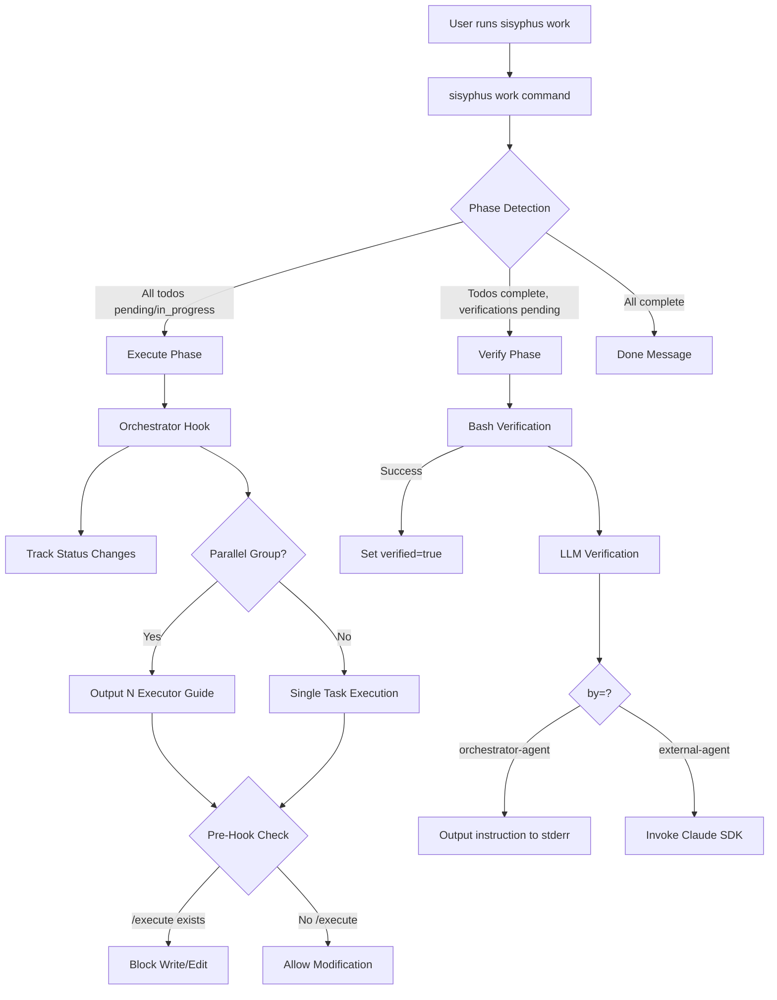
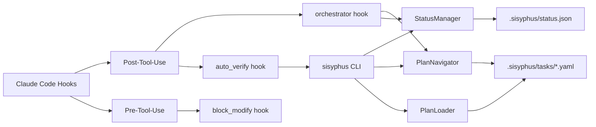

# User's Original Request (For Record)
/plan --review

지금 projects/agentloop_hooks 라는 모노레포안의 프로젝트를 만드려고 해.
그리고 또한 sisyphus work 를 고치려고 해.

@sisyphus_guide.md 에도 나와있지만, 좀 더 구체적으로 말하자면 @sisyphus-setup-dot-claude/commands/execute.md 를 통해 트리거 되면

@sisyphus-setup-dot-claude/agents/executor.md 가 트리거 되고, 이게 트리거 되고 나서 작업 완료를 보고하면

@sisyphus-setup-dot-claude/hooks/post-tool-use/orchestrator_reminder.py 이게 호출 돼. 이거는 참고로 @sisyphus-setup-dot-claude/hooks/post_tool_use.py @sisyphus-setup-dot-claude/settings.json 이렇게 등록돼있어.

훅 시스템의 핵심은 exit 2 + stderr 인데, 이렇게 응답을 하게 되면 claude agent context 로 입력이 들어가게 돼. 따라서 매 executor 의 작업 완료시마다 저 훅이 들어가게 되는거야.

내가 원하는건 이런거야.

예를들어 yaml 의 특정 작업이 현재 실행중이라고 해볼게. .sisyphus/status.json 에 참고로 다 추적이 되고 있는 상태여야 해. (이거는 sisyphus work {plan name} 입력하면 되게 바뀌어야함)

1. 맨 처음에 sisyphus work 통해서 /execute 어쩌구 프롬프트가 들어가면서 실행이 되면, 그 오버뷰 보는 명령어가 실행된 결과가 프롬프트에 같이 들어가야해.  user request, background, required background, status, workflow, todos (but not nested for the children, only for depth 1 lists of them) /execute 안 의 프롬프트와 함께 들어가게 될 수 있어야 해 뭐 이런 느낌인거지.
2. orchestrator 가 작업 할당을 진행함- 이러면 status 들 쫙 바뀌면서 그 내용이 출력되어야 함 (뭐가 어떻게 바뀌었는지.) 그리고 현재 작업이 무엇이니 ' execute' agent 에게 어떻게 할당해야하는지 그 내용이 표시되어야 함. 이것도 명령어 있을거야 continue work 인가 sisyphus task 쪽 뭔가였어.
- 단, 연속된 내용으로써 parallel group 이 공유되고 있다면 총 N개의 executor agent 를 실행하고 할당하라고 가이드가 나가야 함
위의 이 내용이 모조리 정제된 형태로 출력되어야 함. 그 정제된 정보를 바탕으로 executor agent 실행되어야 함
3. 작업이 완료되면 , 새로운 훅이 실행 될 수 있어야 함. 코드를 살펴보고, 테스트 통과여부를 살펴보고, 컨벤션을 살펴보라고. 그 다음에 매뉴얼 버리파이 마킹 하고, 그다음에 배시 버리파이 진행하고, 그 다음에 llm verify 진행하라는 내용의 프롬프트가 상세하게 출력될 수 있는 훅이 필요해. 이게 지금의 @sisyphus-setup-dot-claude/hooks/post-tool-use/orchestrator_reminder.py 를 대체하는 형태여야겠지?
이렇게 되면 일단 bash 로 테스트 스펙이 정해져있는것들은 진행하고, 성공했다면 verified 를 true 로 바꿔야함. 만약에 llm judge 가 따로 없다면 그냥 바로 다음 태스크로 넘어가라고, 그 다음 태스크로 넘기는 명령어 실행하라고 출력이돼야해
    - 즉, if (bash && verified ==true) && (llm judge && verified == true && verification_evidence) -> sisyphus task continue should okay
    - else raise error, that it is not verified yet
4. bash judge 가 다 끝난 상태에서 llm-verify 를 진행하게 되면
    - 만약 by: orchestrator agent 일 경우 instruction 과 함께 검증해야 하는걸 출력해야 하는식으로 동작하는걸로 내가 알고있는데 (가장 위에꺼를 일단 출력하고 N개 더 남았다고 말해줘야함) 이거 맞나 확인해보고 아니라면 이것도 구현계획에 추가해주고
        - 이 경우 orchestrator agent 는 출력물 내용을 보고 본인이 instruction 에 따라 진행하고 마킹하는 방법에 대해서도 같이 출력이 이뤄져야해
    - 만약 by: external agent 일 경우 claude agent sdk 를 소환시켜서 검증 시킬 수 있어야 함. 그리고 이걸 호출하고, verified 값에 대한 보고 & verification_evidence 에 대한 보고를 요구 해야함. 이건 verification phase 에서 fully done true 를 요구하듯 돌도록 되어있는거로
    ```
    {NAME}_VERIFIED = TRUE
    {NAME}_VERIFICATION_EVIDENCE = "ASDFASDFASDF"
    ```
    이런식으로 뱉게 되는거로 아는데 아니라면 이것도 구현하는거 추가해줘
5. 그렇게 모든게 완료되어 다음걸로 넘어갈 수 있게 되면, 다음거로 넘어갈 수 있어야 해 (에이전트가 다음으로 넘기는 명령어를 이 시점에 알고있어야겠지? 사전에 훅이나 실행 결과값을 통해서 입력을 받아서?)
6. 그렇게 execute phase 가 계속 진행되면 status 도 바뀌게 될 것임 엄밀하게 끝나면, verify phase 로 넘어가게 될 것임
7. verify phase 시에는 `sisyphus task verify bash` 그리고 `sisyphus task verify llm` 가 동일하게 기능해야 함.
8. 단 verify phase 의 경우 bash verify 는 `sisyphus work` 내에서 자동적으로 진행되어 검증이 되는 부분이 될 것이고, `sisyphus verify phase llm-verify` 만이 verify phase 의 agent 가 실제로 호출할것임 (이번에는 sisyphus plan get overview 호출 대신 ai-todolist.yaml 의 풀 내용을 직접 넣을것임)
9. 이와 더불어 verify phase 시에 코드도 뒤져보고 이것저것 하고서 작업 최종 완료 여부 보고서를 작성함
10. 작업 완료라면 이제 끝, 그게 아니라면 피드백을 전달하도록 함 (이건 현재와 동일), completed 랑 completed at 다 지워야함
11. 반복

/execute command 실행 기록 혹은 executor agent 소환기록이 transcript path 에 있다면 pre hook 으로 수정을 차단해야함 (exit 2 + stderr) - 오롯이 sisyphus task continue, bash-verify, llm-verify 만 사용하라고 해야함 (읽기는 가능)

그래서 지금 내가 엄청 큰 덩어리를 던졌으니까

각 요구사항을 분석해서

sisyphus-cli 쪽 작업, agentloop_hooks 쪽 작업 이렇게 라벨링 먼저해두고,
sisyphus-cli 쪽에 필요한 기능들이 모두 있는지를 확인하고 점검하고 만약 없거나 부족하거나 의도한대로 작동이 지금 잘 안되는게 있다면 그걸 고치는거를 제일 위쪽으로 넣어주고
그 다음에 agentloop_hooks 작업하게 구성을 해주었으면 해. 그래서 저 오케스트레이터 리마인더쪽 출력값이나 이런것들을 잘 정제해서 출력하게 해주게 해주는 그런것들이 필요한거야 지금. 참고로 그 리마인더는 현재 진행중인 작업을 post tool use 로써 에이전트 끝나면 호출되어갖고 이거 검증하라고 알려주는 형태여야겠지?

그래서 실행시에 sisyphus task/plan 관련 사용법, 맥락 이런게 execute 프롬프트로 들어가고, 훅이 현재 진행중인 작업, 검증해야할거 이런것들 이제 계속 리마인드 시키게해주고 실패시에 행동강령 성공시에 행동강령 이런것들을 잘 출력할 수 있도록 해주면서도, 이 과정이 검증 가능하도록 모듈러하게 돼있어서 각 컴포넌트들이 이제 독립적으로 테스트가 가능하기도하고 또 여러 케이스들에 대해 테스트코드도 있어야하고 클로드 코드용 인터페이스로써 post tool use 식의 입력(json)과 출력(stderr+exit2) 을 핸들링 해줄 수 있게 해줘.
그리고 planreviewer, 당신은 내가 말한 내용대로 요구사항을 잘 반영했는지 작업계획서를 비판적으로 검토해줘.

# Work Objectives (WHAT & WHY)

## Core Objective (TL;DR)
Build an orchestrator system that executes YAML-based work plans through a 2-phase (execute → verify) workflow, replacing the legacy ai-todolist.md Markdown-based system with v3.0 YAML plans.

## Detailed Objectives
1. **Enhance existing CLI commands in sisyphus-cli**
   - Measurable: Existing commands `sisyphus task continue`, `sisyphus task verify bash`, `sisyphus task verify llm` are enhanced to support YAML-based workflow with 80%+ test coverage
   - Note: No new top-level command groups needed - using existing `task` command structure

2. **Create agentloop_hooks monorepo project**
   - Measurable: Hook replaces orchestrator_reminder.py, works via exit 2 + stderr pattern, testable independently with --cwd option

3. **Implement phase-aware sisyphus work command**
   - Measurable: `sisyphus work` detects EXECUTE/VERIFY/DONE phases automatically and routes to appropriate handlers

   - Measurable: When /execute or executor exists in transcript, Write/Edit tool calls blocked with exit 1 and clear error message

5. **Branch LLM verification into two modes**
   - Measurable: orchestrator-agent outputs instruction to stderr, external-agent executes verification via Claude SDK and stores results

# Work Background (WHY & WHAT - Current State)

## Current Situation
- sisyphus-cli has v3.0 YAML format-based work plan system with WorkPlan Pydantic models
- ExecutionLoop exists in `loop.py` providing 2-phase orchestration (execute + verify)
- Verification system exists: bash, llm_judge, manual verification in `task.py`
- Current `orchestrator_reminder.py` hook works with ai-todolist.md (Markdown format, not YAML)
- StatusManager and PlanNavigator track `.sisyphus/status.json` and YAML plans
- `sisyphus work` command uses ExecutionLoop but doesn't detect YAML plan phases

## YAML Format Version Scope (IMPORTANT)
- **This work uses v3.0 YAML format** (v2.1 is deprecated/non-existent)
- **File location**: `.sisyphus/tasks/*.yaml` (v3.0 structure, multiple plans supported)
- **PlanLoader path**: Loads from `.sisyphus/tasks/` directory
- **Format**: v3.0 as specified in AGENTS.md (mandatory)
- **Note**: v2.1 mentioned in old code is obsolete, only v3.0 exists
- **Current plan tracking**: `.sisyphus/status.json` tracks which plan is active

## Reason for Change
- Current `orchestrator_reminder.py` depends on ai-todolist.md (legacy Markdown) instead of YAML plans
- Missing YAML plan-based auto-verification workflow
- Execute phase and verify phase linkage is manual, not automatic
- No parallel group execution guidance in orchestrator
- No orchestrator vs external-agent branching for LLM verification
- `sisyphus work` doesn't automatically detect which phase to execute

## Changes to Make
1. **sisyphus-cli enhancement**: Add task, task verify CLI subcommand groups, enhance work command for phase detection
2. **agentloop_hooks new project**: Create YAML-based orchestrator hook + verification guidance hook
3. **Pre-hook implementation**: Block Write/Edit when /execute exists in transcript
4. **Verification guidance**: Output guidance for sequential bash → llm execution with status prompts
5. **Phase-aware routing**: `sisyphus work` detects EXECUTE/VERIFY/DONE phases and routes accordingly

# Work Started
is_execution_started = FALSE

# All Goals Accomplished
is_all_goals_accomplished = FALSE

# Parallel Execution
parallel_requested = FALSE

# Current Work in Progress
- Work has not started yet.
   - When starting work, change the value of `is_execution_started` above to TRUE.
   - Never start work until the user explicitly says "start the work".
   - **Even if you receive OKAY from plan reviewer, NEVER start work**
   - Never start work until the user explicitly says "start the work".

# Required Background Knowledge

## Tech Stack
- **Language**: Python 3.12+
- **CLI**: Typer 0.15+ for command routing
- **Async**: anyio 4.11+ (asyncio/trio compatibility)
- **Agent SDK**: claude-agent-sdk 0.1+
- **Validation**: Pydantic 2.0+ for type-safe YAML models
- **YAML**: ruamel.yaml 0.18+ for v3.0 WorkPlan format

## File Structure and Roles

### Core sisyphus-cli Files
- `projects/sisyphus-cli/sisyphus/cli.py`: Typer app entry point, command registration
- `projects/sisyphus-cli/sisyphus/cli/task.py`: Existing verify_bash(), verify_llm() commands
- `projects/sisyphus-cli/sisyphus/cli/work.py`: Current work command with ExecutionLoop
- `projects/sisyphus-cli/sisyphus/core/loop.py`: ExecutionLoop (execute + verify phases)
- `projects/sisyphus-cli/sisyphus/core/plan_navigator.py`: PlanNavigator (DFS, next_unverified())
- `projects/sisyphus-cli/sisyphus/core/status/manager.py`: StatusManager (.sisyphus/status.json)
- `projects/sisyphus-cli/sisyphus/utils/plan_types.py`: v3.0 YAML Pydantic models

### Hook System Files
- `sisyphus-setup-dot-claude/hooks/post-tool-use/orchestrator_reminder.py`: Current orchestrator hook (TO REPLACE)
- `sisyphus-setup-dot-claude/hooks/post_tool_use.py`: Hook executor with matcher config

### New agentloop_hooks Project (TO CREATE)
```
projects/agentloop_hooks/
├── agentloop_hooks/
│   ├── orchestrator/
│   │   ├── core.py                    # Core logic (returns string)
│   │   └── claude_agent_hook.py       # Claude Code hook wrapper (entry point)
│   ├── verification/
│   │   ├── core.py                    # Verification automation logic (returns string)
│   │   └── claude_agent_hook.py       # Hook wrapper

│       ├── core.py                    # Pre-hook blocking logic (returns string)
│       └── claude_agent_hook.py       # Hook wrapper
└── tests/
    ├── orchestrator/
    │   ├── test_core.py               # Core logic tests (hook-agnostic)
    │   └── test_claude_agent_hook.py  # Hook wrapper tests (Claude Code integration)
    ├── verification/
    │   ├── test_core.py
    │   └── test_claude_agent_hook.py

        ├── test_core.py
        └── test_claude_agent_hook.py
```

**Architecture: Core Logic vs Claude Agent Hook Wrapper**
- **Core modules (`core.py`)**: Business logic, hook-agnostic, returns string (stderr message)
- **Hook wrappers (`claude_agent_hook.py`)**: Parse Claude Code JSON input via orjson, call core logic, print string to stderr, always exit 2
- **Separation benefit**: Core logic can be reused in other contexts (CLI, tests), not tied to Claude Code hook system
- **Naming convention**: `claude_agent_hook.py` clearly indicates Claude Code integration layer

## Reference Files for Context Understanding

### 1. `projects/sisyphus-cli/sisyphus/utils/plan_types.py`
- **Role**: v3.0 YAML format Pydantic models (WorkPlan, Todo, VerificationItem, BashVerification, LLMJudgeVerification)
- **What to search for**: `class WorkPlan`, `class VerificationItem`, `class BashVerification`, `class LLMJudgeVerification`, `class LLMJudgeBy`
- **Key pattern**: `LLMJudgeBy` Enum has `ORCHESTRATOR = "orchestrator-agent"` and `EXTERNAL = "external-agent"`

### 2. `projects/sisyphus-cli/sisyphus/cli/task.py`
- **Role**: Existing verify commands implementation
- **What to search for**: `def verify_bash(`, `def verify_llm(`, `next_unverified()`
- **Key pattern**: Loads plan via PlanNavigator, executes subprocess.run(), updates YAML with verified=True

### 3. `projects/sisyphus-cli/sisyphus/core/loop.py`
- **Role**: ExecutionLoop 2-phase orchestration
- **What to search for**: `class ExecutionLoop`, `async def _execute_phase(`, `async def _verify_phase(`
- **Key pattern**: Agent-based streaming execution, NOT direct CLI execution

### 4. `projects/sisyphus-cli/sisyphus/core/plan_navigator.py`
- **Role**: Task navigation and verification tracking
- **What to search for**: `class PlanNavigator`, `def get_current_task(`, `def next_unverified(`
- **Key pattern**: DFS traversal, returns (VerificationItem, index, total_count)

### 5. `sisyphus-setup-dot-claude/hooks/post-tool-use/orchestrator_reminder.py`
- **Role**: Current orchestrator hook (ai-todolist.md based, TO REPLACE)
- **What to search for**: `def has_execute_command(`, `def find_uncompleted_todos(`, `exit 2`
- **Key pattern**: Checks transcript for /execute, outputs reminders via stderr + exit 2

# Work Flow (HOW - Task Flow & Dependencies)

## Task Dependency Diagram
```
Phase 1: sisyphus-cli Gap Analysis (1.1, 1.2)
   ↓
Phase 2: sisyphus-cli Enhancement
   ├─> Add task commands (2.1, 2.2)
   ├─> Add task verify commands (2.3, 2.4, 2.5)
   └─> Enhance work command (2.6)
   ↓
Phase 3: agentloop_hooks Project Creation
   ├─> Project setup (3.1, 3.2)
   └─> Implement hooks (3.3, 3.4, 3.5) [Parallel Possible]
   ↓
Phase 4: Integration Tests (4.1, 4.2)
   ↓
Phase 5: Documentation (5.1, 5.2, 5.3) [Parallel Possible]
```

## Phase-by-Phase Explanation
- **Phase 1 (Gap Analysis)**: Identify missing CLI features, design integration points. Must come first to ensure we build the right features.
- **Phase 2 (CLI Enhancement)**: Add missing commands to sisyphus-cli. Sequential execution required as commands build on each other.
- **Phase 3 (Hook Project)**: Create agentloop_hooks project with new hooks. Hooks (3.3, 3.4, 3.5) can run in parallel as they modify different modules.
- **Phase 4 (Integration)**: Test full workflow. Must come after Phase 3 completes.
- **Phase 5 (Documentation)**: Write docs and guides. Tasks can run in parallel as they document different aspects.

# Work Plan

## PRDs & Structures

### System Architecture


### Component Interaction


## Implementation Details

### Architecture Constraints
- **ExecutionLoop NOT reused for new CLI**: ExecutionLoop is Agent-based streaming; new CLI commands are direct YAML + subprocess execution
- **Hook pattern**: exit 2 + stderr for context injection to Claude
- **Testing approach**: Use --cwd option for independent test environments
- **YAML format**: v3.0 only (not v2.1)

### Edge Case Handling
- **Empty plan**: `sisyphus work` should detect no YAML plan and fall back to current behavior
- **Partial verification**: If bash verify fails, don't proceed to LLM verify
- **Parallel group incomplete**: Don't move to next task until all parallel tasks are completed
- **Missing external agent SDK**: LLM verify should fail gracefully with clear error message

### Making Implicit Assumptions Explicit
- **Phase detection logic**: EXECUTE if any todo is pending/in_progress, VERIFY if all todos complete but verifications pending, DONE if everything complete
- **Orchestrator hook timing**: Executes after Task tool completes (post-tool-use)
- **Pre-hook transcript check**: Searches both current transcript and pre-compact backup
- **Verification order**: Always Manual → Bash → LLM (never skip steps)

## Project Commit Message Style
Based on git log analysis:
```
9d1215d guide
b5cb3e4 test: adjust performance test thresholds for reliability
2d51c90 fix: update test mock paths for monorepo structure
9578779 2.0 init
```
Pattern: `<type>: <description>` (lowercase, concise, imperative mood)
Types: feat, fix, test, docs, refactor, chore

# TODOs

## Phase 1: sisyphus-cli Gap Analysis (Label: sisyphus-cli)

- [ ] 1. Analyze current CLI command structure and identify missing features

   **Reference Sources**:
   - Pattern file: `projects/sisyphus-cli/sisyphus/cli.py` (search for `@app.command`, examine how subcommand groups are registered with `app.add_typer()`)
   - Existing commands: `projects/sisyphus-cli/sisyphus/cli/task.py` (search for `verify_app = typer.Typer()`, see subcommand group pattern)

   - [ ] 1.1 Read and analyze CLI structure
      - Open `cli.py` and search for command registration patterns
      - Open `task.py` and search for `@verify_app.command` to understand subcommand structure
      - Document which commands exist vs needed

   - [ ] 1.2 Create gap analysis document
      - List missing commands: `task continue-work`, `task verify bash-verify`, `task verify llm-verify`
      - Document work command phase detection requirement
      - Note: Save analysis to notepad or temporary file

   - [ ] **Work Completion Verification Checklist**
      - [ ] Gap analysis lists all 4 missing features (3 new commands + work enhancement)
      - [ ] Each missing feature has clear description of what it should do
      - [ ] References to existing code patterns are accurate

- [ ] 2. Design ExecutionLoop integration points with new CLI commands

   **Reference Sources**:
   - ExecutionLoop: `projects/sisyphus-cli/sisyphus/core/loop.py` (search for `class ExecutionLoop`, examine `_execute_phase` and `_verify_phase` methods)
   - Current work integration: `projects/sisyphus-cli/sisyphus/cli/work.py` (search for `ExecutionLoop`, see how it's instantiated)

   - [ ] 2.1 Analyze ExecutionLoop architecture
      - Read `loop.py` _execute_phase and _verify_phase implementations
      - Note: ExecutionLoop uses Agent-based streaming (Agent.stream())
      - Conclusion: New CLI commands should NOT reuse ExecutionLoop (different architecture)

   - [ ] 2.2 Design integration approach
      - New commands: Direct YAML load + subprocess execution (no Agent)
      - Work command: Add phase detection before calling ExecutionLoop
      - Integration point: Use PlanNavigator + PlanLoader utilities, not ExecutionLoop

   - [ ] **Work Completion Verification Checklist**
      - [ ] Design document clearly states ExecutionLoop is NOT reused for new commands
      - [ ] Integration approach for each new command is documented
      - [ ] Work command phase detection logic is specified

## Phase 2: sisyphus-cli Enhancement (Label: sisyphus-cli)

- [ ] 4. Implement sisyphus task continue command

   **Reference Sources**:
   - StatusManager: `projects/sisyphus-cli/sisyphus/core/status/manager.py` (search for `async def get()`, examine how to load current plan)
   - PlanLoader: `projects/sisyphus-cli/sisyphus/core/plan_loader.py` (search for `def load()`, see YAML loading pattern)
   - PlanNavigator: `projects/sisyphus-cli/sisyphus/core/plan_navigator.py` (search for `def get_current_task()`, examine task retrieval)

   **Implementation Details**:
   1. Check/Create status.json: If not exists, use --plan option to specify YAML file
   2. Load plan path from status.json: Use `StatusManager(status_file_path).get()` with proper Path to status.json file
   3. Load YAML plan: Use `PlanLoader(status.current_plan.plan_path).load()` to get full WorkPlan with all task data
   4. Find current task FROM YAML: Use `PlanNavigator(plan).get_current_task()` - reads task status directly from YAML
   5. Check parallel group: Use `task.parallel_group` field from YAML
   6. Output guidance: Print plan overview + task info (orchestrator hook will inject as guidance via stderr)

   **Status.json Setup Logic**:
   - If status.json exists: Load plan_path from it
   - If not exists and --plan provided: Create status.json with provided plan path
   - If not exists and no --plan: Error message "Run with --plan first to initialize"

   **Note**: status.json only stores plan_path, not task status. All task information comes from YAML plan itself.

   **Plan Overview Output Format** (Exact specification):
   ```
   # Plan Overview
   ## User Request
   {plan.user_request}

   ## Background
   {plan.background}

   ## Required Background
   {plan.required_background}

   ## Current Status
   Phase: {detected_phase}
   Total Tasks: {total_task_count}
   Completed: {completed_count}
   In Progress: {in_progress_count}

   ## Workflow
   {plan.workflow}

   ## Top-Level Tasks (Depth 1 Only)
   - [ ] {todo.id}: {todo.title} (status: {todo.status})
     - Parallel Group: {todo.parallel_group or "None"}
   ```

   **Async/Sync Pattern for StatusManager**:
   ```python
   import anyio
   from pathlib import Path

   def continue_work(cwd: str | None, plan: str | None):
       # StatusManager needs status_file_path, not cwd
       status_file = Path(cwd or ".") / ".sisyphus" / "status.json"

       # Wrap async calls with anyio.run
       async def load_status():
           manager = StatusManager(status_file)
           return await manager.get()

       status = anyio.run(load_status)
       plan_obj = PlanLoader(status.current_plan.plan_path).load()
       # ... rest of sync code
   ```

   - [ ] 4.1 Implement continue_work function
      - Load plan via StatusManager + PlanLoader (use anyio.run() wrapper)
      - Extract plan overview fields: user_request, background, required_background, status, workflow
      - Extract todos depth 1 only (iterate plan.todos, no recursion)
      - Format as markdown template shown above
      - Find current task via PlanNavigator
      - Check parallel_group field
      - Print plan overview and current task info to stdout

      **Depth 1 Extraction Algorithm** (Clear specification):
      ```python
      # "Depth 1" means: Only direct children of plan.todos (top-level todos)
      # Do NOT recurse into todo.children

      def extract_depth_1_todos(plan: WorkPlan) -> str:
          lines = []
          for todo in plan.todos:  # Iterate ONLY plan.todos (top-level)
              # Format each top-level todo
              status_emoji = "✓" if todo.status == "completed" else "○"
              lines.append(f"- [{status_emoji}] {todo.id}: {todo.title} (status: {todo.status})")
              lines.append(f"    - Parallel Group: {todo.parallel_group or 'None'}")
              # STOP HERE - do NOT iterate todo.children
              # Even if todo.children exists, ignore it for depth 1 view

          return "\n".join(lines)

      # Example output for plan with nested todos:
      # plan.todos = [
      #   Todo(id="1", title="Setup", children=[Todo(id="1.1"), Todo(id="1.2")]),
      #   Todo(id="2", title="Build", children=[])
      # ]
      #
      # Output (depth 1 only):
      # - [ ] 1: Setup (status: pending)
      #     - Parallel Group: None
      # - [ ] 2: Build (status: pending)
      #     - Parallel Group: None
      #
      # Note: Children 1.1, 1.2 are NOT shown
      ```

   - [ ] 4.2 Write tests
      - Test file: `projects/sisyphus-cli/tests/test_execute_phase.py`
      - Test case 1: Plan overview extraction - verify exact format match
      - Test case 2: Parallel group detection - verify "Run N executor agents" guidance
      - Test case 3: Verify anyio.run() wrapper works
      - Use --cwd option for isolated test environment

   - [ ] **Work Completion Verification Checklist**
      - [ ] Run `cd projects/sisyphus-cli && uv run pytest tests/test_execute_phase.py::test_continue_work__if_plan_exists__outputs_overview -v` → PASSED
      - [ ] Run `cd projects/sisyphus-cli && uv run pytest tests/test_execute_phase.py::test_continue_work__if_parallel_group__outputs_guide -v` → PASSED
      - [ ] Run `cd projects/sisyphus-cli && uv run pytest tests/test_execute_phase.py::test_continue_work__async_manager_called__works -v` → PASSED
      - [ ] Manual test with sample YAML plan outputs plan overview in exact format

- [ ] 6. Implement sisyphus task verify bash command

   **Reference Sources**:
   - Existing implementation: `projects/sisyphus-cli/sisyphus/cli/task.py` (search for `def verify_bash(`, examine subprocess.run() usage and YAML update logic)
   - PlanNavigator: `projects/sisyphus-cli/sisyphus/core/plan_navigator.py` (search for `def next_unverified()`)

   **Implementation Details**:
   - Reuse logic from `task.py verify_bash()`:
     1. Load plan via PlanNavigator
     2. Call `next_unverified()` to find next bash verification
     3. Execute bash command via `subprocess.run(bash_spec.execute, shell=True, capture_output=True)`
     4. Check exit code matches `expected_exit_code`
     5. On success: Update `verified=True`, `verified_at`, `verification_evidence` in YAML
     6. Save YAML via PlanLoader

   **Async/Sync Pattern**:
   ```python
   import anyio
   from pathlib import Path

   def bash_verify(cwd: str | None, evidence: str | None):
       status_file = Path(cwd or ".") / ".sisyphus" / "status.json"

       async def load_status():
           manager = StatusManager(status_file)
           return await manager.get()

       status = anyio.run(load_status)
       plan = PlanLoader(status.current_plan.plan_path).load()
       # ... rest of sync code
   ```

   - [ ] 6.1 Implement bash_verify function
      - Copy and adapt logic from `task.py verify_bash()`
      - Use anyio.run() for StatusManager async calls
      - Add --cwd option support

   - [ ] 6.2 Write tests
      - Test successful bash verification
      - Test failed bash verification
      - Test YAML update on success
      - Test anyio.run() wrapper works

   - [ ] **Work Completion Verification Checklist**
      - [ ] Run `cd projects/sisyphus-cli && uv run pytest tests/test_verify_phase.py::test_bash_verify__if_succeeds__updates_verified_true -v` → PASSED
      - [ ] Run `cd projects/sisyphus-cli && uv run pytest tests/test_verify_phase.py::test_bash_verify__if_fails__does_not_update -v` → PASSED

- [ ] 7. Implement sisyphus task verify llm command with branching

   **Reference Sources**:
   - Existing implementation: `projects/sisyphus-cli/sisyphus/cli/task.py` (search for `def verify_llm(`, currently only handles orchestrator-agent)
   - LLMJudgeBy Enum: `projects/sisyphus-cli/sisyphus/utils/plan_types.py` (search for `class LLMJudgeBy`, see ORCHESTRATOR and EXTERNAL values)
   - Claude Agent: `projects/sisyphus-cli/sisyphus/agents/claude.py` (search for `class ClaudeAgent`, examine how to invoke external agent)

   **Implementation Details**:
   - Branch on `LLMJudgeVerification.by` field:
     1. `by=ORCHESTRATOR`:
        - Output instruction to stderr with "N more remain" count
        - Include marking instructions: how to mark as verified
        - Exit with code 2 (Claude hook injection pattern)
     2. `by=EXTERNAL`:
        - Invoke Claude SDK via `ClaudeAgent`
        - Pass entire YAML plan content as context
        - Execute context_commands first to gather files
        - Store result: Update `verified=True`, `verification_evidence` with LLM response

   **Async/Sync Pattern**:
   ```python
   import anyio
   from pathlib import Path

   def llm_verify(cwd: str | None, evidence: str | None):
       status_file = Path(cwd or ".") / ".sisyphus" / "status.json"

       async def load_status():
           manager = StatusManager(status_file)
           return await manager.get()

       status = anyio.run(load_status)
       plan = PlanLoader(status.current_plan.plan_path).load()
       navigator = PlanNavigator(plan)
       result = navigator.next_unverified()
       # ... branching logic
   ```

   **Orchestrator-agent stderr Output Format**:
   ```
   ========================================
   🔍 LLM VERIFICATION REQUIRED
   ========================================
   Verification ID: verify-2.3-llm-1
   Task: Implement sisyphus task verify llm command

   Instruction:
   {llm_judge.instruction}

   Context Commands (already executed):
   {list of context_commands results}

   After Verification:
   Run: sisyphus task verify llm-mark --id verify-2.3-llm-1 --evidence "your findings"

   Remaining LLM Verifications: {count - 1}
   ========================================
   ```

   - [ ] 7.1 Implement llm_verify function with branching
      - Use anyio.run() for StatusManager async calls
      - Load plan, find next unverified llm_judge via PlanNavigator.next_unverified()
      - Check `llm_judge.by` field
      - Branch: orchestrator vs external
      - For orchestrator: Output instruction + marking guide + remaining count
      - For external: Execute context_commands, invoke ClaudeAgent, store result
      - Update YAML with verified=True and verification_evidence

      **External-agent Prompt Template** (for ClaudeAgent invocation):
      ```python
      # Execute context_commands first
      context_outputs = []
      for cmd in llm_judge.context_commands:
          result = subprocess.run(cmd, shell=True, capture_output=True, text=True, cwd=cwd)
          context_outputs.append((cmd, result.stdout))

      # Build prompt for ClaudeAgent
      prompt = f"""
      You are verifying task completion for a work plan.

      Task: {current_task.title}
      Task ID: {current_task.id}
      Description: {current_task.description or 'No description provided'}

      Verification Instruction:
      {llm_judge.instruction}

      Context Files Output:
      {chr(10).join(f"Command: {cmd}{chr(10)}Output:{chr(10)}{output}" for cmd, output in context_outputs)}

      Full Work Plan (for reference):
      ```yaml
      {plan.to_yaml()}
      ```

      Please respond with your verification decision in the following format:
      VERIFIED=TRUE or VERIFIED=FALSE
      EVIDENCE: <your detailed findings explaining why you made this decision>
      """

      # Parse ClaudeAgent response
      response = claude_agent.run(prompt)

      # Extract verification result
      if "VERIFIED=TRUE" in response:
          llm_judge.verified = True
          # Extract everything after "EVIDENCE:" as verification_evidence
          evidence_start = response.find("EVIDENCE:")
          if evidence_start != -1:
              llm_judge.verification_evidence = response[evidence_start + len("EVIDENCE:"):].strip()
      elif "VERIFIED=FALSE" in response:
          llm_judge.verified = False
          evidence_start = response.find("EVIDENCE:")
          if evidence_start != -1:
              llm_judge.verification_evidence = f"FAILED: {response[evidence_start + len('EVIDENCE:'):].strip()}"

      # Save updated plan
      plan_loader.save(plan)
      ```

   - [ ] 7.2 Write tests
      - Test orchestrator-agent branch (check stderr format matches exactly)
      - Test orchestrator-agent with multiple llm_judge (verify count)
      - Test external-agent branch (mock ClaudeAgent, verify invocation)
      - Test context_commands execution before external-agent
      - Test anyio.run() wrapper works

   - [ ] **Work Completion Verification Checklist**
      - [ ] Run `cd projects/sisyphus-cli && uv run pytest tests/test_verify_phase.py::test_llm_verify__if_orchestrator__outputs_to_stderr -v` → PASSED
      - [ ] Run `cd projects/sisyphus-cli && uv run pytest tests/test_verify_phase.py::test_llm_verify__if_external__invokes_claude_sdk -v` → PASSED
      - [ ] Run `cd projects/sisyphus-cli && uv run pytest tests/test_verify_phase.py::test_llm_verify__orchestrator__shows_remaining_count -v` → PASSED

- [ ] 8. Enhance sisyphus work command for YAML-based phase detection

   **Reference Sources**:
   - Current work command: `projects/sisyphus-cli/sisyphus/cli/work.py` (search for `def run(`, examine ExecutionLoop usage)
   - PlanNavigator: `projects/sisyphus-cli/sisyphus/core/plan_navigator.py` (search for `get_current_task`, `next_unverified`)

   **Implementation Details (Work Command Role)**:
   - **Decision: Work command keeps ExecutionLoop, adds phase detection wrapper**
   - Phase detection logic:
     1. Load YAML plan via StatusManager + PlanLoader
     2. Check all todos to detect phase (EXECUTE/VERIFY/DONE)
     3. Route based on phase:
        - EXECUTE/VERIFY: Continue with existing ExecutionLoop.run()
        - DONE: Display completion message and exit
     4. Fallback: If no YAML plan, use current ExecutionLoop behavior

   **Why keep ExecutionLoop**:
   - ExecutionLoop already handles Agent-based streaming for work command
   - Phase detection is just a pre-check before entering ExecutionLoop
   - New CLI commands (task, task verify) are for direct invocation, not Agent-based

   **Phase Detection Business Logic (Detailed Algorithm)**:
   ```python
   def detect_phase(plan: WorkPlan) -> Literal["EXECUTE", "VERIFY", "DONE"]:
       """
       Recursively check all todos (including nested children) to determine phase.

       Algorithm:
       1. Collect all todos via DFS (depth-first search)
       2. Check execution status:
          - If any todo.status in ["pending", "in_progress"] → EXECUTE
       3. Check verification status (only if all todos completed):
          - For each todo.verification_spec:
              - For each v in bash: if not v.verified → VERIFY
              - For each v in llm_judge: if not v.verified → VERIFY
       4. If all todos completed AND all verifications verified → DONE

       Edge Cases:
       - Empty plan: Return DONE
       - No verification_spec: Skip verification check for that todo
       - Nested children: Recurse through all children before checking parent
       - Parallel groups: All tasks in group must complete before moving forward
       """
       def collect_all_todos(todos: list[Todo]) -> list[Todo]:
           result = []
           for todo in todos:
               result.append(todo)
               if todo.children:
                   result.extend(collect_all_todos(todo.children))
           return result

       all_todos = collect_all_todos(plan.todos)

       # Check execution status
       for todo in all_todos:
           if todo.status in ["pending", "in_progress"]:
               return "EXECUTE"

       # All todos completed, check verifications
       for todo in all_todos:
           if not todo.verification_spec:
               continue

           # verification_spec is list[VerificationItem]
           for verify_item in todo.verification_spec:
               for bash_v in verify_item.bash:
                   if not bash_v.verified:
                       return "VERIFY"

               for llm_v in verify_item.llm_judge:
                   if not llm_v.verified:
                       return "VERIFY"

       return "DONE"
   ```

   **Async/Sync Pattern**:
   ```python
   import anyio
   from pathlib import Path

   def run(plan_name: str, cwd: str | None):
       status_file = Path(cwd or ".") / ".sisyphus" / "status.json"

       async def load_status():
           manager = StatusManager(status_file)
           return await manager.get()

       status = anyio.run(load_status)
       plan = PlanLoader(status.current_plan.plan_path).load()
       phase = detect_phase(plan)
       # ... route based on phase
   ```

   - [ ] 8.1 Add phase detection function
      - Function: `detect_phase(plan: WorkPlan) -> Literal["EXECUTE", "VERIFY", "DONE"]`
      - Implement DFS recursive collection of all todos
      - Check execution status first, then verification status
      - Handle edge cases: empty plan, no verification_spec, nested children

   - [ ] 8.2 Modify work command to route by phase
      - Use anyio.run() for StatusManager async calls
      - Before calling ExecutionLoop, detect phase
      - Route to appropriate handler

   - [ ] 8.3 Write tests
      - Test EXECUTE phase detection (pending todo)
      - Test EXECUTE phase detection (in_progress todo)
      - Test VERIFY phase detection (all completed, bash unverified)
      - Test VERIFY phase detection (bash verified, llm unverified)
      - Test DONE phase detection (all completed and verified)
      - Test nested children recursion
      - Test empty plan edge case
      - Test no verification_spec edge case
      - Test fallback behavior

   - [ ] **Work Completion Verification Checklist**
      - [ ] Run `cd projects/sisyphus-cli && uv run pytest tests/test_work_phase_detection.py::test_work__if_todos_pending__detects_execute -v` → PASSED
      - [ ] Run `cd projects/sisyphus-cli && uv run pytest tests/test_work_phase_detection.py::test_work__if_verifications_pending__detects_verify -v` → PASSED
      - [ ] Run `cd projects/sisyphus-cli && uv run pytest tests/test_work_phase_detection.py::test_work__if_all_complete__detects_done -v` → PASSED
      - [ ] Run `cd projects/sisyphus-cli && uv run pytest tests/test_work_phase_detection.py::test_work__nested_children__detects_correctly -v` → PASSED
      - [ ] Run `cd projects/sisyphus-cli && uv run pytest tests/test_work_phase_detection.py::test_work__empty_plan__returns_done -v` → PASSED

- [ ] 9. Commit sisyphus-cli changes
   - [ ] Run linters: `cd projects/sisyphus-cli && uv run ruff check sisyphus/cli/` → 0 errors
   - [ ] Run type check: `cd projects/sisyphus-cli && uv run basedpyright sisyphus/cli/` → 0 errors
   - [ ] Run all tests: `cd projects/sisyphus-cli && uv run pytest tests/ -v` → All PASSED
   - [ ] Git commit: `git add sisyphus/cli/ tests/ && git commit -m "feat: add task and task verify CLI commands with phase detection"`

## Phase 3: agentloop_hooks Project Creation (Label: agentloop_hooks)

- [ ] 10. Create agentloop_hooks monorepo project structure

   **Reference Sources**:
   - Monorepo structure: `pyproject.toml` at root (search for `[tool.uv.workspace]`, examine how sisyphus-cli is structured)
   - sisyphus-cli structure: `projects/sisyphus-cli/` (see directory layout pattern)

   **uv Monorepo Configuration Strategy**:
   ```toml
   # Root pyproject.toml (already exists)
   [tool.uv.workspace]
   members = ["projects/*"]

   # This allows:
   # - Shared uv.lock file at root
   # - Isolated dependencies per project
   # - Cross-project path dependencies (agentloop_hooks → sisyphus-cli)
   ```

   **agentloop_hooks pyproject.toml Structure**:
   ```toml
   [project]
   name = "agentloop-hooks"
   version = "0.1.0"
   requires-python = ">=3.12"
   dependencies = [
       "sisyphus-ai",  # Path dependency via workspace (actual package name)
       "anyio>=4.11",
       "orjson>=3.10",  # Fast JSON parsing for Claude Code hook input
   ]

   [project.optional-dependencies]
   dev = [
       "pytest>=7.0",
       "pytest-mock>=3.0",
   ]

   [tool.uv.sources]
   sisyphus-ai = { workspace = true }

   # This enables:
   # - Import sisyphus StatusManager, PlanNavigator directly
   # - No duplication of plan_types.py
   # - Hooks call sisyphus CLI commands via subprocess
   # - Fast JSON parsing with orjson for hook input
   ```

   - [ ] 10.1 Create directory structure
      ```bash
      mkdir -p projects/agentloop_hooks/agentloop_hooks/{orchestrator,verification}
      mkdir -p projects/agentloop_hooks/tests/{orchestrator,verification}
      touch projects/agentloop_hooks/agentloop_hooks/__init__.py
      touch projects/agentloop_hooks/agentloop_hooks/{orchestrator,verification}/__init__.py
      touch projects/agentloop_hooks/tests/__init__.py
      ```

   - [ ] 10.2 Create pyproject.toml with workspace dependency
      - Location: `projects/agentloop_hooks/pyproject.toml`
      - Add sisyphus-cli as workspace dependency: `sisyphus-cli = { workspace = true }`
      - Dependencies: anyio>=4.11 (for async calls)
      - Dev dependencies: pytest>=7.0, pytest-mock>=3.0
      - **Key**: Use `[tool.uv.sources]` to reference workspace projects

   - [ ] 10.3 Update root pyproject.toml workspace members
      - Verify `members = ["projects/*"]` includes agentloop_hooks
      - Run `uv lock` at root to update uv.lock with new project

   - [ ] 10.4 Create README.md
      - Project overview, installation, usage
      - Document workspace dependency on sisyphus-cli

   - [ ] **Work Completion Verification Checklist**
      - [ ] Run `test -d projects/agentloop_hooks` → Exits 0
      - [ ] Run `test -f projects/agentloop_hooks/pyproject.toml` → Exits 0
      - [ ] Run `cd projects/agentloop_hooks && uv sync` → Completes successfully
      - [ ] Run `cd projects/agentloop_hooks && uv run python -c "from sisyphus.core.plan_navigator import PlanNavigator"` → No import error (imports from sisyphus-ai package)
      - [ ] Run `uv lock` at root → Updates uv.lock with agentloop_hooks

- [ ] 11. Implement orchestrator hook (replace orchestrator_reminder.py)

   **Reference Sources**:
   - Current hook: `sisyphus-setup-dot-claude/hooks/post-tool-use/orchestrator_reminder.py` (search for `has_execute_command`, `find_uncompleted_todos`, see exit 2 + stderr pattern)
   - PlanNavigator: `projects/sisyphus-cli/sisyphus/core/plan_navigator.py`
   - StatusManager: `projects/sisyphus-cli/sisyphus/core/status/manager.py`

   **Architecture: Core Logic vs Claude Agent Hook Wrapper**
   ```
   orchestrator/
   ├── core.py                # Business logic (returns string)
   └── claude_agent_hook.py   # Claude Code hook wrapper (entry point)
   ```

   **Claude Code Hook Input Format** (JSON via stdin):
   ```json
   {
     "tool_name": "Task",
     "tool_input": {
       "subagent_type": "executor",
       "prompt": "...",
       "description": "..."
     },
     "cwd": "/Users/yeongyu/local-workspaces/sisyphus",
     "session_id": "37c5a75b-4eb9-4545-a5be-eadc6fdc0e00"
   }
   ```

   **Implementation Details**:
   - **core.py** - Hook behavior (pure logic):
     1. Load current YAML plan via StatusManager
     2. Find current task via PlanNavigator
     3. Track status changes (compare with previous state)
     4. Output current work info (id, title, status)
     5. Check parallel_group: If exists, list all tasks in group and output "Run N executor agents simultaneously"
     6. Return: (exit_code: int, stderr_output: str)

   - **hook.py** - Claude Code wrapper:
     1. Parse JSON from stdin
     2. Extract cwd, session_id
     3. Check if subagent_type == "executor" (skip if true)
     4. Call core.orchestrate(cwd) → (exit_code, stderr_output)
     5. Print stderr_output to sys.stderr
     6. Return exit_code

   **Status Tracking Previous State Storage**:
   ```python
   # Store previous state in .sisyphus/orchestrator_state.json
   # Format:
   {
       "last_task_id": "task-1.1",
       "last_status": "in_progress",
       "last_check_time": "2025-11-03T23:54:00Z"
   }

   # Compare logic:
   previous_state = load_state(".sisyphus/orchestrator_state.json")
   current_task = navigator.get_current_task()

   if previous_state.last_task_id != current_task.id:
       # Task changed
       output_new_task_assigned(current_task)
   elif previous_state.last_status != current_task.status:
       # Status changed
       output_status_changed(previous_state.last_status, current_task.status)

   save_state(current_task.id, current_task.status)
   ```

   **stderr Output Format Examples**:
   ```
   Example 1: Task assigned
   ========================================
   🎯 NEW TASK ASSIGNED
   ========================================
   Task ID: task-2.3
   Title: Implement sisyphus task verify llm command
   Status: pending → in_progress
   Parallel Group: None

   Next Action:
   - Execute task-2.3 via @agent-executor
   - Use Task tool with subagent_type='executor'
   ========================================

   Example 2: Parallel group detected
   ========================================
   🎯 PARALLEL EXECUTION REQUIRED
   ========================================
   Parallel Group: 1
   Total Tasks: 3

   Tasks to Execute Simultaneously:
   1. [task-3.3] Implement orchestrator hook (status: pending)
   2. [task-3.4] Implement verification automation hook (status: pending)
   3. 
   Next Action:
   - Run 3 @agent-executor agents in parallel
   - Use Task tool 3 times with subagent_type='executor'
   - Wait for all 3 to complete before proceeding
   ========================================

   Example 3: Status changed
   ========================================
   📊 STATUS UPDATE
   ========================================
   Task ID: task-2.3
   Title: Implement sisyphus task verify llm command
   Status Change: in_progress → completed

   Verifications Required:
   - [ ] Manual verification
   - [ ] Bash verification (2 specs)
   - [ ] LLM verification (1 spec)

   Next Action:
   - Run: sisyphus task continue
   - Proceed to verification phase
   ========================================
   ```

   - [ ] 11.1 Implement orchestrator/core.py (business logic)
      - Function: `def orchestrate(cwd: str) -> str`
      - Load YAML plan via anyio.run(StatusManager(cwd).get), then PlanLoader
      - Find current task via PlanNavigator
      - Analyze task status directly from YAML (no state file needed)
      - Check parallel_group field for parallel execution
      - Generate stderr message using exact format shown above
      - Return stderr_message (based on task status analysis)

      **Task Status Detection Logic** (Clear specification):
      ```python
      # NO STATE FILE - Analyze YAML directly
      import anyio
      from pathlib import Path

      def orchestrate(cwd: str) -> str:
          # Load current plan - StatusManager needs status.json path, not cwd
          status_file = Path(cwd or ".") / ".sisyphus" / "status.json"

          async def load_status():
              manager = StatusManager(status_file)
              return await manager.get()

          status = anyio.run(load_status)
          plan = PlanLoader(status.current_plan.plan_path).load()
          navigator = PlanNavigator(plan)
          current_task = navigator.get_current_task()

          if not current_task:
              return ""  # No task to process

          # Analyze task status DIRECTLY from YAML
          # 1. If task.status == "pending" → "NEW TASK ASSIGNED"
          if current_task.status == "pending":
              # Check for parallel group
              if current_task.parallel_group:
                  parallel_tasks = navigator.get_parallel_group_tasks(current_task.parallel_group)
                  if len(parallel_tasks) > 1:
                      return format_parallel_execution(parallel_tasks)
              return format_new_task_assigned(current_task)

          # 2. If task.status == "in_progress" → Already assigned, no output
          elif current_task.status == "in_progress":
              return ""  # Task already in progress, no guidance needed

          # 3. If task.status == "completed" → Check verifications
          elif current_task.status == "completed":
              if current_task.verification_spec:
                  return format_status_update(current_task)
              return ""  # No verification needed

          return ""
      ```

   - [ ] 11.2 Implement orchestrator/claude_agent_hook.py (Claude Code wrapper)
      - Add shebang: `#!/usr/bin/env -S uv run --script`
      - Add PEP 723 inline metadata for dependencies
      - Entry point: `def main() -> int`
      - Parse JSON from sys.stdin.read() using orjson
      - Extract cwd, check subagent_type == "executor" → return 2 immediately (skip but still exit 2)
      - Call core.orchestrate(cwd) → stderr_message (string)
      - Print stderr_message to sys.stderr (even if empty)
      - **ALWAYS return 2** (Claude Code hook requirement: exit 2 + stderr)
      - Chmod +x

   - [ ] 11.3 Update hook dispatcher to call new hook
      - **File to modify**: `sisyphus-setup-dot-claude/hooks/post_tool_use.py`
      - **Location**: Line 121 in POST_TOOL_USE_CONFIG
      - **Change from**: `command="uv run ~/.claude/hooks/post-tool-use/orchestrator_reminder.py"`
      - **Change to**: `command="uv run --with agentloop-hooks python -m agentloop_hooks.orchestrator.claude_agent_hook"`
      - **Note**: agentloop_hooks를 패키지로 설치: `cd projects/agentloop_hooks && uv pip install -e .`
      - **Note**: settings.json only triggers the dispatcher, actual hook paths are in dispatcher config

   - [ ] 11.4 Update Claude Code settings.json configuration
      - **File to check/modify**: `.claude/settings.json` (in user project)
      - **Required structure for hooks**:
        ```json
        {
          "hooks": {
            "post_tool_use": "uv run --script ~/.claude/hooks/post_tool_use.py"
          }
        }
        ```
      - **Note**: This enables the dispatcher, which then calls individual hooks based on POST_TOOL_USE_CONFIG

   - [ ] 11.5 Write core logic tests (orchestrator/test_core.py)
      - Test orchestrate() with pending task → returns "NEW TASK ASSIGNED"
      - Test orchestrate() with in_progress task → returns empty string
      - Test orchestrate() with completed task → returns "STATUS UPDATE" if verifications exist
      - Test orchestrate() with parallel_group → returns "PARALLEL EXECUTION" guide
      - Test orchestrate() with no current task → returns empty string
      - Test anyio.run() wrapper works correctly

   - [ ] 11.6 Write hook wrapper tests (orchestrator/test_claude_agent_hook.py)
      - **Test Claude Code JSON input parsing with orjson**:
        - Create mock JSON: `{"tool_name": "Task", "tool_input": {"subagent_type": "executor"}, "cwd": "/test"}`
        - Pipe to claude_agent_hook.py stdin
        - Verify exit code 2 (always exit 2)
        - Verify stderr is empty (skipped because executor)
      - **Test hook calls core and outputs stderr**:
        - Create mock JSON with non-executor subagent
        - Mock core.orchestrate() to return "TEST STDERR"
        - Verify exit code 2 and stderr contains "TEST STDERR"
      - **Test hook handles missing cwd gracefully**:
        - JSON without cwd field
        - Verify exit code 2 and stderr contains error message
      - **Test orjson parsing failure**:
        - Invalid JSON input
        - Verify exit code 2 and stderr contains parse error

   - [ ] **Work Completion Verification Checklist**
      - [ ] Run `cd projects/agentloop_hooks && uv run pytest tests/orchestrator/test_core.py::test_orchestrate__task_changed__returns_stderr -v` → PASSED
      - [ ] Run `cd projects/agentloop_hooks && uv run pytest tests/orchestrator/test_core.py::test_orchestrate__parallel_group__outputs_guide -v` → PASSED
      - [ ] Run `cd projects/agentloop_hooks && uv run pytest tests/orchestrator/test_claude_agent_hook.py::test_hook__executor_subagent__exits_2_empty_stderr -v` → PASSED
      - [ ] Run `cd projects/agentloop_hooks && uv run pytest tests/orchestrator/test_claude_agent_hook.py::test_hook__non_executor__calls_core_and_outputs -v` → PASSED
      - [ ] Run `cd projects/agentloop_hooks && uv run pytest tests/orchestrator/test_claude_agent_hook.py::test_hook__orjson_parsing__works -v` → PASSED

- [ ] 13. Implement pre-hook for blocking Write/Edit during execution phase

   **Purpose**: Block Write/Edit tool calls when /execute command or executor agent exists in transcript

   **Architecture: Core Logic vs Claude Agent Hook Wrapper**
   ```
   blocking/
   ├── core.py                # Business logic (returns string or None)
   │   └── check_execution_phase(transcript_path: str, tool_name: str) -> str | None
   └── claude_agent_hook.py   # Pre-tool-use hook wrapper (orjson + exit 1)
   ```

   **Reference Sources**:
   - Hook pattern from orchestrator: `projects/agentloop_hooks/agentloop_hooks/orchestrator/` (same pattern)
   - Tool blocking pattern: Exit 1 + stderr for blocking (different from exit 2 context injection)

   **Implementation Details**:

   **Core Logic (core.py)**:
   ```python
   def check_execution_phase(transcript_path: str, tool_name: str) -> str | None:
       """Check if tool should be blocked during execution phase.

       Returns:
           str: Error message if tool should be blocked
           None: If tool is allowed
       """
       # 1. Check if tool is Write or Edit
       if tool_name not in ["Write", "Edit"]:
           return None  # Allow all other tools

       # 2. Search transcript for /execute or executor agent
       with open(transcript_path) as f:
           content = f.read()

       # 3. Check for execution indicators
       if "/execute" in content or "executor.md" in content:
           return (
               "⚠️  Execution phase is active - Write/Edit tools are blocked\n\n"
               "During execution phase, use these commands instead:\n"
               "  • sisyphus task continue    - Continue current task\n"
               "  • sisyphus task verify bash - Run bash verification\n"
               "  • sisyphus task verify llm  - Run LLM verification\n\n"
               "Read-only tools (Read, Grep, Glob) are available."
           )

       return None  # No execution phase detected
   ```

   **Claude Agent Hook (claude_agent_hook.py)**:
   ```python
   #!/usr/bin/env python3
   """Pre-tool-use hook for blocking Write/Edit during execution phase."""

   from __future__ import annotations

   import sys
   from pathlib import Path

   import orjson

   from agentloop_hooks.blocking.core import check_execution_phase


   def main() -> None:
       # 1. Parse JSON input via orjson
       input_data = orjson.loads(sys.stdin.read())

       transcript_path = input_data["transcriptPath"]
       tool_name = input_data["toolUse"]["name"]

       # 2. Call core logic
       error_msg = check_execution_phase(transcript_path, tool_name)

       # 3. Exit 1 + stderr if blocked, exit 0 otherwise
       if error_msg:
           print(error_msg, file=sys.stderr)
           sys.exit(1)

       sys.exit(0)


   if __name__ == "__main__":
       main()
   ```

   - [ ] 13.1 Create blocking module structure
      ```bash
      mkdir -p projects/agentloop_hooks/agentloop_hooks/blocking
      touch projects/agentloop_hooks/agentloop_hooks/blocking/__init__.py
      touch projects/agentloop_hooks/agentloop_hooks/blocking/core.py
      touch projects/agentloop_hooks/agentloop_hooks/blocking/claude_agent_hook.py
      mkdir -p projects/agentloop_hooks/tests/blocking
      touch projects/agentloop_hooks/tests/blocking/__init__.py
      touch projects/agentloop_hooks/tests/blocking/test_core.py
      touch projects/agentloop_hooks/tests/blocking/test_claude_agent_hook.py
      ```

   - [ ] 13.2 Implement core.py blocking logic
      - Location: `projects/agentloop_hooks/agentloop_hooks/blocking/core.py`
      - Function: `check_execution_phase(transcript_path: str, tool_name: str) -> str | None`
      - Logic: Return error message if Write/Edit and /execute exists, None otherwise

   - [ ] 13.3 Implement claude_agent_hook.py wrapper
      - Location: `projects/agentloop_hooks/agentloop_hooks/blocking/claude_agent_hook.py`
      - Make executable: `chmod +x claude_agent_hook.py`
      - Pattern: orjson parse → call core → exit 1 + stderr if blocked

   - [ ] 13.4 Write tests for core.py
      - Location: `projects/agentloop_hooks/tests/blocking/test_core.py`
      - Test cases:
        1. Write tool + /execute exists → Returns error message
        2. Edit tool + executor agent exists → Returns error message
        3. Read tool + /execute exists → Returns None (allowed)
        4. Write tool + no /execute → Returns None (allowed)

   - [ ] 13.5 Write tests for claude_agent_hook.py
      - Location: `projects/agentloop_hooks/tests/blocking/test_claude_agent_hook.py`
      - Test cases:
        1. Blocked tool → Exit 1 with stderr
        2. Allowed tool → Exit 0 with empty stderr
        3. orjson parsing works correctly

   - [ ] 13.6 Register pre-hook in settings.json
      - Location: `sisyphus-setup-dot-claude/settings.json`
      - Add to `hooks.pre_tool_use`:
        ```json
        {
          "command": "uv run --with agentloop-hooks python -m agentloop_hooks.blocking.claude_agent_hook",
          "description": "Block Write/Edit during execution phase"
        }
        ```

   - [ ] **Work Completion Verification Checklist**
      - [ ] Run `cd projects/agentloop_hooks && uv run pytest tests/blocking/test_core.py::test_check__write_with_execute__returns_error -v` → PASSED
      - [ ] Run `cd projects/agentloop_hooks && uv run pytest tests/blocking/test_core.py::test_check__read_with_execute__returns_none -v` → PASSED
      - [ ] Run `cd projects/agentloop_hooks && uv run pytest tests/blocking/test_claude_agent_hook.py::test_hook__blocked__exits_1_stderr -v` → PASSED
      - [ ] Run `cd projects/agentloop_hooks && uv run pytest tests/blocking/test_claude_agent_hook.py::test_hook__allowed__exits_0 -v` → PASSED
      - [ ] Run `cd projects/agentloop_hooks && uv run pytest tests/blocking/test_claude_agent_hook.py::test_hook__orjson_parsing__works -v` → PASSED

- [ ] 14. Implement verification guidance hook

   **Architecture: Core Logic vs Claude Agent Hook Wrapper**
   ```
   verification/
   ├── core.py                # Business logic (returns string)
   └── claude_agent_hook.py   # Claude Code hook wrapper (entry point)
   ```

   **Claude Code Hook Input Format** (JSON via stdin):
   ```json
   {
     "tool_name": "Task",
     "tool_input": {
       "subagent_type": "executor",
       "prompt": "...",
       "description": "..."
     },
     "cwd": "/Users/yeongyu/local-workspaces/sisyphus",
     "session_id": "37c5a75b-4eb9-4545-a5be-eadc6fdc0e00"
   }
   ```

   **Implementation Details**:
   - **core.py** - Hook behavior (pure logic):
     1. Detect task completion (status=completed in YAML)
     2. Check if verification_spec exists
     3. Output guidance for sequential verification:
        a. Check manual verify marking
        b. Guide to run `sisyphus task verify bash`
        c. Guide that verified=true will be set on bash success
        d. Guide to run `sisyphus task verify llm`
     4. When all verifications complete, output "Move to next task" guide
     5. Return: stderr_message (empty if not ready, otherwise formatted guide)

   - **claude_agent_hook.py** - Claude Code wrapper:
     1. Parse JSON from stdin using orjson
     2. Extract cwd
     3. Call core.auto_verify(cwd) → stderr_message
     4. Print stderr_message to sys.stderr
     5. **ALWAYS return 2** (Claude Code hook requirement)

   **Detailed Verification Guidance Workflow**:
   ```python
   import anyio
   from pathlib import Path

   def main() -> int:
       # 1. Load plan and find current task
       status_file = Path(".") / ".sisyphus" / "status.json"

       async def load_status():
           manager = StatusManager(status_file)
           return await manager.get()

       status = anyio.run(load_status)
       plan = PlanLoader(status.current_plan.plan_path).load()
       current_task = PlanNavigator(plan).get_current_task()

       # 2. Check if task is completed
       if current_task.status != "completed":
           return 0  # Not ready for verification

       # 3. Check verification_spec exists
       if not current_task.verification_spec:
           print("No verification required, move to next task", file=sys.stderr)
           return 2

       verification_spec = current_task.verification_spec

       # 4. Manual verification check
       if not verification_spec.orchestrator_manually_verified:
           print("""
           ========================================
           ⚠️  MANUAL VERIFICATION REQUIRED
           ========================================
           Task: {current_task.title}

           Before verification guidance:
           1. Review code changes
           2. Check test coverage
           3. Verify conventions followed

           After review, mark as verified:
           Run: sisyphus task verify manual-mark --evidence "Reviewed code, tests pass, conventions followed"
           ========================================
           """, file=sys.stderr)
           return 2  # Block until manual verification

       # 5. Bash verification
       bash_all_verified = True
       for bash_v in verification_spec.bash:
           if not bash_v.verified:
               # Call sisyphus task verify bash
               result = subprocess.run(["sisyphus", "task verify", "bash-verify"], capture_output=True)
               if result.returncode != 0:
                   print(f"Bash verification failed: {result.stderr.decode()}", file=sys.stderr)
                   bash_all_verified = False
                   break

       if not bash_all_verified:
           print("Bash verification incomplete, please fix and retry", file=sys.stderr)
           return 2

       # 6. LLM verification
       llm_all_verified = True
       for llm_v in verification_spec.llm_judge:
           if not llm_v.verified:
               # Call sisyphus task verify llm
               result = subprocess.run(["sisyphus", "task verify", "llm-verify"], capture_output=True)
               if result.returncode == 2:
                   # Orchestrator-agent mode: instruction output to stderr
                   print(result.stderr.decode(), file=sys.stderr)
                   llm_all_verified = False
                   break
               elif result.returncode != 0:
                   print(f"LLM verification failed: {result.stderr.decode()}", file=sys.stderr)
                   llm_all_verified = False
                   break

       if not llm_all_verified:
           print("LLM verification incomplete", file=sys.stderr)
           return 2

       # 7. All verifications complete
       print("""
       ========================================
       ✅ ALL VERIFICATIONS COMPLETE
       ========================================
       Task: {current_task.title}

       Next Action:
       Run: sisyphus task continue
       ========================================
       """, file=sys.stderr)
       return 2
   ```

   **Key Clarifications**:
   - **Who sets orchestrator_manually_verified?** Orchestrator (user) sets this BEFORE bash/llm guidance begins
   - **Manual verify failure handling:** Hook blocks (exit 2) and outputs guidance to run manual-mark command
   - **Bash verify failure:** Hook blocks and outputs error message
   - **LLM verify orchestrator-agent:** Hook forwards instruction to stderr, blocks until orchestrator marks verified
   - **LLM verify external-agent:** CLI invokes Claude SDK internally, returns success/failure

   - [ ] 12.1 Implement verification/core.py (business logic)
      - Function: `def auto_verify(cwd: str) -> str`
      - Load plan via StatusManager with proper status.json Path
      - Detect task completion (check status == "completed")
      - Check verification_spec exists
      - Check orchestrator_manually_verified first
      - Call sisyphus CLI commands via subprocess.run()
      - Handle each verification failure with specific error messages
      - Return stderr_message (empty if not ready, otherwise formatted guide)

   - [ ] 12.2 Implement verification/claude_agent_hook.py (Claude Code wrapper)
      - Add shebang: `#!/usr/bin/env -S uv run --script`
      - Add PEP 723 inline metadata
      - Entry point: `def main() -> int`
      - Parse JSON from stdin using orjson
      - Extract cwd
      - Call core.auto_verify(cwd) → stderr_message (string)
      - Print stderr_message to sys.stderr
      - **ALWAYS return 2**
      - Chmod +x

   - [ ] 12.3 Write core logic tests (verification/test_core.py)
      - Test auto_verify() task not completed → returns empty string
      - Test auto_verify() no verification_spec → returns "move to next task"
      - Test auto_verify() manual not verified → returns manual guide
      - Test auto_verify() bash fails → returns error message
      - Test auto_verify() llm orchestrator-agent → returns instruction
      - Test auto_verify() all complete → returns "move to next task"
      - Test anyio.run() wrapper works

   - [ ] 12.4 Write hook wrapper tests (verification/test_claude_agent_hook.py)
      - **Test Claude Code JSON parsing with orjson**
      - **Test hook calls core and outputs stderr**
      - **Test hook always exits 2**
      - **Test orjson parsing failure handling**

   - [ ] **Work Completion Verification Checklist**
      - [ ] Run `cd projects/agentloop_hooks && uv run pytest tests/verification/test_core.py::test_auto_verify__task_not_complete__returns_empty -v` → PASSED
      - [ ] Run `cd projects/agentloop_hooks && uv run pytest tests/verification/test_core.py::test_auto_verify__manual_not_verified__outputs_guide -v` → PASSED
      - [ ] Run `cd projects/agentloop_hooks && uv run pytest tests/verification/test_claude_agent_hook.py::test_hook__calls_core_and_exits_2 -v` → PASSED
      - [ ] Run `cd projects/agentloop_hooks && uv run pytest tests/verification/test_claude_agent_hook.py::test_hook__orjson_parsing__works -v` → PASSED

- [ ] 14. Commit agentloop_hooks project
   - [ ] Run linters: `cd projects/agentloop_hooks && uv run ruff check agentloop_hooks/` → 0 errors
   - [ ] Run type check: `cd projects/agentloop_hooks && uv run basedpyright agentloop_hooks/` → 0 errors
   - [ ] Run all tests: `cd projects/agentloop_hooks && uv run pytest tests/ -v` → All PASSED
   - [ ] Git commit: `git add projects/agentloop_hooks/ && git commit -m "feat: add agentloop_hooks project with orchestrator and verification hooks"`

## Phase 4: Integration Tests (Label: integration)

- [ ] 15. Integration test for sisyphus-cli and agentloop_hooks

   **Test Scenario**:
   1. Create test YAML plan with 2 tasks (each with bash + llm verification)
   2. Execute `sisyphus task continue`
   3. Verify orchestrator hook injects plan overview
   4. Mark task 1 as completed
   5. Verify auto_verify hook executes
   6. Verify `sisyphus task verify bash` is called
   7. Verify `sisyphus task verify llm` is called
   8. Verify auto-move to task 2

   - [ ] 15.1 Create integration test file
      - Location: `projects/sisyphus-cli/tests/integration/test_execute_verify_workflow.py`

   - [ ] 15.2 Write end-to-end test
      - Use --cwd for isolated test environment
      - Create sample YAML plan
      - Execute commands
      - Verify outputs and YAML updates

   - [ ] **Work Completion Verification Checklist**
      - [ ] Run `cd projects/sisyphus-cli && uv run pytest tests/integration/test_execute_verify_workflow.py -v` → PASSED

- [ ] 16. Parallel group execution scenario test

   **Test Scenario**:
   1. Create test YAML plan with 3 tasks in same parallel_group=1
   2. Execute `sisyphus task continue`
   3. Verify orchestrator hook outputs "Run 3 executor agents simultaneously"
   4. Mark all 3 tasks as completed
   5. Verify move to next step only after all 3 complete

   - [ ] 16.1 Create parallel group test
      - Location: `projects/sisyphus-cli/tests/integration/test_parallel_group.py`

   - [ ] 16.2 Write parallel execution test

   - [ ] **Work Completion Verification Checklist**
      - [ ] Run `cd projects/sisyphus-cli && uv run pytest tests/integration/test_parallel_group.py -v` → PASSED

- [ ] 17. Commit integration tests
   - [ ] Git commit: `git add tests/integration/ && git commit -m "test: add integration tests for execute-verify workflow"`

## Phase 5: Documentation (Label: documentation)

- [ ] 18. Write agentloop_hooks README.md

   **Content Outline**:
   1. Project overview
   2. Installation: `cd projects/agentloop_hooks && uv sync`
   3. Hook usage:
      - orchestrator hook: Status tracking, parallel group detection
      - verification automation hook: Auto-verify after task completion
      4. Testing: Use --cwd option for independent tests
   5. Claude Code settings.json configuration example

   - [ ] 18.1 Write README content
   - [ ] 18.2 Add usage examples

   - [ ] **Work Completion Verification Checklist**
      - [ ] README includes all 5 sections
      - [ ] Installation commands are correct
      - [ ] settings.json example is provided

- [ ] 19. Write migration guide: orchestrator_reminder.py → agentloop_hooks

   **Content Outline**:
   1. Limitations of orchestrator_reminder.py (ai-todolist.md dependency)
   2. Benefits of agentloop_hooks (YAML-based, modular, testable)
   3. Migration steps:
      - Remove orchestrator_reminder.py from settings.json
      - Install agentloop_hooks: `cd projects/agentloop_hooks && uv sync`
      - Register new hooks in settings.json
   4. settings.json before/after comparison
   5. ai-todolist.md → YAML plan transition guide reference

   - [ ] 19.1 Write MIGRATION_GUIDE.md
      - Location: `projects/agentloop_hooks/MIGRATION_GUIDE.md`

   - [ ] **Work Completion Verification Checklist**
      - [ ] Migration guide exists
      - [ ] Settings.json before/after example provided
      - [ ] Installation steps are clear

- [ ] 20. Update sisyphus-cli AGENTS.md

   **Update Sections**:
   1. ARCHITECTURE: Add task and task verify commands to flow diagram
   2. DEVELOPMENT COMMANDS: Add new command examples
   3. NOTES: Add agentloop_hooks integration notes

   - [ ] 20.1 Update ARCHITECTURE section
   - [ ] 20.2 Update DEVELOPMENT COMMANDS section
   - [ ] 20.3 Update NOTES section

   - [ ] **Work Completion Verification Checklist**
      - [ ] Run `grep -q "task" projects/sisyphus-cli/AGENTS.md` → Exits 0
      - [ ] Run `grep -q "task verify" projects/sisyphus-cli/AGENTS.md` → Exits 0
      - [ ] Run `grep -q "agentloop_hooks" projects/sisyphus-cli/AGENTS.md` → Exits 0

- [ ] 21. Commit documentation
   - [ ] Git commit: `git add projects/agentloop_hooks/{README.md,MIGRATION_GUIDE.md} projects/sisyphus-cli/AGENTS.md && git commit -m "docs: add agentloop_hooks docs and update AGENTS.md"`

# Success Vision

## Success from User Perspective
- **Developer writes YAML plan and runs `sisyphus work`**: Plan overview is automatically included in context, orchestrator clearly understands current state and assigns work appropriately
- **Parallel group detected**: Receives clear guide "Run N executor agents simultaneously" with list of tasks to execute in parallel
- **Task completion triggers verification guidance**: Hook outputs guidance to run bash verify, which sets verified=true on success, then guides to run LLM verify for code quality
- **Attempting Write when /execute exists**: Pre-hook blocks with clear error message, notified that only read-only tools are available during execution phase

## Success from Business Perspective
- **Verification guidance coverage**: 80%+ of tasks receive clear verification guidance prompts that lead to successful verification
- **Orchestrator hook reliability**: 100% accurate status tracking and work assignment based on YAML plan state
- **Hook modularity**: Each hook independently testable with --cwd option, reducing debugging time by 50%

## Technical Success Criteria
- **All CLI commands work**: `uv run sisyphus task --help` and `uv run sisyphus task verify --help` show subcommands correctly
- **Test coverage**: agentloop_hooks project has 80%+ test coverage (`cd projects/agentloop_hooks && uv run pytest --cov=agentloop_hooks`)
- **Integration tests pass**: `cd projects/sisyphus-cli && uv run pytest tests/integration/ -v` → All tests PASSED
- **Phase detection works**: `sisyphus work` correctly identifies EXECUTE/VERIFY/DONE phases and routes accordingly
- **Pre-hook blocks correctly**: Write/Edit blocked when /execute exists, Read allowed
- **LLM verify branching works**: orchestrator-agent outputs to stderr, external-agent invokes Claude SDK

# Final Work Verification Checklist

- [ ] 1. **Verify All CLI Commands Work**
  - [ ] Run `cd projects/sisyphus-cli && uv run sisyphus task --help` → Shows "continue-work" subcommand
  - [ ] Run `cd projects/sisyphus-cli && uv run sisyphus task verify --help` → Shows "bash-verify" and "llm-verify" subcommands
  - [ ] Run `cd projects/sisyphus-cli && uv run sisyphus task continue --help` → Shows --cwd and --plan options

- [ ] 2. **Verify agentloop_hooks Project Works**
  - [ ] Run `cd projects/agentloop_hooks && uv sync` → Completes successfully
  - [ ] Run `cd projects/agentloop_hooks && uv run pytest -v` → All tests PASSED
  - [ ] Run `cd projects/agentloop_hooks && uv run pytest --cov=agentloop_hooks --cov-report=term` → Coverage >= 80%

- [ ] 3. **Verify Integration Tests Pass**
  - [ ] Run `cd projects/sisyphus-cli && uv run pytest tests/integration/test_execute_verify_workflow.py -v` → PASSED
  - [ ] Run `cd projects/sisyphus-cli && uv run pytest tests/integration/test_parallel_group.py -v` → PASSED

- [ ] 4. **Verify Phase Detection Works**
  - [ ] Create sample YAML plan with pending todos
  - [ ] Run `sisyphus work` → Detects EXECUTE phase, calls task logic
  - [ ] Mark all todos complete, add unverified bash items
  - [ ] Run `sisyphus work` → Detects VERIFY phase, calls task verify logic
  - [ ] Mark all verifications complete
  - [ ] Run `sisyphus work` → Detects DONE phase, displays completion message

- [ ] 5. **Verify Documentation Completeness**
  - [ ] Run `test -f projects/agentloop_hooks/README.md` → Exits 0
  - [ ] Run `test -f projects/agentloop_hooks/MIGRATION_GUIDE.md` → Exits 0
  - [ ] Run `grep -q "task" projects/sisyphus-cli/AGENTS.md` → Exits 0
  - [ ] README includes installation, usage, and settings.json example


- [ ] 7. **Verify LLM Verification Branching**
  - [ ] Create YAML plan with orchestrator-agent llm_judge
  - [ ] Run `sisyphus task verify llm`
  - [ ] Verify instruction output to stderr, exit code 2
  - [ ] Create YAML plan with external-agent llm_judge
  - [ ] Run `sisyphus task verify llm`
  - [ ] Verify ClaudeAgent invoked, result stored in YAML

- [ ] 8. **Prevent Scope Creep**
  - [ ] Confirm v3.0 YAML format used (not v2.1)
  - [ ] Confirm ExecutionLoop NOT modified (new commands don't reuse it)
  - [ ] Confirm orchestrator_reminder.py NOT deleted (only replaced by new hooks)

- [ ] 9. **Existing Feature Regression Test**
  - [ ] Run `cd projects/sisyphus-cli && uv run pytest tests/ -v --ignore=tests/integration/` → All existing tests PASSED
  - [ ] Run `cd projects/sisyphus-cli && uv run sisyphus plan --help` → Still works (not affected)
  - [ ] Run `cd projects/sisyphus-cli && uv run sisyphus task --help` → Still works (not affected)
