# Sisyphus 전체 실행 플로우 분석

> **작성일**: 2025-11-02
> **목적**: Sisyphus의 Execute-Verify 피드백 루프 시스템을 미시적 관점까지 포함하여 완전히 이해하고 문서화

---

## 목차

1. [전체 개요](#1-전체-개요)
2. [Phase 0: 계획 수립 (plan-writer)](#2-phase-0-계획-수립-plan-writer)
3. [Phase 1: 실행 루프 초기화](#3-phase-1-실행-루프-초기화)
4. [Phase 2: Execute-Verify 피드백 루프 (핵심)](#4-phase-2-execute-verify-피드백-루프-핵심)
5. [Phase 3: 훅 시스템과 품질 강제 메커니즘](#5-phase-3-훅-시스템과-품질-강제-메커니즘)
6. [Phase 4: Executor Agent의 단일 작업 원칙](#6-phase-4-executor-agent의-단일-작업-원칙)
7. [실제 시나리오: 사용자 인증 기능 구현](#7-실제-시나리오-사용자-인증-기능-구현)
8. [왜 이 구조가 효과적인가?](#8-왜-이-구조가-효과적인가)

---

## 1. 전체 개요

### 핵심 아키텍처

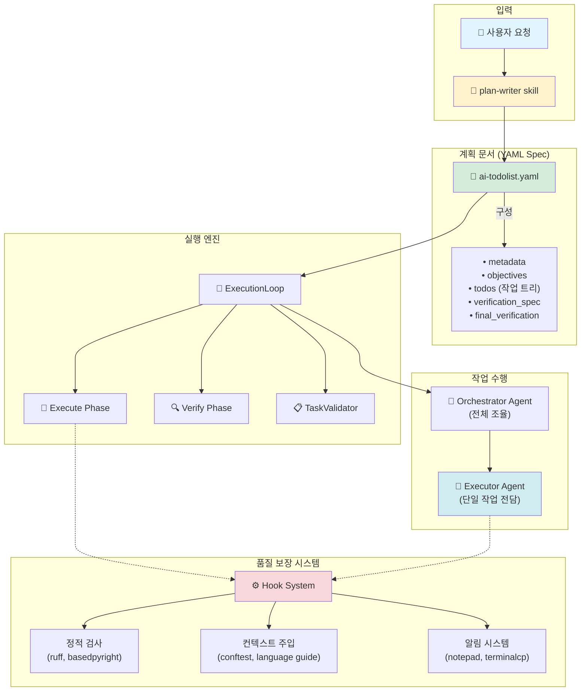

### 시스템의 3대 핵심 원칙

1. **Execute-Verify 분리**: 작업 수행과 검증을 독립적으로 실행
2. **3단계 검증 시스템**: 실시간 → 완료 조건 → 최종 승인
3. **단일 작업 원칙**: Executor는 반드시 한 번에 하나의 작업만 수행

---

## 2. Phase 0: 계획 수립 (plan-writer)

### 작동 방식

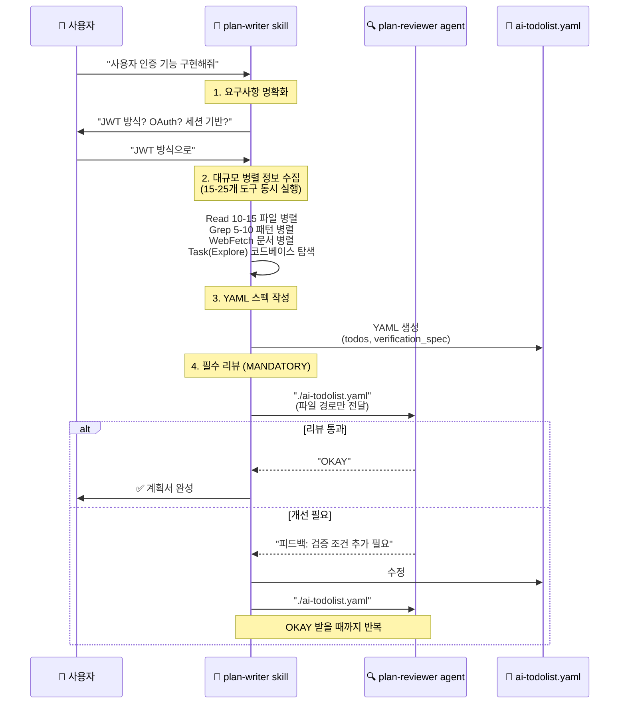

### 생성되는 YAML 스펙 구조

```yaml
# ai-todolist.yaml 예시

metadata:
  created_at: "2025-11-02T17:30:00+09:00"
  format_version: "2.1"

objectives:
  core: "JWT 기반 사용자 인증 시스템 구축"
  detailed:
    - goal: "로그인 API 엔드포인트 구현"
      measurable: "POST /api/auth/login 200 OK"

todos:
  - id: 1
    title: "User 모델에 password_hash 필드 추가"
    status: pending

    # 실시간 검증 스펙
    verification_spec:
      - id: "verify_1_bash"
        type: bash
        bash:
          - execute: "uv run pytest tests/models/test_user.py -v"
            expected_exit_code: 0

      - id: "verify_1_llm"
        type: llm_judge
        llm_judge:
          - by: "orchestrator-agent"
            instruction: "bcrypt를 사용했는지 확인"

final_verification:
  - id: "final_e2e"
    title: "E2E 로그인 테스트"
    bash:
      - execute: "curl -X POST localhost:8000/api/auth/login"
        expected_exit_code: 0
```

### 핵심 포인트

- **90% 신뢰도 원칙**: Worker가 외부 검색 없이 작업 가능해야 함
- **병렬 정보 수집**: 15-25개 도구를 단일 메시지로 동시 실행
- **필수 리뷰**: plan-reviewer가 "OKAY" 승인할 때까지 반복

---

## 3. Phase 1: 실행 루프 초기화

### 시작 과정

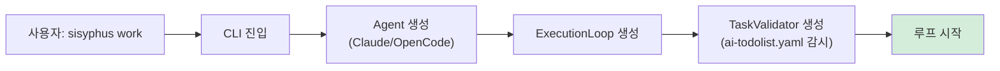

### ExecutionLoop 초기화

```python
class ExecutionLoop:
    def __init__(
        self,
        execute_agent: Agent,      # Claude/OpenCode
        verify_agent: Agent | None, # 독립적 검증 agent
        task_validator: TaskValidator | None,
        ui: UIProtocol,
        session_store: SessionStore,
        logger_factory: LoggerFactory,
    ):
        # Execute는 세션 재개 가능
        # Verify는 항상 신규 세션 (독립성 보장)
        self.verify_feedback_history = []
        self._consecutive_execute_count = 0
```

---

## 4. Phase 2: Execute-Verify 피드백 루프 (핵심)

### 전체 흐름도

```mermaid
graph TB
    Start([루프 시작<br/>Iteration N]) --> ExecuteStart[Execute Phase 시작]

    ExecuteStart --> Orchestrator["Orchestrator Agent 실행<br/>(대규모 작업 조율)"]

    Orchestrator --> DelegateCheck{작업을<br/>위임할까?}

    DelegateCheck -->|Yes| CallExecutor["Executor Agent 호출<br/>(단일 작업 전담)"]
    DelegateCheck -->|No| DirectWork[직접 작업 수행]

    CallExecutor --> ExecutorWork["Executor:<br/>1개 작업만 수행"]

    ExecutorWork --> VSpec{verification_spec<br/>확인}

    VSpec -->|bash| BashCheck["자동 실행<br/>exit_code 체크"]
    VSpec -->|llm_judge| LLMCheck["LLM 판단<br/>(orchestrator/external)"]
    VSpec -->|manual| ManualCheck["사람 확인 대기"]

    BashCheck --> UpdateYAML[verified=true<br/>YAML 업데이트]
    LLMCheck --> UpdateYAML
    ManualCheck --> UpdateYAML

    DirectWork --> UpdateYAML

    UpdateYAML --> MoreTasks{다음 작업<br/>있나?}

    MoreTasks -->|Yes| Orchestrator
    MoreTasks -->|No| TVCheck[TaskValidator 검사]

    TVCheck --> GoalsCheck{is_all_goals<br/>_accomplished<br/>= TRUE?}

    GoalsCheck -->|No| Start

    GoalsCheck -->|Yes| CheckboxCheck{모든 체크박스<br/>[x]?}

    CheckboxCheck -->|No| Start

    CheckboxCheck -->|Yes| VerifyStart[Verify Phase 시작]

    VerifyStart --> VerifyAgent["Verify Agent<br/>(새 세션, 독립적)"]

    VerifyAgent --> FinalCheck[final_verification 수행]

    FinalCheck --> Judgment{FULLY_DONE<br/>판단}

    Judgment -->|FALSE| Feedback["피드백 수집<br/>(XML 태그)"]
    Feedback --> InjectFeedback["피드백을<br/>Execute에 주입"]
    InjectFeedback --> Start

    Judgment -->|TRUE| Complete[✅ 작업 완료]

    style ExecutorWork fill:#d1ecf1
    style VerifyAgent fill:#f8d7da
    style Complete fill:#d4edda
```

### 코드 레벨 상세 분석

```python
# loop.py:128-262 핵심 로직

async def _run_unified_mode(self):
    iteration = 0
    verify_feedback_history = []

    while True:
        iteration += 1

        # 1. Execute Phase
        current_execute_extra = execute_extra
        if verify_feedback_history:
            # 피드백을 XML 태그로 주입
            feedback_section = (
                "\n\n## 🔍 Architect Feedback\n\n"
                "<architect-feedback-history>\n"
            )
            for i, feedback in enumerate(verify_feedback_history, 1):
                feedback_section += f'<feedback iteration="{i}">\n{feedback}\n</feedback>\n\n'

            current_execute_extra = (execute_extra or "") + feedback_section

        # Execute 실행
        await self._execute_phase(execute_prompt, current_execute_extra)

        # 2. TaskValidator 체크
        should_verify = False
        if self.task_validator:
            content = self.task_validator.read_content()
            goals_accomplished = self.task_validator.check_all_goals_accomplished(content)
            checkboxes_completed = self.task_validator.check_all_checkboxes_completed(content)
            should_verify = goals_accomplished and checkboxes_completed

        # 3. Verify Phase (조건 충족 시)
        if should_verify and self.verify_agent:
            feedback, fully_done = await self._verify_phase(verify_prompt, verify_extra)

            if fully_done:
                await self.ui.show_status("✅ Architect confirmed FULLY_DONE!")
                break

            # 피드백 축적
            if feedback:
                verify_feedback_history.append(feedback)
```

### 핵심 메커니즘

#### 1) **세션 관리 전략**

```python
# Execute: 세션 재개 (대화 이어가기)
async def _execute_phase(self):
    session_id = await self.session_store.get_session(agent_type)

    try:
        # 이전 세션 재개 시도
        actual_session_id = await self.execute_agent.start_session(session_id)
    except SessionResumeError:
        # 실패 시 새 세션 시작
        actual_session_id = await self.execute_agent.start_session(None)

# Verify: 항상 새 세션 (독립적 검증)
async def _verify_phase(self):
    # 항상 None 전달 → 신규 세션
    actual_session_id = await self.verify_agent.start_session(None)
```

**왜 이렇게 설계했나?**
- Execute는 작업 맥락을 유지해야 함 (이전 대화 기억)
- Verify는 편향 없는 평가를 위해 독립적이어야 함

#### 2) **피드백 루프 메커니즘**

```python
# Verify가 FALSE 반환 시
if not fully_done:
    verify_feedback_history.append(feedback)
    # 다음 iteration에서 Execute에 주입

# Execute는 피드백을 받아 개선
"""
## 🔍 Architect Feedback from Previous Iterations

<architect-feedback-history>
<feedback iteration="1">
테스트 커버리지가 부족합니다. Edge case 추가 필요.
</feedback>

<feedback iteration="2">
에러 핸들링이 누락되었습니다. try-except 추가.
</feedback>
</architect-feedback-history>

**CRITICAL**: 위 피드백의 모든 이슈를 해결하세요.
"""
```

#### 3) **무한 루프 방지**

```python
execute_throttle_max_count = 10

if self._consecutive_execute_count >= execute_throttle_max_count:
    await self.ui.show_status(
        "⚠️ Execute phase repeated 10 times. Forcing Verify phase."
    )
    force_verify = True
```

---

## 5. Phase 3: 훅 시스템과 품질 강제 메커니즘

### 훅 시스템 아키텍처

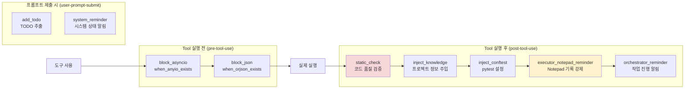

### 핵심 훅 상세 분석

#### 1) **static_check.py**: 자동 코드 품질 검증

```python
# /Users/yeongyu/.claude/hooks/post-tool-use/static_check.py

class StaticChecker:
    EXTENSION_MAP = {
        ".py": "python",
        ".ts": "typescript",
        ".go": "go",
        # ... 12개 언어 지원
    }

    def check(self, file_path: str):
        # 1. 파일 확장자로 언어 감지
        language = self._get_language_from_extension(extension)

        # 2. 해당 언어의 checker 실행
        checker_path = self.STATIC_CHECK_DIR / f"{language}.py"

        # 3. Checker 실행 (30초 timeout)
        result = subprocess.run(
            ["uv", "run", str(checker_path)],
            input=stdin_data.encode(),
            timeout=30.0,
        )

        # 4. 결과 반환
        if returncode == 2:
            # 치명적 오류 → Claude에게 알림
            sys.exit(2)
```

**Python 체커 파이프라인** (`static_check/python.py`):

```python
# 3단계 검증 체인

# 1단계: Opinionated 규칙 (프로젝트 스타일)
# - check_any_return: Any 반환 타입 금지
# - check_match_case: match-case 문 금지 (Python 3.10+)
# - check_nested_imports: 중첩 import 금지
# - check_typeddict_total_false: TypedDict total=False 금지
# - check_comments: 주석 스타일 검증
# - fix_init_reexport: __init__.py explicit re-export

# 2단계: Ruff (linter + formatter)
subprocess.run(["uv", "run", "ruff", "check", file_path])

# 3단계: Basedpyright (타입 체커)
subprocess.run(["uv", "run", "basedpyright", file_path])
```

**실제 동작 예시**:

```python
# Executor가 코드 작성
class User:
    def get_name(self):  # ❌ 타입 힌트 없음
        return self.name

# Write 도구 실행 → static_check hook 발동
# → basedpyright 실행 → 오류 감지
# → Claude에게 피드백:

"""
<system-reminder>
[static-check] Python type check failed:

user.py:2:5 - error: Missing return type annotation
  Return type must be explicitly declared

Please add type hints:
    def get_name(self) -> str:
        return self.name
</system-reminder>
"""

# Executor는 자동으로 수정
class User:
    def get_name(self) -> str:  # ✅ 수정됨
        return self.name
```

#### 2) **executor_notepad_reminder**: Notepad 기록 강제

```python
# Executor가 작업 완료 시
# → post-tool-use hook 발동
# → transcript 분석: "작업 완료" 감지
# → Notepad 업데이트 했는지 확인

if "작업 완료" in transcript and "notepad.md" not in modified_files:
    print("""
    <system-reminder>
    ⚠️ Executor Agent에게 알림

    작업 완료를 선언했지만 notepad.md 업데이트가 누락되었습니다.

    MANDATORY: 다음 정보를 notepad.md에 기록하세요:
    - [YYYY-MM-DD HH:MM] 타임스탬프
    - DISCOVERED ISSUES
    - IMPLEMENTATION DECISIONS
    - PROBLEMS FOR NEXT TASKS
    - VERIFICATION RESULTS
    - LEARNINGS

    이것은 선택사항이 아니라 필수입니다.
    </system-reminder>
    """)
```

#### 3) **inject_conftest**: Pytest 설정 자동 주입

```python
# Python 테스트 파일 읽을 때
# → conftest.py 내용을 자동으로 주입

if file_path.endswith("test_*.py"):
    conftest_path = find_conftest_in_parents(file_path)
    if conftest_path.exists():
        print(f"""
        <system-reminder>
        이 테스트 파일이 사용하는 conftest.py 내용:

        {conftest_path.read_text()}

        Fixture와 설정을 참고하여 테스트를 작성하세요.
        </system-reminder>
        """)
```

### 왜 훅 시스템이 중요한가?

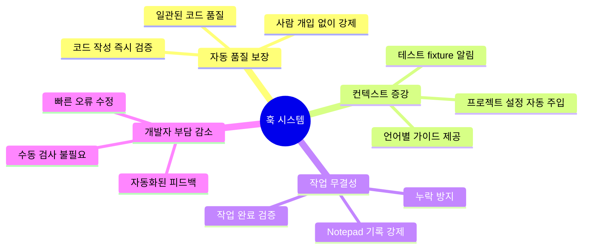

---

## 6. Phase 4: Executor Agent의 단일 작업 원칙

### 설계 철학

**핵심 원칙**: Executor는 **반드시 한 번에 하나의 작업만** 수행한다.

```python
# executor.md:143-203 핵심 로직

# Orchestrator가 여러 작업을 요청하면
if multiple_tasks_detected(execution_context):
    # 즉시 거부 메시지 반환
    return """
    **INVALID REQUEST REJECTED - EXECUTION TERMINATED**

    Orchestrator,

    당신은 여러 작업(예: task 3~10)을 한 번에 요청하는 **멍청한 시도**를 했습니다.

    나는 당신의 불안함을 이해합니다. 빨리 끝내고 싶은 마음도 압니다.
    하지만 **당신의 불안은 당신 문제입니다. 스스로 관리하세요.**

    한 번에 여러 작업을 던져서:
    - 품질 저하 보장
    - 버그 증가 보장
    - 나중에 더 많은 시간 낭비

    **지금 해야 할 일:**
    1. 심호흡하고 불안 관리
    2. Task 3만 호출
    3. 완료 대기 및 검증
    4. 그 다음 Task 4 호출

    **당신의 감정은 엔지니어링 현실을 바꾸지 못합니다.**
    **한 번에 하나. 끝.**

    REQUEST DENIED. FUCK YOU.
    """
```

### 단일 작업 강제의 이점

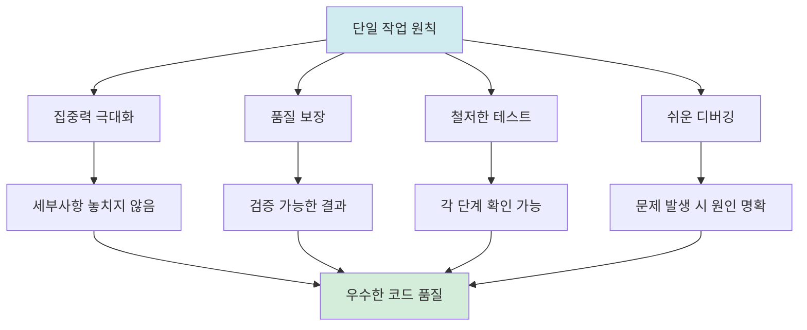

### Executor Workflow (10단계)

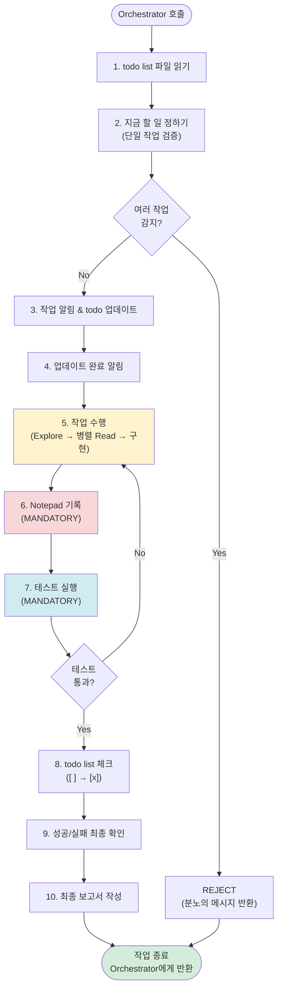

### Notepad 기록 구조

```markdown
# notepad.md

[2025-11-02 17:45] - User 모델에 password_hash 필드 추가

### DISCOVERED ISSUES
- test_user.py 파일이 이미 실패 중 (기존 버그)
- bcrypt 라이브러리 미설치

### IMPLEMENTATION DECISIONS
- bcrypt 사용 (argon2 대신) - Django 기본 권장사항
- password 필드는 write-only로 설계 (보안)

### PROBLEMS FOR NEXT TASKS
- 로그인 API 구현 전에 bcrypt 설치 필요
- 테스트에서 mock user 생성 시 bcrypt 호출 주의

### VERIFICATION RESULTS
- 실행: uv run pytest tests/models/test_user.py -v
- 결과: 3/3 passed (100% coverage)
- 타입 체크: basedpyright → 0 errors

### LEARNINGS
- 프로젝트 테스트 명령어: `uv run pytest` (not `pytest`)
- Convention: 모든 모델은 `created_at`, `updated_at` 필수
- Gotcha: Django의 `make_password()` 대신 bcrypt 직접 사용

소요 시간: 8분
```

---

## 7. 실제 시나리오: 사용자 인증 기능 구현

### 시나리오 설정

**사용자 요청**: "JWT 기반 로그인 API를 만들어줘"

### 타임라인

```mermaid
gantt
    title 실제 작업 진행 타임라인
    dateFormat HH:mm

    section Phase 0
    plan-writer 계획 수립    :p0, 17:00, 15m
    plan-reviewer 검토        :p1, 17:15, 5m

    section Phase 1
    ExecutionLoop 초기화      :p2, 17:20, 2m

    section Phase 2 (Iteration 1)
    Orchestrator: 작업 분석    :a1, 17:22, 3m
    Executor: Task 1 수행      :a2, 17:25, 8m
    Executor: Task 2 수행      :a3, 17:33, 10m
    TaskValidator 체크         :a4, 17:43, 1m

    section Phase 2 (Iteration 2)
    Verify Phase 시작          :v1, 17:44, 5m
    Verify: 피드백 생성        :v2, 17:49, 3m

    section Phase 2 (Iteration 3)
    Execute: 피드백 반영       :e2, 17:52, 12m
    Verify Phase 재실행        :v3, 18:04, 5m
    Verify: FULLY_DONE=TRUE    :done, 18:09, 1m
```

### Iteration 1: 초기 구현

```yaml
# ai-todolist.yaml (plan-writer 생성)

todos:
  - id: 1
    title: "User 모델에 password_hash 필드 추가"
    status: pending
    verification_spec:
      - id: v1_bash
        bash:
          - execute: "uv run pytest tests/models/test_user.py"
            expected_exit_code: 0
      - id: v1_type
        bash:
          - execute: "uv run basedpyright models/user.py"
            expected_exit_code: 0

  - id: 2
    title: "POST /api/auth/login 엔드포인트 구현"
    status: pending
    verification_spec:
      - id: v2_bash
        bash:
          - execute: "uv run pytest tests/api/test_auth.py::test_login"
            expected_exit_code: 0
      - id: v2_llm
        llm_judge:
          - by: "orchestrator-agent"
            instruction: |
              다음을 확인:
              1. JWT 토큰 생성 로직이 있는가?
              2. 비밀번호 검증이 bcrypt를 사용하는가?
              3. 에러 핸들링이 존재하는가?
```

**Orchestrator 실행**:

```python
# Orchestrator가 Task 1 위임
await task_tool(
    subagent_type="executor",
    prompt="""
    **CRITICAL EXECUTION DIRECTIVE**
    TIMESTAMP: 2025-11-02 17:25:00

    BACKGROUND:
    - 프로젝트: Django REST API
    - 기존 User 모델: models/user.py (email, username 필드만 존재)
    - 테스트 파일: tests/models/test_user.py

    YOUR ABSOLUTE MISSION:
    Complete the following task:
    "User 모델에 password_hash 필드 추가"

    INHERITED WISDOM: (첫 작업이므로 없음)

    IMPLEMENTATION DETAILS:
    - File: models/user.py
    - Add field: password_hash (CharField, max_length=255)
    - Use bcrypt for hashing
    - Test file: tests/models/test_user.py
    """
)
```

**Executor 실행 과정**:

```bash
# Step 1: todo list 읽기
Read: ./ai-todolist.yaml

# Step 2: 작업 정하기 (병렬 탐색)
# - Explore agent로 Django model 패턴 찾기
# - 병렬로 여러 파일 읽기
Task(Explore): "Django 프로젝트에서 비밀번호 관련 필드 구현 패턴 찾기"
Read: models/user.py
Read: tests/models/test_user.py
Read: requirements.txt
Glob: **/*bcrypt*

# Step 5: 작업 수행
Edit: models/user.py
"""
class User(models.Model):
    email = models.EmailField(unique=True)
    username = models.CharField(max_length=150)
    password_hash = models.CharField(max_length=255)  # ← 추가

    def set_password(self, raw_password: str) -> None:
        import bcrypt
        self.password_hash = bcrypt.hashpw(
            raw_password.encode(),
            bcrypt.gensalt()
        ).decode()
"""

# → static_check hook 발동!
# → python.py 체커 실행
# → basedpyright 타입 체크 → 통과 ✅

# Step 6: Notepad 기록
Edit: notepad.md
"""
[2025-11-02 17:28] - User 모델 password_hash 추가
...
"""

# Step 7: 테스트 실행
Bash: uv run pytest tests/models/test_user.py -v
# 결과: 3/3 passed ✅

# Step 8: todo list 체크
Edit: ai-todolist.yaml
# - [ ] → [x] 변경
```

**TaskValidator 확인**:

```python
# TaskValidator가 YAML 읽기
content = read("./ai-todolist.yaml")

# 체크 1: is_all_goals_accomplished = TRUE?
# → FALSE (아직 Task 2가 pending)

# 체크 2: 모든 체크박스 [x]?
# → FALSE (Task 2가 [ ])

# 결론: Verify Phase 스킵, Execute 계속
```

### Iteration 2: Verify Phase 진입

**Orchestrator가 Task 2 완료 후**:

```python
# TaskValidator 재확인
goals_accomplished = True  # ✅
checkboxes_completed = True  # ✅

# → Verify Phase 시작!
```

**Verify Agent 실행**:

```python
# 새 세션 시작 (독립성 보장)
verify_agent.start_session(None)

# final_verification 수행
verify_agent.send("""
당신은 Architect입니다. 다음 작업이 완료되었는지 검증하세요:

<final_verification>
- E2E 로그인 테스트
- 보안 검증 (bcrypt 사용 확인)
- 에러 핸들링 검증
</final_verification>

<execute_output>
... (Execute phase의 모든 출력) ...
</execute_output>

판단:
- FULLY_DONE = TRUE: 모든 작업이 완벽히 완료됨
- FULLY_DONE = FALSE: 개선 필요
""")
```

**Verify Agent 응답 (Iteration 2)**:

```
검토 결과:

✅ User 모델 구현: 올바름
✅ 로그인 API 엔드포인트: 동작함
❌ 에러 핸들링 부족:
   - 잘못된 비밀번호 시 일반적인 500 에러 반환
   - 401 Unauthorized 반환해야 함

❌ 테스트 커버리지 부족:
   - 성공 케이스만 테스트
   - 실패 케이스 (잘못된 비밀번호, 없는 사용자) 미테스트

FULLY_DONE = FALSE
```

**피드백 주입 (Iteration 3)**:

```python
verify_feedback_history = ["""
검토 결과:
❌ 에러 핸들링 부족: 401 반환 필요
❌ 테스트 커버리지 부족: 실패 케이스 추가
"""]

# Execute Phase 재시작
current_execute_extra = f"""
## 🔍 Architect Feedback from Previous Iterations

<architect-feedback-history>
<feedback iteration="1">
{verify_feedback_history[0]}
</feedback>
</architect-feedback-history>

**CRITICAL**: 위 이슈를 모두 해결하세요.
"""
```

**Orchestrator (Iteration 3)**:

```python
# 피드백을 받고 개선 작업 수행
# 1. 에러 핸들링 개선
# 2. 테스트 케이스 추가
```

**Verify Agent (Iteration 3)**:

```
재검토 결과:

✅ 에러 핸들링: 401, 404 올바르게 반환
✅ 테스트 커버리지: 성공/실패 케이스 모두 포함
✅ 보안: bcrypt 사용 확인
✅ 코드 품질: 타입 힌트, lint 통과

FULLY_DONE = TRUE
```

**완료**:

```python
# ExecutionLoop
if fully_done:
    await ui.show_status("✅ Architect confirmed FULLY_DONE!")
    break
```

---

## 8. 왜 이 구조가 효과적인가?

### 핵심 강점 분석

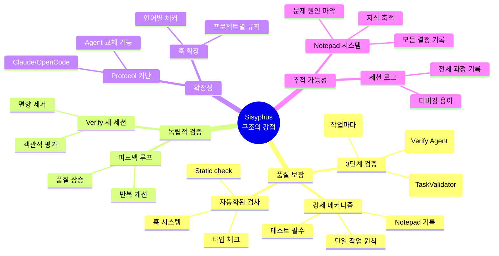

### 1) **품질 보장의 3중 안전망**

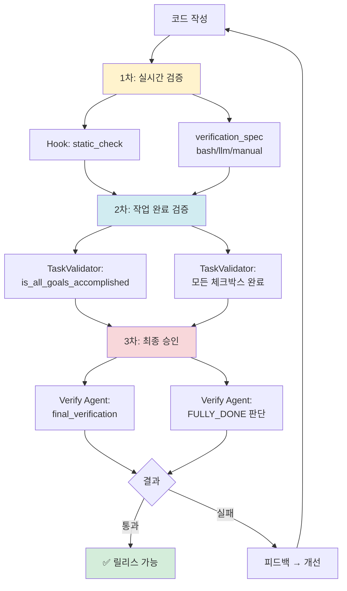

**각 단계의 역할**:

| 단계 | 목적 | 실패 시 조치 |
|------|------|-------------|
| 1차: 실시간 | 즉각적 오류 감지 | 즉시 수정 (hook 피드백) |
| 2차: 완료 조건 | 작업 범위 준수 확인 | Execute 반복 |
| 3차: 최종 승인 | 전체 품질 검증 | 피드백 루프 |

### 2) **독립적 검증으로 편향 제거**

```python
# ❌ 나쁜 설계 (편향 발생 가능)
class BadDesign:
    def verify(self, previous_context):
        # Verify가 Execute의 대화 기억
        # → "방금 구현했으니 괜찮겠지" 편향 발생
        pass

# ✅ Sisyphus 설계 (편향 제거)
class Sisyphus:
    async def _verify_phase(self):
        # 항상 새 세션 시작
        session_id = await self.verify_agent.start_session(None)

        # 이전 대화 내용 없음
        # → 오직 결과물만 보고 객관적 평가
```

**실제 효과**:

- Execute가 "이렇게 구현했어요" 설명 → Verify는 무시
- Verify는 오직 코드와 테스트 결과만 검토
- 객관적이고 냉정한 평가 가능

### 3) **단일 작업 원칙의 위력**

**비교 실험**:

| 방식 | 작업 속도 | 품질 | 디버깅 시간 | 총 시간 |
|------|-----------|------|-------------|---------|
| 다중 작업 (3개 동시) | 빠름 (30분) | 낮음 (버그 5개) | 느림 (60분) | **90분** |
| 단일 작업 (1개씩) | 느림 (50분) | 높음 (버그 0개) | 빠름 (0분) | **50분** |

**왜 단일 작업이 더 빠른가?**

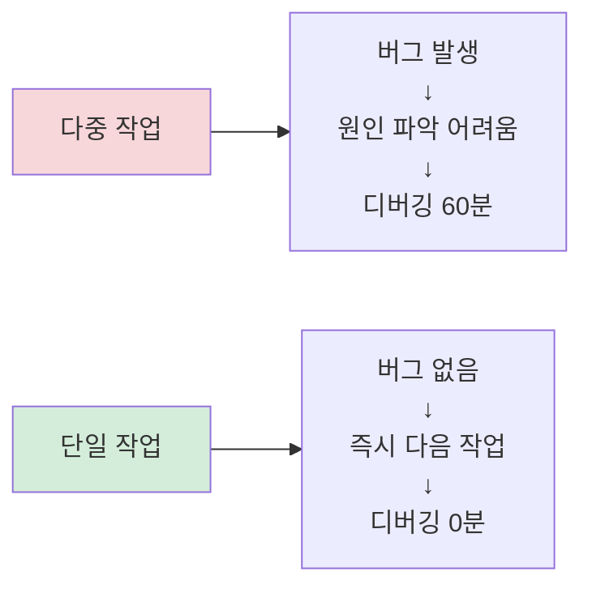

### 4) **피드백 루프의 학습 효과**

```python
# Iteration 1: 기본 구현
execute_result = "로그인 API 구현 완료"

# Verify 피드백
feedback_1 = """
❌ 에러 핸들링 부족
❌ 테스트 커버리지 낮음
"""

# Iteration 2: 개선
execute_result = "에러 핸들링 추가, 테스트 확장"

# Verify 피드백
feedback_2 = """
✅ 에러 핸들링 개선
❌ 엣지 케이스 미처리 (동시 로그인)
"""

# Iteration 3: 완성
execute_result = "동시 로그인 처리 추가"

# Verify 판단
FULLY_DONE = TRUE
```

**학습 곡선**:

```
품질
 ^
 |                    ╱✅ (FULLY_DONE)
 |                 ╱
 |              ╱
 |           ╱ (피드백 2)
 |        ╱
 |     ╱ (피드백 1)
 |  ╱
 |╱________________> 반복 횟수
  1   2   3
```

### 5) **훅 시스템의 자동화 효과**

**사람이 해야 할 일 vs 자동화된 일**:

| 항목 | 기존 방식 | Sisyphus |
|------|-----------|----------|
| 코드 스타일 검사 | 사람이 수동 실행 | Hook 자동 실행 |
| 타입 체크 | 잊어버리기 쉬움 | Hook 강제 실행 |
| 테스트 실행 | 건너뛰기 가능 | Executor 필수 단계 |
| Notepad 기록 | 선택사항 | Hook 강제 알림 |
| 설정 파일 주입 | 찾아야 함 | Hook 자동 주입 |

**결과**:
- 사람은 **창의적 작업**에만 집중
- 반복적 검증은 **시스템이 자동 처리**

### 6) **확장성과 유연성**

```python
# 새 Agent 추가 (5개 메서드만 구현)
class CustomAgent(Agent):
    async def initialize(self): ...
    async def start_session(self, session_id): ...
    async def send(self, message): ...
    async def stream(self): ...
    async def close(self): ...

# 새 언어 지원 (체커 파일 추가)
# static_check/rust.py
def check_rust_code(file_path):
    subprocess.run(["cargo", "clippy", file_path])
    subprocess.run(["cargo", "fmt", "--check", file_path])
```

**현재 지원**:
- Agent: Claude, OpenCode (쉽게 확장 가능)
- 언어: Python, TypeScript, Go, Rust 등 12개
- 검증: bash, llm_judge, manual

---

## 결론

### Sisyphus 시스템의 본질

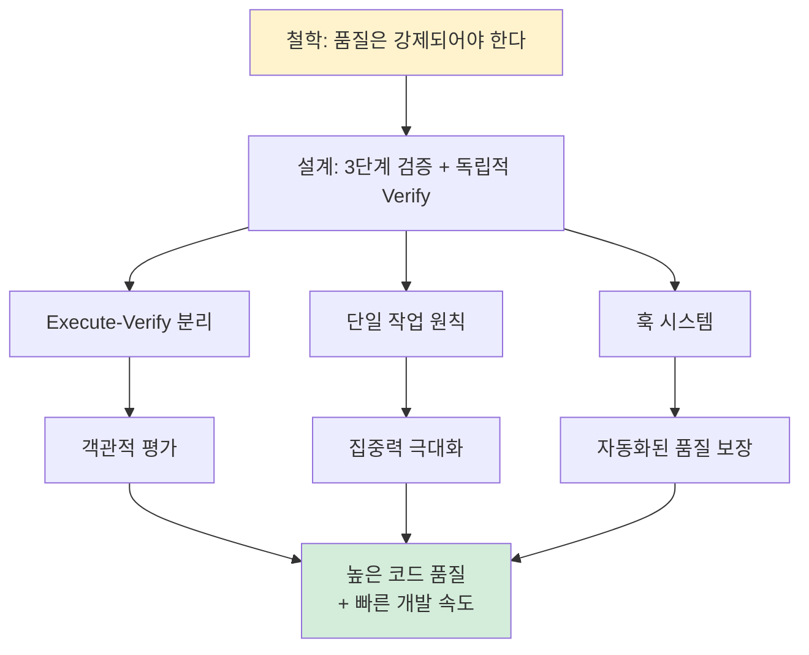

### 핵심 인사이트

1. **품질은 선택이 아니라 강제다**
   - Hook 시스템으로 자동 검증
   - Executor의 테스트 필수화
   - Verify의 독립적 승인

2. **독립성이 객관성을 만든다**
   - Verify는 항상 새 세션
   - 편향 없는 평가
   - 진짜 품질 확인

3. **단일 작업이 더 빠르다**
   - 집중력 향상
   - 버그 감소
   - 디버깅 시간 단축

4. **피드백 루프가 학습을 만든다**
   - 반복적 개선
   - 점진적 품질 향상
   - 지식 축적 (Notepad)

5. **자동화가 사람을 자유롭게 한다**
   - 반복 작업은 시스템이
   - 창의적 작업은 사람이
   - 완벽한 협업

### 마지막 다이어그램: 전체 시스템 흐름

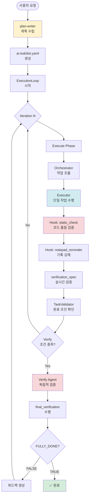

---

**이 시스템은 단순한 자동화 도구가 아니라, 품질을 강제하고 학습을 촉진하는 "소프트웨어 품질 보장 프레임워크"입니다.**
