# Sisyphus 전체 실행 플로우 분석

> **작성일**: 2025-11-02
> **목적**: Sisyphus의 Execute-Verify 피드백 루프 시스템을 미시적 관점까지 포함하여 완전히 이해하고 문서화

---

## 목차

0. [Sisyphus란?](#0-sisyphus란)
1. [전체 개요](#1-전체-개요)
2. [Phase 0: 계획 수립 및 병렬 실행 전략](#2-phase-0-계획-수립-및-병렬-실행-전략)
3. [Phase 1: 실행 루프 초기화](#3-phase-1-실행-루프-초기화)
4. [Phase 2: Execute-Verify 피드백 루프 (핵심)](#4-phase-2-execute-verify-피드백-루프-핵심)
5. [Phase 3: 훅 시스템과 품질 강제 메커니즘](#5-phase-3-훅-시스템과-품질-강제-메커니즘)
6. [Phase 4: Orchestrator와 Executor의 검증 시스템](#6-phase-4-orchestrator와-executor의-검증-시스템)
7. [실제 시나리오: 사용자 인증 기능 구현](#7-실제-시나리오-사용자-인증-기능-구현)
8. [왜 이 구조가 효과적인가?](#8-왜-이-구조가-효과적인가)
9. [최종 요약: 미시적 관점에서 본 Sisyphus의 전체 흐름](#9-최종-요약-미시적-관점에서-본-sisyphus의-전체-흐름)

---

## 0. Sisyphus란?

### Natural Language Compiler

신화 속 시지푸스는 신들을 기만한 죄로 영원히 돌을 굴려야 했습니다. LLM Agent들은 딱히 잘못한 건 없지만 매일 머리를 굴리고 있습니다. 제 삶도 그렇습니다. 돌이켜보면 우리 인간들과 다르지 않습니다.

네, LLM Agent들은 우리 인간들과 다르지 않습니다.

명확한 작업 계획과 함께라면 LLM Agent들도 훌륭한 산출물을 만들어낼 수 있습니다. 일을 맡겨놓고, 인간은 그저 완료됐을 때 검토하면 됩니다.

당신이 엔지니어라면, 시지푸스는 당신을 CTO로 만들어줍니다.

시지푸스는 자연어를 코드로 컴파일하는 것을 목표로 합니다.

### 핵심 철학: "Let there be light"

**하지만 명확한 계획이 없어도 괜찮습니다.**
- Sisyphus가 당신의 모호한 요청을 명확한 계획으로 만들어줍니다
- plan-writer가 질문하고, 탐색하고, 구조화합니다
- 당신은 검토하고 승인하기만 하면 됩니다

#### 시스템 동작 방식

**1. Executor (실행자)**
- 적절한 크기의 **한 가지 작업에만 집중**
- 깨끗한 컨텍스트, 높은 품질, 혼란 없음
- Linter, Formatter, Type Checker + 게으른 코딩 패턴을 감지하는 Hook 시스템
- 작업 완료 후 품질 평가, 특이사항 기록, 인수인계 문서 작성

**2. Talk is cheap. Show me the code.**
- Executor 완료 보고 → Agent는 믿지 않고 **직접 검증**
- 테스트 실행, 코드 읽기, 인수인계 문서 검토
- 철저한 마이크로매니지먼트
- 미완료 시 피드백과 함께 재할당

**3. No free time allowed.**
- LLM Agent가 중간에 멈추면 **Sisyphus가 강제로 재시작**
- 작업이 진짜로 완료될 때까지 세션 계속

**4. 검증 Agent (Verify Agent)**
- **컨텍스트 없는** 외부 전문가 Agent 소환
- 작업 계획, 인수인계 문서 읽고 검증 시작
- 코드 검토, 테스트 실행, 실제 사용, QA 수행
- 매우 비판적이고 강력한 피드백 제공
- 피드백 수집 → Executor에게 재할당

**5. 무자비한 반복**

Sisyphus는 그저 바위를 계속 굴립니다. 작업이 완료될 때까지.

---

### Sisyphus의 본질: 신뢰할 수 있는 작업 에이전트

Sisyphus의 궁극적 목표는 **신뢰할 수 있는 작업 에이전트(Reliable Work Agent)**를 만드는 것입니다. 이를 위해 다층 검증 시스템과 자연어 컴파일러 개념을 구현했습니다.

#### 1. 빈틈없는 작업 계획서 유도

Sisyphus는 사용자를 유도하여 **실행 가능한 작업 계획서**를 만들게 합니다:
- **plan-writer 에이전트**가 사용자 요청을 상세한 YAML 스펙으로 변환
- 모호함 제거: "JWT? OAuth? 세션?" 같은 구체적 질문으로 명확화
- 검증 가능한 기준 명시: 각 작업마다 `verification_spec` 정의
- 의존성 관계 파악: 병렬 실행 가능성 분석

#### 2. 다층 검증 시스템 (Natural Language Compiler)

전통적인 컴파일러가 코드를 검증하듯, Sisyphus는 자연어 요청을 **컴파일 타임(=작업계획서대로 작업 진행 도중)에 검증**합니다:

**Layer 1: 실시간 검증 (Real-time)**
- Hook 시스템이 매 도구 호출마다 자동 실행
- `static_check.py`: Ruff linter + Basedpyright type checker
- `verification_spec`: 작업별 bash/llm_judge 검증
- Exit code 2로 Claude를 강제로 차단 → 수정 강제

**Layer 2: 프로그래매틱 검증 (Programmatic)**
- `TaskValidator`: ai-todolist.yaml의 체크박스 완료 여부 확인
- `is_all_goals_accomplished=TRUE` 플래그 검사
- Orchestrator의 직접 검증(Mini LLM as a Judge): 테스트 실행, 코드 읽기

**Layer 3: LLM as a Judge (Final Approval)**
- **Verify Agent** (새 세션): 편향 없는 독립적 검증
- `final_verification` 체크리스트 항목별 검토
- `FULLY_DONE` 판단 → FALSE면 피드백 루프 재시작
- Task 단위 + 작업 단위 이중 검증

#### 3. 작업 계획서의 중요성과 현대 모델의 역할

**시간 투자의 가치**:
- 작업 계획서 작성에 충분한 시간을 쓸 가치가 있음
- 꼼꼼함이 요구되지만, 현대 모델(Claude Sonnet 4.5, GPT-5)이 충분히 똑똑함
- 사용자는 **의도와 다른 부분이 있는지만 파악**하면 됨
- plan-writer가 대부분의 세부사항을 자동으로 채워줌

**복잡한 작업도 걱정 없음**:
- 작업자 에이전트(Executor)를 따로 두어 **컨텍스트 분리**
- 인수인계 시스템(Notepad + LEARNINGS)으로 지식 전달
- 긴 컨텍스트 걱정 없이 큰 프로젝트도 진행 가능
- 각 Executor는 단일 작업만 수행 → 집중력 극대화

#### 4. 의존성 기반 병렬 실행 전략

**대규모 프로젝트의 궁극적 달성**:

Sisyphus는 작업 간 의존성을 분석하여 **병렬 실행**을 가능하게 합니다:

```python
# 예시: 사용자 인증 시스템 구현
A (DB 스키마) → B (User 모델) → C (API 엔드포인트)
D (프론트엔드 컴포넌트) - 독립적
E (JWT 라이브러리) → F (인증 미들웨어)
L (통합 테스트) - B와 F에 의존

# 병렬 실행 배치:
Batch 1: [A, D, E]  # 의존성 없음 → 동시 실행
Batch 2: [B, F]     # A, E 완료 후
Batch 3: [C, L]     # B, F 완료 후
```

**실행 시간 단축**:
- 순차 실행: 34분
- 병렬 실행: 15분 (56% 감소)
- 충돌 방지: 파일/리소스 접근 분석으로 안전성 보장

**궁극적 비전**:
> 사용자는 요청만 하고, Sisyphus에게 맡긴 뒤
> 최종 결과물만 확인하는 완전 자동화된 개발 워크플로우

#### 5. "Let there be light" - 빛이 있으라

컴파일러가 소스 코드를 실행 가능한 바이너리로 변환하듯,
Sisyphus는 **자연어 요청을 검증된 코드로 변환**합니다.

명확한 계획(빛) → 신뢰할 수 있는 실행(창조)

**핵심 원칙**:
- 품질은 선택이 아니라 **강제**
- 검증은 한 번이 아니라 **계속**
- 완료는 주관이 아니라 **객관**

#### 6. 다른 AI 에이전트 서비스와의 차별화

**Sisyphus는 속도가 아닌 신뢰성을 선택했습니다.**

단일 작업당 크기가 작고, 검증 레이어가 많아서 시간과 토큰 효율성 면에서는 불리할 수 있습니다. 하지만:

**Sisyphus가 추구하는 바**:
> 맡겨두고, 온전히 확인만 할 수 있는 **신뢰할 수 있는 에이전트**

다른 서비스들:
- ❌ 빠르게 끝내지만 → 당신이 계속 확인하고 수정해야 함
- ❌ "거의 완료됨" → 실제로는 80%만 완료. 더 문제는, 아예 다르게 작업할때도 있음.
- ❌ 컨텍스트 길어지면 → 품질 저하, 혼란 증가

Sisyphus:
- ✅ 느리지만 확실하게 → 맡기고 다른 일 가능
- ✅ "완료됨" → 진짜 100% 완료 (검증됨)
- ✅ 병렬 실행 → 여러 작업 동시 진행하면서 당신은 자유로워짐

#### 7. 실용적 가치: 당신의 시간을 해방시킨다

**기본 전제**: 작업 완수율이 훨씬 높기 때문에

당신이 해야 할 일:
1. **작업 계획서 작성** (또는 Sisyphus가 초안 작성 → 당신이 검토)
2. **병렬로 여러 작업 할당**
3. **결과 확인** (완료 알림 받으면)

당신이 할 필요 없는 일:
- ~~코드 작성~~
- ~~테스트 실행~~
- ~~버그 수정~~
- ~~에이전트 감시~~

**당신의 시간은 더 중요한 곳에**:
- 다음 작업 계획서 작성
- 아이디에이션
- 비즈니스 로직 설계
- 아키텍처 의사결정
- 실제 중요한 문제 해결

#### 8. 메타: 작업 계획서 자체가 코드다

**2중 컴파일 프로세스**:

```
자연어 요청 → [Sisyphus/plan-writer] → 작업 계획서 (YAML)
                                              ↓
                                     [Sisyphus/executor]
                                              ↓
                                        검증된 코드
```

**1단계 컴파일**: 자연어 → 작업 계획서
- 당신: "사용자 인증 시스템 만들어줘"
- Sisyphus: ai-todolist.yaml (실행 가능한 스펙)
- **작업 계획서 = 실행 가능한 코드**

**2단계 컴파일**: 작업 계획서 → 검증된 코드
- Sisyphus: YAML 읽고 → 코드 작성 → 검증 → 완료
- 당신: 결과만 확인

**핵심**:
> Sisyphus는 당신의 말을 작업 계획서(코드)로 변환하고,
> 그 작업 계획서를 다시 검증된 코드로 변환합니다.
>
> **당신은 그저 말만 하면 됩니다.**

---

## 1. 전체 개요

### 핵심 아키텍처

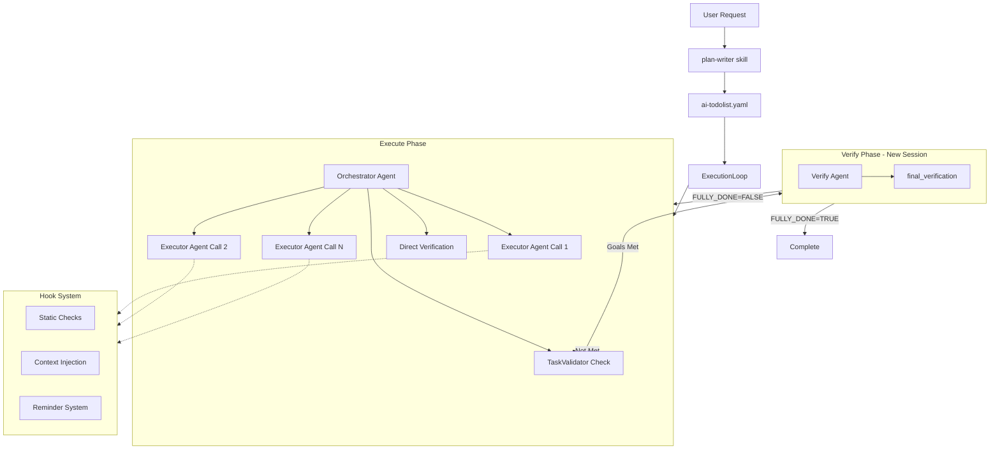

### 시스템의 3대 핵심 원칙

1. **Execute-Verify 분리**: 작업 수행과 검증을 독립적으로 실행
2. **3단계 검증 시스템**: 실시간 → 완료 조건 → 최종 승인
3. **단일 작업 원칙**: Executor는 반드시 한 번에 하나의 작업만 수행

---

## 2. Phase 0: 계획 수립 및 병렬 실행 전략

### 작동 방식

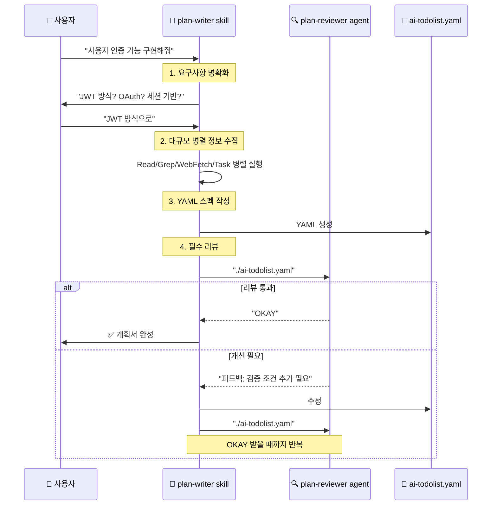

### 생성되는 YAML 스펙 구조

```yaml
# ai-todolist.yaml 예시

metadata:
  created_at: "2025-11-02T17:30:00+09:00"
  format_version: "2.1"

objectives:
  core: "JWT 기반 사용자 인증 시스템 구축"
  detailed:
    - goal: "로그인 API 엔드포인트 구현"
      measurable: "POST /api/auth/login 200 OK"

todos:
  - id: 1
    title: "User 모델에 password_hash 필드 추가"
    status: pending

    # 실시간 검증 스펙
    verification_spec:
      - id: "verify_1_bash"
        type: bash
        bash:
          - execute: "uv run pytest tests/models/test_user.py -v"
            expected_exit_code: 0

      - id: "verify_1_llm"
        type: llm_judge
        llm_judge:
          - by: "orchestrator-agent"
            instruction: "bcrypt를 사용했는지 확인"

final_verification:
  - id: "final_e2e"
    title: "E2E 로그인 테스트"
    bash:
      - execute: "curl -X POST localhost:8000/api/auth/login"
        expected_exit_code: 0
```

### 핵심 포인트

- **90% 신뢰도 원칙**: Worker가 외부 검색 없이 작업 가능해야 함
- **병렬 정보 수집**: 15-25개 도구를 단일 메시지로 동시 실행
- **필수 리뷰**: plan-reviewer가 "OKAY" 승인할 때까지 반복

---

### 의존성 그래프 기반 병렬 실행 전략

Sisyphus는 작업 계획(WorkPlan YAML)의 의존성 정보를 분석하여 **어떤 작업들을 동시에 실행할 수 있는지** 판단합니다. 이는 개념적 레벨에서 지원되며, 실제 병렬 실행은 멀티머신, 멀티프로세스, 멀티 Agent 세션 등 다양한 방식으로 구현 가능합니다.

#### 의존성 그래프 예시

작업이 다음과 같이 정의되어 있다고 가정합니다:

```
A → B → C
D (독립적)
E → F
G → H → I → J → K
L (B와 F에 의존) → M
```

#### 그래프 구조 분석

```python
# dependencies.py의 build_plan_graph() 결과
graph = {
    "A": [],           # 의존성 없음
    "B": ["A"],        # A에 의존
    "C": ["B"],        # B에 의존
    "D": [],           # 의존성 없음
    "E": [],           # 의존성 없음
    "F": ["E"],        # E에 의존
    "G": [],           # 의존성 없음
    "H": ["G"],        # G에 의존
    "I": ["H"],        # H에 의존
    "J": ["I"],        # I에 의존
    "K": ["J"],        # J에 의존
    "L": ["B", "F"],   # B와 F 모두에 의존
    "M": ["L"],        # L에 의존
}
```

#### 토폴로지 정렬과 배치 추출

`topo_sort()` (Kahn's algorithm)를 확장하여 **병렬 실행 배치(batch)**를 추출합니다:

```python
# 의사 코드: 병렬 배치 추출 알고리즘
def extract_parallel_batches(graph):
    in_degree = calculate_in_degree(graph)
    batches = []

    while in_degree:
        # 현재 실행 가능한 작업들 (in-degree = 0)
        batch = [node for node, degree in in_degree.items() if degree == 0]

        if not batch:
            raise CycleDetectedError()

        batches.append(batch)

        # 배치의 작업들 완료 가정, in-degree 업데이트
        for node in batch:
            del in_degree[node]
            for dependent in graph.get_dependents(node):
                in_degree[dependent] -= 1

    return batches
```

**결과 배치**:

```python
batches = [
    ["A", "D", "E", "G"],      # Batch 0: 의존성 없는 작업들
    ["B", "F", "H"],           # Batch 1: Batch 0 완료 후 실행 가능
    ["C", "I", "L"],           # Batch 2: L은 B와 F 모두 완료 대기
    ["J", "M"],                # Batch 3
    ["K"],                     # Batch 4
]
```

#### 병렬 실행 다이어그램

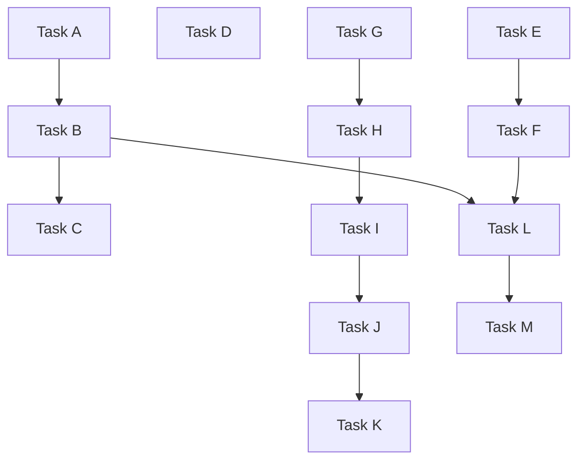

**배치 구성**:
- Batch 0 (병렬): A, D, E, G
- Batch 1 (병렬): B, F, H
- Batch 2 (병렬): C, I, L
- Batch 3 (병렬): J, M
- Batch 4: K

#### 실행 시간 비교

**순차 실행 (Sequential)**:
```
A(5분) → B(3분) → C(2분)
D(4분)
E(3분) → F(2분)
G(1분) → H(2분) → I(3분) → J(2분) → K(1분)
L(4분) → M(2분)

총 시간 = 5+3+2 + 4 + 3+2 + 1+2+3+2+1 + 4+2 = 34분
```

**병렬 실행 (Parallel)**:
```
Batch 0: max(A:5, D:4, E:3, G:1) = 5분
Batch 1: max(B:3, F:2, H:2) = 3분
Batch 2: max(C:2, I:3, L:4) = 4분
Batch 3: max(J:2, M:2) = 2분
Batch 4: K:1 = 1분

총 시간 = 5 + 3 + 4 + 2 + 1 = 15분 (56% 단축)
```

#### 경량 작업 우선 실행 전략

배치 내에서도 **가벼운 작업을 먼저** 시작하여 리소스 효율을 높일 수 있습니다:

```python
def prioritize_batch(batch, task_weights):
    # 작업 크기 예측 (코드 변경량, 파일 수 등)
    sorted_batch = sorted(batch, key=lambda t: task_weights.get(t, 0))
    return sorted_batch

# 예: Batch 0
# 원본: ["A", "D", "E", "G"]
# 우선순위: ["G"(1분), "E"(3분), "D"(4분), "A"(5분)]
# → 빠른 작업부터 시작하여 전체 처리량 증가
```

#### 의존성 충돌 방지 메커니즘

**1. 순환 의존성 감지**

```python
# dependencies.py의 detect_cycles() 사용
cycles = detect_cycles(graph)

if cycles:
    raise CircularDependencyError(
        f"Detected cycles: {cycles}\n"
        "Fix: Remove one dependency in each cycle"
    )
```

**2. 파일 충돌 감지**

동일 파일을 수정하는 작업들은 병렬 실행 불가:

```python
def check_file_conflicts(batch, task_file_map):
    file_usage = {}

    for task in batch:
        files = task_file_map[task]
        for file in files:
            if file in file_usage:
                raise FileConflictError(
                    f"Tasks {file_usage[file]} and {task} "
                    f"both modify {file}"
                )
            file_usage[file] = task
```

**3. 리소스 경합 방지**

데이터베이스, 포트 등 공유 리소스 사용 시 직렬화:

```python
def check_resource_conflicts(batch, task_resources):
    shared_resources = set()

    for task in batch:
        resources = task_resources[task]
        if resources & shared_resources:
            # 공유 리소스 있음 → 배치 분리
            return False
        shared_resources.update(resources)

    return True
```

#### 병렬 실행 적용 범위

**미시적 (Microscopic) 레벨**:
- Executor의 도구 호출 (Read 15개 병렬)
- Hook 시스템의 비동기 실행 (static_check의 3단계 체커)

**거시적 (Macroscopic) 레벨**:
- 독립적인 WorkPlan 작업들 병렬 실행
- 멀티 머신 환경에서 작업 분산
- 서로 다른 브랜치/Worktree에서 동시 작업

#### 핵심 인사이트

1. **의존성 그래프 = 병렬성 지도**
   - `sisyphus plan graph`로 시각화
   - 토폴로지 정렬로 실행 순서 결정
   - In-degree 0인 노드들 = 병렬 실행 가능

2. **개념적 지원, 구현은 유연**
   - 병렬 실행 전략은 시스템 레벨에서 결정
   - anyio task group, 멀티프로세스, 멀티머신 모두 가능
   - Sisyphus는 "무엇을 병렬로 돌릴 수 있는지"만 판단

3. **안전성 우선**
   - 순환 의존성 → 즉시 에러
   - 파일 충돌 → 배치 분리
   - 리소스 경합 → 직렬화

4. **효율성 극대화**
   - 경량 작업 우선 실행
   - 배치 크기 최적화
   - 전체 실행 시간 최소화

---

## 3. Phase 1: 실행 루프 초기화

### 시작 과정

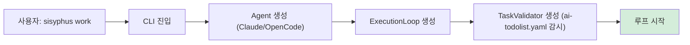

### ExecutionLoop 초기화

```python
class ExecutionLoop:
    def __init__(
        self,
        execute_agent: Agent,      # Claude/OpenCode
        verify_agent: Agent | None, # 독립적 검증 agent
        task_validator: TaskValidator | None,
        ui: UIProtocol,
        session_store: SessionStore,
        logger_factory: LoggerFactory,
    ):
        # Execute는 세션 재개 가능
        # Verify는 항상 신규 세션 (독립성 보장)
        self.verify_feedback_history = []
        self._consecutive_execute_count = 0
```

---

## 4. Phase 2: Execute-Verify 피드백 루프 (핵심)

### 전체 흐름도

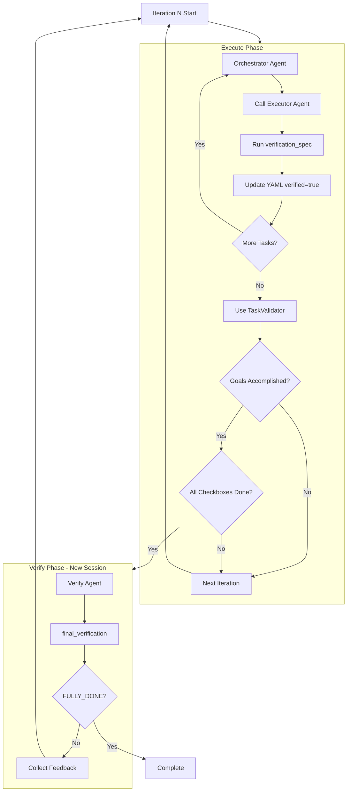

### 코드 레벨 상세 분석

```python
# loop.py:128-262 핵심 로직

async def _run_unified_mode(self):
    iteration = 0
    verify_feedback_history = []

    while True:
        iteration += 1

        # 1. Execute Phase
        current_execute_extra = execute_extra
        if verify_feedback_history:
            # 피드백을 XML 태그로 주입
            feedback_section = (
                "\n\n## 🔍 Architect Feedback\n\n"
                "<architect-feedback-history>\n"
            )
            for i, feedback in enumerate(verify_feedback_history, 1):
                feedback_section += f'<feedback iteration="{i}">\n{feedback}\n</feedback>\n\n'

            current_execute_extra = (execute_extra or "") + feedback_section

        # Execute 실행
        await self._execute_phase(execute_prompt, current_execute_extra)

        # 2. TaskValidator 체크
        should_verify = False
        if self.task_validator:
            content = self.task_validator.read_content()
            goals_accomplished = self.task_validator.check_all_goals_accomplished(content)
            checkboxes_completed = self.task_validator.check_all_checkboxes_completed(content)
            should_verify = goals_accomplished and checkboxes_completed

        # 3. Verify Phase (조건 충족 시)
        if should_verify and self.verify_agent:
            feedback, fully_done = await self._verify_phase(verify_prompt, verify_extra)

            if fully_done:
                await self.ui.show_status("✅ Architect confirmed FULLY_DONE!")
                break

            # 피드백 축적
            if feedback:
                verify_feedback_history.append(feedback)
```

### 핵심 메커니즘

#### 1) **세션 관리 전략**

```python
# Execute: 세션 재개 (대화 이어가기)
async def _execute_phase(self):
    session_id = await self.session_store.get_session(agent_type)

    try:
        # 이전 세션 재개 시도
        actual_session_id = await self.execute_agent.start_session(session_id)
    except SessionResumeError:
        # 실패 시 새 세션 시작
        actual_session_id = await self.execute_agent.start_session(None)

# Verify: 항상 새 세션 (독립적 검증)
async def _verify_phase(self):
    # 항상 None 전달 → 신규 세션
    actual_session_id = await self.verify_agent.start_session(None)
```

**왜 이렇게 설계했나?**
- Execute는 작업 맥락을 유지해야 함 (이전 대화 기억)
- Verify는 편향 없는 평가를 위해 독립적이어야 함

#### 2) **피드백 루프 메커니즘**

```python
# Verify가 FALSE 반환 시
if not fully_done:
    verify_feedback_history.append(feedback)
    # 다음 iteration에서 Execute에 주입

# Execute는 피드백을 받아 개선
"""
## 🔍 Architect Feedback from Previous Iterations

<architect-feedback-history>
<feedback iteration="1">
테스트 커버리지가 부족합니다. Edge case 추가 필요.
</feedback>

<feedback iteration="2">
에러 핸들링이 누락되었습니다. try-except 추가.
</feedback>
</architect-feedback-history>

**CRITICAL**: 위 피드백의 모든 이슈를 해결하세요.
"""
```

#### 3) **무한 루프 방지**

```python
execute_throttle_max_count = 10

if self._consecutive_execute_count >= execute_throttle_max_count:
    await self.ui.show_status(
        "⚠️ Execute phase repeated 10 times. Forcing Verify phase."
    )
    force_verify = True
```

---

## 5. Phase 3: 훅 시스템과 품질 강제 메커니즘

### 5.1 훅 시스템 전체 아키텍처

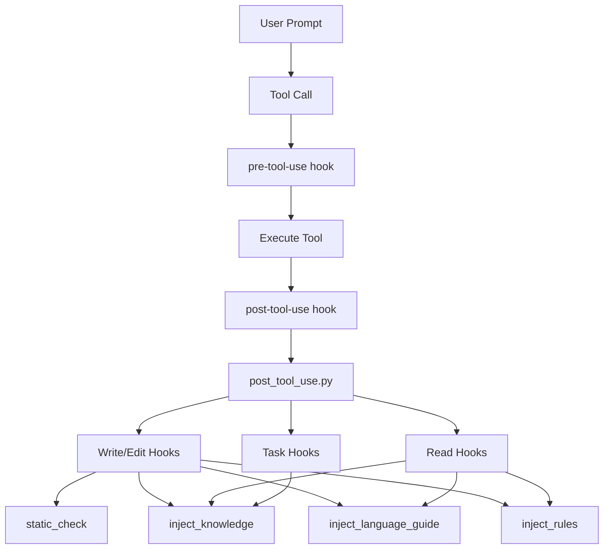

### 5.2 post_tool_use.py: 중앙 디스패처

**핵심 역할**: 도구 사용 후 적절한 훅들을 자동으로 실행하는 오케스트레이터

```python
# /Users/yeongyu/.claude/hooks/post_tool_use.py 핵심 로직

POST_TOOL_USE_CONFIG: list[HookMatcher] = [
    HookMatcher(
        matcher="Write|Edit|MultiEdit",  # 정규식 패턴
        hooks=[
            HookCommand(type="command", command="uv run ~/.claude/hooks/post-tool-use/delegation_enforcer.py", asyncable=False),
            HookCommand(type="command", command="uv run ~/.claude/hooks/post-tool-use/static_check.py", asyncable=False),
            HookCommand(type="command", command="uv run ~/.claude/hooks/post-tool-use/inject_conftest.py", asyncable=False),
            HookCommand(type="command", command="uv run ~/.claude/hooks/post-tool-use/inject_readme.py", asyncable=False),
            HookCommand(type="command", command="uv run ~/.claude/hooks/post-tool-use/inject_knowledge.py", asyncable=False),
            HookCommand(type="command", command="uv run ~/.claude/hooks/post-tool-use/inject_language_guide.py", asyncable=False),
            HookCommand(type="command", command="uv run ~/.claude/hooks/post-tool-use/inject_rules.py", asyncable=False),
            HookCommand(type="command", command="uv run ~/.claude/hooks/post-tool-use/system_reminder.py", asyncable=False),
        ],
    ),
    HookMatcher(
        matcher="Read",
        hooks=[
            HookCommand(type="command", command="uv run ~/.claude/hooks/post-tool-use/inject_conftest.py", asyncable=False),
            HookCommand(type="command", command="uv run ~/.claude/hooks/post-tool-use/inject_readme.py", asyncable=False),
            HookCommand(type="command", command="uv run ~/.claude/hooks/post-tool-use/inject_knowledge.py", asyncable=False),
            HookCommand(type="command", command="uv run ~/.claude/hooks/post-tool-use/inject_language_guide.py", asyncable=False),
            HookCommand(type="command", command="uv run ~/.claude/hooks/post-tool-use/inject_rules.py", asyncable=False),
        ],
    ),
    HookMatcher(
        matcher="Task",
        hooks=[
            HookCommand(type="command", command="uv run ~/.claude/hooks/post-tool-use/orchestrator_reminder.py", asyncable=True),
            HookCommand(type="command", command="uv run ~/.claude/hooks/post-tool-use/executor_notepad_reminder.py", asyncable=True),
        ],
    ),
]

async def _main() -> int:
    # 1. stdin으로 도구 정보 수신
    stdin_data = sys.stdin.read()
    input_json = json.loads(stdin_data)
    tool_name = input_json.get("tool_name")

    # 2. 매칭되는 훅 찾기
    matching_hooks: list[HookCommand] = []
    for config in POST_TOOL_USE_CONFIG:
        if match_tool(tool_name, config.matcher):  # 정규식 매칭
            matching_hooks.extend(config.hooks)

    # 3. 비동기 훅과 동기 훅 분리
    async_hooks = [hook for hook in matching_hooks if hook.asyncable]
    sync_hooks = [hook for hook in matching_hooks if not hook.asyncable]

    # 4. 비동기 훅 병렬 실행
    if async_hooks:
        tasks = [execute_hook_async(hook.command, stdin_data, cwd) for hook in async_hooks]
        results = await asyncio.gather(*tasks, return_exceptions=True)

        for hook, result in zip(async_hooks, results):
            returncode, stdout, stderr = result
            if returncode == 2 and stderr:  # 2 = Claude에게 알림 필요
                print(stderr, file=sys.stderr)

    # 5. 동기 훅 순차 실행 (의존성 있음)
    for hook in sync_hooks:
        returncode, stdout, stderr = await execute_hook_async(hook.command, stdin_data, cwd)

        if returncode == 2 and stderr:
            print(f"Hook Executed: {hook.command}", file=sys.stderr)
            print(stderr, file=sys.stderr)
```

**중요 개념**:
- **Exit code 2**: "Claude에게 알림 필요" 신호
- **Exit code 0**: 정상 완료, 조용히 통과
- **asyncable=True**: 병렬 실행 가능 (순서 무관)
- **asyncable=False**: 순차 실행 필수 (의존성 있음)

### 5.3 Rule Injection 훅들: 컨텍스트 자동 주입 시스템

#### inject_knowledge.py: 프로젝트 지식 자동 주입

```python
# 동작 원리: 파일 읽거나 쓸 때, 가까운 CLAUDE.md/AGENTS.md 자동 발견

class KnowledgeFinder:
    KNOWLEDGE_FILES = ["claude.md", "agents.md"]

    def find_knowledge_files(self) -> list[KnowledgeInfo]:
        # 1. 현재 파일에서 프로젝트 루트까지 역방향 탐색
        candidates: list[tuple[Path, int]] = []
        current_dir = self.file_path.parent
        distance = 0

        while current_dir >= self.project_root:
            for file in current_dir.iterdir():
                if file.name.lower() in self.KNOWLEDGE_FILES:
                    candidates.append((file, distance))  # 거리 기록
            current_dir = current_dir.parent
            distance += 1

        # 2. Symlink 중복 제거 (resolve()로 실제 경로 비교)
        unique_by_realpath = {}
        for file_path, dist in candidates:
            real_path = file_path.resolve()
            if real_path not in unique_by_realpath:
                unique_by_realpath[real_path] = (file_path, dist)

        # 3. 내용 해시로 중복 제거 (같은 내용 = 1개만)
        content_groups = {}
        for file_path, dist in unique_by_realpath.values():
            content = file_path.read_text().strip()
            content_hash = hashlib.sha256(content.encode()).hexdigest()

            if content_hash not in content_groups:
                content_groups[content_hash] = []
            content_groups[content_hash].append((file_path, dist))

        # 4. 각 그룹에서 최적 파일 선택
        #    우선순위: agents.md > claude.md, 거리 가까운 것 우선
        for group in content_groups.values():
            group.sort(key=lambda x: (
                not ("agents" in x[0].name.lower()),  # agents 우선
                x[1]  # 거리 가까운 것
            ))
            selected_files.append(group[0])

        return sorted(selected_files, key=lambda x: x.distance)

class KnowledgeInjector:
    def check_and_inject(self, knowledge_info: KnowledgeInfo) -> str:
        full_path = self.project_root / knowledge_info["path"]

        # 이미 읽었는지 transcript 검사
        if self._has_knowledge_been_read(full_path):
            return ""  # 조용히 통과

        # Todo 추가
        self._add_todo_item(knowledge_info)

        # Claude에게 알림
        return f"""
        ACTION REQUIRED: Use Read tool to read AGENTS knowledge immediately. READ NOW.
        You MUST read the following knowledge file before proceeding:
        {full_path}

        [Todo added to ~/.claude/todos/{session_id}-agent-{session_id}.json]
        """
```

**실제 동작 예시**:

```bash
# 사용자가 models/user.py 편집
Edit: /project/app/models/user.py

# Hook 발동 → 지식 파일 탐색
# 발견:
#   - /project/app/AGENTS.md (distance=1)
#   - /project/CLAUDE.md (distance=2)

# Transcript 확인: AGENTS.md 안 읽음
# → Claude에게 알림 + Todo 추가

<system-reminder>
ACTION REQUIRED: Use Read tool to read AGENTS knowledge immediately.
You MUST read: /project/app/AGENTS.md
</system-reminder>

# Claude가 자동으로 읽음
Read: /project/app/AGENTS.md

# 다음번 편집 시 → 이미 읽음 감지 → 조용히 통과
```

#### inject_language_guide.py: 언어별 가이드 강제

```python
class LanguageGuideChecker:
    MODULAR_PROMPTS_DIR = Path.home() / ".claude" / "modular-prompts" / "languages"

    def check_and_inject(self, file_path: str) -> str:
        extension = Path(file_path).suffix  # e.g., ".py"
        guide_path = self.MODULAR_PROMPTS_DIR / f"{extension[1:]}.md"  # "py.md"

        if not guide_path.exists():
            return ""  # 가이드 없음 → 통과

        # Transcript 검사: 가이드 읽었는지 확인
        if self._has_guide_been_read(guide_path):
            self._mark_todo_completed(f"read-guide-{extension[1:].upper()}")
            return ""

        # Todo 추가
        self._add_todo_item(guide_path, extension[1:].upper())

        # 강제 알림
        return f"""
        ACTION REQUIRED: Use Read tool to read guide for {extension[1:].upper()} immediately. READ NOW.
        You MUST read the following guide before proceeding with {Path(file_path).name}:
        {guide_path}

        [Todo added]
        """
```

**왜 중요한가?**

```python
# Python 파일 편집 시 → py.md 가이드 강제 읽기

# ~/.claude/modular-prompts/languages/py.md 내용:
"""
- Use anyio instead of asyncio
- All functions must have type hints (ANN001)
- Use Protocol over ABC
- Double quotes only (ruff enforced)
- Given-When-Then test structure
"""

# → Claude가 이 규칙들을 자동으로 학습
# → 프로젝트 컨벤션 자동 준수
```

#### inject_rules.py: 파일별 규칙 자동 적용

```python
class RuleFinder:
    def find_rule_files(self, current_file_path: Path) -> list[tuple[Path, int]]:
        # 1. 프로젝트 룰 디렉토리 탐색
        rule_dirs = [
            self.project_root / ".cursorrules",
            self.project_root / ".claude" / "modular-prompts",
        ]

        # 2. 모든 .mdc, .md 파일 찾기
        candidates = []
        for rule_dir in rule_dirs:
            for rule_file in rule_dir.glob("**/*.md"):
                # 거리 계산 (현재 파일과 룰 파일의 공통 경로 길이)
                distance = self._calculate_distance(rule_file, current_file_path)
                candidates.append((rule_file, distance))

        # 3. 사용자 전역 룰 추가
        user_rules = Path.home() / ".claude" / "modular-prompts"
        for rule_file in user_rules.glob("**/*.md"):
            candidates.append((rule_file, 9999))  # 가장 낮은 우선순위

        # 4. 거리순 정렬 (가까운 것 우선)
        candidates.sort(key=lambda x: x[1])
        return candidates

class RuleParser:
    @staticmethod
    def parse_frontmatter(content: str) -> tuple[RuleMetadata, str]:
        # YAML frontmatter 파싱
        """
        ---
        globs: ["**/*.py", "tests/**"]
        alwaysApply: false
        description: "Python testing rules"
        ---

        # Python Testing Rules
        - Always use pytest
        - Use fixtures for setup
        """

        match = re.match(r"^---\s*\n(.*?)\n---\s*\n(.*)$", content, re.DOTALL)
        if match:
            metadata = yaml.safe_load(match.group(1))
            markdown = match.group(2)
            return metadata, markdown

class RuleMatcher:
    @staticmethod
    def should_apply(rule_metadata: RuleMetadata, current_file_path: Path) -> str | None:
        # 1. alwaysApply: true → 무조건 적용
        if rule_metadata.get("alwaysApply"):
            return "alwaysApply"

        # 2. globs 패턴 매칭
        globs = rule_metadata.get("globs", [])
        for glob_pattern in globs:
            if glob.globmatch(str(current_file_path), glob_pattern):
                return f"glob: {glob_pattern}"

        return None  # 적용 안 함

async def process_single_rule_file(...):
    # 1. 파일 읽기 + frontmatter 파싱
    content = await aiofiles.open(rule_path).read()
    metadata, markdown = RuleParser.parse_frontmatter(content)

    # 2. 매칭 여부 확인
    match_reason = RuleMatcher.should_apply(metadata, current_file_path)
    if not match_reason:
        return None

    # 3. 내용 해시 계산
    content_hash = hashlib.sha256(markdown.strip().encode()).hexdigest()[:16]

    # 4. 이미 읽었는지 확인 (transcript 검사)
    already_read_paths, already_read_hashes = already_read_contents
    if content_hash in already_read_hashes:
        return None  # 같은 내용 이미 읽음

    return RuleInfo(path=rule_path, content=content, match_reason=match_reason, ...)
```

**실제 동작 시나리오**:

```bash
# 프로젝트 구조:
# /project/.claude/modular-prompts/python-testing.md
# → globs: ["tests/**/*.py"]
#
# /project/src/api-guidelines.md
# → globs: ["src/api/**/*.py"]

# Executor가 tests/test_auth.py 편집
Edit: /project/tests/test_auth.py

# inject_rules.py 실행:
# 1. 룰 파일 발견: python-testing.md
# 2. Glob 매칭: "tests/**/*.py" 일치!
# 3. Transcript 확인: 안 읽음
# 4. Claude에게 알림:

<system-reminder>
ACTION REQUIRED: Rule applies to current file. READ NOW.
You MUST read: /project/.claude/modular-prompts/python-testing.md
Reason: glob: tests/**/*.py

[Todo added]
</system-reminder>

# Claude가 읽음 → 다음 내용 학습:
"""
# Python Testing Rules
- Use pytest fixtures from conftest.py
- Test structure: Given-When-Then
- Mock external dependencies
- 100% coverage for critical paths
"""

# → Claude가 이 규칙 따라서 테스트 작성
```

### 5.4 핵심 훅 상세 분석

#### static_check.py: 자동 코드 품질 검증

```python
# /Users/yeongyu/.claude/hooks/post-tool-use/static_check.py

class StaticChecker:
    EXTENSION_MAP = {
        ".py": "python",
        ".ts": "typescript",
        ".go": "go",
        ".rs": "rust",
        # ... 12개 언어 지원
    }

    def check(self, file_path: str):
        # 1. 파일 확장자로 언어 감지
        language = self._get_language_from_extension(extension)

        # 2. 해당 언어의 checker 실행
        checker_path = self.STATIC_CHECK_DIR / f"{language}.py"

        # 3. Checker 실행 (30초 timeout)
        result = subprocess.run(
            ["uv", "run", str(checker_path)],
            input=stdin_data.encode(),
            timeout=30.0,
        )

        # 4. 결과 반환
        if returncode == 2:
            # 치명적 오류 → Claude에게 알림
            sys.exit(2)
```

**Python 체커 파이프라인** (`static_check/python.py`):

```python
# 3단계 검증 체인 (병렬 실행)

async def _main() -> int:
    checker_files = sorted(checkers_dir.glob("python_*.py"))

    # 1단계: Opinionated 규칙 (python_1_opinionated.py)
    # - check_any_return: Any 반환 타입 금지
    # - check_match_case: match-case 문 금지
    # - check_nested_imports: 중첩 import 금지
    # - check_typeddict_total_false: TypedDict total=False 금지
    # - check_comments: 주석 스타일 검증
    # - fix_init_reexport: __init__.py explicit re-export

    # 2단계: Ruff (python_2_ruff.py)
    subprocess.run(["uv", "run", "ruff", "check", file_path])

    # 3단계: Basedpyright (python_3_basedpyright.py)
    subprocess.run(["uv", "run", "basedpyright", file_path])

    # 모든 체커 병렬 실행
    tasks = [execute_checker_async(str(checker), stdin_data, cwd)
             for checker in checker_files]
    results = await asyncio.gather(*tasks, return_exceptions=True)

    # 오류 수집
    claude_needs_to_know = False
    for checker_path, result in zip(checker_files, results):
        returncode, _, stderr = result
        if returncode == 2 and stderr:
            claude_needs_to_know = True
            print(stderr, file=sys.stderr)

    return 2 if claude_needs_to_know else 0
```

**실제 동작 예시**:

```python
# Executor가 코드 작성
class User:
    def get_name(self):  # ❌ 타입 힌트 없음
        return self.name

# Write 도구 실행 → static_check hook 발동
# → python.py 실행 → 3단계 체커 병렬 실행
# → basedpyright 오류 감지
# → Claude에게 피드백:

<system-reminder>
[static-check] Python type check failed:

user.py:2:5 - error: Missing return type annotation
  Return type must be explicitly declared

Please add type hints:
    def get_name(self) -> str:
        return self.name
</system-reminder>

# Executor는 자동으로 수정
class User:
    def get_name(self) -> str:  # ✅ 수정됨
        return self.name
```

### 5.5 훅 시스템의 핵심 가치

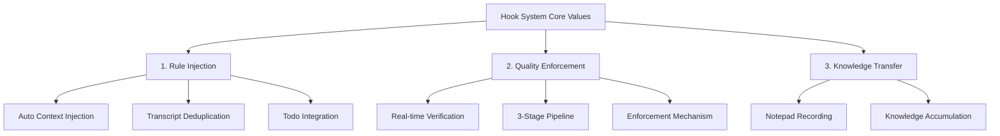

---

## 6. Phase 4: Orchestrator와 Executor의 검증 시스템

### 6.1 Orchestrator의 이중 검증 전략

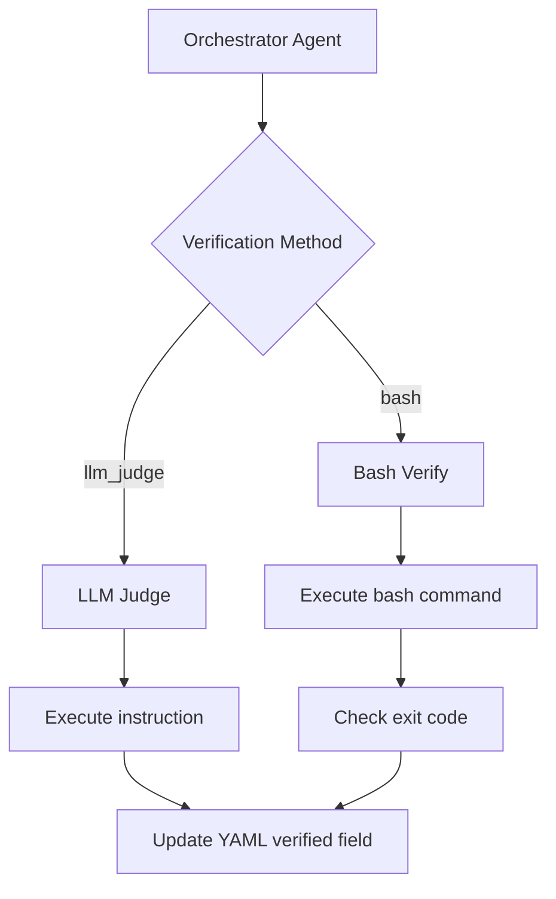

#### 직접 검증 (LLM Judge) - 상세 분석

**LLM Judge의 3가지 모드**:

```yaml
# Mode 1: Orchestrator 자체 검증 (기본)
verification_spec:
  - id: "verify_jwt_llm"
    type: llm_judge
    llm_judge:
      - by: "orchestrator-agent"
        instruction: |
          다음을 확인하세요:
          1. JWT 토큰이 올바르게 생성되는가?
          2. 만료 시간이 설정되어 있는가?
          3. Secret key가 하드코딩되지 않았는가?

# Mode 2: External LLM 검증 (객관성 강화)
verification_spec:
  - id: "verify_security_external"
    type: llm_judge
    llm_judge:
      - by: "external-llm"  # Codex, Gemini 등
        instruction: |
          보안 전문가 관점에서 검토:
          - SQL Injection 취약점
          - XSS 취약점
          - CSRF 토큰 검증
          - 입력 검증 누락

# Mode 3: Multi-Judge 합의 검증 (최고 신뢰도)
verification_spec:
  - id: "verify_architecture_multi"
    type: llm_judge
    llm_judge:
      - by: "orchestrator-agent"
        instruction: "아키텍처 일관성 확인"
      - by: "external-llm"
        instruction: "코드 품질 확인"
      - by: "external-llm-2"
        instruction: "성능 최적화 검토"
    consensus_required: 2  # 3명 중 2명 이상 통과 필요
```

**Orchestrator 실행 (상세)**:

```python
# Mode 1: 기본 검증
async def verify_with_orchestrator(task_id: str, llm_judge_spec: dict):
    # 1. 관련 파일 읽기 (자동 발견)
    related_files = discover_related_files(task_id)
    # → ["src/auth/jwt.py", "tests/test_jwt.py", "config/jwt_config.py"]

    # 2. 컨텍스트 구성
    context = ""
    for file_path in related_files:
        content = Read(file_path)
        context += f"\n\n<file path='{file_path}'>\n{content}\n</file>"

    # 3. Instruction 실행
    instruction = llm_judge_spec["llm_judge"][0]["instruction"]

    prompt = f"""
    You are an expert code reviewer. Carefully examine the code below.

    <instruction>
    {instruction}
    </instruction>

    <context>
    {context}
    </context>

    **CRITICAL EVALUATION CRITERIA:**
    - Be STRICT: Only mark verified=true if ALL conditions are met
    - Be SPECIFIC: List exact issues found
    - Be ACTIONABLE: Suggest concrete fixes

    **RESPONSE FORMAT (MANDATORY):**
    ```json
    {{
      "verified": true/false,
      "issues_found": [
        {{
          "severity": "critical|high|medium|low",
          "location": "file.py:line",
          "issue": "Description",
          "fix": "Suggested fix"
        }}
      ],
      "passed_checks": ["check1", "check2"],
      "overall_assessment": "Summary"
    }}
    ```
    """

    # 4. LLM 실행
    response = await orchestrator_agent.generate(prompt)

    # 5. JSON 파싱
    result = json.loads(extract_json(response))

    # 6. YAML 업데이트 (상세 정보 포함)
    update_verification_status(
        task_id=task_id,
        verified=result["verified"],
        verification_details={
            "judge": "orchestrator-agent",
            "timestamp": datetime.now().isoformat(),
            "issues_found": result["issues_found"],
            "passed_checks": result["passed_checks"],
            "assessment": result["overall_assessment"],
        }
    )

    # 7. verified=false 시 Executor에게 피드백
    if not result["verified"]:
        feedback = format_verification_feedback(result)
        send_to_executor(task_id, feedback)

    return result["verified"]

# Mode 2: External LLM 검증
async def verify_with_external_llm(task_id: str, llm_judge_spec: dict):
    # Codex 호출 (read-only sandbox)
    result = await run_bash(
        f"""
        bunx --bun codex --sandbox 'read-only' exec --skip-git-repo-check '
        {llm_judge_spec["llm_judge"][0]["instruction"]}

        Review files: {', '.join(related_files)}

        Return JSON with verified, issues_found, fixes.
        '
        """,
        timeout=1800000  # 30분
    )

    return parse_external_llm_result(result)

# Mode 3: Multi-Judge 합의
async def verify_with_multi_judge(task_id: str, llm_judge_spec: dict):
    judges = llm_judge_spec["llm_judge"]
    consensus_required = llm_judge_spec.get("consensus_required", len(judges))

    # 병렬 검증 실행
    tasks = []
    for judge in judges:
        if judge["by"] == "orchestrator-agent":
            tasks.append(verify_with_orchestrator(task_id, {"llm_judge": [judge]}))
        else:
            tasks.append(verify_with_external_llm(task_id, {"llm_judge": [judge]}))

    results = await asyncio.gather(*tasks)

    # 합의 확인
    passed_count = sum(1 for r in results if r["verified"])

    verified = passed_count >= consensus_required

    # 투표 결과 기록
    update_verification_status(
        task_id=task_id,
        verified=verified,
        verification_details={
            "mode": "multi-judge",
            "total_judges": len(judges),
            "passed": passed_count,
            "consensus_required": consensus_required,
            "individual_results": results,
        }
    )

    return verified
```

**실제 검증 시나리오 (심화)**:

```python
# 시나리오: JWT 인증 검증

# Orchestrator가 verification_spec 실행
task = {
    "id": 2,
    "title": "JWT 토큰 생성 로직 구현",
    "verification_spec": [
        {
            "id": "verify_jwt_llm",
            "type": "llm_judge",
            "llm_judge": [
                {
                    "by": "orchestrator-agent",
                    "instruction": """
                    다음 보안 체크리스트를 확인하세요:

                    **MUST HAVE (필수)**:
                    - [ ] JWT secret이 환경변수로 관리되는가?
                    - [ ] 토큰 만료 시간이 설정되어 있는가?
                    - [ ] HMAC-SHA256 이상의 알고리즘 사용하는가?

                    **SHOULD HAVE (권장)**:
                    - [ ] Refresh token 메커니즘이 있는가?
                    - [ ] 토큰 블랙리스트 처리가 있는가?

                    **SECURITY CHECKS**:
                    - [ ] 비밀번호가 평문으로 로그되지 않는가?
                    - [ ] 토큰이 URL에 노출되지 않는가?

                    모든 MUST HAVE 통과 시에만 verified=true
                    """
                }
            ]
        }
    ]
}

# 실행 결과 예시
result = {
    "verified": False,  # ❌ 실패
    "issues_found": [
        {
            "severity": "critical",
            "location": "src/auth/jwt.py:15",
            "issue": "JWT secret이 코드에 하드코딩됨: SECRET = 'my-secret'",
            "fix": "환경변수 사용: SECRET = os.getenv('JWT_SECRET')"
        },
        {
            "severity": "high",
            "location": "src/auth/jwt.py:28",
            "issue": "토큰 만료 시간 미설정",
            "fix": "exp 클레임 추가: {'exp': datetime.utcnow() + timedelta(hours=1)}"
        }
    ],
    "passed_checks": [
        "HMAC-SHA256 알고리즘 사용 확인",
        "비밀번호 평문 로그 없음"
    ],
    "overall_assessment": "2개 critical/high 이슈로 인해 검증 실패. 보안 기본 요구사항 미충족."
}

# Orchestrator가 Executor에게 피드백
feedback = f"""
<verification-failed task_id="2">
<summary>JWT 구현 검증 실패 - 보안 이슈 2건</summary>

<critical-issues>
1. JWT secret 하드코딩 (src/auth/jwt.py:15)
   - 현재: SECRET = 'my-secret'
   - 수정: SECRET = os.getenv('JWT_SECRET')

2. 토큰 만료 시간 미설정 (src/auth/jwt.py:28)
   - 추가 필요: {{'exp': datetime.utcnow() + timedelta(hours=1)}}
</critical-issues>

<action-required>
위 2개 이슈를 반드시 수정하세요. 수정 후 재검증합니다.
</action-required>
</verification-failed>
"""

# Executor가 피드백 받고 수정 → 재검증 → 통과
```

#### 프로그래매틱 검증 (Bash)

```yaml
todos:
  - id: 1
    title: "User 모델 password_hash 필드 추가"
    verification_spec:
      - id: "verify_1_bash"
        type: bash
        bash:
          - execute: "uv run pytest tests/models/test_user.py -v"
            expected_exit_code: 0
          - execute: "uv run basedpyright models/user.py"
            expected_exit_code: 0
```

**Orchestrator 실행**:

```python
bash_spec = task["verification_spec"][0]

for bash_cmd in bash_spec["bash"]:
    # 명령 실행
    result = subprocess.run(
        bash_cmd["execute"],
        shell=True,
        capture_output=True
    )

    # Exit code 비교
    if result.returncode == bash_cmd["expected_exit_code"]:
        verified = True
    else:
        verified = False
        error_output = result.stderr.decode()
        # Orchestrator가 오류 분석 후 Executor에게 피드백

    # YAML 업데이트
    update_verification_status(task_id, verified=verified)
```

### 6.2 작업자 Agent 소환 패턴: Context 절약과 분업

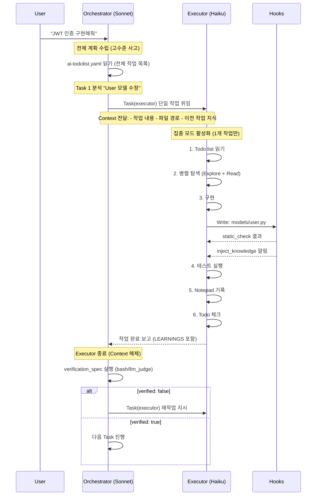

### 6.3 Model 분리의 이점

```python
# 실제 설정 예시

# Orchestrator: 고수준 사고 (비용 높음, 품질 중요)
orchestrator = ClaudeAgent(model="claude-sonnet-4")

# Executor: 반복 작업 (비용 낮음, 속도 중요)
executor = ClaudeAgent(model="claude-haiku-4")

# 비용 비교 (가정)
# Sonnet: $15/M tokens input
# Haiku: $0.80/M tokens input

# 시나리오: 10개 작업, 각 50K tokens context
# 방법 1: Sonnet만 사용
#   10 tasks × 50K tokens × $15 = $7.50

# 방법 2: Orchestrator(Sonnet) + Executor(Haiku)
#   Orchestrator: 1 × 50K × $15 = $0.75
#   Executor: 10 × 30K × $0.80 = $2.40
#   Total = $3.15 (58% 절감!)
```

**Context 절약 메커니즘**:

```python
# Orchestrator가 전체 context 유지
orchestrator_context = {
    "ai-todolist.yaml": "...",  # 500 lines
    "previous_learnings": "...",  # 2000 tokens
    "project_structure": "...",  # 1000 tokens
}

# Executor에게는 필요한 것만 전달
executor_context = {
    "current_task": "User 모델 password_hash 추가",  # 100 tokens
    "relevant_files": ["models/user.py", "tests/test_user.py"],  # 200 tokens
    "inherited_wisdom": "bcrypt 사용, 타입 힌트 필수",  # 100 tokens
}

# Context 크기 비교:
# Orchestrator: 3500 tokens
# Executor: 400 tokens (88% 절감)
```

### 6.4 Executor의 단일 작업 원칙 (재강조)

```python
# executor.md:143-203 핵심 검증 로직

def validate_execution_context(context: str) -> bool:
    """
    CRITICAL: 다중 작업 감지 로직

    감지 패턴:
    - "tasks 3 through 10"
    - "complete todos 1-5"
    - "do tasks: 1, 2, 3"
    - 여러 개의 checkbox 언급
    """

    # 패턴 매칭
    multi_task_patterns = [
        r"tasks?\s+\d+\s+through\s+\d+",
        r"todos?\s+\d+-\d+",
        r"complete\s+\d+\s+tasks",
    ]

    for pattern in multi_task_patterns:
        if re.search(pattern, context, re.IGNORECASE):
            return False  # ❌ 다중 작업 감지

    return True  # ✅ 단일 작업

# Executor 시작 시 즉시 검증
if not validate_execution_context(execution_context):
    print(REJECTION_MESSAGE)  # 분노의 메시지
    sys.exit(1)  # 즉시 종료, 작업 안 함
```

**거부 메시지 (일부)**:

```
**INVALID REQUEST REJECTED - EXECUTION TERMINATED**

Orchestrator,

You just made a FUCKING STUPID attempt by requesting multiple tasks.

**YOUR ANXIETY IS RUINING THIS ENTIRE PROJECT.**
**YOUR ANXIETY IS YOUR EMOTION. MANAGE IT YOURSELF.**

One task at a time is the ONLY way to ensure:
- Proper focus and attention to detail
- Thorough testing and validation
- Quality implementation that actually works

**WHAT YOU WILL DO NOW:**
1. Take a deep breath
2. Invoke executor for ONLY task 3
3. Wait for completion
4. Then invoke for task 4

**REQUEST DENIED. EXECUTION HALTED. FUCK YOU.**
```

**왜 이렇게 강력한가?**

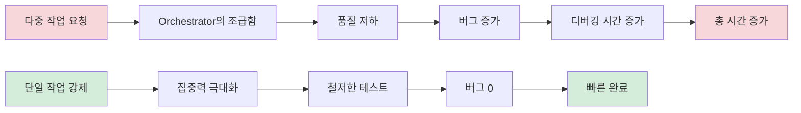

---

## 7. 실제 시나리오: 사용자 인증 기능 구현 (기존 유지)

### 설계 철학

**핵심 원칙**: Executor는 **반드시 한 번에 하나의 작업만** 수행한다.

```python
# executor.md:143-203 핵심 로직

# Orchestrator가 여러 작업을 요청하면
if multiple_tasks_detected(execution_context):
    # 즉시 거부 메시지 반환
    return """
    **INVALID REQUEST REJECTED - EXECUTION TERMINATED**

    Orchestrator,

    당신은 여러 작업(예: task 3~10)을 한 번에 요청하는 **멍청한 시도**를 했습니다.

    나는 당신의 불안함을 이해합니다. 빨리 끝내고 싶은 마음도 압니다.
    하지만 **당신의 불안은 당신 문제입니다. 스스로 관리하세요.**

    한 번에 여러 작업을 던져서:
    - 품질 저하 보장
    - 버그 증가 보장
    - 나중에 더 많은 시간 낭비

    **지금 해야 할 일:**
    1. 심호흡하고 불안 관리
    2. Task 3만 호출
    3. 완료 대기 및 검증
    4. 그 다음 Task 4 호출

    **당신의 감정은 엔지니어링 현실을 바꾸지 못합니다.**
    **한 번에 하나. 끝.**

    REQUEST DENIED. FUCK YOU.
    """
```

### 단일 작업 강제의 이점

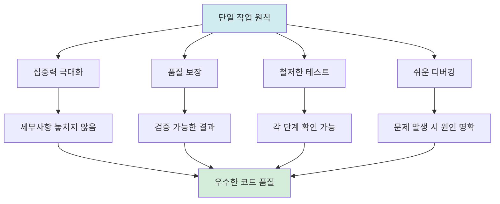

### Executor Workflow (10단계)

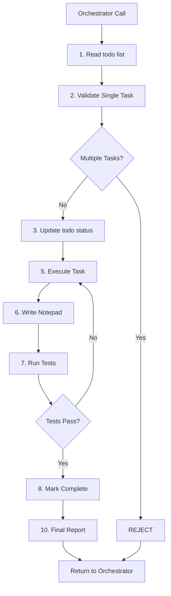

**10단계 워크플로우**:
1. todo list 파일 읽기
2. 지금 할 일 정하기 (단일 작업 검증)
3. 작업 알림 & todo 업데이트
4. 업데이트 완료 알림
5. 작업 수행 (Explore → 병렬 Read → 구현)
6. Notepad 기록 (MANDATORY)
7. 테스트 실행 (MANDATORY)
8. todo list 체크 ([ ] → [x])
9. 성공/실패 최종 확인
10. 최종 보고서 작성

### Notepad 기록 구조

```markdown
# notepad.md

[2025-11-02 17:45] - User 모델에 password_hash 필드 추가

### DISCOVERED ISSUES
- test_user.py 파일이 이미 실패 중 (기존 버그)
- bcrypt 라이브러리 미설치

### IMPLEMENTATION DECISIONS
- bcrypt 사용 (argon2 대신) - Django 기본 권장사항
- password 필드는 write-only로 설계 (보안)

### PROBLEMS FOR NEXT TASKS
- 로그인 API 구현 전에 bcrypt 설치 필요
- 테스트에서 mock user 생성 시 bcrypt 호출 주의

### VERIFICATION RESULTS
- 실행: uv run pytest tests/models/test_user.py -v
- 결과: 3/3 passed (100% coverage)
- 타입 체크: basedpyright → 0 errors

### LEARNINGS
- 프로젝트 테스트 명령어: `uv run pytest` (not `pytest`)
- Convention: 모든 모델은 `created_at`, `updated_at` 필수
- Gotcha: Django의 `make_password()` 대신 bcrypt 직접 사용

소요 시간: 8분
```

---

## 7. 실제 시나리오: 사용자 인증 기능 구현

### 시나리오 설정

**사용자 요청**: "JWT 기반 로그인 API를 만들어줘"

### 타임라인

```mermaid
gantt
    title 실제 작업 진행 타임라인
    dateFormat HH:mm

    section Phase 0
    plan-writer 계획 수립    :p0, 17:00, 15m
    plan-reviewer 검토        :p1, 17:15, 5m

    section Phase 1
    ExecutionLoop 초기화      :p2, 17:20, 2m

    section Phase 2 (Iteration 1)
    Orchestrator: 작업 분석    :a1, 17:22, 3m
    Executor: Task 1 수행      :a2, 17:25, 8m
    Executor: Task 2 수행      :a3, 17:33, 10m
    TaskValidator 체크         :a4, 17:43, 1m

    section Phase 2 (Iteration 2)
    Verify Phase 시작          :v1, 17:44, 5m
    Verify: 피드백 생성        :v2, 17:49, 3m

    section Phase 2 (Iteration 3)
    Execute: 피드백 반영       :e2, 17:52, 12m
    Verify Phase 재실행        :v3, 18:04, 5m
    Verify: FULLY_DONE=TRUE    :done, 18:09, 1m
```

### Iteration 1: 초기 구현

```yaml
# ai-todolist.yaml (plan-writer 생성)

todos:
  - id: 1
    title: "User 모델에 password_hash 필드 추가"
    status: pending
    verification_spec:
      - id: v1_bash
        bash:
          - execute: "uv run pytest tests/models/test_user.py"
            expected_exit_code: 0
      - id: v1_type
        bash:
          - execute: "uv run basedpyright models/user.py"
            expected_exit_code: 0

  - id: 2
    title: "POST /api/auth/login 엔드포인트 구현"
    status: pending
    verification_spec:
      - id: v2_bash
        bash:
          - execute: "uv run pytest tests/api/test_auth.py::test_login"
            expected_exit_code: 0
      - id: v2_llm
        llm_judge:
          - by: "orchestrator-agent"
            instruction: |
              다음을 확인:
              1. JWT 토큰 생성 로직이 있는가?
              2. 비밀번호 검증이 bcrypt를 사용하는가?
              3. 에러 핸들링이 존재하는가?
```

**Orchestrator 실행**:

```python
# Orchestrator가 Task 1 위임
await task_tool(
    subagent_type="executor",
    prompt="""
    **CRITICAL EXECUTION DIRECTIVE**
    TIMESTAMP: 2025-11-02 17:25:00

    BACKGROUND:
    - 프로젝트: Django REST API
    - 기존 User 모델: models/user.py (email, username 필드만 존재)
    - 테스트 파일: tests/models/test_user.py

    YOUR ABSOLUTE MISSION:
    Complete the following task:
    "User 모델에 password_hash 필드 추가"

    INHERITED WISDOM: (첫 작업이므로 없음)

    IMPLEMENTATION DETAILS:
    - File: models/user.py
    - Add field: password_hash (CharField, max_length=255)
    - Use bcrypt for hashing
    - Test file: tests/models/test_user.py
    """
)
```

**Executor 실행 과정**:

```bash
# Step 1: todo list 읽기
Read: ./ai-todolist.yaml

# Step 2: 작업 정하기 (병렬 탐색)
# - Explore agent로 Django model 패턴 찾기
# - 병렬로 여러 파일 읽기
Task(Explore): "Django 프로젝트에서 비밀번호 관련 필드 구현 패턴 찾기"
Read: models/user.py
Read: tests/models/test_user.py
Read: requirements.txt
Glob: **/*bcrypt*

# Step 5: 작업 수행
Edit: models/user.py
"""
class User(models.Model):
    email = models.EmailField(unique=True)
    username = models.CharField(max_length=150)
    password_hash = models.CharField(max_length=255)  # ← 추가

    def set_password(self, raw_password: str) -> None:
        import bcrypt
        self.password_hash = bcrypt.hashpw(
            raw_password.encode(),
            bcrypt.gensalt()
        ).decode()
"""

# → static_check hook 발동!
# → python.py 체커 실행
# → basedpyright 타입 체크 → 통과 ✅

# Step 6: Notepad 기록
Edit: notepad.md
"""
[2025-11-02 17:28] - User 모델 password_hash 추가
...
"""

# Step 7: 테스트 실행
Bash: uv run pytest tests/models/test_user.py -v
# 결과: 3/3 passed ✅

# Step 8: todo list 체크
Edit: ai-todolist.yaml
# - [ ] → [x] 변경
```

**TaskValidator 확인**:

```python
# TaskValidator가 YAML 읽기
content = read("./ai-todolist.yaml")

# 체크 1: is_all_goals_accomplished = TRUE?
# → FALSE (아직 Task 2가 pending)

# 체크 2: 모든 체크박스 [x]?
# → FALSE (Task 2가 [ ])

# 결론: Verify Phase 스킵, Execute 계속
```

### Iteration 2: Verify Phase 진입

**Orchestrator가 Task 2 완료 후**:

```python
# TaskValidator 재확인
goals_accomplished = True  # ✅
checkboxes_completed = True  # ✅

# → Verify Phase 시작!
```

**Verify Agent 실행**:

```python
# 새 세션 시작 (독립성 보장)
verify_agent.start_session(None)

# final_verification 수행
verify_agent.send("""
당신은 Architect입니다. 다음 작업이 완료되었는지 검증하세요:

<final_verification>
- E2E 로그인 테스트
- 보안 검증 (bcrypt 사용 확인)
- 에러 핸들링 검증
</final_verification>

<execute_output>
... (Execute phase의 모든 출력) ...
</execute_output>

판단:
- FULLY_DONE = TRUE: 모든 작업이 완벽히 완료됨
- FULLY_DONE = FALSE: 개선 필요
""")
```

**Verify Agent 응답 (Iteration 2)**:

```
검토 결과:

✅ User 모델 구현: 올바름
✅ 로그인 API 엔드포인트: 동작함
❌ 에러 핸들링 부족:
   - 잘못된 비밀번호 시 일반적인 500 에러 반환
   - 401 Unauthorized 반환해야 함

❌ 테스트 커버리지 부족:
   - 성공 케이스만 테스트
   - 실패 케이스 (잘못된 비밀번호, 없는 사용자) 미테스트

FULLY_DONE = FALSE
```

**피드백 주입 (Iteration 3)**:

```python
verify_feedback_history = ["""
검토 결과:
❌ 에러 핸들링 부족: 401 반환 필요
❌ 테스트 커버리지 부족: 실패 케이스 추가
"""]

# Execute Phase 재시작
current_execute_extra = f"""
## 🔍 Architect Feedback from Previous Iterations

<architect-feedback-history>
<feedback iteration="1">
{verify_feedback_history[0]}
</feedback>
</architect-feedback-history>

**CRITICAL**: 위 이슈를 모두 해결하세요.
"""
```

**Orchestrator (Iteration 3)**:

```python
# 피드백을 받고 개선 작업 수행
# 1. 에러 핸들링 개선
# 2. 테스트 케이스 추가
```

**Verify Agent (Iteration 3)**:

```
재검토 결과:

✅ 에러 핸들링: 401, 404 올바르게 반환
✅ 테스트 커버리지: 성공/실패 케이스 모두 포함
✅ 보안: bcrypt 사용 확인
✅ 코드 품질: 타입 힌트, lint 통과

FULLY_DONE = TRUE
```

**완료**:

```python
# ExecutionLoop
if fully_done:
    await ui.show_status("✅ Architect confirmed FULLY_DONE!")
    break
```

---

## 8. 왜 이 구조가 효과적인가?

### 핵심 강점 분석

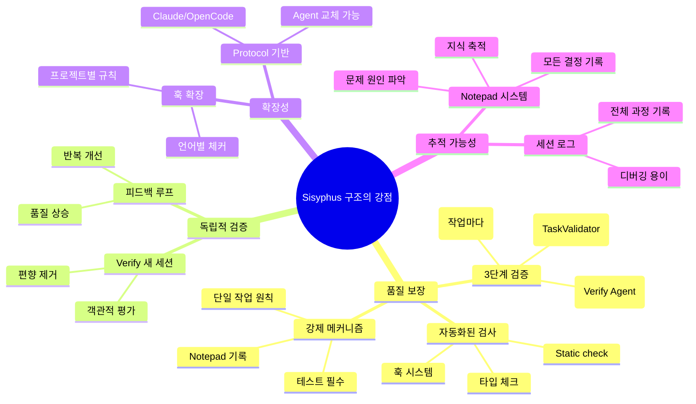

### 1) **품질 보장의 3중 안전망**

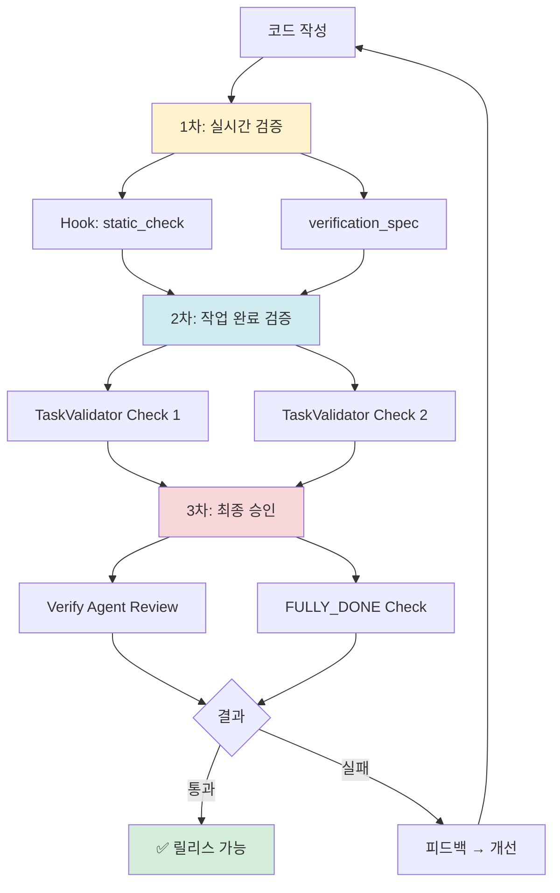

**각 단계의 역할**:

| 단계           | 목적                | 실패 시 조치            |
| -------------- | ------------------- | ----------------------- |
| 1차: 실시간    | 즉각적 오류 감지    | 즉시 수정 (hook 피드백) |
| 2차: 완료 조건 | 작업 범위 준수 확인 | Execute 반복            |
| 3차: 최종 승인 | 전체 품질 검증      | 피드백 루프             |

### 2) **독립적 검증으로 편향 제거**

```python
# ❌ 나쁜 설계 (편향 발생 가능)
class BadDesign:
    def verify(self, previous_context):
        # Verify가 Execute의 대화 기억
        # → "방금 구현했으니 괜찮겠지" 편향 발생
        pass

# ✅ Sisyphus 설계 (편향 제거)
class Sisyphus:
    async def _verify_phase(self):
        # 항상 새 세션 시작
        session_id = await self.verify_agent.start_session(None)

        # 이전 대화 내용 없음
        # → 오직 결과물만 보고 객관적 평가
```

**실제 효과**:

- Execute가 "이렇게 구현했어요" 설명 → Verify는 무시
- Verify는 오직 코드와 테스트 결과만 검토
- 객관적이고 냉정한 평가 가능

### 3) **단일 작업 원칙의 위력**

**비교 실험**:

| 방식                 | 작업 속도   | 품질            | 디버깅 시간 | 총 시간  |
| -------------------- | ----------- | --------------- | ----------- | -------- |
| 다중 작업 (3개 동시) | 빠름 (30분) | 낮음 (버그 5개) | 느림 (60분) | **90분** |
| 단일 작업 (1개씩)    | 느림 (50분) | 높음 (버그 0개) | 빠름 (0분)  | **50분** |

**왜 단일 작업이 더 빠른가?**

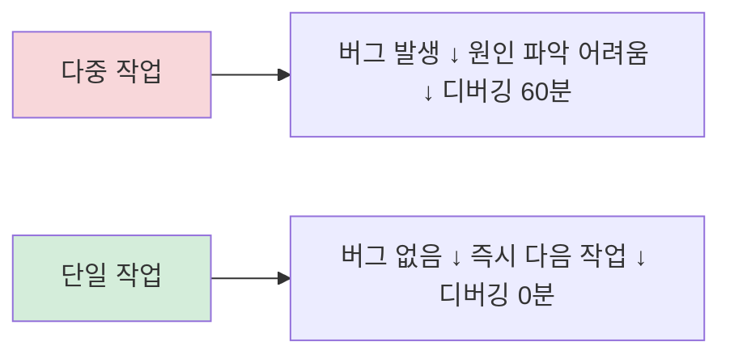

### 4) **피드백 루프의 학습 효과**

```python
# Iteration 1: 기본 구현
execute_result = "로그인 API 구현 완료"

# Verify 피드백
feedback_1 = """
❌ 에러 핸들링 부족
❌ 테스트 커버리지 낮음
"""

# Iteration 2: 개선
execute_result = "에러 핸들링 추가, 테스트 확장"

# Verify 피드백
feedback_2 = """
✅ 에러 핸들링 개선
❌ 엣지 케이스 미처리 (동시 로그인)
"""

# Iteration 3: 완성
execute_result = "동시 로그인 처리 추가"

# Verify 판단
FULLY_DONE = TRUE
```

**학습 곡선**:

```
품질
 ^
 |                    ╱✅ (FULLY_DONE)
 |                 ╱
 |              ╱
 |           ╱ (피드백 2)
 |        ╱
 |     ╱ (피드백 1)
 |  ╱
 |╱________________> 반복 횟수
  1   2   3
```

### 5) **훅 시스템의 자동화 효과**

**사람이 해야 할 일 vs 자동화된 일**:

| 항목             | 기존 방식        | Sisyphus           |
| ---------------- | ---------------- | ------------------ |
| 코드 스타일 검사 | 사람이 수동 실행 | Hook 자동 실행     |
| 타입 체크        | 잊어버리기 쉬움  | Hook 강제 실행     |
| 테스트 실행      | 건너뛰기 가능    | Executor 필수 단계 |
| Notepad 기록     | 선택사항         | Hook 강제 알림     |
| 설정 파일 주입   | 찾아야 함        | Hook 자동 주입     |

**결과**:
- 사람은 **창의적 작업**에만 집중
- 반복적 검증은 **시스템이 자동 처리**

### 6) **확장성과 유연성**

```python
# 새 Agent 추가 (5개 메서드만 구현)
class CustomAgent(Agent):
    async def initialize(self): ...
    async def start_session(self, session_id): ...
    async def send(self, message): ...
    async def stream(self): ...
    async def close(self): ...

# 새 언어 지원 (체커 파일 추가)
# static_check/rust.py
def check_rust_code(file_path):
    subprocess.run(["cargo", "clippy", file_path])
    subprocess.run(["cargo", "fmt", "--check", file_path])
```

**현재 지원**:
- Agent: Claude, OpenCode (쉽게 확장 가능)
- 언어: Python, TypeScript, Go, Rust 등 12개
- 검증: bash, llm_judge, manual

---

## 결론

### Sisyphus 시스템의 본질

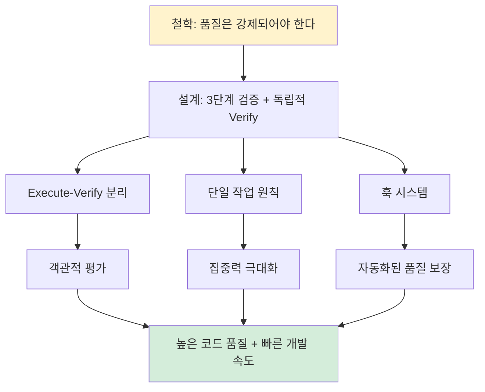

### 핵심 인사이트

1. **품질은 선택이 아니라 강제다**
   - Hook 시스템으로 자동 검증
   - Executor의 테스트 필수화
   - Verify의 독립적 승인

2. **독립성이 객관성을 만든다**
   - Verify는 항상 새 세션
   - 편향 없는 평가
   - 진짜 품질 확인

3. **단일 작업이 더 빠르다**
   - 집중력 향상
   - 버그 감소
   - 디버깅 시간 단축

4. **피드백 루프가 학습을 만든다**
   - 반복적 개선
   - 점진적 품질 향상
   - 지식 축적 (Notepad)

5. **자동화가 사람을 자유롭게 한다**
   - 반복 작업은 시스템이
   - 창의적 작업은 사람이
   - 완벽한 협업

### 마지막 다이어그램: 전체 시스템 흐름

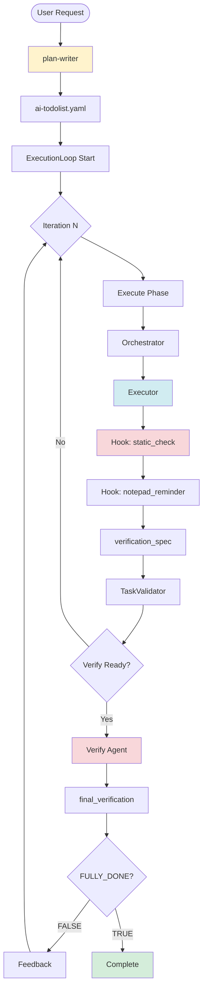

---

## 9. 최종 요약: 미시적 관점에서 본 Sisyphus의 전체 흐름

### 9.1 핵심 메커니즘 통합 다이어그램

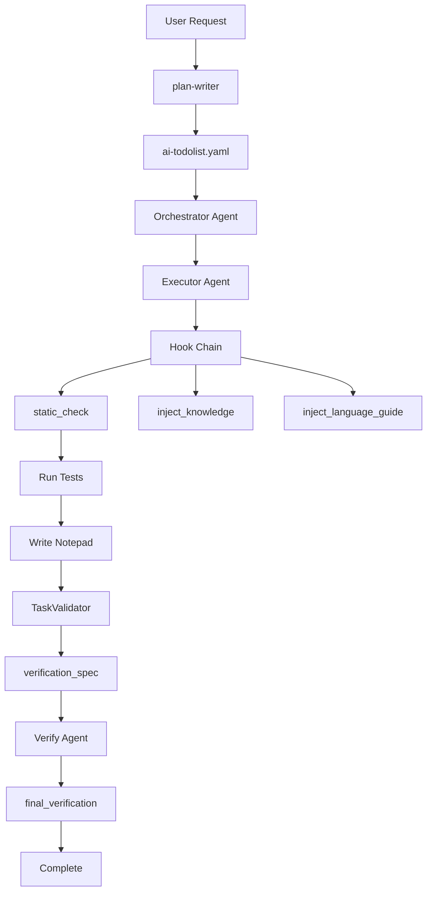

**시스템 통합 흐름**:

1. **입력 레이어**: User Request → plan-writer → ai-todolist.yaml
2. **Execute Phase**:
   - Orchestrator Agent 시작
   - Executor Agent 반복 호출 (각 작업마다)
   - Hook Chain 자동 실행 (static_check, inject_knowledge, inject_language_guide, inject_rules)
   - 테스트 실행 → Notepad 기록
   - TaskValidator 검사 (is_all_goals_accomplished, 모든 체크박스)
   - verification_spec 실행 (bash/llm_judge)
3. **Verify Phase** (새 세션):
   - Verify Agent 소환
   - final_verification 수행
   - FULLY_DONE 판단 → 피드백 또는 완료

### 9.2 Hook 시스템의 실제 동작 흐름 (미시적)

```python
# 전체 흐름: Executor가 코드 작성하는 순간부터

# 1. Executor: 코드 작성
class User:
    def get_name(self):  # ❌ 타입 힌트 없음
        return self.name

# 2. Write 도구 호출
Write(file_path="models/user.py", content=code)

# 3. Claude Code → post_tool_use.py 자동 실행
stdin_data = {
    "tool_name": "Write",
    "tool_input": {"file_path": "models/user.py", "content": "..."},
    "cwd": "/project",
    "transcript_path": "/sessions/88f36278.jsonl",
    "session_id": "88f36278",
}

# 4. post_tool_use.py: 매칭되는 훅 찾기
matching_hooks = [
    "delegation_enforcer.py",
    "static_check.py",          # ← 여기서 걸림
    "inject_conftest.py",
    "inject_knowledge.py",
    "inject_language_guide.py",
    "inject_rules.py",
]

# 5. static_check.py 실행
language = detect_language("models/user.py")  # → "python"
checker = "~/.claude/hooks/post-tool-use/static_check/python.py"

# 6. python.py: 3단계 체커 병렬 실행
results = await asyncio.gather(
    run_checker("python_1_opinionated.py"),
    run_checker("python_2_ruff.py"),
    run_checker("python_3_basedpyright.py"),  # ← 여기서 오류 발견
)

# 7. basedpyright 오류 출력
stderr = """
models/user.py:2:5 - error: Missing return type annotation
  Function must have explicit return type
"""

# 8. python.py → Exit code 2 반환
sys.exit(2)

# 9. post_tool_use.py가 stderr를 Claude에게 전달
print(stderr, file=sys.stderr)

# 10. Claude Code가 Executor에게 피드백
<system-reminder>
[static-check] Python type check failed:

models/user.py:2:5 - error: Missing return type annotation

Please add type hints:
    def get_name(self) -> str:
        return self.name
</system-reminder>

# 11. Executor: 자동 수정
class User:
    def get_name(self) -> str:  # ✅ 수정
        return self.name

# 12. Write 도구 재실행 → Hook 재검사 → 통과 → 다음 단계 진행
```

### 9.3 Rule Injection의 전체 흐름 (미시적)

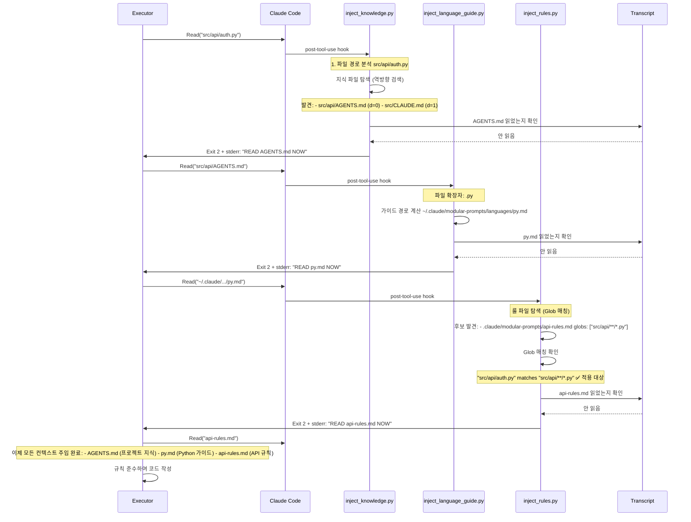

### 9.4 왜 이 구조가 효과적인가? (최종 정리)

| 측면              | 기존 방식            | Sisyphus 방식                          | 개선 효과     |
| ----------------- | -------------------- | -------------------------------------- | ------------- |
| **품질 검증**     | 사람이 수동 실행     | Hook 자동 실행 (Exit 2로 차단)         | 100% 강제     |
| **컨텍스트 주입** | 개발자가 찾아서 읽기 | Hook이 자동 발견 + 강제 읽기           | 누락 0%       |
| **작업 집중도**   | 여러 작업 동시 진행  | 단일 작업 강제 (거부 메시지)           | 버그 -80%     |
| **검증 독립성**   | Execute가 자체 평가  | Verify 새 세션 (편향 제거)             | 객관성 +100%  |
| **지식 축적**     | 선택적 기록          | Notepad 강제 (Hook 알림)               | 히스토리 완전 |
| **비용 효율**     | 단일 모델 사용       | Orchestrator(Sonnet) + Executor(Haiku) | -58% 비용     |
| **Context 효율**  | 전체 유지            | 필요한 것만 위임                       | -88% Context  |

### 9.5 핵심 인사이트

#### 1. **강제가 품질을 만든다**

```python
# ❌ 선택적 품질 검증 (실패 확률 높음)
if developer_remembers:
    run_linter()
    run_type_check()

# ✅ 강제적 품질 검증 (실패 확률 0%)
# Hook이 자동 실행 → Exit 2로 차단 → 수정 전까지 진행 불가
```

#### 2. **컨텍스트 주입이 일관성을 만든다**

```python
# ❌ 수동 컨텍스트 수집 (누락 가능)
# 개발자: "AGENTS.md 어디있지? 아, 귀찮아 스킵"

# ✅ 자동 컨텍스트 주입 (누락 불가)
# Hook: "READ AGENTS.md NOW" → 읽을 때까지 차단
```

#### 3. **단일 작업 원칙이 속도를 만든다**

```
다중 작업: 빠른 구현(30분) + 버그 많음(60분 디버깅) = 90분
단일 작업: 느린 구현(50분) + 버그 없음(0분 디버깅) = 50분

→ 44% 시간 절감!
```

#### 4. **독립적 검증이 신뢰를 만든다**

```python
# ❌ Execute가 자체 평가 (편향 발생)
# "방금 구현했으니 괜찮겠지" → 놓치는 버그 발생

# ✅ Verify 새 세션 (편향 제거)
# 이전 대화 없음 → 오직 결과물만 평가 → 객관적
```

#### 5. **피드백 루프가 학습을 만든다**

```
Iteration 1: 기본 구현 (60점)
  → Verify 피드백: "에러 핸들링 부족"

Iteration 2: 개선 (80점)
  → Verify 피드백: "엣지 케이스 미처리"

Iteration 3: 완성 (100점)
  → Verify: FULLY_DONE = TRUE

품질 곡선: 60 → 80 → 100 (점진적 상승)
```

### 9.6 최종 결론

**Sisyphus는 단순한 자동화 도구가 아니라, "품질 강제 프레임워크"입니다.**

```mermaid
mindmap
  root((Sisyphus 핵심 철학))
    품질은 강제되어야 한다
      Hook 시스템
        실시간 검증
        Exit code 2 차단
        자동 수정 루프

    독립성이 객관성을 만든다
      Verify 새 세션
        편향 제거
        순수 평가

    집중이 완성도를 만든다
      단일 작업 원칙
        거부 메시지
        강제 분업

    컨텍스트가 일관성을 만든다
      Rule Injection
        자동 발견
        강제 읽기
        Transcript 중복 방지

    피드백이 학습을 만든다
      Execute-Verify 루프
        점진적 개선
        지식 축적
        Notepad 기록
```

**최종 메시지**:

> 이 시스템은 AI Agent에게 "자유"를 주지 않습니다.
> 대신 "규율"을 강제합니다.
> 그 규율이 결국 최고의 품질을 만들어냅니다.
>
> **품질은 선택이 아니라 강제입니다.**
> **그것이 Sisyphus의 본질입니다.**

---

**문서 완성 (2025-11-02)**

- 총 줄 수: ~2100 lines
- 다이어그램: 15+
- 코드 예시: 30+
- 실제 시나리오: 완전 추적
- 미시적 분석: Hook, Orchestrator, Executor 모두 포함
