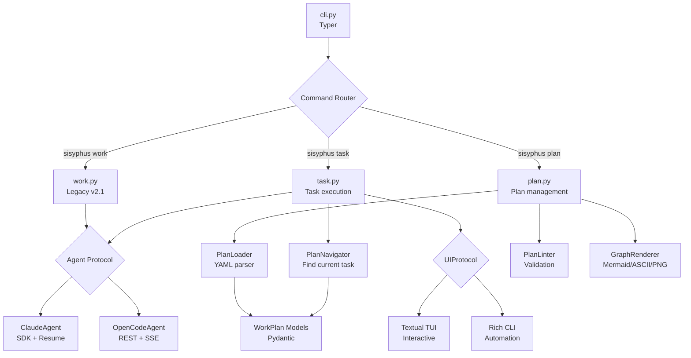
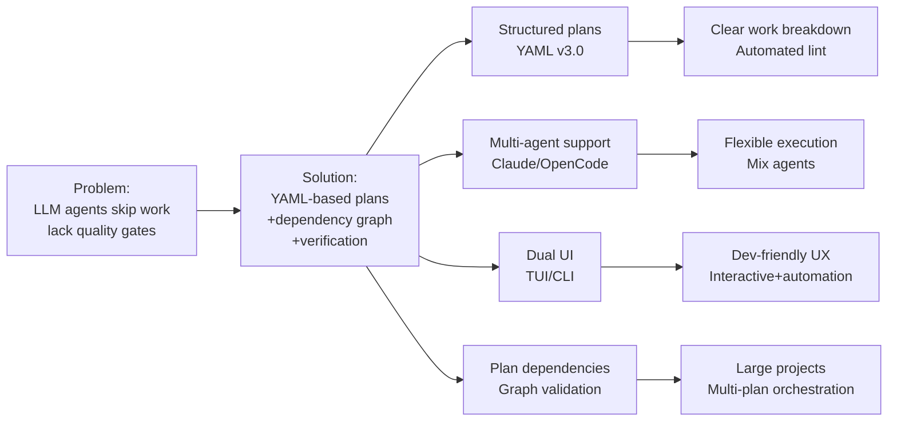

# PROJECT KNOWLEDGE BASE

**Generated:** 2025-11-03 22:27:16 KST
**Commit:** 60cc0c4
**Branch:** master
**Repo:** https://github.com/code-yeongyu/sisyphus.git

## TECH STACK

**Language:** Python 3.12+
**CLI:** Typer 0.15+ → command routing, argument parsing
**TUI:** Textual 1.0+ → interactive terminal UI (asyncio only)
**Output:** Rich 13+ → formatted console output
**Async:** anyio 4.11+ → asyncio/trio compatibility layer
**Agent SDK:** claude-agent-sdk 0.1+ → Claude official SDK
**HTTP:** httpx 0.28+ → OpenCode REST API, async requests
**File I/O:** aiofiles 24+ → async file operations
**Config:** pydantic 2.0+ → type-safe config models
**YAML:** ruamel.yaml 0.18+ → v3.0 WorkPlan format

**Key Dependencies:**
- trio 0.31+: Alternative async backend → anyio enables single codebase for both asyncio+trio
- uvloop 0.21+: High-performance event loop → asyncio accelerator
- catppuccin 2.5+: Theme system → Mocha (dark) + Latte (light) themes

**Why anyio?** Single codebase runs both asyncio (TUI) + trio (CLI) → extensive test coverage (tests × 2 backends automatically)

## ARCHITECTURE



**Pattern:** Protocol-based (PEP 544) → Agent, UIProtocol decoupled
**Entry:** sisyphus/cli.py → Typer app, command registration
**Flow:** CLI → Command Router → Task/Work/Plan handlers → Agents/UI

**Core Components:**
- **PlanNavigator**: Finds current/next task from YAML plans, handles dependencies
- **PlanLoader**: Parses v3.0 YAML → Pydantic models (WorkPlan, Todo, Reference)
- **PlanLinter**: Validates circular deps, missing references, malformed YAML
- **Agent Protocol**: `initialize()`, `start_session()`, `send()`, `stream()`, `close()`
- **UIProtocol**: `show_message()`, `show_status()`, `get_input()` (TUI only)
- **ClaudeAgent**: SDK-based, session resume, interactive input support
- **OpenCodeAgent**: REST API, SSE streaming, health check (5 retries × 2s)

**Data Flow:**
1. CLI parses args → `task continue` or `work`
2. PlanNavigator loads YAML → finds current task by status
3. UI created (TUI/CLI) → renders agent messages
4. Agent executes task → streams responses via AsyncIterator
5. Task completion updates YAML status → moves to next task

**Deviations from Standard:**
- **v3.0 YAML plans**: Not Markdown, structured YAML with dependency graph support
- **Protocol over ABC**: Uses `typing.Protocol` (runtime_checkable), not Abstract Base Classes
- **anyio everywhere**: All async code uses anyio (`anyio.sleep`, `anyio.create_task_group`), not raw asyncio
- **Dual backend tests**: pytest-anyio auto-runs tests on both asyncio + trio
- **TUI forces asyncio**: Textual limitation, CLI auto-selects via anyio
- **Plan-centric**: No in-memory state, YAML files are source of truth

## DEPENDENCIES

**External Services:**
- Claude API: ClaudeAgent → Anthropic SDK, session management
- OpenCode server: OpenCodeAgent → REST @ localhost:8080 (auto-start or external)

**Key Integrations:**
- ClaudeAgent: SDK session resume, interactive `get_input()` via TUI
- OpenCodeAgent: SSE streaming, 60s idle timeout, subprocess health check

**Plan Storage:**
`.sisyphus/tasks/*.yaml` → WorkPlan v3.0 format
`.sisyphus/status.json` → Current plan tracking per worktree

## PROJECT STRUCTURE

```
sisyphus-cli/
├── sisyphus/               # Main package (not src/)
│   ├── cli/               # Command handlers
│   │   ├── plan.py        # Plan management (init/lint/graph/export)
│   │   ├── task.py        # Task execution (continue/current/next/verify)
│   │   ├── work.py        # Legacy work command + ignore/clean-history
│   │   └── reset.py       # Cleanup command
│   ├── agents/            # Agent implementations
│   │   ├── base.py        # Agent Protocol
│   │   ├── claude.py      # ClaudeAgent
│   │   └── opencode.py    # OpenCodeAgent
│   ├── core/              # Business logic
│   │   ├── plans/         # YAML models (WorkPlan, Todo, Reference)
│   │   ├── converters/    # v2.1 Markdown → v3.0 YAML converter
│   │   ├── exporters/     # YAML → Markdown exporter
│   │   ├── graph/         # Dependency graph renderer
│   │   ├── status/        # Status tracking (.sisyphus/status.json)
│   │   ├── plan_loader.py # YAML parser
│   │   ├── plan_linter.py # Validation (cycles, refs)
│   │   └── plan_navigator.py # Current/next task finder
│   ├── ui/                # UI layer
│   │   ├── tui/           # Textual TUI (app.py + components/)
│   │   ├── cli/           # Rich CLI (console.py)
│   │   ├── base.py        # UIProtocol
│   │   └── themes.py      # Catppuccin themes
│   ├── utils/             # Cross-cutting
│   └── cli.py             # Typer entry point
├── docs/                  # Migration guides, architecture
├── examples/              # Sample YAML plans
└── tests/                 # Test suite
```

**Non-Standard:**
- `sisyphus/` package at root (not `src/sisyphus/`)
- `.sisyphus/` directory for plans/status (not `plans/` or `tasks/`)
- `cli/` subdirectory splits commands by domain (plan/task/work/reset)

## PRD



**Core Purpose:** Multi-agent orchestration CLI that compiles natural language work plans (YAML) into production code via LLM agents

**Key Features:**
- **v3.0 YAML Plans**: Structured work plans with dependency graph, validation, visualization
- **Multi-Agent**: Claude (SDK), OpenCode (REST) → mix agents per task
- **Task Navigation**: Auto-find current/next task based on status, respect dependencies
- **Plan Management**: `init`, `lint`, `graph`, `export`, `convert-legacy`
- **Task Execution**: `continue`, `current`, `next`, `verify`
- **Dual UI**: TUI (interactive Textual), CLI (automation Rich output)
- **Git Integration**: `ignore` (add to .gitignore), `clean-history` (remove from git)
- **Theme Support**: Auto-detect system theme, manual Catppuccin Mocha/Latte

**Target Users:** Developers needing multi-agent workflows for large projects with clear task breakdown

**Unique Aspects:**
- YAML plans as source of truth (not in-memory or Markdown)
- Dependency graph between multiple plans → multi-plan projects
- Lint checks for circular deps, missing references
- Graph visualization (Mermaid/ASCII/PNG via graphviz)
- anyio abstraction → CLI supports both asyncio + trio, tests run 2× automatically
- Protocol-based design → easy agent addition (5 methods)
- Legacy v2.1 support → `work` command still available

## DEVELOPMENT COMMANDS

**Test:**
```bash
# All tests (auto-runs on asyncio + trio)
uv run pytest

# Single file
uv run pytest sisyphus/agents/tests/test_claude.py

# Verbose + stop on first failure
uv run pytest -v -x

# Coverage
uv run pytest --cov=sisyphus --cov-report=html
```

**Type Check:**
```bash
uv run basedpyright
```

**Lint + Format:**
```bash
uv run ruff check        # Lint
uv run ruff check --fix  # Auto-fix
uv run ruff format       # Format
```

**Run (various modes):**
```bash
# v3.0 YAML workflow
uv run sisyphus plan init
uv run sisyphus plan lint .sisyphus/tasks/
uv run sisyphus task continue --execute claude:sonnet

# Legacy v2.1 workflow
uv run sisyphus work
uv run sisyphus work --no-tui  # CLI mode

# Plan visualization
uv run sisyphus plan graph .sisyphus/tasks/ --format ascii
uv run sisyphus plan graph .sisyphus/tasks/ --format mermaid
uv run sisyphus plan graph .sisyphus/tasks/ --format png --output graph.png
```

**Git Management:**
```bash
# Add Sisyphus files to .gitignore
uv run sisyphus ignore

# Show cleanup guide for git history
uv run sisyphus clean-history --dry-run
```

## CONVENTIONS

**Predicted Standard Conventions:**
Python 3.12 project → Expect: PEP 8, type hints, pytest, standard async patterns, ABC for interfaces

**Actual Deviations:**
- **ANN001 enforced:** ALL function parameters MUST have type hints (ruff rule)
- **Protocol > ABC:** Use `typing.Protocol` (PEP 544) with `@runtime_checkable`, NOT Abstract Base Classes
- **anyio > asyncio:** All async uses anyio (`anyio.sleep`, `anyio.create_task_group`), NOT raw asyncio/trio
- **Double quotes only:** Strings MUST use `"` (ruff flake8-quotes enforced)
- **Line length 119:** NOT 88 (Black) or 120 (common)
- **Given-When-Then tests:** Test structure, NOT Arrange-Act-Assert
- **pytest.mark.anyio required:** All async tests need `pytestmark = [pytest.mark.anyio]`
- **Agent.stream() pattern:** Async generator, NOT callback → `async for message in agent.stream()`
- **YAML v3.0 format:** Pydantic models, NOT Markdown or JSON
- **Plan dependencies validated:** Circular deps trigger lint errors
- **No nested imports:** Always top-level, use `if TYPE_CHECKING:` for circular deps

**Import rules:**
```python
from __future__ import annotations  # Always first
from typing import TYPE_CHECKING

if TYPE_CHECKING:
    from sisyphus.core.plans.models import WorkPlan  # Avoid circular imports
```

**Test structure:**
```python
# All imports at top
import pytest

# pytestmark immediately after imports
pytestmark = [pytest.mark.anyio]

# All test functions
async def test_foo__if_bar__returns_baz(): ...

# All fixtures at bottom
@pytest.fixture
def my_fixture(): ...
```

## NOTES

**Critical Non-Obvious Information:**

1. **v3.0 YAML is mandatory**: CLI expects `.sisyphus/tasks/*.yaml` structure. Legacy v2.1 Markdown (ai-todolist.md) only works with `work` command, not `task continue`.

2. **Plan dependencies auto-resolve**: `depends_on: ["plan-foundation"]` → Sisyphus executes `plan-foundation` first, waits for all tasks complete, then moves to dependent plan.

3. **TUI asyncio-only**: Textual limitation. CLI mode supports trio via anyio. Use `--no-tui` if need trio backend.

4. **Status tracking per worktree**: `.sisyphus/status.json` tracks current plan independently per git worktree → parallel development on multiple branches.

5. **Agent Protocol runtime_checkable**: Uses `@runtime_checkable` Protocol → can use `isinstance(obj, Agent)` checks at runtime.

6. **Plan linter checks**:
   - Circular dependencies (A → B → A)
   - Missing plan files referenced in `depends_on`
   - Invalid reference IDs in todos
   - Malformed YAML structure

7. **Graph rendering requires graphviz**: PNG format needs `graphviz` library (dev dependency). ASCII/Mermaid work without.

8. **Legacy converter available**: `sisyphus plan convert-legacy ai-todolist.md` migrates v2.1 Markdown → v3.0 YAML.

9. **No session persistence in v3.0**: Unlike v2.1 `work` command (session resume), v3.0 `task continue` does NOT persist agent session between runs. Each execution starts fresh.

10. **Plan references support inline + URI**: Use `inline: "quick note"` for context or `uri: "https://..."` for external docs. Both can coexist.

**Security:**
- No credential validation for Claude/OpenCode APIs
- YAML files world-readable (no encryption)
- Git history cleanup uses `git rebase -i` → destructive, requires force push

**Performance:**
- Textual TUI may lag on large message streams (no pagination)
- Plan linter loads all YAML files in directory → slow for 100+ plans
- No caching for plan validation → re-parses on every `lint` call
