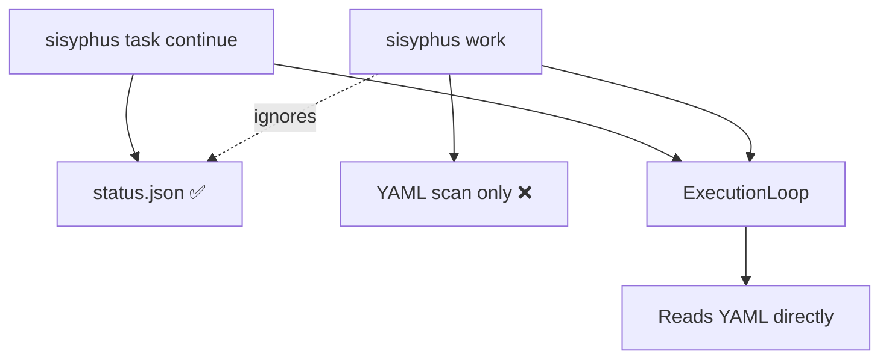
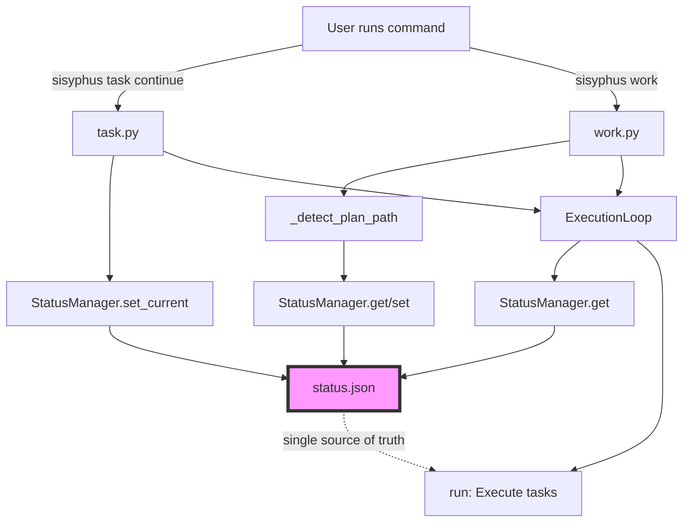

# Migration Guide: status.json Refactoring

**Date**: 2025-11-10
**Scope**: ExecutionLoop, work.py, StatusManager integration
**Impact**: Backend-only (transparent to users)

## Overview

This refactoring makes `status.json` the **Single Source of Truth** for current plan tracking across all Sisyphus entry points. Previously, `sisyphus task continue` used status.json while `sisyphus work` completely ignored it, causing synchronization issues between CLI and TUI modes.

**Key Changes:**
- ExecutionLoop now reads plan_id from status.json (not just YAML)
- `sisyphus work` now reads and writes status.json
- Both commands stay synchronized automatically
- Backward compatibility maintained via optional parameter

## Background

### Problem Statement

**Before this refactoring:**


**Issues:**
1. `sisyphus task continue` used status.json ✅
2. `sisyphus work` completely ignored status.json ❌
3. ExecutionLoop loaded plan_id from YAML only ❌
4. Users had to select the same plan twice (once in each mode)
5. CLI and TUI modes could work on different plans simultaneously

**Real-world scenario:**
```bash
# User selects plan-A
sisyphus task continue  # → Writes to status.json: plan-A

# User runs work command
sisyphus work           # → Ignores status.json, scans YAML → might pick plan-B

# User returns to task continue
sisyphus task continue  # → Reads status.json: still plan-A (out of sync!)
```

### Why This Refactoring Was Needed

**Architectural Principle Violated:**
status.json was designed as the Single Source of Truth for current plan tracking, but ExecutionLoop and work.py bypassed it entirely.

**User Experience Problems:**
- Confusing: Two commands tracked different plans
- Redundant: Had to select plan twice when switching between modes
- Error-prone: Manual synchronization required

**Design Decision:**
Instead of making TaskValidator responsible for status.json (violates single responsibility), we inject StatusManager directly into ExecutionLoop. This allows both `work.py` and `task.py` to share the same synchronization mechanism.

## Changes

### 1. ExecutionLoop API Change

**Before:**
```python
from sisyphus_core.core.loop import ExecutionLoop

loop = ExecutionLoop(
    execute_agent=agent,
    ui=ui,
    session_store=store,
    logger_factory=factory,
)
```

**After:**
```python
from sisyphus_core.core.loop import ExecutionLoop
from sisyphus_core.core.status.manager import StatusManager

status_manager = StatusManager(worktree_root / ".sisyphus" / "status.json")

loop = ExecutionLoop(
    execute_agent=agent,
    ui=ui,
    session_store=store,
    logger_factory=factory,
    status_manager=status_manager,  # ✅ NEW (optional)
)
```

**Backward Compatibility:**
- `status_manager=None` (default) → Uses old behavior (task_validator)
- Existing code continues to work without modification
- Only affects projects using ExecutionLoop directly

### 2. work.py Integration

**Changes in `_detect_plan_path()`:**

```python
async def _detect_plan_path(scan_directory: Path) -> Path:
    """Detect plan path with status.json priority.

    Priority:
    1. Read status.json first (if exists and current_plan set)
    2. If not found, scan YAML files (existing logic)
    3. After selection, write to status.json for next time
    """
    # NEW: Create StatusManager
    worktree_root = StatusManager.detect_worktree(scan_directory)
    status_path = worktree_root / ".sisyphus" / "status.json"
    status_manager = StatusManager(status_path)

    # NEW: Check status.json first
    status = await status_manager.get()
    if status.current_plan:
        plan_path = Path(status.current_plan.plan_path)
        if plan_path.exists():
            return plan_path  # ✅ Use cached plan from status.json

    # Existing: YAML scan logic (fallback)
    selected_path = await _scan_yaml_files(scan_directory)

    # NEW: Write to status.json after selection
    await status_manager.set_current(selected_path, worktree_root)

    return selected_path
```

**Changes in `_main_cli()` and `_main_tui()`:**

Both functions now create StatusManager and pass it to ExecutionLoop:

```python
# Create StatusManager for status.json integration
worktree_root = StatusManager.detect_worktree(Path.cwd())
status_path = worktree_root / ".sisyphus" / "status.json"
status_manager = StatusManager(status_path)

# Pass to ExecutionLoop
loop = ExecutionLoop(
    execute_agent=execute_agent,
    ui=ui,
    session_store=session_store,
    logger_factory=logger_factory,
    verify_agent=verify_agent,
    task_validator=task_validator,
    working_directory=Path.cwd(),
    status_manager=status_manager,  # ✅ NEW
)
```

### 3. ExecutionLoop.run() Logic

**New plan_id resolution priority:**

```python
async def run(self) -> None:
    """Execute tasks with status.json priority."""
    plan_id = "default"  # Fallback

    # Priority 1: Read from status.json (if status_manager provided)
    if self.status_manager:
        try:
            status = await self.status_manager.get()
            if status.current_plan:
                plan_path = Path(status.current_plan.plan_path)
                plan = load_plan(plan_path)
                plan_id = plan.work_plans[0].id
        except Exception:
            pass  # Fallback to priority 2

    # Priority 2: Read from YAML via task_validator (backward compatibility)
    if plan_id == "default" and self.task_validator:
        plan = load_plan(self.task_validator.todolist_path)
        plan_id = plan.work_plans[0].id

    # Priority 3: Use "default" plan_id
    # (if neither status_manager nor task_validator provided)

    # ... rest of execution logic ...
```

**Fallback guarantees:**
- status_manager=None → Uses task_validator (old behavior)
- Both None → Uses "default" plan_id
- Exception during status.json read → Falls back to task_validator

## Data Flow Visualization

### After Refactoring



**Synchronization Flow:**
1. User runs `sisyphus task continue` → StatusManager.set_current() → status.json updated
2. User runs `sisyphus work` → _detect_plan_path() reads status.json → auto-uses same plan
3. ExecutionLoop.run() reads status.json → consistent plan_id across all modes

## Migration Guide

### For Users

**No action required!** This is a transparent backend change.

**Benefits you'll notice:**
- ✅ No more selecting the same plan twice
- ✅ CLI and TUI modes stay synchronized automatically
- ✅ Switching between modes is seamless
- ✅ status.json reflects actual working plan at all times

**Example workflow (before vs after):**

**Before (broken):**
```bash
sisyphus task continue     # Select plan-A → status.json = plan-A
sisyphus work              # Scan YAML → might pick plan-B (ignored status.json)
# Result: Out of sync! ❌
```

**After (fixed):**
```bash
sisyphus task continue     # Select plan-A → status.json = plan-A
sisyphus work              # Read status.json → auto-use plan-A ✅
# Result: Synchronized! 🎉
```

### For Developers

**If you create ExecutionLoop manually:**

**Old code (still works, but won't synchronize):**
```python
loop = ExecutionLoop(
    execute_agent=agent,
    ui=ui,
    session_store=store,
    logger_factory=factory,
)
await loop.run()
```

**New code (recommended):**
```python
from sisyphus_core.core.status.manager import StatusManager

# Create StatusManager
worktree_root = StatusManager.detect_worktree(Path.cwd())
status_path = worktree_root / ".sisyphus" / "status.json"
status_manager = StatusManager(status_path)

# Pass to ExecutionLoop
loop = ExecutionLoop(
    execute_agent=agent,
    ui=ui,
    session_store=store,
    logger_factory=factory,
    status_manager=status_manager,  # ✅ Add this
)
await loop.run()
```

**If you write tests:**

Use `MockStatusManager` from `sisyphus.core.tests.test_loop`:

```python
from sisyphus_core.core.tests.test_loop import MockStatusManager

# In your test
loop = ExecutionLoop(
    execute_agent=mock_agent,
    ui=mock_ui,
    session_store=mock_store,
    logger_factory=mock_factory,
    status_manager=MockStatusManager(plan_id="test-plan"),  # ✅ Mock support
)
```

**MockStatusManager API:**
```python
class MockStatusManager:
    """Test double for StatusManager.

    Provides in-memory plan_id without file I/O.
    """
    def __init__(self, plan_id: str = "test-plan"):
        self.plan_id = plan_id

    async def get(self) -> StatusFile:
        """Return mock StatusFile with current_plan."""
        return StatusFile(
            version=1,
            current_plan=CurrentPlan(
                plan_path=f"/tmp/{self.plan_id}.yaml",
                plan_root="/tmp",
                updated_at=datetime.now(UTC),
            ),
        )

    async def set_current(self, plan_path: Path, plan_root: Path) -> None:
        """No-op in tests."""
        pass

    def get_plan_id(self) -> str:
        """Return plan_id without YAML loading."""
        return self.plan_id
```

## Testing

### Verify the Integration

**1. Run loop tests (98 tests):**
```bash
uv run pytest projects/sisyphus-cli/sisyphus/core/tests/test_loop*.py
```

**Expected**: 98/98 passed ✅

**2. Run integration tests (8 tests):**
```bash
uv run pytest projects/sisyphus-cli/sisyphus/cli/tests/test_work_status_integration.py
```

**Expected**: 8/8 passed (4 test cases × 2 backends: asyncio + trio) ✅

**3. Manual end-to-end test:**
```bash
# Step 1: Use task continue to select plan
sisyphus task continue  # → Select a plan

# Step 2: Check status.json
cat .sisyphus/status.json
# Expected: current_plan.plan_path is set

# Step 3: Run work command
sisyphus work  # → Should auto-use the same plan (no re-selection)

# Step 4: Verify status.json unchanged
cat .sisyphus/status.json
# Expected: Same plan_path as Step 2
```

## Technical Details

### status.json Structure

```json
{
  "version": 1,
  "current_plan": {
    "plan_path": ".sisyphus/tasks/main.yaml",
    "plan_root": ".sisyphus/tasks",
    "updated_at": "2025-11-10T06:35:00.123456Z"
  }
}
```

**Fields:**
- `version`: Schema version (currently 1)
- `current_plan`: Nullable (null if no plan selected yet)
  - `plan_path`: Absolute or relative path to YAML plan file
  - `plan_root`: Directory containing plan files (worktree-relative)
  - `updated_at`: ISO 8601 timestamp (UTC)

### Execution Priority Logic

**ExecutionLoop.run() fallback chain:**

```python
plan_id = None

# Priority 1: StatusManager (NEW)
if self.status_manager:
    status = await self.status_manager.get()
    if status.current_plan:
        plan_id = extract_plan_id_from(status.current_plan.plan_path)

# Priority 2: TaskValidator (EXISTING - backward compatibility)
if not plan_id and self.task_validator:
    plan_id = extract_plan_id_from(self.task_validator.todolist_path)

# Priority 3: Default fallback
if not plan_id:
    plan_id = "default"
```

**Why this order?**
1. **status.json first**: Represents user's explicit plan selection (most recent intent)
2. **task_validator second**: Backward compatibility for existing code
3. **"default" last**: Safe fallback for test environments

### Atomic Write Pattern

StatusManager uses atomic file writes to prevent corruption:

```python
async def set_current(self, plan_path: Path, plan_root: Path) -> None:
    """Atomically write status.json."""
    status = StatusFile(
        version=1,
        current_plan=CurrentPlan(
            plan_path=str(plan_path),
            plan_root=str(plan_root),
            updated_at=datetime.now(UTC),
        ),
    )

    # Write to temp file first
    temp_path = self.status_path.with_suffix(".tmp")
    async with aiofiles.open(temp_path, "w") as f:
        await f.write(status.model_dump_json(indent=2))

    # Atomic rename (POSIX guarantees atomicity)
    temp_path.replace(self.status_path)
```

**Benefits:**
- No partial writes if process crashes
- Concurrent reads always see valid JSON
- Cross-process safe (git worktree scenarios)

## Rollback Strategy

If issues occur, you can temporarily disable status.json integration:

### Option 1: Pass `status_manager=None`

```python
# Explicitly disable status.json integration
loop = ExecutionLoop(
    execute_agent=agent,
    ui=ui,
    session_store=store,
    logger_factory=factory,
    status_manager=None,  # ✅ Fallback to task_validator
)
```

### Option 2: Delete status.json

```bash
# Force work command to scan YAML files
rm .sisyphus/status.json

# Next run will scan YAML, then recreate status.json
sisyphus work
```

### Option 3: Downgrade Sisyphus

If the refactoring introduces regressions:

```bash
# Find commit before this refactoring
git log --oneline --grep="status.json refactoring"

# Checkout previous version
git checkout <commit-before-refactoring>

# Reinstall
uv pip install -e projects/sisyphus-cli/
```

## Related Changes

### sessions.json Structure Update

**Note**: This refactoring also standardized `sessions.json` structure to support multi-plan environments.

**Before (legacy):**
```json
{
  "claude": {
    "session_id": "abc123",
    "updated_at": "2025-11-10T00:00:00Z"
  }
}
```

**After:**
```json
{
  "claude": {
    "plan-main": {
      "session_id": "abc123",
      "updated_at": "2025-11-10T00:00:00Z"
    },
    "plan-feature": {
      "session_id": "def456",
      "updated_at": "2025-11-10T01:00:00Z"
    }
  }
}
```

**Migration script:**
```bash
# Auto-migrate legacy sessions.json
python scripts/migrate_sessions.py .sisyphus/sessions/sessions.json

# Dry-run mode (preview changes)
python scripts/migrate_sessions.py .sisyphus/sessions/sessions.json --dry-run
```

**Why this change?**
- Allows different plans to have separate agent sessions
- Prevents session conflicts when switching between plans
- Aligns with status.json multi-plan support

## References

- **Work Plan**: `.sisyphus/tasks/status-json-refactoring.yaml`
- **Integration Tests**: `sisyphus/cli/tests/test_work_status_integration.py`
- **Loop Tests**: `sisyphus/core/tests/test_loop*.py` (98 tests)
- **StatusManager Implementation**: `sisyphus/core/status/manager.py`
- **Migration Script**: `scripts/migrate_sessions.py`

## FAQ

**Q: Will my existing workflows break?**
A: No. This is a backend-only change with full backward compatibility. Existing code continues to work.

**Q: Do I need to update my status.json manually?**
A: No. status.json is auto-updated when you run `sisyphus task continue` or `sisyphus work`.

**Q: What if I don't use status.json?**
A: ExecutionLoop falls back to the old task_validator method. No impact.

**Q: How do I know if status.json is being used?**
A: Check if `status_manager` parameter is passed to ExecutionLoop. If yes, status.json is used.

**Q: Can I mix old and new code?**
A: Yes. Old code (no status_manager) and new code (with status_manager) can coexist safely.

**Q: What happens if status.json is corrupted?**
A: StatusManager catches JSON errors and falls back to task_validator. You'll see a warning but execution continues.

**Q: Does this affect git worktrees?**
A: Yes (positive impact). Each worktree gets independent status.json, so you can work on different plans in parallel.

**Q: Where can I find the migration script for sessions.json?**
A: `scripts/migrate_sessions.py` (handles legacy → new structure conversion with backup)

## Summary

This refactoring achieves the architectural goal of making status.json the **Single Source of Truth** for current plan tracking:

✅ **Problem Solved**: work and task continue now share the same plan state
✅ **User Experience**: No more duplicate plan selection
✅ **Backward Compatible**: Existing code works without modification
✅ **Well-Tested**: 106 tests pass (98 loop + 8 integration)
✅ **Future-Proof**: Foundation for multi-plan orchestration

**Key Takeaway**: status.json now bridges all Sisyphus entry points, ensuring consistent plan tracking across CLI/TUI modes and multiple worktrees.

---

**Migration completed successfully?** Run `sisyphus task continue` to verify synchronization! 🚀
