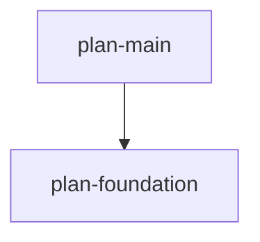

# Sisyphus v3.0 API Documentation

## Table of Contents

1. [Overview](#overview)
2. [Module Structure](#module-structure)
3. [Core Modules](#core-modules)
4. [CLI Commands](#cli-commands)
5. [Pydantic Models](#pydantic-models)
6. [Examples](#examples)

---

## Overview

Sisyphus v3.0 is a multi-agent orchestration system with the following key features:

- **Multi-plan support**: Manage multiple YAML work plans simultaneously
- **Dependency management**: Define plan dependencies with cycle detection
- **v3.0 YAML schema**: Enhanced with `depends_on`, `description`, `children`, and `inline` references
- **Dual CLI**: `plan` commands for plan management, `task` commands for execution
- **Status tracking**: `.sisyphus/status.json` tracks current plan across worktrees
- **Graph visualization**: ASCII, Mermaid, and PNG renderers

---

## Module Structure

```
sisyphus/
├── core/
│   ├── plans/                    # v3.0 plan handling
│   │   ├── models.py            # Pydantic models (WorkPlan, Todo, etc.)
│   │   ├── loader.py            # Multi-plan loading, version detection
│   │   ├── exceptions.py        # Plan-specific exceptions
│   │   └── references.py        # Reference resolution (ref_id, inline)
│   ├── status/                   # Status management
│   │   └── manager.py           # StatusManager (status.json, worktree detection)
│   ├── graph/                    # Dependency graph
│   │   ├── dependencies.py      # Cycle detection, topological sort
│   │   └── renderer.py          # ASCII, Mermaid, PNG renderers
│   ├── exporters/                # Export utilities
│   │   └── markdown.py          # YAML to Markdown converter
│   ├── converters/               # Legacy converters
│   │   └── legacy.py            # v2.1 to v3.0 migration
│   ├── plan_linter.py           # YAML validation
│   ├── plan_loader.py           # Legacy v2.1 loader
│   ├── plan_navigator.py        # Task navigation (DFS)
│   └── session.py               # Session persistence
├── commands/                     # CLI command modules
│   ├── plan.py                  # plan lint, overview, init, graph, export
│   ├── task.py                  # task show, current, next, continue, verify
│   ├── reset.py                 # reset command
│   └── common.py                # Shared utilities (resolve_cwd)
├── agents/                       # Agent implementations
│   ├── claude.py                # Claude SDK agent
│   └── opencode.py              # OpenCode REST agent
└── ui/                           # User interfaces
    ├── tui/                     # Textual TUI
    └── cli/                     # Rich CLI
```

---

## Core Modules

### `sisyphus.core.plans.models`

**v3.0 Pydantic Models**

```python
from sisyphus_core.core.plans.models import (
    PlanDocument,
    WorkPlan,
    Todo,
    TodoStatus,
    ReferenceItem,
    VerificationItem,
    Metadata
)
```

#### `PlanDocument`
Root model for v3.0 YAML files.

**Fields:**
- `version: str` - Schema version (e.g., "3.0")
- `metadata: Metadata` - Creation and update timestamps
- `work_plans: list[WorkPlan]` - List of work plans

#### `WorkPlan`
Represents a single work plan with dependencies.

**Fields:**
- `id: str` - Unique plan identifier (e.g., "plan-main")
- `name: str` - Human-readable name
- `depends_on: list[str]` - List of plan IDs this plan depends on (default: `[]`)
- `todos: list[Todo]` - Task list
- `references: list[ReferenceItem]` - Reference definitions (default: `[]`)

#### `Todo`
Represents a task or subtask.

**Fields:**
- `id: str` - Unique task ID
- `title: str` - Task title
- `description: str | None` - Optional description (v3.0 addition)
- `status: TodoStatus` - One of: `pending`, `in_progress`, `completed`, `blocked`
- `children: list[Todo] | None` - Nested subtasks (1 level only)
- `references: list[ReferenceItem]` - Task-specific references (default: `[]`)
- `verification_spec: list[VerificationItem]` - Verification items (default: `[]`)

#### `ReferenceItem`
Reference to external resources or inline text.

**Fields:**
- `ref_id: str | None` - Reference ID for reuse (optional)
- `uri: str | None` - External URI (mutually exclusive with `inline`)
- `inline: str | None` - Inline text content (mutually exclusive with `uri`)

**Validation:**
- `uri` and `inline` cannot both be set
- At least one of `ref_id`, `uri`, or `inline` must be set

**Example:**
```python
# URI reference
ReferenceItem(ref_id="ref1", uri="https://docs.example.com")

# Inline reference
ReferenceItem(inline="Use Python 3.12+ with anyio for async support")
```

---

### `sisyphus.core.plans.loader`

**Multi-Plan Loading and Version Detection**

```python
from sisyphus_core.core.plans.loader import load_plan, load_multiple_plans
```

#### `async load_plan(path: Path) -> PlanDocument`
Load and validate a single v3.0 plan file.

**Args:**
- `path: Path` - Absolute path to YAML file

**Returns:**
- `PlanDocument` - Validated plan document

**Raises:**
- `UnsupportedPlanVersionError` - If file is v2.1 or has invalid version
- `ValidationError` - If YAML structure is invalid
- `FileNotFoundError` - If file doesn't exist

**Example:**
```python
from pathlib import Path
from sisyphus_core.core.plans.loader import load_plan

plan_doc = await load_plan(Path(".sisyphus/tasks/main.yaml"))
print(f"Loaded {len(plan_doc.work_plans)} plan(s)")
```

#### `async load_multiple_plans(root: Path) -> dict[str, WorkPlan]`
Discover and load all plans in `.sisyphus/tasks/`.

**Args:**
- `root: Path` - Project root directory

**Returns:**
- `dict[str, WorkPlan]` - Map of plan_id → WorkPlan

---

### `sisyphus.core.status.manager`

**Status File and Worktree Management**

```python
from sisyphus_core.core.status.manager import StatusManager, StatusFile, CurrentPlan
```

#### `StatusManager`
Manages `.sisyphus/status.json` with atomic writes and worktree caching.

**Constructor:**
```python
manager = StatusManager(status_path=Path(".sisyphus/status.json"))
```

**Methods:**

##### `async get() -> StatusFile`
Read current status file.

**Returns:**
- `StatusFile` with current plan info (or `current_plan=None` if file doesn't exist)

##### `async set_current(plan_path: str, plan_root: str) -> None`
Atomically update current plan.

**Args:**
- `plan_path: str` - Relative or absolute path to plan YAML
- `plan_root: str` - Root directory for plan discovery

**Features:**
- Atomic write via temp file + rename
- Automatic backup (`.bak` file)
- Thread-safe with anyio.Lock

##### `@classmethod async detect_worktree() -> Path` (if implemented)
Detect current git worktree with 60s cache.

**Returns:**
- `Path` - Current worktree root

**Cache:**
- TTL: 60 seconds
- Uses `git worktree list --porcelain`

**Example:**
```python
from pathlib import Path
from sisyphus_core.core.status.manager import StatusManager

manager = StatusManager(Path(".sisyphus/status.json"))

# Read status
status = await manager.get()
if status.current_plan:
    print(f"Current plan: {status.current_plan.plan_path}")

# Set current plan
await manager.set_current(
    plan_path=".sisyphus/tasks/main.yaml",
    plan_root=".sisyphus/tasks"
)
```

---

### `sisyphus.core.graph.dependencies`

**Dependency Graph Operations**

```python
from sisyphus_core.core.graph.dependencies import (
    build_plan_graph,
    detect_cycles,
    topo_sort,
    discover_plan_files
)
```

#### `build_plan_graph(plans: dict[str, WorkPlan]) -> dict[str, list[str]]`
Build adjacency list from plans.

**Args:**
- `plans: dict[str, WorkPlan]` - Map of plan_id → WorkPlan

**Returns:**
- `dict[str, list[str]]` - Adjacency list (plan_id → list of dependencies)

#### `detect_cycles(graph: dict[str, list[str]]) -> list[list[str]]`
Detect circular dependencies using DFS.

**Args:**
- `graph: dict[str, list[str]]` - Adjacency list

**Returns:**
- `list[list[str]]` - List of cycles (empty if acyclic)

**Example:**
```python
# Circular dependency: plan-a → plan-b → plan-a
cycles = detect_cycles({"plan-a": ["plan-b"], "plan-b": ["plan-a"]})
# Returns: [["plan-a", "plan-b", "plan-a"]]
```

#### `topo_sort(graph: dict[str, list[str]]) -> list[str]`
Topological sort using Kahn's algorithm.

**Args:**
- `graph: dict[str, list[str]]` - Adjacency list where `graph[A] = [B]` means A depends on B

**Returns:**
- `list[str]` - Plan IDs in execution order (dependencies first)

**Raises:**
- `ValueError` - If graph has cycles

**Example:**
```python
# plan-main depends on plan-foundation
graph = {"plan-main": ["plan-foundation"], "plan-foundation": []}
order = topo_sort(graph)
# Returns: ["plan-foundation", "plan-main"]
```

#### `discover_plan_files(root: Path) -> list[Path]`
Find all YAML files in `.sisyphus/tasks/`.

**Args:**
- `root: Path` - Project root directory

**Returns:**
- `list[Path]` - Absolute paths to `.yaml` and `.yml` files

---

### `sisyphus.core.graph.renderer`

**Graph Visualization**

```python
from sisyphus_core.core.graph.renderer import AsciiRenderer, MermaidRenderer, PngRenderer
```

#### `AsciiRenderer`
Renders graph as ASCII tree.

```python
renderer = AsciiRenderer()
output = renderer.render(graph)
print(output)
```

**Example Output:**
```
└── plan-foundation
    └── plan-main
        └── plan-feature-x
```

#### `MermaidRenderer`
Renders graph as Mermaid diagram.

```python
renderer = MermaidRenderer()
mermaid_code = renderer.render(graph)
print(mermaid_code)
```

**Example Output:**


#### `PngRenderer`
Renders graph as PNG image (requires `graphviz` library).

```python
renderer = PngRenderer()
png_bytes = renderer.render(graph)
Path("graph.png").write_bytes(png_bytes)
```

---

### `sisyphus.core.exporters.markdown`

**YAML to Markdown Conversion**

```python
from sisyphus_core.core.exporters.markdown import MarkdownExporter
```

#### `MarkdownExporter.export(plan_document: PlanDocument) -> str`
Convert v3.0 YAML to ai-todolist.md format.

**Args:**
- `plan_document: PlanDocument` - Validated v3.0 plan

**Returns:**
- `str` - Markdown formatted as ai-todolist.md

**Features:**
- Converts `Todo.status` to checkbox (`[x]` or `[ ]`)
- Preserves nested `children` with indentation
- Includes reference links at bottom

**Example:**
```python
from sisyphus_core.core.plans.loader import load_plan
from sisyphus_core.core.exporters.markdown import MarkdownExporter

plan_doc = await load_plan(Path("plan.yaml"))
markdown = MarkdownExporter.export(plan_doc)
Path("ai-todolist.md").write_text(markdown)
```

---

## CLI Commands

### `sisyphus plan`

Plan management commands.

#### `sisyphus plan lint [--file FILE] [--cwd DIR]`
Validate YAML file.

**Options:**
- `--file, -f`: YAML file path (default: `./ai-todolist.yaml`)
- `--cwd`: Working directory

**Example:**
```bash
sisyphus plan lint --file .sisyphus/tasks/main.yaml
```

#### `sisyphus plan overview [--rich] [--cwd DIR]`
Show work plan summary.

**Options:**
- `--rich`: Use Rich table format
- `--cwd`: Working directory

#### `sisyphus plan init [--path FILE] [--cwd DIR]`
Initialize new plan YAML template.

**Options:**
- `--path, -p`: Destination path (default: `./ai-todolist.yaml`)
- `--cwd`: Working directory

**Example:**
```bash
sisyphus plan init --path .sisyphus/tasks/foundation.yaml
```

#### `sisyphus plan graph [--format FORMAT] [--cwd DIR]`
Display plan dependency graph.

**Options:**
- `--format, -f`: Output format (`ascii` or `mermaid`, default: `ascii`)
- `--cwd`: Working directory

**Example:**
```bash
sisyphus plan graph --format mermaid
```

#### `sisyphus plan export YAML_PATH [--output FILE] [--cwd DIR]`
Export WorkPlan YAML to Markdown.

**Arguments:**
- `YAML_PATH`: Path to v3.0 YAML file

**Options:**
- `--output, -o`: Output Markdown file (default: stdout)
- `--cwd`: Working directory

**Example:**
```bash
sisyphus plan export .sisyphus/tasks/main.yaml --output ai-todolist.md
```

---

### `sisyphus task`

Task execution commands.

#### `sisyphus task show TASK_ID [--rich] [--cwd DIR]`
Display specific task details.

**Arguments:**
- `TASK_ID`: Task ID to display

**Options:**
- `--rich`: Use Rich table format
- `--cwd`: Working directory

#### `sisyphus task current [--rich] [--cwd DIR]`
Show current in-progress task.

**Options:**
- `--rich`: Use Rich table format
- `--cwd`: Working directory

#### `sisyphus task next [--rich] [--cwd DIR]`
Show next pending task.

**Options:**
- `--rich`: Use Rich table format
- `--cwd`: Working directory

#### `sisyphus task continue [--cwd DIR]`
Resume work on current task (integrates with ExecutionLoop).

**Options:**
- `--cwd`: Working directory

**Note:** This command will integrate with ExecutionLoop to resume agent execution.

---

### `sisyphus task verify`

Verification commands (sequential processing).

#### `sisyphus task verify bash [--evidence TEXT] [--cwd DIR]`
Execute next bash verification.

**Options:**
- `--evidence`: Additional verification evidence
- `--cwd`: Working directory

**Features:**
- Runs bash commands from `verification_spec`
- Checks expected exit codes
- Auto-marks verified on success
- Sequential (processes one item at a time)

**Example:**
```bash
sisyphus task verify bash --evidence "All tests passed"
```

#### `sisyphus task verify llm [--cwd DIR]`
Display next LLM verification instructions.

**Options:**
- `--cwd`: Working directory

**Workflow:**
1. Run `task verify llm` to see instructions
2. Perform manual LLM review
3. Run `task verify llm-mark` to mark complete

#### `sisyphus task verify llm-mark VERIFY_ID --evidence TEXT [--cwd DIR]`
Mark LLM verification as complete.

**Arguments:**
- `VERIFY_ID`: Verification item ID

**Options:**
- `--evidence`: Verification evidence (required)
- `--cwd`: Working directory

**Example:**
```bash
sisyphus task verify llm-mark verify-001 --evidence "Claude reviewed and approved"
```

#### `sisyphus task verify manual [--cwd DIR]`
Display next manual verification instructions.

**Options:**
- `--cwd`: Working directory

#### `sisyphus task verify manual-mark VERIFY_ID --evidence TEXT [--cwd DIR]`
Mark manual verification as complete.

**Arguments:**
- `VERIFY_ID`: Verification item ID

**Options:**
- `--evidence`: Verification evidence (required)
- `--cwd`: Working directory

#### `sisyphus task verify status [--cwd DIR]`
Show verification progress.

**Options:**
- `--cwd`: Working directory

**Output:**
```
검증 상태: 3/8 완료

✓ [verify-001] Phase 1 완료
✓ [verify-002] Phase 2 완료
✓ [verify-003] Phase 3 완료
○ [verify-004] Phase 4 완료
○ [verify-005] Phase 5 완료
...
```

---

### `sisyphus reset`

Reset Sisyphus state.

#### `sisyphus reset [--include-task-specs] [--dry-run] [--yes] [--cwd DIR]`
Delete Sisyphus-generated files.

**Options:**
- `--include-task-specs`: Also delete `.sisyphus/tasks/` and `status.json`
- `--dry-run`: Show what would be deleted without deleting
- `--yes, -y`: Skip confirmation prompt
- `--cwd`: Working directory

**Default targets:**
- `notepad.md`
- `sessions/`
- `logs/`

**With `--include-task-specs`:**
- `.sisyphus/tasks/`
- `.sisyphus/status.json`

**Example:**
```bash
# Dry run
sisyphus reset --dry-run

# Reset all including task specs
sisyphus reset --include-task-specs --yes
```

---

## Pydantic Models

### v3.0 Schema Example

```yaml
version: "3.0"
metadata:
  created_at: "2025-11-01T12:00:00Z"
  updated_at: "2025-11-01T15:30:00Z"
work_plans:
  - id: plan-foundation
    name: "Foundation Plan"
    depends_on: []
    todos:
      - id: "1"
        title: "Setup project structure"
        description: "Create base directories and configuration"
        status: completed
        children:
          - id: "1.1"
            title: "Create .sisyphus/tasks/"
            status: completed
          - id: "1.2"
            title: "Initialize status.json"
            status: completed
        references:
          - ref_id: "ref-structure"
        verification_spec:
          - type: bash
            description: "Directory structure exists"
            command: "ls .sisyphus/tasks"
            expected_output: ""
    references:
      - id: "ref-structure"
        uri: "https://docs.example.com/structure"

  - id: plan-main
    name: "Main Work Plan"
    depends_on: [plan-foundation]
    todos:
      - id: "2"
        title: "Implement feature X"
        description: "Core feature implementation"
        status: in_progress
        references:
          - inline: "Use anyio for async operations"
```

### Key Model Differences (v2.1 → v3.0)

| Feature | v2.1 | v3.0 |
|---------|------|------|
| Plan dependencies | ❌ | ✅ `depends_on: list[str]` |
| Todo description | ❌ | ✅ `description: str \| None` |
| Nested children | ❌ | ✅ `children: list[Todo]` (1 level) |
| Inline references | ❌ | ✅ `inline: str` in ReferenceItem |
| Multi-plan support | ❌ | ✅ Multiple WorkPlans in one file |

---

## Examples

### Example 1: Load and Validate Plan

```python
import anyio
from pathlib import Path
from sisyphus_core.core.plans.loader import load_plan
from sisyphus_core.core.graph.dependencies import build_plan_graph, detect_cycles

async def main():
    # Load plan
    plan_doc = await load_plan(Path(".sisyphus/tasks/main.yaml"))

    # Build dependency graph
    plans = {plan.id: plan for plan in plan_doc.work_plans}
    graph = build_plan_graph(plans)

    # Check for cycles
    cycles = detect_cycles(graph)
    if cycles:
        print(f"Circular dependencies detected: {cycles}")
    else:
        print("No circular dependencies")

anyio.run(main)
```

### Example 2: Visualize Dependencies

```python
import anyio
from pathlib import Path
from sisyphus_core.core.plans.loader import load_multiple_plans
from sisyphus_core.core.graph.dependencies import build_plan_graph
from sisyphus_core.core.graph.renderer import AsciiRenderer

async def main():
    # Load all plans
    plans = await load_multiple_plans(Path.cwd())

    # Build and render graph
    graph = build_plan_graph(plans)
    renderer = AsciiRenderer()
    print(renderer.render(graph))

anyio.run(main)
```

### Example 3: Status Management

```python
import anyio
from pathlib import Path
from sisyphus_core.core.status.manager import StatusManager

async def main():
    manager = StatusManager(Path(".sisyphus/status.json"))

    # Set current plan
    await manager.set_current(
        plan_path=".sisyphus/tasks/main.yaml",
        plan_root=".sisyphus/tasks"
    )

    # Read status
    status = await manager.get()
    if status.current_plan:
        print(f"Current: {status.current_plan.plan_path}")
        print(f"Updated: {status.current_plan.updated_at}")

anyio.run(main)
```

### Example 4: Export to Markdown

```python
import anyio
from pathlib import Path
from sisyphus_core.core.plans.loader import load_plan
from sisyphus_core.core.exporters.markdown import MarkdownExporter

async def main():
    plan_doc = await load_plan(Path(".sisyphus/tasks/main.yaml"))
    markdown = MarkdownExporter.export(plan_doc)

    output_path = Path("ai-todolist.md")
    output_path.write_text(markdown, encoding="utf-8")
    print(f"Exported to {output_path}")

anyio.run(main)
```

---

## Additional Resources

- **Migration Guide**: See `docs/migration-v2-to-v3.md` for v2.1 → v3.0 migration
- **Schema Reference**: See `docs/plan-schema.md` for detailed YAML schema
- **Project README**: See `README.md` for quick start guide

---

**Last Updated**: 2025-11-02
**Version**: v3.0
